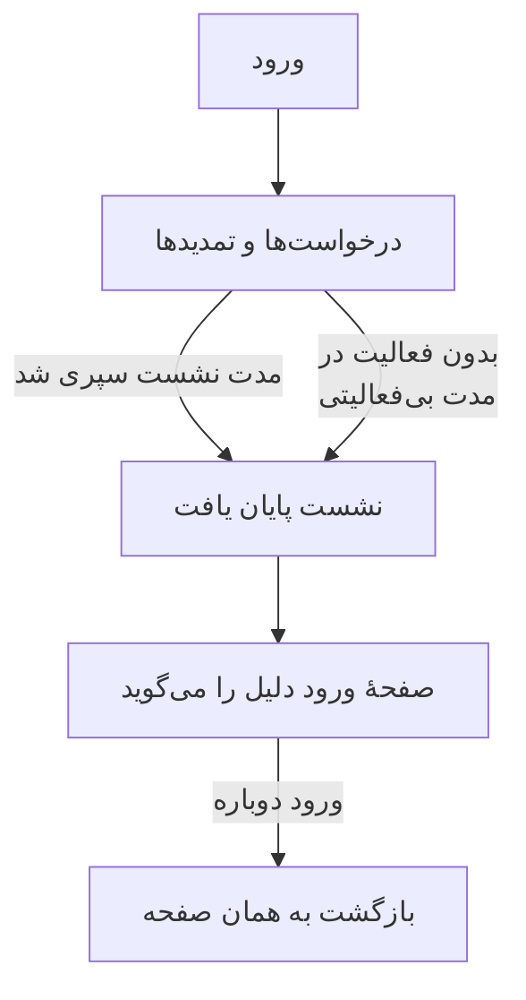

# مدت نشست

تعیین کنید افراد چه مدت در OneUptime وارد شده باقی بمانند تا دوباره وارد شوند: مدتی ثابت پس از ورود، مدتی بدون استفاده، یا هر دو. این برای هر ورود به داشبورد، Admin Dashboard و برنامهٔ موبایل اعمال می‌شود، چه با رمز عبور، چه با کلید عبور، ورود با Google، ورود با Microsoft یا ورود یکپارچه. ورودهای SSO می‌توانند مدت جداگانهٔ خودشان را داشته باشند.

> [!NOTE]
> مدت نشست بخشی از [OneUptime Enterprise Edition](/docs/self-hosted/enterprise) است. Community Edition صفحهٔ **مدت نشست** را ندارد و هر ورود همان‌طور ادامه می‌یابد که [بدون محدودیت](#بدون-محدودیت) توضیح می‌دهد.

:::cards
- [تعیین مدت نشست](#تعیین-مدت-نشست): دو تنظیم در Admin Dashboard.
- [نشست چگونه پایان می‌یابد](#نشست-چگونه-پایان-مییابد): سرور چه چیزی را و چه زمانی می‌شمارد.
- [ورودهای SSO](#ورودهای-sso): مدت جداگانه برای ورود یکپارچه.
- [آنچه ورود به حساب نیست](#آنچه-ورود-به-حساب-نیست): کلیدهای API، اتصال‌های MCP و خوانندگان صفحه‌های وضعیت.
:::

## بدون محدودیت

تا وقتی مدتی تعیین نکنید، ورود هیچ محدودیتی ندارد. توکن دسترسی آن 15 دقیقه معتبر است و در پس‌زمینه با یک توکن تازه‌سازی تمدید می‌شود که 30 روز معتبر است و با هر بار استفاده از نو شروع می‌شود. کسی که دست‌کم هر 30 روز یک بار OneUptime را باز کند وارد شده باقی می‌ماند؛ کسی که باز نکند دوباره وارد می‌شود.

## تعیین مدت نشست

:::steps
### باز کردن مدت نشست
در Admin Dashboard، **تنظیمات** را باز کنید و سپس **مدت نشست** را در منوی کناری باز کنید.

### انتخاب مدت‌ها
- **خارج کردن افراد پس از**: یک ورود از لحظهٔ ورود فرد چه مدت ادامه می‌یابد، هر قدر هم فعال باشد.
- **خارج کردن افراد پس از بی‌فعالیتی به مدت**: کسی چه مدت می‌تواند در OneUptime کلیک نکند، چیزی ننویسد یا صفحه را پیمایش نکند.

هر انتخاب به محض انجام ذخیره می‌شود.

### تأیید اینکه چه کسانی خارج می‌شوند
مدت کوتاه‌تر برای همهٔ کسانی که اکنون وارد شده‌اند اعمال می‌شود. وقتی افرادی را بی‌درنگ از حساب خارج کند، OneUptime ابتدا می‌گوید چند نفر، و اینکه آیا شما هم جزو آن‌ها هستید. برای ادامه، **ذخیره و خارج کردن آن‌ها** را انتخاب کنید.
:::

| تنظیم | گزینه‌ها | پیش‌فرض |
| --- | --- | --- |
| **خارج کردن افراد پس از** | از 1 ساعت تا 90 روز | **بدون محدودیت** |
| **خارج کردن افراد پس از بی‌فعالیتی به مدت** | از 15 دقیقه تا 14 روز | 30 روز، بیشترین مقدار ممکن |

از راه API، در پیکربندی سراسری سرور، `sessionLengthInMinutes` هر عدد صحیحی از دقیقه‌ها از 15 تا 525600 (یک سال) را می‌پذیرد و `sessionIdleTimeoutInMinutes` از 15 تا 43200 (30 روز) را. خالی بودن یعنی پیش‌فرض.

## نشست چگونه پایان می‌یابد

- سرور هر دو مدت را از خود نشست می‌شمارد: زمانی که وارد شد، و زمانی که فردِ آن آخرین بار فعال بود. آن‌ها را در هر درخواست، هر تمدید و هر به‌روزرسانی زنده بررسی می‌کند و خارج کردن از حساب را هرگز به مرورگر نمی‌سپارد.
- مدت بی‌فعالیتی از آخرین کلیک، فشردن کلید یا پیمایش در هر زبانه‌ای از داشبورد یا Admin Dashboard شمرده می‌شود. زبانه‌ای که باز مانده باشد نشست را زنده نگه نمی‌دارد.
- برنامهٔ موبایل هر بار که استفاده شود فعال به شمار می‌آید.
- وقتی نشستی پایان می‌یابد، مرورگر به صفحهٔ ورود می‌رود که دلیل را می‌گوید. پس از ورود دوباره، فرد به همان صفحه‌ای برمی‌گردد که در آن بود.

| تغییر | چه بر سر کسانی می‌آید که اکنون وارد شده‌اند |
| --- | --- |
| مدت نشست یا مدت بی‌فعالیتی کوتاه‌تر | همهٔ کسانی که از آن گذشته‌اند بی‌درنگ خارج می‌شوند و بقیه وقتی به آن برسند |
| مدتی طولانی‌تر، یا بدون محدودیت | هیچ‌کس خارج نمی‌شود و نشست‌ها از تمدید بعدی‌شان بیشتر ادامه می‌یابند |

## ورودهای SSO

ورودهایی که از راه ورود یکپارچه انجام می‌شوند از همان دو تنظیم پیروی می‌کنند. برای دادن مدت جداگانه به آن‌ها، **تنظیمات بیشتر** را در صفحهٔ **مدت نشست** باز کنید و **مدت جداگانه برای ورودهای SSO** را روشن کنید. آنگاه دو تنظیم زیر آن برای ورود از راه ارائه‌دهندهٔ SAML یا OpenID Connect یک پروژه، یا [SSO سراسری](/docs/identity/global-sso) خود سرور اعمال می‌شوند، و دو تنظیم بالای صفحه برای همهٔ ورودهای دیگر. این دو در آغاز همان مدت‌های همهٔ ورودهای دیگر را دارند، پس روشن کردن آن تا وقتی مدت دیگری انتخاب نکنید چیزی را تغییر نمی‌دهد.

افزون بر این، پروژه‌ای که SSO را الزامی کرده نشستی را فقط تا وقتی راه می‌دهد که ورود SSO آن ادامه دارد، و این هرگز طولانی‌تر از مدتی نیست که ورودهای SSO از آن پیروی می‌کنند.

از راه API، کلید روشن و خاموش `useSeparateSsoSessionLengths` است و مدت‌های ورودهای SSO `ssoSessionLengthInMinutes` و `ssoSessionIdleTimeoutInMinutes` هستند، با همان بازه‌ها.

## آنچه ورود به حساب نیست

- **کلیدهای API** همان انقضایی را که به آن‌ها می‌دهید نگه می‌دارند.
- **اتصال‌های MCP**، یعنی دستیارهای هوش مصنوعی که با OAuth وصل شده‌اند، طول عمر خودشان را نگه می‌دارند. در پروژه‌ای که SSO را الزامی کرده، یک اتصال هرگز از ورود SSO که با آن تأیید شده بیشتر دوام نمی‌آورد.
- **صفحه‌های وضعیت خصوصی** برای خوانندگانشان مدت خودشان را دارند: [کاربران خصوصی](/docs/status-pages/index#کاربران-خصوصی) را ببینید.

## بدون پروانه

پس از دورهٔ آزمایشی یا دورهٔ مهلت، بدون پروانهٔ معتبر یا با پروانه‌ای که مدت نشست را شامل نمی‌شود، مدت‌ها را نمی‌توان تعیین یا تغییر داد. مدت‌هایی که از قبل تعیین شده‌اند همچنان افراد را از حساب خارج می‌کنند و هنوز می‌توانید آن‌ها را حذف کنید. با ایمیج Community Edition هیچ مدتی اعمال نمی‌شود: مقدارها در پایگاه داده می‌مانند و وقتی برگردید دوباره اعمال می‌شوند.

## گام‌های بعدی

:::cards
- [SSO](/docs/identity/sso): ورود افراد با ارائه‌دهندهٔ هویت شما.
- [SSO سراسری](/docs/identity/global-sso): یک ارائه‌دهندهٔ هویت برای کل سرور.
- [Enterprise Edition](/docs/self-hosted/enterprise): آنچه Enterprise Edition می‌افزاید، و پروانهٔ آن.
:::
