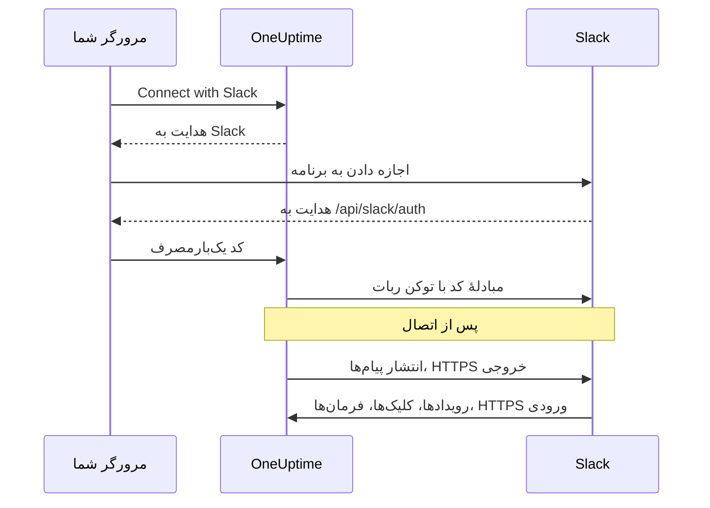
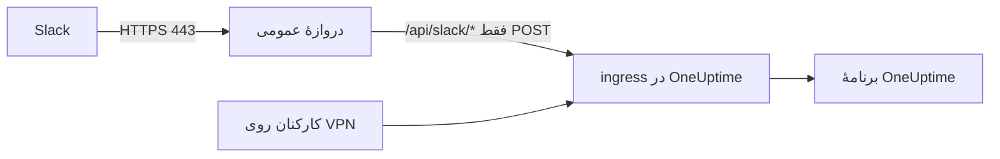

# یکپارچه‌سازی Slack

OneUptime خودمیزبان خود را به Slack وصل کنید. از مانیفستی که سرور شما می‌سازد یک برنامهٔ Slack می‌سازید، اعتبارنامه‌های برنامه را به OneUptime می‌دهید و هر پروژه را به یک فضای کاری وصل می‌کنید. پس از آن OneUptime رخدادها، هشدارها و نگهداری‌های زمان‌بندی‌شده را در کانال‌های شما منتشر می‌کند و تیم شما از همان Slack به آن‌ها رسیدگی می‌کند.

این صفحه برای کسی است که سرور OneUptime را اداره می‌کند. وقتی Slack وصل شد، قواعد اعلان برای هر پروژه جداگانه تنظیم می‌شوند: [Slack](/docs/workspace-connections/slack) را ببینید.

:::cards
- [راه‌اندازی برنامهٔ Slack](#راهاندازی-برنامهٔ-slack): برنامه را از مانیفست خود بسازید و یک پروژه را وصل کنید.
- [متغیرهای محیطی](#متغیرهای-محیطی): سه مقداری که OneUptime از برنامه نیاز دارد.
- [دسترسی شبکه](#دسترسی-شبکه-برای-استقرارهای-خودمیزبان): فراخوان‌های بازگشتی‌ای که Slack باید بتواند به آن‌ها برسد.
- [عیب‌یابی](#عیبیابی): پیام‌های صفحهٔ Slack چه معنایی دارند و چه باید کرد.
:::

## چگونه کار می‌کند

برنامهٔ Slack مال خود شماست: در فضای کاری شما نصب می‌شود و فقط با سرور شما حرف می‌زند. ترافیک در هر دو جهت جریان دارد و هر جهت به دسترسی شبکهٔ خودش نیاز دارد.



- **خروجی**: OneUptime برای انتشار پیام‌ها، ساختن کانال‌ها و بارگذاری تصویرها Web API در Slack را فرا می‌خواند.
- **ورودی**: Slack برای رویدادها، کلیک روی دکمه‌ها، منوها و فرمان‌های اسلش، چهار مسیر روی سرور شما را فرا می‌خواند. هر درخواست با signing secret برنامه امضا شده است. OneUptime درخواستی را که امضایش مطابقت ندارد یا مُهر زمانی‌اش بیش از پنج دقیقه قدیمی است رد می‌کند.

## پیش از شروع

- یک فضای کاری Slack که بتوانید در آن برنامه بسازید و نصب کنید.
- یک نام میزبان HTTPS عمومی برای OneUptime که Slack بتواند به آن برسد. [دسترسی شبکه](#دسترسی-شبکه-برای-استقرارهای-خودمیزبان) را ببینید.
- دسترسی به پیکربندی سرور: `config.env` برای Docker Compose، یا مقادیر Helm برای Kubernetes.
- برای وصل کردن یک پروژه، نقش **Project Owner**، **Project Admin** یا **Project Member** در آن پروژه.

## راه‌اندازی برنامهٔ Slack

:::steps
### نشانی عمومی را تنظیم کنید

OneUptime مانیفست برنامه و هر نشانی فراخوان بازگشتی را از `HOST` و `HTTP_PROTOCOL` می‌سازد. آن‌ها را روی نام میزبانی بگذارید که Slack از راه HTTPS فرا خواهد خواند:

:::tabs
@tab Docker Compose
```bash title="config.env"
HOST=oneuptime.example.com
HTTP_PROTOCOL=https
```
@tab Kubernetes
```yaml title="values.yaml"
host: oneuptime.example.com
httpProtocol: https
```
:::

این مقادیر فقط نشانی‌ها را می‌سازند. رکورد DNS، گواهی یا قاعدهٔ فایروال نمی‌سازند.

### مانیفست برنامه را کپی کنید

**تنظیمات پروژه** > **فضای کاری** > **Slack** را باز کنید. تا وقتی Slack روی سرور راه‌اندازی نشده است، این صفحه **Integrating Slack with your OneUptime Project** را همراه مانیفستی که برای نام میزبان شما ساخته شده نشان می‌دهد. مانیفست در `https://oneuptime.example.com/api/slack/app-manifest` هم در دسترس است.

بررسی کنید که هر نشانی در مانیفست با نام میزبان عمومی شما شروع شود. اگر نه، ابتدا `HOST` و `HTTP_PROTOCOL` را اصلاح کنید و تغییر را اعمال کنید.

### برنامهٔ Slack را بسازید

در [api.slack.com/apps](https://api.slack.com/apps) یک برنامهٔ تازه از مانیفست بسازید، فضای کاری خود را برگزینید و مانیفست را بچسبانید. همیشه از مانیفستی استفاده کنید که سرور خود شما می‌سازد تا نشانی‌هایش با نام میزبان شما بخواند.

### اعتبارنامه‌های برنامه را کپی کنید

در صفحهٔ **Basic Information** برنامه، زیر **App Credentials**، مقدارهای **Client ID**، **Client Secret** و **Signing Secret** را کپی کنید.

### اعتبارنامه‌ها را به OneUptime بدهید

:::tabs
@tab Docker Compose
```bash title="config.env"
SLACK_APP_CLIENT_ID=YOUR_SLACK_APP_CLIENT_ID
SLACK_APP_CLIENT_SECRET=YOUR_SLACK_APP_CLIENT_SECRET
SLACK_APP_SIGNING_SECRET=YOUR_SLACK_APP_SIGNING_SECRET
```
@tab Kubernetes
```yaml title="values.yaml"
slackApp:
  clientId: "YOUR_SLACK_APP_CLIENT_ID"
  clientSecret: "YOUR_SLACK_APP_CLIENT_SECRET"
  signingSecret: "YOUR_SLACK_APP_SIGNING_SECRET"
```

برای نگه داشتن مقادیر در یک Secret در Kubernetes که خودتان مدیریت می‌کنید، به‌جای آن `slackApp.existingSecret` را تنظیم کنید: `name` آن، و کلیدهای `clientIdKey`، `clientSecretKey` و `signingSecretKey`.
:::

### پیکربندی را اعمال کنید

:::tabs
@tab Docker Compose
```bash
npm run start
```

این کار کانتینرها را با `config.env` تازه از نو می‌سازد. `docker compose restart` آن را دوباره نمی‌خواند.
@tab Kubernetes
```bash
helm upgrade my-oneuptime oneuptime/oneuptime -f values.yaml
```
:::

وقتی OneUptime دوباره بالا آمد، **تنظیمات پروژه** > **فضای کاری** > **Slack** به‌جای مانیفست دکمهٔ **Connect with Slack** را نشان می‌دهد.

### نشانی درخواست رویدادها را تأیید کنید

در **Event Subscriptions** برنامهٔ Slack، نشانی درخواست را تأیید کنید. OneUptime فقط پس از تنظیم signing secret به challenge در Slack پاسخ می‌دهد، پس اگر هنگام ساختن برنامه ناموفق بود، دوباره تلاش کنید.

### پروژه را وصل کنید

در **تنظیمات پروژه** > **فضای کاری** > **Slack** گزینهٔ **Connect with Slack** را برگزینید و در Slack به برنامه اجازه دهید. Slack شما را به همان صفحه برمی‌گرداند که اکنون نام فضای کاری شما را نشان می‌دهد.

### حساب Slack خودتان را وصل کنید

دکمه‌ها، فرم‌ها و فرمان‌ها به‌عنوان کاربری از OneUptime عمل می‌کنند که به حساب Slack به‌کاربرندهٔ آن‌ها پیوند خورده است. هر کس **تنظیمات کاربر** > **فضای کاری** > **Slack** را باز می‌کند و **Connect my account with Slack** را برمی‌گزیند. کسی که حسابی وصل نکرده است، از برنامه یک پیام مستقیم می‌گیرد که از او می‌خواهد این کار را بکند.
:::

## متغیرهای محیطی

| Docker Compose (`config.env`) | Helm (`values.yaml`) | الزامی | مقدار |
| --- | --- | --- | --- |
| `SLACK_APP_CLIENT_ID` | `slackApp.clientId` | بله | **Client ID** برنامه. بدون آن، صفحهٔ Slack به‌جای **Connect with Slack** راهنمای راه‌اندازی را نشان می‌دهد. |
| `SLACK_APP_CLIENT_SECRET` | `slackApp.clientSecret` | بله | **Client Secret** برنامه، که با آن کدی که Slack برمی‌گرداند با توکن مبادله می‌شود. |
| `SLACK_APP_SIGNING_SECRET` | `slackApp.signingSecret` | بله | **Signing Secret** برنامه. هر درخواست از Slack با آن بررسی می‌شود. |
| `HOST` | `host` | بله | نام میزبان عمومی شما، بدون طرح نشانی. |
| `HTTP_PROTOCOL` | `httpProtocol` | بله | `https`. Slack فقط نشانی‌های HTTPS را فرا می‌خواند. |

## برنامه چه کارهایی می‌کند

مانیفست این قابلیت‌ها را راه‌اندازی می‌کند. هر کدام از راه مسیر نشان‌داده‌شده به سرور شما می‌رسد، پس فقط وقتی کار می‌کند که Slack بتواند به آن مسیر برسد.

| قابلیت | چه می‌کند | مسیر |
| --- | --- | --- |
| `/incident` و میان‌بُر **Create New Incident** | اعلام یک رخداد از Slack | `POST /api/slack/interactive` |
| `/maintenance` و میان‌بُر **Create Scheduled Event** | زمان‌بندی نگهداری از Slack | `POST /api/slack/interactive` |
| `/oneuptime` | پرسیدن از OneUptime AI دربارهٔ لاگ‌ها، تریس‌ها، متریک‌ها، رخدادها و مانیتورهای شما | `POST /api/slack/command` |
| دکمه‌ها و فرم‌های پیام‌های OneUptime | تأیید، حل کردن، افزودن یادداشت، تغییر وضعیت، اجرای یک سیاست آنکال | `POST /api/slack/interactive` و `POST /api/slack/options-load` |
| رویدادها | اشاره‌ها، پیام‌ها، واکنش‌ها و سنجاق‌ها، برای نمونه ذخیرهٔ یک پیام به‌عنوان یادداشت | `POST /api/slack/events` |

### تصویرها در پیام‌ها

شرح رخدادها و هشدارها می‌تواند تصویر صفحه داشته باشد، برای نمونه تصویر یک مانیتور مصنوعی ([نمایش نماگرفت](/docs/monitor/incident-alert-templating#نمایش-نماگرفت) را ببینید). OneUptime هر کدام را به‌صورت یک فایل خصوصی در فضای کاری شما بارگذاری می‌کند تا در پیام‌های Slack نشان دهد، و برای این کار به scope ربات `files:write` نیاز دارد. مانیفست ساخته‌شده آن را دارد.

اگر برنامهٔ Slack خود را از یک مانیفست قدیمی‌تر ساخته‌اید، `files:write` را زیر **OAuth & Permissions > Bot Token Scopes** بیفزایید (یا برنامه را از مانیفست کنونی به‌روز کنید). سپس در **تنظیمات پروژه** > **فضای کاری** > **Slack** دوباره **Connect with Slack** را برگزینید تا scope تازه داده شود. تا آن زمان، هر تصویر صفحه به‌صورت متن جایگزینش نمایش داده می‌شود.

## دسترسی شبکه برای استقرارهای خودمیزبان

### جهت ترافیک و نقطه‌های پایانی

| ترافیک | دسترسی لازم |
| --- | --- |
| از OneUptime به Slack | DNS و HTTPS خروجی روی TCP ۴۴۳ به `slack.com` برای فراخوانی‌های Web API و مبادلهٔ توکن OAuth؛ و در صورت استفاده، `hooks.slack.com` برای نشانی‌های پاسخ فرمان‌ها و اعلان‌های وب‌هوک ورودی |
| از Slack به OneUptime | HTTPS عمومی روی TCP ۴۴۳ به چهار مسیر POST زیر، برای یکپارچه‌سازی کامل |
| از مرورگر کاربر به OneUptime | دسترسی به داشبورد و هدایت‌های OAuth به `/api/slack/auth/:projectId/:userId` و `/api/slack/auth/:projectId/:userId/user`؛ این‌ها می‌توانند فقط از راه VPN کاربر در دسترس بمانند |

دامنه‌های خروجی، یکپارچه‌سازی Slack در OneUptime را شرح می‌دهند، نه یک فهرست مجاز کامل برای کلاینت‌های Slack یا همهٔ قابلیت‌های Slack. یک *وب‌هوک ورودی* Slack را خود Slack میزبانی می‌کند: OneUptime به آن می‌فرستد، پس نقطهٔ پایانی ورودی‌ای روی سرور شما نیست. [راهنمای وب‌هوک ورودی](https://docs.slack.dev/messaging/sending-messages-using-incoming-webhooks/) در Slack را ببینید.

این فراخوان‌های بازگشتی را از راه ingress به OneUptime برسانید:

| روش و مسیر | هدف |
| --- | --- |
| `POST /api/slack/events` | تأیید Events API، واکنش‌ها، سنجاق‌ها، اشاره‌ها و پیام‌ها |
| `POST /api/slack/interactive` | دکمه‌ها، میان‌بُرها، ارسال پنجره‌های مُدال، `/incident` و `/maintenance` |
| `POST /api/slack/options-load` | درخواست گزینه‌های منوهای تعاملی |
| `POST /api/slack/command` | فرمان `/oneuptime` |

OAuth یک [هدایت در مرورگر است که پس از آن مبادلهٔ توکن در سمت سرور انجام می‌شود](https://docs.slack.dev/authentication/installing-with-oauth/). مانیفست `/api/slack/auth` را به‌عنوان پیشوند نشانی هدایت ثبت می‌کند و OneUptime هنگام شروع مجوزدهی، مسیرهای پروژه و کاربر را به آن می‌افزاید. دسترسی از مرورگر به‌تنهایی به Slack اجازه نمی‌دهد رویدادها یا کلیک روی دکمه‌ها را تحویل دهد.

### استقرارهای خصوصی و امنیت فراخوان‌های بازگشتی



از DNS عمومی و دروازه‌ای استفاده کنید که یک گواهی HTTPS مورد اعتماد عموم، زنجیرهٔ کامل گواهی و یک مسیر خصوصی تا ingress در OneUptime داشته باشد. TCP ۴۴۳ ورودی به دروازه را مجاز کنید و فقط چهار مسیر فراخوان بازگشتی بالا را هدایت کنید. یک `ClusterIP` خصوصی، یک نام DNS داخلی یا اتصال VPN یکی از کارکنان برای Slack در دسترس نیست. DNS دوپاره می‌تواند داشبورد و مسیرهای OAuth را زیر همان نام میزبان خصوصی نگه دارد.

پس از تغییر نام میزبان، مانیفست را دوباره بسازید و برنامهٔ Slack را به‌روز کنید.

در گذر از دروازه این‌ها را نگه دارید:

- روش، مسیر، رشتهٔ پرس‌وجو و بدنهٔ اصلی؛
- `Content-Type`، `X-Slack-Signature` و `X-Slack-Request-Timestamp`؛
- میزبان عمومی و طرح HTTPS، از راه سرآیندهای مورد اعتماد پراکسی.

مسیرهای فراخوان بازگشتی را از SSO مرورگر، CAPTCHA و صفحه‌های ورود پراکسی معاف کنید و بررسی‌های signing secret و مُهر زمانی در OneUptime را نگه دارید. ساعت سرور را همگام نگه دارید: درخواستی که بیش از پنج دقیقه اختلاف داشته باشد رد می‌شود. Slack [تأیید امضای درخواست‌ها](https://docs.slack.dev/authentication/verifying-requests-from-slack/) را مستند کرده است؛ بررسی IP مبدأ جای آن را نمی‌گیرد.

### تأیید دسترسی و شناخت محدودیت‌ها

:::steps
1. در **Event Subscriptions** برنامهٔ Slack، نشانی درخواست را تأیید کنید. Slack یک [challenge از نوع POST می‌فرستد و TLS را بررسی می‌کند](https://docs.slack.dev/apis/events-api/using-http-request-urls/).
2. یک اعلان آزمایشی بفرستید، یک فرمان اسلش اجرا کنید، روی دکمهٔ یک پیام رخداد بزنید و یک رویداد مشترک‌شده را راه بیندازید.
3. لاگ‌های دروازه و OneUptime را برای تحویل‌های ناموفق بررسی کنید، بی‌آنکه رازها را در لاگ بنویسید.
:::

Slack انتظار تأیید سریع دارد، از جمله [پاسخ ظرف سه ثانیه برای تعامل‌ها](https://docs.slack.dev/interactivity/handling-user-interaction/). یک GET از مرورگر یا یک پیام خروجی موفق، این فراخوان‌های بازگشتی POST را تأیید نمی‌کند.

> [!WARNING]
> اگر هر اتصال ورودی ممنوع باشد، برنامه‌ای که از پیش مجوز گرفته همچنان می‌تواند با HTTPS خروجی پیام بفرستد، اما رویدادها، دکمه‌ها، میان‌بُرها و فرمان‌ها کار نمی‌کنند. مانیفست OneUptime از فراخوان‌های بازگشتی HTTP استفاده می‌کند و Socket Mode را خاموش می‌کند؛ روشن کردن Socket Mode در Slack جایگزین پشتیبانی‌شده‌ای برای این مسیرها نیست.

[تنظیمات دسترسی به شبکهٔ خصوصی](/docs/self-hosted/private-network-access) درخواست‌های خروجی به مقصدهای خصوصی را کنترل می‌کنند. آن‌ها فراخوان‌های بازگشتی را برای Slack در دسترس نمی‌گذارند.

## عیب‌یابی

### اتصال کامل نشد

وقتی Slack شما را برمی‌گرداند و اتصال برقرار نشده است، صفحهٔ Slack‌ای که از آن شروع کرده بودید (**تنظیمات پروژه** > **فضای کاری** > **Slack**، یا اگر حساب خود را وصل می‌کردید، **تنظیمات کاربر** > **فضای کاری** > **Slack** خودتان) **Slack وصل نشد** را همراه یک جمله به زبان شما نشان می‌دهد که دلیلش را می‌گوید. بقیهٔ صفحه مثل همیشه بارگذاری می‌شود، پس می‌توانید همان‌جا دوباره وصل کنید. پاسخ خود Slack هرگز نشان داده نمی‌شود: آن پاسخ همراه دلیل در لاگ سرور OneUptime است.

| صفحه می‌گوید | چه باید کرد |
| --- | --- |
| **"این پیوند اتصال نامعتبر است، منقضی شده یا قبلاً استفاده شده است. لطفاً از نو شروع کنید."** | پیوند یک بار، به مدت ۱۵ دقیقه، در همان مرورگری کار می‌کند که آن را آغاز کرده است. از صفحهٔ Slack از نو شروع کنید و ظرف ۱۵ دقیقه در همان مرورگر کار را در Slack تمام کنید. |
| **"شما اجازه اتصال این پروژه به Slack را ندارید."** | نصب OneUptime در Slack به **Project Owner**، **Project Admin** یا **Project Member** نیاز دارد. وقتی Slack شما را برمی‌گرداند این دوباره بررسی می‌شود، پس نقشی که در این فاصله گرفته شده باشد، اتصال را این‌جا هم پایان می‌دهد. |
| **"شما دیگر عضو این پروژه نیستید."** | برای وصل کردن حساب Slack خودتان، باید در لحظه‌ای که Slack شما را برمی‌گرداند عضو پروژه باشید. |
| **"این پروژه هنوز به هیچ فضای کاری Slack وصل نیست."** | ابتدا OneUptime را از **تنظیمات پروژه** > **فضای کاری** > **Slack** در Slack نصب کنید، سپس حساب خودتان را وصل کنید. |
| **"شما به فضای کاری Slack دیگری غیر از فضای کاری‌ای که این پروژه به آن وصل است وارد شده‌اید."** | حساب خود را در حالی وصل کنید که در همان فضای کاری Slack که پروژه در آن نصب است وارد شده‌اید. |
| **"اتصال لغو شد، بنابراین چیزی تغییر نکرد."** | درخواست در Slack اجازه نگرفت. از نو شروع کنید و اجازه دهید. |
| **"Slack روی این سرور OneUptime راه‌اندازی نشده است."** | `SLACK_APP_CLIENT_ID` و `SLACK_APP_CLIENT_SECRET` را تنظیم کنید ([متغیرهای محیطی](#متغیرهای-محیطی) را ببینید) و OneUptime را دوباره راه‌اندازی کنید. |
| **"OneUptime نتوانست اتصال را کامل کند. لطفاً دوباره تلاش کنید."** | Slack با خطا پاسخ داد، یا هنگام کامل کردن، یک درخواست یا یک نوشتن ناموفق بود. لاگ سرور OneUptime می‌گوید کدام. دوباره تلاش کنید؛ اگر تکرار شد، لاگ و تنظیمات برنامهٔ Slack را بررسی کنید. |

### مشکلات دیگر

:::details Slack نمی‌تواند نشانی درخواست رویدادها را تأیید کند
OneUptime فقط وقتی به challenge در Slack پاسخ می‌دهد که `SLACK_APP_SIGNING_SECRET` تنظیم شده باشد و درخواست به آن برسد. signing secret را تنظیم کنید، پیکربندی را اعمال کنید و تأیید را دوباره امتحان کنید. اگر باز ناموفق بود، بررسی کنید که `POST /api/slack/events` با یک گواهی مورد اعتماد عموم از اینترنت در دسترس باشد.
:::

:::details دکمه‌ها و فرمان‌های اسلش کاری نمی‌کنند، اما اعلان‌ها می‌رسند
اعلان‌ها خروجی‌اند، پس بدون دسترسی ورودی هم کار می‌کنند. دکمه‌ها، میان‌بُرها و فرمان‌ها ورودی‌اند: بررسی کنید که Slack بتواند به `POST /api/slack/interactive` و `POST /api/slack/command` برسد، و دروازه بدنه و سرآیندهای `X-Slack-Signature` و `X-Slack-Request-Timestamp` را نگه دارد.
:::

:::details برنامه می‌گوید حساب Slack من به OneUptime وصل نیست
دکمه‌ها، فرم‌ها و فرمان‌ها نیاز دارند که حساب Slack شما به کاربر شما در OneUptime پیوند خورده باشد. **تنظیمات کاربر** > **فضای کاری** > **Slack** را باز کنید و **Connect my account with Slack** را برگزینید. اگر از پروژه حذف شده باشید، برنامه به‌جای آن همین را می‌گوید و کارهایی که از Slack انجام می‌شوند رد می‌شوند.
:::

:::details تصویرهای صفحه به‌صورت متن نمایش داده می‌شوند
برنامهٔ Slack scope `files:write` را ندارد. [تصویرها در پیام‌ها](#تصویرها-در-پیامها) را ببینید.
:::

## گام‌های بعدی

:::cards
- [Slack](/docs/workspace-connections/slack): برای پروژه قواعد اعلان و خلاصه‌ها بسازید.
- [یکپارچه‌سازی Microsoft Teams](/docs/self-hosted/microsoft-teams-integration): ربات Teams را هم روی سرور خود راه‌اندازی کنید.
- [دسترسی به شبکه خصوصی](/docs/self-hosted/private-network-access): بگذارید گردش‌کارها و وب‌هوک‌ها به ابزارهای داخلی برسند.
:::
