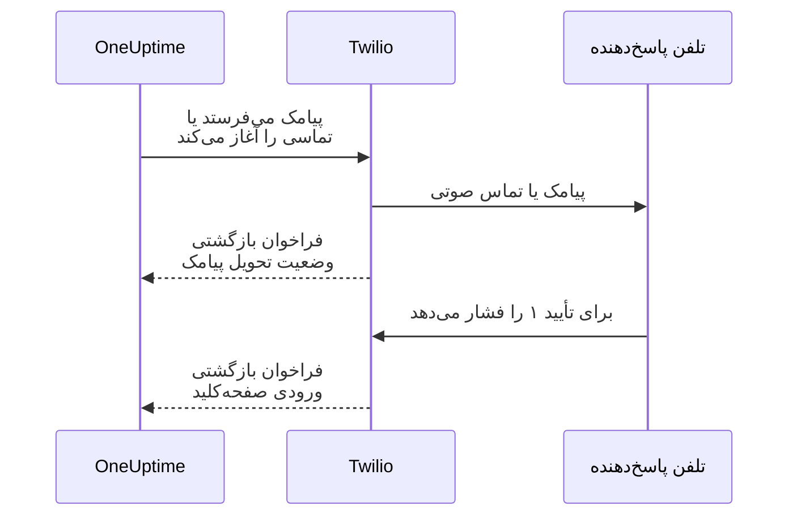

# یکپارچه‌سازی Twilio

OneUptime خودمیزبان هشدارهای پیامکی و صوتی را از راه حساب Twilio خود شما می‌فرستد، و هزینه را مستقیم به Twilio می‌پردازید. اعتبارنامه‌های Twilio را در داشبورد OneUptime ذخیره می‌کنید، نه در متغیرهای محیطی: ارسال اعلان‌ها پیکربندی ذخیره‌شده را می‌خواند، و چارت Helm هیچ مقداری برای اعتبارنامه‌های Twilio ندارد.

> [!NOTE]
> یک مهاجرت قدیمی `TWILIO_ACCOUNT_SID`، `TWILIO_AUTH_TOKEN` و `TWILIO_PHONE_NUMBER` را وارد کرد؛ تغییر این متغیرها راه به‌روزرسانی اعتبارنامه‌های یک نصب موجود نیست.

:::cards
- [حساب Twilio خود را آماده کنید](#۱-حساب-twilio-خود-را-آماده-کنید): اعتبارنامه‌ها، یک شماره تلفن و محدودیت‌های حساب.
- [اعتبارنامه‌ها را ذخیره کنید](#۲-اعتبارنامهها-را-در-oneuptime-ذخیره-کنید): برای یک پروژه، یا برای کل نصب.
- [دسترسی شبکه را پیکربندی کنید](#۳-دسترسی-شبکه-را-پیکربندی-کنید): Twilio باید به چه چیزی روی سرور شما برسد، و چه زمانی.
- [شماره‌های تلفن را تأیید کنید](#۵-شماره-تلفن-اعضای-تیم-را-تأیید-کنید): شماره‌های اعضای تیم چگونه تأیید می‌شوند.
:::

## ۱. حساب Twilio خود را آماده کنید

:::steps
### اعتبارنامه‌های خود را کپی کنید

[Twilio Console](https://console.twilio.com/) را باز کنید و **Account SID** و **Auth Token** خود را کپی کنید.

### یک شماره تلفن بگیرید

یک شماره تلفن Twilio با قابلیت‌های پیامکی و/یا صوتی که نیاز دارید بگیرید؛ Twilio Console نشان می‌دهد هر شماره چه کارهایی می‌تواند بکند. برای شماره‌های فرستنده و گیرنده از قالب E.164، همراه کد کشور، استفاده کنید. جایی که هیچ شماره‌ای هر دو کار را نمی‌کند، یک شماره برای تماس و یکی برای پیامک بگیرید: [شماره‌های جدا برای تماس و پیامک](#شمارههای-جدا-برای-تماس-و-پیامک) را ببینید.

### محدودیت‌های حساب را بررسی کنید

موجودی حساب، مجوزهای کشورهای مقصد و الزامات ثبت فرستنده‌ای را که شامل حالتان می‌شود بررسی کنید. حساب‌های آزمایشی محدودیت‌های گیرنده، جغرافیایی و دیگری دارند که می‌توانند جلوی کار کردن هشدارهای واقعی OneUptime را بگیرند؛ پیش از آزمایش، [مستندات حساب و دورهٔ آزمایشی Twilio](https://www.twilio.com/docs/usage/tutorials/how-to-use-your-free-trial-account) را بخوانید. برای محیط عملیاتی از یک حساب ارتقایافته استفاده کنید.
:::

## ۲. اعتبارنامه‌ها را در OneUptime ذخیره کنید

اعتبارنامه‌ها را برای یک پروژه ذخیره کنید، یا یک بار برای کل نصب:

| | پیکربندی پروژه | پیکربندی سراسری نصب |
| --- | --- | --- |
| کجا | کارت **پیکربندی Twilio** در **تنظیمات پروژه** > **اعلان‌ها** > **تنظیمات اعلان** | **Admin Dashboard** > **تنظیمات** > **تماس و پیامک** |
| چه کسی می‌تواند تنظیمش کند | **مالک پروژه**، **مدیر پروژه**، یا **Create Call and SMS** در یک نقش سفارشی | یک مدیر ارشد |
| چه کسی می‌تواند Auth Token آن را بخواند | **مالک پروژه**، **مدیر پروژه**، یا **Read Call and SMS** در یک نقش سفارشی. دیگرانی که پیکربندی را می‌بینند بقیهٔ آن را می‌بینند؛ توکن به‌صورت رمزگذاری‌شده ذخیره می‌شود | یک مدیر ارشد |
| برای چه به کار می‌رود | پیامک‌ها و تماس‌ها به اعضای پروژه تا وقتی پیش‌فرض پروژه است، صفحه‌های وضعیتی که به آن‌ها اختصاص یافته، و سیاست‌های تماس ورودی‌ای که از آن استفاده می‌کنند | پیامک‌ها و تماس‌ها به اعضای هر پروژه‌ای که پیکربندی پیش‌فرض ندارد |

برای افزودن یک پیکربندی پروژه:

:::steps
1. به **تنظیمات پروژه** > **اعلان‌ها** > **تنظیمات اعلان** بروید.
2. در **پیکربندی Twilio**، **ایجاد پیکربندی Twilio** را انتخاب کنید.
3. یک نام وارد کنید و در **کاربرد این حساب** انتخاب کنید که حساب چه چیزی می‌فرستد: **تماس و پیامک**، **فقط پیامک** یا **فقط تماس**. سپس **SID حساب Twilio**، **توکن احراز هویت Twilio** و شماره‌ای را که انتخابتان می‌خواهد وارد کنید: **شماره تلفن اصلی Twilio** برای تماس‌ها، یا **شماره‌های تلفن پیامک Twilio** برای **فقط پیامک**. در **فیلدهای بیشتر**، در صورت نیاز **شماره‌های تلفن دوم Twilio** را، جداشده با کاما، برای کشورهای دیگر وارد کنید، و اگر شماره‌های شما نمی‌توانند پیامک بفرستند، **شماره‌های تلفن پیامک Twilio** را وارد کنید.
4. **تنظیم به‌عنوان پیش‌فرض پروژه** برای نخستین پیکربندی پروژه روشن است، پس پیامک‌ها و تماس‌ها به اعضای پروژه، از جمله اعلان‌های آنکال، به محض ذخیره از راه آن می‌روند. اگر این حساب فقط برای صفحه‌های وضعیت یا تماس‌های ورودی است، آن را خاموش کنید. پیکربندی بعدی با کلید خاموش آغاز می‌شود: برای بردن آن پیام‌ها به آن، کلید را روشن کنید، یا **تنظیم به‌عنوان پیش‌فرض پروژه** را از منوی ردیف پیکربندی برگزینید. با درخواستی از API که `isProjectDefault` را نیاورد هم همین‌گونه رفتار می‌شود.
5. ذخیره کنید. فقط یک پیکربندی می‌تواند پیش‌فرض پروژه باشد. صفحه‌های وضعیت از پیکربندی‌ای استفاده می‌کنند که صریحاً به هر صفحهٔ وضعیت اختصاص یافته است.

> [!IMPORTANT]
> **SMS** و **تماس‌های تلفنی** در هر پروژه خاموش آغاز می‌شوند، و تا روشن نشوند هیچ‌کس در پروژه نمی‌تواند برای آن‌ها شماره تلفن اضافه کند. مالک پروژه، یک **مدیر صورت‌حساب** یا کسی با **Manage Billing** آن‌ها را در کارت **کانال‌های اعلان** در همین صفحه روشن می‌کند.
:::

برای یک پیش‌فرض سراسری نصب، یک مدیر می‌تواند به‌جای آن **Admin Dashboard** > **تنظیمات** > **تماس و پیامک** را باز کند، انتخاب کند که حساب چه چیزی می‌فرستد، اعتبارنامه‌ها و شماره تلفن‌های Twilio را ویرایش کند و ذخیره کند. اعلان‌های اعضا وقتی پروژه‌شان پیش‌فرضی ندارد از همین پیکربندی سراسری استفاده می‌کنند. Auth Token را محرمانه نگه دارید.

### شماره‌های جدا برای تماس و پیامک

یک شماره Twilio می‌تواند تماس برقرار کند و پیامک بفرستد، یا فقط یکی از این دو کار را بکند، و در برخی کشورها هیچ شماره‌ای هر دو کار را نمی‌کند: شماره‌های ملی ممکن است فقط صوتی باشند، در حالی که پیامک‌ها به شماره همراه نیاز دارند. یک پیکربندی، چه از آن یک پروژه و چه از آن کل نصب، می‌تواند در **فیلدهای بیشتر** شماره‌هایی برای پیامک فهرست کند:

| فیلد | آنچه از آن فرستاده می‌شود |
| --- | --- |
| **شماره تلفن اصلی Twilio** | تماس‌ها، و تا وقتی شماره پیامکی فهرست نشده، پیامک‌ها هم |
| **شماره‌های تلفن دوم Twilio** | تماس‌ها، و تا وقتی شماره پیامکی فهرست نشده، پیامک‌ها هم، به گیرندگان کشور هر شماره |
| **شماره‌های تلفن پیامک Twilio** | هر پیامک، پس از فهرست شدن: از شماره کشور گیرنده، و اگر نباشد، از نخستین شماره |

اگر شماره شما فقط می‌تواند تماس برقرار کند، آن را در **شماره تلفن اصلی Twilio** نگه دارید و شماره‌ای را که می‌تواند پیامک بفرستد، مانند یک شماره همراه، در **شماره‌های تلفن پیامک Twilio** وارد کنید. همین که پیکربندی‌ای شماره‌های پیامک را فهرست کند، هیچ پیامکی از شماره‌های دیگرش فرستاده نمی‌شود؛ پس هر شماره‌ای را که باید پیامک بفرستد فهرست کنید.

پیکربندی بدون شماره‌های پیامک، مانند گذشته، پیامک‌ها را از همان شماره‌هایی می‌فرستد که تماس‌ها از آن‌ها برقرار می‌شوند. **ارسال پیامک آزمایشی** و **ارسال تماس آزمایشی** از همان شماره‌ای فرستاده می‌شوند که یک پیامک یا تماس واقعی به همان گیرنده از آن فرستاده می‌شد. اگر Twilio پیامکی را با خطای 21606 رد کند، آن شماره نمی‌تواند پیامک بفرستد: شماره‌ای را که می‌تواند، به **شماره‌های تلفن پیامک Twilio** اضافه کنید.

> [!NOTE]
> اینکه کدام شماره‌ها می‌توانند پیامک بفرستند و آیا فرستنده باید پیش از آن ثبت شود، از کشوری به کشور دیگر فرق می‌کند: جایی که ثبت الزامی است، پیامکی که از شماره‌ای ثبت‌نشده فرستاده شود ممکن است مسدود شود یا هرزنامه شناخته شود. پیش از تکیه بر یک شماره، [راهنمای پیامک Twilio](https://www.twilio.com/en-us/guidelines/sms) را برای هر کشوری که به آن پیامک می‌فرستید ببینید.

### حسابی فقط برای پیامک، یا فقط برای تماس

حسابی که فقط برای پیامک، یا فقط برای تماس نگه می‌دارید، برای دیگری به شماره‌ای نیاز ندارد. آن را در **کاربرد این حساب** انتخاب کنید تا فرم فقط شماره‌هایی را بخواهد که آن انتخاب لازم دارد:

| انتخاب | شماره‌هایی که لازم دارد | آنچه هرگز نمی‌فرستد |
| --- | --- | --- |
| **تماس و پیامک** | **شماره تلفن اصلی Twilio** | هیچ |
| **فقط پیامک** | **شماره‌های تلفن پیامک Twilio** | تماس‌ها |
| **فقط تماس** | **شماره تلفن اصلی Twilio** | پیامک‌ها |

آنچه یک پیکربندی نمی‌فرستد، همان‌طور فرستاده می‌شود که بدون آن پیکربندی فرستاده می‌شد: وقتی پیش‌فرض پروژه روی **فقط پیامک** تنظیم شده است، تماس با اعضای پروژه از طریق پیکربندی سراسری نصب انجام می‌شود. اگر هیچ پیکربندی‌ای نتواند پیامی را بفرستد، گزارش آن پیام می‌گوید که پیکربندی پروژه برای آن به کار نمی‌رود، و چه کسی می‌تواند این را تغییر دهد.

صفحه‌های وضعیت فقط پیکربندی‌هایی را پیشنهاد می‌کنند که پیامک می‌فرستند، و **ارسال پیامک آزمایشی** و **ارسال تماس آزمایشی** فقط برای آنچه یک پیکربندی می‌فرستد نمایش داده می‌شوند. هر پیکربندی موجود، مثل قبل، روی **تماس و پیامک** تنظیم شده است. در API و Terraform، این انتخاب فیلد `usedFor` است، و پیکربندی‌ای که شماره‌های لازم برای انتخابش را نداشته باشد رد می‌شود.

## ۳. دسترسی شبکه را پیکربندی کنید

ارسال تنها با دسترسی خروجی کار می‌کند. به‌روزرسانی‌های تحویل، تأیید با صفحه‌کلید و تماس‌های ورودی نیاز دارند که Twilio به سرور شما برسد.

یک استقرار خصوصی برای ثبت پیامک‌ها و تماس‌ها به تفکیک نام DNS و HTTPS خروجی روی TCP ۴۴۳ به Twilio نیاز دارد. Twilio توصیه می‌کند HTTPS خروجی به `*.twilio.com` را مجاز کنید، چون نشانی‌های API آن پویا هستند؛ [نشانی‌های IP در Twilio](https://help.twilio.com/articles/115015934048-All-About-Twilio-IP-Addresses) را ببینید. این را روی ترافیک خروجی بار کاری برنامهٔ OneUptime اعمال کنید، از جمله NetworkPolicyهای Kubernetes و فایروال‌های بیرونی.

دسترسی ورودی به قابلیت بستگی دارد:

| قابلیت | آیا Twilio باید به OneUptime برسد؟ |
| --- | --- |
| ثبت پیامک | نه. البته به‌روزرسانی‌های وضعیت تحویل به فراخوان بازگشتی نیاز دارند. |
| یک تماس صوتی آزمایشی ساده | نه. OneUptime دستورهای گفتاری را همراه درخواست API خروجی می‌فرستد. |
| فشار دادن ۱ برای تأیید یک هشدار آنکال | بله. Twilio ورودی صفحه‌کلید را به OneUptime می‌فرستد. |
| سیاست‌های تماس ورودی | بله. Twilio دستورهای تماس را درخواست می‌کند و نتیجهٔ شماره‌گیری را گزارش می‌دهد. |

این‌ها مسیرهای بیرونی‌اند، از راه دروازهٔ Nginx در OneUptime. جای‌نگهدارها در هر اعلان فرق می‌کنند:

| روش | مسیر | هدف |
| --- | --- | --- |
| POST | `/notification/sms/status-callback/:smsLogId/:token` | وضعیت تحویل پیامک |
| POST | `/api/user-notification-log-timeline/call/gather-input/:itemId?token=...` | تأیید با صفحه‌کلید |
| POST | `/notification/incoming-call/voice` | اختیاری: دستورهای تماس ورودی |
| POST | `/notification/incoming-call/dial-status/:callLogId/:callLogItemId` | اختیاری: نتیجه‌های مسیریابی تماس ورودی |

OneUptime نشانی‌های پیامک و تأیید را خودکار می‌سازد. توکن‌های آن‌ها را با یک نشانی وب‌هوک ثابت جایگزین نکنید. برای تماس‌های ورودی، [سیاست‌های تماس ورودی](/docs/on-call/incoming-call-policy) را دنبال کنید، که وقتی شماره‌ای را وصل می‌کنید وب‌هوک آن شماره را پیکربندی می‌کند.

Twilio به [نشانی‌های وب‌هوکی که از اینترنت در دسترس باشند](https://www.twilio.com/docs/usage/webhooks/webhooks-overview) نیاز دارد. از یک گواهی TLS مورد اعتماد عموم استفاده کنید و میزبان، پروتکل، مسیر، پارامترهای پرس‌وجو، بدنه و سرآیند `X-Twilio-Signature` اصلی را در گذر از پراکسی‌ها نگه دارید. کنترل‌کننده‌های تماس ورودی امضاهای Twilio را اعتبارسنجی می‌کنند؛ تحویل پیامک از یک توکن در نشانی برای هر پیام، و تأیید با صفحه‌کلید از یک توکن پرس‌وجوی امضاشده استفاده می‌کند. توکن‌ها را در لاگ‌ها یا تصویرهای صفحهٔ مشترک نشان ندهید. [امنیت وب‌هوک در Twilio](https://www.twilio.com/docs/usage/webhooks/webhooks-security) را ببینید.

### انتشار فراخوان‌های بازگشتی از یک استقرار خصوصی

:::steps
1. DNS نام میزبان OneUptime خود، برای نمونه `oneuptime.example.com`، را منتشر کنید تا به یک پراکسی معکوس یا متعادل‌کنندهٔ بار رو به اینترنت اشاره کند. TCP ۴۴۳ ورودی را مجاز کنید و یک گواهی مورد اعتماد عموم را با زنجیرهٔ کاملش پیکربندی کنید. یک IP خصوصی، DNS فقط داخلی یا اتصال VPN یک مدیر، دسترسی Twilio را فراهم نمی‌کند.
2. به آن دروازه مسیری در شبکه تا ورودی خصوصی OneUptime بدهید، مستقیم یا از راه VPN سایت‌به‌سایت/پیوند خصوصی خودتان. درگاه سرویس بالادست را مجاز کنید. یک سرویس `ClusterIP` در Kubernetes به یک ingress در دسترس یا مسیر دیگری از دروازه نیاز دارد. پایگاه‌های داده و دیگر سرویس‌های داخلی را خصوصی نگه دارید.
3. فقط مسیرهای فراخوان بازگشتی‌ای را از جدول بالا منتشر کنید که استفاده می‌کنید. آن‌ها را از راه دروازهٔ Nginx در OneUptime هدایت کنید، که پیشوند بیرونی `/notification` را به برنامه نگاشت می‌کند. `/api` را روی مسیر صفحه‌کلید نگه دارید. روش HTTP و دادهٔ درخواست را نگه دارید؛ به نشانی دیگری تغییر مسیر ندهید. `Host` عمومی را نگه دارید و سرآیندهای هدایت مورد اعتماد را برای میزبان عمومی و طرح HTTPS در پراکسی خود تنظیم کنید.
4. این مسیرها را از SSO مرورگر، CAPTCHA و صفحه‌های ورود پراکسی معاف کنید. احراز هویت فراخوان‌های بازگشتی OneUptime را فعال نگه دارید. دسترسی به مبدأ خصوصی را به دروازه و کلاینت‌های داخلی مجاز محدود کنید.
5. `HOST=oneuptime.example.com` و `HTTP_PROTOCOL=https` را در `config.env` مربوط به Docker Compose، یا `host: oneuptime.example.com` و `httpProtocol: https` را در مقادیر Helm تنظیم کنید. تغییر استقرار را اعمال کنید و صبر کنید تا برنامه دوباره راه‌اندازی شود. این تنظیمات نشانی‌ها را می‌سازند؛ DNS، گواهی یا قاعدهٔ فایروال نمی‌سازند. OneUptime تنظیم جداگانه‌ای برای نام میزبان فراخوان بازگشتی Twilio ندارد. اگر نام میزبان تغییر کند، وب‌هوک شماره تلفن‌های موجود Twilio را هم به‌روز کنید.
:::

داشبورد می‌تواند روی یک ingress خصوصی بماند: با DNS دوپاره، کارکنان همان نام میزبان را از شبکهٔ سازمانی یا VPN به آن ingress تفکیک می‌کنند، در حالی که Twilio آن را به دروازه تفکیک می‌کند. روی هر دو مسیر گواهی معتبری برای آن نام میزبان ارائه دهید. [تنظیمات دسترسی به شبکه خصوصی](/docs/self-hosted/private-network-access) در OneUptime درخواست‌های خروجی به سرویس‌های داخلی را کنترل می‌کند؛ `ALLOW_PRIVATE_NETWORK_WEBHOOKS` هیچ نقطهٔ پایانی ورودی‌ای منتشر نمی‌کند.

### محدودیت‌های IP و استقرارهای بدون دسترسی ورودی

نشانی‌های مبدأ وب‌هوک‌های معمولی Twilio تغییر می‌کنند، پس محدوده‌های IP مربوط به SIP یا رسانه را فهرست مجاز فراخوان‌های بازگشتی نکنید. نسخه‌های واجد شرایط Twilio [Static Proxy for Webhooks](https://www.twilio.com/docs/iam/twilio-editions/twilio-static-proxy) را ارائه می‌دهند. واجد شرایط بودن نسخهٔ خود و محصولات پشتیبانی‌شده را تأیید کنید، و فایروال خود را با محدوده‌های منتشرشدهٔ کنونی Twilio پیکربندی کنید؛ حتی هنگام استفاده از آن هم اعتبارسنجی فراخوان‌های بازگشتی را ادامه دهید.

> [!WARNING]
> اگر سیاست سازمان اتصال‌های ورودی را ممنوع کند، ثبت پیامک و پخش صوتی سادهٔ درون‌خطی می‌توانند با HTTPS خروجی کار کنند. به‌روزرسانی‌های تحویل پیامک، تأیید با صفحه‌کلید و مسیریابی تماس ورودی بدون فراخوان‌های بازگشتی در دسترس کار نمی‌کنند. نصبی که کاملاً از شبکه جدا است نمی‌تواند از Twilio استفاده کند.

برای توسعه، [راهنمای آزمایش وب‌هوک](https://www.twilio.com/docs/usage/webhooks/webhook-testing) در Twilio استفاده از یک تونل عمومی را شرح می‌دهد: آن را به پراکسی‌ای هدایت کنید که فقط مسیرهای لازم را مجاز می‌کند، نام میزبان حاصل را مانند بالا پیکربندی کنید، و پس از آزمایش آن را متوقف کنید. یک تونل هم دسترسی ورودی را باز می‌کند.

## ۴. تحویل و فراخوان‌های بازگشتی را جداگانه آزمایش کنید

:::steps
1. از بیرون شبکهٔ سازمانی و VPN خود بررسی کنید که نام میزبان فراخوان بازگشتی به دروازهٔ عمومی تفکیک می‌شود و یک گواهی TLS معتبر ارائه می‌دهد. یک درخواست GET از مرورگر این فراخوان‌های بازگشتی POST را نمی‌آزماید.
2. از **ارسال پیامک آزمایشی** و **ارسال تماس آزمایشی** روی پیکربندی Twilio پروژه استفاده کنید. رسیدن آن‌ها را روی تلفن مقصد تأیید کنید. هر دو به اجازهٔ افزودن پیکربندی‌های Twilio نیاز دارند: **مالک پروژه**، **مدیر پروژه**، یا **Create Call and SMS** و **Read Call and SMS** در یک نقش سفارشی.
3. مخاطب پیامک/تماس تأییدشدهٔ کاربر و قواعد اعلان او را پیکربندی کنید، سپس یک هشدار آنکال کنترل‌شده را راه بیندازید. ۱ را فشار دهید و تأیید را در OneUptime ببینید. اگر از سیاست‌های تماس ورودی استفاده می‌کنید، با شمارهٔ پیکربندی‌شده تماس بگیرید و مسیریابی و گزارش تماس آن را بررسی کنید.
4. وضعیت تحویل پیامک را در OneUptime و در لاگ‌های پیام Twilio تأیید کنید. پذیرفته شدن یک ارسال دلیل تحویل آن نیست؛ [Twilio تغییرهای بعدی وضعیت را از راه فراخوان‌های بازگشتی گزارش می‌دهد](https://www.twilio.com/docs/messaging/guides/track-outbound-message-status).
:::

| نشانه | کجا را ببینید |
| --- | --- |
| هیچ چیز فرستاده نمی‌شود | اعتبارنامه‌ها، قابلیت‌های شماره، محدودیت‌های حساب و اتصال خروجی. |
| Twilio پیامک را با خطای 21606 رد می‌کند | آن شماره نمی‌تواند پیامک بفرستد. شماره‌ای را که می‌تواند، به **شماره‌های تلفن پیامک Twilio** اضافه کنید: [شماره‌های جدا برای تماس و پیامک](#شمارههای-جدا-برای-تماس-و-پیامک) را ببینید. |
| تماس‌ها یا پیامک‌ها از حسابی غیر از حساب پروژه فرستاده می‌شوند | پیش‌فرض پروژه روی **فقط پیامک** یا **فقط تماس** تنظیم شده است: [حسابی فقط برای پیامک، یا فقط برای تماس](#حسابی-فقط-برای-پیامک-یا-فقط-برای-تماس) را ببینید. |
| پیامک یا تماس می‌رسد، اما وضعیتش یا تأیید به‌روز نمی‌شود | نشانی فراخوان بازگشتی و لاگ‌های ingress عمومی. [راهنمای خطای بازیابی HTTP](https://www.twilio.com/docs/api/errors/11200) در Twilio به عیب‌یابی فراخوان‌های بازگشتی دور از دسترس، مشکلات TLS و خطاهای HTTP کمک می‌کند. |

یک تماس آزمایشی موفق به‌تنهایی دسترسی فراخوان‌های بازگشتی را تأیید نمی‌کند.

## ۵. شماره تلفن اعضای تیم را تأیید کنید

افزودن یک شماره تلفن برای پیامک یا تماس، کد تأیید آن را بی‌درنگ می‌فرستد و پنجرهٔ تأیید باز می‌شود. این پنجره نشان می‌دهد کد کی فرستاده شد و تا کی معتبر است، و هر بار که بخواهید کد تازه‌ای می‌فرستد، حداکثر یک بار در دقیقه. پیش از تأیید لازم نیست چیزی دوباره فرستاده شود.

وقتی هیچ کدی نمی‌تواند فرستاده شود، پنجره به‌جای ادعای فرستادن کد، دلیلش را می‌گوید: برای نمونه، اینکه هیچ حساب Twilio راه‌اندازی نشده است، تا وقتی که یک پیکربندی پیش‌فرض پروژه یا پیکربندی سراسری نصب که در بالا آمد وجود داشته باشد. شماره‌ای که نخستین کدش نمی‌تواند فرستاده شود اضافه نمی‌شود، و فرم دلیل آن را نشان می‌دهد، مانند رد شدن یک کشور مقصد از سوی Twilio.

شماره‌ای که برای پیامک تأیید شده، بدون کد دوم برای تماس‌ها هم تأیید می‌شود. تأیید با تماس پیامک را تأیید نمی‌کند، چون شماره‌ای که تماس دریافت می‌کند، مانند یک تلفن ثابت، همیشه نمی‌تواند پیامک دریافت کند. اگر Twilio کدی را بپذیرد که هرگز نمی‌رسد، گزارش پیامک پروژه وضعیت تحویل آن را نشان می‌دهد.

## گام‌های بعدی

:::cards
- [سیاست تماس ورودی](/docs/on-call/incoming-call-policy): بگذارید تماس‌گیرندگان از راه یک شمارهٔ Twilio به مهندسان آنکال شما برسند.
- [قواعد تشدید](/docs/on-call/escalation-rules): تصمیم بگیرید در هر سطح چه کسی، با پیامک، تماس یا هر روش دیگری، خبر شود.
- [درگاه پیامک و تماس](/docs/self-hosted/sms-and-call-gateway): پیامک‌ها و تماس‌ها را به‌جای Twilio از راه ارائه‌دهندهٔ خودتان بفرستید.
- [SMTP](/docs/emails/smtp): ایمیل را هم از راه سرور ایمیل خودتان بفرستید.
- [دسترسی به شبکه خصوصی](/docs/self-hosted/private-network-access): بگذارید گردش‌کارها و وب‌هوک‌ها به ابزارهای داخلی برسند.
:::
