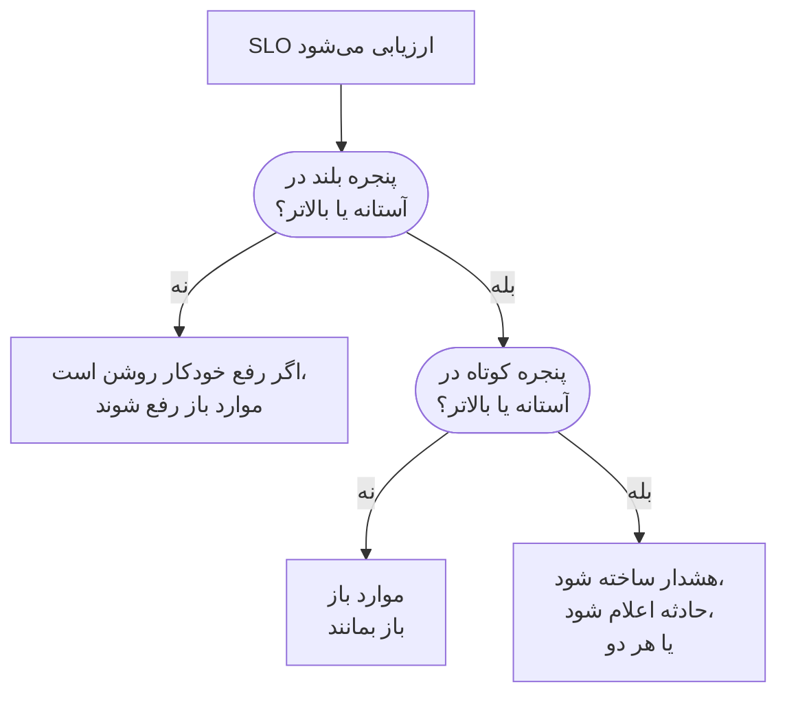

# هشدارها و حوادث نرخ مصرف

بودجه‌های خطا به شما می‌گویند کجا ایستاده‌اید؛ قواعد نرخ مصرف به شما می‌گویند کی باید از رختخواب بیرون بیایید. وقتی یک SLO بودجه خطایش را آن‌قدر سریع خرج می‌کند که اهمیت داشته باشد، یک قاعده نرخ مصرف هشدار می‌سازد، حادثه اعلام می‌کند یا هر دو را انجام می‌دهد، با عنوان و توضیحات، شدت، مالکان، برچسب‌ها، تشدید آنکال و اعلان‌های فضای کاری که خودتان تعیین می‌کنید.

:::cards
- [یک قاعده چگونه تصمیم می‌گیرد](#یک-قاعده-چگونه-تصمیم-میگیرد-فعال-شود): دو پنجره، هر دو بالای آستانه.
- [قواعد پیش‌فرض](#قواعد-پیشفرض): Fast burn و Slow burn، متناسب با پنجره SLO.
- [ساختن یک قاعده](#ساختن-یا-ویرایش-یک-قاعده): پنج گام در صفحه Burn Rate Rules آن SLO.
- [متغیرهای قالب](#هر-هشدار-و-حادثه-چه-میگوید): عنوان‌ها و توضیحات خودتان را بنویسید.
:::

## نرخ مصرف یعنی چه

نرخ مصرف سرعت خرج کردن بودجه خطا در مقایسه با یک آهنگ یکنواخت است:

```text
burn rate = (share of time that was bad) ÷ (share of time the target allows to be bad)
```

با نرخ مصرف ۱، بودجه را درست در طول پنجره خرج می‌کنید و بی‌آنکه چیزی بماند به هدف می‌رسید. عددهای بزرگ‌تر آن را زودتر تمام می‌کنند. برای یک SLO با ۹۹٫۹٪ روی ۳۰ روز:

| نرخ مصرف، اگر ادامه یابد | بودجه تمام می‌شود پس از |
| --- | --- |
| ۱ | ۳۰ روز |
| ۲ | ۱۵ روز |
| ۶ | ۵ روز |
| ۱۴٫۴ | حدود ۲ روز (۵۰ ساعت) |

نرخ مصرف به اینکه چه مقدار بودجه مانده بستگی ندارد. به «همین حالا اوضاع چقدر بد است؟» پاسخ می‌دهد، و این همان چیزی است که برای تصمیم به فراخواندن کسی باید بدانید.

## یک قاعده چگونه تصمیم می‌گیرد فعال شود

OneUptime هر قاعده نرخ مصرف فعال را در هر ارزیابی SLO، هر ۵ دقیقه، بررسی می‌کند. هر قاعده نرخ مصرف را روی دو پنجره می‌سنجد و فقط وقتی فعال می‌شود که هر دو در آستانه آن یا بالاتر باشند:

- **پنجره بلند** (برای نمونه ۱ ساعت) نشان می‌دهد مصرف پایدار و چشمگیر است، نه یک بررسی ناموفق تنها.
- **پنجره کوتاه** (برای نمونه ۵ دقیقه) نشان می‌دهد هنوز در جریان است. بدون آن، جهشی از یک ساعت پیش مدت‌ها پس از بهبود هم هشدار می‌داد.

این الگوی چندپنجره‌ای و چندنرخی از Google SRE Workbook است، و همان چیزی که OneUptime برایتان برپا می‌کند.



یک قاعده تا وقتی SLO یک پنجره بلند کامل از تاریخچه پایش نداشته باشد نمی‌تواند فعال شود: وگرنه نخستین بررسی ناموفق یک مانیتور، تقسیم بر چند دقیقه تاریخچه، نرخ مصرفی بسیار بزرگ می‌داد. پس یک SLO تازه نمی‌تواند در ساعت نخست قاعده **Fast burn** خود را فعال کند، و نه در شش ساعت نخست قاعده **Slow burn** را. اگر بعدها یک SLO دیگر آن‌قدر تاریخچه نداشته باشد، برای نمونه پس از آنکه مانیتورهایش با مانیتورهای تازه جایگزین شدند، قاعده آنچه را باز کرده بود رفع می‌کند به‌جای آنکه معلق بگذارد. یک قاعده همچنین وقتی یکی از مانیتورهای SLO در تعمیر و نگهداری زمان‌بندی‌شده است فعال نمی‌شود: [تعمیر و نگهداری زمان‌بندی‌شده](#تعمیر-و-نگهداری-زمانبندیشده) را ببینید.

## قواعد پیش‌فرض

هر SLO تازه دو قاعده نرخ مصرف می‌گیرد. برای یک پنجره ۳۰ روزه:

| قاعده | آستانه | پنجره بلند | پنجره کوتاه | کی فعال می‌شود |
| --- | --- | --- | --- | --- |
| **Fast burn** | ۱۴٫۴× | ۱ ساعت | ۵ دقیقه | حدود ۲٪ بودجه در یک ساعت مصرف می‌شود: در حدود ۲ روز تمام می‌شد. |
| **Slow burn** | ۶× | ۶ ساعت | ۳۰ دقیقه | حدود ۵٪ بودجه در شش ساعت مصرف می‌شود: در حدود ۵ روز تمام می‌شد. |

آستانه‌های ۱۴٫۴× و ۶× برای بودجه‌ای ۳۰ روزه حساب شده‌اند، پس OneUptime آن‌ها را با پنجره SLO شما تطبیق می‌دهد. هر قاعده همیشه یعنی «۲٪ بودجه در ۱ ساعت» یا «۵٪ بودجه در ۶ ساعت»:

| پنجره SLO | آستانه Fast burn | آستانه Slow burn |
| --- | --- | --- |
| ۷ روز | ۳٫۳۶× | ۱٫۴× |
| ۲۸ روز | ۱۳٫۴۴× | ۵٫۶× |
| ۳۰ روز | ۱۴٫۴× | ۶× |
| ۹۰ روز | ۴۳٫۲× | ۱۸× |

SLOهای ماه تقویمی مقدارهای ۳۰ روزه را می‌گیرند. هر دو قاعده با بالاترین شدت هشدار پروژه، با عنوان و توضیحات پیش‌فرض هشدار می‌سازند، آن را خودکار رفع می‌کنند و مالک یا برچسبی نمی‌افزایند. حادثه اعلام نمی‌کنند، پس ارتقای OneUptime هرگز به‌جای شما شروع به اعلام حادثه نمی‌کند. آن‌ها را ویرایش یا حذف کنید، یا قواعد خودتان را بیفزایید.

## ساختن یا ویرایش یک قاعده

به دسترسی ساختن قواعد نرخ مصرف SLO نیاز دارید.

:::steps
### باز کردن Burn Rate Rules

SLO را باز کنید، به **Burn Rate Rules** بروید و روی **ساخت SLO Burn Rate Rule** کلیک کنید، یا یکی از قواعد پیش‌فرض را ویرایش کنید.

### نام‌گذاری قاعده

در **Rule** یک **نام** وارد کنید، مانند «Fast burn». **فعال** روشن است.

### تنظیم پنجره مصرف

در **Burn Window**، **Burn Rate Threshold** (برای نمونه `14.4`)، **Long Window (Minutes)** و **Short Window (Minutes)** را تنظیم کنید، و در صورت تمایل **Re-fire Suppression (Minutes)** را.

### انتخاب آنچه اعلام می‌کند

در **What It Declares**، **ساخت هشدار**، **اعلام حادثه** یا هر دو را روشن کنید. **Add SLO Owners as Owners** مالکان SLO را هم مالک هر چیزی می‌کند که قاعده می‌سازد.

### توصیف هشدار و حادثه

گام‌های **هشدار** و **حادثه** فقط برای آنچه قاعده اعلام می‌کند نمایان می‌شوند. هر کدام عنوان و شدتی دارد، و بخش‌هایی بسته: **توضیحات**، **مالکیت و برچسب‌ها**، **آنکال** و **فیلدهای بیشتر** که رفع خودکار، حریم خصوصی و یادداشت‌های رفع را در خود دارد. قواعد تازه با عنوان و توضیحات پیش‌فرض، آماده ویرایش، آغاز می‌شوند. در گام آخر روی **ساخت SLO Burn Rate Rule** کلیک کنید.
:::

OneUptime هنگام ذخیره یک قاعده عددهای آن را بررسی می‌کند:

| تنظیم | باید باشد |
| --- | --- |
| **Burn Rate Threshold** | بزرگ‌تر از ۰. |
| **Short Window (Minutes)** | بزرگ‌تر از ۰. |
| **Long Window (Minutes)** | بلندتر از پنجره کوتاه. |
| **Re-fire Suppression (Minutes)** | ۰ یا بیشتر. خالی یعنی طول پنجره بلند. |

یک قاعده باید هشدار بسازد، حادثه اعلام کند یا هر دو: قاعده‌ای که هر دو را خاموش داشته باشد رد می‌شود، چون در هر ارزیابی بررسی می‌شد بی‌آنکه هرگز چیزی اعلام کند.

جدول قواعد برای هر قاعده آستانه، پنجره‌ها و سرکوب، آنچه اعلام می‌کند (و اینکه هشدار یا حادثه فقط دستی رفع می‌شود یا خصوصی است)، شدت‌ها، سیاست‌های آنکال، مالکان و برچسب‌ها را نشان می‌دهد.

> [!TIP]
> نقطه آغازی خوب: دو قاعده پیش‌فرض را نگه دارید، قاعده مصرف سریع را با شدت بالا به سیاست آنکالی بفرستید که افراد را فرامی‌خواند، و بگذارید قاعده مصرف کند برای ساعت‌های کاری هشداری با شدت کمتر بسازد. اگر تیمتان با حادثه‌ها کار می‌کند، روی قاعده مصرف سریع **اعلام حادثه** را روشن کنید، و اگر نمی‌خواهید هر دو را بگیرید، همان‌جا **ساخت هشدار** را خاموش کنید.

## یک قاعده چه اعلام می‌کند

|  | **ساخت هشدار** | **اعلام حادثه** |
| --- | --- | --- |
| در آغاز | روشن | خاموش |
| چیست | سیگنال سبک: به فهرست هشدارها می‌رود. | سیگنال سنگین: شماره حادثه می‌گیرد و کل گردش کار پاسخ را آغاز می‌کند. |
| عنوان و توضیحات | از آن خودش، یا متن پیش‌فرض | از آن خودش، یا متن پیش‌فرض |
| شدت | **شدت هشدار**: اگر خالی باشد، بالاترین شدت پروژه | **شدت حادثه**: اگر خالی باشد، بالاترین شدت پروژه |
| تشدید | **Alert On-Call Duty Policies** | **Incident On-Call Duty Policies** |
| مالکان و برچسب‌ها | **مالکان هشدار** و **برچسب‌های هشدار** | **مالکان حادثه** و **برچسب‌های حادثه** |
| خصوصی | خاموش | خاموش |
| رفع خودکار | روشن | روشن |
| صفحه‌های وضعیت | هرگز منتشر نمی‌شود | هرگز منتشر نمی‌شود |

چون هر کدام جداگانه تنظیم می‌شود، می‌توانید هشداری کوتاه به نوبت‌بندی تیم مسئول و حادثه‌ای مفصل به نوبت‌بندی حادثه‌های بزرگ بفرستید. جداگانه هم زندگی می‌کنند: هر کدام به‌تنهایی تکراری‌زدایی، رفع و سرکوب می‌شود، پس رفع کردن حادثه سرکوب هشدار را از نو آغاز نمی‌کند، و برعکس.

### SLO یک منبع تحت تأثیر است

هر هشدار و حادثه‌ای که یک قاعده نرخ مصرف می‌سازد، SLO خود را زیر **منابع تحت تأثیر** فهرست می‌کند و به آن پیوند می‌دهد. پالایه **منابع تحت تأثیر** در فهرست‌های هشدارها و حوادث آن‌ها را به یک SLO محدود می‌کند، و صفحه‌های **هشدارها** و **حوادث** آن SLO آن‌ها را فهرست می‌کنند، با نشان‌هایی در منوی کناری که موارد باز را می‌شمارند. OneUptime این پیوند را خودش برقرار می‌کند، و ویرایش هشدار یا حادثه هرگز آن را برنمی‌دارد.

### حوادث نرخ مصرف داخلی می‌مانند

بودجه خطایی که سریع مصرف می‌شود سیگنالی برای مهندسی است، نه یک قطعی اعلام‌شده. یک حادثه نرخ مصرف هرگز روی صفحه‌های وضعیت نشان داده نمی‌شود و هرگز به مشترکان صفحه وضعیت اطلاع نمی‌دهد. به هیچ مانیتوری هم پیوند نمی‌خورد، چون در آن صورت رفع کردنش همان تاریخچه وضعیت مانیتورهایی را بازنویسی می‌کرد که SLO از روی آن سنجیده می‌شود.

اگر چنین حادثه‌ای را دستی رفع کنید، تا وقتی مصرف بهبود نیابد و قاعده واقعاً دوباره فعال نشود، هیچ چیز آن را دوباره اعلام نمی‌کند، پس هنگام کار روی یک حادثه هرگز با قاعده درگیر نمی‌شوید.

## هر هشدار و حادثه چه می‌گوید

قواعد تازه، هم برای هشدار و هم برای حادثه، با عنوان و توضیحات پیش‌فرض آغاز می‌شوند. یک عنوان یا توضیحات را خالی کنید تا به متن پیش‌فرض بازگردید. عنوان پیش‌فرض این است:

```text
SLO burn rate: {{sloName}} — {{ruleName}}
```

توضیحات پیش‌فرض قاعده را نام می‌برد، نرخ مصرف هر دو پنجره را در برابر آستانه و بودجه خطای باقی‌مانده را می‌گوید.

برای نوشتن متن خودتان، در عنوان، توضیحات و یادداشت‌های رفع از متغیرهای قالب استفاده کنید. هر یک از این فیلدها آن‌ها را زیر **متغیرهای قالب** فهرست می‌کند: روی یکی کلیک کنید تا در جای مکان‌نما درج شود، یا در فیلد `{{` را تایپ کنید و یکی را برگزینید. توضیحات و یادداشت‌های رفع در نوار ابزارشان **درج متغیر** را هم دارند. متغیرها هنگام فعال شدن قاعده پر می‌شوند:

| متغیر | چه چیزی را در خود دارد | نمونه |
| --- | --- | --- |
| `{{sloName}}` | نام SLO. | `Checkout availability` |
| `{{sloId}}` | شناسه SLO. | `b7f4c2d8-1f3e-4a5b-9c6d-7e8f9a0b1c2d` |
| `{{sloLink}}` | پیوند به SLO در داشبورد OneUptime. | `https://oneuptime.com/dashboard/project-id/slos/slo-id` |
| `{{sloStatus}}` | وضعیت SLO پس از این ارزیابی. | `At Risk` |
| `{{ruleName}}` | نام قاعده نرخ مصرفی که فعال شد. | `Fast burn` |
| `{{burnRateThreshold}}` | آستانه نرخ مصرف قاعده (مضربی از آهنگ پایدار). | `14.4` |
| `{{longWindowBurnRate}}` | نرخ مصرف سنجیده‌شده روی پنجره بلند قاعده. | `21.5` |
| `{{shortWindowBurnRate}}` | نرخ مصرف سنجیده‌شده روی پنجره کوتاه قاعده. | `36` |
| `{{longWindowInMinutes}}` | طول پنجره بلند قاعده، به دقیقه. | `60` |
| `{{shortWindowInMinutes}}` | طول پنجره کوتاه قاعده، به دقیقه. | `5` |
| `{{targetPercentage}}` | هدف SLO، به درصد. | `99.9` |
| `{{currentSliPercentage}}` | SLI سنجیده‌شده روی پنجره انطباق SLO، به درصد. | `99.87` |
| `{{errorBudgetRemainingPercentage}}` | سهمی از بودجه خطا که هنوز در دسترس است، به درصد. وقتی از بودجه فراتر رفته باشید منفی است. | `42.5` |
| `{{errorBudgetRemaining}}` | بودجه خطایی که هنوز در دسترس است، به‌صورت مدت. وقتی از بودجه فراتر رفته باشید با علامت منفی آغاز می‌شود. | `18m 22s` |
| `{{errorBudgetRemainingMinutes}}` | بودجه خطایی که هنوز در دسترس است، به دقیقه. | `18.37` |
| `{{windowDescription}}` | پنجره انطباق SLO، به زبان ساده. | `rolling 30-day window` |

برای نمونه، عنوان `{{ruleName}}: {{sloName}} is burning {{longWindowBurnRate}}x` به `Fast burn: Checkout availability is burning 21.5x` تبدیل می‌شود.

:::details متغیرها چگونه پر می‌شوند
- عددها تا دو رقم اعشار گرد می‌شوند.
- فاصله درون آکولادها اشکالی ندارد: `{{ sloName }}` کار می‌کند.
- متغیری که نادرست نوشته شده همان‌طور که هست می‌ماند، تا غلط تایپی به‌جای آنکه بی‌صدا ناپدید شود در هشدار دیده شود.
- عنوان‌ها می‌توانند ۵۰۰ نویسه باشند، و توضیحات و یادداشت‌های رفع ۵۰٬۰۰۰. عنوانی که پس از پر شدن متغیرها بیش از ۵۰۰ نویسه شود، در یک سطر قرار می‌گیرد و با سه‌نقطه کوتاه می‌شود، تا هشدار یا حادثه با این حال ساخته شود.
- اگر هنگام فعال شدن قاعده نتوان پیوند SLO را ساخت، `{{sloLink}}` خالی می‌ماند و هشدار یا حادثه با این حال ساخته می‌شود.
:::

## مالکان، برچسب‌ها و حریم خصوصی

- **مالکان هشدار** و **مالکان حادثه** افراد و تیم‌هایی هستند که با **افزودن مالک** از یک فهرست واحد انتخاب می‌شوند. به محض ساخته شدن هشدار یا حادثه به آن افزوده می‌شوند و اعلان می‌گیرند. افراد باید عضو پروژه باشند.
- **Add SLO Owners as Owners** مالکان SLO، یعنی کاربران مالک آن و اعضای تیم‌های مالکش، را هم به هر چیزی که قاعده می‌سازد می‌افزاید. مالکان SLO از تغییر وضعیت خود SLO پیش‌تر باخبر می‌شوند، پس این کار ممکن است دو بار به آن‌ها اطلاع دهد. به‌طور پیش‌فرض خاموش است.
- هر مالک یک بار افزوده می‌شود: کاربری که پیش‌تر مالک هشدار یا حادثه است، برای نمونه از راه قواعد مالکیت پروژه، یا در یک تیم مالک افزوده‌شده است، دوباره افزوده نمی‌شود.
- **برچسب‌های هشدار** و **برچسب‌های حادثه** به هشدار یا حادثه افزوده می‌شوند، تا پالایه‌ها، قواعد مالکیت و قواعد اعلان فضای کاری بتوانند با آن‌ها جور شوند.
- یک هشدار یا حادثه خصوصی فقط برای مالکانش، مدیران پروژه و مالکان پروژه دیده می‌شود.

برچسب‌ها، تیم‌های مالک و سیاست‌های آنکال باید به پروژه آن SLO تعلق داشته باشند.

## رفع و سرکوب فعال شدن دوباره

- **رفع از پنجره بلند پیروی می‌کند.** وقتی رفع خودکار روشن است (پیش‌فرض)، OneUptime به محض اینکه نرخ مصرف پنجره بلند زیر آستانه برود، هشدار و حادثه قاعده را رفع می‌کند. رفع بر پایه پنجره کوتاه نوسان می‌ساخت: قطعی‌ای که می‌آید و می‌رود پس از پنج دقیقه آرامش رفع می‌شد و تمام شب دوباره افراد را فرامی‌خواند.
- **رفع خودکار خاموش.** **رفع خودکار هشدار** یا **رفع خودکار حادثه** را خاموش کنید تا آن رکورد تا وقتی کسی رفعش کند باز بماند، حتی پس از بهبود مصرف. قاعده رکورد دیگری روی آن باز نمی‌کند، و وقتی دستی رفع شد و پنجره بلند زیر آستانه بود، قاعده پس از دوره سرکوبش دوباره می‌تواند فعال شود.
- **سرکوب فعال شدن دوباره.** پس از رفع یک رکورد، قاعده در دوره سرکوب، که به‌طور پیش‌فرض طول پنجره بلند است، آن نوع رکورد را دوباره اعلام نمی‌کند. به این ترتیب سامانه‌ای که در حال بهبود است فرصت بهبود دارد بی‌آنکه به خاطر نویز باقی‌مانده کسی فراخوانده شود.

برخی تغییرها همیشه آنچه را یک قاعده باز کرده رفع می‌کنند، هر چه تنظیمات رفع خودکارش بگوید، تا هیچ چیز برای قاعده‌ای که دیگر توجیهی ندارد به تشدید ادامه ندهد:

- خاموش کردن **ساخت هشدار** یا **اعلام حادثه** آنچه را آن خروجی باز کرده بود می‌بندد؛
- خاموش یا حذف کردن قاعده؛
- خاموش کردن ارزیابی SLO، بایگانی کردن SLO یا حذف آن؛
- رفتن SLO به **متوقف‌شده** یا **Misconfigured**، چون در آن حالت چیزی نمی‌سنجد؛
- از دست رفتن آستانه یا پنجره‌های قاعده، یا اینکه SLO دیگر یک پنجره بلند کامل از تاریخچه نداشته باشد.

## تعمیر و نگهداری زمان‌بندی‌شده

تا وقتی یکی از مانیتورهای SLO در یک رویداد تعمیر و نگهداری زمان‌بندی‌شده در جریان است، قواعد نرخ مصرف آن نه هشدار می‌سازند و نه حادثه اعلام می‌کنند: کار برنامه‌ریزی‌شده نباید کسی را فرابخواند. آنچه قواعد پیش‌تر باز کرده‌اند همچنان طبق معمول رفع می‌شود. آن زمان طبق وضعیت‌های قطعی SLO همچنان در بودجه خطا شمرده می‌شود.

## فید SLO

**Feed** آن SLO هر هشداری را که یک قاعده می‌سازد و هر حادثه‌ای را که اعلام می‌کند، همراه با پیوند و نرخ‌های مصرفی که آن را توضیح می‌دهند، منتشر می‌کند، و نیز زمان رفع هر کدام را، خودکار یا دستی. رکوردی که قاعده دوباره در دست می‌گیرد چون هنوز باز بوده، دو بار منتشر نمی‌شود. ساختن، ویرایش و حذف یک قاعده هم منتشر و در **گزارش‌های ممیزی** آن SLO ثبت می‌شود. [فید و گزارش‌های ممیزی SLO](/docs/slo/feed-and-audit-logs) را ببینید.

## عیب‌یابی

:::details یک قاعده درست پس از ساخته شدن SLO فعال نشد
یک قاعده فقط وقتی فعال می‌شود که SLO یک پنجره بلند کامل از تاریخچه پایش داشته باشد: یک ساعت برای قاعده پیش‌فرض مصرف سریع، شش ساعت برای قاعده مصرف کند.
:::

:::details یک هشدار در حالی که قطعی هنوز ادامه داشت رفع شد
رفع خودکار از پنجره بلند پیروی می‌کند: به محض اینکه نرخ مصرف پنجره بلند زیر آستانه برود، هشدار رفع می‌شود. به قاعده پنجره بلند بلندتری بدهید، یا **رفع خودکار هشدار** را خاموش کنید و هشدار را دستی رفع کنید.
:::

:::details در یک رویداد تعمیر و نگهداری زمان‌بندی‌شده هیچ چیز فعال نشد
تا وقتی یکی از مانیتورهای SLO در یک رویداد تعمیر و نگهداری زمان‌بندی‌شده در جریان است، قواعد نرخ مصرف ساکت می‌مانند. قطعی همچنان در بودجه شمرده می‌شود.
:::

:::details آیا کمینه‌ای برای شمار نمونه‌ها هست؟
نه برای SLOهایی که با دسترس‌پذیری مانیتور سنجیده می‌شوند. دسترس‌پذیری به ثانیه سنجیده می‌شود، پس هر ثانیه از پنجره یک نمونه است و حالت ترافیک کمی وجود ندارد که لازم باشد در برابرش محافظت کنید. کمینه شمار نمونه‌ها فقط برای SLIهای مبتنی بر رویداد اهمیت دارد، که هنوز در دسترس نیستند.
:::

## گام‌های بعدی

:::cards
- [بودجه‌های خطا](/docs/slo/error-budget): بودجه چیست و چقدر دوام می‌آورد.
- [قواعد تشدید](/docs/on-call/escalation-rules): چه کسی و به چه ترتیبی فراخوانده می‌شود.
- [فید و گزارش‌های ممیزی SLO](/docs/slo/feed-and-audit-logs): هر هشدار و حادثه‌ای که یک قاعده می‌سازد.
:::
