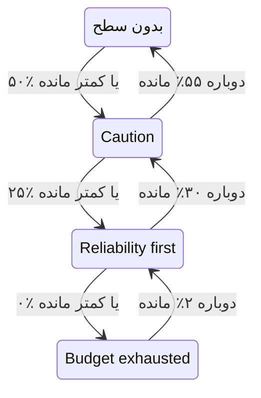

# سیاست بودجه خطا

سیاست بودجه خطا می‌نویسد که تیم شما توافق کرده با کم شدن بودجه خطای یک SLO چه کند، مثلاً بازبینی تغییرات پرخطر وقتی نیمی از آن خرج شده، یا متوقف کردن انتشارها وقتی همه آن خرج شده است. OneUptime، SLO را در سطحی از سیاست می‌گذارد که بودجه‌اش به آن رسیده، توافق تیم برای آن سطح را در صفحه‌های SLO نشان می‌دهد و می‌تواند وقتی SLO وارد یک سطح می‌شود هشدار بسازد یا حادثه اعلام کند. این همان شیوه سیاست بودجه خطا در [Google SRE Workbook](https://sre.google/workbook/error-budget-policy/) است.

:::cards
- [سطح‌ها چگونه کار می‌کنند](#سطحها-چگونه-کار-میکنند): کدام سطح برقرار است و SLO کی آن را ترک می‌کند.
- [یک سیاست تنظیم کنید](#یک-سیاست-تنظیم-کنید): با سیاست پیشنهادی شروع کنید یا سطح‌های خودتان را بنویسید.
- [هشدارها و حوادث](#هشدارها-و-حوادث): وقتی SLO وارد یک سطح می‌شود به تیم خود خبر دهید.
- [سطح را از API بخوانید](#سطح-را-از-api-بخوانید): سطح را از CI و اسکریپت‌ها بررسی کنید.
:::

## سطح‌ها چگونه کار می‌کنند

یک سیاست مجموعه‌ای از سطح‌هاست. هر سطح سه فیلد دارد:

| فیلد | چه چیزی را نگه می‌دارد |
| --- | --- |
| **نام** | نامی که تیم به سطح می‌دهد، مثلاً «Reliability first». |
| **آستانه بودجه باقی‌مانده (%)** | سهمی از بودجه خطای باقی‌مانده که سطح در آن یا پایین‌تر از آن برقرار است. از ۰ تا ۱۰۰، با اعشار. هر سطح یک SLO آستانه خودش را دارد. |
| **آنچه انجام می‌دهیم** | آنچه تیم توافق کرده تا وقتی SLO در این سطح است انجام دهد، به Markdown. الزامی، تا ۱۰٬۰۰۰ نویسه. |

یک سطح تا وقتی بودجه باقی‌مانده در آستانه آن یا پایین‌تر است برقرار است، پس سطح ۰٪ سطحِ بودجه تمام‌شده است. وقتی چند سطح برقرارند، SLO در سطحی است که پایین‌ترین آستانه را دارد: جدی‌ترین آن‌ها. وقتی هیچ‌کدام برقرار نیست، SLO در هیچ سطحی نیست. با سطح‌های ۵۰٪، ۲۵٪ و ۰٪، SLOیی که ۳۰٪ بودجه‌اش مانده در سطح ۵۰٪ است و SLOیی که ۱۰٪ مانده در سطح ۲۵٪.

### ورود به یک سطح و ترک آن

سطح همان‌طور که وضعیت SLO این کار را می‌کند، بودجه باقی‌مانده را دنبال می‌کند:

- ورود به یک سطح فوری است: ارزیابی‌ای که بودجه را در آستانه یک سطح یا پایین‌تر از آن می‌یابد، SLO را در آن سطح می‌گذارد. بودجه‌ای که یک‌باره از چند آستانه پایین‌تر برود، مستقیم به جدی‌ترین سطح می‌رود.
- ترک یک سطح به سوی سطحی کم‌جدی‌تر تا وقتی بودجه به‌روشنی برگردد صبر می‌کند. سطح ۰٪ وقتی دوباره ۲٪ بودجه بماند ترک می‌شود. هر سطح دیگری وقتی بودجه ۵ واحد بالاتر از آستانه‌اش باشد ترک می‌شود.

پس سطح ۰٪ همراه با وضعیت **بودجه تمام‌شده** جابه‌جا می‌شود، و سطحی که در آستانه در معرض خطر SLO است همراه با **در معرض خطر**: [تغییر وضعیت و آستانه در معرض خطر](/docs/slo/error-budget#تغییر-وضعیت-و-آستانه-در-معرض-خطر) را ببینید. پنجره غلتانی که دور یک آستانه نوسان می‌کند، سطح را رفت‌وبرگشتی نمی‌کند.



## یک سیاست تنظیم کنید

به مجوز ساخت سطح‌های سیاست بودجه خطای SLO نیاز دارید.

:::steps
### سیاست بودجه خطا را باز کنید

SLO را باز کنید و در بخش **قواعد** منوی کناری آن به **سیاست بودجه خطا** بروید. این صفحه سطح‌های SLO را فهرست می‌کند، هر کدام با نامش، بودجه باقی‌مانده‌ای که در آن برقرار است، و کاری که تیم می‌کند.

### با سیاست پیشنهادی شروع کنید

تا وقتی SLO هیچ سطحی ندارد، صفحه **استفاده از سیاست پیشنهادی** را پیشنهاد می‌دهد. روی آن کلیک کنید، سه سطحی را که فهرست می‌کند بررسی کنید و تأیید کنید. سپس متن هر سطح را به توافق خود تیمتان تغییر دهید.

### یا خودتان یک سطح اضافه کنید

روی **ساخت سطح سیاست بودجه خطای SLO** کلیک کنید. یک **نام** و یک **آستانه بودجه باقی‌مانده (%)** وارد کنید، و توافق تیم را در **آنچه انجام می‌دهیم** بنویسید.

### انتخاب کنید سطح چه چیزی ایجاد کند

سطح توافق را ثبت می‌کند و نشان می‌دهد. برای اینکه وقتی SLO وارد سطح می‌شود به کسی هم خبر داده شود، تنظیمات بسته هشدار و حادثه را باز کنید و هشدار، حادثه یا هر دو را روشن کنید. هر دو به‌طور پیش‌فرض خاموش‌اند. [هشدارها و حوادث](#هشدارها-و-حوادث) را ببینید.
:::

افزودن، ویرایش یا حذف یک سطح بی‌درنگ اعمال می‌شود: OneUptime در حدود یک دقیقه SLO را دوباره ارزیابی می‌کند. اگر بودجه از پیش در آستانه یک سطح یا پایین‌تر از آن باشد، SLO آنگاه وارد آن سطح می‌شود و سطح آنچه را برایش تنظیم شده ایجاد می‌کند. خاموش کردن یا حذف یک سطح آنچه را ایجاد کرده رفع می‌کند و SLO به سطحی می‌رود که بودجه‌اش در آن است. خاموش کردن هشدار یا حادثه یک سطح، همان هشدار یا حادثه را رفع می‌کند.

### سیاست پیشنهادی

**استفاده از سیاست پیشنهادی** سه سطح، در نیمه بودجه، یک‌چهارم آن و صفر، با این متن انگلیسی اضافه می‌کند:

| سطح | برقرار در | آنچه تیم می‌کند |
| --- | --- | --- |
| **Caution** | ۵۰٪ یا کمتر مانده | Half of the error budget is spent. Review risky changes before they ship, and find out what has been spending the budget. |
| **Reliability first** | ۲۵٪ یا کمتر مانده | Reliability comes first. Only reliability improvements and critical fixes ship until the budget recovers. |
| **Budget exhausted** | ۰٪ یا کمتر مانده | The error budget is spent. Freeze non-critical releases: only fixes for this SLO's reliability and security fixes ship until the budget is back. |

هیچ‌کدام تا وقتی شما روشنش نکنید هشدار نمی‌سازد یا حادثه اعلام نمی‌کند. فقط سطح‌هایی افزوده می‌شوند که SLO ندارد: سطحی با همان نام، یا با همان آستانه، موجود به شمار می‌آید، چه روشن باشد چه خاموش. پس دو بار درخواست کردن، از یک زبانه دوم یا از راه API، چیزی را دو بار اضافه نمی‌کند. هر سطحی که این‌گونه افزوده شود، در گزارش‌های ممیزی SLO به‌عنوان افزوده‌شده توسط شما ثبت می‌شود.

## سطح کجا دیده می‌شود

- **نمای کلی** SLO سطحی را که SLO در آن است و آنچه تیم توافق کرده در آن انجام دهد نشان می‌دهد، تا هر کسی که SLO را باز می‌کند توافقی را ببیند که اکنون برقرار است.
- نمودار **روند مصرف بودجه خطا** در آستانه هر سطح، کنار خط آستانه در معرض خطر، یک خط برچسب‌دار می‌کشد.
- **فید** SLO هر تغییر سطح را منتشر می‌کند: سطحی که SLO ترک کرد و سطحی که وارد شد، بودجه باقی‌مانده، و آنچه تیم توافق کرده در سطح تازه انجام دهد.
- **گزارش‌های ممیزی** SLO هر تغییر سطح را به‌عنوان تغییری ثبت می‌کنند که خود OneUptime داده است، پس آن را فقط وقتی **ذخیره رویدادهای سامانه** روشن است نشان می‌دهند: [روشن کردن گزارش‌های ممیزی](/docs/slo/feed-and-audit-logs#روشن-کردن-گزارشهای-ممیزی) را ببینید. افزودن، ویرایش و حذف یک سطح به نام کسی ثبت می‌شود که آن را انجام داده است.
- API خواندن SLO سطح را برمی‌گرداند: [سطح را از API بخوانید](#سطح-را-از-api-بخوانید) را ببینید.

## هشدارها و حوادث

هر سطح می‌تواند وقتی SLO وارد آن می‌شود هشدار بسازد، حادثه اعلام کند یا هر دو. گزینه‌های آن‌ها همان گزینه‌های هشدار و حادثه یک قاعده نرخ مصرف است: شدت، سیاست‌های آنکال، الگوهای عنوان، توضیح و یادداشت‌های رفع مشکل، خصوصی بودن، رفع خودکار، برچسب‌ها، تیم‌ها و کاربران مالک، و افزودن مالکان SLO به‌عنوان مالک. [یک قاعده چه اعلام می‌کند](/docs/slo/burn-rate-alerts#یک-قاعده-چه-اعلام-میکند) را ببینید. هر دو به‌طور پیش‌فرض خاموش‌اند، پس تا وقتی یکی از آن‌ها را روشن نکنید، سطح به کسی خبر نمی‌دهد.

- ورود به سطحی جدی‌تر آنچه سطح قبلی ایجاد کرده رفع می‌کند، هر تنظیم رفع خودکاری که داشته باشد، چون سطح تازه جای آن را می‌گیرد. پس در هر زمان حداکثر هشدار و حادثه یک سطح باز است، و آن‌ها به سطحی تعلق دارند که SLO در آن است.
- بهبود به سطحی کم‌جدی‌تر، یا بیرون رفتن از همه سطح‌ها، وقتی رفع خودکار آن سطح روشن باشد، که به‌طور پیش‌فرض روشن است، آن‌ها را رفع می‌کند. با رفع خودکار خاموش، باز می‌مانند تا کسی رفعشان کند.
- سرکوب فعال شدن دوباره وجود ندارد. یک سطح فقط پس از آنکه SLO به‌روشنی آن را ترک کرد و دوباره وارد آن شد دوباره ایجاد می‌کند، پس نوسان نمی‌کند. اگر کسی در حالی که SLO هنوز در آن سطح است آنچه را سطح ایجاد کرده دستی رفع کند، رفع‌شده می‌ماند.
- تا وقتی یکی از مانیتورهای SLO در تعمیر و نگهداری زمان‌بندی‌شده است، سطح‌ها چیزی ایجاد نمی‌کنند. خود سطح باز هم تغییر می‌کند و آنچه باز است همچنان رفع می‌شود. اگر وقتی تعمیر و نگهداری تمام می‌شود SLO هنوز در آن سطح باشد، سطح آنگاه آنچه را برایش تنظیم شده ایجاد می‌کند.

مانند یک قاعده نرخ مصرف، هشدار یا حادثه‌ای که یک سطح ایجاد می‌کند SLO را زیر **منابع تحت تأثیر** فهرست می‌کند، و حادثه هرگز در صفحه‌های وضعیت نشان داده نمی‌شود. فید SLO هر کدام را، و زمان رفعشان را، منتشر می‌کند.

### چه می‌گویند

عنوان، توضیح و یادداشت‌های رفع مشکل یک سطح، مانند یک قاعده، متغیرهای الگو می‌پذیرند: [هر هشدار و حادثه چه می‌گوید](/docs/slo/burn-rate-alerts#هر-هشدار-و-حادثه-چه-میگوید) را ببینید. فیلدهای یک سطح متغیرهای SLO و بودجه‌اش و سه متغیر ویژه سطح را پیشنهاد می‌دهند: `{{sloName}}`، `{{sloId}}`، `{{sloLink}}`، `{{sloStatus}}`، `{{policyTier}}`، `{{policyTierThresholdPercentage}}`، `{{policyTierWhatWeDo}}`، `{{targetPercentage}}`، `{{currentSliPercentage}}`، `{{errorBudgetRemainingPercentage}}`، `{{errorBudgetRemaining}}`، `{{errorBudgetRemainingMinutes}}` و `{{windowDescription}}`. متغیرهای ویژه یک قاعده، مانند `{{ruleName}}` و نرخ‌های مصرف، پیشنهاد نمی‌شوند و در الگوهای یک سطح خالی‌اند.

سه متغیر سطح در الگوهای قواعد نرخ مصرف هم کار می‌کنند:

| متغیر | چه چیزی را نگه می‌دارد |
| --- | --- |
| `{{policyTier}}` | نام سطحی که SLO پس از ارزیابی در آن است، یا `None` وقتی در هیچ سطحی نیست. |
| `{{policyTierThresholdPercentage}}` | آستانه آن سطح، مثلاً `25`. وقتی SLO در هیچ سطحی نیست خالی است. |
| `{{policyTierWhatWeDo}}` | آنچه تیم توافق کرده در آن سطح انجام دهد. وقتی SLO در هیچ سطحی نیست خالی است. |

سطحی که عنوانش خالی بماند، عنوان داخلی را به کار می‌برد:

```text
SLO error budget policy: {{sloName}} — {{policyTier}}
```

توضیح داخلی نام سطح را می‌آورد، بودجه باقی‌مانده را با آستانه سطح می‌سنجد و می‌گوید تیم توافق کرده در آن سطح چه کند.

## وقتی بودجه سنجیده نمی‌شود

- SLOیی که **متوقف‌شده** یا **پیکربندی نادرست** است هیچ بودجه‌ای نمی‌سنجد، پس سطحش همان‌جا که بود می‌ماند و آنچه سطح ایجاد کرده تا ازسرگیری سنجش باز می‌ماند. در مقابل، قواعد نرخ مصرف آنگاه آنچه را باز دارند رفع می‌کنند.
- خاموش کردن ارزیابی SLO، یا بایگانی کردن SLO، آنچه را سطح‌هایش ایجاد کرده‌اند رفع می‌کند. سطحی که SLO در آن است همان‌طور که بود می‌ماند.
- حذف SLO سطح‌هایش را حذف می‌کند و آنچه را ایجاد کرده‌اند رفع می‌کند.

## سطح را از API بخوانید

API خواندن خود SLO سطحی را که SLO در آن است برمی‌گرداند، تا یک کار CI یا یک اسکریپت بتواند پیش از هر اقدامی، مثلاً پیش از یک انتشار، آن را بررسی کند. تا وقتی SLO در هیچ سطحی نیست، هر سه فیلد خالی‌اند:

| فیلد | چه چیزی را نگه می‌دارد |
| --- | --- |
| `currentErrorBudgetPolicyTierId` | شناسه سطح. |
| `currentErrorBudgetPolicyTierName` | نام سطح. |
| `currentErrorBudgetPolicyTierEnteredAt` | زمانی که SLO وارد سطح شد. |

این فیلدها با مجوز خواندن خود SLO خوانده می‌شوند، همان مجوزی که بودجه‌اش هم نیاز دارد. برای نمونه، با یک [کلید API](/docs/api-reference/api-reference) از پروژه:

```bash
curl -X POST 'https://oneuptime.com/api/service-level-objective/<slo-id>/get-item' \
  -H "ApiKey: $ONEUPTIME_API_KEY" \
  -H 'Content-Type: application/json' \
  -d '{ "select": { "name": true, "errorBudgetRemainingPercentage": true, "currentErrorBudgetPolicyTierName": true, "currentErrorBudgetPolicyTierEnteredAt": true } }'
```

خود سطح‌ها منبعی جداگانه‌اند، `/api/service-level-objective-error-budget-policy-tier`، با درخواست‌های فهرست، خواندن، ساخت، تغییر و حذف که هر منبعی دارد. دو درخواست دیگر برای سیاست پیشنهادی است. هر دو `{ "serviceLevelObjectiveId": "..." }` را می‌گیرند و با سطح‌ها در `tiers` پاسخ می‌دهند:

| درخواست | چه می‌کند |
| --- | --- |
| `POST /api/service-level-objective-error-budget-policy-tier/recommended-policy` | سطح‌های پیشنهادی‌ای را که SLO ندارد فهرست می‌کند. چیزی نمی‌نویسد. |
| `POST /api/service-level-objective-error-budget-policy-tier/recommended-policy/add` | آن‌ها را اضافه می‌کند و آنچه را اضافه کرده فهرست می‌کند. درخواست دوباره چیزی اضافه نمی‌کند. |

## مجوزها

| مجوز | به یک نقش اجازه می‌دهد |
| --- | --- |
| **Read SLO Error Budget Policy Tier** | سطح‌های یک SLO را ببیند. |
| **Create SLO Error Budget Policy Tier** | سطح اضافه کند، دستی یا با **استفاده از سیاست پیشنهادی**. |
| **Edit SLO Error Budget Policy Tier** | سطح‌ها را تغییر دهد و آن‌ها را روشن یا خاموش کند. |
| **Delete SLO Error Budget Policy Tier** | سطح‌ها را حذف کند. |

این مجوزها در گروه SLO یک نقش هستند. نقش‌های Project Owner و Project Admin همه آن‌ها را دارند، و نقش‌های Project Member و Viewer می‌توانند سطح‌ها را بخوانند.

## هنوز در دسترس نیست

برخی بخش‌های سیاست بودجه خطا هنوز در دسترس نیست: دروازه استقراری که خودش انتشارها را متوقف کند (به‌جای آن یک کار CI می‌تواند سطح را از API بخواند)، راه‌اندازهای گردش‌کار و اعلان‌های Slack یا Microsoft Teams برای هر سطح، سیاستی که میان چند SLO مشترک باشد، تأیید یک سطح یا دادن استثنا به آن، و سطح‌هایی که به‌جای بودجه باقی‌مانده بر پایه مدت دوام بودجه باشند.

## گام‌های بعدی

:::cards
- [بودجه‌های خطا](/docs/slo/error-budget): بودجه چیست و وضعیت چگونه آن را دنبال می‌کند.
- [هشدارها و حوادث نرخ مصرف](/docs/slo/burn-rate-alerts): وقتی بودجه بیش از حد سریع مصرف می‌شود به تیم خود خبر دهید.
- [فید و گزارش‌های ممیزی SLO](/docs/slo/feed-and-audit-logs): هر تغییر سطح، و آنچه سطح‌ها ایجاد کرده‌اند.
:::
