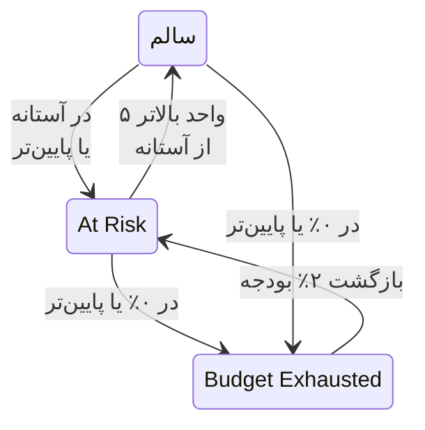

# بودجه‌های خطا

بودجه خطا قطعی‌ای است که هدف یک SLO مجاز می‌داند. هدف ۹۹٫۹٪ به معنای «هرگز قطع نشو» نیست: به معنای «می‌توانی در ۳۰ روز تا ۴۳ دقیقه قطع باشی، پس آن را خردمندانه خرج کن» است. این صفحه توضیح می‌دهد OneUptime بودجه را چگونه می‌شمارد، بودجه چقدر دوام می‌آورد، چگونه بازمی‌گردد و چه کسی از آن باخبر می‌شود.

:::cards
- [بودجه چگونه محاسبه می‌شود](#بودجه-چگونه-محاسبه-میشود): فرمول و بودجه هدف‌های رایج.
- [مدت دوام بودجه](#مدت-دوام-بودجه): بودجه با آهنگ کنونی چقدر دوام می‌آورد.
- [بودجه چگونه بازمی‌گردد](#بودجه-چگونه-بازمیگردد): پنجره‌های غلتان و ماه‌های تقویمی.
- [اطلاع به مالکان](#اطلاع-به-مالکان): وقتی بودجه کم می‌شود چه کسی باخبر می‌شود.
:::

## بودجه چگونه محاسبه می‌شود

کل بودجه آن بخش از پنجره است که هدف شما وعده‌اش را نمی‌دهد:

```text
total budget = (100% − target) × window length
```

| هدف | پنجره ۷ روزه | پنجره ۲۸ روزه | پنجره ۳۰ روزه | پنجره ۹۰ روزه |
| --- | --- | --- | --- | --- |
| 99% | 1h 40m 48s | 6h 43m 12s | 7h 12m | 21h 36m |
| 99.5% | 50m 24s | 3h 21m 36s | 3h 36m | 10h 48m |
| 99.9% | 10m 5s | 40m 19s | 43m 12s | 2h 9m 36s |
| 99.95% | 5m 2s | 20m 10s | 21m 36s | 1h 4m 48s |
| 99.99% | 1m 0s | 4m 2s | 4m 19s | 12m 58s |

صفحه **تنظیمات** یک SLO بودجه‌ای را که هدفش مجاز می‌داند کنار هدف نشان می‌دهد، برای نمونه «43m 12s قطعی در هر پنجره ۳۰ روزه».

### بودجه یک SLO چندمانیتوری

در حالت **Any Monitor Down**، بودجه برابر `(100% − target) × window` است، هر چند مانیتور هم که SLO بسنجد: پنجره یک خط زمانی است.

در حالت **Monitor Seconds Average**، بودجه بر حسب ثانیه-مانیتور و جمع روی همه مانیتورها شمرده می‌شود، پس با شمار مانیتورها بزرگ می‌شود: یک SLO سه‌مانیتوری با ۹۹٫۹٪ روی ۳۰ روز به‌جای ۴۳ دقیقه حدود ۱۲۹ دقیقه بودجه دارد. درصدها (SLI، بودجه باقی‌مانده، نرخ مصرف) همان معنا را دارند؛ فقط مدت‌ها تغییر می‌کنند.

### بودجه یک ماه تقویمی

یک SLO ماه تقویمی از روز نخست بودجه کل ماه را دارد: یک SLO با ۹۹٫۹٪ در ماهی ۳۱ روزه در روز ۱ همه 44m 38s خود را دارد. بودجه به نسبت بخش سپری‌شده ماه تقسیم نمی‌شود، پس یک قطعی یک‌دقیقه‌ای در صبح روز ۱ یک دقیقه از بودجه ماه را خرج می‌کند.

## بودجه باقی‌مانده

با انباشته شدن قطعی، **نمای کلی** بودجه باقی‌مانده را در کاشی **Error budget left** خود نشان می‌دهد:

- به‌صورت درصدی از کل، که وضعیت SLO را هم تعیین می‌کند و نوار را پر می‌کند. نوار روی آستانه در معرض خطر SLO نشانه‌ای دارد؛
- به‌صورت مدت، برای نمونه "31m 4s left of 43m 12s".

وقتی بودجه تمام شود، کاشی **No budget left** را نشان می‌دهد. وقتی قطعی از آن فراتر برود، کاشی **Budget exceeded** و میزان فراتر رفتن را به‌صورت زمان نشان می‌دهد، برای نمونه "4d 23m over budget · 5m 47s allowed": SLO همه ۵ دقیقه و ۴۷ ثانیه بودجه‌اش را خرج کرده و ۴ روز و ۲۳ دقیقه هم بیشتر. نوار خالی و قرمز می‌ماند.

بودجه باقی‌مانده برای محاسبه‌ها و نمودارهای تاریخچه به‌صورت عددی علامت‌دار نگه داشته می‌شود، پس در آنجا بودجه فراتر رفته به‌صورت درصد منفی نمایان می‌شود. درصدی بسیار منفی یعنی فراتر رفتن در مقایسه با بودجه بزرگ است؛ این سهمی از زمان که سرویس قطع بوده نیست.

اینکه کدام ثانیه‌ها قطعی شمرده شوند را وضعیت‌های قطعی SLO تعیین می‌کنند و، برای SLO چندمانیتوری، حالت چندمانیتوری آن، که هر دو در **تنظیمات** > **Downtime Calculation** هستند. [نمای کلی SLOها](/docs/slo/introduction) را ببینید.

## مدت دوام بودجه

کاشی **Budget runway** در **نمای کلی** به «اگر همین‌طور ادامه یابد، بودجه کی تمام می‌شود؟» پاسخ می‌دهد. بودجه باقی‌مانده را بر نرخ مصرف ۶۰ دقیقه گذشته تقسیم می‌کند:

```text
runway = budget left ÷ (burn rate × (100% − target))
```

| کاشی نشان می‌دهد | معنا |
| --- | --- |
| یک مدت، مانند **~2d 5h** | با آهنگ کنونی، بودجه تقریباً پس از این مدت تمام می‌شود. کهربایی، و وقتی یک روز یا کمتر بماند قرمز. **Under 1m** یعنی کمتر از یک دقیقه. |
| **Not burning** | در ۶۰ دقیقه گذشته بودجه‌ای خرج نشده است. |
| **Sustainable** | فقط پنجره‌های غلتان: مدت دوام دست‌کم یک پنجره کامل است، پس بودجه سریع‌تر از بیرون رفتن قطعی‌های قدیمی از پنجره خرج نمی‌شود. با این آهنگ تمام نمی‌شود. |
| **Lasts until reset** | فقط ماه‌های تقویمی: بودجه پیش از تمام شدن، در آغاز ماه بعد از نو آغاز می‌شود. |
| **Overspent** | بودجه پیش‌تر خرج شده است. کاشی می‌گوید چقدر از آن فراتر رفته است. |

برای SLOهای ماه تقویمی، کاشی همچنین می‌گوید بودجه کی از نو آغاز می‌شود.

مدت دوام یک پیش‌بینی خطی است. در یک پنجره غلتان، قطعی‌های قدیمی‌ای که از پنجره بیرون می‌روند بودجه را بازمی‌گردانند، و این پیش‌بینی آن را نادیده می‌گیرد: آن را کمترین زمانی بدانید که برایتان مانده است. پیش از نخستین ارزیابی نشان داده نمی‌شود، و برای SLOهای در حالت **Monitor Seconds Average** هم، که بودجه‌شان بر حسب ثانیه-مانیتور شمرده می‌شود نه زمان واقعی.

## نمودار مصرف بودجه خطا

نمودار **Error budget burn-down** در **نمای کلی** بودجه باقی‌مانده را به درصد در طول پنجره انطباق کنونی رسم می‌کند:

- خطی در ۰٪ جایی را که بودجه تمام می‌شود نشان می‌دهد، و خطی خط‌چین آستانه در معرض خطر SLO را.
- برای SLOهای ماه تقویمی، خطی کم‌رنگ از بودجه کامل در آغاز ماه تا بودجه تهی در لحظه از نو آغاز شدن، یکنواخت پایین می‌آید. زیر آن خط، ماه بودجه‌اش را بیش از حد سریع خرج می‌کند.
- در هر ارزیابی، یعنی هر ۵ دقیقه، یک نقطه ثبت می‌شود، پس نمودار یک SLO تازه تا نخستین ارزیابی‌اش خالی است.
- روی نمودار بکشید تا بخشی از پنجره را بزرگ کنید. دوبار کلیک کنید، یا روی **Reset zoom** کلیک کنید، تا دوباره کل پنجره را ببینید.

**Open metrics** صفحه **متریک‌ها** آن SLO را باز می‌کند، که زبانه **Error Budget History** آن تا ۴۰۰ روز به عقب می‌رود. [متریک‌ها و داشبوردهای SLO](/docs/slo/metrics) را ببینید.

## بودجه چگونه بازمی‌گردد

اینکه بودجه چگونه بازمی‌گردد به نوع پنجره SLO بستگی دارد:

:::tabs
@tab Rolling
یک پنجره غلتان همیشه به همان اندازه از اکنون به عقب نگاه می‌کند، پس قطعی سرانجام از آن بیرون می‌رود: یک قطعی درست یک پنجره پس از رخ دادنش دیگر شمرده نمی‌شود. قطعی ۳۰ دقیقه‌ای ۱ ژوئن در ۱ ژوئیه از محاسبه یک SLO سی‌روزه بیرون می‌رود، و بودجه کم‌کم بازمی‌گردد، با بیرون رفتن هر ثانیه از قطعی از پنجره، نه یکباره.

پس بهبود به دست آوردنی است، نه زمان‌بندی‌کردنی. اگر قطعی‌های کوچک پیوسته رخ دهند، قطعی قدیمی بیرون می‌رود در حالی که قطعی تازه وارد می‌شود، و بودجه به‌جای بهبود یافتن در جا می‌ماند.
@tab Calendar Month
یک SLO ماه تقویمی در نیمه‌شب روز نخست هر ماه، در منطقه زمانی خودش، از نو آغاز می‌شود. همه بودجه یکباره بازمی‌گردد و ماه پیشین بسته می‌شود. هیچ چیزی از یک ماه به ماه بعد منتقل نمی‌شود، در هیچ جهتی: یک ماه بد به ماه بعد آسیب نمی‌زند، و یک ماه عالی به آن مهلت بیشتری نمی‌دهد.
:::

### SLOهای تازه

SLOای با پنجره غلتان که از پنجره‌اش جوان‌تر است، روی داده‌هایی که تا کنون وجود دارند سنجیده می‌شود، و کل بودجه‌اش با آن‌ها بزرگ می‌شود: SLO سی‌روزه‌ای که یک هفته پیش ساخته شده، فعلاً بودجه ۷ روز را دارد. تا وقتی پنجره پر نشده، **نمای کلی** با نشانگر **Window 23% full** و همان یادداشت در کاشی **Error budget left** نشان می‌دهد پنجره چقدر پر است. انتظار داشته باشید با پر شدن پنجره عددها آرام بگیرند.

## تغییر وضعیت و آستانه در معرض خطر

بودجه باقی‌مانده وضعیت SLO را تعیین می‌کند:

| وضعیت | چه زمانی |
| --- | --- |
| **سالم** | بیش از آستانه در معرض خطر بودجه مانده است. |
| **At Risk** | بودجه باقی‌مانده در آستانه در معرض خطر یا پایین‌تر از آن است: به‌طور پیش‌فرض ۲۰٪. |
| **Budget Exhausted** | بودجه باقی‌مانده صفر یا کمتر است. |

آستانه در معرض خطر را در **تنظیمات** > **Objective** تنظیم کنید.

پنجره‌های غلتان ثانیه به ثانیه بهبود می‌یابند، پس یک SLO نزدیک به یک مرز ممکن است میان دو وضعیت پس و پیش برود. برای اینکه هر تغییر وضعیت معنا داشته باشد، یک SLO فقط وقتی از یک وضعیت بیرون می‌آید که آشکارا از مرز گذشته باشد:



با آستانه پیش‌فرض ۲۰٪، یک SLO در معرض خطر با ۲۵٪ بودجه باقی‌مانده دوباره سالم می‌شود، و یک SLO با بودجه تمام‌شده با ۲٪ به در معرض خطر بازمی‌گردد. هر تغییر وضعیت در **Feed** آن SLO، همراه با SLI، بودجه و نرخ مصرفی که آن را توضیح می‌دهند، نمایان می‌شود.

## اطلاع به مالکان

وقتی یک SLO به **At Risk** یا **Budget Exhausted** می‌رود، OneUptime به مالکانش اطلاع می‌دهد:

- مالکان کاربران و اعضای تیم‌هایی در صفحه **مالکان** آن SLO هستند که هنوز عضو پروژه‌اند. SLO بدون مالک به‌جای آن به مالکان پروژه اطلاع می‌دهد.
- هر مالک به‌طور پیش‌فرض یک ایمیل می‌گیرد، و اعلان را در هر کانال دیگری که برای **SLO status changed** در **تنظیمات کاربر** > **تنظیمات اعلان** > **پایش** روشن کرده باشد.
- موضوع ایمیل وضعیت و SLO را نام می‌برد، برای نمونه `[SLO At Risk] API Availability`.

برای اینکه یک SLO نزدیک به یک مرز پیوسته اعلان نفرستد، مالکانش در هر ساعت حداکثر یک اعلان می‌گیرند. رفتن به **Budget Exhausted** همیشه فرستاده می‌شود، حتی در همان ساعت.

> [!TIP]
> اعلان‌های مالکان به مسئولان یک SLO می‌گویند بودجه‌اش در دردسر است. برای فراخواندن تیم آنکالتان از راه سیاست‌های تشدید، از [هشدارها و حوادث نرخ مصرف](/docs/slo/burn-rate-alerts) استفاده کنید. یک قاعده نرخ مصرف همچنین می‌تواند مالکان SLO را به هر هشدار و حادثه‌ای که می‌سازد بیفزاید.

## گام‌های بعدی

:::cards
- [هشدارها و حوادث نرخ مصرف](/docs/slo/burn-rate-alerts): وقتی بودجه بیش از حد سریع مصرف می‌شود، تیمتان را باخبر کنید.
- [متریک‌ها و داشبوردهای SLO](/docs/slo/metrics): بودجه را در طول زمان رسم کنید.
- [نمای کلی SLOها](/docs/slo/introduction): هدف‌ها، پنجره‌ها و وضعیت‌های قطعی.
:::
