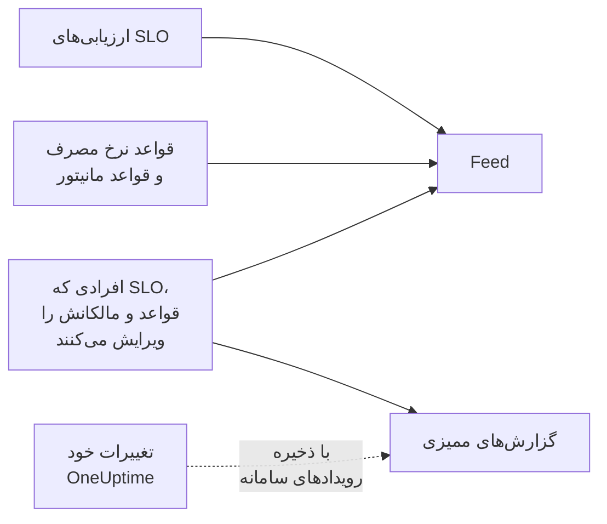

# فید و گزارش‌های ممیزی SLO

یک SLO دو سابقه از تاریخچه‌اش نگه می‌دارد، و این دو به پرسش‌های متفاوتی پاسخ می‌دهند. **Feed** به «برای این SLO چه رخ داده است؟» پاسخ می‌دهد و برای کسانی نوشته شده که از آن مراقبت می‌کنند. **گزارش‌های ممیزی** به «دقیقاً چه کسی چه چیزی را تغییر داد؟» پاسخ می‌دهند، فیلد به فیلد، برای بازبینی و انطباق.

## فید یا گزارش‌های ممیزی؟

| | **Feed** | **گزارش‌های ممیزی** |
| --- | --- | --- |
| پاسخ می‌دهد به | اینکه برای SLO چه رخ داده است | اینکه چه کسی چه چیزی را و کی تغییر داد |
| ثبت می‌کند | تغییرات وضعیت، هشدارها و حوادث نرخ مصرف، و تغییرات SLO، قواعد، مانیتورها و مالکانش | هر تغییری که افراد در SLO، قواعد نرخ مصرف، قواعد مانیتور و مالکانش داده‌اند، با مقدار پیشین و تازه |
| کار خود OneUptime را هم در بر دارد | بله: ارزیابی‌ها و قواعد مانیتوری که مانیتور پیوست می‌کنند | فقط وقتی **ذخیره رویدادهای سامانه** روشن است |
| طرح‌ها | همه طرح‌ها | طرح Enterprise روی OneUptime Cloud، یا Enterprise Edition روی نصب خودمیزبان |
| نگه‌داری | سه سال روی OneUptime Cloud | به‌طور پیش‌فرض ۷ روز، تا ۱۸۰ |

## فید SLO

فید در صفحه **Feed** آن SLO است، و تازه‌ترین مواردش زیر **Recent activity** در **نمای کلی** آن SLO. موارد به SLO، مانیتورها، هشدارها و حوادثی که نام می‌برند پیوند می‌دهند، و بیشترشان بخشی به نام **More Information** با عددها یا مقدارهای پیشین و تازه دارند.

| رویداد | کی منتشر می‌شود |
| --- | --- |
| SLO ساخته شد | SLO ساخته می‌شود. هدف، پنجره انطباق، SLI، آستانه در معرض خطر، توضیحات و قواعد نرخ مصرف پیش‌فرضی را که با آن‌ها آغاز کرده است فهرست می‌کند. |
| SLO به‌روز شد | نام، توضیحات، برچسب‌ها، هدف، پنجره انطباق، منطقه زمانی، آستانه در معرض خطر، حالت چندمانیتوری یا وضعیت‌های قطعی تغییر می‌کند. هر مقدار پیشین و تازه را نشان می‌دهد. |
| SLO فعال یا غیرفعال شد | ارزیابی روشن یا خاموش می‌شود. |
| SLO بایگانی یا بازیابی شد | SLO بایگانی می‌شود یا از بایگانی بیرون می‌آید. |
| وضعیت تغییر کرد | یک ارزیابی SLO را به وضعیتی تازه می‌برد. SLI، بودجه خطا، نرخ مصرف و آستانه در معرض خطری را که آن را توضیح می‌دهند نشان می‌دهد، و دلیل را برای **متوقف‌شده** یا **Misconfigured**. |
| هشدار نرخ مصرف ساخته شد | یک قاعده نرخ مصرف هشداری می‌سازد. به آن پیوند می‌دهد و نرخ‌های مصرفی را که فعالش کردند نشان می‌دهد. |
| حادثه نرخ مصرف اعلام شد | یک قاعده نرخ مصرف حادثه‌ای اعلام می‌کند. به آن پیوند می‌دهد و نرخ‌های مصرفی را که فعالش کردند نشان می‌دهد. |
| هشدار یا حادثه نرخ مصرف رفع شد | هشدار یا حادثه یک قاعده بسته می‌شود: خودکار رفع شده، یا دستی در حالی که رفع خودکار خاموش بوده است. |
| قاعده نرخ مصرف افزوده، تغییر داده یا حذف شد | کسی یک قاعده نرخ مصرف را می‌سازد، ویرایش یا حذف می‌کند. قواعد پیش‌فرض یک SLO تازه به‌جای آن در مورد «SLO ساخته شد» آن هستند. |
| قاعده مانیتور افزوده، تغییر داده یا حذف شد | کسی یک قاعده مانیتور را می‌سازد، ویرایش یا حذف می‌کند. ذخیره‌ای که هیچ چیز مهمی را تغییر ندهد منتشر نمی‌شود. |
| مانیتورها پیوست یا جدا شدند | مانیتورها، دستی یا با یک قاعده مانیتور، به SLO افزوده یا از آن برداشته می‌شوند. فهرست‌های بلند چند مانیتور نخست را نام می‌برند و «و N مورد دیگر». |
| مالک افزوده یا برداشته شد | یک کاربر یا تیم به مالکان SLO افزوده یا از آن‌ها برداشته می‌شود. |
| قاعده برچسب به کار رفت | یک قاعده برچسب، هنگام ساخته شدن SLO یا وقتی کسی قاعده را اجرا کرد، برچسب‌هایی به SLO پیوست کرد. قواعدی را که جور بودند نام می‌برد. [قواعد برچسب و مالکیت](/docs/slo/label-and-owner-rules) را ببینید. |
| قاعده مالکیت به کار رفت | یک قاعده مالکیت مالکانی به SLO افزود. قواعدی را که جور بودند نام می‌برد؛ هر مالکی که افزوده است هم مورد «مالک افزوده شد» خودش را می‌گیرد. |

چند نکته:

- وقتی تغییری را یک شخص داده باشد، موارد می‌گویند چه کسی. تغییراتی که خود OneUptime می‌دهد، مانند یک ارزیابی یا قاعده مانیتوری که مانیتوری را پیوست می‌کند، و تغییراتی که از راه API یا یک خودکارسازی داده می‌شوند، کاربری ندارند.
- هشدار یا حادثه‌ای که یک قاعده دوباره در دست می‌گیرد چون هنوز باز بوده، دو بار منتشر نمی‌شود.
- برای هشدار یا حادثه خصوصی، مورد عنوان، شماره و پیوند آن را حذف می‌کند، چون هر کسی که بتواند SLO را بخواند فیدش را هم می‌تواند بخواند. با این حال می‌گوید یک رکورد خصوصی ساخته شده و نرخ‌های مصرفی را که فعالش کردند نشان می‌دهد.
- هیچ‌کس نمی‌تواند موارد فید را ویرایش یا حذف کند. روی OneUptime Cloud، موارد قدیمی‌تر از سه سال برداشته می‌شوند.

## گزارش‌های ممیزی

صفحه **گزارش‌های ممیزی** یک SLO تغییرات این‌ها را فهرست می‌کند:

- خود SLO: جزئیات، تنظیمات، برچسب‌ها، مانیتورها و بایگانی آن؛
- قواعد نرخ مصرف آن؛
- قواعد مانیتور آن؛
- کاربران مالک و تیم‌های مالک آن.

تغییرات قواعد و مالکان روی قاعده یا مالک ثبت می‌شوند و در SLO گرد می‌آیند، پس صفحه آن کل تاریخچه‌اش را در یک جا نشان می‌دهد، و هر مدخل به صفحه‌ای که به آن تعلق دارد پیوند می‌دهد. موارد مرتبط مانند برچسب‌ها و مانیتورها با نامشان ثبت می‌شوند، نه فقط با شناسه‌شان.

دو چیز کنار گذاشته می‌شوند:

- **نتیجه‌های ارزیابی.** SLI، بودجه خطا، نرخ مصرف، وضعیت و زمان‌های ارزیابی هر چند دقیقه تغییر می‌کنند. تاریخچه آن‌ها در **نمای کلی**، صفحه **متریک‌ها** و **Feed** است.
- **تغییراتی که خود OneUptime می‌دهد**، مانند قاعده مانیتوری که مانیتوری را پیوست یا جدا می‌کند، مگر اینکه **ذخیره رویدادهای سامانه** برای پروژه روشن باشد. **Feed** پیوست و جدا شدن مانیتورها را در هر حال ثبت می‌کند.

### روشن کردن گزارش‌های ممیزی

گزارش‌های ممیزی قابلیتی Enterprise هستند: روی OneUptime Cloud به طرح **Enterprise**، و روی نصب خودمیزبان به Enterprise Edition نیاز دارند. روی طرح‌های دیگر، صفحه **گزارش‌های ممیزی** آن SLO توضیح می‌دهد چگونه آن را به دست آورید. روی نصب خودمیزبان، بدون مجوز معتبر (پس از دوره آزمایشی ۱۴ روزه، یا ۳۰ روز پس از انقضای مجوز) ثبت گزارش‌های ممیزی متوقف می‌شود و به محض فعال شدن یک مجوز از سر گرفته می‌شود ([When a license expires or is missing](/docs/self-hosted/enterprise#وقتی-پروانه-منقضی-شده-یا-وجود-ندارد) را ببینید). صفحه‌های **گزارش‌های ممیزی** نشان می‌دهند چه زمانی ثبت انجام نمی‌شود.

گزارش‌های ممیزی همچنین در هر پروژه به‌طور پیش‌فرض خاموش‌اند. برای روشن کردنشان:

:::steps
### باز کردن تنظیمات گزارش‌های ممیزی

به **تنظیمات پروژه** بروید، **گزارش‌های ممیزی** را در منوی کناری باز کنید و روی **تنظیمات** کلیک کنید.

### ویرایش تنظیمات

روی **Edit Audit Log Settings** کلیک کنید و **فعال کردن گزارش‌های ممیزی** را روشن کنید.

### انتخاب آنچه نگه داشته شود

**نگهداری (روز)** را از ۷ (پیش‌فرض) تا ۱۸۰ تنظیم کنید، و **ذخیره رویدادهای سامانه** را روشن کنید تا تغییراتی هم که خود OneUptime می‌دهد ثبت شوند. ذخیره کنید. تغییر در حدود یک دقیقه اعمال می‌شود.
:::

تا وقتی ثبت گزارش‌های ممیزی خاموش است، صفحه **گزارش‌های ممیزی** آن SLO پیام **Audit logging is off** را با پیوندی برای روشن کردنش نشان می‌دهد. مدخل‌هایی که پیش از خاموش شدن ثبت شده‌اند دیده‌شدنی می‌مانند. گزارش ممیزی کامل پروژه، برای همه منابع، در **تنظیمات پروژه** > **گزارش‌های ممیزی** > **گزارش‌های ممیزی** است.

## گام‌های بعدی

:::cards
- [نمای کلی SLOها](/docs/slo/introduction): همه صفحه‌هایی که یک SLO دارد.
- [مانیتورها و قواعد مانیتور](/docs/slo/monitor-rules): چه چیزی مانیتورها را پیوست و جدا می‌کند.
- [هشدارها و حوادث نرخ مصرف](/docs/slo/burn-rate-alerts): چه چیزی هشدارها و حوادث فید را می‌سازد و رفع می‌کند.
- [قواعد برچسب و مالکیت](/docs/slo/label-and-owner-rules): چه چیزی برچسب‌ها و مالکان را خودکار می‌افزاید.
:::
