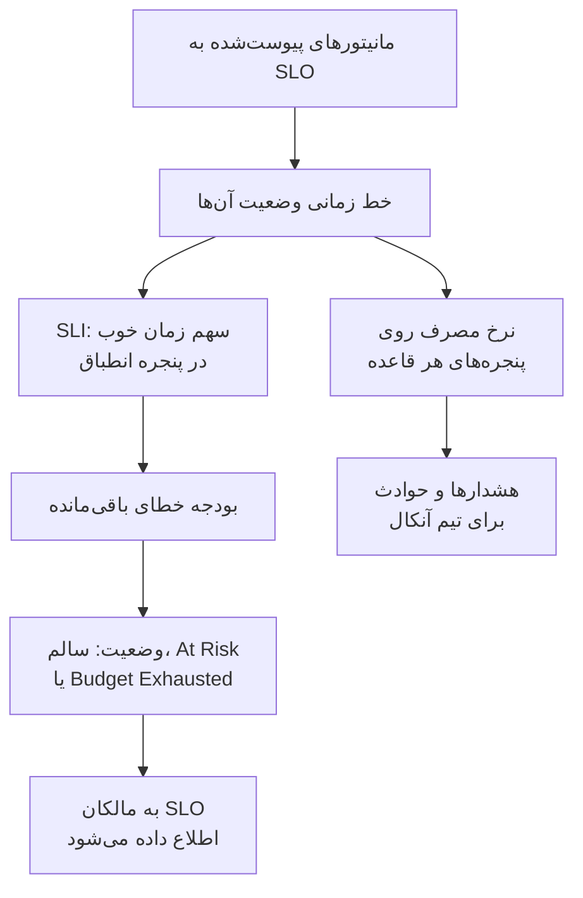

# نمای کلی SLOها

هدف سطح خدمت (SLO) هدفی از قابلیت اتکا برای چیزی است که زیر نظر دارید، مانند «۹۹٫۹٪ زمان در دسترس، روی ۳۰ روز غلتان». OneUptime هر ۵ دقیقه هر SLO را با هدفش می‌سنجد، پس به‌جای «همین حالا کار می‌کند؟» می‌توانید پاسخ دهید «آیا در بازه‌ای که برای کاربرانمان مهم است به‌اندازه کافی قابل اتکا بوده‌ایم، و چقدر جا برای خطا برایمان مانده است؟».

:::cards
- [ساختن یک SLO](#ساختن-یک-slo): یک نام و یک هدف. باقی چیزها با مقدار پیش‌فرض آغاز می‌شوند.
- [مانیتورها و قواعد مانیتور](/docs/slo/monitor-rules): مانیتورهایی را که یک SLO می‌سنجد انتخاب کنید.
- [بودجه‌های خطا](/docs/slo/error-budget): یک هدف چقدر قطعی را مجاز می‌داند و بودجه چگونه بازمی‌گردد.
- [هشدارها و حوادث نرخ مصرف](/docs/slo/burn-rate-alerts): وقتی بودجه بیش از حد سریع مصرف می‌شود، تیمتان را باخبر کنید.
:::

## چگونه کار می‌کند

یک SLO خط زمانی وضعیت مانیتورهای پیوست‌شده به خود را می‌خواند: همان داده‌ای که صفحه‌های وضعیت شما نشان می‌دهند. OneUptime از روی آن حساب می‌کند چه سهمی از پنجره انطباق زمان خوب بوده، چه مقدار از بودجه خطا مانده و این بودجه با چه سرعتی مصرف می‌شود.

## مفاهیم کلیدی

| اصطلاح | معنا |
| --- | --- |
| **SLI** (شاخص سطح خدمت) | اندازه‌گیری: درصدی از پنجره انطباق که مانیتورهای SLO در آن در دسترس بوده‌اند. |
| **SLO** (هدف سطح خدمت) | هدفی برای SLI، برای نمونه «دست‌کم ۹۹٫۹٪ در ۳۰ روز گذشته». |
| **بودجه خطا** | قطعی‌ای که هدف مجاز می‌داند: `(100% − target) × window`. با ۹۹٫۹٪ روی ۳۰ روز، این ۴۳ دقیقه و ۱۲ ثانیه است. |
| **نرخ مصرف** | سرعت خرج شدن بودجه در مقایسه با یک آهنگ یکنواخت. با نرخ مصرف ۱، بودجه درست در پایان پنجره تمام می‌شود. |

بودجه خطا قابلیت اتکا را به چیزی خرج‌کردنی تبدیل می‌کند. اگر زیاد مانده، سریع‌تر منتشر کنید و ریسک کنید؛ اگر کم مانده، آهسته‌تر بروید و روی پایداری سرمایه بگذارید. SLO به این گفت‌وگو عددی می‌دهد که همه آن را می‌بینند.

## ساختن یک SLO

به نقشی نیاز دارید که بتواند SLO بسازد: Project Owner، Project Admin یا نقشی سفارشی با دسترسی Create Service Level Objective.

:::steps
### باز کردن SLOها

**SLOs** را از منوی **محصولات** در نوار بالا باز کنید. در نخستین گروه، کنار مانیتورها و حوادث است. روی **ساخت Service Level Objective** کلیک کنید.

### نام‌گذاری و تعیین هدف

یک **نام** وارد کنید، برای نمونه «API Availability»، و یک **Target (%)**: سهمی از زمان که مانیتورهایش باید در دسترس باشند. هدف از `99.9` آغاز می‌شود. باید بزرگ‌تر از ۰ و حداکثر ۹۹٫۹۹۹ باشد، چون هدف ۱۰۰٪ هیچ بودجه خطایی برای دنبال کردن باقی نمی‌گذارد.

### بررسی مقدارهای پیش‌فرض در فیلدهای بیشتر

**فیلدهای بیشتر** بسته است و یک سطر می‌گوید مقدارهای پیش‌فرضش چه می‌کنند: SLO روی پنجره‌ای غلتان از ۳۰ روز سنجیده می‌شود و وقتی کمتر از ۲۰٪ بودجه خطایش بماند در معرض خطر قرار می‌گیرد. برای تغییر هر یک از فیلدهای جدول زیر بازش کنید.

### ذخیره SLO

روی **ساخت Service Level Objective** کلیک کنید. OneUptime SLO تازه را باز می‌کند. چون SLO تازه هنوز مانیتوری ندارد، **نمای کلی** آن **Choose what this SLO measures** را نشان می‌دهد.

### پیوست کردن مانیتورها

روی **Create a monitor rule** کلیک کنید تا هر مانیتوری که جور باشد، اکنون و در آینده، پیوست شود، یا روی **Add monitors** تا آن‌ها را دستی انتخاب کنید. [مانیتورها و قواعد مانیتور](/docs/slo/monitor-rules) را ببینید.

### رسیدن نخستین عددها

OneUptime SLOهای فعال را هر ۵ دقیقه ارزیابی می‌کند. SLI، بودجه خطا و نمودار مصرف پس از نخستین ارزیابی‌ای که مانیتوری برای سنجیدن دارد نمایان می‌شوند.
:::

فیلدهای زیر **فیلدهای بیشتر**:

| فیلد | آنچه تنظیم می‌کنید | پیش‌فرض |
| --- | --- | --- |
| **توضیحات** | اینکه SLO برای چیست. | خالی |
| **آستانه در معرض خطر (٪)** | سهمی از بودجه خطای باقی‌مانده که SLO در آن به **At Risk** می‌رود. عددی صحیح از ۰ تا ۱۰۰. | ۲۰ |
| **Window Type** | **Rolling**: N روز گذشته، که با بیرون رفتن قطعی‌های قدیمی از پنجره بهبود می‌یابد. **Calendar Month**: هر ماه جداگانه، که روز ۱ از نو آغاز می‌شود. | **Rolling** |
| **Window (Days)** | فقط پنجره‌های غلتان: چند روز به عقب نگاه شود، از ۱ تا ۳۶۶. معمولاً ۲۸ یا ۳۰. | ۳۰ |
| **منطقه زمانی** | فقط ماه‌های تقویمی: منطقه زمانی‌ای که هر ماه در آن آغاز و پایان می‌یابد. | UTC |
| **برچسب‌ها** | برچسب‌هایی برای سامان دادن و پالایش SLOها. | هیچ |

هر چیزی که تعیین می‌کند SLO چگونه می‌سنجد با یک مقدار پیش‌فرض آغاز می‌شود که بعداً تغییرش می‌دهید:

| تنظیم | SLO تازه با این آغاز می‌شود | جای تغییر |
| --- | --- | --- |
| مانیتورها | هیچ | **مانیتورها** یا **Monitor Rules** |
| وضعیت‌های قطعی | همه وضعیت‌های غیرعملیاتی پروژه | **تنظیمات** > **Downtime Calculation** |
| حالت چندمانیتوری | **Any Monitor Down** | **تنظیمات** > **Downtime Calculation** |
| ارزیابی | روشن | **تنظیمات** > **ارزیابی** |
| قواعد نرخ مصرف | یک قاعده **Fast burn** و یک قاعده **Slow burn**، متناسب با پنجره | **Burn Rate Rules** |

## یک SLO از چه ساخته شده است

| بخش | چه چیزی را تعیین می‌کند |
| --- | --- |
| مانیتورها | اینکه SLI از کجا می‌آید. آن‌ها را دستی یا با قواعد مانیتور پیوست کنید: [مانیتورها و قواعد مانیتور](/docs/slo/monitor-rules) را ببینید. |
| هدف | سهمی از زمان خوب که SLO وعده می‌دهد، بزرگ‌تر از ۰ و حداکثر ۹۹٫۹۹۹. |
| پنجره انطباق | بازه‌ای که SLI و بودجه روی آن سنجیده می‌شوند: پنجره‌ای غلتان از ۱ تا ۳۶۶ روز، یا یک ماه تقویمی. |
| آستانه در معرض خطر | سهمی از بودجه باقی‌مانده که SLO در آن به **At Risk** می‌رود. |
| وضعیت‌های قطعی | اینکه کدام وضعیت‌های مانیتور قطعی شمرده می‌شوند. |
| حالت چندمانیتوری | اینکه قطعی چند مانیتور چگونه با هم ترکیب شود. |

### کدام وضعیت‌ها قطعی شمرده می‌شوند

هر SLO فهرست خودش را از وضعیت‌های مانیتوری دارد که قطعی شمرده می‌شوند. SLO تازه با همه وضعیت‌هایی از پروژه آغاز می‌کند که عملیاتی علامت نخورده‌اند، مانند Degraded و Offline، درست همان کاری که صفحه‌های وضعیت شما می‌کنند. فهرست را در **تنظیمات** > **Downtime Calculation** تغییر دهید. خالی‌اش بگذارید تا همه وضعیت‌های غیرعملیاتی شمرده شوند، از جمله آن‌هایی که بعداً به پروژه افزوده می‌شوند.

> [!TIP]
> با دو SLO همان مانیتورها را به دو شیوه بسنجید: یک SLO سخت‌گیر دسترس‌پذیری که در آن هم Degraded و هم Offline شمرده می‌شوند، و یک SLO آسان‌گیرتر قطعی کامل که فقط Offline را می‌شمارد.

### پنجره‌های انطباق

| نوع پنجره | رفتار |
| --- | --- |
| **Rolling** | از اکنون شمار ثابتی از روزها را به عقب نگاه می‌کند. قطعی‌های قدیمی از پنجره بیرون می‌روند، پس بودجه کم‌کم بازمی‌گردد. |
| **Calendar Month** | از روز نخست ماه می‌سنجد، در منطقه زمانی SLO (به‌طور پیش‌فرض UTC). همه بودجه در آغاز هر ماه بازمی‌گردد. |

### چند مانیتور روی یک SLO

وقتی یک SLO بیش از یک مانیتور را می‌سنجد، **Multi Monitor Mode** آن تعیین می‌کند قطعی آن‌ها چگونه ترکیب شود. SLO تازه از **Any Monitor Down** استفاده می‌کند.

| حالت | قطعی چگونه شمرده می‌شود | چه زمانی به کار ببرید |
| --- | --- | --- |
| **Any Monitor Down** | هر لحظه‌ای که دست‌کم یک مانیتور قطع باشد، برای کل SLO قطعی شمرده می‌شود. قطعی‌های هم‌پوشان یک بار شمرده می‌شوند. | مانیتورها با هم یک سرویس را می‌سازند: اگر هر کدام قطع شود، کاربران متوجه می‌شوند. |
| **Monitor Seconds Average** | قطعی هر مانیتور جداگانه شمرده و روی کل زمان پایش میانگین گرفته می‌شود: SLI = 1 − (ثانیه‌های قطعی همه مانیتورها ÷ ثانیه‌های پایش‌شده همه مانیتورها). | مانیتورها ناوگانی از منابع همانند هستند و اثر جزئی باید جزئی شمرده شود. |

برای نمونه، مانیتور A از ۱۰:۰۰ تا ۱۱:۰۰ قطع است و مانیتور B در دسترس می‌ماند. **Any Monitor Down** ۶۰ دقیقه قطعی ثبت می‌کند؛ **Monitor Seconds Average** معادل ۳۰ دقیقه ثبت می‌کند، چون یکی از دو مانیتور یک ساعت قطع بوده است. در این حالت بودجه هم بر حسب ثانیه-مانیتور شمرده می‌شود: [بودجه‌های خطا](/docs/slo/error-budget) را ببینید.

## وضعیت SLO

OneUptime به هر SLO ارزیابی‌شده یک وضعیت می‌دهد:

| وضعیت | معنا |
| --- | --- |
| **سالم** | بیش از آستانه در معرض خطر بودجه مانده است. |
| **At Risk** | بودجه باقی‌مانده به آستانه در معرض خطر یا کمتر رسیده است: به‌طور پیش‌فرض ۲۰٪. |
| **Budget Exhausted** | بودجه کاملاً خرج شده یا از آن فراتر رفته است. |
| **Misconfigured** | SLO را نمی‌توان سنجید: مانیتوری ندارد، مانیتورهایش دیگر وجود ندارند یا هنوز در پنجره‌اش وضعیتی ثبت نکرده‌اند، یا هدفش خارج از محدوده است. |
| **متوقف‌شده** | همه مانیتورهایی که می‌سنجد بایگانی شده‌اند یا پایش فعالشان خاموش است، دستی، با یک حادثه دستی یا با تعمیر و نگهداری زمان‌بندی‌شده. به محض اینکه یکی از آن‌ها دوباره پایش شود، خودبه‌خود از سر گرفته می‌شود. |

SLO خاموش یا بایگانی‌شده ارزیابی نمی‌شود، پس وضعیتش همان‌طور که بوده می‌ماند؛ در عوض فهرست SLOها نشان **غیرفعال** یا **بایگانی‌شده** را نشان می‌دهد. وقتی وضعیت به **At Risk** یا **Budget Exhausted** تغییر کند، به مالکان SLO اطلاع داده می‌شود: [بودجه‌های خطا](/docs/slo/error-budget) را ببینید.

## فهرست SLOها

صفحه **SLOs** هر SLO بایگانی‌نشده را با وضعیت، SLI، بودجه باقی‌مانده، نرخ مصرف، هدف، پنجره، مانیتورها، برچسب‌ها و مالکانش نشان می‌دهد.

- کاشی‌های بالای فهرست SLOها را بر حسب وضعیت می‌شمارند: **سالم**، **At Risk**، **Budget Exhausted**، **Misconfigured**، **متوقف‌شده** و **غیرفعال**. روی یک کاشی کلیک کنید تا فقط همان SLOها را ببینید، و دوباره کلیک کنید تا همه را ببینید.
- SLOها را انتخاب کنید تا همه را با هم برچسب‌دار یا بی‌برچسب کنید، مالک بیفزایید یا بردارید، بایگانی یا حذفشان کنید.
- بخش **تنظیمات** منوی کناری **قواعد برچسب** و **قواعد مالکیت** را دارد که به SLOهای تازه برچسب و مالک می‌دهند: [قواعد برچسب و مالکیت](/docs/slo/label-and-owner-rules) را ببینید.
- بخش **پیشرفته** منوی کناری **بایگانی‌شده** را دارد، فهرست SLOهای بایگانی‌شده.

## صفحه‌های یک SLO

یک SLO را باز کنید تا صفحه‌هایش را در منوی کناری ببینید:

| صفحه | چه نشان می‌دهد |
| --- | --- |
| **نمای کلی** | وضعیت، عددهای اصلی، نمودار مصرف بودجه خطا، فعالیت اخیر، هشدارها و حوادث باز، و قواعد نرخ مصرف. |
| **متریک‌ها** | متریک‌های `oneuptime.slo.*` آن SLO، تاریخچه بلندمدت بودجه خطایش، و متریک‌های حوادث و هشدارهایی که بر آن اثر می‌گذارند. [متریک‌ها و داشبوردهای SLO](/docs/slo/metrics) را ببینید. |
| **حوادث** | حوادثی که قواعد نرخ مصرفش اعلام کرده‌اند. نشان، موارد باز را می‌شمارد. |
| **هشدارها** | هشدارهایی که قواعد نرخ مصرفش ساخته‌اند. نشان، موارد باز را می‌شمارد. |
| **Feed** | آنچه برای SLO رخ داده، به‌صورت خط زمانی. [فید و گزارش‌های ممیزی SLO](/docs/slo/feed-and-audit-logs) را ببینید. |
| **مانیتورها** | مانیتورهایی که می‌سنجد، و اینکه هر کدام را یک شخص پیوست کرده یا یک قاعده. |
| **Monitor Rules** | قواعدی که مانیتورهای جور را پیوست می‌کنند. |
| **Burn Rate Rules** | قواعدی که وقتی بودجه بیش از حد سریع مصرف می‌شود هشدار می‌سازند و حادثه اعلام می‌کنند. |
| **مالکان** | کاربران و تیم‌هایی که از تغییرات وضعیت آن باخبر می‌شوند. |
| **تنظیمات** | هدف، دوره انطباق، محاسبه قطعی، کلید ارزیابی و کارت بایگانی. |
| **گزارش‌های ممیزی** | اینکه چه کسی و چه زمانی SLO، قواعد و مالکانش را تغییر داده است. |
| **Delete SLO** | SLO را برای همیشه حذف می‌کند و هشدارها و حوادث نرخ مصرف باز آن را برطرف می‌کند. |

**مانیتورها**، **Monitor Rules** و **Burn Rate Rules** در بخش **پیکربندی** هستند، و **مالکان**، **تنظیمات**، **گزارش‌های ممیزی** و **Delete SLO** در بخش **Management**. هر دو در آغاز بسته‌اند، همان‌طور که بخش **توسعه‌دهنده** برای مدیریت SLO از راه کد: برای باز کردن یک بخش روی عنوانش کلیک کنید.

وقتی چیزی جلوی سنجش یک SLO را می‌گیرد، بنری در بالای هر یک از صفحه‌هایش می‌گوید چه چیزی نادرست است و به صفحه‌ای پیوند می‌دهد که آن را درست می‌کند: [عیب‌یابی](#عیبیابی) را ببینید.

### نمای کلی

**نمای کلی** از بالا به پایین به «آیا در محدوده بودجه هستیم؟» پاسخ می‌دهد:

- **خلاصه**: وضعیت، جمله‌ای درباره معنای آن، و توضیحات. کنارش **تازه‌سازی** و زمان آخرین ارزیابی SLO است. زیرش هدف، **Compliance window** (با نشانگر پر شدن تا وقتی پنجره غلتان تازه پر می‌شود: [SLOهای تازه و نشانگر پر شدن پنجره](#sloهای-تازه-و-نشانگر-پر-شدن-پنجره) را ببینید)، شمار مانیتورها و مالکان آمده است.
- **عددهای اصلی**:
  - **SLI**: سهم زمان خوب در پنجره، و اینکه چقدر بالاتر یا پایین‌تر از هدف است.
  - **Error budget left**: یک درصد، مدتی مانند "12m 30s left of 43m 12s"، و نواری با نشانه‌ای روی آستانه در معرض خطر. وقتی از بودجه فراتر رفته باشید، **Budget exceeded** و میزان آن را نشان می‌دهد.
  - **Burn rate**: سرعت خرج شدن بودجه در ۶۰ دقیقه گذشته، همان بازه‌ای که قاعده پیش‌فرض مصرف سریع به کار می‌برد. بالاتر از ۱× کهربایی می‌شود، و در پایین‌ترین آستانه قواعد نرخ مصرف فعال آن SLO، با **Rule threshold reached**، قرمز.
  - **Budget runway**: بودجه با این آهنگ چقدر دوام می‌آورد. [بودجه‌های خطا](/docs/slo/error-budget#مدت-دوام-بودجه) را ببینید.
- **Error budget burn-down**: بودجه باقی‌مانده در طول پنجره کنونی. [بودجه‌های خطا](/docs/slo/error-budget#نمودار-مصرف-بودجه-خطا) را ببینید.
- **Recent activity**: تازه‌ترین موارد فید SLO.
- **SLO Details**: نام، توضیحات و برچسب‌ها، تنها تنظیماتی که در نمای کلی ویرایش می‌شوند.
- **Open alerts & incidents**: آنچه قواعد نرخ مصرف همین حالا باز نگه داشته‌اند.
- **Burn rate rules**: آستانه هر قاعده فعال در کنار نرخ مصرف کنونی، و اینکه قاعده چه چیزی اعلام می‌کند.

### تنظیمات

صفحه **تنظیمات** همه چیزهایی را که شیوه سنجش یک SLO را تعیین می‌کنند گرد می‌آورد، برای هر کدام یک کارت:

| کارت | آنچه تغییر می‌دهید | خوب است بدانید |
| --- | --- | --- |
| **Objective** | **Target (%)** و **آستانه در معرض خطر (٪)**، با **Edit Objective**. | قطعی‌ای را که هدف مجاز می‌داند نشان می‌دهد، برای نمونه «43m 12s قطعی در هر پنجره ۳۰ روزه». |
| **Compliance Period** | **Window Type**، **Window (Days)** و **منطقه زمانی**، با **Edit Period**. | قواعد نرخ مصرف با تغییر پنجره آستانه‌هایشان را نگه می‌دارند، پس پس از آن بازبینی‌شان کنید. |
| **Downtime Calculation** | **Multi Monitor Mode** و **وضعیت‌های مانیتور در حالت قطعی**، با **Edit Downtime Calculation**. | اگر هیچ وضعیتی انتخاب نشود، همه وضعیت‌های غیرعملیاتی شمرده می‌شوند، از جمله آن‌هایی که بعداً افزوده می‌شوند. |
| **ارزیابی** | کلید **ارزیابی این SLO**، که به محض تغییر ذخیره می‌شود. | خاموش کردنش تأیید می‌خواهد، چون هشدارها و حوادث نرخ مصرف باز آن SLO را هم برطرف می‌کند. |
| **Archive SLO** | **بایگانی** یا **خروج از بایگانی**. | [بایگانی کردن یک SLO](#بایگانی-کردن-یک-slo) را ببینید. |

پس از تغییر هدف، دوره یا محاسبه قطعی، OneUptime در اجرای بعدی SLO را دوباره ارزیابی می‌کند.

## بایگانی کردن یک SLO

SLOای را که دیگر نمی‌سنجید ولی می‌خواهید نگهش دارید بایگانی کنید، مانند سرویسی که کنار گذاشته شده یا هدف سال گذشته. آن را از **تنظیمات** > **Archive SLO** بایگانی کنید، یا SLOها را در فهرست انتخاب کنید و **بایگانی** را برگزینید.

یک SLO بایگانی‌شده:

- از فهرست SLOها، کاشی‌های وضعیت آن، و انتخابگرها و فهرست‌های SLO در داشبوردها پنهان می‌شود؛
- ارزیابی نمی‌شود: عددهایش همان‌گونه که در آخرین ارزیابی بودند می‌مانند، قواعد نرخ مصرفش فعال نمی‌شوند و متریکی نمی‌فرستد؛
- هشدارها و حوادث نرخ مصرف بازش برطرف می‌شوند؛
- تنظیمات، تاریخچه، قواعد و مالکانش را نگه می‌دارد. قواعد مانیتورش فهرست مانیتورهایش را به‌روز نگه می‌دارند، پس با مانیتورهای درست از سر گرفته می‌شود.

SLOهای بایگانی‌شده در صفحه **بایگانی‌شده**، در بخش **پیشرفته** منوی کناری فهرست SLOها فهرست می‌شوند. آن‌ها را آنجا انتخاب کنید و **خروج از بایگانی** را برگزینید تا برگردند: در اجرای بعدی دوباره ارزیابی می‌شوند و SLI و بودجه از روی تاریخچه مانیتورهایشان دوباره محاسبه می‌شوند.

بایگانی کردن و خاموش کردن ارزیابی دو کلید جدا هستند. SLOای که پیش از بایگانی خاموش بوده، پس از خروج از بایگانی هم خاموش می‌ماند: آن را با **روشن کردن ارزیابی** در بنرش، یا با **ارزیابی این SLO** در **تنظیمات** > **ارزیابی** دوباره روشن کنید.

| می‌خواهید | این کار را بکنید |
| --- | --- |
| مدتی سنجش را متوقف کنید و آن را در فهرست نگه دارید | ارزیابی را خاموش کنید |
| کنارش بگذارید، ولی تاریخچه و تنظیماتش را نگه دارید | بایگانی‌اش کنید |
| برای همیشه برش دارید | حذفش کنید |

## SLOها روی هشدارها، حوادث و مانیتورها

هر هشدار و حادثه‌ای که یک قاعده نرخ مصرف می‌سازد به SLO خود پیوند دارد:

- صفحه هشدار یا حادثه، SLO را زیر **منابع تحت تأثیر** با پیوندی به آن فهرست می‌کند.
- فهرست‌های هشدارها و حوادث، SLO را میان منابع تحت تأثیر نشان می‌دهند، و پالایه **منابع تحت تأثیر** یک فهرست را به یک SLO محدود می‌کند.
- صفحه‌های **هشدارها** و **حوادث** آن SLO آن‌ها را فهرست می‌کنند و نشان‌هایشان در منوی کناری موارد باز را می‌شمارند.

OneUptime این پیوند را وقتی یک قاعده هشدار یا حادثه را می‌سازد برقرار می‌کند؛ نمی‌توانید آن را دستی بیفزایید، و ویرایش هشدار یا حادثه هرگز آن را برنمی‌دارد.

منوی کناری یک مانیتور هم صفحه **SLOs** دارد: SLOهایی که آن مانیتور را می‌سنجند، تا پیش از متوقف کردن یا تغییر دادن مانیتور بدانید کدام هدف‌ها به آن وابسته‌اند.

## SLOهای تازه و نشانگر پر شدن پنجره

SLOای با پنجره غلتان که از پنجره‌اش جوان‌تر است، روی داده‌هایی که تا کنون وجود دارند سنجیده می‌شود: SLO سی‌روزه‌ای که دیروز ساخته شده، داده یک روز را دارد. بودجه خطایش کوچک آغاز می‌شود و با پر شدن پنجره بزرگ می‌شود، پس نخستین عددهایش بیش از بعدها نوسان دارند.

تا وقتی چنین است، **نمای کلی** آن را می‌گوید: خلاصه نشانگر **Window 23% full** را نشان می‌دهد (در روز نخست **Window under 1% full**)، و کاشی **Error budget left** آن را زیر عددش تکرار می‌کند. هر دو وقتی پنجره پر شود ناپدید می‌شوند. SLOهای ماه تقویمی هرگز آن‌ها را نشان نمی‌دهند، چون بودجه‌شان از روز نخست کل ماه را می‌پوشاند، و SLOهای در حالت **Monitor Seconds Average** هم نشان نمی‌دهند، چون بودجه‌شان روی همه مانیتورها شمرده می‌شود.

## عیب‌یابی

بنری در بالای صفحه‌های SLO می‌گوید چه چیزی جلوی سنجش آن را گرفته است:

| بنر | معنا | چه باید کرد |
| --- | --- | --- |
| **No monitors attached** | SLO مانیتوری ندارد، پس چیزی برای سنجیدن نیست. | مانیتور پیوست کنید یا یک قاعده مانیتور بسازید. |
| **Waiting for SLO evaluation** | مانیتورها پیوست شده‌اند، ولی آخرین ارزیابی داده وضعیتی از آن‌ها نداشت. | بررسی کنید که مانیتورها بررسی می‌شوند. عددها پس از ارزیابی بعدی‌ای که داده دارد نمایان می‌شوند. |
| **Measurement is paused** | همه مانیتورهایی که می‌سنجد بایگانی شده‌اند یا پایش فعالشان خاموش است. | پایش دست‌کم یک مانیتور را دوباره روشن کنید، یا صبر کنید تا تعمیر و نگهداری تمام شود. |
| **The target is out of range** | هدف در محدوده بزرگ‌تر از ۰ و کوچک‌تر از ۱۰۰ نیست. | هدفی مانند ۹۹٫۹ را در **تنظیمات** > **Objective** تنظیم کنید. |
| **This SLO is disabled** | ارزیابی خاموش است. | روی **روشن کردن ارزیابی** کلیک کنید. |
| **This SLO is archived** | SLO بایگانی شده است. | آن را در **تنظیمات** از بایگانی خارج کنید. |
| **Not evaluated yet** | SLO همین حالا ساخته شده است. | منتظر نخستین ارزیابی بمانید، حداکثر چند دقیقه. |

## گام‌های بعدی

:::cards
- [مانیتورها و قواعد مانیتور](/docs/slo/monitor-rules): مانیتورها را دستی یا با قواعد پیوست کنید.
- [بودجه‌های خطا](/docs/slo/error-budget): محاسبه بودجه، مدت دوام آن و اینکه بودجه چگونه بازمی‌گردد.
- [هشدارها و حوادث نرخ مصرف](/docs/slo/burn-rate-alerts): وقتی بودجه بیش از حد سریع مصرف می‌شود، تیم آنکالتان را باخبر کنید.
- [متریک‌ها و داشبوردهای SLO](/docs/slo/metrics): برای SLOها نمودار بکشید و یک داشبورد SLO بسازید.
:::
