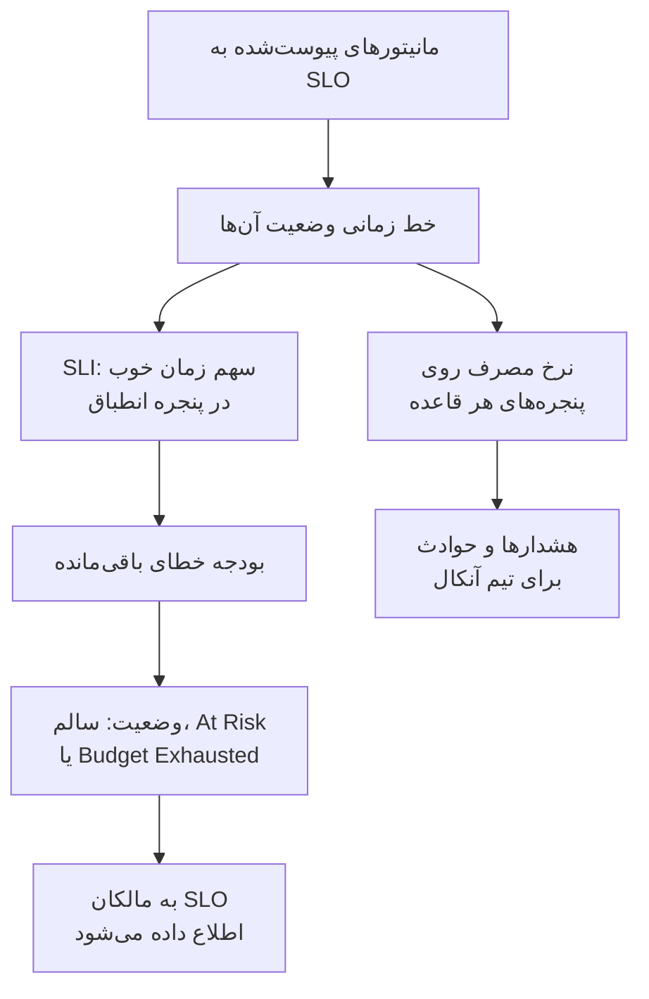

# نمای کلی SLOها

هدف سطح خدمت (SLO) هدفی از قابلیت اتکا برای چیزی است که اجرا می‌کنید، مانند «۹۹٫۹٪ زمان در دسترس، روی ۳۰ روز غلتان» یا «۹۹٫۹٪ درخواست‌های پرداخت موفق‌اند». OneUptime هر ۵ دقیقه هر SLO را با هدفش می‌سنجد، پس به‌جای «همین حالا کار می‌کند؟» می‌توانید پاسخ دهید «آیا در بازه‌ای که برای کاربرانمان مهم است به‌اندازه کافی قابل اتکا بوده‌ایم، و چقدر جا برای خطا برایمان مانده است؟». [واژه‌نامه](/docs/introduction/glossary#slo) SLOها را کنار دیگر واژه‌هایی می‌گذارد که OneUptime به کار می‌برد.

:::cards
- [ساختن یک SLO](#ساختن-یک-slo): آنچه می‌سنجد، یک نام و یک هدف. باقی چیزها با مقدار پیش‌فرض آغاز می‌شوند.
- [مانیتورها و قواعد مانیتور](/docs/slo/monitor-rules): مانیتورهایی را که یک SLO می‌سنجد انتخاب کنید.
- [SLOهای درخواست و تأخیر](/docs/slo/request-slos): درخواست‌های سرویس‌ها را از روی ترِیس‌هایشان بسنجید.
- [بودجه‌های خطا](/docs/slo/error-budget): یک هدف چقدر قطعی را مجاز می‌داند و بودجه چگونه بازمی‌گردد.
- [هشدارها و حوادث نرخ مصرف](/docs/slo/burn-rate-alerts): وقتی بودجه بیش از حد سریع مصرف می‌شود، تیمتان را باخبر کنید.
:::

## چگونه کار می‌کند

یک SLO یکی از دو چیز را می‌سنجد. یک SLO زمان کارکرد مانیتور خط زمانی وضعیت مانیتورهای پیوست‌شده به خود را می‌خواند: همان داده‌ای که صفحه‌های وضعیت شما نشان می‌دهند. یک SLO درخواست، درخواست‌هایی را که سرویس‌هایش پاسخ می‌دهند از روی ترِیس‌هایشان می‌شمارد: [SLOهای درخواست و تأخیر](/docs/slo/request-slos) را ببینید. باقی این صفحه SLOهای زمان کارکرد مانیتور را شرح می‌دهد، و SLOهای درخواست هم همین‌گونه کار می‌کنند، مگر آنکه خلافش گفته شود. OneUptime از روی آن حساب می‌کند چه سهمی از پنجره انطباق زمان خوب بوده، چه مقدار از بودجه خطا مانده و این بودجه با چه سرعتی مصرف می‌شود. زمانی که پایش یک مانیتور خاموش است کنار گذاشته می‌شود: در آن زمان هیچ چیز مانیتور را بررسی نمی‌کند، پس آن زمان نه از بودجه خطا مصرف می‌کند و نه زمان خوب به حساب می‌آید. زمانِ پیش از نخستین بررسی یک مانیتور هم کنار گذاشته می‌شود: تا وقتی چیزی مانیتوری را بررسی نکرده، وضعیتش فقط همان وضعیت عملیاتی است که هر مانیتور با آن ساخته می‌شود، پس یک SLO از نخستین بررسی‌های مانیتورهایش سنجیده می‌شود، و SLOیی که هنوز هیچ چیز مانیتورهایش را بررسی نکرده، تا وقتی بررسی نشوند چیزی برای سنجیدن ندارد.



## مفاهیم کلیدی

واژه‌هایی که در سراسر OneUptime به کار می‌روند در [واژه‌نامه](/docs/introduction/glossary) آمده‌اند.

| اصطلاح | معنا |
| --- | --- |
| **SLI** (شاخص سطح خدمت) | اندازه‌گیری: درصدی از پنجره انطباق که مانیتورهای SLO در آن در دسترس بوده‌اند، یا درصدی از درخواست‌های سرویس‌هایش که خوب بوده‌اند. |
| **SLO** (هدف سطح خدمت) | هدفی برای SLI، برای نمونه «دست‌کم ۹۹٫۹٪ در ۳۰ روز گذشته». |
| **بودجه خطا** | قطعی‌ای که هدف مجاز می‌داند: `(100% − target) × window`. با ۹۹٫۹٪ روی ۳۰ روز، این ۴۳ دقیقه و ۱۲ ثانیه است. برای یک SLO درخواست، بودجه خطا درخواست‌های بدی است که هدف مجاز می‌داند: با ۹۹٫۹٪، یکی از هر ۱٬۰۰۰ درخواست. |
| **نرخ مصرف** | سرعت خرج شدن بودجه در مقایسه با یک آهنگ یکنواخت. با نرخ مصرف ۱، بودجه درست در پایان پنجره تمام می‌شود. |

بودجه خطا قابلیت اتکا را به چیزی خرج‌کردنی تبدیل می‌کند. اگر زیاد مانده، سریع‌تر منتشر کنید و ریسک کنید؛ اگر کم مانده، آهسته‌تر بروید و روی پایداری سرمایه بگذارید. SLO به این گفت‌وگو عددی می‌دهد که همه آن را می‌بینند.

## ساختن یک SLO

به نقشی نیاز دارید که بتواند SLO بسازد: مالک پروژه، مدیر پروژه یا نقشی سفارشی با دسترسی Create Service Level Objective.

:::steps
### باز کردن SLOها

**SLOها** را از منوی **محصولات** در نوار بالا باز کنید. در نخستین گروه، کنار مانیتورها و حوادث است. روی **ساخت هدف سطح سرویس** کلیک کنید.

### انتخاب آنچه می‌سنجد

زیر **آنچه می‌سنجد**، **زمان کارکرد مانیتور** را نگه دارید تا سهمی از زمان را بسنجید که مانیتورها در دسترس‌اند. برای سنجیدن درخواست‌های سرویس‌ها، به‌جای آن **موفقیت درخواست** یا **تأخیر درخواست** را انتخاب کنید، و سرویس‌ها را در **سرویس‌ها** برگزینید: [SLOهای درخواست و تأخیر](/docs/slo/request-slos) را ببینید. برای شمردن رویدادهای خوب در یک شمارنده یا یک هیستوگرام که سرویس‌هایتان می‌فرستند، **متریک** را انتخاب کنید: [SLOهای مبتنی بر متریک](/docs/slo/request-slos#sloهای-مبتنی-بر-متریک) را ببینید. روی **بعدی** کلیک کنید.

### نام‌گذاری و تعیین هدف

یک **نام** وارد کنید، برای نمونه «API Availability»، و یک **هدف (%)**: سهمی از زمان، یا از درخواست‌ها، که باید خوب باشد. هدف از `99.9` آغاز می‌شود. باید بزرگ‌تر از ۰ و حداکثر ۹۹٫۹۹۹ باشد، چون هدف ۱۰۰٪ هیچ بودجه خطایی برای دنبال کردن باقی نمی‌گذارد.

### بررسی مقدارهای پیش‌فرض در فیلدهای بیشتر

**فیلدهای بیشتر** بسته است و یک سطر می‌گوید مقدارهای پیش‌فرضش چه می‌کنند: SLO روی پنجره‌ای غلتان از ۳۰ روز سنجیده می‌شود و وقتی کمتر از ۲۰٪ بودجه خطایش بماند در معرض خطر قرار می‌گیرد. برای تغییر هر یک از فیلدهای جدول زیر بازش کنید.

### ذخیره SLO

روی **ساخت هدف سطح سرویس** کلیک کنید. OneUptime SLO تازه را باز می‌کند. **نمای کلی** یک SLO زمان کارکرد مانیتور **انتخاب کنید این SLO چه چیزی را بسنجد** را نشان می‌دهد، چون هنوز مانیتوری ندارد.

### پیوست کردن مانیتورها

برای یک SLO زمان کارکرد مانیتور، روی **ساخت قاعده مانیتور** کلیک کنید تا هر مانیتوری که جور باشد، اکنون و در آینده، پیوست شود، یا روی **افزودن مانیتورها** تا آن‌ها را دستی انتخاب کنید. [مانیتورها و قواعد مانیتور](/docs/slo/monitor-rules) را ببینید.

### رسیدن نخستین عددها

OneUptime SLOهای فعال را هر ۵ دقیقه ارزیابی می‌کند. SLI، بودجه خطا و نمودار مصرف پس از نخستین ارزیابی‌ای که مانیتوری برای سنجیدن یا درخواستی برای شمردن دارد نمایان می‌شوند.
:::

فیلدهای زیر **فیلدهای بیشتر**:

| فیلد | آنچه تنظیم می‌کنید | پیش‌فرض |
| --- | --- | --- |
| **توضیحات** | اینکه SLO برای چیست. | خالی |
| **آستانه در معرض خطر (٪)** | سهمی از بودجه خطای باقی‌مانده که SLO در آن به **در معرض خطر** می‌رود. عددی صحیح از ۰ تا ۱۰۰. | ۲۰ |
| **نوع بازه** | **غلتان**: N روز گذشته، که با بیرون رفتن قطعی‌های قدیمی از پنجره بهبود می‌یابد. **ماه تقویمی**: هر ماه جداگانه، که روز ۱ از نو آغاز می‌شود. | **غلتان** |
| **بازه (روز)** | فقط پنجره‌های غلتان: چند روز به عقب نگاه شود، از ۱ تا ۳۶۶. معمولاً ۲۸ یا ۳۰. | ۳۰ |
| **منطقه زمانی** | فقط ماه‌های تقویمی: منطقه زمانی‌ای که هر ماه در آن آغاز و پایان می‌یابد. | UTC |
| **برچسب‌ها** | برچسب‌هایی برای سامان دادن و پالایش SLOها. | هیچ |

هر چیزی که تعیین می‌کند SLO چگونه می‌سنجد با یک مقدار پیش‌فرض آغاز می‌شود که بعداً تغییرش می‌دهید:

| تنظیم | SLO تازه با این آغاز می‌شود | جای تغییر |
| --- | --- | --- |
| مانیتورها | هیچ | **مانیتورها** یا **قواعد مانیتور** |
| وضعیت‌های قطعی | همه وضعیت‌های غیرعملیاتی پروژه | **تنظیمات** > **محاسبه زمان قطعی** |
| حالت چندمانیتوری | **از کار افتادن هر مانیتور** | **تنظیمات** > **محاسبه زمان قطعی** |
| ارزیابی | روشن | **تنظیمات** > **ارزیابی** |
| قواعد نرخ مصرف | یک قاعده **Fast burn**، یک قاعده **Slow burn** و یک قاعده **Slow leak**، متناسب با پنجره | **قواعد نرخ مصرف** |

## یک SLO از چه ساخته شده است

| بخش | چه چیزی را تعیین می‌کند |
| --- | --- |
| آنچه می‌سنجد | **زمان کارکرد مانیتور**، **موفقیت درخواست** یا **تأخیر درخواست**. |
| مانیتورها یا سرویس‌ها | اینکه SLI از کجا می‌آید: مانیتورها، که دستی یا با قواعد مانیتور پیوست می‌شوند ([مانیتورها و قواعد مانیتور](/docs/slo/monitor-rules) را ببینید)، یا سرویس‌هایی که یک SLO درخواست، درخواست‌هایشان را می‌شمارد. |
| هدف | سهمی از زمان خوب که SLO وعده می‌دهد، بزرگ‌تر از ۰ و حداکثر ۹۹٫۹۹۹. |
| پنجره انطباق | بازه‌ای که SLI و بودجه روی آن سنجیده می‌شوند: پنجره‌ای غلتان از ۱ تا ۳۶۶ روز، یا یک ماه تقویمی. |
| آستانه در معرض خطر | سهمی از بودجه باقی‌مانده که SLO در آن به **در معرض خطر** می‌رود. |
| وضعیت‌های قطعی | اینکه کدام وضعیت‌های مانیتور قطعی شمرده می‌شوند. |
| حالت چندمانیتوری | اینکه قطعی چند مانیتور چگونه با هم ترکیب شود. |

### کدام وضعیت‌ها قطعی شمرده می‌شوند

هر SLO فهرست خودش را از وضعیت‌های مانیتوری دارد که قطعی شمرده می‌شوند. SLO تازه با همه وضعیت‌هایی از پروژه آغاز می‌کند که عملیاتی علامت نخورده‌اند، مانند Degraded و Offline، درست همان کاری که صفحه‌های وضعیت شما می‌کنند. فهرست را در **تنظیمات** > **محاسبه زمان قطعی** تغییر دهید. خالی‌اش بگذارید تا همه وضعیت‌های غیرعملیاتی شمرده شوند، از جمله آن‌هایی که بعداً به پروژه افزوده می‌شوند.

> [!TIP]
> با دو SLO همان مانیتورها را به دو شیوه بسنجید: یک SLO سخت‌گیر دسترس‌پذیری که در آن هم Degraded و هم Offline شمرده می‌شوند، و یک SLO آسان‌گیرتر قطعی کامل که فقط Offline را می‌شمارد.

### پنجره‌های انطباق

| نوع پنجره | رفتار |
| --- | --- |
| **غلتان** | از اکنون شمار ثابتی از روزها را به عقب نگاه می‌کند. قطعی‌های قدیمی از پنجره بیرون می‌روند، پس بودجه کم‌کم بازمی‌گردد. |
| **ماه تقویمی** | از روز نخست ماه می‌سنجد، در منطقه زمانی SLO (به‌طور پیش‌فرض UTC). همه بودجه در آغاز هر ماه بازمی‌گردد. |

### چند مانیتور روی یک SLO

وقتی یک SLO بیش از یک مانیتور را می‌سنجد، **حالت چند مانیتور** آن تعیین می‌کند قطعی آن‌ها چگونه ترکیب شود. SLO تازه از **از کار افتادن هر مانیتور** استفاده می‌کند.

| حالت | قطعی چگونه شمرده می‌شود | چه زمانی به کار ببرید |
| --- | --- | --- |
| **از کار افتادن هر مانیتور** | هر لحظه‌ای که دست‌کم یک مانیتور قطع باشد، برای کل SLO قطعی شمرده می‌شود. قطعی‌های هم‌پوشان یک بار شمرده می‌شوند. | مانیتورها با هم یک سرویس را می‌سازند: اگر هر کدام قطع شود، کاربران متوجه می‌شوند. |
| **میانگین ثانیه‌های مانیتور** | قطعی هر مانیتور جداگانه شمرده و روی کل زمان پایش میانگین گرفته می‌شود: SLI = 1 − (ثانیه‌های قطعی همه مانیتورها ÷ ثانیه‌های پایش‌شده همه مانیتورها). | مانیتورها ناوگانی از منابع همانند هستند و اثر جزئی باید جزئی شمرده شود. |

برای نمونه، مانیتور A از ۱۰:۰۰ تا ۱۱:۰۰ قطع است و مانیتور B در دسترس می‌ماند. **از کار افتادن هر مانیتور** ۶۰ دقیقه قطعی ثبت می‌کند؛ **میانگین ثانیه‌های مانیتور** معادل ۳۰ دقیقه ثبت می‌کند، چون یکی از دو مانیتور یک ساعت قطع بوده است. در این حالت بودجه هم بر حسب ثانیه-مانیتور شمرده می‌شود: [بودجه‌های خطا](/docs/slo/error-budget) را ببینید.

## وضعیت SLO

OneUptime به هر SLO ارزیابی‌شده یک وضعیت می‌دهد:

| وضعیت | معنا |
| --- | --- |
| **سالم** | بیش از آستانه در معرض خطر بودجه مانده است. |
| **در معرض خطر** | بودجه باقی‌مانده به آستانه در معرض خطر یا کمتر رسیده است: به‌طور پیش‌فرض ۲۰٪. |
| **بودجه تمام‌شده** | بودجه کاملاً خرج شده یا از آن فراتر رفته است. |
| **پیکربندی نادرست** | SLO را نمی‌توان سنجید: مانیتوری ندارد، مانیتورهایش دیگر وجود ندارند، هنوز هیچ چیز بررسی‌شان نکرده یا هنوز در پنجره‌اش وضعیتی ثبت نکرده‌اند، یا هدفش خارج از محدوده است. یک SLO درخواست بدون سرویس، بدون آستانه تأخیر، یا تا وقتی سرویس‌هایش در پنجره‌اش به هیچ درخواستی پاسخ نداده‌اند، پیکربندی نادرست است. |
| **متوقف‌شده** | همه مانیتورهایی که می‌سنجد بایگانی شده‌اند یا پایش فعالشان خاموش است، دستی، با یک حادثه دستی یا با تعمیر و نگهداری زمان‌بندی‌شده. به محض اینکه یکی از آن‌ها دوباره پایش شود، خودبه‌خود از سر گرفته می‌شود. |

SLO خاموش یا بایگانی‌شده ارزیابی نمی‌شود، پس وضعیتش همان‌طور که بوده می‌ماند؛ در عوض فهرست SLOها نشان **غیرفعال** یا **بایگانی‌شده** را نشان می‌دهد. وقتی وضعیت به **در معرض خطر** یا **بودجه تمام‌شده** تغییر کند، به مالکان SLO اطلاع داده می‌شود: [بودجه‌های خطا](/docs/slo/error-budget) را ببینید.

## فهرست SLOها

صفحه **SLOها** هر SLO بایگانی‌نشده را با وضعیت، SLI، بودجه باقی‌مانده، نرخ مصرف، هدف، پنجره، مانیتورها، برچسب‌ها و مالکانش نشان می‌دهد. ستون **آنچه می‌سنجد** برای SLO درخواست، سرویس‌های آن را نشان می‌دهد و برای SLO دسترس‌پذیری مانیتور، مانیتورهای آن را، و فیلتر **سرویس‌ها** SLOهایی را که یک سرویس را می‌سنجند پیدا می‌کند.

- کاشی‌های بالای فهرست SLOها را بر حسب وضعیت می‌شمارند: **سالم**، **در معرض خطر**، **بودجه تمام‌شده**، **پیکربندی نادرست**، **متوقف‌شده** و **غیرفعال**. به محض اینکه SLOای بایگانی‌نشده وجود داشته باشد، نمایش داده می‌شوند. روی یک کاشی کلیک کنید تا فقط همان SLOها را ببینید، و دوباره کلیک کنید تا همه را ببینید.
- SLOها را انتخاب کنید تا همه را با هم برچسب‌دار یا بی‌برچسب کنید، مالک بیفزایید یا بردارید، فعال یا غیرفعالشان کنید، [قواعد نرخ مصرف پیشنهادی](/docs/slo/burn-rate-alerts#افزودن-قواعد-پیشنهادی-به-چند-slo-با-هم) را که ندارند به آن‌ها بدهید، یا بایگانی یا حذفشان کنید.
- بخش **تنظیمات** منوی کناری **قواعد برچسب** و **قواعد مالکیت** را دارد که به SLOهای تازه برچسب و مالک می‌دهند: [قواعد برچسب و مالکیت](/docs/slo/label-and-owner-rules) را ببینید.
- بخش **پیشرفته** منوی کناری **بایگانی‌شده** را دارد، فهرست SLOهای بایگانی‌شده.

## صفحه‌های یک SLO

یک SLO را باز کنید تا صفحه‌هایش را در منوی کناری ببینید:

| صفحه | چه نشان می‌دهد |
| --- | --- |
| **نمای کلی** | وضعیت، عددهای اصلی، نمودار مصرف بودجه خطا، فعالیت اخیر، هشدارها و حوادث باز، و قواعد نرخ مصرف. |
| **متریک‌ها** | متریک‌های `oneuptime.slo.*` آن SLO، تاریخچه بلندمدت بودجه خطایش، و متریک‌های حوادث و هشدارهایی که بر آن اثر می‌گذارند. [متریک‌ها و داشبوردهای SLO](/docs/slo/metrics) را ببینید. |
| **گزارش ماهانه** | عملکرد SLO در هر ماه تقویمی و در کل بازه. ببینید [گزارش ماهانه](#گزارش-ماهانه). |
| **حوادث** | حوادثی که قواعد نرخ مصرف و سیاست بودجه خطایش اعلام کرده‌اند. نشان، موارد باز را می‌شمارد. |
| **هشدارها** | هشدارهایی که قواعد نرخ مصرف و سیاست بودجه خطایش ساخته‌اند. نشان، موارد باز را می‌شمارد. |
| **فید** | آنچه برای SLO رخ داده، به‌صورت خط زمانی. [فید و گزارش‌های ممیزی SLO](/docs/slo/feed-and-audit-logs) را ببینید. |
| **مانیتورها** | مانیتورهایی که می‌سنجد، و اینکه هر کدام را یک شخص پیوست کرده یا یک قاعده. فقط برای SLOهای زمان کارکرد مانیتور. |
| **قواعد مانیتور** | قواعدی که مانیتورهای جور را پیوست می‌کنند. فقط برای SLOهای زمان کارکرد مانیتور. |
| **قواعد نرخ مصرف** | قواعدی که وقتی بودجه بیش از حد سریع مصرف می‌شود هشدار می‌سازند و حادثه اعلام می‌کنند. |
| **سیاست بودجه خطا** | آنچه تیم توافق کرده با کم شدن بودجه خطا انجام دهد، و هشدارها و حوادثی که هر سطح سیاست ایجاد می‌کند. [سیاست بودجه خطا](/docs/slo/error-budget-policy) را ببینید. |
| **مالکان** | کاربران و تیم‌هایی که از تغییرات وضعیت آن باخبر می‌شوند. |
| **تنظیمات** | آنچه می‌سنجد، هدف، دوره انطباق، محاسبه قطعی، کلید ارزیابی و کارت بایگانی. |
| **گزارش‌های ممیزی** | اینکه چه کسی و چه زمانی SLO، قواعد و مالکانش را تغییر داده است. |
| **حذف SLO** | SLO را برای همیشه حذف می‌کند و هشدارها و حوادث نرخ مصرف باز آن را برطرف می‌کند. |

**مانیتورها** در بخش **نمای کلی**، زیر **نمای کلی** است؛ **قواعد مانیتور**، **قواعد نرخ مصرف** و **سیاست بودجه خطا** در بخش **قواعد**؛ و **مالکان**، **تنظیمات**، **گزارش‌های ممیزی** و **حذف SLO** در بخش **مدیریت**. **قواعد** و **مدیریت** در آغاز بسته‌اند، همان‌طور که بخش **توسعه‌دهنده** برای مدیریت SLO از راه کد: برای باز کردن یک بخش روی عنوانش کلیک کنید.

وقتی چیزی جلوی سنجش یک SLO را می‌گیرد، بنری در بالای هر یک از صفحه‌هایش می‌گوید چه چیزی نادرست است و به صفحه‌ای پیوند می‌دهد که آن را درست می‌کند: [عیب‌یابی](#عیبیابی) را ببینید.

### نمای کلی

**نمای کلی** از بالا به پایین به «آیا در محدوده بودجه هستیم؟» پاسخ می‌دهد:

- **خلاصه**: وضعیت، جمله‌ای درباره معنای آن، و توضیحات. کنارش **تازه‌سازی** و زمان آخرین ارزیابی SLO است. زیرش هدف، **بازه انطباق** (با نشانگر پر شدن تا وقتی پنجره غلتان تازه پر می‌شود: [SLOهای تازه و نشانگر پر شدن پنجره](#sloهای-تازه-و-نشانگر-پر-شدن-پنجره) را ببینید)، شمار مانیتورها (یا سرویس‌های یک SLO درخواست) و مالکان آمده است، با **افزودن مالکان** برای افزودن مالک همان‌جا.
- **عددهای اصلی**:
  - **SLI**: سهم زمان خوب در پنجره، و اینکه چقدر بالاتر یا پایین‌تر از هدف است.
  - **بودجه خطای مانده**: یک درصد، مدتی مانند "۱۲ دقیقه ۳۰ ثانیه از ۴۳ دقیقه ۱۲ ثانیه مانده" (برای یک SLO درخواست، شمار درخواست‌های بد)، و نواری با نشانه‌ای روی آستانه در معرض خطر. وقتی از بودجه فراتر رفته باشید، **بودجه از حد گذشته** و میزان آن را نشان می‌دهد.
  - **نرخ مصرف**: سرعت خرج شدن بودجه در ۶۰ دقیقه گذشته، همان بازه‌ای که قاعده پیش‌فرض مصرف سریع به کار می‌برد. بالاتر از ۱× کهربایی می‌شود، و در پایین‌ترین آستانه آن قواعد نرخ مصرف فعال SLO که ۶ ساعت یا کمتر به عقب نگاه می‌کنند، با **آستانه قاعده رسید**، قرمز. یک ساعت درباره قاعده‌ای که چند روز به عقب نگاه می‌کند، مانند **Slow leak**، چیز زیادی نمی‌گوید، پس با چنین قاعده‌ای مقایسه نمی‌شود.
  - **دوام بودجه**: بودجه با این آهنگ چقدر دوام می‌آورد. [بودجه‌های خطا](/docs/slo/error-budget#مدت-دوام-بودجه) را ببینید.
- **روند مصرف بودجه خطا**: بودجه باقی‌مانده در طول پنجره کنونی. [بودجه‌های خطا](/docs/slo/error-budget#نمودار-مصرف-بودجه-خطا) را ببینید.
- **فعالیت اخیر**: تازه‌ترین موارد فید SLO.
- **جزئیات SLO**: نام، توضیحات و برچسب‌ها، تنها تنظیماتی که در نمای کلی ویرایش می‌شوند.
- **هشدارها و حوادث باز**: آنچه قواعد نرخ مصرف همین حالا باز نگه داشته‌اند.
- **قواعد نرخ مصرف**: آستانه هر قاعده فعال در کنار نرخ مصرف کنونی، برای قواعدی که ۶ ساعت یا کمتر به عقب نگاه می‌کنند، و اینکه قاعده چه چیزی اعلام می‌کند.

وقتی SLO در سطحی از سیاست بودجه خطای خود است، **نمای کلی** آن سطح و آنچه تیم توافق کرده در آن انجام دهد را هم نشان می‌دهد: [سیاست بودجه خطا](/docs/slo/error-budget-policy) را ببینید.

کارت **استفاده‌شده توسط** قواعد نرخ مصرف و سطح‌های سیاست بودجه خطا را که روی SLO اثر می‌گذارند، و داشبوردهایی که آن را نمایش می‌دهند فهرست می‌کند. بایگانی یا حذف SLO اول این‌ها را می‌گوید: قواعد و سطح‌هایش همراه آن می‌روند.

### تنظیمات

صفحه **تنظیمات** همه چیزهایی را که شیوه سنجش یک SLO را تعیین می‌کنند گرد می‌آورد، برای هر کدام یک کارت:

| کارت | آنچه تغییر می‌دهید | خوب است بدانید |
| --- | --- | --- |
| **آنچه می‌سنجد** | **آنچه می‌سنجد**، **سرویس‌ها**، **آستانه تأخیر (ms)**، **فیلتر درخواست** و **متریک**، با **ویرایش آنچه می‌سنجد**. | یک SLO درخواست پس از هر تغییر، درخواست‌هایش را از نو از ابتدا می‌شمارد. |
| **هدف** | **هدف (%)** و **آستانه در معرض خطر (٪)**، با **ویرایش هدف**. | قطعی‌ای را که هدف مجاز می‌داند نشان می‌دهد، برای نمونه «۴۳ دقیقه ۱۲ ثانیه زمان قطعی در هر بازه ۳۰ روزه». |
| **دوره انطباق** | **نوع بازه**، **بازه (روز)** و **منطقه زمانی**، با **ویرایش دوره**. | قواعد نرخ مصرف با تغییر پنجره آستانه‌هایشان را نگه می‌دارند، پس پس از آن بازبینی‌شان کنید. |
| **محاسبه زمان قطعی** | **حالت چند مانیتور** و **وضعیت‌های مانیتور در حالت قطعی**، با **ویرایش محاسبه زمان قطعی**. | فقط برای SLOهای زمان کارکرد مانیتور. اگر هیچ وضعیتی انتخاب نشود، همه وضعیت‌های غیرعملیاتی شمرده می‌شوند، از جمله آن‌هایی که بعداً افزوده می‌شوند. |
| **ارزیابی** | کلید **ارزیابی این SLO**، که به محض تغییر ذخیره می‌شود. | خاموش کردنش تأیید می‌خواهد، چون هشدارها و حوادث نرخ مصرف باز آن SLO را هم برطرف می‌کند. |
| **بایگانی SLO** | **بایگانی** یا **خروج از بایگانی**. | [بایگانی کردن یک SLO](#بایگانی-کردن-یک-slo) را ببینید. |

پس از تغییر آنچه می‌سنجد، هدف، دوره یا محاسبه قطعی، OneUptime در اجرای بعدی SLO را دوباره ارزیابی می‌کند.

### گزارش ماهانه

**گزارش ماهانه** نشان می‌دهد SLO در هر ماه تقویمی از **۳ ماه**، **۶ ماه**، **۹ ماه** یا **۱۲ ماه** گذشته، یا از یک سال تقویمی، چگونه عمل کرده است. هر ماه SLI خود، زمان قطعی‌اش (برای SLO درخواست، درخواست‌های ناموفق یا کند، و برای SLO مبتنی بر متریک، رویدادهای بد)، سهمی از بودجه خطایش که مصرف کرده و نتیجه‌اش را نشان می‌دهد:

| نتیجه | معنا |
| --- | --- |
| برآورده شد | ماه تمام شده و SLI آن به هدف رسیده است. |
| برآورده نشد | ماه تمام شده و به هدف نرسیده است، یا ماه هنوز در جریان است و از همین حالا بیش از آنچه کل ماه اجازه می‌دهد زمان قطعی دارد. |
| در مسیر درست | ماه هنوز در جریان است و SLI آن تا اکنون به هدف می‌رسد. |
| پایین‌تر از هدف | ماه هنوز در جریان است و SLI آن تا اکنون پایین‌تر از هدف است. |
| داده‌ای نیست | در آن ماه چیزی سنجیده نشد. |

ردیف **کل** کل بازه را یکجا می‌سنجد. SLO دارای چند مانیتور یک جدول **به تفکیک مانیتور** هم دارد: SLI خودِ هر مانیتور در هر ماه، با مانیتوری که بیشترین هزینه را برای SLO داشته در ابتدا. **دانلود CSV** گزارش را به‌صورت فایلی برای صفحه‌گسترده ذخیره می‌کند.

برای گزارش چیز اضافه‌ای ذخیره نمی‌شود. هر ماه هنگام باز کردن گزارش از تاریخچه وضعیت مانیتورها حساب می‌شود، با مانیتورها، وضعیت‌های قطعی و هدف SLO آن‌طور که اکنون هستند، پس تا پیش از ساخته شدن SLO هم عقب می‌رود. ماه‌های یک SLO درخواست از درخواست‌هایی می‌آیند که OneUptime برایش شمرده، و ماه‌های یک SLO مبتنی بر متریک از رویدادهای متریکش؛ OneUptime آن‌ها را ۴۰۰ روز نگه می‌دارد. ماه‌ها بر اساس منطقه زمانی SLO حساب می‌شوند، یا اگر نداشته باشد بر اساس UTC.

API همین گزارش را برمی‌گرداند:

```bash
curl -sS "https://oneuptime.com/api/service-level-objective/<slo-id>/monthly-report?months=12" \
  -H "ApiKey: $ONEUPTIME_API_KEY"
```

با `months` از ۱ تا ۲۴ ماهِ منتهی به ماه جاری را بخواهید، یا با `year` یک سال تقویمی را، مثلاً `year=2025`.

## بایگانی کردن یک SLO

SLOای را که دیگر نمی‌سنجید ولی می‌خواهید نگهش دارید بایگانی کنید، مانند سرویسی که کنار گذاشته شده یا هدف سال گذشته. آن را از **تنظیمات** > **بایگانی SLO** بایگانی کنید، یا SLOها را در فهرست انتخاب کنید و **بایگانی** را برگزینید.

یک SLO بایگانی‌شده:

- از فهرست SLOها، کاشی‌های وضعیت آن، و انتخابگرها و فهرست‌های SLO در داشبوردها پنهان می‌شود؛
- ارزیابی نمی‌شود: عددهایش همان‌گونه که در آخرین ارزیابی بودند می‌مانند، قواعد نرخ مصرفش فعال نمی‌شوند و متریکی نمی‌فرستد؛
- هشدارها و حوادث نرخ مصرف بازش برطرف می‌شوند؛
- تنظیمات، تاریخچه، قواعد و مالکانش را نگه می‌دارد. قواعد مانیتورش فهرست مانیتورهایش را به‌روز نگه می‌دارند، پس با مانیتورهای درست از سر گرفته می‌شود.

SLOهای بایگانی‌شده در صفحه **بایگانی‌شده**، در بخش **پیشرفته** منوی کناری فهرست SLOها فهرست می‌شوند. آن‌ها را آنجا انتخاب کنید و **خروج از بایگانی** را برگزینید تا برگردند: در اجرای بعدی دوباره ارزیابی می‌شوند و SLI و بودجه از روی تاریخچه مانیتورهایشان دوباره محاسبه می‌شوند.

بایگانی کردن و خاموش کردن ارزیابی دو کلید جدا هستند. SLOای که پیش از بایگانی خاموش بوده، پس از خروج از بایگانی هم خاموش می‌ماند: آن را با **روشن کردن ارزیابی** در بنرش، یا با **ارزیابی این SLO** در **تنظیمات** > **ارزیابی** دوباره روشن کنید.

| می‌خواهید | این کار را بکنید |
| --- | --- |
| مدتی سنجش را متوقف کنید و آن را در فهرست نگه دارید | ارزیابی را خاموش کنید |
| کنارش بگذارید، ولی تاریخچه و تنظیماتش را نگه دارید | بایگانی‌اش کنید |
| برای همیشه برش دارید | حذفش کنید |

## SLOها روی هشدارها، حوادث و مانیتورها

هر هشدار و حادثه‌ای که یک قاعده نرخ مصرف می‌سازد به SLO خود پیوند دارد:

- صفحه هشدار یا حادثه، SLO را زیر **منابع تحت تأثیر** با پیوندی به آن فهرست می‌کند.
- فهرست‌های هشدارها و حوادث، SLO را میان منابع تحت تأثیر نشان می‌دهند، و پالایه **منابع تحت تأثیر** یک فهرست را به یک SLO محدود می‌کند.
- صفحه‌های **هشدارها** و **حوادث** آن SLO آن‌ها را فهرست می‌کنند و نشان‌هایشان در منوی کناری موارد باز را می‌شمارند.

OneUptime این پیوند را وقتی یک قاعده هشدار یا حادثه را می‌سازد برقرار می‌کند؛ نمی‌توانید آن را دستی بیفزایید، و ویرایش هشدار یا حادثه هرگز آن را برنمی‌دارد.

منوی کناری یک مانیتور هم صفحه **SLOها** دارد: SLOهایی که آن مانیتور را می‌سنجند، تا پیش از متوقف کردن یا تغییر دادن مانیتور بدانید کدام هدف‌ها به آن وابسته‌اند.

## SLOهای تازه و نشانگر پر شدن پنجره

SLOای با پنجره غلتان که از پنجره‌اش جوان‌تر است، روی داده‌هایی که تا کنون وجود دارند سنجیده می‌شود: SLO سی‌روزه‌ای که دیروز ساخته شده، داده یک روز را دارد. بودجه خطایش کوچک آغاز می‌شود و با پر شدن پنجره بزرگ می‌شود، پس نخستین عددهایش بیش از بعدها نوسان دارند.

تا وقتی چنین است، **نمای کلی** آن را می‌گوید: خلاصه نشانگر **۲۳٪ بازه پر شده** را نشان می‌دهد (در روز نخست **کمتر از ۱٪ بازه پر شده**)، و کاشی **بودجه خطای مانده** آن را زیر عددش تکرار می‌کند. هر دو وقتی پنجره پر شود ناپدید می‌شوند. SLOهای ماه تقویمی هرگز آن‌ها را نشان نمی‌دهند، چون بودجه‌شان از روز نخست کل ماه را می‌پوشاند، و SLOهای در حالت **میانگین ثانیه‌های مانیتور** هم نشان نمی‌دهند، چون بودجه‌شان روی همه مانیتورها شمرده می‌شود. یک SLO درخواست تا وقتی OneUptime هنوز درخواست‌های قدیمی‌تر سرویس‌هایش را می‌شمارد آن‌ها را نشان می‌دهد: [SLOهای درخواست و تأخیر](/docs/slo/request-slos#درخواستها-چگونه-شمرده-میشوند) را ببینید.

## عیب‌یابی

بنری در بالای صفحه‌های SLO می‌گوید چه چیزی جلوی سنجش آن را گرفته است:

| بنر | معنا | چه باید کرد |
| --- | --- | --- |
| **هیچ مانیتوری وصل نیست** | SLO مانیتوری ندارد، پس چیزی برای سنجیدن نیست. | مانیتور پیوست کنید یا یک قاعده مانیتور بسازید. |
| **در انتظار ارزیابی SLO** | مانیتورها پیوست شده‌اند، ولی آخرین ارزیابی داده وضعیتی از آن‌ها نداشت. | بررسی کنید که مانیتورها بررسی می‌شوند. عددها پس از ارزیابی بعدی‌ای که داده دارد نمایان می‌شوند. |
| **در انتظار نخستین بررسی** | مانیتورها پیوست شده‌اند، ولی هنوز هیچ چیزی آن‌ها را بررسی نکرده است: مانیتوری که یک دقیقه پیش ساخته شده، یا پراب خودمیزبانی که وصل نیست. | کاری لازم نیست: SLO از نخستین بررسی آن‌ها اندازه‌گیری می‌شود. اگر این بررسی انجام نشد، مانیتورها را باز کنید تا علت را ببینید. |
| **سنجش متوقف شده است** | همه مانیتورهایی که می‌سنجد بایگانی شده‌اند یا پایش فعالشان خاموش است. | پایش دست‌کم یک مانیتور را دوباره روشن کنید، یا صبر کنید تا تعمیر و نگهداری تمام شود. |
| **هدف خارج از محدوده مجاز است** | هدف در محدوده بزرگ‌تر از ۰ و کوچک‌تر از ۱۰۰ نیست. | هدفی مانند ۹۹٫۹ را در **تنظیمات** > **هدف** تنظیم کنید. |
| **این SLO غیرفعال است** | ارزیابی خاموش است. | روی **روشن کردن ارزیابی** کلیک کنید. |
| **این SLO بایگانی شده است** | SLO بایگانی شده است. | آن را در **تنظیمات** از بایگانی خارج کنید. |
| **هنوز ارزیابی نشده** | SLO همین حالا ساخته شده است. | منتظر نخستین ارزیابی بمانید، حداکثر چند دقیقه. |
| **هیچ سرویسی انتخاب نشده** | یک SLO درخواست هیچ سرویسی ندارد، پس درخواستی برای شمردن ندارد. | سرویس‌هایش را در **تنظیمات** > **آنچه می‌سنجد** انتخاب کنید. |
| **هیچ آستانه تأخیری تعیین نشده** | یک SLO تأخیر درخواست آستانه‌ای ندارد، پس هیچ درخواستی نمی‌تواند به‌اندازه کافی سریع شمرده شود. | **آستانه تأخیر (ms)** را در **تنظیمات** > **آنچه می‌سنجد** تنظیم کنید. |
| **در انتظار درخواست‌ها** | هنوز هیچ‌یک از سرویس‌های یک SLO درخواست در پنجره‌اش به درخواستی پاسخ نداده است. | بررسی کنید که سرویس‌ها ترِیس به OneUptime می‌فرستند. عددها پس از ارزیابی بعدی‌ای که درخواستی را بشمارد نمایان می‌شوند. |
| **متریکی برای شمردن نیست** | یک SLO مبتنی بر متریک متریکی ندارد که بتواند بشمارد: هیچ متریکی انتخاب نشده، یا مشخص نشده است که رویدادهای خوبش چگونه تشخیص داده شوند. | متریک را، همراه با شرط یا مقدار خوب بودنش، در **تنظیمات** > **آنچه می‌سنجد** انتخاب کنید. |
| **در انتظار متریک** | هنوز هیچ‌یک از سرویس‌های یک SLO مبتنی بر متریک در پنجره‌اش رویدادی از متریک آن نفرستاده است. | بررسی کنید که سرویس‌ها متریک را با همان نامی که SLO می‌شمارد به OneUptime می‌فرستند. عددها پس از ارزیابی بعدی‌ای که رویدادی را بشمارد نمایان می‌شوند. |

## گام‌های بعدی

:::cards
- [مانیتورها و قواعد مانیتور](/docs/slo/monitor-rules): مانیتورها را دستی یا با قواعد پیوست کنید.
- [SLOهای درخواست و تأخیر](/docs/slo/request-slos): درخواست‌های یک سرویس را از روی ترِیس‌هایش بسنجید.
- [بودجه‌های خطا](/docs/slo/error-budget): محاسبه بودجه، مدت دوام آن و اینکه بودجه چگونه بازمی‌گردد.
- [بررسی‌های انتشار](/docs/slo/release-checks): انتشاری را که بودجه خطا را مصرف می‌کند بازگردانید.
:::
