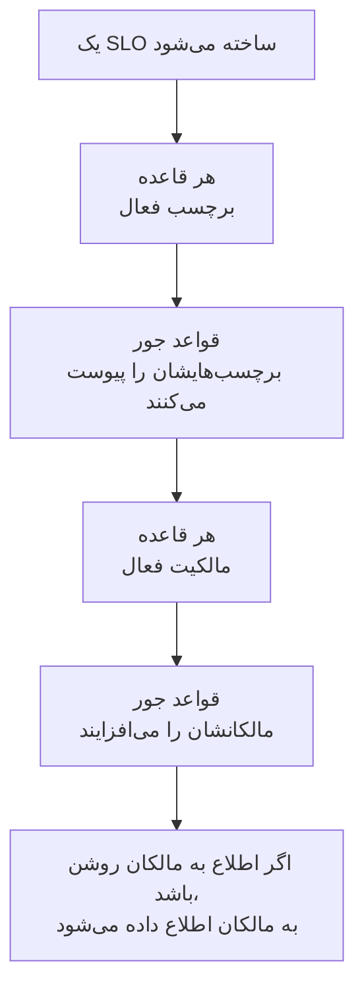

# قواعد برچسب و مالکیت

قواعد برچسب و قواعد مالکیت SLOهای شما را برایتان مرتب می‌کنند. یک **قاعده برچسب** به هر SLO تازه‌ای که با آن جور باشد برچسب می‌زند، و یک **قاعده مالکیت** کاربران و تیم‌های مالک را به آن می‌افزاید، پس یک SLO تازه checkout برچسب _Checkout_ می‌گیرد و مالکش تیم checkout می‌شود، بی‌آنکه کسی لازم باشد آن را به یاد بسپارد. هر دو مانند قواعد برچسب و مالکیت همه محصولات دیگر کار می‌کنند: برای آنچه مشترک دارند، [قواعد برچسب و مالکیت](/docs/configuration/label-and-owner-rules) را ببینید.

## چگونه کار می‌کند

قواعد هنگام ساخته شدن یک SLO اجرا می‌شوند، چه از داشبورد و چه از راه API. قواعد برچسب نخست اجرا می‌شوند، پس یک قاعده مالکیت می‌تواند با برچسبی جور شود که یک قاعده برچسب همین حالا پیوست کرده است.

هر دو نوع برای کل پروژه‌اند. آن‌ها را در منوی کناری فهرست SLOها، زیر **تنظیمات** پیدا کنید: **قواعد برچسب** و **قواعد مالکیت**. بخش **تنظیمات** در آغاز بسته است؛ برای باز کردنش روی عنوانش کلیک کنید.

## ساختن یک قاعده

:::steps
### باز کردن فهرست قواعد

**SLOs** را باز کنید، سپس در منوی کناری **تنظیمات** > **قواعد برچسب** یا **تنظیمات** > **قواعد مالکیت** را، و روی **ساخت SLO Label Rule** یا **ساخت SLO Owner Rule** کلیک کنید.

### انتخاب آنچه قاعده با آن جور می‌شود

در گام **تطبیق**، برای هر شرطی که یک SLO باید برآورده کند روی **افزودن شرط** کلیک کنید ([معیار تطبیق](#معیار-تطبیق) را ببینید). با دو شرط یا بیشتر، **تطبیق با همه** یا **تطبیق با هر یک** را برگزینید. قاعده‌ای بدون شرط با هر SLO تازه‌ای جور است.

### انتخاب آنچه قاعده می‌افزاید

گام دوم یک قاعده برچسب **برچسب‌ها** است، که در آن **برچسب‌هایی که باید افزوده شوند** را انتخاب می‌کنید. گام دوم یک قاعده مالکیت **مالکان** است، که در آن **مالکان** افزودنی را انتخاب می‌کنید — افراد و تیم‌ها، انتخاب‌شده از یک فهرست واحد با **افزودن مالک**. یک قاعده باید دست‌کم یک برچسب یا مالک بیفزاید.

### بررسی نام و فیلدهای بسته

**نام** از روی آنچه انتخاب می‌کنید پر می‌شود، مانند _افزودن Checkout, Production_ یا _افزودن Checkout team به‌عنوان مالک_، و تا وقتی نام خودتان را تایپ نکنید از انتخاب‌هایتان پیروی می‌کند. در **فیلدهای بیشتر**، **توضیحات** اختیاری هست و، در یک قاعده مالکیت، **اطلاع به مالکان**.

### ذخیره قاعده

در گام آخر دوباره روی **ساخت SLO Label Rule** یا **ساخت SLO Owner Rule** کلیک کنید. قاعده فعال آغاز می‌شود.
:::

**اطلاع به مالکان** (زیر **فیلدهای بیشتر**) به‌طور پیش‌فرض روشن است: مالکانی که یک قاعده مالکیت می‌افزاید همان اعلان «شما به‌عنوان مالک افزوده شدید» را می‌گیرند که مالکی که دستی افزوده شده است. خاموشش کنید تا مالکان را بی‌صدا بیفزایید.

برای مکث یک قاعده بی‌آنکه حذفش کنید، در فرم ویرایش آن **فعال** را خاموش کنید. فرم ویرایش هرگز برچسب یا مالک را الزامی نمی‌کند: قاعده‌ای قدیمی‌تر که چیزی نمی‌افزاید همچنان می‌تواند تغییر نام دهد، خاموش یا حذف شود، و فهرست آن را با **چیزی نمی‌افزاید** نشان‌گذاری می‌کند.

وقتی یک قاعده با یک SLO جور می‌شود:

- یک قاعده برچسب هر برچسبی را که در **برچسب‌هایی که باید افزوده شوند** است پیوست می‌کند. برچسب‌هایی که SLO پیش‌تر دارد دو بار افزوده نمی‌شوند، و وقتی چند قاعده جور باشند، SLO همه برچسب‌هایشان را می‌گیرد.
- یک قاعده مالکیت هر کاربر و تیم قاعده را به‌عنوان مالک می‌افزاید. مالکانی که SLO پیش‌تر دارد کنار گذاشته می‌شوند، و وقتی چند قاعده جور باشند، SLO همه مالکانشان را می‌گیرد. کاربری که دیگر عضو پروژه نیست، یا تیمی از پروژه‌ای دیگر، هرگز افزوده نمی‌شود؛ دیگر مالکان قاعده همچنان افزوده می‌شوند.

مالکان یک SLO کسانی هستند که از تغییرات وضعیت آن باخبر می‌شوند: [بودجه‌های خطا](/docs/slo/error-budget) را ببینید.

## معیار تطبیق

هر شرط یک فیلد از SLO را مقایسه می‌کند:

| فیلد | با چه مقایسه می‌شود | عملگرها |
| --- | --- | --- |
| **برچسب‌های SLO** | برچسب‌های SLO. | **یکی از این‌ها را دارد**، **همه این‌ها را دارد**، **هیچ‌یک از این‌ها را ندارد** |
| **نام SLO** | نام SLO. | **شامل است**، **شامل نیست**، **مساوی است با**، **مساوی نیست با**، **شروع می‌شود با**، **پایان می‌یابد با**، **با الگو مطابقت دارد**، **با الگو مطابقت ندارد** |
| **توضیحات SLO** | توضیحات SLO. | همان‌هایی که برای **نام SLO** |

یک شرط تازه روی نام یا توضیحات با **شامل است** آغاز می‌شود. یک الگو یا یک عبارت باقاعده است، مانند `^checkout-.*`، یا یک نویسه عام `*`، مانند `*checkout*`، و به بزرگی و کوچکی حروف حساس نیست. الگویی که هیچ‌کدام از این دو نباشد، مانند `checkout-(01`، به‌جای آنکه بی‌صدا با هیچ چیز جور نشود، هنگام ذخیره رد می‌شود.

| می‌خواهید | شرط‌ها |
| --- | --- |
| هر SLO سرویس checkout | **نام SLO** شامل `checkout` است |
| هر SLO تولید | **برچسب‌های SLO** یکی از _Production_ را دارد |
| SLOهای checkout، ولی نه آن‌های staging | **تطبیق با همه**: **نام SLO** شامل `checkout` است، و **برچسب‌های SLO** هیچ‌یک از _Staging_ را ندارد |

## قواعد کی اجرا می‌شوند

- **وقتی یک SLO ساخته می‌شود**، چه از داشبورد و چه از راه API: هر قاعده برچسب فعال، سپس هر قاعده مالکیت فعال.
- **وقتی قاعده‌ای را اجرا می‌کنید** با **Run Now**: پایین‌تر را ببینید.

ویرایش یک SLO قواعد را دوباره اعمال نمی‌کند، و یک قاعده هرگز چیزی برنمی‌دارد: نه برچسب‌ها یا مالکانی که کسی دستی افزوده، و نه آن‌هایی که خودش افزوده است. قاعده خاموش کاری نمی‌کند.

## اجرای یک قاعده روی SLOهای موجود

قاعده‌ای که امروز می‌نویسید برای SLOهایی به کار می‌رود که پس از آن ساخته می‌شوند. برای اعمال آن روی SLOهایی که از پیش دارید، روی **Run Now** در ردیف قاعده کلیک کنید، یا روی **مشاهده** و سپس روی **Run Now** در صفحه خود قاعده. همچنین می‌توانید چند قاعده را انتخاب کنید و آن‌ها را از عملیات گروهی جدول اجرا کنید.

یک اجرا همه SLOهای پروژه را، از جمله بایگانی‌شده‌ها، بررسی می‌کند و گزارش می‌دهد با چند مورد جور شد و چند مورد را تغییر داد. مالکانی که یک اجرا می‌افزاید فقط وقتی اعلان می‌گیرند که در پنجره گفت‌وگوی اجرا اطلاع دادن را برگزینید و قاعده **اطلاع به مالکان** را روشن داشته باشد. [اجرای قواعد روی منابع موجود](/docs/configuration/run-rules-now) را ببینید.

قواعد برچسب را همچنین می‌توان میان پروژه‌ها رونوشت کرد: [وارد کردن و صادر کردن قواعد برچسب](/docs/configuration/label-rule-import-export) را ببینید.

## تاریخچه

هر بار که یک قاعده SLOای را تغییر می‌دهد، **Feed** آن SLO ثبت می‌کند کدام قواعد این کار را کردند. هر مالکی که یک قاعده می‌افزاید هم مورد فید «به‌عنوان مالک افزوده شد» خودش را می‌گیرد، پس فید می‌گوید چه کسی و چرا افزوده شد. [فید و گزارش‌های ممیزی SLO](/docs/slo/feed-and-audit-logs) را ببینید.

## دسترسی‌ها

| برای | به این نیاز دارید |
| --- | --- |
| کار با قواعد برچسب | **Create SLO Label Rule**، **Edit SLO Label Rule**، **Delete SLO Label Rule** یا **Read SLO Label Rule** |
| کار با قواعد مالکیت | **Create SLO Owner Rule**، **Edit SLO Owner Rule**، **Delete SLO Owner Rule** یا **Read SLO Owner Rule** |
| اجرای یک قاعده برچسب | **Edit SLO Label Rule** و **Edit Service Level Objective** |
| اجرای یک قاعده مالکیت | **Edit SLO Owner Rule**، **Edit Service Level Objective**، **Create SLO User Owner** و **Create SLO Team Owner** |

این دسترسی‌ها در گروه SLO یک نقش هستند، و نقش‌های Project Owner و Project Admin همه آن‌ها را دارند. یک اجرا همه SLOهای پروژه را تغییر می‌دهد، پس دسترسی‌ای که به برخی برچسب‌ها یا به SLOهایی که مالکشان هستید محدود باشد برای اجرای یک قاعده کافی نیست.

## گام‌های بعدی

:::cards
- [قواعد برچسب و مالکیت](/docs/configuration/label-and-owner-rules): قواعد برچسب و مالکیت همه محصولات چگونه کار می‌کنند.
- [اجرای قواعد روی منابع موجود](/docs/configuration/run-rules-now): Run Now برای هر نوع قاعده چگونه کار می‌کند.
- [نمای کلی SLOها](/docs/slo/introduction): همه صفحه‌هایی که یک SLO دارد، و فهرست SLOها.
:::
