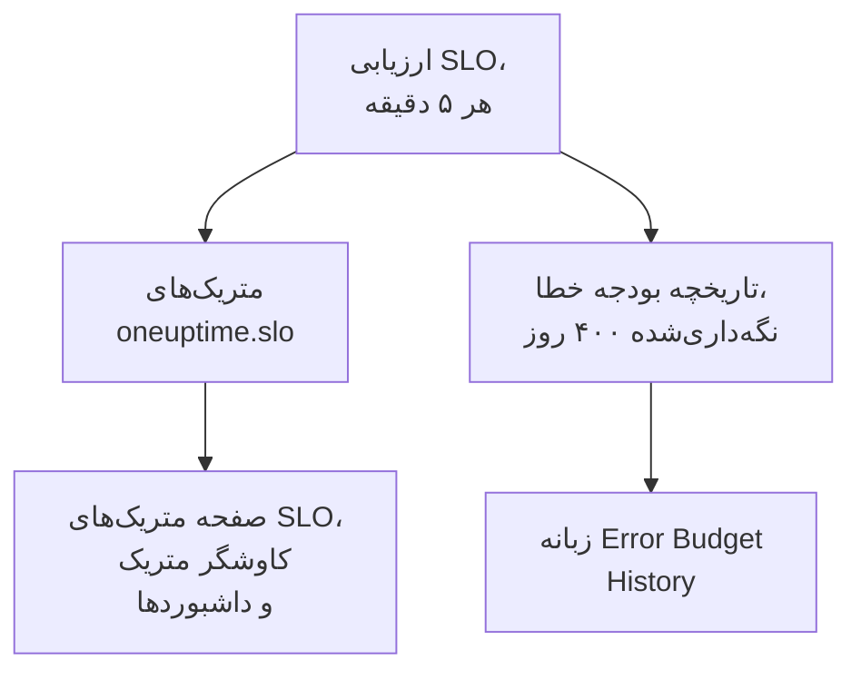

# متریک‌ها و داشبوردهای SLO

هر بار که OneUptime یک SLO را ارزیابی می‌کند، یعنی هر ۵ دقیقه، نتیجه‌ها را به‌صورت متریک‌هایی با نام `oneuptime.slo.*` می‌نویسد. این متریک‌ها در همان انبار متریکی هستند که متریک‌های مانیتورهای شما، پس می‌توانید برای یک SLO در صفحه **متریک‌ها** آن نمودار بکشید، آن را در کاوشگر متریک باز کنید و روی هر داشبوردی بگذارید، پالایش‌شده و گروه‌بندی‌شده مانند هر سری دیگر.

:::cards
- [متریک‌ها](#متریکها): شش سری، یکاهایشان و شیوه تجمیعشان.
- [صفحه متریک‌ها](#صفحه-متریکها): نمودارها، تاریخچه، و متریک‌های حادثه و هشدار یک SLO.
- [SLOها روی داشبوردها](#sloها-روی-داشبوردها): ویجت SLO و قالب SLO Dashboard.
:::

## چگونه کار می‌کند

## متریک‌ها

| متریک | یکا | تجمیع | چه چیزی را در خود دارد |
| --- | --- | --- | --- |
| `oneuptime.slo.sli.percent` | `%` | Avg | SLI روی پنجره انطباق SLO: سهمی از زمان سنجیده‌شده که خوب بوده است. |
| `oneuptime.slo.target.percent` | `%` | Avg | هدف SLO، که با هر ارزیابی فرستاده می‌شود تا نمودار بتواند آن را روی SLI بکشد. |
| `oneuptime.slo.error.budget.remaining.percent` | `%` | Avg | سهمی از بودجه خطا که هنوز در پنجره خرج نشده است. وقتی از بودجه فراتر رفته باشید منفی است. |
| `oneuptime.slo.error.budget.remaining.seconds` | `seconds` | Avg | قطعی‌ای که SLO هنوز می‌تواند پیش از نقض شدن تحمل کند. وقتی از بودجه فراتر رفته باشید منفی است. |
| `oneuptime.slo.burn.rate` | `x` | Max | بودجه در ۶۰ دقیقه گذشته با چه سرعتی خرج می‌شود. 1x بودجه را درست در طول پنجره خرج می‌کند. |
| `oneuptime.slo.status` | — | Max | وضعیت SLO در هر ارزیابی: `0` یعنی سالم، `1` یعنی At Risk، `2` یعنی Budget Exhausted. |

تجمیع شیوه‌ای است که نمودارهای خود SLO و قالب SLO Dashboard نقطه‌هایی را که در یک بازه نمودار می‌افتند ترکیب می‌کنند. درصدها و مدت‌ها میانگین گرفته می‌شوند. نرخ مصرف و وضعیت بیشینه را می‌گیرند، تا یک جهش کوتاه مصرف یا ورودی کوتاه به Budget Exhausted در میانگین گم نشود.

برای یک SLO در حالت **Monitor Seconds Average**، `oneuptime.slo.error.budget.remaining.seconds` ثانیه-مانیتورهای جمع‌شده روی همه مانیتورهایش را می‌شمارد، همان‌گونه که بودجه خطایش: [بودجه‌های خطا](/docs/slo/error-budget) را ببینید.

### وقتی هیچ نقطه‌ای نوشته نمی‌شود

- SLO خاموش یا بایگانی‌شده ارزیابی نمی‌شود، پس چیزی نمی‌فرستد.
- SLO **متوقف‌شده** یا **Misconfigured** چیزی نمی‌سنجد، پس فقط `oneuptime.slo.target.percent` را می‌فرستد که پیکربندی است نه اندازه‌گیری. نمودارهای SLI، بودجه، نرخ مصرف و وضعیت آن شکاف نشان می‌دهند.
- مقداری که عدد واقعی نیست، مانند نرخ مصرف روی پنجره‌ای بدون داده، کنار گذاشته می‌شود و هرگز به‌صورت ۰ نوشته نمی‌شود.

### ویژگی‌ها

هر نقطه این ویژگی‌ها را دارد:

| ویژگی | مقدار |
| --- | --- |
| `sloId` | شناسه SLO. صفحه‌های خود SLO بر پایه آن پالایش می‌کنند، پس تغییر نام یک SLO هرگز نمودارهایش را دو تکه نمی‌کند. |
| `sloName` | نام SLO هنگام نوشته شدن نقطه. |
| `projectId` | شناسه پروژه. |
| `oneuptime.label.<key>` | یک ویژگی برای هر برچسب SLO. برچسبی به نام `Tier 1` به `oneuptime.label.tier_1` = `true` تبدیل می‌شود، و برچسبی به نام `product:checkout` به `oneuptime.label.product` = `checkout`. کلیدها با حروف کوچک نوشته می‌شوند و فاصله‌ها و نشانه‌های نگارشی به `_` تبدیل می‌شوند. |

سری‌ها از آن SLO هستند، نه هیچ‌یک از مانیتورهایش، و در مصرف تله‌متری شمرده نمی‌شوند.

متریک‌های حادثه و هشدار دو ویژگی متناظر دارند، `serviceLevelObjectiveIds` و `serviceLevelObjectiveNames`: فهرست‌هایی جداشده با ویرگول از SLOهایی که حادثه یا هشدار بر آن‌ها اثر می‌گذارد.

### نگه‌داری

متریک‌های `oneuptime.slo.*` به اندازه متریک‌های مانیتور نگه داشته می‌شوند: به‌طور پیش‌فرض **۳۰ روز**. روی یک نصب خودمیزبان، مدیر اصلی می‌تواند این را با **Monitor Metric Retention (Days)** در تنظیمات **نگهداری داده** در Admin Dashboard تغییر دهد.

این محدودیت شامل زبانه **Error Budget History** در صفحه **متریک‌ها** آن SLO نمی‌شود. آن تاریخچه جداگانه ذخیره و ۴۰۰ روز نگه داشته می‌شود.

## صفحه متریک‌ها

صفحه **متریک‌ها** یک SLO چهار زبانه دارد:

| زبانه | چه نشان می‌دهد |
| --- | --- |
| **SLO Metrics** | سری‌های `oneuptime.slo.*` در سه کارت که یک بازه زمانی مشترک دارند، به‌طور پیش‌فرض روز گذشته: **Objective** (SLI با هدف روی آن، و بودجه باقی‌مانده)، **Burn** (نرخ مصرف و زمان باقی‌مانده بودجه) و **وضعیت**. |
| **Error Budget History** | SLI، بودجه باقی‌مانده و نرخ مصرف روی تاریخچه بلندمدت، با خط‌هایی در هدف، در مرزهای در معرض خطر و تمام‌شده، و در آستانه هر قاعده نرخ مصرف فعال. |
| **متریک‌های حادثه** | شمار، زمان تا تأیید، زمان تا رفع و مدت حوادثی که بر این SLO اثر می‌گذارند، به‌طور پیش‌فرض هفته گذشته. حوادثی که قواعد نرخ مصرفش اعلام کرده‌اند هم در آن هستند. |
| **متریک‌های هشدار** | همین برای هشدارها. هشدارهایی که قواعد نرخ مصرفش ساخته‌اند هم در آن هستند. |

زبانه‌های **SLO Metrics**، **متریک‌های حادثه** و **متریک‌های هشدار** از انبار متریک می‌خوانند، که به دسترسی خواندن تله‌متری نیاز دارد. نقشی سفارشی که می‌تواند SLOها را بخواند ولی تله‌متری را نه، این زبانه‌ها را خالی می‌بیند، در حالی که **Error Budget History** همچنان کار می‌کند.

## SLOها روی داشبوردها

### رسم نمودار هر متریک SLO

:::steps
#### افزودن یک نمودار

در حالت ویرایش یک داشبورد، یک ویجت نمودار یا مقدار بیفزایید و یکی از متریک‌های `oneuptime.slo.*` را انتخاب کنید.

#### گروه‌بندی یا پالایش

بر پایه `sloName` و `sloId` گروه‌بندی کنید تا برای هر SLO یک خط داشته باشید؛ `sloId` دو SLO هم‌نام را از هم جدا نگه می‌دارد. یا بر پایه `sloName`، یا یک ویژگی `oneuptime.label.*` پالایش کنید.

#### انتخاب تجمیع

تجمیع جدول بالا را به کار ببرید: Avg برای درصدها و مدت‌ها، Max برای نرخ مصرف و وضعیت.
:::

### ویجت SLO

[ویجت SLO](/docs/dashboards/widgets#slo) SLI، بودجه باقی‌مانده یا نرخ مصرف یک SLO را به‌صورت کاشی یا نمودار نشان می‌دهد. SLO خود را به یکی از دو راه به دست می‌آورد:

| تنظیم | رفتار |
| --- | --- |
| **Service Level Objective** | ویجت را به یک SLO سنجاق می‌کند. انتخابگر SLOهایی را فهرست می‌کند که بایگانی نشده‌اند. |
| **Follow SLO Variable** | SLOای را نشان می‌دهد که در یک متغیر داشبورد انتخاب شده است: یک متغیر **Telemetry Attribute** روی کلید `sloName`. تا وقتی SLOای سنجاق شده باشد نادیده گرفته می‌شود. |

روی یک [داشبورد عمومی](/docs/dashboards/sharing)، ویجتی که یک متغیر را دنبال می‌کند به بینندگان اجازه می‌دهد هر SLO بایگانی‌نشده پروژه را با نامش انتخاب کنند. ویجت سنجاق‌شده فقط SLO خودش را نشان می‌دهد، و آخرین عددهای SLOای را که بعداً بایگانی شود همچنان نشان می‌دهد.

### قالب SLO Dashboard

هنگام ساختن یک داشبورد، قالب **SLO Dashboard** را برگزینید تا تابلویی آماده از همه SLOهای پروژه در سه نوار داشته باشید:

1. **Service Level Objectives**: فهرستی از هر SLO بایگانی‌نشده با وضعیت، SLI در برابر هدف، نوار بودجه و نرخ مصرفش، و شمار SLOها بر حسب وضعیت. SLOهای فعال نخست می‌آیند، آنکه کمترین بودجه را دارد پیش از همه؛ SLO خاموش در پایان با عنوان **غیرفعال** می‌آید و آخرین عددهایش کم‌رنگ است.
2. **Error Budget & Burn Rate**: کاشی‌های **Lowest Error Budget Remaining**، **Least Error Budget Time Left** و **Peak Burn Rate**، و نمودارهای **Error Budget Remaining by SLO** و **Burn Rate by SLO** با یک خط برای هر SLO، گروه‌بندی‌شده بر پایه `sloName` و `sloId`.
3. **Selected SLO**: کاشی‌های **SLI**، **Error Budget Remaining** و **Burn Rate** و نمودارهای **SLI History**، **Error Budget History** و **Burn Rate History** یک SLO.

یک متغیر SLO در نوار ابزار دامنه کل تابلو را تعیین می‌کند. این یک متغیر Telemetry Attribute روی `sloName` است، پس گزینه‌هایش نام‌های SLO موجود در متریک‌ها هستند. انتخاب یک SLO فهرست را به آن محدود می‌کند، نمودارها و کاشی‌های آن نوار را محدود می‌کند و ویجت‌های **Selected SLO** را که متغیر را دنبال می‌کنند پر می‌کند. تا وقتی یکی را انتخاب نکنید، از شما می‌خواهند یک SLO را در نوار ابزار انتخاب کنید.

## عیب‌یابی

:::details یک SLO در انتخابگر SLO نوار ابزار نیست
انتخابگر نام SLOهایی را فهرست می‌کند که در روز گذشته فرستاده شده‌اند. SLO تازه پس از نخستین ارزیابی‌اش نمایان می‌شود؛ SLO **متوقف‌شده** یا **Misconfigured** انتخاب‌کردنی می‌ماند چون هنوز هدفش را می‌فرستد؛ SLO خاموش یا بایگانی‌شده حدود یک روز پس از آخرین نقطه‌اش ناپدید می‌شود.
:::

:::details انتخاب یک نام دو SLO را نشان می‌دهد
دو SLO آن نام را دارند. فهرست و نمودارها هر دو را نشان می‌دهند، و ویجت‌های **Selected SLO** می‌گویند نام مبهم است. به SLOها نام‌های متفاوت بدهید.
:::

:::details زبانه SLO Metrics خالی است
نقش شما نمی‌تواند تله‌متری بخواند، یا SLO هنوز ارزیابی نشده است. **Error Budget History** خود SLO را می‌خواند و همچنان کار می‌کند.
:::

## گام‌های بعدی

:::cards
- [ویجت‌های داشبورد](/docs/dashboards/widgets): همه ویجت‌ها، از جمله ویجت SLO.
- [متغیرهای داشبورد](/docs/dashboards/variables): دامنه کل یک تابلو را با یک انتخابگر تعیین کنید.
- [بودجه‌های خطا](/docs/slo/error-budget): عددهای بودجه چه معنایی دارند.
:::
