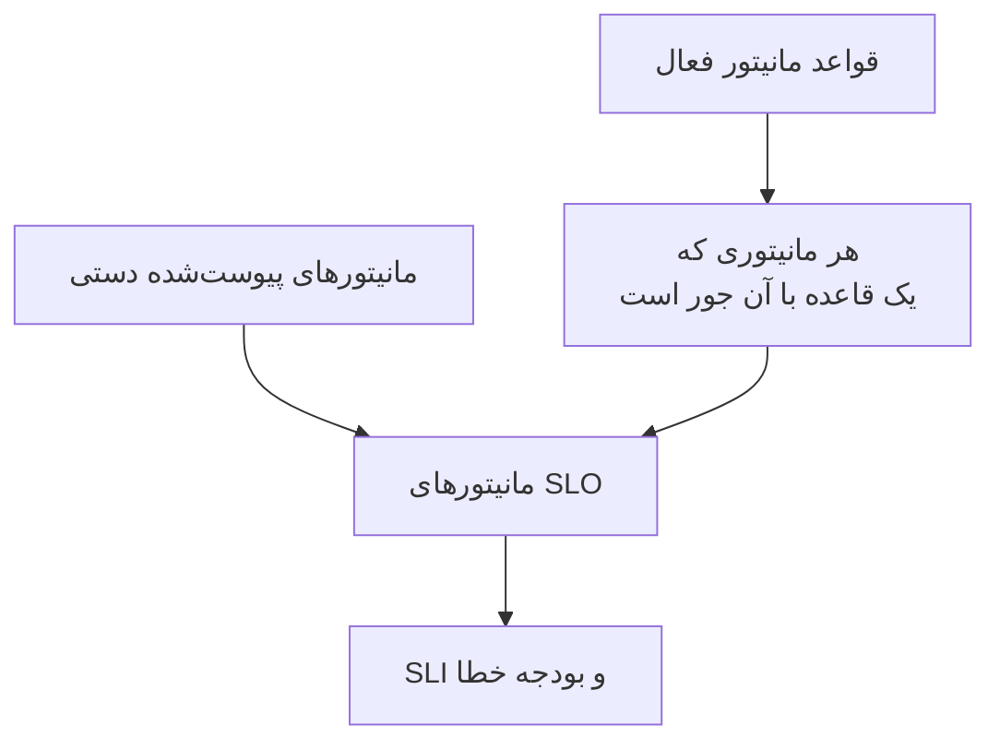

# مانیتورها و قواعد مانیتور

یک SLO دسترس‌پذیری مانیتورهای پیوست‌شده به خود را می‌سنجد. آن‌ها را دستی پیوست کنید، بگذارید قواعد مانیتور هر مانیتور جوری را پیوست کنند، یا هر دو. این صفحه درباره صفحه‌های **مانیتورها** و **Monitor Rules** یک SLO است که هر دو زیر **پیکربندی** در منوی کناری آن قرار دارند.

:::cards
- [انتخاب دستی مانیتورها](#پیوست-کردن-دستی-مانیتورها): بهترین گزینه برای مجموعه‌ای کوچک و ثابت.
- [پیوست کردن مانیتورها با یک قاعده](#پیوست-کردن-مانیتورها-با-یک-قاعده): «هر مانیتور با برچسب Production»، که برایتان به‌روز نگه داشته می‌شود.
- [معیار تطبیق](#معیار-تطبیق): فیلدها و عملگرهایی که یک قاعده می‌تواند بر پایه آن‌ها جور شود.
:::

## یک SLO کدام مانیتورها را می‌سنجد

یک SLO اجتماع مانیتورهایی را که دستی پیوست کرده‌اید و هر مانیتوری را که دست‌کم یکی از قواعد مانیتور فعالش با آن جور است می‌سنجد.

SLO تازه مانیتوری ندارد، چون فرم ساختن آن مانیتوری نمی‌خواهد. تا وقتی مانیتوری نداشته باشد نمی‌تواند ارزیابی شود: صفحه‌هایش **No monitors attached** را نشان می‌دهند، و **نمای کلی** آن هر دو راه پیوست کردن مانیتور را پیشنهاد می‌کند.

## پیوست کردن دستی مانیتورها

به دسترسی ویرایش آن SLO نیاز دارید.

:::steps
### باز کردن صفحه مانیتورها

SLO را باز کنید و به **مانیتورها** بروید.

### انتخاب مانیتورها

روی **Add Monitors** کلیک کنید و مانیتورهایی از پروژه را انتخاب کنید. فقط مانیتورهایی فهرست می‌شوند که هنوز پیوست نشده‌اند.

### ذخیره فهرست

روی **Add Monitors** کلیک کنید. مانیتورها با منبع **Manual** در فهرست نمایان می‌شوند و از ارزیابی بعدی در SLI شمرده می‌شوند.
:::

برای بیرون بردن یک مانیتور از SLO، روی **حذف** در ردیف آن کلیک کنید. خود مانیتور تغییری نمی‌کند؛ فقط دیگر در SLI و بودجه خطای آن SLO شمرده نمی‌شود.

صفحه **مانیتورها** برای هر مانیتور این‌ها را نشان می‌دهد:

| ستون | چه نشان می‌دهد |
| --- | --- |
| **وضعیت فعلی** | وضعیت فعلی مانیتور، یا وقتی بررسی نمی‌شود یا هنوز چیزی گزارش نکرده است، **بایگانی‌شده**، **غیرفعال**، **پراب‌ها فعال نیستند**، **پراب‌ها قطع شده‌اند** یا **ناشناخته**. |
| **منبع** | اگر یکی از قواعد مانیتور SLO آن را پیوست کرده باشد **Rule**، و اگر کسی آن را دستی پیوست کرده باشد **Manual**. |
| **برچسب‌ها** | برچسب‌های مانیتور. |

## پیوست کردن مانیتورها با یک قاعده

یک قاعده مانیتور، مانیتورهایی را که یک SLO باید بسنجد توصیف می‌کند، مانند «هر مانیتور با برچسب Production» یا «هر مانیتوری که نامش با api- آغاز می‌شود». هر مانیتور جوری پیوست می‌شود، چه اکنون و چه هر بار که مانیتورها ساخته یا تغییر داده می‌شوند، پس کسی لازم نیست مانیتوری را که کسی ماه بعد می‌افزاید به یاد بسپارد.

:::steps
### باز کردن Monitor Rules

SLO را باز کنید، به **Monitor Rules** بروید و روی **ساخت SLO Monitor Rule** کلیک کنید.

### نام‌گذاری قاعده

در **اطلاعات پایه**، یک **نام** وارد کنید و در صورت تمایل در **توضیحات** بنویسید چرا این مانیتورها به این SLO تعلق دارند.

### انتخاب آنچه قاعده با آن جور می‌شود

در **معیار تطبیق**، روی **افزودن شرط** کلیک کنید، یک فیلد و یک عملگر انتخاب کنید و مقدار را وارد یا انتخاب کنید. با دو شرط یا بیشتر، **تطبیق با همه** یا **تطبیق با هر یک** را برگزینید. یک قاعده مانیتور دست‌کم یک شرط لازم دارد.

### ذخیره قاعده

روی **ساخت SLO Monitor Rule** کلیک کنید. قاعده فعال آغاز می‌شود و مانیتورهای SLO بی‌درنگ دوباره ارزیابی می‌شوند: هر مانیتور جوری با منبع **Rule** پیوست می‌شود.
:::

جدول قواعد برای هر قاعده نام، معیار تطبیق به زبان ساده و فعال بودن یا نبودنش را نشان می‌دهد. برای مکث یک قاعده، در فرم ویرایش آن **فعال** را خاموش کنید. **View Monitors** صفحه **مانیتورها** آن SLO را باز می‌کند.

### معیار تطبیق

هر شرط یک فیلد از یک مانیتور را مقایسه می‌کند:

| فیلد | با چه مقایسه می‌شود | عملگرها |
| --- | --- | --- |
| **برچسب‌های مانیتور** | برچسب‌های مانیتور. | **یکی از این‌ها را دارد**، **همه این‌ها را دارد**، **هیچ‌یک از این‌ها را ندارد** |
| **نوع مانیتور** | نوع مانیتور، انتخاب‌شده از فهرست انواع. | **مساوی است با**، **مساوی نیست با** |
| **نام مانیتور** | نام مانیتور. | **شامل است**، **شامل نیست**، **مساوی است با**، **مساوی نیست با**، **شروع می‌شود با**، **پایان می‌یابد با**، **با الگو مطابقت دارد**، **با الگو مطابقت ندارد** |
| **توضیحات مانیتور** | توضیحات مانیتور. | همان‌هایی که برای **نام مانیتور** |

یک الگو یا یک عبارت باقاعده است، مانند `^api-.*`، یا یک نویسه عام `*`، مانند `*checkout*`، و به بزرگی و کوچکی حروف حساس نیست. الگویی که هیچ‌کدام از این دو نباشد، مانند `api-(01`، به‌جای آنکه بی‌صدا با هیچ چیز جور نشود، هنگام ذخیره رد می‌شود. برای پیوست کردن همه مانیتورهای پروژه، شرطی روی **نام مانیتور** بیفزایید که با الگوی `.*` مطابقت داشته باشد.

| می‌خواهید | شرط‌ها |
| --- | --- |
| هر مانیتور تولید | **برچسب‌های مانیتور** یکی از _Production_ را دارد |
| هر مانیتور API | **نوع مانیتور** مساوی است با _API_ |
| هر مانیتور به‌جز مانیتورهای دستی | **نوع مانیتور** مساوی نیست با _Manual_ |
| هر مانیتوری که نامش با api- آغاز می‌شود | **نام مانیتور** با الگوی `^api-` مطابقت دارد |
| مانیتورهای checkout، ولی نه آن‌های staging | **تطبیق با همه**: **نام مانیتور** با الگوی `*checkout*` مطابقت دارد، و **برچسب‌های مانیتور** هیچ‌یک از _Staging_ را ندارد |

### قواعد کی اجرا می‌شوند

- وقتی قاعده‌ای را می‌سازید، ویرایش می‌کنید، روشن یا خاموش می‌کنید یا حذف می‌کنید، مانیتورهای SLO بی‌درنگ دوباره ارزیابی می‌شوند.
- وقتی مانیتوری ساخته می‌شود، یا برچسب‌ها، نام یا توضیحاتش تغییر می‌کند، هر قاعده مانیتور در پروژه آن را بررسی می‌کند، از جمله برچسب‌هایی که قواعد برچسب مانیتور شما به آن می‌دهند.
- وقتی برچسبی حذف می‌شود، SLOهایی که قواعدشان از آن استفاده می‌کردند دوباره ارزیابی می‌شوند.
- قواعد فهرست مانیتورهای یک SLO را حتی وقتی آن SLO خاموش یا بایگانی‌شده است به‌روز نگه می‌دارند، پس با مانیتورهای درست از سر گرفته می‌شود.

قواعد با هر ذخیره دوباره همگام می‌شوند، پس **Run Now** برای رسیدن به چیزی است که از دست SLO رفته است. در هر ردیف، در صفحه خود قاعده (**مشاهده**) و در عملیات گروهی جدول هست. اجرای یک قاعده همه قواعد مانیتور فعال SLO را با هم دوباره ارزیابی می‌کند، و سپس پنجره گفت‌وگو می‌گوید چند مانیتور پیوست و جدا شدند. اجرای یک قاعده به دسترسی ویرایش قواعد مانیتور SLO نیاز دارد. [اجرای قواعد روی منابع موجود](/docs/configuration/run-rules-now) را ببینید.

### کدام مانیتورها از آن یک قاعده‌اند

- یک مانیتور تا وقتی یک قاعده فعال با آن جور است پیوست می‌ماند، و به محض اینکه هیچ قاعده‌ای جور نباشد جدا می‌شود.
- خاموش کردن یا حذف یک قاعده فقط مانیتورهایی را جدا می‌کند که دیگر هیچ قاعده فعال دیگری با آن‌ها جور نیست.
- قواعد فقط مانیتورهایی را جدا می‌کنند که یک قاعده پیوست کرده است. مانیتوری که دستی پیوست شده هرگز در اختیار قاعده‌ای که از قضا با آن جور است قرار نمی‌گیرد، و وقتی دیگر جور نباشد جدا نمی‌شود. منبع آن **Manual** می‌ماند.

## انتخاب دستی وقتی قواعد روشن‌اند

تا وقتی دست‌کم یک قاعده فعال است، مانیتورهای SLO را قواعد مدیریت می‌کنند:

- نمی‌توان مانیتورها را دستی افزود: **Add Monitors** غیرفعال است و بنری می‌گوید **This SLO's monitors are managed by its monitor rules**، همراه با پیوند **Manage Monitor Rules**؛
- مانیتورهایی که یک قاعده پیوست کرده است دستی برداشته نمی‌شوند، چون قاعده دوباره پیوستشان می‌کند: دکمه **حذف** آن‌ها قفل است و راهنمای آن دلیلش را توضیح می‌دهد؛
- مانیتورهایی که پیش از روشن شدن قواعد دستی پیوست شده‌اند همچنان برداشتنی‌اند.

این برای API هم صادق است. همه قواعد را خاموش کنید تا دوباره خودتان مانیتورها را انتخاب کنید.

## SLOهایی که یک مانیتور در آن‌ها شمرده می‌شود

صفحه یک مانیتور SLOهایی را که آن را می‌سنجند فهرست می‌کند: مانیتور را باز کنید و در منوی کناری‌اش به **SLOs** بروید. پیش از متوقف کردن یا تغییر دادن یک مانیتور به آن سر بزنید تا ببینید کدام هدف‌ها به آن وابسته‌اند. SLOهای بایگانی‌شده نمایان نمی‌شوند، چون ارزیابی نمی‌شوند.

## آمدن از Auto-Add Monitors With Labels

نسخه‌های پیشین تنظیمی به نام **Auto-Add Monitors With Labels** روی فرم SLO داشتند. هنگام ارتقا، هر SLOای که از آن استفاده می‌کرد یک قاعده مانیتور فعال به نام **Auto-add monitors with labels** می‌گیرد که با همان برچسب‌ها جور می‌شود، پس دقیقاً همان مانیتورها را می‌سنجد. فیلد `monitorLabels` در API SLO منسوخ شده است: به‌جای آن از قواعد مانیتور SLO استفاده کنید.

:::details اگر چیزی هنوز تنظیم قدیمی را ذخیره کند چه؟
زبانه‌ای از داشبورد که پیش از ارتقا باز شده، یا یک کلاینت API یا گردش کاری که برای نسخه پیشین نوشته شده، هنوز می‌تواند تنظیم قدیمی را ذخیره کند. برای اینکه یک SLO از این راه بی‌صدا مانیتور از دست ندهد:

- **SLOای بدون قاعده مانیتور** برچسب‌های ذخیره‌شده را به یک قاعده **Auto-add monitors with labels** تبدیل می‌کند و مانیتورهایش بی‌درنگ دوباره ارزیابی می‌شوند. ذخیره یک فهرست خالی، مانند گذشته، مانیتورهایی را که آن تنظیم پیوست کرده بود جدا می‌کند.
- **SLOای که قاعده مانیتور دارد**، روشن یا خاموش، برچسب‌هایی را که از راه تنظیم قدیمی ذخیره شده‌اند نادیده می‌گیرد، چون قواعدش تعیین می‌کنند چه چیزی را می‌سنجد.
- **ساختن نخستین قاعده مانیتور** برای SLOای که مانیتورهایش را تنظیم قدیمی پیوست کرده بود، نخست آن تنظیم را به یک قاعده تبدیل می‌کند، پس قاعده تازه در کنار آن افزوده می‌شود نه به‌جای آن.

قاعده تبدیل‌شده‌ای که حذف می‌کنید حذف‌شده می‌ماند، مگر اینکه مانیتورهایش پس از آن هنوز پیوست باشند، برای نمونه چون کارسازی که هنوز نسخه پیشین را اجرا می‌کند در جریان ارتقا آن‌ها را دوباره پیوست کرده است: در این صورت تغییر بعدی مانیتور یا قاعده تازه بعدی برچسب‌ها را دوباره تبدیل می‌کند. وقتی ارتقا تمام شد، آن قاعده را دوباره حذف کنید.
:::

## تاریخچه

هر پیوست و جدا شدن، و هر قاعده‌ای که ساخته، ویرایش یا حذف شود، در **Feed** آن SLO نمایان می‌شود. تغییرات قواعد در **گزارش‌های ممیزی** آن هم ثبت می‌شوند. [فید و گزارش‌های ممیزی SLO](/docs/slo/feed-and-audit-logs) را ببینید.

## عیب‌یابی

:::details Add Monitors غیرفعال است
دست‌کم یکی از قواعد مانیتور SLO فعال است، پس مانیتورهایش را قواعد مدیریت می‌کنند. قواعد را تغییر دهید، یا همه را خاموش کنید تا مانیتورها را دستی انتخاب کنید.
:::

:::details دکمه حذف یک مانیتور قفل است
یک قاعده مانیتور آن مانیتور را پیوست کرده و دوباره پیوستش می‌کند. قاعده‌ای را که با آن جور است تغییر دهید یا خاموش کنید.
:::

:::details مانیتوری که باید با یک قاعده جور شود پیوست نشده است
بررسی کنید قاعده فعال است و با **تطبیق با همه** همه شرط‌ها برآورده می‌شوند. برچسب‌هایی که یک قاعده برچسب مانیتور می‌افزاید هم شمرده می‌شوند. روی **Run Now** آن قاعده کلیک کنید تا SLO دوباره همگام شود.
:::

:::details ذخیره یک قاعده با خطای الگو شکست می‌خورد
مقدار نه یک عبارت باقاعده است و نه یک نویسه عام `*`، برای نمونه به خاطر پرانتزی که بسته نشده است. الگو را درست کنید، یا از **شامل است** استفاده کنید.
:::

## گام‌های بعدی

:::cards
- [نمای کلی SLOها](/docs/slo/introduction): قطعی چند مانیتور چگونه ترکیب می‌شود.
- [بودجه‌های خطا](/docs/slo/error-budget): قطعی مانیتورها چه چیزی را مصرف می‌کند.
- [اجرای قواعد روی منابع موجود](/docs/configuration/run-rules-now): Run Now برای هر نوع قاعده چگونه کار می‌کند.
:::
