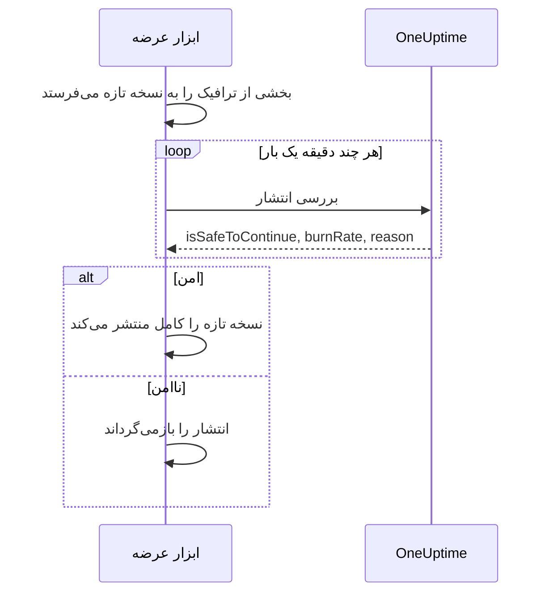

# بررسی‌های انتشار

یک بررسی انتشار، در حالی که انتشار در جریان است، از یک SLO می‌پرسد «آیا ادامه دادن به عرضه این انتشار امن است؟»، و بر پایه اینکه SLO در چند دقیقه گذشته با چه سرعتی بودجه خطایش را مصرف کرده پاسخ می‌دهد. Argo Rollouts، Flagger یا یک پایپ‌لاین استقرار، وقتی یک کاناری ترافیک می‌گیرد این پرسش را می‌پرسد، و با پاسخ منفی انتشار را بازمی‌گرداند. OneUptime خودش چیزی مستقر نمی‌کند: ابزار عرضه شما کار عرضه را ادامه می‌دهد، و OneUptime به آن می‌گوید انتشار در چه حالی است.

:::cards
- [پرسیدن از بررسی](#پرسیدن-از-بررسی): یک درخواست با یک کلید API، و پاسخی که می‌دهد.
- [Argo Rollouts](#argo-rollouts): تحلیلی که عرضه را لغو می‌کند.
- [Flagger](#flagger): وب‌هوکی که کاناری را متوقف می‌کند.
- [GitHub Actions](#github-actions): گامی که پس از یک استقرار انتشار را بازمی‌گرداند.
:::

## چگونه کار می‌کند

[دروازه Deployment](/docs/slo/error-budget-policy#دروازه-deployment) پیش از یک انتشار پاسخ می‌دهد، بر پایه بودجه خطای کل پنجره انطباق. انتشاری که چیزی را خراب می‌کند در ده دقیقه نخستش تقریباً هیچ از بودجه یک ماه را خرج نکرده است، پس بررسی انتشار همان چیزی را می‌خواند که انتشار تغییر می‌دهد: نرخ مصرف در چند دقیقه گذشته.



بررسی با یکی از سه حکم پاسخ می‌دهد:

| حکم | چه زمانی | `isSafeToContinue` |
| --- | --- | --- |
| `Pass` | پنجره بودجه خطا را با `maxBurnRate` یا آهسته‌تر از آن مصرف کرد. | `true` |
| `Fail` | سریع‌تر مصرف کرد، یا سیاست بودجه خطای SLO، Deploymentها را فریز کرده است. | `false` |
| `NotEnoughData` | پنجره کمتر از `minimumRequestCount` درخواست داشت، یا مانیتورهای SLO در آن هیچ وضعیتی ثبت نکردند. برای امن دانستن انتشار بسیار کم است. | `false` |

با نرخ مصرف ۱، پنجره دقیقاً به هدف SLO رسیده است، پس مقدار پیش‌فرض `1` برای `maxBurnRate` انتشاری را که بدتر از هدف عمل کند رد می‌کند.

آنچه بررسی می‌خواند به آنچه SLO می‌سنجد بستگی دارد:

- یک [SLO درخواست](/docs/slo/request-slos) بر پایه درخواست‌های سرویس‌هایش در پنجره داوری می‌شود، که با رسیدن اسپن‌هایشان از روی آن‌ها خوانده می‌شوند. `serviceVersion` را بیفزایید تا فقط درخواست‌های نسخه تازه داوری شوند: OneUptime آن را با ویژگی منبع `service.version` اسپن‌ها مقایسه می‌کند، که هر SDK از OpenTelemetry آن را از روی `OTEL_RESOURCE_ATTRIBUTES=service.version=1.4.2` تنظیم می‌کند. به این ترتیب کاناری بر پایه درخواست‌های خودش داوری می‌شود، نه آمیخته با درخواست‌های نسخه قدیمی.
- یک [SLO مبتنی بر متریک](/docs/slo/request-slos#sloهای-مبتنی-بر-متریک) بر پایه رویدادهای متریکش در پنجره داوری می‌شود، که همان‌گونه شمرده می‌شوند که SLI آن می‌شمارد، پس `minimumRequestCount`، `goodRequestCount` و `totalRequestCount` بر حسب رویداد هستند. با `serviceVersion` فقط نقطه‌هایی از متریک شمرده می‌شوند که ویژگی منبع `service.version` آن‌ها همین مقدار را دارد: هر SDK از OpenTelemetry آن را روی متریک‌هایش هم مانند اسپن‌هایش تنظیم می‌کند.
- یک SLO زمان کارکرد مانیتور بر پایه خط زمانی وضعیت مانیتورهایش در طول پنجره داوری می‌شود. `minimumRequestCount` برای آن به کار نمی‌رود، و بررسی‌ای با `serviceVersion` رد می‌شود: مانیتورها نسخه ندارند.

## پیش از شروع

به SLOای نیاز دارید که چیزی را بسنجد که انتشار بر آن اثر می‌گذارد. یک SLO درخواست برای همان سرویسی که منتشر می‌کنید بهتر از همه درباره کاناری داوری می‌کند، چون درخواست‌های خود آن سرویس را می‌خواند.

## راه‌اندازی یک بررسی انتشار

:::steps
### به عرضه یک کلید بدهید

یک [کلید API](/docs/api-reference/api-reference) از پروژه بسازید که نقشش بتواند SLOها را بخواند، و آن را به‌عنوان رازی از ابزار عرضه یا پایپ‌لاین خود ذخیره کنید.

### شناسه SLO را کپی کنید

SLO را باز کنید و شناسه‌اش را از نشانی کپی کنید: `/slos/<slo-id>`.

### یک بار بررسی را دستی بپرسید

درخواستی را که زیر [پرسیدن از بررسی](#پرسیدن-از-بررسی) آمده با کلید و شناسه اجرا کنید. پاسخ آن `isSafeToContinue` و یک `reason` دارد.

### آن را به عرضه خود بیفزایید

بررسی را از [Argo Rollouts](#argo-rollouts)، [Flagger](#flagger) یا [GitHub Actions](#github-actions) بپرسید، و وقتی `isSafeToContinue` برابر `false` است انتشار را بازگردانید.
:::

## پرسیدن از بررسی

بررسی یک `GET` یا `POST` روی نشانی `release-check` آن SLO است. گزینه‌ها را در رشته پرس‌وجو بفرستید، یا با `POST` به‌صورت بدنه JSON:

```bash
curl -sS "https://oneuptime.com/api/service-level-objective/<slo-id>/release-check?windowInMinutes=10&serviceVersion=1.4.2" \
  -H "ApiKey: $ONEUPTIME_API_KEY"
```

پاسخ با حکم آغاز می‌شود و سپس آنچه حکم از روی آن خوانده شده را می‌آورد:

```json
{
  "isSafeToContinue": false,
  "verdict": "Fail",
  "reason": "The last 10 minutes burned the error budget at 3.2x, faster than the 1x this check allows (SLI 99.68% against the 99.9% target).",
  "sloId": "<slo-id>",
  "sloName": "Checkout requests",
  "sliType": "Request Success",
  "targetPercentage": 99.9,
  "windowInMinutes": 10,
  "maxBurnRate": 1,
  "burnRate": 3.2,
  "sliPercentage": 99.68,
  "deploymentsAllowed": true,
  "errorBudgetPolicyTier": null,
  "sloStatus": "Healthy",
  "checkedAt": "2026-11-15T12:00:00.000Z",
  "goodRequestCount": 2492,
  "totalRequestCount": 2500,
  "minimumRequestCount": 1,
  "serviceVersion": "1.4.2"
}
```

گزینه‌ها:

| گزینه | پیش‌فرض | چه می‌کند |
| --- | --- | --- |
| `windowInMinutes` | `10` | بررسی چقدر به عقب نگاه کند، به دقیقه‌های کامل از ۱ تا ۳۶۰. |
| `maxBurnRate` | `1` | سریع‌ترین نرخ مصرفی که پذیرفته می‌شود. `2` به پنجره اجازه می‌دهد بودجه را دو برابر سریع‌تر از آنچه هدف مجاز می‌داند مصرف کند. |
| `minimumRequestCount` | `1` | SLOهای درخواست: کمترین شمار درخواستی که بررسی درباره آن داوری می‌کند. با `0`، پنجره‌ای بدون درخواست پذیرفته می‌شود. |
| `serviceVersion` | هیچ | SLOهای درخواست: فقط درخواست‌هایی داوری شوند که اسپن‌هایشان این `service.version` را دارند. |
| `includeDeploymentGate` | `true` | تا وقتی سیاست بودجه خطای SLO، Deploymentها را فریز کرده است، بررسی رد شود. با `false`، فقط نرخ مصرف تصمیم می‌گیرد. |
| `failWithStatusCode` | `false` | پاسخ منفی با وضعیت HTTP 412 به‌جای 200 داده شود، برای ابزارهایی که فقط کد وضعیت را می‌خوانند. |

فیلدهای پاسخ:

| فیلد | چه چیزی را نگه می‌دارد |
| --- | --- |
| `isSafeToContinue` | `true` برای ادامه عرضه، `false` برای بازگرداندن آن. |
| `verdict` | `Pass`، `Fail` یا `NotEnoughData`. |
| `reason` | یک جمله برای لاگ عرضه، که می‌گوید چه چیزی سنجیده شد و چرا بررسی این‌گونه پاسخ داد. |
| `burnRate` و `sliPercentage` | پنجره با چه سرعتی بودجه خطا را مصرف کرد، و SLI در طول پنجره. |
| `goodRequestCount` و `totalRequestCount` | SLOهای درخواست: درخواست‌هایی که در پنجره بودند، و اینکه چندتایشان خوب بودند. |
| `deploymentsAllowed` و `errorBudgetPolicyTier` | اینکه آیا سیاست بودجه خطای SLO اجازه Deployment می‌دهد، و سطحی که SLO در آن است. |
| `checkedAt` | زمانی که بررسی سنجیده شد. |

به SLOای که نمی‌توان سنجید — یک SLO درخواست بدون سرویس، یک SLO تأخیر بدون آستانه، یک SLO مبتنی بر متریک بدون متریکی که بتوان شمرد، یک SLO زمان کارکرد مانیتور بدون مانیتور — با HTTP 400 و آنچه باید درست شود پاسخ داده می‌شود، تا عرضه روی یک خطای روشن بایستد نه روی یک حدس. روی نصب خودمیزبان، به‌جای oneuptime.com نشانی خود آن نصب را به کار ببرید.

## Argo Rollouts

یک تحلیل با یک متریک `web` در هر گام کاناری از بررسی می‌پرسد، و Argo Rollouts وقتی این تحلیل شکست بخورد عرضه را لغو می‌کند و مقیاس کاناری را پایین می‌آورد. نخست کلید API را به‌عنوان یک Secret ذخیره کنید:

```bash
kubectl create secret generic oneuptime --from-literal=api-key="$ONEUPTIME_API_KEY"
```

سپس الگو را اضافه کنید، و آن را پس از نخستین گام کاناری اجرا کنید:

:::tabs
@tab AnalysisTemplate
```yaml title="oneuptime-release-check.yaml"
apiVersion: argoproj.io/v1alpha1
kind: AnalysisTemplate
metadata:
  name: oneuptime-release-check
spec:
  args:
    - name: version
    - name: api-key
      valueFrom:
        secretKeyRef:
          name: oneuptime
          key: api-key
  metrics:
    - name: slo-burn-rate
      interval: 2m
      count: 5
      failureLimit: 0
      successCondition: result == true
      provider:
        web:
          url: "https://oneuptime.com/api/service-level-objective/<slo-id>/release-check?windowInMinutes=10&serviceVersion={{args.version}}"
          headers:
            - key: ApiKey
              value: "{{args.api-key}}"
          jsonPath: "{$.isSafeToContinue}"
```
@tab Rollout
```yaml title="rollout.yaml"
apiVersion: argoproj.io/v1alpha1
kind: Rollout
metadata:
  name: checkout
spec:
  strategy:
    canary:
      steps:
        - setWeight: 10
        - analysis:
            templates:
              - templateName: oneuptime-release-check
            args:
              - name: version
                value: "1.4.2"
        - setWeight: 50
        - pause: { duration: 10m }
```
:::

تحلیل پنج بار، به فاصله دو دقیقه، می‌پرسد، و نخستین پاسخ منفی عرضه را لغو می‌کند. همان نسخه‌ای را بدهید که پادهای کاناری در `OTEL_RESOURCE_ATTRIBUTES` تنظیم می‌کنند. اگر ممکن است کاناری در نخستین وزنش ترافیکی نبیند، `&minimumRequestCount=0` را به نشانی بیفزایید، وگرنه یک کاناری کم‌ترافیک تحلیل را با `NotEnoughData` شکست می‌دهد.

## Flagger

Flagger در هر گام تحلیلش یک وب‌هوک `rollout` را فرا می‌خواند، و وقتی وب‌هوک پیاپی شکست بخورد کاناری را متوقف می‌کند و بازمی‌گرداند. وب‌هوک‌های Flagger هیچ سرآیندی نمی‌فرستند، پس بررسی را از راه آزمون‌گر بار Flagger بپرسید، که برای وب‌هوک یک فرمان اجرا می‌کند:

```yaml title="canary.yaml"
apiVersion: flagger.app/v1beta1
kind: Canary
metadata:
  name: checkout
spec:
  analysis:
    interval: 1m
    threshold: 2
    maxWeight: 50
    stepWeight: 10
    webhooks:
      - name: oneuptime-release-check
        type: rollout
        url: http://flagger-loadtester.test/
        timeout: 30s
        metadata:
          type: bash
          cmd: "curl -sSf -H \"ApiKey: $ONEUPTIME_API_KEY\" 'https://oneuptime.com/api/service-level-objective/<slo-id>/release-check?windowInMinutes=5&failWithStatusCode=true'"
```

با `failWithStatusCode=true`، پاسخ منفی HTTP 412 است، پس `curl -f` با خطا خارج می‌شود و وب‌هوک شکست می‌خورد. کلید را از یک Secret کوبرنتیز، به‌صورت `ONEUPTIME_API_KEY` در محیط آزمون‌گر بار به آن بدهید. وقتی به تعداد `threshold` بررسی شکست خورده باشد، Flagger کاناری را بازمی‌گرداند.

## GitHub Actions

پایپ‌لاینی که یک‌جا مستقر می‌کند هم می‌تواند انتشار را زیر نظر بگیرد: مستقر کنید، چند بار از بررسی بپرسید، و وقتی پاسخ منفی داد انتشار را بازگردانید.

```yaml title=".github/workflows/deploy.yml"
name: Deploy
on:
  push:
    branches: [main]

jobs:
  deploy:
    runs-on: ubuntu-latest
    steps:
      - uses: actions/checkout@v4
      - name: Deploy
        run: ./deploy.sh
      - name: Watch the release against the SLO
        env:
          ONEUPTIME_API_KEY: ${{ secrets.ONEUPTIME_API_KEY }}
          SLO_ID: <slo-id>
          VERSION: ${{ github.sha }}
        run: |
          for attempt in 1 2 3 4 5; do
            sleep 120
            CHECK=$(curl -sS "https://oneuptime.com/api/service-level-objective/$SLO_ID/release-check?windowInMinutes=10&serviceVersion=$VERSION" \
              -H "ApiKey: $ONEUPTIME_API_KEY")
            echo "$CHECK" | jq -r '.reason'
            if [ "$(echo "$CHECK" | jq -r '.isSafeToContinue')" != "true" ]; then
              exit 1
            fi
          done
      - name: Roll back
        if: failure()
        run: ./rollback.sh
```

این گام با پاسخ منفی شکست می‌خورد، و با هر پاسخی که `isSafeToContinue: true` نداشته باشد — شناسه نادرست، کلیدی که نمی‌تواند SLO را بخواند، یا نرسیدن هیچ پاسخی — پس پایپ‌لاین هرگز بر پایه پاسخی که نگرفته است ادامه نمی‌دهد. وقتی سرویس آغاز به کار می‌کند، `service.version` را برابر کامیت (`${{ github.sha }}`) بگذارید، تا بررسی فقط نسخه تازه را داوری کند.

## گام‌های بعدی

:::cards
- [SLOهای درخواست و تأخیر](/docs/slo/request-slos): درخواست‌های یک سرویس را بسنجید، همان SLI که بهتر از همه درباره کاناری داوری می‌کند.
- [سیاست بودجه خطا](/docs/slo/error-budget-policy): تا وقتی بودجه کم است، Deploymentها را فریز کنید.
- [هشدارها و حوادث نرخ مصرف](/docs/slo/burn-rate-alerts): وقتی بودجه بیش از حد سریع مصرف می‌شود، تیمتان را باخبر کنید.
:::
