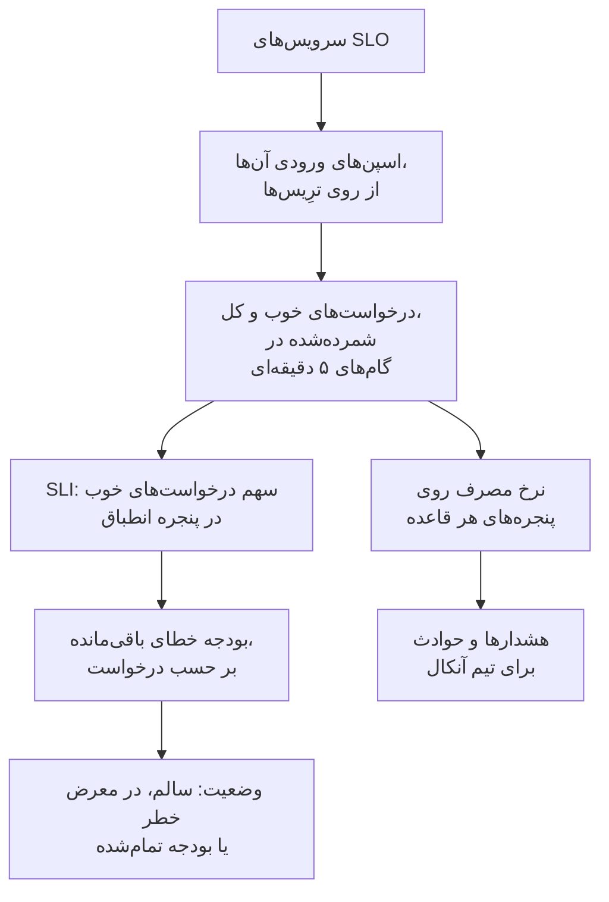

# SLOهای درخواست و تأخیر

یک SLO درخواست می‌سنجد کاربرانتان از یک سرویس چه می‌گیرند: سهمی از درخواست‌های آن که موفق می‌شوند، یا به‌اندازه کافی سریع پاسخ داده می‌شوند. OneUptime آن‌ها را از روی ترِیس‌هایی می‌شمارد که سرویس‌هایتان همین حالا هم می‌فرستند، پس مانیتوری برای راه‌اندازی در کار نیست: سرویس‌ها و یک هدف را انتخاب کنید، و OneUptime هر ۵ دقیقه آن‌ها را می‌سنجد.

:::cards
- [ساختن یک SLO درخواست](#ساختن-یک-slo-درخواست): سرویس‌ها، آستانه‌ای برای تأخیر، و یک هدف.
- [درخواست‌ها چگونه شمرده می‌شوند](#درخواستها-چگونه-شمرده-میشوند): کدام اسپن‌ها شمرده می‌شوند، و چه زمانی.
- [بررسی‌های انتشار](/docs/slo/release-checks): انتشاری را که بودجه خطا را مصرف می‌کند بازگردانید.
:::

## موفقیت درخواست و تأخیر درخواست

| آنچه می‌سنجد | درخواست وقتی بد است که | آنچه بودجه خطایش می‌شمارد |
| --- | --- | --- |
| **موفقیت درخواست** | وضعیت اسپن آن `Error` باشد. اسپنی که وضعیتی ندارد خوب شمرده می‌شود، همان‌طور که OpenTelemetry در نظر دارد. | درخواست‌های ناموفق |
| **تأخیر درخواست** | بیش از **آستانه تأخیر (ms)** آن SLO طول کشیده باشد، وضعیتش هر چه باشد. | درخواست‌های کند |

SLI سهم درخواست‌های خوب در پنجره انطباق است، و بودجه خطا درخواست‌های بدی است که هدف مجاز می‌داند: با ۹۹٫۹٪، یکی از هر ۱٬۰۰۰ درخواست. یک SLO تأخیر درخواستی را که سریع شکست خورده خوب می‌شمارد، پس یک سرویس مهم را به هر دو شیوه بسنجید: با یک SLO برای اینکه کار می‌کند، و با یکی دیگر برای اینکه سریع است.

## چگونه کار می‌کند

یک درخواست، اسپن ورودی یکی از سرویس‌های SLO است: اسپنی که در آن یک درخواست یا یک پیام وارد سرویس می‌شود، همان‌طور که فهرست [ترِیس‌ها](/docs/telemetry/traces-explorer#ترِیسها-و-اسپنها) به‌طور پیش‌فرض آن‌ها را نشان می‌دهد. درخواستی که از دو سرویس این SLO می‌گذرد، در هر کدام یک بار شمرده می‌شود.

از آنجا به بعد یک SLO درخواست مانند هر SLO دیگری کار می‌کند. وضعیت، قواعد نرخ مصرف، سیاست بودجه خطا، مالکان و اعلان‌هایش همان‌اند، با این تفاوت که بودجه خطایش به‌جای دقیقه بر حسب درخواست است.

## پیش از شروع

- سرویس‌ها ترِیس‌هایشان را به OneUptime می‌فرستند: [OpenTelemetry](/docs/telemetry/open-telemetry) را ببینید. هر کدام با `service.name` خود در [کاتالوگ سرویس](/docs/telemetry/services) آمده است.
- نقشی که بتواند SLO بسازد: مالک پروژه، مدیر پروژه یا نقشی سفارشی با دسترسی Create Service Level Objective.

## ساختن یک SLO درخواست

:::steps
### باز کردن SLOها

**SLOs** را از منوی **محصولات** در نوار بالا باز کنید، و روی **ساخت هدف سطح سرویس** کلیک کنید.

### انتخاب آنچه می‌سنجد

زیر **آنچه می‌سنجد**، **موفقیت درخواست** یا **تأخیر درخواست** را انتخاب کنید، سپس در **سرویس‌ها** سرویس‌هایی را برگزینید که درخواست‌هایشان شمرده می‌شود. برای **تأخیر درخواست**، **آستانه تأخیر (ms)** را هم تنظیم کنید، برای نمونه `300`: درخواستی که در این مدت پاسخ داده شود به‌اندازه کافی سریع حساب می‌شود. روی **بعدی** کلیک کنید.

### نام‌گذاری و تعیین هدف

یک **نام** وارد کنید، برای نمونه «Checkout requests»، و یک **هدف (%)**: سهمی از درخواست‌ها که باید خوب باشند. روی **ساخت هدف سطح سرویس** کلیک کنید.

### رسیدن نخستین عددها

نخستین ارزیابی، ظرف ۵ دقیقه، درخواست‌های ۶ ساعت گذشته را می‌شمارد، پس SLO بی‌درنگ عدد دارد. ارزیابی‌های پس از آن درخواست‌های قدیمی‌تر را هم می‌شمارند، تا وقتی پنجره انطباق پوشش داده شود.
:::

صفحهٔ **SLOs** هر سرویس SLOهایی را که آن را می‌سنجند فهرست می‌کند، و **ساخت هدف سطح سرویس** در آن همان فرم را با سرویسِ از پیش انتخاب‌شده باز می‌کند. برای اینکه بعداً آنچه یک SLO می‌سنجد، سرویس‌هایش یا آستانه‌اش را تغییر دهید، **تنظیمات** آن را باز کنید و روی **ویرایش آنچه می‌سنجد** کلیک کنید.

## درخواست‌ها چگونه شمرده می‌شوند

OneUptime درخواست‌های خوب و کل درخواست‌های هر SLO را در گام‌های ۵ دقیقه‌ای می‌شمارد و این شمارش‌ها را نگه می‌دارد، تا SLO پنجره‌اش را از روی شمارش‌های خودش بخواند، نه هر بار از روی همه اسپن‌ها:

- هر گام ۲ دقیقه پس از پایانش شمرده می‌شود، تا اسپن‌هایی که دیر می‌رسند در آن باشند، و ارزیابی بعدی دو گام آخر را دوباره می‌شمارد، برای اسپن‌هایی که باز هم دیرتر می‌رسند.
- یک SLO تازه با ۶ ساعت گذشته آغاز می‌کند. هر ارزیابی پس از آن تا یک روز از درخواست‌های قدیمی‌تر را، از تازه‌ترین به قدیمی‌ترین، می‌شمارد تا پنجره پوشش داده شود.
- فقط درخواست‌هایی شمرده می‌شوند که هنوز در محدوده [نگهداری تله‌متری](/docs/telemetry/data-retention#تلهمتری-چه-مدت-نگه-داشته-میشود) شما هستند. گام‌های شمرده‌شده ۴۰۰ روز نگه داشته می‌شوند، بیش از هر پنجره انطباقی، پس پنجره‌ای که از مدت نگهداری بلندتر است با بالا رفتن عمر SLO پر می‌شود.
- تغییر آنچه SLO می‌سنجد، سرویس‌هایش یا آستانه تأخیرش، درخواست‌هایش را از نو از ابتدا می‌شمارد. پنجره انطباق بلندتر با شمردن درخواست‌های عقب‌تر پر می‌شود.

تا وقتی شمارش‌ها فقط بخشی از پنجره انطباق را می‌پوشانند، **نمای کلی** این را با نشانگر **۲۳٪ بازه پر شده** می‌گوید، و کاشی **بودجه خطای مانده** آن را زیر عددش تکرار می‌کند. هر دو وقتی شمارش‌ها کل پنجره را بپوشانند ناپدید می‌شوند.

## بودجه خطا بر حسب درخواست

بودجه، درخواست‌های بدی است که هدف از میان درخواست‌های شمرده‌شده در پنجره مجاز می‌داند، پس با ترافیک بزرگ‌تر می‌شود: با ۹۹٫۹٪، پنجره‌ای با ۲٬۰۰۰٬۰۰۰ درخواست ۲٬۰۰۰ درخواست ناموفق را مجاز می‌داند. در **نمای کلی**:

- **بودجه خطای مانده** می‌گوید چند درخواست بد از چند درخواست مانده است، یا SLO چند درخواست از بودجه فراتر رفته است.
- **دوام بودجه** می‌گوید بودجه با نرخ مصرف کنونی چقدر دوام می‌آورد، به شرط آنکه ترافیک همان‌طور که بوده بماند.
- خلاصه شمار سرویس‌های SLO را نشان می‌دهد، و یک SLO تأخیر آستانه‌اش را زیر هدفش می‌آورد.

هشدارهای نرخ مصرف، اعلان‌ها و فید هم بودجه را بر حسب درخواست بیان می‌کنند. متریک `oneuptime.slo.error.budget.remaining.seconds` برای یک SLO درخواست فرستاده نمی‌شود؛ به‌جای آن از `oneuptime.slo.error.budget.remaining.percent` نمودار بکشید.

یک SLO درخواست همان قواعد **Fast burn**، **Slow burn** و **Slow leak** را می‌گیرد که هر SLO تازه‌ای می‌گیرد. در یک ساعت آرام با چند درخواست انگشت‌شمار، یک خطای تنها می‌تواند بودجه را سریع مصرف کند، پس یک قاعده می‌تواند پنجره‌هایی را که درخواست‌های بسیار کمی دارند نادیده بگیرد: `minimumSampleCount` آن قاعده را از راه API تنظیم کنید، تا قاعده هر پنجره بلندی را که کمتر از این تعداد درخواست دارد کنار بگذارد.

## عیب‌یابی

:::details SLO پیام در انتظار درخواست‌ها را نشان می‌دهد
هنوز هیچ‌یک از سرویس‌هایش در پنجره به درخواستی پاسخ نداده است. بررسی کنید که سرویس‌ها ترِیس به OneUptime می‌فرستند، و اسپن‌هایشان اسپن ورودی هم دارند: سرویسی که همه اسپن‌هایش داخلی‌اند درخواستی برای شمردن ندارد.
:::

:::details SLI پس از تغییر سرویس‌ها تغییر کرد
تغییر آنچه SLO می‌سنجد، سرویس‌هایش یا آستانه تأخیرش، درخواست‌هایش را دوباره می‌شمارد، با آغاز از ۶ ساعت گذشته، پس SLI و بودجه از همان‌جا از نو آغاز می‌شوند. نشانگر **۲۳٪ بازه پر شده** نشان می‌دهد تا کنون چه مقدار از پنجره شمرده شده است.
:::

## گام‌های بعدی

:::cards
- [بررسی‌های انتشار](/docs/slo/release-checks): بگذارید Argo Rollouts، Flagger یا یک پایپ‌لاین انتشاری را که بودجه را مصرف می‌کند بازگرداند.
- [هشدارها و حوادث نرخ مصرف](/docs/slo/burn-rate-alerts): وقتی بودجه بیش از حد سریع مصرف می‌شود، تیمتان را باخبر کنید.
- [سیاست بودجه خطا](/docs/slo/error-budget-policy): توافق کنید تیم با کم شدن بودجه چه کند.
:::
