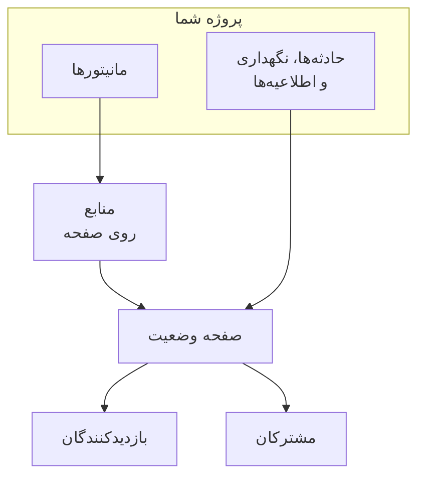

# نمای کلی صفحات وضعیت

صفحه وضعیت چهره عمومی هر چیزی است که زیر نظر می‌گیرید: یک نشانی که مشتریانتان می‌توانند به‌جای ایمیل زدن و پرسیدن اینکه «فقط مشکل من است؟» بازش کنند. وضعیت جاری سرویس‌هایی را که برای نمایش برمی‌گزینید، حادثه‌هایی که رویشان کار می‌کنید، نگهداری‌ای که برنامه‌ریزی کرده‌اید، و هر اطلاعیه‌ای که می‌خواهید بالا سنجاق کنید نشان می‌دهد.

وقتی ساعت دو بامداد چیزی می‌شکند، صفحه وضعیت نخستین چیزی است که صف پشتیبانی شما به آن پیوند می‌دهد. همچنین چیزی است که مشترکانتان از آن خبردار می‌شوند — پس ارزش دارد پیش از آنکه لازمش داشته باشید برپایش کنید، نه در حین قطعی.

:::cards
- [ساختن یک صفحه وضعیت](#ساختن-یک-صفحه-وضعیت): برای آغاز دو فیلد، و هر چیز دیگر پس از آن.
- [برگزیدن آنچه نشان می‌دهد](#برگزیدن-آنچه-روی-صفحه-نشان-داده-میشود): حادثه‌ها، اپیزودها، اطلاعیه‌ها، نگهداری و زمان کارکرد، در یک کارت.
- [تعیین اینکه چه کسی آن را می‌بیند](#محدود-کردن-اینکه-چه-کسی-صفحه-را-میبیند): هر کسی که پیوند را دارد، فقط افرادی که وارد می‌شوند، یا هر کسی که رمز عبور را دارد.
- [بایگانی کردن صفحه وضعیت](#بایگانی-کردن-صفحه-وضعیت): صفحه‌ای را بی‌آنکه حذفش کنید از دسترس بیرون ببرید.
:::

## چگونه کار می‌کند

صفحه‌های وضعیت زیر **صفحات وضعیت** در منوی **محصولات** نوار بالا، میان محصولات اصلی، زندگی می‌کنند. هر چیزی در این صفحه به ازای هر صفحه وضعیت است: پروژه‌ای می‌تواند هر تعداد که بخواهد اجرا کند — یکی عمومی برای مشتریان، یکی خصوصی برای مخاطبی داخلی، یکی به ازای هر ناحیه برای بازاری مشخص.

صفحه مانیتورهایی را که رویش می‌گذارید به‌عنوان منابعش نشان می‌دهد. حادثه‌ها و نگهداری‌های زمان‌بندی‌شده از راه همان مانیتورها به آن می‌رسند، و اطلاعیه‌ها مستقیم روی آن منتشر می‌شوند. بازدیدکنندگان صفحه را می‌خوانند، و به مشترکان درباره هر تغییر روی کانال‌هایی که برگزیده‌اند خبر داده می‌شود.

## در یک نگاه

- **با دو فیلد ساخته می‌شود.** صفحه وضعیت تازه فقط **نام** و **توضیحات** می‌پرسد. منابع، برندسازی و دامنه‌ها همه بعداً پیکربندی می‌شوند.
- **منابع همان چیزی‌اند که بازدیدکنندگان می‌بینند.** هر سطری روی صفحه یک **منبع صفحه وضعیت** است — مانیتوری (یا گروه مانیتوری) با نام نمایشی، راهنمای شناور و گزینه‌های زمان کارکرد خودش. گروه‌ها صفحه‌ای بلند را به بخش‌ها تقسیم می‌کنند و می‌توانند تودرتو باشند.
- **از روز نخست نشانی پیش‌نمایش.** هر صفحه وضعیتی پیوند پیش‌نمایشی می‌گیرد تا پیش از وجود دامنه سفارشی بتوانید نگاهش کنید.
- **مسیرهای رو به بازدیدکننده با تنظیمات دروازه‌بانی می‌شوند.** حادثه‌ها، اپیزودها، اطلاعیه‌ها و رویدادهای زمان‌بندی‌شده هرکدام فقط تا وقتی پدیدار می‌شوند که کلیدشان در **آنچه صفحه وضعیت شما نشان می‌دهد** (روی **تنظیمات پیشرفته**) روشن باشد، و صفحه اشتراک فقط تا وقتی **نمایش صفحه مشترکان** روشن باشد.
- **اینکه چه کسی آن را می‌بیند یک انتخاب است.** هر کسی که پیوند را دارد، فقط افرادی که وارد می‌شوند (کاربران خصوصی، SSO از نوع SAML یا OIDC)، یا هر کسی که رمز عبور را دارد — روی صفحه **دسترسی** صفحه، با فهرست اختیاری IPهای مجاز زیر **تنظیمات بیشتر**.
- **به مشترکان خودکار گفته می‌شود.** مشترکان ایمیل، پیامک، Slack، Microsoft Teams و وب‌هوک همه می‌توانند صفحه‌ای را دنبال کنند، هر کانالی پشت کلید خودش.

## اصطلاح‌های کلیدی

| اصطلاح | یعنی چه |
| --- | --- |
| **صفحه وضعیت** | یک صفحه عمومی (یا خصوصی)، با برندسازی، دامنه‌ها، منابع و مشترکان خودش. مدل `StatusPage`. |
| **منبع** | یک سطر که بازدیدکنندگان می‌بینند — مانیتوری یا گروه مانیتوری که با نام نمایشی و گزینه‌های زمان کارکرد روی صفحه نمایان شده است. |
| **گروه** | بخشی نام‌دار که منابع را نگه می‌دارد. گروه‌ها درون گروه‌های دیگر جای می‌گیرند، و هر سطحی وضعیت هر چیزی زیرش را جمع‌بندی می‌کند. |
| **اطلاعیه** | پیامی که روی یک یا چند صفحه وضعیت منتشر می‌کنید، با زمان آغازی و زمان پایانی اختیاری. |
| **مشترک** | کسی (یا چیزی) که صفحه را روی ایمیل، پیامک، Slack، Microsoft Teams یا وب‌هوکی دنبال می‌کند. |
| **دامنه سفارشی** | دامنه‌ای از آنِ شما — `status.example.com` — که با رکورد CNAME به صفحه نشانه گرفته شده است. OneUptime گواهی SSL آن را رایگان صادر و تمدید می‌کند. |
| **کاربر خصوصی** | حسابی که می‌تواند به صفحه وضعیتی خصوصی وارد شود. جدا از کاربران پروژه OneUptime شما. |

## ساختن یک صفحه وضعیت

:::steps
### فرم ساخت را باز کنید

**صفحات وضعیت → همه صفحات وضعیت** را باز کنید و روی **ساخت صفحه وضعیت** کلیک کنید.

### برای صفحه نام بگذارید

در پنجره **ساخت صفحه وضعیت جدید**، فیلد **نام** (الزامی، دست‌کم دو نویسه) و اختیاراً **توضیحات** را پر کنید، سپس روی **ساخت صفحه وضعیت** کلیک کنید.

فرم ساخت همین است. فهرستی که به آن برمی‌گردید **نام**، **توضیحات**، **برچسب‌ها** و **مالکان** را نشان می‌دهد، و می‌توان بر پایه **شناسه صفحه وضعیت**، **نام** و **توضیحات** پالودش.

### صفحه تازه را باز کنید

صفحه تازه را باز کنید و روی صفحه **نمای کلی** آن می‌نشینید، که دو کارت دارد: **Status Page Preview URL** با پیوندی به خود صفحه، و **جزئیات صفحه وضعیت** که می‌توانید نام، توضیحات و برچسب‌هایی را که تازه گذاشته‌اید ویرایش کنید. وقتی پروژه فیلدهای سفارشی صفحه وضعیت داشته باشد، کارت **فیلدهای سفارشی** پس از آن‌ها می‌آید.
:::

صفحه‌ای که از راه API یا Terraform ساخته شود تابع همان طرح‌هایی است که تنظیم‌های پایین‌تر دارند. در OneUptime Cloud، ساختن صفحه‌ای با تنظیمی روشن که طرح شما آن را ندارد - برای نمونه خصوصی، فهرستی پنهان، HTML، CSS یا JavaScript سفارشی، گزارش‌های ایمیلی، مشترکان پیامک، Slack، Microsoft Teams یا وب‌هوک، فهرست IPهای مجاز - با `402 Payment Required` رد می‌شود، و پیام نام طرح را می‌آورد. طرح هر تنظیم همراه همان تنظیم در پایین آمده است. تنظیم‌هایی که در پیش‌فرض خود مانده‌اند، همان‌طور که این فرم آن‌ها را می‌گذارد، در هر طرحی کار می‌کنند.

بعدی، تقریباً به ترتیب سودمندی:

- منابعی بیفزایید تا صفحه چیزی رویش داشته باشد — [منابع و گروه‌های صفحه وضعیت](/docs/status-pages/resources-and-groups) را ببینید.
- عنوان صفحه، فاوآیکن، نشان و جلد را بگذارید، سپس دامنه سفارشی پیوست کنید — [برندینگ و دامنه‌های صفحه وضعیت](/docs/status-pages/branding-and-domains) را ببینید.
- تصمیم بگیرید آدم‌ها روی کدام کانال‌ها می‌توانند مشترک شوند — [مشترکان و اطلاعیه‌ها](/docs/status-pages/subscribers) را ببینید.
- آنچه را روی صفحه پدیدار می‌شود زیر **تنظیمات پیشرفته** تنظیم کنید.

## هر چیزی کجا زندگی می‌کند

پس از باز کردن صفحه وضعیتی، منوی کناری چپ خودش به نُه بخش گروه‌بندی شده است. از این به‌عنوان نقشه باقی این گروه از مستندات استفاده کنید.

| بخش | چه چیزی درونش هست |
| --- | --- |
| **پایه** | **نمای کلی**، **اطلاعیه‌ها**، **مالکان**. |
| **منابع** | صفحه‌ای تنها به نام **منابع** — گروه‌ها در چپ، مانیتورهای گروه برگزیده در راست — و **Monitor Rules**. |
| **مشترکان** | **مشترکان ایمیلی**، **مشترکان پیامکی**، **مشترکان Slack**، **مشترکان MS Teams**، **مشترکان وب‌هوک**، **تنظیمات مشترکان**. |
| **گزارش‌های اعلان** | **گزارش‌های اعلان** — آنچه به مشترکان فرستاده شده است. |
| **برندینگ** | **برندینگ** (نشان، عنوان، فاوآیکن، پیوندها، پاورقی، رنگ‌ها و زبان‌ها، در یک صفحه)، **دامنه‌های سفارشی**، **HTML، CSS و JavaScript**. |
| **امنیت** | **دسترسی** (چه کسی صفحه را می‌بیند)، **کاربران خصوصی**، **SSO**، **OIDC**، **SCIM**. |
| **هوش مصنوعی** | **MCP**. |
| **توسعه‌دهنده** | **Terraform**، **API**، **دستیارهای هوش مصنوعی** — صفحه به‌صورت کد. |
| **پیشرفته** | **وضعیت جاسازی‌شده**، **گزارش‌ها**، **فیلدهای سفارشی**، **تنظیمات پیشرفته**، **گزارش‌های ممیزی**، **حذف صفحه وضعیت**. |

فقط **پایه** و **منابع**، یعنی آنچه صفحه نشان می‌دهد، باز آغاز می‌شوند. هر بخش دیگری، مانند بخش‌های کم‌کاربرد هر منویی در OneUptime، بسته آغاز می‌شود: روی عنوان بخشی کلیک کنید تا صفحه‌هایش نمایان شوند. هر وقت روی یکی از صفحه‌های بخشی باشید، مانند **تنظیمات پیشرفته** یا **مشترکان ایمیلی**، آن بخش خودبه‌خود باز می‌شود.

دو نکته نام‌گذاری که پیش از گشتن دانستنشان می‌ارزد:

- آیتم **منابع** فقط وقتی **منابع** برچسب می‌خورد که پروژه گروه‌های مانیتور را فعال داشته باشد. وگرنه **مانیتورها** خوانده می‌شود. در هر صورت همان صفحه است.
- صفحه گروه‌های جداگانه‌ای وجود ندارد. گروه‌ها و منابع ادغام شدند، و مسیر قدیمی `/groups` حالا به صفحه منابع هدایت می‌کند.

بیرون از صفحه‌ای منفرد، خود بخش **صفحات وضعیت** فهرست **همه صفحات وضعیت** را دارد، و بخشی به نام **بیشتر** **اطلاعیه‌ها** را نگه می‌دارد. بخشی جمع‌شده به نام **تنظیمات** **قالب‌های اطلاعیه**، **قالب‌های مشترکان**، **فیلدهای سفارشی**، **قواعد مالکیت** و **قواعد برچسب** را نگه می‌دارد، که در سطح پروژه‌اند و میان همه صفحه‌های وضعیت مشترک‌اند. بخشی جمع‌شده به نام **پیشرفته** **بایگانی‌شده** را نگه می‌دارد: صفحه‌های وضعیتی که از دسترس بیرون برده‌اید ([بایگانی کردن صفحه وضعیت](#بایگانی-کردن-صفحه-وضعیت) را ببینید).

**قواعد برچسب** و **قواعد مالکیت** به صفحه‌های وضعیت تازه برچسب می‌زنند و مالک می‌دهند. یک قاعده دو گام دارد — **تطبیق**، یعنی شرط‌هایی که صفحه وضعیت باید برآورده کند، و سپس **برچسب‌ها** (یا **مالکان**)، یعنی آنچه قاعده می‌افزاید — و **نام** آن از آنچه برمی‌گزینید پر می‌شود. یک قاعده تازه باید دست‌کم یک برچسب یا مالک بیفزاید؛ ویرایش آن هرگز این را نمی‌خواهد، و فهرست قاعده قدیمی‌ای را که چیزی نمی‌افزاید با **چیزی نمی‌افزاید** نشان می‌دهد. [قواعد برچسب و مالکیت](/docs/configuration/label-and-owner-rules) را ببینید.

## بازدیدکنندگان چه می‌بینند

صفحه عمومی برنامه خودش است، با مجموعه کوچکی از مسیرها:

- `/` — **نمای کلی**.
- `/incidents` و `/incidents/:id` — فهرست حادثه‌ها و یک حادثه.
- `/announcements` و `/announcements/:id`.
- `/scheduled-events` و `/scheduled-events/:id`.
- `/subscribe/email`، `/subscribe/sms`، `/subscribe/slack`، `/subscribe/microsoft-teams`، `/subscribe/webhooks`.
- `/confirm-subscription/:id`، `/update-subscription/:id` و `/unsubscribe/:token` — پیوندهایی که در پیام‌های مشترکان می‌آیند.
- `/rss` — خوراک.
- `/login`، `/sso` و `/master-password` — فقط روی صفحه‌ای خصوصی مرتبط‌اند.

نوار پیمایش بالا همیشه **نمای کلی** را نشان می‌دهد؛ باقی فقط وقتی فعال باشند پدیدار می‌شوند. **حوادث**، **اطلاعیه‌ها** و **رویدادهای زمان‌بندی‌شده** هرکدام کلیدشان را لازم دارند؛ **عضویت** هم **نمایش صفحه مشترکان** و هم دست‌کم یک کانال مشترک فعال را لازم دارد. صفحه خصوصی آیتم **خروج** هم می‌گیرد.

یک حادثه، اپیزود، اطلاعیه یا رویداد زمان‌بندی‌شده تنها وقتی باز می‌شود که صفحه آن را فهرست کند، هر چه بازه تاریخچه‌اش باشد: حادثه یا اپیزودی خصوصی، موردی که از صفحه‌های وضعیت پنهان شده، رویداد زمان‌بندی‌شده‌ای که از صفحه‌های وضعیت پنهان است، یا اطلاعیه‌ای که برای بعد زمان‌بندی شده، با پیوندش هم پیدا نمی‌شود.

### صفحه نمای کلی

نمای کلی صفحه‌ای است که بیشتر بازدیدکنندگان اصلاً می‌بینند. از بالا به پایین این‌ها را ترسیم می‌کند:

1. **هر اطلاعیه زنده‌ای** — اطلاعیه‌هایی که زمان آغازشان گذشته و زمان پایانشان نگذشته است.
2. **بنری از وضعیت کلی** — خطی تنها که خلاصه می‌کند همه منابع متأثرند یا فقط برخی.
3. **درصد کلی زمان کارکرد**، اگر روشنش کرده باشید: در پایان بنر وضعیت کلی، تا وقتی همه منابع عملیاتی‌اند. به‌طور پیش‌فرض خاموش.
4. **گروه‌های منابع**، هرکدام با منابعشان، وضعیت جاری‌شان، و میله‌های تاریخچه زمان کارکردشان.
5. **حوادث فعال**، همراه با اپیزودهای فعال.
6. **رویدادهای تعمیر و نگهداری زمان‌بندی‌شده**.

صفحه‌ای نو که چیزی رویش نیست حالتی خالی نشان می‌دهد که می‌گوید از داشبورد منابعی بیفزایید — که نشانه شماست برای رفتن به صفحه **منابع**.

نمای کلی‌ای که به بازدیدکننده نشان داده می‌شود حداکثر ۱۵ ثانیه کهنه است، و هر چه از صفحه بردارید ظرف یک ثانیه از آن می‌رود: حادثه، اپیزود یا رویداد زمان‌بندی‌شده‌ای که از صفحه‌های وضعیت پنهان، خصوصی، محدود به صفحه‌های دیگر یا حذف می‌کنید، اطلاعیه‌ای که پایان می‌دهید، به بعد می‌برید یا حذف می‌کنید، یادداشت عمومی‌ای که حذف می‌کنید، و منبع، گروه یا مانیتوری که از صفحه برمی‌دارید یا حذف می‌کنید. ویرایش‌های دیگر، مانند عنوانی تازه، ظرف همان ۱۵ ثانیه نمایان می‌شوند.

برای اینکه اصلاً چه چیزی حادثه‌ای را روی این صفحه می‌گذارد، و چه چیزی دوباره برش می‌دارد، [وضعیت‌ها و شدت‌های حادثه](/docs/incidents/states-and-severities) را ببینید.

## برگزیدن آنچه روی صفحه نشان داده می‌شود

آنچه بازدیدکنندگان می‌بینند در یک کارت تنظیم می‌شود: **آنچه صفحه وضعیت شما نشان می‌دهد**، روی **صفحات وضعیت → صفحهٔ شما → پیشرفته → تنظیمات پیشرفته**. این کارت برای هر فهرستی که صفحه می‌تواند نشان دهد یک ردیف دارد، و پس از آن‌ها **تاریخچه زمان کارکرد** (با درصد کلی زمان کارکرد و اینکه کدام وضعیت‌ها قطعی به حساب می‌آیند) و خط «Powered by OneUptime». دکمه ویرایشی در کار نیست: کلید همان لحظه که آن را بزنید ذخیره می‌شود، تعداد روزها وقتی از کادرش بیرون بروید یا Enter را بزنید، و انتخاب از یک فهرست همان لحظه که انجامش دهید.

- **نمایش حوادث** (`showIncidentsOnStatusPage`) — به‌طور پیش‌فرض روشن. زیرش، **نمایش … روز گذشته** (`showIncidentHistoryInDays`، پیش‌فرض ۱۴) تعیین می‌کند فهرست حادثه‌ها چقدر به عقب می‌رسد، و **نمایش برچسب‌های حادثه** (`showIncidentLabelsOnStatusPage`) به‌طور پیش‌فرض خاموش است.
- **فقط نمایش حادثه‌های محدودشده به این صفحه** (`onlyShowScopedIncidents`) — آن هم در ردیف حادثه‌ها، به‌طور پیش‌فرض خاموش. روشنش کنید تا صفحه فقط حادثه‌هایی را که با **محدود به این صفحات وضعیت** به آن محدود شده‌اند نشان دهد و مشترکانش را فقط درباره آن‌ها خبردار کند. حادثه‌هایی که به هیچ صفحه‌ای محدود نشده‌اند، از جمله حادثه‌هایی که مانیتور، Slack، Microsoft Teams، API یا هوش مصنوعی خودشان باز می‌کنند، هرگز به آن نمی‌رسند تا کسی صفحه را به آن‌ها بیفزاید. این کلید همچنین تعیین می‌کند کدام حادثه‌ها اپیزودهایشان را به صفحه می‌آورند، برای همین وقتی **نمایش حوادث** خاموش است هم سر جایش می‌ماند. برای صفحه‌هایی که در مانیتورها شریک‌اند اما به مخاطبان مختلفی خدمت می‌کنند، [یک صفحه وضعیت برای هر مخاطب](/docs/status-pages/one-status-page-per-audience) را ببینید.
- **نمایش اپیزودها** (`showEpisodesOnStatusPage`) — به‌طور پیش‌فرض روشن، با **نمایش … روز گذشته** (`showEpisodeHistoryInDays`، پیش‌فرض ۱۴) و **نمایش برچسب‌های اپیزود** (`showEpisodeLabelsOnStatusPage`، به‌طور پیش‌فرض خاموش). اپیزودها مدل خودشان با نقطه‌های پایانی خودشان‌اند، نه نمایی از حادثه‌ها.
- **نمایش اطلاعیه‌ها** (`showAnnouncementsOnStatusPage`) — به‌طور پیش‌فرض روشن، با **نمایش … روز گذشته** (`showAnnouncementHistoryInDays`، پیش‌فرض ۱۴).
- **نمایش رویدادهای تعمیر و نگهداری زمان‌بندی‌شده** (`showScheduledMaintenanceEventsOnStatusPage`) — به‌طور پیش‌فرض روشن، با **نمایش … روز گذشته** (`showScheduledEventHistoryInDays`، پیش‌فرض ۱۴) و **نمایش برچسب‌های رویداد** (`showScheduledEventLabelsOnStatusPage`، به‌طور پیش‌فرض خاموش).
- **تاریخچه زمان کارکرد** — هر چیزی درباره زمان کارکرد صفحه، در یک ردیف:
  - **نمایش … روز گذشته** (`showUptimeHistoryInDays`) طول میله زمان کارکرد کنار هر منبع است. پیش‌فرض ۹۰ و باید میان ۱ و ۹۰ باشد. هر گزینه **نمایش ٪ زمان کارکرد** و **نمایش نمودار تاریخچه وضعیت** روی منبعی یا گروهی همین عدد را می‌خواند، و درصد کلی زمان کارکرد هم همین‌طور.
  - **نمایش درصد کلی زمان کارکرد** (`showOverallUptimePercentOnStatusPage`) — به‌طور پیش‌فرض خاموش. روشنش کنید و بنر وضعیت کلی، تا وقتی همه چیز عملیاتی است، با یک درصد زمان کارکرد برای کل صفحه پایان می‌یابد، میانگین منابع و گروه‌هایش. تا وقتی روشن است، **دقت** (`overallUptimePercentPrecision`) تعیین می‌کند چند رقم اعشار نشان دهد: `99%`، `99.9%`، `99.99%` (پیش‌فرض) یا `99.999%`. هر منبع و گروه دقت خودش را دارد.
  - **قطعی به حساب می‌آید** (`downtimeMonitorStatuses`) — وضعیت‌های مانیتوری که زمانشان در برابر هر درصد زمان کارکرد روی صفحه شمرده می‌شود: درصد هر منبع، هر گروه و درصد کلی. هر وضعیت تراشه‌ای به رنگ خودش است. یکی را از فهرست بیفزایید یا یکی را با **×** آن بردارید، و تغییر بی‌درنگ ذخیره می‌شود. صفحه وضعیت تازه با هر وضعیتی از پروژه که عملیاتی نیست آغاز می‌شود. دست‌کم یک وضعیت می‌ماند: آخرینش را نمی‌توان برداشت، چون بی هیچ وضعیتی هر زمان کارکردی روی صفحه ۱۰۰٪ خوانده می‌شد.
- **نمایش نشان «Powered By OneUptime»** — به‌طور پیش‌فرض روشن، پس پاورقی بازدیدکننده «Powered by OneUptime» می‌خواند. خاموشش کنید تا آن خط پنهان شود. ستون آن را برعکس ذخیره می‌کند، به‌صورت `hidePoweredByOneUptimeBranding`.

**فهرستی که خاموش است** از صفحه برداشته می‌شود، همراه با آیتمش در نوار پیمایش اگر آیتمی داشته باشد؛ نقطه پایانی عمومی‌اش درخواست را رد می‌کند و مشترکان صفحه درباره آن نوع رویداد خبردار نمی‌شوند. آن‌وقت ردیفش فقط کلیدش را نشان می‌دهد: اینکه فهرستی پنهان چقدر به عقب می‌رسد یا برچسب نشان می‌دهد یا نه، چیزی را تغییر نمی‌دهد.

**طرح‌ها.** در OneUptime Cloud، کنار تنظیمی که طرح شما اجازه تغییرش را نمی‌دهد نام طرح لازم نوشته می‌شود. چهار کلید فهرست‌ها، سه کلید برچسب‌ها و تاریخچه اپیزودها به **Growth** نیاز دارند؛ نشان دادن درصد کلی زمان کارکرد و پنهان کردن خط «Powered by OneUptime» به **Scale** نیاز دارند. بقیه بازه‌های تاریخچه، **تاریخچه زمان کارکرد**، **دقت**، **قطعی به حساب می‌آید** و **فقط نمایش حادثه‌های محدودشده به این صفحه** در هر طرحی تغییرپذیرند، و هرکدام جداگانه ذخیره می‌شود: صفحه‌ای که درصد کلی زمان کارکردش از پیش روشن است می‌تواند دقت آن را در هر طرحی تغییر دهد. برگرداندن تنظیمی به همان حالتی که صفحه تازه دارد - نشان دادن دوباره فهرستی، پنهان کردن برچسب‌ها یا درصد کلی زمان کارکرد، نشان دادن خط «Powered by OneUptime»، برگرداندن تاریخچه اپیزودها به ۱۴ روز - در هر طرحی کار می‌کند، پس هیچ چیزی که دوره آزمایشی تغییر داده به خاطر نبود طرحی همان‌طور نمی‌ماند: کلید می‌گوید که هنوز می‌تواند برگردد، و تغییر دوباره‌اش به کدام طرح نیاز دارد.

اینکه صفحه آیتم **عضویت** را نشان بدهد یا نه (**نمایش صفحه مشترکان**، `showSubscriberPageOnStatusPage`، به‌طور پیش‌فرض روشن) و بازدیدکنندگان از راه کدام کانال‌ها بتوانند مشترک شوند، در این صفحه تنظیم نمی‌شود: هر دو در کارت **کانال‌ها** زیر **مشترکان → تنظیمات مشترکان** هستند ([کانال‌های اشتراک](/docs/status-pages/subscribers#کانالهای-اشتراک) را ببینید).

زیر کارت، **خروجی گرفتن از صفحه وضعیت به صورت JSON** است که تنظیم‌های خود صفحه وضعیت را در فایلی دانلود می‌کند که می‌توانید دوباره وارد کنید، و **Archive status page** ([بایگانی کردن صفحه وضعیت](#بایگانی-کردن-صفحه-وضعیت) را ببینید). درصد کلی زمان کارکرد و وضعیت‌های قطعی پیش‌تر اینجا دو کارت جداگانه بودند، هرکدام پشت دکمه **ویرایش**؛ اکنون ردیف‌هایی از این کارت‌اند.

**رنگ‌ها کجایند.** رنگ میله‌های زمان کارکرد اینجا نیستند — **رنگ پیش‌فرض میله** و قواعد رنگ میله زیر **تنظیمات بیشتر** روی **صفحات وضعیت → صفحهٔ شما → برندینگ → برندینگ** هستند. هیچ‌جا تنظیم پوسته یا رنگ برند وجود ندارد؛ هر چیزی فراتر از آن کنترل‌ها با **CSS سفارشی** انجام می‌شود.

## پیش‌نمایش پیش از زنده شدن

صفحه **نمای کلی** هر صفحه وضعیتی کارت **Status Page Preview URL** را با پیوندی مستقیم به صفحه حمل می‌کند. تا وقتی هنوز منابع می‌افزایید و پیش از وجود دامنه سفارشی از آن استفاده کنید.

پشت پرده، هر مسیر عمومی دوقلویی پیش‌نمایشی زیر `/status-page/{statusPageId}/...` دارد — نمای کلی پیش‌نمایش، فهرست حادثه پیش‌نمایش، صفحه اشتراک پیش‌نمایش و مانند آن. یعنی نشانی یا عکسی که از پیش‌نمایش داشبورد گرفته شود پس از پیوست شدن دامنه سفارشی با آنچه مشتری می‌بیند نمی‌خواند، پس هر پیوندی را که در رانبوکی یا ایمیلی می‌چسبانید دوباره بررسی کنید.

## محدود کردن اینکه چه کسی صفحه را می‌بیند

هر صفحه وضعیتی برای عموم نیست. اینکه چه کسی صفحه را می‌بیند یک انتخاب است، نخستین کارت روی **صفحات وضعیت → صفحهٔ شما → امنیت → دسترسی**، یعنی **چه کسی می‌تواند این صفحه وضعیت را ببیند**:

- **هر کسی که پیوند را دارد** — صفحه عمومی است. هر صفحه وضعیت تازه‌ای از اینجا آغاز می‌شود.
- **فقط افرادی که وارد می‌شوند** — بازدیدکنندگان روی `/login` می‌نشینند و به‌عنوان کاربر خصوصی، یا با ارائه‌دهنده SSO یا OIDC شما (پایین‌تر را ببینید)، وارد می‌شوند. زیر این انتخاب، کارت ورودهایی را که برای صفحه برپا شده فهرست می‌کند - چند کاربر خصوصی دارد، و اینکه SSO و OIDC روشن‌اند یا نه، هرکدام با پیوند به صفحه خودش - و تا وقتی همین انتخاب برگزیده است، اگر هنوز کسی نتواند وارد شود همین را می‌گوید.
- **هر کسی که رمز عبور را دارد** — بازدیدکنندگان روی `/master-password` می‌نشینند و صفحه را با یک رمز عبور که با آن‌ها در میان می‌گذارید باز می‌کنند. هیچ‌کس به حساب نیاز ندارد. برگزیدن آن، اگر صفحه رمزی نداشته باشد، در همان پنجره رمز عبور را می‌پرسد؛ اگر داشته باشد، می‌توانید نگهش دارید یا رمز تازه‌ای تایپ کنید. پس از آن **تغییر رمز عبور** زیر این انتخاب آن را جایگزین می‌کند. رمز عبور به‌صورت هش ذخیره می‌شود و دوباره نشان داده نمی‌شود، و کسانی که رمز قدیمی را وارد کرده‌اند تا ۷ روز می‌توانند به دیدن صفحه ادامه دهند.

برگزیدن یک انتخاب از شما تأیید می‌خواهد، و می‌گوید چه چیزی برای بازدیدکنندگان تغییر می‌کند، و بی‌درنگ ذخیره می‌شود. دکمه ویرایشی در کار نیست.

**تصویرها.** تصویری در آنچه صفحه نشان می‌دهد - یادداشت عمومی، اطلاعیه، توضیحات - با نشانی بلند و حدس‌ناپذیر خودش باز می‌شود، که بی ورود کار می‌کند، تا ایمیل‌هایی که مشترکانتان می‌گیرند هم بتوانند نشانش دهند. خود صفحه همچنان ورود یا رمز عبور را می‌خواهد.

**آنچه ذخیره می‌کند.** این انتخاب سه ستون است، که API و Terraform مانند گذشته می‌خوانند و می‌نویسند: `isPublicStatusPage`، `enableMasterPassword` و `masterPassword`. از بازدیدکنندگان تنها روی صفحه‌ای رمز عبور خواسته می‌شود که عمومی نیست، `enableMasterPassword` در آن روشن است و رمزی تنظیم شده؛ صفحه خصوصی‌ای که کلیدش روشن است اما رمزی ندارد، صفحه ورود است. برگزیدن **هر کسی که پیوند را دارد** `enableMasterPassword` را هم خاموش می‌کند، چون صفحه عمومی هرگز رمز نمی‌خواهد. صفحه **دسترسی** فقط ستون‌هایی را می‌نویسد که یک انتخاب تغییرشان می‌دهد.

**طرح‌ها.** در OneUptime Cloud، خصوصی کردن صفحه به طرح **Growth** نیاز دارد: در طرحی پایین‌تر، دو انتخاب خصوصی طرح لازمشان را نشان می‌دهند و قابل برگزیدن نیستند. عمومی کردن دوباره‌اش - **هر کسی که پیوند را دارد** - در هر طرحی کار می‌کند، پس صفحه‌ای که پس از پایان دوره آزمایشی، یا پس از رفتن به طرحی پایین‌تر، خصوصی مانده همیشه می‌تواند باز شود؛ پنجره می‌گوید خصوصی کردن دوباره‌اش به **Growth** نیاز دارد. رفتن میان **فقط افرادی که وارد می‌شوند** و **هر کسی که رمز عبور را دارد** در هر طرحی کار می‌کند، و **تغییر رمز عبور** هم همین‌طور.

### کاربران خصوصی

آدم‌هایی را که مجازند وارد شوند در **صفحات وضعیت → صفحهٔ شما → امنیت → کاربران خصوصی** بیفزایید. کنش **افزودن گروهی** هست — فهرستی از نشانی‌های ایمیل بچسبانید و هرکدام ایمیل دعوتی می‌گیرند. کاربران خصوصی جریان فراموشی و بازنشانی گذرواژه خودشان را دارند، جدا از حساب‌های پروژه OneUptime شما.

**کاربران خصوصی و رمز عبور روی هم انباشته نمی‌شوند.** تا وقتی **هر کسی که رمز عبور را دارد** انتخاب است، کاربران خصوصی نمی‌توانند وارد شوند - آن‌ها هم رمز عبور را وارد می‌کنند - و صفحه **کاربران خصوصی** همین را می‌گوید، با پیوندی برای بازگشت به **دسترسی**.

### SSO و OIDC

برای صفحه‌ای خصوصی که به ارائه‌دهنده هویتتان گره خورده، **صفحات وضعیت → صفحهٔ شما → امنیت → SSO** یعنی SAML را پیکربندی می‌کند: نشانی ورود، صادرکننده و گواهی x509 را وارد می‌کنید، و روش‌های امضا و چکیده زیر **فیلدهای بیشتر** پر شده‌اند. **صفحات وضعیت → صفحهٔ شما → امنیت → OIDC** یعنی OpenID Connect را پیکربندی می‌کند: صادرکننده، شناسه و راز کلاینت را وارد می‌کنید، و نشانی کشف، دامنه‌ها و نام ادعاها زیر **فیلدهای بیشتر** پر شده‌اند. **SCIM** کاربران خصوصی را خودکار از IdP تأمین می‌کند. در OneUptime Cloud هر سه به طرح Scale یا بالاتر نیاز دارند. در نصب خودمیزبان، SSO و OIDC بخشی از همهٔ نسخه‌ها هستند و SCIM به [نسخه سازمانی](/docs/self-hosted/enterprise) نیاز دارد.

خاموش کردن یا حذف ارائه‌دهنده SSO یا OIDC یک صفحه وضعیت، کاربران خصوصی‌ای را که با آن وارد شده‌اند بیرون می‌برد: نشست‌هایشان در درخواست بعدی‌شان پایان می‌یابد، و روشن کردن دوباره ارائه‌دهنده آن‌ها را برنمی‌گرداند - دوباره با آن وارد می‌شوند. گواهی یا راز کلاینت تازه، نشانی‌های دیگر یا نامی تازه همه را وارد نگه می‌دارد. روی صفحه‌ای که SSO را الزامی کرده، خاموش کردن آخرین ارائه‌دهنده‌اش هیچ‌کس را قادر به ورود نمی‌گذارد تا وقتی یکی را دوباره روشن کنید یا **الزامی کردن SSO برای ورود** را خاموش کنید؛ برای رفتن به ارائه‌دهنده‌ای دیگر، پیش از خاموش کردن قدیمی، تازه را برپا کنید و بیازمایید.

زیر ارائه‌دهنده‌ها، کارت **تنظیمات SSO** کلید **الزامی کردن SSO برای ورود** (`requireSsoForLogin`، به‌طور پیش‌فرض خاموش) را دارد، که همان لحظه که آن را بزنید ذخیره می‌شود. روشن کردنش نخست می‌پرسد، چون از آن پس کاربران خصوصی نمی‌توانند با ایمیل و گذرواژه وارد شوند: فقط کسانی که ارائه‌دهنده SSO یا OIDC شما راهشان می‌دهد می‌توانند صفحه را ببینند. پیش از روشن کردنش SSO را با پیوند همان صفحه بیازمایید. فقط تا وقتی **فقط افرادی که وارد می‌شوند** انتخاب است اهمیت دارد، و صفحه **دسترسی** آن را زیر همان انتخاب به‌صورت **SSO الزامی** فهرست می‌کند. تا وقتی روشن است، کاربر خصوصی‌ای که با ایمیل و گذرواژه وارد شده هم در درخواست بعدی‌اش بیرون می‌رود: فقط نشست‌هایی به حساب می‌آیند که یک ارائه‌دهنده SSO یا OIDC ساخته است. در OneUptime Cloud، روشن کردن آن به طرح **Scale** نیاز دارد و خاموش کردنش در هر طرحی ممکن است. صفحه‌ای که پس از پایان دوره آزمایشی Scale یا رفتن به طرحی پایین‌تر هنوز SSO را الزامی کرده، تا وقتی کسی آن را خاموش نکند همچنان الزامی‌اش می‌کند: صفحه‌های **SSO** و **OIDC** آن، این کلید را برای همین زیر پیشنهاد ارتقای طرح نشان می‌دهند.

### فهرست IPهای مجاز

زیر **تنظیمات بیشتر** روی **دسترسی**، بخش **فهرست IPهای مجاز** (ستون `ipWhitelist`) صفحه را به شبکه‌های شناخته محدود می‌کند. هر که صفحه برایش باز باشد، اعمال می‌شود: بازدیدکننده‌ای از هر نشانی دیگر رد می‌شود، حتی با رمز عبور یا حساب کاربر خصوصی. در هر سطر یک مدخل وارد کنید - نشانی IPv4 یا IPv6، یا بازه‌ای IPv4 مانند `10.0.0.0/8`؛ سطری که هیچ‌کدام نباشد هنگام ذخیره رد می‌شود. خالی بگذاریدش تا هر نشانی‌ای راه یابد. تا وقتی فهرست برقرار است، سرتیتر جمع‌شده **تنظیمات بیشتر** **فهرست IPهای مجاز** را با شمار مدخل‌هایش نشان می‌دهد. در OneUptime Cloud، تغییر آن به طرح **Scale** نیاز دارد؛ خالی کردنش در هر طرحی کار می‌کند.

## نشان تعبیه‌شدنی و خوراک RSS

دو راه برای نمایان کردن وضعیت جایی جز خود صفحه.

**نشان تعبیه‌شده وضعیت.** روی **صفحات وضعیت → صفحهٔ شما → پیشرفته → وضعیت جاسازی‌شده**، **فعال کردن نشان وضعیت جاسازی‌شده** (`enableEmbeddedOverallStatus`، به‌طور پیش‌فرض خاموش) را روشن کنید، سپس روی کارت **توکن امنیتی** روی **ساخت دوباره توکن** کلیک کنید تا نشان توکنش (`embeddedOverallStatusToken`) را بگیرد. نشان از `/api/status-page/badge/<status-page-id>?token=<token>` سرو می‌شود، و صفحه آن را زیر **پیش‌نمایش نشان** با تکه‌کدهایی برای رونوشت نشان می‌دهد، پس می‌توانید وضعیت کلی جاری را در مستنداتتان، پاورقی برنامه‌تان یا صفحه‌ای بازاریابی بگذارید.

**خوراک RSS.** هر صفحه وضعیتی `/rss` را سرو می‌کند — خوراکی با عنوان «{page title} Updates»، با **عنوان صفحه** صفحه از **برندینگ**، یا نامش وقتی عنوانی ندارد، که آیتم‌هایش با `Incident: `، `Announcement: ` و `Scheduled Maintenance: ` پیشوند می‌گیرند. برای کسانی که ترجیح می‌دهند به‌جای اشتراک با ایمیل، به‌روزرسانی‌های شما را به خواننده‌ای یا ربات گفت‌وگویی لوله کنند به‌کار می‌آید.

اگر ترجیح می‌دهید داده را خودتان بکشید، صفحه وضعیت نقطه‌های پایانی عمومی خواندنی برای نمای کلی، حادثه‌ها، رویدادهای نگهداری زمان‌بندی‌شده، اطلاعیه‌ها و اپیزودها دارد — [API عمومی](/docs/status-pages/public-api) را ببینید.

## بایگانی کردن صفحه وضعیت

صفحه وضعیتی را بایگانی کنید تا بی‌آنکه حذفش کنید از دسترس بیرون برود. صفحه وضعیت بایگانی‌شده:

- **از دسترس بیرون است.** نشانی‌اش، دامنه‌های سفارشی‌اش، نشان تعبیه‌شده‌اش، API عمومی‌اش و سرور MCPاش همه چنان پاسخ می‌دهند که گویی صفحه وجود نداشته («Status Page not found»)، پس بازدیدکننده نمی‌تواند صفحه بایگانی‌شده را از صفحه‌ای که هرگز نبوده تشخیص دهد. پیوند پیش‌نمایش داشبورد هم از کار می‌افتد.
- **چیزی برای مشترکانش نمی‌فرستد.** نه اعلان حادثه، اپیزود، نگهداری یا اطلاعیه، نه گزارش، و نه تأیید اشتراک. هیچ‌کس نمی‌تواند در آن مشترک شود.
- **فهرست صفحات وضعیت را ترک می‌کند.** آن را زیر **صفحات وضعیت → پیشرفته → بایگانی‌شده** پیدا کنید.
- **همه چیز را نگه می‌دارد.** منابع، گروه‌ها، برندینگ، دامنه‌ها، کاربران خصوصی و مشترکانش نگه داشته می‌شوند، پس خروج از بایگانی صفحه را درست همان‌طور که بود دوباره در دسترس می‌گذارد.

برای بایگانی کردن یک صفحه وضعیت، آن را باز کنید و به **پیشرفته → تنظیمات پیشرفته → Archive status page** بروید. برای بایگانی کردن چند صفحه، آن‌ها را در فهرست **صفحات وضعیت** برگزینید و **بایگانی** را انتخاب کنید. برای برگرداندن یکی، **صفحات وضعیت → پیشرفته → بایگانی‌شده** را باز کنید، آن را برگزینید و **خروج از بایگانی** را انتخاب کنید، یا آن را باز کنید و روی **خروج از بایگانی** در بنر بالای صفحه‌هایش کلیک کنید.

## گام‌های بعدی

:::cards
- [منابع و گروه‌های صفحه وضعیت](/docs/status-pages/resources-and-groups): مانیتورها را روی صفحه بگذارید و در بخش‌ها سازمان دهید.
- [برندینگ و دامنه‌های صفحه وضعیت](/docs/status-pages/branding-and-domains): نشان و رنگ‌های شما، و صفحه روی دامنه خودتان.
- [مشترکان و اطلاعیه‌ها](/docs/status-pages/subscribers): پنج کانال مشترکان، و انتشار اطلاعیه‌ها.
- [یک صفحه وضعیت برای هر مخاطب](/docs/status-pages/one-status-page-per-audience): یک صفحه برای هر مشتری، سایت یا منطقه، و اینکه کدام‌ها درباره هر حادثه بشنوند.
:::
