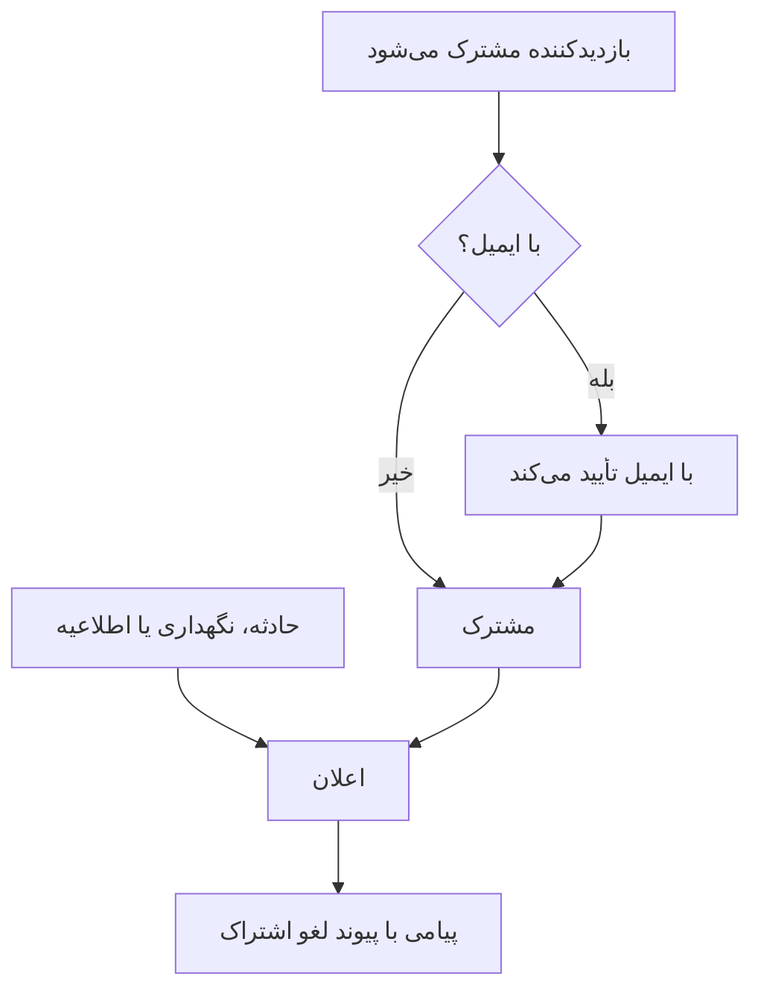

# مشترکان و اطلاعیه‌ها

صفحه وضعیت جایی است که آدم‌ها به آن می‌روند. مشترکان کسانی‌اند که ترجیح می‌دهند مجبور نباشند — یک بار نشانی ایمیل، شماره تلفن، وب‌هوک Slack یا نقطه پایانی HTTPای به شما می‌دهند، و پس از آن به‌روزرسانی‌های شما نزدشان می‌آید.

اطلاعیه‌ها نیمه دیگر همان کارند. مانیتوری می‌تواند به بازدیدکنندگانتان بگوید پرداخت خطای ۵۰۰ برمی‌گرداند؛ هیچ مانیتوری نمی‌تواند بگوید شنبه پایگاه‌های داده را مهاجرت می‌دهید، ارائه‌دهنده‌ای شخص ثالث روز بدی دارد، یا حادثه‌ای که دیروز درباره‌اش خواندند کاملاً بسته شده است. اطلاعیه‌ها کانال متن آزاد برای هر چیزی هستند که بررسی‌های شما نمی‌بینند، و به همان فهرست مشترکان پخش می‌شوند.

این صفحه هر دو را پوشش می‌دهد: پنج کانال اشتراک و اینکه بازدیدکنندگان چگونه ثبت‌نام می‌کنند، مشترکان چه چیزی را می‌توانند برای شنیدن برگزینند، جریان دوگام تأیید و لغو اشتراک، گزارش ایمیلی‌ای که مشترکان می‌توانند هر ماه بگیرند، و اینکه اطلاعیه‌ها چگونه نوشته، زمان‌بندی و قالب‌بندی می‌شوند.

:::cards
- [کانال‌های اشتراک](#کانالهای-اشتراک): کانال‌هایی که بازدیدکنندگان می‌توانند با آن‌ها مشترک شوند، و صفحه‌ای که در آن مشترک می‌شوند.
- [آنچه به مشترکان گفته می‌شود](#مشترکان-درباره-چه-چیزی-خبردار-میشوند): اطلاعیه‌ها، نگهداری، حادثه‌ها و اپیزودها، و ویرایش‌های آن‌ها.
- [بررسی آنچه فرستاده شد](#بررسی-آنچه-فرستاده-شد): وضعیت هر اعلان، و تلاش دوباره و ارسال دوباره.
- [اطلاعیه‌ها](#اطلاعیهها): اطلاعیه‌ای را روی یک یا چند صفحه وضعیت منتشر کنید.
:::

## چگونه کار می‌کند



هر صفحه وضعیت مشترکان خودش را دارد. بازدیدکننده در صفحه **عضویت** صفحه مشترک می‌شود، جایی که نشانی ایمیل پیش از شنیدن هر چیزی با یک پیوند تأیید می‌شود، یا تیم شما آن‌ها را در داشبورد می‌افزاید. از آن پس هر حادثه، رویداد نگهداری زمان‌بندی‌شده و اطلاعیه‌ای که به صفحه می‌رسد به مشترکانش خبر می‌دهد، هرکدام روی کانالی که با آن مشترک شده، و هر پیام پیوندی دارد که اشتراک را لغو می‌کند.

## کانال‌های اشتراک

صفحه وضعیت از پنج کانال پشتیبانی می‌کند. این کانال‌ها و صفحه‌ای که بازدیدکنندگان در آن مشترک می‌شوند در یک جا روشن و خاموش می‌شوند: کارت **کانال‌ها** در **صفحات وضعیت → صفحهٔ شما → مشترکان → تنظیمات مشترکان**. هر کلید همان لحظه‌ای که تغییرش می‌دهید ذخیره می‌شود:

- **نمایش صفحه مشترکان** (`showSubscriberPageOnStatusPage`) — به‌طور پیش‌فرض روشن. آیتم **عضویت** را در نوار پیمایش صفحه وضعیت می‌گذارد، جایی که بازدیدکنندگان از راه کانال‌های زیر مشترک می‌شوند.
- **ایمیل** (`enableEmailSubscribers`) — به‌طور پیش‌فرض روشن. باقی همه‌چیز تا وقتی روشنشان نکنید خاموش‌اند.
- **SMS** (`enableSmsSubscribers`) — به‌طور پیش‌فرض خاموش. در OneUptime Cloud هزینه هر پیامک از موجودی پیامک و تماس پروژه پرداخت می‌شود، مگر اینکه صفحه **پیکربندی Twilio** خودش را داشته باشد ([پایین‌تر](#پاورقی-ایمیل-smtp-سفارشی-و-twilio) را ببینید). برای روشن کردنش، **SMS** پروژه هم باید در کارت **کانال‌های اعلان** در **Project Settings > Notifications > Notification Settings** روشن باشد. مالک پروژه یا کسی که **Billing Admin** یا **Manage Billing** دارد می‌تواند آن را روشن کند.
- **Slack** (`enableSlackSubscribers`) — به‌طور پیش‌فرض خاموش.
- **Microsoft Teams** (`enableMicrosoftTeamsSubscribers`) — به‌طور پیش‌فرض خاموش.
- **وب‌هوک** (`enableWebhookSubscribers`) — به‌طور پیش‌فرض خاموش.

این کلیدها تعیین می‌کنند بازدیدکنندگان چگونه می‌توانند خودشان مشترک شوند: صفحه وضعیت اشتراک از راه کانالِ خاموش را رد می‌کند. اعلان‌ها را متوقف نمی‌کنند: مشترکانی که تیم شما در داشبورد، با API یا با یک گردش‌کار اضافه می‌کند، هر کانالی هم که روشن باشد به‌روزرسانی‌ها را دریافت می‌کنند.

در OneUptime Cloud، کنار کلیدی که طرح شما آن را ندارد نام طرح نوشته می‌شود: **Growth** برای **SMS** و **نمایش صفحه مشترکان**، و **Scale** برای **Slack**، **Microsoft Teams** و **وب‌هوک**. خاموش کردن یک کانال در هر طرحی کار می‌کند، پس کانالی که دوره آزمایشی روشنش کرده همیشه می‌تواند دوباره خاموش شود؛ کلید این را زیر خودش می‌گوید.

هر کانالی فهرست خودش را هم در منوی کناری صفحه وضعیت زیر **مشترکان** می‌گیرد: **مشترکان ایمیلی**، **مشترکان پیامکی**، **مشترکان Slack**، **مشترکان MS Teams** و **مشترکان وب‌هوک**. آنجاست که می‌بینید چه کسی ثبت‌نام کرده، کسی را دستی می‌افزایید، یا روی مشترکی مشخص برای خودتان مدخل **یادداشت‌ها** (`internalNote`) می‌گذارید. تا وقتی کانالی خاموش است، بالای فهرستش همین را می‌گوید و کلید کانال همان‌جاست، پس بی‌آنکه فهرست را ترک کنید روشنش می‌کنید.

**یک کلید بس نیست.** آیتم **عضویت** در نوار پیمایش صفحه وضعیت فقط وقتی پدیدار می‌شود که **نمایش صفحه مشترکان** روشن باشد *و* دست‌کم یک کانال روشن باشد. اگر **ایمیل** را روشن کنید اما **نمایش صفحه مشترکان** را خاموش بگذارید، بازدیدکنندگان راهی به فرم ندارند.

## بازدیدکننده در صفحه عضویت چه می‌بیند

صفحه **عضویت** زیرمنویی با یک زبانه به ازای هر کانال فعال دارد. هر زبانه‌ای کمینه آنچه لازم دارد را می‌پرسد:

| زبانه | نشانی | سرتیتر | آنچه می‌پرسد |
| --- | --- | --- | --- |
| **ایمیل** | `/subscribe/email` | **عضویت با ایمیل** | **ایمیل شما**، با جانگهدار `subscriber@company.com`. |
| **پیامک** | `/subscribe/sms` | **عضویت با پیامک** | **شماره تلفن شما**، با جانگهدار `+11234567890`. |
| **اسلک** | `/subscribe/slack` | **عضویت با اسلک** | **نام فضای کاری اسلک** (برای اعتبارسنجی به کار می‌رود) و **آدرس وب‌هوک ورودی اسلک**، با جانگهدار `https://hooks.slack.com/services/...`. |
| **مایکروسافت تیمز** | `/subscribe/microsoft-teams` | **عضویت با مایکروسافت تیمز** | **نام فضای کاری مایکروسافت تیمز** و **آدرس وب‌هوک ورودی مایکروسافت تیمز**، با جانگهدار `https://outlook.office.com/webhook/...`. |
| **وب‌هوک‌ها** | `/subscribe/webhooks` | **عضویت با وب‌هوک** | **آدرس وب‌هوک**، با جانگهدار `https://example.com/webhook`. در هر رویداد صفحه وضعیت درخواستی `POST` از نوع JSON به آن فرستاده می‌شود. |

دکمه ثبت **عضویت** خوانده می‌شود. ثبت‌نام با پیامک، Slack، Microsoft Teams یا وب‌هوک پیام *عضویت شما با موفقیت انجام شد.* را نشان می‌دهد. ثبت‌نام با ایمیل می‌گوید پیوند تأییدی فرستاده شده و اگر نرسید پوشه هرزنامه را بررسی کنند ([تأیید دوگام ایمیل](#تأیید-دوگام-ایمیل) را ببینید). زبانه‌های **ایمیل**، **پیامک**، **اسلک** و **مایکروسافت تیمز** تقسیم **عضویت جدید** / **مدیریت عضویت موجود** را هم دارند، پس کسی که از پیش مشترک شده می‌تواند بدون گشتن دنبال پیامی قدیمی به ترجیحاتش برگردد.

## اجازه دادن به مشترکان برای برگزیدن منابع و نوع رویداد

به‌طور پیش‌فرض مشترک هر چیزی را روی صفحه می‌گیرد. دو کلید در کارت **تنظیمات پیشرفته مشترکان** این را تغییر می‌دهند:

- **اجازه انتخاب منابع به مشترکان** (`allowSubscribersToChooseResources`) — به‌طور پیش‌فرض خاموش. روشنش کنید و فرم اشتراک کلید **عضویت در همه منابع** می‌گیرد؛ پاکش کنید و **انتخاب منابع برای عضویت** پدیدار می‌شود تا بازدیدکننده منابع منفرد را برگزیند.
- **اجازه انتخاب نوع رویداد به مشترکان** (`allowSubscribersToChooseEventTypes`) — به‌طور پیش‌فرض خاموش. همان شکل: کلید **عضویت در همه انواع رویداد**، و **انتخاب انواع رویداد برای عضویت** زیرش وقتی پاک شود.

با روشن بودن هر کدام از این دو هم فرم اشتراک یک صفحه می‌ماند. زیر جای ارسال به‌روزرسانی‌ها (نشانی ایمیل، شماره تلفن، فضای کاری یا وب‌هوک) **ترجیحات** می‌آید، که در یک خط جمع شده و می‌گوید بازدیدکننده چه چیزی دریافت می‌کند. همه منابع و همه نوع رویدادها از پیش برگزیده‌اند، پس با «همه به‌روزرسانی‌های این صفحه وضعیت را دریافت خواهید کرد.» آغاز می‌شود، و بازدیدکننده‌ای که همه چیز را می‌خواهد بی‌آنکه بازش کند **عضویت** را می‌زند. هر کس دیگری **ترجیحات** را باز می‌کند و منابع یا نوع رویدادها را محدود می‌کند؛ دوباره که جمع شود، آن خط آنچه را برگزیده دنبال می‌کند («فقط به‌روزرسانی‌های منابعی را که انتخاب کرده‌اید دریافت خواهید کرد.»). وقتی هر دو خاموش‌اند **ترجیحات** در کار نیست: فرم همان جای ارسال به‌روزرسانی‌ها است، و سپس **عضویت**.

صفحه **به‌روزرسانی عضویت** (پایین‌تر را ببینید) همین انتخاب‌ها را باز نشان می‌دهد، چون مشترک برای تغییر همین‌ها به آنجا می‌رود.

نوع رویدادها `Incident`، `Announcement` و `Scheduled Event` هستند.

**گروه مانیتور نماینده همه مانیتورهای درون خود است.** منبع روی صفحه یا مانیتور است یا گروه مانیتور، و مشترکی که گروه مانیتوری را برمی‌گزیند درباره حادثه‌ها، رویدادهای نگهداری زمان‌بندی‌شده (با یادداشت‌هایشان) و اطلاعیه‌های هر مانیتوری از آن گروه خبردار می‌شود، درست مانند وقتی که آن مانیتور را برگزیده باشد، و صفحه وضعیت هم آن‌ها را همین‌گونه نشان می‌دهد. کسی که فقط منابع دیگری را برگزیده خبردار نمی‌شود، و کسی که هم مانیتور و هم گروهی را که آن را دارد برگزیده یک اعلان می‌گیرد، نه دو.

انتخاب‌ها روی رکورد مشترک به‌صورت **Is Subscribed to All Resources** (`isSubscribedToAllResources`، پیش‌فرض درست)، **Is Subscribed to All Event Types** (`isSubscribedToAllEventTypes`، پیش‌فرض درست)، **Subscribed to Resources** و **Subscribed to Event Types** می‌نشینند.

**مشترک از میان منابع صفحه خودش برمی‌گزیند.** **Subscribed to Resources** منابعی از صفحه وضعیت خود مشترک را نام می‌برد، هر که آن را بنویسد: بازدیدکننده‌ای روی صفحه، هم‌تیمی‌ای در داشبورد، یک کلید API یا یک گردش‌کار. بازدیدکننده از میان آنچه صفحه به او نشان می‌دهد برمی‌گزیند، پس منبعی که مانیتورش بایگانی شده و صفحه پنهانش می‌کند قابل برگزیدن نیست. منبعی از صفحه وضعیت دیگر، یا منبعی که صفحه از بازدیدکننده پنهان می‌کند، با همان `400`ای رد می‌شود که فیلد و شناسه را نام می‌برد، مانند شناسه‌ای که با هیچ چیز جور نیست. تغییر فقط درباره منابعی می‌پرسد که می‌افزاید، پس اشتراک منبعی را که از پیش نام می‌برد نگه می‌دارد، مانند منبعی که مانیتورش پس از برگزیده شدن بایگانی شده. مشترک فقط از راه منابع صفحه خودش درباره رویدادی خبردار می‌شود.

خوب برای: صفحه‌ای که چند محصول را پوشش می‌دهد. مشتری‌ای که فقط API شما را به کار می‌برد نمی‌خواهد هر بار که سایت بازاریابی می‌لرزد فراخوانده شود — بگذارید خودشان فهرست را تنگ کنند به‌جای اینکه تماشا کنید کلاً لغو اشتراک می‌کنند.

همان کارت **مناطق زمانی مشترکان** را هم حمل می‌کند.

## تأیید دوگام ایمیل

مشترکان ایمیلی همیشه تأیید می‌کنند. وقتی مشترکی با نشانی ایمیل ساخته می‌شود و از پیش تأییدشده ساخته نشده باشد، **Is Subscription Confirmed** (`isSubscriptionConfirmed`) به `false` وادار می‌شود و **Subscription Confirmation Token** شش‌رقمی‌ای تولید می‌شود. آنگاه OneUptime پیوند تأییدی به شکل `{statusPageUrl}/confirm-subscription/{statusPageSubscriberId}?verification-token={token}` ایمیل می‌کند. بازدیدکننده روی صفحه **تأیید عضویت** می‌نشیند و پس از انجام شدنش پیام *عضویت با موفقیت تأیید شد* را می‌بیند.

مشترکان پیامک، Slack، ‏Microsoft Teams و وب‌هوک این را رد می‌کنند — با `isSubscriptionConfirmed` که از پیش `true` است ساخته می‌شوند. مشترکان ایمیلی‌ای هم که تیم شما در **مشترکان ایمیلی** می‌افزاید همین‌طورند: آنجا **لینک تأیید فرستاده نشود** به‌طور پیش‌فرض روشن است. خاموشش کنید تا نشانی مانند یک ثبت‌نام تأیید شود.

**تأییدنشده یعنی خاموش.** پرس‌وجویی که مشترکان را برای اعلانی می‌گیرد بر `isUnsubscribed: false` و `isSubscriptionConfirmed: true` می‌پالاید. نشانی ایمیلی که هرگز روی پیوند کلیک نکرده در فهرست **مشترکان ایمیلی** شما می‌نشیند و چیزی نمی‌گیرد. اگر کسی قسم می‌خورد مشترک است اما چیزی نمی‌شنود، نخست همان ستون را بررسی کنید.

کلیدی برای خاموش کردن تأیید ایمیل وجود ندارد — برای هر کسی که از راه صفحه وضعیت ثبت‌نام می‌کند بی‌قید و شرط است. ستونی جدا به ازای هر مشترک، **Send You Have Subscribed Message** (`sendYouHaveSubscribedMessage`، پیش‌فرض درست)، ایمیل «شما مشترک شدید» را که پس از تأیید مشترک بیرون می‌رود کنترل می‌کند.

## مدیریت و لغو اشتراک

هر پیامی که مشترک دریافت می‌کند پیوند لغو اشتراکی به شکل `{statusPageUrl}/unsubscribe/{statusPageSubscriberId}-{token}` حمل می‌کند: پایین ایمیل، در متن پیامک و پیام Slack یا Microsoft Teams، و به‌صورت `unsubscribeUrl` در محتوای وب‌هوک. token رازی تصادفی است که فقط به همان اشتراک تعلق دارد، پس پیوند بدون ورود به سیستم کار می‌کند. این شامل صفحه وضعیت خصوصی هم می‌شود، جایی که هر چیز دیگری بازدیدکنندهٔ واردشده می‌خواهد.

تنها استثنا پیامکی است که از صفحه وضعیت **public** فرستاده می‌شود: این پیامک به‌جای آن پیوند **به‌روزرسانی عضویت** مشترک را حمل می‌کند (پایین‌تر را ببینید). آن صفحه در صفحه وضعیت عمومی بدون ورود به سیستم کار می‌کند و پیوندش ۵۷ نویسه کوتاه‌تر است. هزینهٔ پیامک به ازای هر بخش ۱۶۰ نویسه‌ای حساب می‌شود، پس پیوند بلندتر بیشتر متن‌های پیش‌فرض را به بخشی دیگر می‌برد. `{{unsubscribeUrl}}` در قالب سفارشی پیامک هم از همین قاعده پیروی می‌کند. پیامکی که از صفحه وضعیت خصوصی فرستاده شود پیوند لغو اشتراک را حمل می‌کند.

گزارش پیامک (زبانهٔ **SMS** در **گزارش‌های اعلان**، در صفحه وضعیت و در تنظیمات پروژه) متن هر پیامک را نگه می‌دارد، و اعضای بیشتری از پروژه می‌توانند آن را بخوانند تا مشترکان را مدیریت کنند. پس این گزارش پیوند لغو اشتراک را با token جایگزین‌شده با `[redacted]` نشان می‌دهد، برای نمونه `{statusPageUrl}/unsubscribe/{statusPageSubscriberId}-[redacted]`. فقط تلفن خود مشترک پیوند کارا را می‌گیرد. token مشترک تازه از راه API هم هرگز برگردانده نمی‌شود، حتی در پاسخ به درخواستی که آن را ساخته است.

**باز کردن پیوند چیزی را تغییر نمی‌دهد.** صفحه نام و نشان صفحه وضعیت و اشتراکی را که پیوند به آن تعلق دارد نشان می‌دهد: نشانی ایمیل به‌طور کامل، شماره تلفن با پوشاندن همه رقم‌ها جز چهار رقم آخر، نام فضای کاری Slack یا Microsoft Teams، یا میزبان یک وب‌هوک. می‌پرسد *آیا می‌خواهید دیگر اعلان‌های این صفحه وضعیت را دریافت نکنید؟* و فقط زدن **لغو عضویت** اشتراک را لغو می‌کند، پس اسکنرهای ایمیل و پیش‌نمایش‌گرهای پیوند که هر پیوند پیام را باز می‌کنند نمی‌توانند اشتراک کسی را لغو کنند. هیچ چیز دیگری از صفحه نشان داده نمی‌شود و هیچ‌یک از JavaScript سفارشی آن اجرا نمی‌شود. تأیید دوباره، یا باز کردن پیوند اشتراکی که پیش‌تر لغو شده، فقط می‌گوید که لغو شده است. روی صفحه وضعیت عمومی، صفحه لغو اشتراک پیوندی به صفحه **به‌روزرسانی عضویت** مشترک هم دارد، تا به‌جای آن برگزیند چه اعلان‌هایی بگیرد.

صفحه **به‌روزرسانی عضویت**، یعنی `{statusPageUrl}/update-subscription/{statusPageSubscriberId}`، با عنوان **به‌روزرسانی عضویت** است و به بازدیدکننده می‌گوید می‌تواند آنجا ترجیحاتش را به‌روزرسانی کند یا لغو اشتراک کند. این‌ها را دارد:

- هر انتخابگر منبع و نوع رویدادی که صفحه اجازه می‌دهد.
- کلید **لغو عضویت**، که به‌عنوان لغو اشتراک از همه منابع توصیف شده است. مقدار **عضویت لغو شده است** (`isUnsubscribed`، پیش‌فرض نادرست) را می‌نویسد.
- دکمه ثبتی که **به‌روزرسانی عضویت** خوانده می‌شود؛ ذخیره پیام *تغییرات شما ذخیره شد.* را نشان می‌دهد.

روی صفحه وضعیت خصوصی، این صفحه هم مانند بقیه صفحه بازدیدکنندهٔ واردشده می‌خواهد. کسی که پیوند را گم کرده از **مدیریت عضویت موجود** در صفحه **عضویت** استفاده می‌کند و **ارسال لینک مدیریت** را می‌زند. پیوند به خود اشتراک فرستاده می‌شود — به نشانی ایمیلش، شماره تلفنش، یا کانال Slack یا Microsoft Teamsاش — و هرگز به نشانی‌ای که در درخواست آمده نمی‌رود، و صفحه چه اشتراکی پیدا شود چه نه پاسخ یکسانی می‌دهد، پس نمی‌توان با آن فهمید چه کسی مشترک است. آن پیام به صفحه **به‌روزرسانی عضویت** پیوند می‌دهد و هر دو پیوند را به قالب سفارشی می‌دهد: `manageSubscriptionUrl` و `unsubscribeUrl`.

نقطه‌های پایانی پشت همه این‌ها `POST .../subscribe/:statusPageId`، `POST .../manage-subscription/:statusPageId`، `POST .../get-subscription/:statusPageId/:subscriberId`، `PUT .../update-subscription/:statusPageId/:subscriberId`، و `GET` و `POST .../unsubscribe/:statusPageId/:subscriberId/:token` هستند. `GET` لغو اشتراک فقط پیوند را توصیف می‌کند. `POST` اشتراک را صرف‌نظر از بدنه‌اش لغو می‌کند، از جمله بدنهٔ `List-Unsubscribe=One-Click` یک درخواست لغو اشتراک یک‌کلیکی. هر دو برای token نادرست، مشترک حذف‌شده و مشترک صفحه وضعیتی دیگر پاسخ یکسانی می‌دهند، پس نمی‌توان با آن‌ها فهمید چه کسی مشترک است.

لغو اشتراک به‌جای حذف سطری، پرچمی را می‌چرخاند، پس رکورد با **عضویت لغو شده است** تنظیم‌شده در فهرست کانال می‌ماند — وقتی بعداً باید توضیح دهید چرا نشانی مشخصی دیگر نامه نمی‌گیرد مفید است. همچنین **تاریخ لغو عضویت** (`unsubscribedAt`) را ثبت می‌کند، هر که اشتراک را لغو کرده باشد: خود مشترک با پیوند یا صفحه **به‌روزرسانی عضویت**، یا هم‌تیمی‌ای در داشبورد یا از راه API. هر فهرست مشترکان ستون و فیلتر **تاریخ لغو عضویت** دارد. خاموش کردن دوبارهٔ **عضویت لغو شده است** آن را پاک می‌کند. اشتراک‌هایی که پیش از ثبت این مقدار در OneUptime لغو شده‌اند تاریخی ندارند.

پیوندهای پیام‌هایی که پیش از وجود صفحه لغو اشتراک فرستاده شده‌اند همچنان کار می‌کنند: پیوند **به‌روزرسانی عضویت** هنوز همان صفحه را باز می‌کند. پیام‌های خیلی قدیمی `/api/status-page-subscriber/unsubscribe/{statusPageSubscriberId}` را حمل می‌کردند، که به‌محض باز شدن اشتراک را لغو می‌کرد. دیگر چیزی را تغییر نمی‌دهد: به صفحه لغو اشتراک می‌رود، که می‌گوید پیوند قدیمی است و باید از پیوند یک پیام اخیر استفاده کرد.

### نشانی‌های مشترک و فهرست‌های پستی

هر کسی که بتواند صندوق ایمیلی را بخواند می‌تواند اشتراک آن را لغو کند. برای نشانی‌ای که کسی خودش مشترک کرده، هدف همین است. برای نشانی‌ای که تیم شما افزوده، مانند فهرست پستی یک سایت مثل `site03-all@`، یعنی یک خواننده می‌تواند پیش از قطعی بعدی همه اعضای فهرست را از صفحه بیرون ببرد. پس:

- **تا جایی که می‌توانید افراد را با نشانی خودشان بیفزایید.** فرم **افزودن گروهی** و فرم افزودن مشترک ایمیل همین را در توضیح فیلد ایمیل می‌گویند.
- **به تیم خبر داده می‌شود.** مشترکی که تیم شما افزوده، مشترکی است که از داشبورد، با کلید API (API REST، Terraform، یک اسکریپت) یا با یک گردش کاری افزوده شده باشد؛ API آن را با **Is Added By Team** (`isAddedByTeam`) نشان می‌دهد. وقتی چنین مشترکی اشتراکش را لغو کند، با پیوندش یا در صفحه **به‌روزرسانی عضویت**، مالکان صفحه وضعیت (کاربران مالک آن، و اعضای تیم‌های مالک آن) هر کدام یک ایمیل می‌گیرند که مشترک را نام می‌برد و به فهرست مشترکان صفحه پیوند می‌دهد. اگر هم‌تیمی‌ای آن را افزوده باشد، او هم ایمیل می‌گیرد. صفحه‌ای بی‌مالک فقط به همان هم‌تیمی ایمیل می‌فرستد، پس مشترکی که کلید API یا گردش کاری به صفحه‌ای بی‌مالک افزوده گزارش نمی‌شود. کسانی که خودشان در صفحه وضعیت مشترک شده‌اند هرگز گزارش نمی‌شوند. مشترکانی که پیش از ثبت این مقدار در OneUptime با کلید API یا گردش کاری افزوده شده‌اند از مشترک‌شدگان خودخواسته قابل تشخیص نیستند و آن‌ها هم گزارش نمی‌شوند.
- **فهرست‌های مشترکان آن را نشان می‌دهند.** بالای هر فهرست، اعلانی مشترکانی را که تیم شما افزوده و در ۳۰ روز گذشته اشتراکشان را لغو کرده‌اند نام می‌برد.

صفحه لغو اشتراک پیش از تأیید به خوانندهٔ چنین اشتراکی هشدار می‌دهد: اگر نشانی مشترک باشد، لغو اشتراک اعلان‌ها را برای همه دریافت‌کنندگان آن قطع می‌کند و به تیم خبر داده می‌شود.

## مشترکان درباره چه چیزی خبردار می‌شوند

مشترکان درباره سه نوع رویداد بالا می‌شنوند، اما هر منبعی کلید خودش را دارد، پس چیزی تصادفی فرستاده نمی‌شود.

### اعلان اطلاعیه

خودِ اطلاعیه **Should subscribers be notified?** (`shouldStatusPageSubscribersBeNotified`) را حمل می‌کند، که روی فرم ساخت به‌صورت جعبه انتخاب **اطلاع به مشترکان صفحه وضعیت** زیر **زمان‌بندی و اعلان‌ها** در معرض است و پیش‌فرضش روشن. به مشترکان یک بار خبر داده می‌شود، وقتی نمایش اطلاعیه شروع می‌شود؛ پس این انتخاب هنگام ساخت اطلاعیه انجام می‌شود و ویرایش آن را تغییر نمی‌دهد. گردش‌کاری که بعداً آن را بنویسد فقط ذخیره‌اش می‌کند: نوشتن دوباره‌ی همان مقدار هرگز اطلاعیه را دوباره نمی‌فرستد، روشن کردنش آن را نمی‌فرستد، و خاموش کردنش پیش از رفتن اعلان، اعلان را رد می‌کند. اگر اطلاعیه زیر **مانیتورهای تحت تأثیر** مانیتورهایی را نام ببرد، اعلان به همان مانیتورها محدود می‌شود: روی صفحه‌ای که مشترکانش منابع را برمی‌گزینند، به مشترکان آن مانیتورها، گروه‌های مانیتوری که آن‌ها را دارند، و همه منابع می‌رسد. خالی بگذاریدش و به همه مشترکان خبر داده می‌شود. روی صفحه وضعیتی که هیچ‌کدام از آن مانیتورها را، نه مستقیم و نه از راه گروهی، فهرست نکرده، اطلاعیه برای همه کسانی است که آن صفحه را می‌خوانند، پس به هر مشترکی در آنجا که اطلاعیه‌ها را می‌گیرد خبر داده می‌شود.

### رویدادهای نگهداری زمان‌بندی‌شده

رویداد نگهداری زمان‌بندی‌شده مجموعه ستون‌های مشترک خودش را دارد: **Should subscribers be notified when event is created?**، **Should subscribers be notified when event is changed to ongoing?**، **Should subscribers be notified when event is changed to ended?**، به‌علاوه **Subscriber notifications before the event** و **Next subscriber notification before the event at?** برای هشدارهای پیشاپیش. مقدار **صفحات وضعیت** روی رویداد تصمیم می‌گیرد روی کدام صفحه‌ها پدیدار شود، و **Should be visible on status page?** تصمیم می‌گیرد اصلاً پدیدار شود یا نه.

**ساخت رویداد تعمیر و نگهداری زمان‌بندی‌شده** مانند **اعلام حادثه** دو گام و سپس یک مرور را طی می‌کند:

1. **رویداد** — **عنوان**، **توضیحات**، **شروع در** و **پایان در**. رویداد تازه از ساعت کامل بعدی در ساعت شما آغاز می‌شود و یک ساعت طول می‌کشد؛ زمان‌ها را فقط وقتی نادرست‌اند تغییر دهید. جابه‌جا کردن **شروع در**، **پایان در** را هم با خود جابه‌جا می‌کند، پس بازه طولش را نگه می‌دارد، و رویداد باید پس از شروعش پایان یابد. **مالکان** و **برچسب‌ها** زیر **فیلدهای بیشتر** منتظرند.
2. **منابع تحت تأثیر** — نخست **مانیتورها**، سپس وقتی مانیتوری برگزیده شد درست زیر آن‌ها **تغییر وضعیت مانیتور به**: مانیتورها هنگام شروع رویداد به آن وضعیت می‌روند و هنگام پایانش به حالت عملیاتی بازمی‌گردند. سپس **سایر منابع تحت تأثیر**: میزبان‌ها، خوشه‌ها، میزبان‌های کانتینر، پایگاه‌های داده، ناوگان‌های IoT، سایت‌های شبکه و سرویس‌هایی که نگهداری لمسشان می‌کند. سپس **نمایش رویداد در این صفحات وضعیت**، و سپس **اعلان‌های مشترکان**، که در یک خط جمع شده و می‌گوید چه خواهد شد. به‌طور پیش‌فرض می‌خواند: «مشترکان صفحات وضعیت رویداد هنگام زمان‌بندی، هنگام شروع و هنگام پایان آن مطلع می‌شوند.» بازش کنید تا **هنگام زمان‌بندی رویداد**، **هنگام شروع رویداد**، **هنگام پایان رویداد** و **یادآوری‌های پیش از رویداد** را تغییر دهید؛ آن خط آنچه را تیک می‌زنید دنبال می‌کند، و گام مرور هم آن را نشان می‌دهد.

از زبانه **تعمیر و نگهداری زمان‌بندی‌شده** یک میزبان، یک خوشه Kubernetes، Proxmox، Ceph یا Docker Swarm، یک میزبان Docker یا Podman، یک vCenter، یک آرایه ذخیره‌سازی، یک ناوگان IoT، یک پایگاه داده، یک سرویس یا یک سایت شبکه، **ساخت رویداد تعمیر و نگهداری زمان‌بندی‌شده** (و **ساخت از روی قالب**) همان فرم را باز می‌کند، با همان منبع از پیش برگزیده زیر **سایر منابع تحت تأثیر**، و مسیر راهنما (breadcrumbs) به همان زبانه برمی‌گردد. زبانه **تعمیر و نگهداری زمان‌بندی‌شده** یک مورد موجودی، میزبان، سرویس یا خوشه Kubernetesای را برمی‌گزیند که آن مورد به آن اشاره می‌کند، و مسیر راهنما از راه زبانه همان منبع برمی‌گردد.

فقط عنوان را باید تایپ کرد: هر چیز دیگری پیش‌فرض دارد، پس **بعدی** گام‌های دیگر را بی‌آنکه چیزی بخواهد طی می‌کند، و **ساخت رویداد تعمیر و نگهداری زمان‌بندی‌شده** روی مرور پایانی است. تا صفحه وضعیتی برنگزینید به کسی خبر داده نمی‌شود. سه تنظیم **هنگام … رویداد** هنگام ساخت رویداد انتخاب می‌شوند، و گردش‌کاری که بعداً **هنگام زمان‌بندی رویداد** را بنویسد فقط ذخیره‌اش می‌کند: نوشتن دوباره‌ی همان مقدار یا روشن کردنش چیزی نمی‌فرستد، و خاموش کردنش پیش از رفتن اعلان «زمان‌بندی شد»، آن اعلان را رد می‌کند. دکمه **ویرایش** روی کارت **Maintenance Details** رویداد، عنوان، بازه و برچسب‌هایش (**رویداد**) و صفحه‌های وضعیت و یادآوری‌هایش (**صفحات وضعیت**) را تغییر می‌دهد. دکمه **ویرایش** روی کارت **منابع تحت تأثیر** آن، همان‌گونه که فرم می‌پرسد می‌پرسد: **مانیتورها**، سپس وقتی مانیتوری هست **تغییر وضعیت مانیتور به**، سپس **سایر منابع تحت تأثیر**، و کارت وضعیت را زیر مانیتورها نشان می‌دهد. هر کسی که بتواند رویداد را ویرایش کند تا آغاز رویداد می‌تواند وضعیت مانیتورهایش را تغییر دهد. وقتی رویداد آغاز می‌شود - در زمان شروعش، یا وقتی کسی آن را دستی، از Slack یا Microsoft Teams، یا از راه API به وضعیتی در حال انجام می‌برد - مانیتورهایش به وضعیتی می‌روند که رویداد در همان لحظه دارد، و مانیتورهایی هم که در حین اجرا افزوده شوند همین‌طور. بردن آن از **Scheduled** مستقیماً به وضعیتی از آنِ خودتان که میان **Ongoing** و **Ended** گذاشته شده، مانند "Verifying"، آن را به همان شکل آغاز می‌کند: مانیتورهایش مانند **Ongoing** به وضعیتش می‌روند و هنگام پایانش به حالت عملیاتی بازمی‌گردند. از آن پس دیگر نمی‌توان وضعیت را تغییر داد: **ویرایش** کارت آن را فقط‌خواندنی نشان می‌دهد، با «رویداد شروع شده است، بنابراین دیگر نمی‌توان آن را تغییر داد.»، و API تغییر را با "Change Monitor Status to can no longer be changed: this event has already started." رد می‌کند. نوشتن دوباره‌ی وضعیتی که رویداد از پیش دارد همچنان پذیرفته می‌شود. قالب‌های نگهداری زمان‌بندی‌شده (**تنظیمات → قالب‌های رویداد**) همین گام‌ها را به کار می‌برند، با نام قالب در آغاز و زمان‌بندی تکرارشونده‌اش در پایان. قالب، چه مانیتوری نام ببرد چه نه، **تغییر وضعیت مانیتور به** را می‌پرسد، چون وضعیتش بر مانیتورهایی هم اعمال می‌شود که هنگام زمان‌بندی رویدادی از روی آن برگزیده می‌شوند. کارت **منابع تحت تأثیر** قالبی موجود هم همین‌گونه می‌پرسد و وضعیتی را که قالب برمی‌گزیند نشان می‌دهد، یا وقتی هیچ‌کدام را برنگزیند **مانیتورها وضعیت خود را حفظ می‌کنند.** را؛ هر کسی که بتواند قالب را ویرایش کند می‌تواند آن را همان‌جا تغییر دهد.

**کدام صفحه‌های وضعیت؟** وقتی رویداد مانیتورهایی را نام ببرد، صفحه‌های وضعیتی که آن‌ها را نشان می‌دهند زیر **نمایش رویداد در این صفحات وضعیت** پیشنهاد می‌شوند: «صفحات وضعیتی که مانیتورهای تحت تأثیر را نشان می‌دهند:» و پس از آن نام هر صفحه. روی نامی کلیک کنید تا آن صفحه افزوده شود، یا روی **افزودن همه** تا همه افزوده شوند. صفحه‌ای به حساب می‌آید که یکی از مانیتورها را، مستقیم یا از راه گروه مانیتوری، فهرست کرده باشد. فقط صفحه‌های وضعیتی که می‌توانید ببینید پیشنهاد می‌شوند، و صفحه‌های بایگانی‌شده و صفحه‌هایی که رویدادهای نگهداری زمان‌بندی‌شده را نشان نمی‌دهند کنار گذاشته می‌شوند. هیچ چیزی خودبه‌خود برگزیده نمی‌شود: صفحه وضعیتی که برمی‌گزینید رویداد را نشان می‌دهد و، با اعلان‌های پیش‌فرض، به مشترکانش خبر می‌دهد، پس این انتخاب با خود شما می‌ماند. گام **صفحات وضعیت** در **ویرایش** رویداد و فرم‌های قالب نگهداری زمان‌بندی‌شده هم به همین شکل، از روی مانیتورهای رویداد یا قالب، پیشنهاد می‌دهند.

**وضعیت‌هایی از آنِ خودتان.** رویداد در **Ongoing** و در هر وضعیتی از آنِ خودتان که میان **Ongoing** و **Ended** گذاشته شده - مثلاً گامی به نام "Verifying" - در حال انجام است. وضعیتی از آنِ خودتان که پیش از **Ongoing** گذاشته شده هنوز آغاز نشده، و وضعیتی که پس از **Ended** گذاشته شده - "Reviewing" - پایان یافته است. هر چیزی که می‌پرسد آیا رویدادی در حال انجام است، همین یک قاعده را می‌پرسد. چنین رویدادی روی صفحه‌های وضعیتش - در نمای کلی، در صفحه خود رویداد و در خوراک RSS - در حال انجام فهرست می‌شود، و در فهرست‌های **Ongoing** زیر **تعمیر و نگهداری زمان‌بندی‌شده** و **خانه**، نشان‌های منوی آن‌ها و کاشی **تعمیر و نگهداری در حال انجام** در **خانه** نیز، و برنامه Microsoft Teams آن را به‌عنوان نگهداری در حال انجام فهرست می‌کند. مانیتورهایش در حالت نگهداری می‌مانند، سایت‌های شبکه و سری‌های تله‌متری‌ای که پوشش می‌دهد بی‌صدا می‌مانند، و هشدارهای نرخ مصرف SLO روی مانیتورهایش نگه داشته می‌شوند. در **پایان در** خود، مانند رویدادی در حال انجام پایان می‌یابد، و اگر **هنگام پایان رویداد** روشن باشد به مشترکانش خبر داده می‌شود. بردن آن از **Ongoing** یا "Verifying" مستقیماً به وضعیتی از آنِ خودتان که پس از **Ended** گذاشته شده، آن را مانند **Ended** پایان می‌دهد: مانیتورهایش به حالت عملیاتی بازمی‌گردند، و سرصفحه رویداد نشان می‌دهد چقدر طول کشید. بردن آن از **Ongoing** به "Verifying"، یا از **Ended** به "Reviewing"، چیزی را دوباره آغاز یا پایان نمی‌دهد. جای یک وضعیت، جای آن در فهرست صفحه **وضعیت رویداد** است، زیر **تعمیر و نگهداری زمان‌بندی‌شده → تنظیمات**.

**در انتظار آغاز، پایان‌یافته و کامل.** همین جایگاه بقیه را هم می‌گوید. رویداد در **Scheduled** و در هر وضعیتی از آنِ خودتان که میان **Scheduled** و **Ongoing** گذاشته شده - مثلاً گامی به نام "Confirmed" - منتظر **شروع در** خود می‌ماند. در زمان شروعش، از همان‌جا به همان شکلی آغاز می‌شود که از **Scheduled** آغاز می‌شود: به **Ongoing** می‌رود، مانیتورهایش به **تغییر وضعیت مانیتور به** آن می‌روند، به مالکانش خبر داده می‌شود و اگر **هنگام شروع رویداد** روشن باشد به مشترکانش هم. تا آن زمان میان رویدادهای پیش رو فهرست می‌شود - در نمای کلی صفحه‌های وضعیتش، صفحه رویدادهای زمان‌بندی‌شده و خوراک RSS، و وقتی کسی از برنامه Microsoft Teams نگهداری‌های زمان‌بندی‌شده را بپرسد - و یادآوری‌های پیش از رویداد همچنان برای مشترکانش فرستاده می‌شوند. خوراکش و خط زمانی صفحه وضعیتش چنین وضعیتی را با همان ساعتی نشان می‌دهند که برای **Scheduled** نشان می‌دهند. وضعیتی از آنِ خودتان که پیش از **Scheduled** گذاشته شده - "Draft" یا گامی برای تأیید - هم هنوز آغاز نشده، اما منتظر یک نفر است: آنجا هیچ چیز رویداد را در زمانش آغاز نمی‌کند، و رویداد به‌عنوان پیش رو فهرست نمی‌شود. رویداد در **Ended**، در **Completed** و در هر وضعیتی از آنِ خودتان که پس از **Ended** گذاشته شده پایان یافته است، و **نمای کلی** رویداد آن را همه‌جا پایان‌یافته می‌شمارد - سرصفحه‌اش، کارت **اندازه‌گیری‌ها** و خط زمانی‌ای که نشان می‌دهد. در **Completed** و در هر وضعیتی از آنِ خودتان که پس از آن گذاشته شده - "Archived" - کامل است: این همان چیزی است که یادآوری‌های مالکانش (**Remind until event is Completed**) را متوقف می‌کند، همان چیزی که Slack و Microsoft Teams برایش **Mark as Complete** را رد می‌کنند، و همان چیزی که خوراکش و خط زمانی صفحه وضعیتش انجام‌شده علامت می‌زنند. در **Ended**، یا در "Reviewing" میان **Ended** و **Completed**، پایان یافته اما هنوز کامل نیست.

**سایت‌های شبکه هر تغییر وضعیت را دنبال می‌کنند.** سایت‌های شبکه‌ای که رویداد پوشش می‌دهد، تا وقتی رویداد در حال انجام است، قطعی برنامه‌ریزی‌شده‌اش را به حساب سایت‌های بالادستشان نمی‌گذارند. هر تغییر وضعیت رویداد وضعیت آن‌ها را بی‌درنگ و در هر دو جهت دوباره محاسبه می‌کند - حتی وقتی رویداد به عقب برمی‌گردد، مانند وقتی که مدخل وضعیتی که در آن است از **خط زمانی حالت** آن حذف می‌شود: با بازگشت از "Verifying" به **Scheduled**، بی‌درنگ از بی‌صدا کردن آن‌ها دست می‌کشد، نه در بازبینی بعدی، که همچنان هر پنج دقیقه به‌عنوان تور ایمنی اجرا می‌شود.

**آنچه خوراک برای یک ویرایش ثبت می‌کند.** هر ویرایش مدخل **Scheduled Maintenance was updated.** را به **فید تعمیر و نگهداری زمان‌بندی‌شده** رویداد می‌افزاید - که در کانال‌های Slack و Microsoft Teams آن هم منتشر می‌شود - با یک سطر برای هر چیزی که تغییر داده: عنوان، **شروع در**، **پایان در**، توضیحات، یادآوری‌های پیش از رویداد، آنچه رویداد بر آن اثر می‌گذارد، **تغییر وضعیت مانیتور به**، صفحه‌های وضعیتی که رویداد روی آن‌ها نشان داده می‌شود و برچسب‌هایش، هر کدام با مقدار تازه‌اش. مقداری که همان‌طور که بود ذخیره شود سطری ندارد، پس ذخیره کارت **Maintenance Details** بی هیچ تغییری - که هر بار عنوان، بازه، برچسب‌ها، صفحه‌های وضعیت و یادآوری‌ها را می‌فرستد - یا کلاینت API، گردش‌کار یا Terraformی که رویداد را همان‌طور که هست دوباره بنویسد، اصلاً مدخلی نمی‌افزاید. زمان‌ها وقتی به یک لحظه اشاره کنند یکسان‌اند، به هر شکلی که نوشته شده باشند - زمانی که بی منطقه زمانی نوشته شود UTC است، همان‌طور که ذخیره می‌شود - و یادآوری‌ها، صفحه‌های وضعیت، منابع تحت تأثیر و برچسب‌ها با هر ترتیبی همان مجموعه‌اند. برداشتن همه یادآوری‌ها، صفحه‌های وضعیت یا برچسب‌ها به‌صورت "No reminders before the event."، "Not shown on any status page." یا "All labels removed." ثبت می‌شود، و برداشتن آخرین منبع تحت تأثیر به‌جز مانیتورها - مثلاً آخرین میزبان، خوشه یا سرویس - به‌صورت "No other affected resources.". قاعده یادآوری رویداد دوباره تطبیق داده می‌شود، و انتظار برای یادآوری بعدی از نو آغاز می‌شود، فقط وقتی برچسب‌هایش تغییر کنند یا کلید **فرستادن یادآوری‌ها** آن زده شود. قاعده یادآوری‌ای (**تعمیر و نگهداری زمان‌بندی‌شده → قواعد → Reminder Rules**) که **Remind While Event is Scheduled** در آن خاموش است، نخستین یادآوری را از آغاز رویداد می‌شمارد، پس بردن **شروع در** به زمانی دیگر، تا وقتی آغاز هنوز پیش رو است، آن یادآوری را هم با خود می‌برد؛ یادآوری‌های قاعده‌ای که هنگام زمان‌بندی‌شده بودن رویداد یادآوری می‌کند سر جایشان می‌مانند. خوراک مانیتور هم ویرایش نام، توضیحات و برچسب‌هایش را به همین شکل ثبت می‌کند.

اگر رویدادی با **هنگام زمان‌بندی رویداد** خاموش ساخته شود (زیر **اعلان‌های مشترکان** در گام **منابع تحت تأثیر** فرم ساخت)، یادداشت‌های عمومی تازه روی آن با **Notify status page subscribers** خاموش آغاز می‌شوند، با سطری زیر جعبه انتخاب که دلیلش را توضیح می‌دهد. این در صفحه **یادداشت‌های عمومی** رویداد و در **Add Public Note** روی **فید تعمیر و نگهداری زمان‌بندی‌شده**، که همان نویسنده یادداشت را باز می‌کند، اعمال می‌شود. یادداشت‌هایی که بی انتخاب صریح منتشر شوند از همان تنظیم **هنگام زمان‌بندی رویداد** پیروی می‌کنند: یادداشت‌های Slack و Microsoft Teams، گردش‌کارها، و درخواست‌های API که `shouldStatusPageSubscribersBeNotifiedOnNoteCreated` را نمی‌فرستند. مقدار صریح `true` یا `false` همیشه نگه داشته می‌شود. **هنگام زمان‌بندی رویداد** فقط اعلامی را که هنگام ساخت رویداد فرستاده می‌شود خاموش می‌کند. یادآوری‌ها (**Subscriber notifications before the event**، که با **یادآوری‌های پیش از رویداد** در فرم ساخت تنظیم می‌شود) و اعلان‌هایی که با **هنگام شروع رویداد** و **هنگام پایان رویداد** تنظیم می‌شوند تنظیم‌هایی جدا هستند و همچنان فرستاده می‌شوند. اگر مشترکان از همین راه، مثلاً از یک یادآوری یا اعلان در حال انجام، درباره رویداد شنیده‌اند، کادر را تیک بزنید تا درباره یادداشت به آن‌ها خبر داده شود.

پنجره **علامت‌گذاری تعمیر و نگهداری زمان‌بندی‌شده به‌عنوان `<state name>`**، که از دکمه‌های بالای صفحه **نمای کلی** رویداد باز می‌شود، یک جعبه انتخاب **اطلاع به مشترکان صفحه وضعیت** دارد که هم تغییر وضعیت و هم **یادداشت عمومی** پنجره (جمع‌شده زیر **افزودن یادداشت عمومی**) را در بر می‌گیرد. روی رویدادی که با **هنگام زمان‌بندی رویداد** روشن ساخته شده، مانند گذشته روشن آغاز می‌شود. روی رویدادی که با آن خاموش ساخته شده، خاموش آغاز می‌شود و همان سطر را زیرش نشان می‌دهد، جز در دو حالت که روشن آغاز می‌شود، هماهنگ با آنچه تغییر وضعیت خودکار اعلام می‌کرد:

- رویداد را به وضعیت در حال انجامش می‌برید، یا از وضعیتی که در آن آغاز نشده به وضعیتی از آنِ خودتان که میان **Ongoing** و **Ended** گذاشته شده (آغاز می‌شود)، و **هنگام شروع رویداد** روشن است.
- رویداد را به وضعیتی پایان‌یافته یا کامل می‌برید، یا از وضعیتی که در آن در حال انجام است به وضعیتی از آنِ خودتان که پس از **Ended** گذاشته شده (پایان می‌یابد)، و **هنگام پایان رویداد** روشن است.

**یادداشتی که با تغییر وضعیت فرستاده شود همان یک پیام است.** اگر در آن پنجره (یا کنش گروهی **تغییر وضعیت**)، وقتی **اطلاع به مشترکان صفحه وضعیت** روشن است، **یادداشت عمومی** بنویسید، مشترکان در هر کانال یادداشت را می‌گیرند، نه پیام جداگانه تغییر وضعیت را: یک پیام، نه دو. تغییر وضعیت **اعلان‌های فرستاده‌شده** را نشان می‌دهد، و پیام وضعیتش می‌گوید یادداشت آن را رسانده است. یادداشت پس از ذخیره شدن تغییر وضعیت منتشر می‌شود: در فید رویداد و در Slack و Microsoft Teams پس از آن تغییر می‌آید، و تغییر وضعیتی که ذخیره نشود هیچ یادداشتی منتشر نمی‌کند و به کسی خبر نمی‌دهد. یادداشتی که جز فاصله چیزی در آن نیست منتشر نمی‌شود و مشترکان پیام تغییر وضعیت را می‌گیرند. وقتی این کادر خاموش است، نه تغییر وضعیت به کسی خبر می‌دهد و نه یادداشتش. از راه API، یادداشت با تغییر وضعیت در `"miscDataProps": {"publicNote": "..."}` روی `POST /api/scheduled-maintenance-state-timeline` می‌رود و `shouldStatusPageSubscribersBeNotified` برای هر دو تصمیم می‌گیرد (اگر فرستاده نشود، تغییر وضعیت خبر می‌دهد و یادداشتش نه). حادثه‌ها هم همین‌گونه کار می‌کنند؛ [وضعیت‌ها و شدت‌های حادثه](/docs/incidents/states-and-severities#گفتن-تغییر-وضعیت-به-مشترکان-صفحه-وضعیت) را ببینید.

**یادداشت وضعیت تازه را نام می‌برد.** چون همان یک پیام است، یادداشتی که با تغییر وضعیت فرستاده شود در هر کانال می‌گوید رویداد اکنون در چه وضعیتی است، همان‌طور که پیام تغییر وضعیت می‌گفت: موضوع ایمیل `[Ongoing Scheduled Maintenance] <title>` است و جزئیاتش ردیف **وضعیت** را نشان می‌دهد، پیامک می‌گوید `Maintenance <title> on <status page> is Ongoing.`، پیام‌های Slack و Microsoft Teams سطر `**Status:** Ongoing` را دارند، و محموله `ScheduledMaintenanceNoteCreated` وب‌هوک در `data` مقدار `scheduledMaintenanceState` را می‌آورد. یادداشتی که جدا ثبت شود همان پیام همیشگی‌اش را دارد. ثبت یادداشت به **Create Scheduled Maintenance Status Page Note** نیاز دارد (نقش‌های آماده نگهداری زمان‌بندی‌شده و پروژه آن را دارند): به کسی که آن را ندارد **افزودن یادداشت عمومی** پیشنهاد نمی‌شود، و تغییر وضعیتی که از سوی او با یادداشت فرستاده شود رد می‌شود؛ پس رویداد وضعیتش را نگه می‌دارد، نه آنکه بی‌خبر از مشترکان تغییر کند.

فرم دستی در صفحه **خط زمانی حالت** رویداد و کنش گروهی **تغییر وضعیت** در فهرست نگهداری‌های زمان‌بندی‌شده به این تنظیم‌ها نگاه نمی‌کنند: جعبه انتخاب **اطلاع به مشترکان صفحه وضعیت** آن‌ها همیشه روشن آغاز می‌شود.

رویدادهایی که از روی قالب ساخته می‌شوند **هنگام زمان‌بندی رویداد** را، همراه با دیگر تنظیم‌های مشترکانش، از قالب می‌گیرند. **ساخت از روی قالب** فرم ساخت را با مقادیر قالب پر می‌کند، و رویدادهای تکرارشونده‌ای که قالبی زیر **تنظیمات → قالب‌های رویداد** زمان‌بندی می‌کند آن‌ها را رونوشت می‌کنند.

### حادثه‌ها

`Incident` سومین نوع رویداد است. اینکه اصلاً چه چیزی حادثه‌ای را به صفحه وضعیت می‌رساند — کدام منابع را لمس می‌کند و کدام وضعیت‌ها آن را دیده نگه می‌دارند — در [وضعیت‌ها و شدت‌های حادثه](/docs/incidents/states-and-severities) پوشش داده شده است. یادداشت‌های عمومی روی حادثه‌ای که بی خبر دادن به مشترکان اعلام شده با **اطلاع به مشترکان صفحه وضعیت** خاموش آغاز می‌شوند؛ [یادداشت‌ها، مالکان و فید حادثه](/docs/incidents/notes-owners-and-feed#انتشار-یک-یادداشت-عمومی) را ببینید.

پیام‌های یک حادثه — ساخته شدن، تغییر وضعیت، یادداشت عمومی و پس‌رویدادنامه — به مشترکان هر صفحه وضعیتی می‌روند که یکی از مانیتورهایش را فهرست کرده است. دو تنظیم این را تنگ‌تر می‌کنند. **محدود به این صفحات وضعیت** روی حادثه آن را به صفحه‌هایی که از میان آن‌ها برمی‌گزینید محدود نگه می‌دارد، و **فقط نمایش حادثه‌های محدودشده به این صفحه** روی صفحه وضعیت هر حادثه‌ای را که به آن محدود نشده دور نگه می‌دارد. برای حادثه‌ای که به صفحه‌های مشخصی محدود شده، نشانی ایمیل یا شماره تلفنی که روی چندتا از آن‌ها مشترک است در هر ارسال یک ایمیل یا پیامک می‌گیرد، نه یکی برای هر صفحه؛ پیام‌های وب‌هوک، Slack و Microsoft Teams هرگز ادغام نمی‌شوند. فرم اعلام و صفحه **یادداشت‌های عمومی** پیش از فرستادن هر چیزی نشان می‌دهند چه کسی خبردار خواهد شد. [یک صفحه وضعیت برای هر مخاطب](/docs/status-pages/one-status-page-per-audience) را ببینید.

#### پس‌رویدادنامه

مشترکان یک بار درباره پس‌رویدادنامه یک حادثه خبردار می‌شوند، وقتی منتشر می‌شود: نخستین باری که صفحه وضعیت آن را نشان می‌دهد. صفحه وضعیت پس‌رویدادنامه را وقتی نشان می‌دهد که **انتشار در صفحه وضعیت** روشن باشد و پس‌رویدادنامه یادداشتی داشته باشد؛ پیوست‌هایش همراه یادداشت نشان داده می‌شوند، هرگز بی آن. پس روشن کردن انتشار روی یادداشتی نوشته‌شده آن را منتشر می‌کند، و نوشتن یادداشتِ پس‌رویدادنامه‌ای که روشن است نیز همین‌طور. **اطلاع به مشترکان**، روی همان فرم، تعیین می‌کند که اصلاً خبردار شوند یا نه. پس از آن:

- **ذخیرهٔ دوباره به کسی خبر نمی‌دهد.** فرم **ویرایش یادداشت گزارش پس از حادثه** با هر ذخیره کل پس‌رویدادنامه را می‌فرستد، و یک کلاینت API، Terraform یا یک گردش کار ممکن است کل حادثه را دوباره بنویسد؛ آنچه پیش‌تر منتشر شده خبر تازه‌ای نیست.
- **ویرایش پس‌رویدادنامهٔ منتشرشده هم به کسی خبر نمی‌دهد.** صفحه وضعیت یادداشت تازه را بی‌درنگ نشان می‌دهد، و خوراک حادثه آن را یک بار، به‌صورت **Postmortem Note updated**، ثبت می‌کند، اما مشترکان پیش‌تر خبردار شده‌اند. فاصله‌های سفید پیرامون یادداشت تغییر به شمار نمی‌آیند.
- **برداشتن آن از صفحه وضعیت به کسی خبر نمی‌دهد، و انتشار دوباره‌اش دوباره خبرشان می‌کند**: رفتنش را دیده‌اند. خالی کردن یادداشتِ پس‌رویدادنامهٔ منتشرشده هم آن را از صفحه وضعیت برمی‌دارد.
- **پس‌رویدادنامه‌ای که بی یادداشت روشن شده چیزی نشان نمی‌دهد**، پس تا یادداشتش نوشته نشود کسی خبردار نمی‌شود.
- **پس‌رویدادنامه‌ای که هنگام پنهان بودن حادثه‌اش منتشر شده، وقتی حادثه نمایان شود فرستاده می‌شود.** صفحه وضعیت پس‌رویدادنامه را تنها روی حادثه‌ای نشان می‌دهد که خودِ آن را نشان می‌دهد — **قابل مشاهده در صفحه وضعیت** روشن، و حادثه غیرخصوصی — پس تا حادثه پنهان است کسی خبردار نمی‌شود و وضعیت اعلان **هنوز ارسال نشده: حادثه در صفحات وضعیت پنهان است** خوانده می‌شود. روشن کردن **قابل مشاهده در صفحه وضعیت** آن را یک بار می‌فرستد (برای حادثهٔ خصوصی، همراه با خاموش کردن **حادثه خصوصی**)، و کلیدِ آن در صفحه **تنظیمات** حادثه پیش از ذخیره این را به شما می‌گوید. پنهان کردن حادثه و نشان دادن دوباره‌اش چیز دیگری نمی‌فرستد، و نشان دادن حادثه‌ای که پس‌رویدادنامه‌اش پیش‌تر فرستاده شده یا منتشر نشده چیزی نمی‌فرستد. پس‌رویدادنامه‌ای که نسخه‌ای پیشین به همین دلیل نفرستاده، اگر حادثه‌اش هنگام ارتقا هنوز پنهان بوده، به همین شکل فرستاده می‌شود؛ پس‌رویدادنامه‌ای که حادثه‌اش از آن پس نمایان شده فرستاده نمی‌شود، چون صفحه وضعیت از همان زمان آن را نشان داده است.
- **اطلاع به مشترکان هنگام رفتن اعلان خوانده می‌شود.** پس‌رویدادنامه‌ای که با خاموش بودن آن منتشر شده اعلام نمی‌شود، و روشن کردنش پس از آن اعلانی را که بی آن منتشر شده نمی‌فرستد.

وضعیت اعلان در صفحه **گزارش پس از حادثه** حادثه است؛ اعلانی که ناموفق شده **تلاش دوباره** را پیشنهاد می‌کند ([تلاش دوباره و ارسال دوباره](#تلاش-دوباره-و-ارسال-دوباره) را ببینید). از راه API، نوشتن `showPostmortemOnStatusPage` به‌صورت `true` روی `postmortemNote` نوشته‌شده آن را منتشر می‌کند، حتی وقتی درخواست کل حادثه را دوباره می‌نویسد، از جمله وضعیت اعلانش همان‌طور که هست، و نمایان کردن حادثه‌ای پنهان — نوشتن `isVisibleOnStatusPage` به‌صورت `true`، و برای حادثهٔ خصوصی `isPrivate` به‌صورت `false` — پس‌رویدادنامه‌ای را که منتظر آن است می‌فرستد. نوشتن `subscriberNotificationStatusOnPostmortemPublished` به‌صورت `Pending` آن را دوباره می‌فرستد. اعلانی که پیش‌تر در انتظار است یا در حال فرستاده شدن است بار دوم در صف گذاشته نمی‌شود، و پس‌رویدادنامه‌ای که در حین آماده شدن یکی منتشر شود باز هم یک بار اعلام می‌شود. پیش‌نویس خودکار پس‌رویدادنامه با هوش مصنوعی هرگز در پس‌رویدادنامه‌ای که روشن است نوشته نمی‌شود، پس پیش‌نویس بازبینی‌نشده هرگز به مشترکان نمی‌رسد.

#### پیش‌نمایش ایمیل پیش از فرستادن

**پیش‌نمایش** پیوند کوچکی است کنار مقداری که پیش‌نمایشش را نشان می‌دهد: در گام آخر **اعلام حادثه جدید** کنار **بله** زیر **اطلاع به مشترکان صفحه وضعیت**، و هنگام نوشتن یادداشت عمومی کنار کادر **اطلاع به مشترکان صفحه وضعیت**. **پیش‌نمایش اعلان** را باز می‌کند که ایمیلی را نشان می‌دهد که مشترکان هر صفحه وضعیت دریافت می‌کنند، ساخته و رندرشده با همان کد، قالب و تنظیماتی که اعلان با آن فرستاده می‌شود؛ پس آنچه می‌بینید همان چیزی است که آن‌ها دریافت می‌کنند:

- صفحه وضعیتی را برگزینید تا ایمیلش را همراه با موضوع و شمار «حداکثر» گیرندگان هر کانال ببینید؛
- یک خط می‌گوید کدام قالب به کار می‌رود و چرا، مثلاً اینکه قالب سفارشی صفحه به کار نمی‌رود چون صفحه **پیکربندی SMTP سفارشی** ندارد؛
- وقتی چیزی فرستاده نمی‌شود (مانیتوری نیست، حادثه خصوصی یا پنهان است، **اطلاع به مشترکان صفحه وضعیت** خاموش است، یا هیچ صفحه وضعیتی حادثه را نشان نمی‌دهد)، به‌جای نشان دادن ایمیل همین را می‌گوید.

فقط صفحه‌های وضعیتی که شما می‌بینید پیش‌نمایش می‌شوند؛ بقیه فقط شمرده می‌شوند. ایمیل در قابی ایزوله (sandbox) نشان داده می‌شود که هیچ اسکریپتی را اجرا نمی‌کند. پیوند لغو اشتراک آن نمونه است، چون ایمیل هر مشترک پیوند خودش را دارد.

**ارسال آزمایشی برای من** ایمیل صفحهٔ نشان‌داده‌شده را با `[Test]` در ابتدای موضوع به ایمیل حساب خود شما می‌فرستد، و اگر صفحه **پیکربندی SMTP سفارشی** داشته باشد از طریق همان. هرگز به نشانی دیگری نمی‌فرستد، ایمیل حساب شما باید تأییدشده باشد، و هر نفر در هر ۱۵ دقیقه می‌تواند ده ایمیل آزمایشی بفرستد.

#### فیلدهای سفارشی حادثه در اعلان‌ها

فیلدهای سفارشی حادثه که **گنجاندن در اعلان‌های مشترکان** برایشان روشن است (در **حوادث → تنظیمات → فیلدهای سفارشی**) همراه پیام‌های حادثه فرستاده می‌شوند — ساخته شدن، تغییر وضعیت، ثبت یا ویرایش یادداشت عمومی، و پس‌رویدادنامه. این در هر طرحی که فیلد سفارشی دارد کار می‌کند و نه قالب سفارشی لازم دارد نه SMTP سفارشی.

- **ایمیل** آن‌ها را در کادر جزئیات، زیر ردیف‌های خود حادثه و بر پایه **ترتیب** فیلدها فهرست می‌کند. فیلدی که حادثه برایش مقداری ندارد کنار گذاشته می‌شود. فیلد بله/خیر به‌صورت **بله** یا **خیر** خوانده می‌شود، تاریخ همان روزی است که برگزیده شده (برای همه گیرندگان، هر جا که باشند، همان روز، برای تاریخی که در هر منطقه زمانی از UTC−10:59 تا UTC+13 برگزیده شده باشد)، تاریخ و ساعت در منطقه‌های زمانی مشترکان صفحه وضعیت نشان داده می‌شود، متن بلند سطرهایش را نگه می‌دارد، و متن قالب‌بندی‌شده با همان قواعد پیوندِ یادداشت‌ها قالب‌بندی‌شده نمایش داده می‌شود. تصویرهای درون آن برای کسانی که پیام را می‌گیرند دیدنی می‌شوند، هنگامی که نخستین پیامی که آن را دارد فرستاده می‌شود.
- **Slack** و **Microsoft Teams** آن‌ها را به همین شکل، هر کدام در یک سطر، فهرست می‌کنند.
- محتوای **وب‌هوک** آن‌ها را در `data.customFields` می‌آورد، با کلید **متغیر قالب** هر فیلد: `{ "name": ..., "type": ..., "value": ... }`، با مقداری که ذخیره شده است (`null` وقتی حادثه مقداری ندارد). کلیدها با تغییر نام فیلد عوض نمی‌شوند.
- **SMS** آن‌ها را نمی‌آورد. هزینه پیامک بر پایه هر بخش است و پیامک پیش‌فرض همین حالا نزدیک یک بخش است؛ قالب پیامک سفارشی می‌تواند هر فیلدی را با `{{incident.customFields.<key>}}` بگذارد.
- اعلان‌های **Incident episode** فیلد سفارشی ندارند: اپیزود حادثه‌هایی را کنار هم می‌گذارد که هر کدام مقادیر خودش را دارد. اعلان‌های خود هر حادثه عضو فیلدهای آن را می‌آورند.

ورودی **اعلان به مشترکان فرستاده شد** در فید حادثه، زیر **Custom fields sent**، مقادیری را فهرست می‌کند که هر ارسال در پیامی گذاشته است. مشترکان معمولاً بیرون از تیم شما هستند، پس این تنظیم را فقط برای فیلدهایی روشن کنید که اشتراک‌گذاری آن‌ها با آنان امن است.

بخش **گزارش‌های اعلان** در منوی کناری صفحه وضعیت (`{id}/notification-logs`) جایی است که وقتی لازم دارید ببینید صفحه واقعاً چه فرستاده به آن می‌روید.

### اپیزودهای حادثه

اپیزود حادثه در `shouldStatusPageSubscribersBeNotifiedOnEpisodeCreated` ثبت می‌کند که آیا به مشترکان گفته شده ساخته شده است. اپیزودهایی که با دکمه **ساخت اپیزود** یا با **قواعد گروه‌بندی** ساخته می‌شوند آن را روشن دارند؛ درخواست API می‌تواند اپیزودی با `false` برای آن بسازد.

روی اپیزودی که با `false` برای آن ساخته شده، یادداشت‌های عمومی تازه با **Notify status page subscribers** خاموش آغاز می‌شوند، با سطری زیرش که دلیلش را توضیح می‌دهد، در صفحه **یادداشت‌های عمومی** اپیزود و در **Add Public Note** روی **فید اپیزود**، که همان نویسنده یادداشت را باز می‌کند. همچنان می‌توانید آن را تیک بزنید. یادداشت‌هایی که بی انتخاب صریح منتشر شوند از همان تنظیم پیروی می‌کنند: یادداشت‌های Slack، گردش‌کارها، و درخواست‌های API که `shouldStatusPageSubscribersBeNotifiedOnNoteCreated` را نمی‌فرستند. مقدار صریح `true` یا `false` همیشه نگه داشته می‌شود. فقط همین تنظیم به حساب می‌آید: برخلاف حادثه، خصوصی کردن اپیزود تغییری نمی‌دهد که جعبه انتخاب از کجا آغاز شود.

این فقط یادداشت‌های عمومی را در بر می‌گیرد. تغییر وضعیت‌های اپیزود (**تأیید**، **رفع** و رفع خودکار) همچنان به مشترکان خبر می‌دهند، چون نه پنجره تغییر وضعیت اپیزود و نه فرم صفحه **خط زمانی حالت** آن جعبه انتخاب **اطلاع به مشترکان صفحه وضعیت** دارند.

اپیزودی که در وضعیتی بعدی ساخته شود - با **وضعیت اولیه** در فرم **ساخت اپیزود**، یا وضعیتی که از راه API فرستاده شده - یک بار، با اعلان ساخته شدنش، اعلام می‌شود: نخستین وضعیتش، هر چه باشد، هرگز جداگانه به‌عنوان تغییر وضعیت فرستاده نمی‌شود، و اپیزودی که با `shouldStatusPageSubscribersBeNotifiedOnEpisodeCreated` برابر `false` ساخته شده اصلاً اعلامش نمی‌کند. نخستین سطر خط زمانی وضعیتش آن اعلان را، همراه با دلیل، ردشده ثبت می‌کند.

### گفتن ویرایش به مشترکان

مشترکان یک بار درباره اطلاعیه یا یادداشت عمومی خبردار می‌شوند، وقتی منتشر می‌شود. ویرایش آن پس از آن آنچه را صفحه وضعیت نشان می‌دهد تغییر می‌دهد اما به کسی خبر نمی‌دهد، مگر آنکه در همان ویرایش آن را بخواهید.

فرم ویرایش اطلاعیه، و فرم ویرایش یادداشت عمومی روی حادثه، رویداد نگهداری زمان‌بندی‌شده یا اپیزود حادثه، جعبه انتخاب **اطلاع این به‌روزرسانی به مشترکان** را دارد. هر بار تیک‌نخورده آغاز می‌شود، پس درست کردن یک غلط تایپی بی‌صدا می‌ماند؛ وقتی تغییر مهم است تیکش بزنید - بازه نگهداری تازه، اثری بازنگری‌شده، به‌روزرسانی اصلاح‌شده برای مشتری. روی فرم‌های ساخت نیست، که گزینه **اطلاع به مشترکان صفحه وضعیت** خودشان را دارند. روی اطلاعیه، در گام **اطلاعیه** است، درست زیر توضیحات.

وقتی با کادر تیک‌خورده ذخیره کنید، مشترکان محتوای ویرایش‌شده را با نشان به‌روزرسانی می‌گیرند، نه به‌عنوان انتشاری تازه:

- **ایمیل** قالب خودش را به کار می‌برد - برای نمونه موضوع `[Announcement Updated] <title>` و سرتیتر `Announcement Updated: <title>`، یا **Updated Note** در کادر جزئیات ایمیل یادداشت.
- **SMS**، **Slack** و **Microsoft Teams** می‌گویند اطلاعیه یا یادداشت به‌روزرسانی شده است.
- مشترکان **وب‌هوک** `AnnouncementUpdated`، `IncidentNoteUpdated`، `ScheduledMaintenanceNoteUpdated` یا `EpisodeNoteUpdated` را به‌عنوان `eventType` می‌گیرند، با آخرین محتوا در `data`.

به‌روزرسانی به همان کسانی می‌رسد که پیام اصلی امروز به آن‌ها می‌رسید: همان کلیدهای کانال، همان ترجیحات منبع و نوع رویداد، و همان بررسی‌های نمایان بودن (حادثه‌ای پنهان یا صفحه‌ای که **نمایش اطلاعیه‌ها** در آن خاموش است همچنان چیزی نمی‌فرستد).

دو حالت عمداً چیزی نمی‌فرستند، و دلیلش را ثبت می‌کنند:

- **اعلان اصلی هنوز نرفته است.** اگر اطلاعیه یا یادداشتی هنوز منتظر اعلام است، آن اعلان مورد را هنگام فرستاده شدن می‌خواند و از پیش ویرایش شما را دارد، پس پیام جداگانه «به‌روزرسانی شد» فقط مردم را سردرگم می‌کند. اگر اعلان اصلی در همان لحظه در حال فرستاده شدن باشد، به‌جای آن به‌روزرسانی منتظر می‌ماند و پس از پایان ارسال اصلی می‌رود: آن ارسال مورد را پیش از ویرایش شما خوانده است، پس ممکن است متن پیش از ویرایش برای مشترکان فرستاده شده باشد.
- **اطلاعیه برای بعد زمان‌بندی شده است.** تا **شروع نمایش اطلاعیه از** نگذرد روی هیچ صفحه وضعیتی نیست، و هر کسی که هنگام زنده شدنش خبردار شود نسخه ویرایش‌شده را می‌بیند.

مورد ویرایش‌شده **وضعیت اعلان به‌روزرسانی** را کنار وضعیت اصلی نشان می‌دهد، با همان حالت‌ها (**Sending Soon**، **اعلان‌های فرستاده‌شده**، **ناموفق** و مانند آن). **تلاش دوباره** روی اعلان به‌روزرسانی ناموفق، به‌روزرسانی را دوباره می‌فرستد، هرگز پیام اصلی «منتشر شد» را. هر صفحه وضعیت می‌تواند این پیام‌ها را با نوع رویدادهای قالب **Subscriber Announcement Updated**، **Subscriber Incident Note Updated**، **Subscriber Scheduled Maintenance Note Updated** و **Subscriber Episode Note Updated** سفارشی کند؛ بدون قالب سفارشی، عبارت‌بندی به‌روزرسانی داخلی به کار می‌رود.

از راه API، این انتخاب را کنار فیلدهایی که تغییر می‌دهید، در `miscDataProps`، بفرستید:

```json
{
  "data": {
    "description": "The maintenance now starts on Sunday at 02:00 UTC."
  },
  "miscDataProps": {
    "notifySubscribersOfUpdate": true
  }
}
```

به‌عنوان بدنه `PUT /api/status-page-announcement/<announcement-id>` (یا `incident-public-note`، `scheduled-maintenance-public-note`، `incident-episode-public-note`). `miscDataProps` را نفرستید و ویرایش، مانند گذشته، بی‌صدا است.

## بررسی آنچه فرستاده شد

هر اعلان مشترکان وضعیتی از آن خود دارد، کنار همان چیزی که درباره‌اش است. برای یک حادثه، این وضعیتِ اعلان «ساخته شد» آن در **نمای کلی** حادثه، هر ردیف **خط زمانی حالت** آن، هر یادداشت عمومی و **گزارش پس از حادثه** آن است. رویدادهای نگهداری زمان‌بندی‌شده و اطلاعیه‌ها وضعیت خود را به همین شکل نشان می‌دهند، و اپیزودهای حادثه روی یادداشت‌های عمومی‌شان. روی وضعیت بزنید تا پیامش را بخوانید، که می‌گوید چه رخ داد. یادداشت‌های عمومی وضعیت را به‌صورت نشانی با عبارت‌های خودشان نشان می‌دهند:

| وضعیت | روی یادداشت عمومی | یعنی چه |
| --- | --- | --- |
| **Sending Soon** | **Notifying subscribers soon** | در صف. کاری که آن را می‌فرستد دقیقه‌ای یک بار اجرا می‌شود. |
| **Notifications Being Sent** | **Notifying subscribers** | کار در حال رسیدگی به مشترکان است. |
| **اعلان‌های فرستاده‌شده** | **Subscribers notified** | فرستاده شد. معنای دقیقش در ادامه آمده است. |
| **ناموفق** | **Notification failed** | به هر مشترکی فرستاده نشد، یا ارسال ایستاد. پیام می‌گوید چه فرستاده شد و **تلاش دوباره** چه می‌کند. |
| **Notifications skipped.** | **Subscribers not notified** | قرار نبود چیزی فرستاده شود، برای نمونه چون حادثه از صفحه‌های وضعیت پنهان است. پیام می‌گوید چرا. |

### یک ارسال چگونه شمرده می‌شود

اعلان‌های حادثه‌ها و اپیزودهای حادثه — ساخته شدن، تغییر وضعیت، انتشار یا ویرایش یادداشت عمومی، و پس‌رویدادنامه — پیام به پیام شمرده می‌شوند:

- **پیام فرستاده حساب می‌شود** وقتی سرور ایمیل یا فراهم‌کننده پیامک آن را پذیرفته باشد، یا نقطه پایانی Slack، Microsoft Teams یا وب‌هوک پاسخ داده باشد. «فرستاده» تا جایی است که OneUptime می‌بیند: سرور ایمیل هنوز می‌تواند ایمیلی را بعداً برگرداند.
- **پیام ناموفق حساب می‌شود** وقتی رد شود، فرستادنش خطا بدهد، یا ظرف ۴ دقیقه پاسخی نگیرد. یک شکست اعلان را **ناموفق** می‌کند؛ به مشترکان دیگر همچنان فرستاده می‌شود.
- **به هر مشترکی می‌رسد.** مشترکان یک صفحه وضعیت در دسته‌های ۱۰٬۰۰۰ تایی تا آخرین نفر خوانده می‌شوند، و ۲۰ پیام هم‌زمان در راه‌اند. یک اعلان ۲۰ دقیقه پس از آغازش پیام تازه‌ای شروع نمی‌کند: صفحه‌های وضعیت و مشترکانی که تا آن زمان به آن‌ها نرسیده به‌عنوان فرستاده‌نشده فهرست می‌شوند، و اعلان **ناموفق** علامت می‌خورد.
- **شمارها به ازای هر صفحه وضعیت ثبت می‌شوند.** پیام وضعیت برای هر صفحه وضعیت فهرست می‌کند چند پیام روی هر کانال فرستاده شد و چند تا ناموفق بود، برای نمونه `Site 03: 41 email sent. Site 07: 16 email, 2 SMS sent; 2 email failed.` مدخل **اعلان به مشترکان فرستاده شد** در خوراک حادثه همین شمارها را با موضوعی که ایمیل هر صفحه با آن رفت فهرست می‌کند. **گزارش‌های اعلان** روی هر صفحه وضعیت هر پیام را نشان می‌دهد.

اعلان‌های نگهداری زمان‌بندی‌شده و اطلاعیه‌ها هنوز این‌گونه شمرده نمی‌شوند. پیام‌هایشان بی‌آنکه منتظر پاسخ بمانند به فرستنده‌ها سپرده می‌شوند، پس **اعلان‌های فرستاده‌شده** یعنی سپرده شدند، و یک ارسال حداکثر به ۱۰٬۰۰۰ مشترک از هر صفحه وضعیت می‌رسد.

### ارسال‌هایی که قطع شدند

ارسالی که سرورش در میانه راه از نو راه بیفتد یا پاسخ ندهد نمی‌تواند تمام شود، و چیز دیگری هم آن را به سرانجام نمی‌رساند. پس اعلانی که پس از ۴۰ دقیقه هنوز **Notifications Being Sent** است، یعنی بیش از زمانی که هر ارسالی اجازه دارد، **ناموفق** علامت می‌خورد، با پیامی که با `Interrupted:` آغاز می‌شود و می‌گوید **تلاش دوباره** چه خواهد کرد. این همه اعلان‌های بالا را در بر می‌گیرد، از جمله نگهداری زمان‌بندی‌شده و اطلاعیه‌ها. این بررسی هر ۵ دقیقه اجرا می‌شود.

### تلاش دوباره و ارسال دوباره

**تلاش دوباره** روی اعلانی که **ناموفق** شده پیشنهاد می‌شود. اعلان را به صف برمی‌گرداند، و اجرای بعدی کار ارسال، ظرف یک دقیقه، آن را دوباره می‌فرستد. روی حادثه، فرستادن دوباره پس از رفتن اعلان هم پیشنهاد می‌شود: **ارسال دوباره اعلان** روی یادداشت عمومی، و **ارسال دوباره** روی اعلان «ساخته شد» حادثه، در **نمای کلی** آن. هر دو نخست می‌پرسند، و صفحه‌های وضعیتی را که اکنون به آن‌ها می‌رسد با شمار «حداکثر» برای هر کانال فهرست می‌کنند. هیچ‌کدام از این‌ها روی اعلانی که رد شده، یا تا وقتی اعلانی هنوز در صف است یا در حال فرستاده شدن است، پیشنهاد نمی‌شود. [یادداشت‌ها، مالکان و فید حادثه](/docs/incidents/notes-owners-and-feed#یادداشت-عمومی-کی-واقعاً-به-مشترکان-میرسد) را ببینید.

اعلانی که دوباره فرستاده می‌شود بر پایه وضع همان هنگامِ رفتنش فرستاده می‌شود: به صفحه‌های وضعیتی که آن هنگام به آن‌ها می‌رسد، و به مشترکانِ آن هنگامشان. برای یک حادثه، یعنی صفحه‌هایی که از آن زمان به محدوده‌اش افزوده یا از آن برداشته شده‌اند به حساب می‌آیند، و کسانی هم که از آن زمان مشترک شده یا اشتراکشان را لغو کرده‌اند.

**پیشرفت به ازای هر صفحه وضعیت نگه داشته می‌شود، نه به ازای هر مشترک.**

- **اعلان «ساخته شد» حادثه** هر صفحه وضعیت را وقتی ثبت می‌کند که به همه مشترکانش فرستاده شده باشد، و **تلاش دوباره** از آن صفحه‌ها می‌گذرد. صفحه‌ای که پیامی در آن ناموفق بوده، یا ارسال در میانه آن ایستاده، دوباره به‌طور کامل فرستاده می‌شود، پس مشترکانی از آن صفحه که پیش‌تر آن را گرفته‌اند بار دوم هم می‌گیرند. برای فرستادن دوباره به همه صفحه‌ها، **ارسال دوباره به همه صفحه‌ها** را به کار ببرید ([افزودن صفحه‌های وضعیت](/docs/status-pages/one-status-page-per-audience#افزودن-صفحههای-وضعیت) را ببینید).
- **هر اعلان دیگر** — تغییر وضعیت، یادداشت عمومی، پس‌رویدادنامه، و اعلان‌های اپیزودها، رویدادهای نگهداری زمان‌بندی‌شده و اطلاعیه‌ها — چنین ثبتی نگه نمی‌دارد. **تلاش دوباره** آن را دوباره به هر صفحه وضعیت می‌فرستد، از جمله به مشترکانی که پیش‌تر آن را گرفته‌اند.

برای حادثه‌ای که به صفحه‌های وضعیت مشخصی محدود شده، «یک ایمیل یا پیامک برای هر نفر» درون هر ارسال برقرار است، پس تلاش دوباره، که خودش ارسالی جداگانه است، می‌تواند به کسی برسد که ارسال نخست را هم گرفته است. [یک ایمیل برای هر نفر](/docs/status-pages/one-status-page-per-audience#یک-ایمیل-برای-هر-نفر) را ببینید.

## گزارش‌های ایمیلی

صفحه وضعیت می‌تواند بر پایه زمان‌بندی‌ای گزارشی برای مشترکانش ایمیل کند: برای هر منبع روی صفحه، زمان کارکرد، زمان از کار افتادگی و حادثه‌هایش در یک بازه زمانی. این در کارت **گزارش‌های ایمیلی** در **صفحات وضعیت → صفحهٔ شما → پیشرفته → گزارش‌ها** تنظیم می‌شود.

- **ارسال گزارش‌های ایمیلی** گزارش‌ها را روشن و خاموش می‌کند، و همان لحظه که آن را بزنید ذخیره می‌شود. در هیچ‌کدام از دو حالت چیزی برای پر کردن نیست.
- **نخستین باری که گزارش‌ها روشن می‌شوند**، صفحه یک زمان‌بندی می‌گیرد: گزارشی در روز ۱ هر ماه ساعت ۰۹:۰۰، که از روز ۱ ماه بعد آغاز می‌شود، و هر کدام کل ماه تقویمی پیش از خود را پوشش می‌دهد، پس گزارشی که ۱ نوامبر فرستاده می‌شود اکتبر را پوشش می‌دهد. ۰۹:۰۰ در منطقه زمانی گزارش است، که تا تغییرش ندهید UTC است.
- **تا وقتی گزارش‌ها روشن‌اند**، کارت می‌گوید گزارش بعدی کی می‌رود و چه تاریخ‌هایی را پوشش می‌دهد، گزارش‌ها هر چند وقت یک بار می‌روند، هر کدام چه چیزی را پوشش می‌دهد و منطقه زمانی چیست. **ویرایش زمان‌بندی** این‌ها را در یک صفحه تغییر می‌دهد: **تناوب**، و **اولین گزارش در**، که هر گزارش بعدی بر پایه همان تناوب و در همان ساعت روز از آن پیروی می‌کند. زیر **فیلدهای بیشتر**، **منطقه زمانی گزارش** و **بازه‌ی گزارش** هستند: کل دوره تقویمی پیشین (گزارش هفتگی دوشنبه تا یکشنبه را پوشش می‌دهد) یا شماری روز غلتان که هنگام فرستاده شدن گزارش پایان می‌یابد. گزارش بعدی و تاریخ‌هایش هنگام ویرایش، پیش از ذخیره، محاسبه می‌شوند. اگر کارت وقتی گزارش‌ها روشن‌اند **هنوز زمان‌بندی نشده است** را نشان دهد، زمان‌بندی را با **ویرایش زمان‌بندی** ذخیره کنید: این محاسبه می‌کند گزارش بعدی کی می‌رود.
- **خاموش کردن گزارش‌ها** زمان‌بندی را نگه می‌دارد. وقتی دوباره روشن شوند، گزارش‌ها از تاریخ بعدی آن دوباره بر پایه همان می‌روند، پس صفحه‌ای که یک ماه خاموش بوده گزارشی را که از دست داده نمی‌فرستد.
- **ارسال گزارش آزمایشی**، زیر کارت، گزارشی را به نشانی‌ای که می‌دهید ایمیل می‌کند، تا ببینید مشترکان چه می‌گیرند، چه گزارش‌ها روشن باشند چه نه. همان چیزی را لازم دارد که روشن کردن گزارش‌ها لازم دارد: مجوز ویرایش صفحه و، در OneUptime Cloud، طرح **Growth**.

گزارش‌ها به مشترکان ایمیلی صفحه می‌روند؛ مشترکان پیامک، Slack، Microsoft Teams و وب‌هوک آن‌ها را نمی‌گیرند. قالب **Subscriber Report** که به صفحه پیوند داده شده، وقتی صفحه **پیکربندی SMTP سفارشی** دارد، جای ایمیل داخلی را می‌گیرد ([سفارشی‌سازی قالب‌های اعلان](#سفارشیسازی-قالبهای-اعلان) را ببینید). در OneUptime Cloud، روشن کردن گزارش‌ها به طرح **Growth** یا بالاتر نیاز دارد، و در طرحی پایین‌تر نام طرح کنار کلید نوشته می‌شود. خاموش کردنشان در هر طرحی کار می‌کند، پس صفحه‌ای که دوره آزمایشی آن را در حال فرستادن گزارش رها کرده همیشه می‌تواند بایستد: کلید این را زیر خودش می‌گوید، و روشن کردن دوباره گزارش‌ها به **Growth** نیاز دارد.

**از راه API یا Terraform**، روشن کردن `isReportEnabled` بی `reportStartDateTime` یا `reportRecurringInterval` همان زمان‌بندی پیش‌فرض را به صفحه می‌دهد، به‌جای آنکه گزارش‌ها روشن بمانند و چیزی زمان‌بندی نشده باشد. زمان‌بندی‌ای که همراه آن بفرستید نگه داشته می‌شود، و زمان‌بندی‌ای هم که صفحه از پیش دارد. `reportRecurringInterval` را بی `reportStartDateTime` بفرستید و نخستین گزارش ساعت ۰۹:۰۰ در آغاز دوره بعدی آن بازه می‌رود: روز بعد برای زمان‌بندی روزانه، دوشنبه بعد برای هفتگی، روز ۱ ماه بعد برای ماهانه و ۱ ژانویه برای سالانه؛ زمان‌بندی ساعتی از ساعت کامل بعدی آغاز می‌شود. سرور `sendNextReportBy`، یعنی زمانی که گزارش بعدی می‌رود، را محاسبه می‌کند، و `reportStartDateTime` یا `reportRecurringInterval`ای را که نتواند بخواند رد می‌کند.

## سفارشی‌سازی قالب‌های اعلان

زبانه **قالب‌های اعلان** در **تنظیمات مشترکان** قالب‌هایی را که این صفحه وضعیت به کار می‌برد فهرست می‌کند، با ستون‌های **نام قالب**، **نوع رویداد** و **روش اعلان** — پس می‌توانید به‌جای پذیرفتن یک پیام خانگی برای همه‌چیز، عبارت‌بندی را به ازای هر نوع رویداد و هر کانال تغییر دهید.

قالب‌های سطح پروژه یک سطح بالاتر، در **صفحات وضعیت → تنظیمات → قالب‌های مشترکان**، کنار **قالب‌های اطلاعیه** زندگی می‌کنند.

### قالب سفارشی به چه چیزی نیاز دارد

در OneUptime Cloud، قالب‌های اعلان مشترکان قابلیتی از طرح **Scale** هستند؛ نصب‌های خودمیزبان محدودیت طرح ندارند. قالب فقط وقتی به کار می‌رود که روی زبانه **قالب‌های اعلان** یک صفحه وضعیت به آن صفحه پیوند داده شده باشد، و دو کانال به این هم نیاز دارند که صفحه از راه ارائه‌دهنده خود شما بفرستد:

| کانال | قالب پیوندشده وقتی به کار می‌رود که صفحه این را داشته باشد |
| --- | --- |
| **ایمیل** | یک **پیکربندی SMTP سفارشی** ([پایین‌تر](#پاورقی-ایمیل-smtp-سفارشی-و-twilio) را ببینید) |
| **SMS** | یک **پیکربندی Twilio** |
| **Slack** و **Microsoft Teams** | چیز دیگری لازم نیست |

بدون آن‌ها صفحه ایمیل یا پیامک پیش‌فرض خود را می‌فرستد. وقتی قالب ایمیل یا پیامکِ پیوندشده‌ای به همین دلیل به کار نمی‌رود، زبانه **قالب‌های اعلان** با **قالب‌های سفارشی به پیکربندی نیاز دارند** این را می‌گوید. پیکربندی‌های SMTP سفارشی و Twilio به طرح **Growth** یا بالاتر نیاز دارند. مشترکان وب‌هوک همیشه محتوای JSON استاندارد را می‌گیرند.

برای گذاشتن فیلدهای سفارشی حادثه در پیام‌ها به هیچ‌کدام از این‌ها نیاز نیست. فیلدهایی که **گنجاندن در اعلان‌های مشترکان** برایشان روشن است در هر طرحی که فیلد سفارشی دارد در پیام‌های پیش‌فرض ایمیل، Slack، Microsoft Teams و وب‌هوک می‌آیند ([فیلدهای سفارشی حادثه در اعلان‌ها](#فیلدهای-سفارشی-حادثه-در-اعلانها) را ببینید). قالب سفارشی برای این است که خودتان آن‌ها را هر جای چیدمان خودتان بگذارید.

### متغیرهای حادثه

قالب‌های پنج نوع رویداد حادثه — **Subscriber Incident Created**، **Subscriber Incident State Changed**، **Subscriber Incident Note Created**، **Subscriber Incident Note Updated** و **Subscriber Incident Postmortem Published** — افزون بر متغیرهای خودشان می‌توانند این‌ها را به کار ببرند:

| متغیر | با چه چیزی پر می‌شود |
| --- | --- |
| `{{incidentLabels}}` | برچسب‌های حادثه، جداشده با ویرگول. |
| `{{affectedStatusPages}}` | نام همه صفحه‌های وضعیتی که حادثه روی آن‌ها نشان داده می‌شود، جداشده با ویرگول. |
| `{{incident.customFields.<key>}}` | مقدار یک فیلد سفارشی حادثه، با **متغیر قالب** فیلد، چه **گنجاندن در اعلان‌های مشترکان** برای آن فیلد روشن باشد چه نه. |

کلید، **متغیر قالب** فیلد است که با تغییر نام فیلد عوض نمی‌شود؛ فرم قالب فیلدهای سفارشی حادثه پروژه را، هر کدام با متغیرش، زیر بدنه قالب فهرست می‌کند (بنگرید به [گذاشتن متغیرها](#گذاشتن-متغیرها)). قالب‌هایی که با شکل قدیمی‌تر `{{customFields.<key>}}` ذخیره شده‌اند به همان شکل پر می‌شوند. فیلدی که حادثه برایش مقداری ندارد خالی می‌ماند. در بدنه ایمیل، فیلد ساده مانند هر مقدار دیگری escape می‌شود، اما فیلد متن قالب‌بندی‌شده، متن بلند یا تاریخ و ساعت به‌صورت HTML قرار می‌گیرد: Markdown قالب‌بندی‌شده، سطرهایش، یا یک سطر برای هر منطقه زمانی مشترکان. تصویرهای درون فیلد متن قالب‌بندی‌شده برای کسانی که پیام را می‌گیرند دیدنی می‌شوند.

**دو تا از آن‌ها داده داخلی‌اند.** `{{affectedStatusPages}}` نام همه مخاطبانی را که حادثه به آن‌ها می‌رسد می‌آورد: با [یک صفحه وضعیت برای هر مخاطب](/docs/status-pages/one-status-page-per-audience)، مشترکان یک سایت می‌فهمند کدام سایت‌های دیگر درگیرند، و یک مشتری نام مشتریان دیگر را می‌فهمد. فیلد سفارشی ممکن است یادداشت‌هایی برای تیم شما داشته باشد. آن‌ها را فقط در قالب‌هایی بگذارید که مشترکانشان اجازه دیدنشان را دارند.

**گذاشتن برچسب‌ها و فیلدهای سفارشی به دسترسی به حادثه‌ها نیاز دارد.** `{{incidentLabels}}` و `{{incident.customFields.<key>}}` از سوابق حادثه تیم شما می‌خوانند، که صفحه وضعیت آن‌ها را نشان نمی‌دهد. پس قالبی که آن‌ها را می‌گذارد را فقط کسی می‌تواند ذخیره کند که بتواند همه حادثه‌ها و فیلدهای سفارشی‌شان را بخواند — **Project Owner**، **Project Admin**، **Project Member** یا **Viewer**، یا **Incident Admin**، **Incident Member** یا **Incident Viewer**، بی آنکه به برخی برچسب‌ها یا به حادثه‌هایی که مالکشان است محدود باشد. **Status Page Admin** و **Status Page Member** به‌تنهایی می‌توانند قالب بنویسند، ولی نمی‌توانند این جانگهدارها را اضافه کنند؛ بقیه قالبی را که از پیش آن‌ها را دارد همچنان می‌توانند ویرایش کنند. `{{affectedStatusPages}}` بیش از خود قالب چیزی نمی‌خواهد.

### وضعیت در قالب‌های یادداشت

قالب‌های **Subscriber Incident Note Created** و **Subscriber Scheduled Maintenance Note Created** می‌توانند وضعیت رویداد را با `{{incidentState}}` و `{{scheduledMaintenanceState}}` نام ببرند. برای یادداشتی که با تغییر وضعیت ثبت شده، این همان وضعیتی است که تغییر به آن رسید، حتی اگر رویداد تا زمان فرستادن پیام جلوتر رفته باشد؛ برای هر یادداشت دیگر، وضعیت رویداد در زمان فرستادن پیام است. قالب‌های **Note Updated** وضعیت رویداد را در زمان فرستادن به‌روزرسانی می‌گیرند. قالب ایمیل سفارشی‌ای که موضوع خودش را ندارد، برای یادداشتی که با تغییر وضعیت ثبت شده، به موضوع تغییر وضعیت برمی‌گردد: `[Incident Resolved] <title>` یا `[Scheduled Maintenance Ongoing] <title>`.

### گذاشتن متغیرها

هیچ‌گاه لازم نیست نام متغیری را تایپ کنید. زیر بدنه قالب — و زیر موضوع قالب ایمیل — **متغیرهای قالب** هر متغیری را که رویداد قالب می‌تواند به کار ببرد، همراه با آنچه با آن پر می‌شود، فهرست می‌کند: متغیرهای صفحه وضعیت، متغیرهای خود رویداد و، برای رویداد حادثه، فیلدهای سفارشی حادثه پروژه با نامشان. تا بازش نکنید بسته می‌ماند، و کلیک روی یک متغیر آن را همان‌جایی می‌گذارد که مکان‌نما است. ویرایشگر HTML قالب ایمیل در نوار ابزارش **درج متغیر** هم دارد، و در هر یک از این فیلدها تایپ `{{` فهرست را زیر مکان‌نما باز می‌کند: با ادامه تایپ فهرست را کوتاه کنید، با کلیدهای جهت انتخاب کنید و Enter یا Tab را بزنید. برای قالب گزارش، فهرست با آنچه حلقه‌هایش به آن می‌رسند به پایان می‌رسد، مانند `{{this.resourceName}}` درون `{{#each report.resources}}`. صفحه خود قالب **مرجع متغیرهای قالب** کامل را نگه می‌دارد.

### مقدارها در قالب‌ها

بدنهٔ یک قالب **ایمیل** به‌صورت HTML فرستاده می‌شود، پس مقدارهایی که OneUptime در آن می‌گذارد escape می‌شوند: عنوان، نام، شدت یا وضعیت و نشانی (URL) همان نویسه‌هایی خوانده می‌شوند که در خود دارند، و نشانه‌گذاری درونشان (مثلاً رخدادی با عنوان `<a href="...">`) به‌جای پیوند شدن، به‌صورت متن دیده می‌شود. توضیحات، یادداشت‌ها، پس‌رخداد (postmortem) و `{{resourcesAffected}}` از پیش HTML هستند و همان‌طور که هستند قرار می‌گیرند. HTML خود قالب همان‌طور که نوشته‌اید فرستاده می‌شود. موضوع ایمیل و SMS متن را همان‌طور که نوشته شده نشان می‌دهند، پس هر مقدار ساده را بی‌تغییر می‌گیرند، و توضیحات، یادداشت‌ها، پس‌رخداد و فیلدهای متن غنی را به‌صورت متن ساده: قالب‌بندی Markdown آن‌ها برداشته می‌شود، و همچنین تگ‌ها و کامنت‌های HTML، مانند `<b>`، `</p>` یا `<!-- draft -->`. هر `<` که تگ یا کامنتی را آغاز نکند، مانند `p99 < 200 ms`، می‌ماند. برای نگه داشتن علامت‌های کوچک‌تر و بزرگ‌تر، متن را در یک inline code span بگذارید، مانند `Map<String, Integer>` میان دو بک‌تیک تکی: یک fenced code block کنار گذاشته می‌شود، و همچنین هر آنچه درون یک کامنت باشد. پیام Slack یا Microsoft Teams به‌صورت Markdown است، پس در همهٔ پیام‌های مشترکان - پیام‌های یک حادثه، یک اپیزود حادثه، یک نگهداری زمان‌بندی‌شده یا یک اطلاعیه، و پیام‌های خوش‌آمد و آزمایشی - هر مقدار ساده (عنوان، نام صفحهٔ وضعیت، شدت یا وضعیت، منابع تحت تأثیر، متن یک فیلد سفارشی) برای Markdown escape می‌شود، چه در پیام‌های پیش‌فرض و چه در قالب‌های خود شما: همان نویسه‌هایی خوانده می‌شود که در خود دارد، در یک خط، و کروشه‌ها، `<` یا اشاره‌ای مانند `<!channel>` در آن به‌جای آنکه پیوند، تصویر یا اعلان شود، به‌صورت متن دیده می‌شود. توضیحات و یادداشت‌ها از پیش Markdown هستند و همان‌طور که هستند قرار می‌گیرند.

پیوندها و تصویرهای Markdownی که به ایمیل می‌رسد (توضیحات، یادداشت‌ها، اطلاعیه‌ها) فقط برای نشانی‌های `http`، `https` و `mailto` نگه داشته می‌شوند (برای تصویرها `http` و `https`)؛ هر پیوند دیگری فقط متنش را نشان می‌دهد.

### پیش‌نمایش زنده

هنگام نوشتن قالب، **پیش‌نمایش زنده** زیر بدنهٔ قالب آن را با مقدارهای نمونه پر می‌کند، همان‌طور که هر اعلان با مقدارهای واقعی پر می‌شود. قالب ایمیل همان‌گونه که ایمیل دیده می‌شود، در قابی ایزوله، نشان داده می‌شود: مقدارهای HTML به‌صورت HTML و هر مقدار دیگر escape‌شده؛ کانال‌های دیگر متنی را که می‌فرستند نشان می‌دهند. جانگهدارهایی که رویداد قالب آن‌ها را ارائه نمی‌دهد زیر پیش‌نمایش فهرست می‌شوند: همان‌طور که نوشته شده‌اند فرستاده می‌شوند. قالب‌های گزارش پیش‌نمایش ندارند، چون هنگام فرستادن گزارش با داده‌های خود گزارش پر می‌شوند.

## پاورقی ایمیل، SMTP سفارشی و Twilio

سه کارت دیگر روی **تنظیمات مشترکان** کنترل می‌کنند پیام‌های مشترکان چگونه پروژه شما را ترک کنند:

- **تنظیمات پاورقی ایمیل** — گزینه‌های **فعال کردن متن سفارشی پاورقی ایمیل** و **متن پاورقی اعلان ایمیلی مشترکان** پاورقی خودتان را روی ایمیل‌های مشترکان می‌گذارند.
- **SMTP سفارشی** — گزینه **پیکربندی SMTP سفارشی** ایمیل مشترکان را به‌جای پیش‌فرض از راه کارساز نامه خودتان می‌فرستد.
- **پیکربندی Twilio** — گزینه **پیکربندی Twilio** حساب Twilioای است که برای مشترکان پیامک به کار می‌رود.

اگر مشترک ایمیلی دارید، SMTP سفارشی زود انجام دادنش می‌ارزد: نامه‌ای که از دامنه خودتان می‌آید بسیار کمتر پالوده می‌شود، و مشتری‌ای که ساعت دو بامداد می‌خواندش بسیار بیشتر به آن اعتماد می‌کند.

## اطلاعیه‌ها

اطلاعیه رکوردی در سطح پروژه است (مدل `StatusPageAnnouncement`) که به یک یا چند صفحه وضعیت پخشش می‌کنید، اختیاراً محدود به مانیتورهای مشخص، با پنجره‌ای که در آن نشان داده می‌شود.

یکی را از **صفحات وضعیت → بیشتر → اطلاعیه‌ها**، یا از **اطلاعیه‌ها** در منوی کناری صفحه وضعیتی منفرد می‌سازید. اگر از صفحه وضعیتی بسازید، همان صفحه از پیش انتخاب شده است، پس یک عنوان و یک توضیح کافی است: **بعدی** بقیه را طی می‌کند، و **ساخت اطلاعیه**، روی مرور، شما را به فهرست **اطلاعیه‌ها** همان صفحه برمی‌گرداند (یا به فهرست پروژه، اگر در میانه راه آن صفحه را از انتخاب درآورده باشید). فرم ساخت دو گام دارد و سپس مرور:

1. **اطلاعیه** — **عنوان** (الزامی، دست‌کم دو نویسه) و **توضیحات** (مارک‌داون، الزامی: متنی است که مردم روی صفحه وضعیت می‌خوانند). **پیوست‌ها**، برای فایل‌هایی که باید همراه اطلاعیه روی صفحه وضعیت در دسترس باشند، زیر **فیلدهای بیشتر** است.
2. **صفحات وضعیت** — گزینه **نمایش اطلاعیه در این صفحات وضعیت**، چندانتخابی الزامی (یک اطلاعیه می‌تواند هم‌زمان چند صفحه را نشانه بگیرد)، و **مانیتورهای تحت تأثیر**: اگر هیچ‌کدام را برنگزینید، به همه مشترکان خبر داده می‌شود. وقتی مانیتورها را انتخاب کنید، زیر انتخاب صفحات، صفحات وضعیتی که آن‌ها را نشان می‌دهند پیشنهاد می‌شوند («صفحات وضعیتی که مانیتورهای تحت تأثیر را نشان می‌دهند:» و پس از آن نام هر صفحه). با کلیک روی یک نام آن صفحه افزوده می‌شود، یا با **افزودن همه** همه؛ هیچ صفحه‌ای خودبه‌خود انتخاب نمی‌شود. زیر آن‌ها، **زمان‌بندی و اعلان‌ها** به یک خط جمع شده که می‌گوید چه می‌شود: «از همین حالا نمایش داده می‌شود و تا وقتی آن را پایان دهید می‌ماند. مشترکان هنگام شروع نمایش آن مطلع می‌شوند.» بازش کنید تا **شروع نمایش اطلاعیه از** (پیش‌فرض حالا)، **پایان نمایش اطلاعیه در** (خالی: اطلاعیه می‌ماند تا وقتی پایانی برایش تعیین کنید) یا **اطلاع به مشترکان صفحه وضعیت** (به‌طور پیش‌فرض روشن) را تغییر دهید. آن خط پاسخ‌های شما را دنبال می‌کند. پایان باید پس از شروع باشد و، برای اطلاعیه تازه، هنوز نرسیده باشد: اطلاعیه‌ای که از پیش پایان یافته هرگز نمایش داده نمی‌شود.

گام مرور همان خط را نشان می‌دهد. **ساخت از روی قالب** فرم را از روی یک قالب پر می‌کند؛ اگر از صفحه وضعیتی ساخته شود، صفحه‌های وضعیت خود قالب کنار همان صفحه نگه داشته می‌شوند.

صفحه خود اطلاعیه آن را در همان دو گام ویرایش می‌کند. **اطلاع این به‌روزرسانی به مشترکان** زیر توضیح است ([گفتن ویرایش به مشترکان](#گفتن-ویرایش-به-مشترکان) را ببینید)، و **زمان‌بندی** شروع و پایان را نگه می‌دارد. گذاشتن پایانی که گذشته است راه پایین آوردن یک اطلاعیه است.

بازدیدکنندگان اطلاعیه‌ها را در `/announcements` می‌خوانند، که به **اطلاعیه‌های فعال** و **اطلاعیه‌های گذشته** تقسیم شده و هرکدام با **اعلام‌شده در** مهر خورده‌اند. اطلاعیه‌هایی که هم‌اکنون زنده‌اند بالای صفحه نمای کلی هم سنجاق می‌شوند. وقتی چیزی برای نشان دادن نباشد، صفحه *بدون اطلاعیه* را با یادداشتی می‌خواند که تاکنون چیزی منتشر نشده است.

پیوست‌ها از `GET {statusPageCrudPath}/status-page-announcement/attachment/:statusPageId/:announcementId/:fileId` سرو می‌شوند، پشت همان بررسی خواندنی که خود صفحه وضعیت دارد — پس پیوستی روی صفحه‌ای خصوصی خصوصی می‌ماند.

## زمان‌بندی اطلاعیه چگونه کار می‌کند

مقادیر **Show At** (`showAnnouncementAt`) و **End At** (`endAnnouncementAt`) همه‌چیز را می‌رانند، اما صفحه نمای کلی و فهرست اطلاعیه‌ها پرسش‌های متفاوتی می‌پرسند، و تفاوت آدم‌ها را می‌لغزاند.

- **صفحه نمای کلی** اطلاعیه‌ای را وقتی نشان می‌دهد که `showAnnouncementAt` در گذشته باشد و `endAnnouncementAt` یا در آینده باشد یا خالی.
- **فهرست `/announcements`** اطلاعیه‌هایی را نشان می‌دهد که `showAnnouncementAt` آن‌ها در بازه تاریخچه اطلاعیه‌ها (`showAnnouncementHistoryInDays`، پیش‌فرض ۱۴) می‌افتد، سپس در سمت کلاینت به فعال و گذشته تقسیمشان می‌کند.

دو پیامد که برنامه‌ریزی برایشان می‌ارزد:

- **اطلاعیه‌ای بدون تاریخ پایان هرگز منقضی نمی‌شود.** گزینه **پایان نمایش اطلاعیه در** را خالی بگذارید و بی‌پایان به صفحه نمای کلی سنجاق می‌ماند. روی هر چیزی که زمان‌بند دارد تاریخ پایانی بگذارید.
- **اطلاعیه‌ای قدیمی اما هنوز فعال می‌تواند از فهرست ناپدید شود.** اگر بیش از `showAnnouncementHistoryInDays` پیش آغاز شده باشد، از `/announcements` می‌افتد در حالی که روی نمای کلی می‌ماند. اگر اطلاعیه‌های طولانی‌مدت نگه می‌دارید پنجره تاریخچه را بالا ببرید.

**تصویرها از اطلاعیه پیروی می‌کنند.** تصویری در توضیحات یک اطلاعیه از **شروع نمایش اطلاعیه از** به بعد برای همه باز می‌شود، نه پیش از آن. تا وقتی اطلاعیه برای بعد زمان‌بندی شده، تصویرهایش فقط برای اعضای پروژه شما باز می‌شوند، درست همان‌طور که خود اطلاعیه فقط در داشبورد دیده می‌شود. وقتی نمایشش آغاز شود، تصویرهایش برای همه باز می‌شوند، روی صفحه وضعیت و در ایمیل‌هایی که مشترکان می‌گیرند. پس از پایانش هم همین‌طور می‌مانند، چون صفحه‌های وضعیتش همچنان آن را زیر **اطلاعیه‌های گذشته** فهرست می‌کنند و پیوندش همچنان کار می‌کند. اطلاعیه‌ای را به زمانی دیرتر ببرید و تصویرهایش تا آن زمان دوباره خصوصی می‌شوند.

اینکه اصلاً اطلاعیه‌ها پدیدار شوند یا نه در کارت **آنچه صفحه وضعیت شما نشان می‌دهد** روی **تنظیمات پیشرفته** تنظیم می‌شود: **نمایش اطلاعیه‌ها** (`showAnnouncementsOnStatusPage`، پیش‌فرض درست) و زیرش **نمایش … روز گذشته** (`showAnnouncementHistoryInDays`، پیش‌فرض ۱۴). با خاموش بودن **نمایش اطلاعیه‌ها**، نقطه پایانی اطلاعیه‌ها درخواست را یکسره رد می‌کند.

## قالب‌های اطلاعیه

اگر مدام همان نوع اطلاعیه را منتشر می‌کنید — یادآوری ماهانه نگهداری، تنزل تکرارشونده شخص ثالثی — از پیش قوطی‌اش کنید. بخش **صفحات وضعیت → تنظیمات → قالب‌های اطلاعیه** مدل `StatusPageAnnouncementTemplate` را ذخیره می‌کند. فرمش **اطلاعات قالب** (**نام قالب**، **توضیحات قالب**) و سپس گام‌های خود اطلاعیه را طی می‌کند: **اطلاعیه** (**عنوان**، **توضیحات**) و **صفحات وضعیت** (**نمایش اطلاعیه در این صفحات وضعیت**، **مانیتورهای تحت تأثیر** و **اطلاع به مشترکان صفحه وضعیت** که به‌طور پیش‌فرض روشن است)، پس پخش و تصمیم اعلان یک بار گرفته می‌شوند نه هر بار. قالب زمان‌بندی ندارد: اطلاعیه‌ای که از آن ساخته شود از لحظه ساخت نمایش داده می‌شود، مگر آنکه زیر **زمان‌بندی و اعلان‌ها** تغییرش دهید.

## مشترکان وب‌هوک و محافظت در برابر SSRF

مشترکان وب‌هوک در هر رویداد صفحه وضعیت درخواستی `POST` از نوع JSON می‌گیرند، که آن‌ها را به آسان‌ترین راه لوله‌کشی به‌روزرسانی‌های صفحه وضعیت به سامانه خودتان تبدیل می‌کند — یک چت‌بات، داشبوردی داخلی، صفی از تیکت‌ها. محتوای حادثه‌ها `data.customFields` را دارد، یعنی فیلدهای سفارشی حادثه که **گنجاندن در اعلان‌های مشترکان** برایشان روشن است ([فیلدهای سفارشی حادثه در اعلان‌ها](#فیلدهای-سفارشی-حادثه-در-اعلانها) را ببینید).

چون مشترک شدن عملیاتی عمومی روی صفحه‌ای عمومی است، OneUptime از هدف محافظت می‌کند:

- **آدرس وب‌هوک** عمومی پیش از پذیرفته شدن اعتبارسنجی می‌شود، و نشانی‌های خصوصی، بازگشتی، محلی-پیوند و فراداده ابری رد می‌شوند. نمی‌توانید اشتراکی را به چیزی درون شبکه خود استقرار OneUptime نشانه بگیرید.
- **آدرس وب‌هوک ورودی اسلک** باید با `https://hooks.slack.com/services/` آغاز شود.
- **آدرس وب‌هوک ورودی مایکروسافت تیمز** باید نشانی `https`ای روی `office.com`، `office365.com`، `logic.azure.com` یا `environment.api.powerplatform.com`، یا زیردامنه‌ای از یکی از آن‌ها، باشد.

اگر اشتراک وب‌هوکی هنگام ثبت‌نام رد شود، نشانی داخلی یا بدشکل نخستین چیزی است که باید بررسی کنید.

## گام‌های بعدی

:::cards
- [نمای کلی صفحات وضعیت](/docs/status-pages/index): صفحه وضعیت چیست و چگونه سرهم می‌شود.
- [منابع و گروه‌های صفحه وضعیت](/docs/status-pages/resources-and-groups): مانیتورها و گروه‌هایی که مشترکان میانشان برمی‌گزینند.
- [یک صفحه وضعیت برای هر مخاطب](/docs/status-pages/one-status-page-per-audience): حادثه را به صفحه‌هایی محدود کنید که مشترکانشان باید درباره‌اش بشنوند.
- [برندینگ و دامنه‌های صفحه وضعیت](/docs/status-pages/branding-and-domains): ظاهر صفحه‌ای که پیام‌هایتان به آن پیوند می‌دهند.
:::
