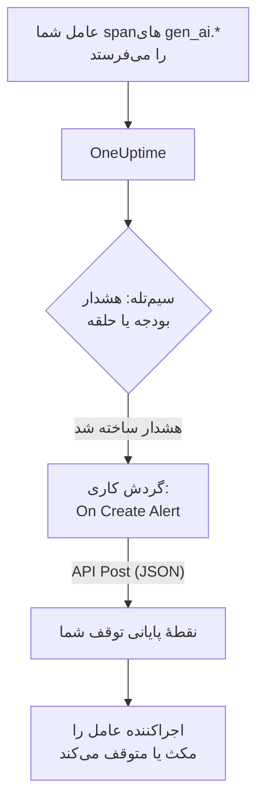

# مدارشکن‌های عامل هوش مصنوعی

یک عامل هوش مصنوعی به‌ندرت با از کار افتادن شکست می‌خورد. با ادامه دادن شکست می‌خورد: ابزاری خراب را دوباره امتحان می‌کند، همان گام را دوباره برنامه‌ریزی می‌کند یا زیرعامل‌های بیشتری راه می‌اندازد، و هر نوبت توکن‌های بیشتری صورت‌حساب می‌کند. این صفحه برای این کار یک مدارشکن از قطعه‌هایی می‌سازد که OneUptime از پیش دارد: هشداری که عامل لگام‌گسیخته را تشخیص می‌دهد، و گردش کاری‌ای که برای متوقف کردنش نقطهٔ پایانی متعلق به شما را فراخوانی می‌کند.

:::cards
- [یک سیم‌تله برگزینید](#یک-سیمتله-برگزینید): هشدار بر پایهٔ خرج، یا بر پایهٔ ابزاری که بارها و بارها فراخوانی می‌شود.
- [نقطهٔ پایانی توقف را بسازید](#نقطهٔ-پایانی-توقف-را-بسازید): سرویس کوچکی که عامل شما را مکث می‌دهد.
- [گردش کاری را بسازید](#گردش-کاری-را-بسازید): از یک هشدار تازه تا فراخوانی نقطهٔ پایانی شما.
- [مدارشکن را بیازمایید](#مدارشکن-را-بیازمایید): نخست با دست فعالش کنید، سپس در شرایط واقعی.
:::

## چگونه کار می‌کند



مدارشکن OpenTelemetryای را می‌پاید که عامل شما از پیش می‌فرستد، مستقیم یا [از راه یک دروازه](/docs/telemetry/ai-gateways)، و کنار مسیر درخواست عمل می‌کند، نه درون آن. چیزی به هر فراخوانی مدل افزوده نمی‌شود، و عوض کردن ارائه‌دهنده، SDK یا دروازه آن را از کار نمی‌اندازد.

بهایش سرعت است: عامل لگام‌گسیخته را در چند دقیقه متوقف می‌کند، نه در چند میلی‌ثانیه. محدودیت شمار گام‌ها و مهلت‌ها را در خود عامل نگه دارید، و بگذارید مدارشکن آنچه از آن‌ها می‌گریزد را بگیرد.

| سیم‌تله | چه چیزی را می‌گیرد | زمان تا هشدار |
| --- | --- | --- |
| هشدار بودجه، از یک مانیتور متریک | خرجی که مدام بالا می‌رود، هر علتی که داشته باشد | تا ۱۵ دقیقه، به‌اضافهٔ یک دقیقه برای مانیتور |
| هشدار حلقه، از یک مانیتور ترِیس | همان ابزاری که بارها و بارها فراخوانی می‌شود | ۱ تا ۵ دقیقه |

## پیش از شروع

- عامل شما spanهای GenAI را به OneUptime می‌فرستد. [مشاهده‌پذیری هوش مصنوعی / LLM](/docs/telemetry/ai-llm-observability) را ببینید.
- یک نقطهٔ پایانی HTTPS که بتواند اجراکنندهٔ عامل شما را مکث یا متوقف کند و از OneUptime در دسترس باشد. آن را در [نقطهٔ پایانی توقف را بسازید](#نقطهٔ-پایانی-توقف-را-بسازید) می‌سازید.
- اجازهٔ ساختن مانیتور و گردش کاری در پروژه.

## یک سیم‌تله برگزینید

هر دو سیم‌تله یکسان پایان می‌یابند: یک مانیتور هشداری می‌سازد، و هشدار تازه گردش کاری را آغاز می‌کند. می‌توانید هر دو را راه بیندازید: برای گردش کاری فرقی نمی‌کند کدام فعال شده است.

### هشدار بودجه

خرج مطمئن‌ترین نشانهٔ عامل لگام‌گسیخته است. بودجه هر ۱۵ دقیقه خرج هوش مصنوعی آن روز را جمع می‌زند و آن را به‌صورت دو متریک منتشر می‌کند، `oneuptime.llm.budget.spend.usd` و `oneuptime.llm.budget.percent.used` ، که هر کدام شناسهٔ بودجه را در `oneuptime.llm.budget.id` دارند.

:::steps
1. **محصولات** > **هوش مصنوعی / LLM** > **بودجه‌ها** را باز کنید و روی **ساخت LLM Cost Budget** کلیک کنید. یک **بودجه روزانه (USD)** تعیین کنید، و سرویس عامل را در **سرویس (اختیاری)** برگزینید تا بودجه فقط همان عامل را بپاید.
2. در منوی ردیف بودجهٔ تازه، **نمایش شناسه** را برگزینید و شناسه را کپی کنید.
3. یک [مانیتور متریک](/docs/monitor/metrics-monitor) روی `oneuptime.llm.budget.percent.used` بسازید که با ویژگی `oneuptime.llm.budget.id` برابر شناسهٔ کپی‌شده فیلتر شده باشد، و **بازه زمانی** آن را روی **Past 30 Minutes** بگذارید.
4. معیار **Greater Than Or Equal To** `100` را اضافه کنید که هشدار می‌سازد، و به آن یک **عنوان هشدار** بدهید که نام عامل را دارد، مانند `LLM budget exceeded: support-bot` . گردش کاری و نقطهٔ پایانی شما هر دو همین عنوان را می‌خوانند.
:::

بر پایهٔ شناسه فیلتر کنید، نه نام: تغییر نام بودجه نام سری آن را هم تغییر می‌دهد، و مانیتوری که با نام قدیمی فیلتر شده بی‌صدا دیگر چیزی را پیدا نمی‌کند. بازهٔ زمانی را روی ۳۰ دقیقه نگه دارید: بودجه هر ۱۵ دقیقه یک نقطه منتشر می‌کند، پس بازهٔ کوتاه‌تر میان دو نقطه چیزی نمی‌یابد و هشدار بارها و بارها باز و رفع می‌شود.

معیار دومی روی `80` با شدت کمتر، پیش از آنکه مدارشکن روی `100` فعال شود، از راه سیاست کشیک هشدار نخست به یک انسان هشدار می‌دهد.

### هشدار حلقه

عاملی که گیر کرده ردی شناختنی به جا می‌گذارد: همان span ابزار، بارها و بارها. یک اجرای سالم ابزاری را در چند دقیقه ده‌ها بار فراخوانی نمی‌کند، پس یک شمارش حلقه را بسیار پیش از بودجه می‌گیرد.

:::steps
1. **مانیتورها** را باز کنید، روی **ساخت مانیتور** کلیک کنید و زیر **انواع دیگر مانیتور** گزینهٔ **ترِیس‌ها** را برگزینید.
2. زیر **فیلدهای بیشتر** ، **فیلتر بر اساس سرویس تله‌متری** را روی سرویس عامل بگذارید، و **فیلتر بر اساس ویژگی‌ها** را روی `gen_ai.tool.name` برابر ابزاری که انتظار دارید عامل روی آن در حلقه بیفتد، مانند `search_web` . اگر ابزارگذاری شما span هر ابزار را با نام خودش نام‌گذاری می‌کند، به‌جای آن همان نام را در **نام اسپن** بگذارید.
3. **پایش ترِیس‌ها به مدت (زمان)** را روی **۵ دقیقه گذشته** بگذارید.
4. معیار **Span Count** **Greater Than** را با عددی که هیچ اجرای سالمی در پنج دقیقه به آن نمی‌رسد، مانند `50` ، اضافه کنید تا هشداری با عنوانی مانند `Agent loop: support-bot` بسازد.
:::

مانیتور ترِیس دومی که **فیلتر بر اساس وضعیت اسپن** آن روی **خطا** و شمارشش کمتر است، طوفان‌های تلاش دوباره را می‌گیرد: ابزاری که مدام شکست می‌خورد، و عاملی که مدام دوباره امتحانش می‌کند.

## نقطهٔ پایانی توقف را بسازید

گردش کاری یک `POST` با بدنهٔ JSON به نقطهٔ پایانی‌ای می‌فرستد که خودتان اجرا می‌کنید. اینکه «توقف» چه معنایی دارد با شماست. از کمترین اثر تا بیشترین:

| اقدام | اثر |
| --- | --- |
| توقف کار تازه | اجراکننده هیچ اجرای تازه‌ای برای آن عامل آغاز نمی‌کند |
| لغو اجراهای آن | اجراهای در جریان آن عامل لغو می‌شوند |
| مکث کل مخزن | همهٔ کارگرها خالی می‌شوند تا کسی مدارشکن را بازنشانی کند |

یک نقطهٔ پایانی کمینه در Express که برای هر عامل جداگانه مدارشکن را فعال می‌کند:

```typescript title="circuit-breaker.ts"
import express from "express";

const app = express();
app.use(express.json());

const tripped = new Set<string>(); // agents whose breaker is open

app.post("/circuit-breaker", (req, res) => {
  if (req.headers["authorization"] !== `Bearer ${process.env.KILL_TOKEN}`) {
    return res.status(401).end();
  }

  const alertTitle: string = req.body.alertTitle ?? "";

  // "LLM budget exceeded: support-bot" -> "support-bot"
  const agent: string = alertTitle.split(": ").pop() ?? "unknown";

  tripped.add(agent); // your run loop checks this set
  abortActiveRuns(agent); // cancel that agent's runs in flight

  // Answer fast; do the slow cleanup in the background.
  return res.status(200).json({ tripped: agent });
});
```

آن را با این قاعده‌ها بسازید:

- فعال شدن را ایدمپوتنت کنید. یک هشدار و یک تجاوز، یا یک هشدار بودجه و یک هشدار حلقه با هم، می‌توانند آن را بیش از یک بار فعال کنند، و فعال شدن دوم نباید چیزی را تغییر دهد.
- در یکی دو ثانیه پاسخ دهید، و پاک‌سازی را در پس‌زمینه انجام دهید. گردش کاری هر پاسخ 2xx را موفقیت به شمار می‌آورد.
- یک راز طلب کنید. هر کسی که بتواند نقطهٔ پایانی را فراخوانی کند می‌تواند عامل‌های شما را متوقف کند، پس یک توکن bearer را بررسی کنید که گردش کاری از یک متغیر سراسری رازدار می‌فرستد.
- با دست بازنشانی کنید. مدارشکن فعال‌شده فعال می‌ماند تا کسی اجرا را بررسی کند: گفتگوی عامل را زیر **محصولات** > **هوش مصنوعی / LLM** > **گفتگوها** باز کنید تا آنچه کرده را بخوانید یا بازپخش کنید.

درخواست از OneUptime بیرون می‌رود. در OneUptime Cloud، نقطهٔ پایانی شما باید از اینترنت در دسترس باشد. نصب خودمیزبان نشانی‌های شبکهٔ خصوصی را رد می‌کند، مگر اینکه یک مدیر اجازه دهد: [دسترسی شبکهٔ خروجی](/docs/workflows/configuration#دسترسی-شبکه-خروجی) را ببینید.

## گردش کاری را بسازید

نخست توکن نقطهٔ پایانی را جایی ذخیره کنید که گردش کاری بتواند بی‌آنکه نشانش دهد از آن استفاده کند: **گردش‌های کاری** > **متغیرهای سراسری** را باز کنید، روی **ساخت متغیر گردش کاری** کلیک کنید، نامش را `AGENT_KILL_TOKEN` بگذارید، توکن را در **محتوا** بگذارید و **راز** را روشن کنید. مقدار رازدار از لاگ‌های اجرا و ترِیس گام‌ها پاک می‌شود.

:::steps
### گردش کاری را ایجاد کنید

**محصولات** > **گردش‌های کاری** را باز کنید و روی **ساخت گردش کاری** کلیک کنید. روی **شروع از صفر** کلیک کنید، نامش را `AI agent circuit breaker` بگذارید و روی **ساخت گردش کاری** کلیک کنید. گردش کاری در **سازنده** و در حالت خاموش باز می‌شود.

### ماشه را اضافه کنید

روی بلوک خط‌چین **Choose what starts this workflow** کلیک کنید و در پنل **Add Trigger** گزینهٔ **On Create Alert** را برگزینید. روی ماشه کلیک کنید، در **Select Fields** عنوان و توضیح را تیک بزنید و روی **ذخیره** کلیک کنید. شناسهٔ روی بلوک، `alert-on-create-1` ، راهی است که بلوک‌های بعدی با آن به این بلوک ارجاع می‌دهند.

### عنوان را بررسی کنید

روی **افزودن مؤلفه** کلیک کنید، **If / Else** را برگزینید و نقطهٔ **Success** ماشه را به آن وصل کنید. **Value to check** را روی عنوان هشدار بگذارید (روی **{ }** کلیک کنید و آن را برگزینید)، **Comparison** را روی **شامل است** ، و **Compare with** را روی آغازی که عنوان‌های سیم‌تله‌های شما در آن مشترک‌اند، مانند `LLM budget exceeded` .

### نقطهٔ پایانی خود را فراخوانی کنید

**API Post (JSON)** را اضافه کنید و نقطهٔ **Yes** از **If / Else** را به آن وصل کنید. **URL** آن را روی نقطهٔ پایانی خود بگذارید، مانند `https://agents.example.com/circuit-breaker` ، و هدرها و بدنهٔ زیر را پر کنید.

### شکست را گزارش کنید

**Send Message to Slack** یا **Send Email** را اضافه کنید و نقطهٔ **Error** بلوک API را به آن وصل کنید. مدارشکنی که در فعال شدن شکست بخورد، همان هشداری است که یک انسان حتماً باید ببیند.

### آن را روشن کنید

**فعال** را در بالای **سازنده** روشن کنید.
:::

**Request Headers** بلوک API:

```json title="Request Headers"
{
  "Authorization": "Bearer {{global.variables.AGENT_KILL_TOKEN}}",
  "Content-Type": "application/json"
}
```

**Request Body** آن:

```json title="Request Body"
{
  "source": "oneuptime-circuit-breaker",
  "alertId": "{{local.components.alert-on-create-1.returnValues.model._id}}",
  "alertTitle": "{{local.components.alert-on-create-1.returnValues.model.title}}",
  "alertDescription": "{{local.components.alert-on-create-1.returnValues.model.description}}"
}
```

برای واکنش به چند سیم‌تله، همهٔ عنوان‌هایشان را یکسان آغاز کنید، یا از نقطهٔ **No** بلوک‌های **If / Else** بیشتری را پشت هم وصل کنید. برای بوم، [نوشتن گردش کاری](/docs/workflows/authoring) و برای ارجاع‌های `{{…}}` ، [متغیرها](/docs/workflows/variables) را ببینید.

## مدارشکن را بیازمایید

:::steps
1. با دست فعالش کنید. **هشدارها** را باز کنید، روی **ساخت هشدار** کلیک کنید و هشداری با عنوان `LLM budget exceeded: test` بسازید. اجرا زیر **گردش‌های کاری** > **لاگ‌ها** > **اجراها** نمایان می‌شود، و نقطهٔ پایانی شما درخواست را دریافت می‌کند.
2. در شرایط واقعی فعالش کنید. روی سرویس یک عامل آزمایشی بودجه‌ای با سقف بسیار کم بسازید، مانند `0.01` USD، یک مانیتور بودجه را به آن نشانه بگیرید و بگذارید عامل اجرا شود: درصد از ۱۰۰ می‌گذرد، هشدار باز می‌شود، گردش کاری اجرا می‌شود و مدارشکن فعال می‌شود. برای هشدار حلقه، به یک عامل آزمایشی ابزاری بدهید که همیشه شکست می‌خورد.
3. دو بار فعالش کنید. همان هشدار را دوباره بسازید: نقطهٔ پایانی شما باید فعال شدن دوم را بی‌آنکه چیزی را تغییر دهد بپذیرد.
:::

## رفتار مدارشکن در گذر زمان

- گردش کاری هنگام ساخته شدن هشدار اجرا می‌شود، پس یک سیم‌تله مدارشکن را برای هر هشدار یک بار فعال می‌کند، نه برای هر ارزیابی.
- بودجه روز UTC را می‌شمارد، پس درصدش در نیمه‌شب UTC دوباره از ۰ آغاز می‌شود. آنگاه هشدار بودجه می‌تواند رفع شود، و روز بد بعدی هشداری تازه باز می‌کند که مدارشکن را دوباره فعال می‌کند.
- مانیتور تا وقتی معیارهایش برقرارند هشدارش را باز نگه می‌دارد. با روشن بودن **رفع خودکار هشدار** ، هشدار وقتی معیارها دیگر برقرار نباشند رفع می‌شود، و تجاوز بعدی هشداری تازه باز می‌کند.
- بازنشانی در هر دو سو تصمیم یک انسان است: هشدار را در OneUptime رفع کنید، و مدارشکن را در اجراکنندهٔ خود بازنشانی کنید.
- هر هشدار تازه در پروژه گردش کاری را آغاز می‌کند. چیزی که هشدارهای دیگر را از مدارشکن دور نگه می‌دارد **If / Else** است: آن را حذف نکنید.

## رفع اشکال

:::details گردش کاری اجرا نمی‌شود
بررسی کنید که **فعال** در بالای **سازنده** روشن باشد: گردش‌های کاری در حالت خاموش ساخته می‌شوند. سپس بررسی کنید که هشدار پس از روشن کردن گردش کاری ساخته شده باشد: ماشه فقط برای هشدار تازه اجرایی آغاز می‌کند.
:::

:::details گردش کاری اجرا می‌شود، اما همیشه شاخهٔ No را می‌رود
عنوان خالی است یا مطابقت ندارد. فیلدی که در **Select Fields** ماشه تیک نخورده باشد خالی می‌رسد، پس عنوان را تیک بزنید. سپس عنوان هشدار را با **Compare with** مقایسه کنید: **شامل است** باید دقیقاً همان متن را در آن بیابد.
:::

:::details نقطهٔ پایانی شما پاسخ 401 می‌دهد
هدر `Authorization` با توکنی که نقطهٔ پایانی شما انتظار دارد مطابقت ندارد. نام را در `{{global.variables.AGENT_KILL_TOKEN}}` و مقدار ذخیره‌شده در متغیر سراسری را بررسی کنید. مقدار متغیر رازدار را نمی‌توان دوباره خواند، پس اگر تردید دارید آن را با **Update Content** دوباره وارد کنید.
:::

:::details هشدار بودجه بارها و بارها باز و رفع می‌شود
**بازه زمانی** مانیتور از ۱۵ دقیقهٔ میان دو نقطهٔ بودجه کوتاه‌تر است. آن را روی **Past 30 Minutes** بگذارید.
:::

:::details درخواست هرگز به نقطهٔ پایانی شما نمی‌رسد
اجرا را زیر **گردش‌های کاری** > **لاگ‌ها** > **اجراها** باز کنید و گام **API Post (JSON)** را ببینید: علت شکست درخواست را می‌گوید. در OneUptime Cloud، نقطهٔ پایانی باید از اینترنت در دسترس باشد؛ نصب خودمیزبان نشانی‌های شبکهٔ خصوصی را رد می‌کند، مگر اینکه یک مدیر اجازه دهد.
:::

## گام‌های بعدی

:::cards
- [مشاهده‌پذیری هوش مصنوعی / LLM](/docs/telemetry/ai-llm-observability): بودجه‌ها، هزینه و spanهایی که مدارشکن می‌پاید.
- [مانیتور ترِیس‌ها](/docs/monitor/traces-monitor): فیلترهای span و معیارها با جزئیات.
- [گردش‌های کاری](/docs/workflows/index): ماشه‌ها، مؤلفه‌ها، متغیرها و اجراها.
- [دروازه‌های هوش مصنوعی](/docs/telemetry/ai-gateways): فراخوانی‌های مدل همهٔ عامل‌ها از راه یک صادرات.
:::
