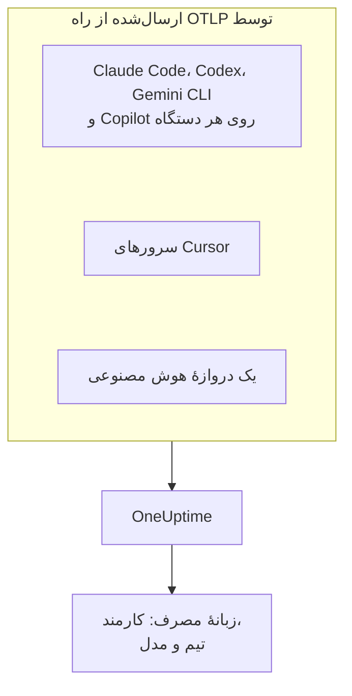

# دستیارهای کدنویسی هوش مصنوعی

مهندسان شما Claude Code، Cursor، Codex، Gemini CLI و Copilot را به کار می‌برند و صورت‌حساب‌ها مدام بزرگ‌تر می‌شوند. این صفحه به پرسش‌های یک مدیر پاسخ می‌دهد: **چه کسی از کدام ابزار، با کدام مدل‌ها استفاده می‌کند، و هر شخص و هر تیم چقدر خرج می‌کند** .

بیشتر دستیارهای کدنویسی خودشان OpenTelemetry صادر می‌کنند، پس لازم نیست چیزی روی دستگاه‌های توسعه‌دهندگان نصب کنید: صادرات را به سمت OneUptime بفرستید تا توکن‌ها، هزینه و استفاده از ابزارها کنار فراخوانی‌های هوش مصنوعی برنامه‌های خودتان قرار بگیرند. همه‌چیز در این صفحه از راه OpenTelemetry می‌رسد؛ OneUptime هیچ API مدیریتی یا صورت‌حساب هیچ فروشنده‌ای را واکاوی نمی‌کند.

:::cards
- [جدول پشتیبانی](#جدول-پشتیبانی): هر ابزار چه می‌فرستد و آیا نام شخصی را می‌آورد.
- [انتساب به کارمندان و تیم‌ها](#انتساب-به-کارمندان-و-تیمها): کلیدهایی که نام و تیم را روی خرج می‌گذارند.
- [زبانهٔ مصرف](#زبانهٔ-مصرف): جدول‌های خرج برای یک دستیار کدنویسی چه می‌توانند و چه نمی‌توانند نشان دهند.
- [از کجا شروع کنیم](#از-کجا-شروع-کنیم): ترتیبی برای راه‌اندازی که از روز نخست نتیجه نشان می‌دهد.
:::

## چگونه کار می‌کند

هر ابزار تله‌متری خود را با کلید دریافت دادهٔ شما به نقطهٔ پایانی OTLP در OneUptime می‌فرستد: از هر دستگاه توسعه‌دهنده، از سرورهای فروشنده (Cursor)، یا از دروازه‌ای که ترافیک مدل شما از آن می‌گذرد.



## پیش از شروع

1. یک کلید دریافت دادهٔ تله‌متری در **تنظیمات پروژه** > **تله‌متری و APM** > **کلیدهای دریافت داده** بسازید.
2. نقطهٔ پایانی OTLP شما `https://oneuptime.com/otlp` است، یا اگر OneUptime را خودتان میزبانی می‌کنید `https://YOUR-ONEUPTIME-HOST/otlp`.
3. هر صادرات کلید را در سرآیند `x-oneuptime-token` می‌فرستد.

یک کلید دریافت داده برای همهٔ دستگاه‌ها کافی است. این کلید روی هر دستگاه توسعه‌دهنده قرار می‌گیرد، پس آن را اعتبارنامه‌ای مشترک بدانید که فقط می‌تواند داده بفرستد، و مانند هر اعتبارنامهٔ دیگری آن را دوره‌ای عوض کنید.

## جدول پشتیبانی

سه چیز تعیین می‌کند از یک ابزار چه به دست می‌آورید: آیا اصلاً OpenTelemetry می‌فرستد، تله‌متری‌اش چگونه به OneUptime می‌رسد، و آیا چیزی در آن نام شخصی را می‌آورد.

| ابزار | چه می‌فرستد | چگونه به OneUptime می‌رسد | نام چه کسی را می‌آورد | راهنما |
| --- | --- | --- | --- | --- |
| Claude Code | متریک‌ها و لاگ‌ها؛ ترِیس‌ها در نسخهٔ بتا | از هر دستگاه؛ متغیرهای محیطی یا یک فایل تنظیمات مدیریت‌شده | `user.email`، وقتی با حساب Claude وارد شده باشد | [Claude Code](/docs/telemetry/claude-code) |
| Cursor | متریک‌ها و لاگ‌ها | از سرورهای Cursor، یک بار در داشبورد Cursor تنظیم می‌شود؛ فقط در پلن Enterprise | `cursor.user.id`، یک عدد صحیح | [Cursor](/docs/telemetry/cursor) |
| OpenAI Codex | ترِیس‌ها، متریک‌ها و لاگ‌ها، هر کدام در `~/.codex/config.toml` روشن می‌شود | از هر دستگاه، با یک نشانی کامل برای هر سیگنال | هیچ‌کس روی spanها یا متریک‌ها: `user.id` و `user.email` را خودتان در `[otel.span_attributes]` تنظیم می‌کنید | [OpenAI Codex](/docs/telemetry/openai-codex) |
| Gemini CLI | ترِیس‌ها، متریک‌ها و لاگ‌ها | از هر دستگاه، معمولاً از راه یک Collector محلی | `user.email`، وقتی وارد شده باشد | [Gemini CLI و GitHub Copilot](/docs/telemetry/gemini-cli-and-copilot) |
| GitHub Copilot | ترِیس‌ها، متریک‌ها و لاگ‌ها، فقط از بخش‌های عامل آن | از ویرایشگر یا میزبان عامل | هیچ‌کس: `enduser.id` و `user.email` را خودتان روی هر دستگاه تنظیم می‌کنید | [Gemini CLI و GitHub Copilot](/docs/telemetry/gemini-cli-and-copilot) |
| Cline | متریک‌ها و لاگ‌ها | به‌صورت متمرکز، در داشبورد سازمانی Cline پیکربندی می‌شود | یک `user_id` ناشناس‌شده | — |
| LiteLLM و Portkey | ترِیس هر فراخوانی که از دروازه می‌گذرد | از فرایند دروازه | در LiteLLM، مالک کلید مجازی | [دروازه‌های هوش مصنوعی](/docs/telemetry/ai-gateways) |
| برنامه‌های خودتان | آنچه ابزارگذاری GenAI شما می‌فرستد | از برنامهٔ شما | هر کسی که به‌عنوان `user.id` تنظیم کنید | [مشاهده‌پذیری هوش مصنوعی / LLM](/docs/telemetry/ai-llm-observability) |
| Windsurf، JetBrains AI، Amazon Bedrock، Azure OpenAI | هیچ OpenTelemetry از خودشان ندارند | فقط از راه دروازه‌ای که جلویشان می‌گذارید | هر کسی که دروازه نامش را بیاورد | [دروازه‌های هوش مصنوعی](/docs/telemetry/ai-gateways) |

خط تیره یعنی OneUptime هنوز راهنمایی برای آن ابزار ندارد. تله‌متری آن همچنان مانند هر OpenTelemetry دیگری دریافت می‌شود.

:::details GitHub Copilot دقیقاً چه چیزی صادر می‌کند
Copilot فقط از بخش‌های عامل خود OpenTelemetry صادر می‌کند: گفتگو و حالت عامل در VS Code، میزبان عامل پشت Copilot CLI، Copilot SDK، و گردش‌کارهای عامل در IDEهای JetBrains از راه افزونهٔ Copilot. GitHub هیچ صادراتی برای تکمیل‌های درون‌خطی، Copilot در github.com یا بازبینی کد Copilot مستند نکرده است. Copilot هیچ ویژگی کاربری از هیچ نوعی نمی‌فرستد، پس `enduser.id` و `user.email` را برای هر دستگاه از راه `resourceAttributes` یا `OTEL_RESOURCE_ATTRIBUTES` تنظیم کنید.
:::

:::details Amazon Bedrock، Azure OpenAI، Windsurf و JetBrains AI
- **Amazon Bedrock**: APIهای `InvokeModel` و `Converse` هیچ OpenTelemetry نمی‌فرستند. Bedrock AgentCore فرق دارد: AWS برای آن متریک‌ها، spanها و لاگ‌ها را مستند کرده که به‌طور پیش‌فرض به CloudWatch فرستاده می‌شوند. تنظیم `DISABLE_ADOT_OBSERVABILITY=true` پیکربندی پیش‌فرض ADOT محیط اجرا را خاموش می‌کند تا بتوانید ADOT SDK را به سمت OneUptime بفرستید.
- **Azure OpenAI**: این سرویس چیزی نمی‌فرستد و متریک‌های Azure Monitor آن بُعد کاربر ندارند. کلاینت را ابزارگذاری کنید، یا API Management یا دروازهٔ دیگری را جلوی آن بگذارید.
- **Windsurf**: هیچ صادرات تله‌متری‌ای را مستند نکرده است. دادهٔ هر کاربر در Enterprise API از Windsurf است که OneUptime آن را واکاوی نمی‌کند.
- **JetBrains AI Assistant و Junie**: هیچ مصرفی صادر نمی‌کنند. افزونهٔ OpenTelemetry از JetBrains تله‌متری برنامهٔ خود شما را درون IDE دریافت می‌کند؛ چیزی به بیرون نمی‌فرستد.
:::

## انتساب به کارمندان و تیم‌ها

OneUptime هنگام رسیدن تله‌متری، شخصی را که فراخوانی را انجام داده و تیمش را در ستون‌هایی کپی می‌کند، تا زبانهٔ **مصرف** بتواند بدون فیلتر ویژگی، اشخاص و تیم‌ها را رتبه‌بندی کند.

### ویژگی‌هایی که به‌عنوان کارمند خوانده می‌شوند

روی یک span، نخستین کلید موجود، به این ترتیب، برنده است:

| ستون | کلیدها، به ترتیب اولویت |
| --- | --- |
| شناسهٔ کارمند | `user.id`، `enduser.id`، `litellm.metadata.user_api_key_user_id`، `metadata.user_api_key_user_id`، `traceloop.association.properties.user_id`، `langfuse.user.id`، `user.account_uuid`، `user.account_id`، `cursor.user.id` |
| ایمیل کارمند | `user.email`، `litellm.metadata.user_api_key_user_email`، `metadata.user_api_key_user_email`، `traceloop.association.properties.user_email`، `enduser.email` |
| تیم / مرکز هزینه | `team.id`، `team`، `cost_center`، `department`، `litellm.metadata.user_api_key_team_id`، `litellm.team.id`، `metadata.user_api_key_team_id`، `cursor.team.id` |

روی یک نقطهٔ دادهٔ متریک، فهرست کوتاه‌تر است و با ایمیل آغاز می‌شود، چون دستیارهای کدنویسی‌ای که متریک می‌فرستند خودشان `user.email` را می‌فرستند:

| ستون | کلیدها، به ترتیب اولویت |
| --- | --- |
| کارمند | `user.email`، `user.id`، `user.account_uuid`، `user.account_id`، `cursor.user.id` |
| تیم / مرکز هزینه | `team.id`، `team`، `cost_center`، `department`، `cursor.team.id` |
| مدل | `gen_ai.request.model`، `model`، `cursor.model.name` |

این کلیدها چگونه خوانده می‌شوند:

- **هر کلید با پیشوند `resource.` هم خوانده می‌شود.** دریافت دادهٔ OTLP ویژگی‌های منبع را زیر همین پیشوند ذخیره می‌کند، پس `OTEL_RESOURCE_ATTRIBUTES=team.id=platform` به‌صورت `resource.team.id` می‌رسد. کلیدهای بدون پیشوند نخست آزموده می‌شوند، پس مقداری که روی span است بر مقدارِ کل فرایند پیشی می‌گیرد.
- **زبانهٔ مصرف ایمیل شخص را نشان می‌دهد اگر فراخوانی ایمیل داشته باشد، وگرنه شناسه را.** ردیف‌هایی که ایمیل یکسانی نشان می‌دهند با هم جمع می‌شوند، پس یک مهندس روی دو دستگاه یک ردیف است.
- **هویت فقط از فراخوانی‌های هوش مصنوعی خوانده می‌شود.** `user.id`، `user.email` و `team.id` کلیدهایی عمومی‌اند که spanهای مرورگر و بک‌اند هم دارند؛ فقط spanهایی که پیش‌تر به‌عنوان فراخوانی هوش مصنوعی شناخته شده‌اند این ستون‌ها را می‌گیرند.
- **رکوردهای لاگ برای هویت خوانده نمی‌شوند.** این برای Codex اهمیت دارد که `user.email` را فقط روی لاگ‌هایش می‌گذارد.
- LiteLLM این کلیدها را به دو شکل می‌نویسد: callback پیش‌فرض `otel` آن پیشوند `metadata.` را به کار می‌برد، و حالت اختیاری OpenTelemetry v2 آن (`LITELLM_OTEL_V2=true`) فضای نام `litellm.` را. OneUptime هر دو را می‌خواند، پس یک پراکسی معمولی بدون تنظیم اضافه کار می‌کند.

### تیم‌ها و مراکز هزینه

هیچ ابزارگذاری‌ای `team.id`، `team`، `cost_center` یا `department` را نمی‌فرستد: سازمان شما آن‌ها را تنظیم می‌کند، معمولاً از راه `OTEL_RESOURCE_ATTRIBUTES` روی فرایند ابزار.

```bash
export OTEL_RESOURCE_ATTRIBUTES="team.id=platform,team=Platform_Engineering,cost_center=eng-123,department=engineering"
```

آن را همان جایی تنظیم کنید که دستگاه‌های توسعه‌دهندگان را آماده می‌کنید: یک پروفایل MDM، یک فایل تنظیمات مدیریت‌شده، یا یک پروفایل shell از dotfileهایتان. مقدارها نمی‌توانند فاصله داشته باشند: از زیرخط یا کدگذاری درصدی مانند `%20` استفاده کنید. Codex ویژگی منبع ندارد، پس همین کلیدها را به‌جایش در `[otel.span_attributes]` آن تنظیم کنید.

برای جدا کردن خرج بر پایهٔ برنامه، از نام سرویس استفاده کنید (`OTEL_SERVICE_NAME`، یا تنظیم خود ابزار). تفکیک **برنامه / سرویس** فقط ابزارهایی را پوشش می‌دهد که span GenAI می‌فرستند.

### آنچه عمداً کارمند به شمار نمی‌آید

یک فراخوانی ممکن است دو شخص متفاوت را با خود داشته باشد: کارمندی که آن را انجام داد، و مشتری‌ای که فراخوانی برای او انجام شد. این کلیدها مشتری را نشان می‌دهند و OneUptime هرگز آن‌ها را در ستون هویت نمی‌خواند:

- `gen_ai.user` و `llm.user`: بازتاب پارامتر درخواست `user` در OpenAI توسط ابزارگذاری‌ها، که OpenAI آن را شناسه‌ای برای کاربران نهایی شما توصیف می‌کند.
- `litellm.metadata.user_api_key_end_user_id`، `metadata.user_api_key_end_user_id` و `litellm.end_user.id`: کاربر نهایی LiteLLM، برخلاف مالک کلید که همان کارمند است.

خواندن شناسهٔ مشتری به‌عنوان کارمند، یک ربات پشتیبانی را که به ۴۰٬۰۰۰ مشتری خدمت می‌دهد به ۴۰٬۰۰۰ کارمند خیالی تبدیل می‌کند، در حالی که مهندسی که صاحب این خرج است گویی هیچ خرجی نکرده است. این کلیدها در ویژگی‌های span باقی می‌مانند و زبانهٔ **LLM** در نمایشگر ترِیس آن‌ها را به‌عنوان کاربر نهایی نشان می‌دهد.

### حریم خصوصی

ستون ایمیل کارمند دادهٔ شخصی دارد. **قواعد پالایش** ترِیس‌ها آن را دقیقاً همان‌طور پوشش می‌دهند که ویژگی‌ای را که از آن خوانده شده، پس قاعده‌ای که ایمیل‌ها را می‌پوشاند این ستون را هم می‌پوشاند. آن‌ها را در **ترِیس‌ها** > **تنظیمات** پیدا می‌کنید.

## متریک‌های دستیارهای کدنویسی که OneUptime می‌خواند

دستیارهای کدنویسی متریک‌هایشان را به‌جای `gen_ai.*` با پیشوند خودشان نام‌گذاری می‌کنند، پس OneUptime هر کدام را با نامش می‌شناسد:

| متریک | ابزار | واحد |
| --- | --- | --- |
| `claude_code.token.usage` | Claude Code | توکن |
| `claude_code.cost.usage` | Claude Code | USD |
| `cursor.token.usage` | Cursor | توکن |
| `cursor.cost.usage` | Cursor | USD، برآوردی به حساب خود Cursor |
| `codex.turn.token_usage` | OpenAI Codex | توکن |
| `codex.turn.cost_microusd` | OpenAI Codex | یک‌میلیونیم دلار: OneUptime آن را تبدیل می‌کند، پس خودتان تبدیل نکنید |

OneUptime همچنین توکن‌ها را از `gen_ai.client.token.usage`، `gen_ai.client.token.count`، `llm.token.usage` و `llm.usage.tokens` می‌خواند، و هزینه را از `gen_ai.client.cost`، `gen_ai.client.cost.usd`، `gen_ai.usage.cost`، `litellm_spend_metric` و `litellm.cost.total`.

دو نکته پیش از خواندن عددها:

- **`gemini_cli.token.usage` عمداً کنار گذاشته می‌شود.** Gemini CLI توکن‌هایش را دو بار می‌فرستد، به‌صورت متریک خودش و به‌صورت `gen_ai.client.token.usage`، و خواندن هر دو آن‌ها را دو برابر می‌کند. توکن‌هایش یک بار، از راه `gen_ai.client.token.usage`، شمرده می‌شوند. Gemini CLI هیچ متریک هزینه‌ای نمی‌فرستد: ترِیس‌هایش را روشن کنید تا هر فراخوانی قیمت‌گذاری شود.
- **فقط توکن‌های ورودی و خروجی شمرده می‌شوند.** نوع توکن از `gen_ai.token.type`، `llm.token.type`، `type`، `cursor.token.type` یا `token_type` خوانده می‌شود و فقط `input` و `output` (یا `prompt` و `completion` قدیمی‌تر) شمرده می‌شوند. خواندن و نوشتن cache، `total` در Codex (که بقیه را تکرار می‌کند) و `reasoning_output` (بخشی از `output`) کنار گذاشته می‌شوند، پس مجموعی که از متریک‌ها می‌آید از جمع همهٔ چیزهایی که یک ابزار می‌فرستد کوچک‌تر است.

## زبانهٔ مصرف

**محصولات** > **هوش مصنوعی / LLM** را باز کنید و به **مصرف** بروید. این زبانه **کارمند** ، **تیم** ، **مدل** ، **ارائه‌دهنده** و **برنامه / سرویس** را بر پایهٔ خرج رتبه‌بندی می‌کند، در ۷ روز گذشته مگر اینکه بازهٔ دیگری برگزینید. فراخوانی‌هایی که نام کسی را ندارند زیر **بدون انتساب** شمرده می‌شوند: ردیف بزرگی از **بدون انتساب** نشان می‌دهد کدام ابزار هنوز باید هویتش تنظیم شود.

### متریک‌های دستیارهای کدنویسی جایگزین‌اند، نه افزوده

spanهای GenAI مقدم‌اند: متریک‌ها فقط برای عددی خوانده می‌شوند که spanها چیزی برایش گزارش نکرده‌اند، و این دو هرگز با هم جمع نمی‌شوند ([چرا](/docs/telemetry/ai-llm-observability#نخست-spanها-متریکها-جای-خالی-را-پر-میکنند)). برای دستیارهای کدنویسی این یک پیامد صریح دارد: **اگر همان پروژه spanهای GenAI دارای هزینه دریافت کند، خرج دستیارهای کدنویسی نمایش داده نمی‌شود.** به دستیارهای کدنویسی پروژه‌ای جداگانه با کلید دریافت دادهٔ خودش بدهید.

وقتی این جایگزینی اعمال می‌شود، هر تفکیک برای ابزاری که فقط متریک می‌فرستد این‌ها را می‌تواند نشان دهد:

| تفکیک | از متریک‌ها |
| --- | --- |
| **کارمند** | بله، از هر کلید هویتی بالا، هم بدون پیشوند و هم با پیشوند `resource.` |
| **تیم** | بله، از کلیدهای تیم |
| **مدل** | بله: Claude Code و Codex یک `model` بدون پیشوند می‌فرستند، Cursor هم `cursor.model.name` |
| **ارائه‌دهنده** | خیر: متریک‌های دستیارهای کدنویسی نام هیچ ارائه‌دهنده‌ای را نمی‌آورند |
| **برنامه / سرویس** | خیر: متریک‌هایشان به هیچ سرویس OneUptime تعلق ندارند |

ردیفی که از متریک‌ها خوانده شده فقط هزینه دارد: خانه‌های فراخوانی و توکن آن `—` نشان می‌دهند، چون یک شمارندهٔ خرج جزئیات هر فراخوانی را ندارد، و ۰ در آنجا یعنی ادعای اینکه آن شخص هیچ فراخوانی‌ای نداشته است. جدول با **از متریک‌های GenAI** علامت می‌خورد.

## OpenTelemetry ندارد؟ یک دروازه جلویش بگذارید

برای Windsurf، JetBrains AI، APIهای مدل Bedrock، Azure OpenAI و هر چیز دیگری که صادرات خودش را ندارد، یک دروازهٔ هوش مصنوعی جلویش بگذارید. آن‌گاه هر فراخوانی از یک فرایند می‌گذرد که OpenTelemetry می‌فرستد، و صادرات را یک بار پیکربندی می‌کنید.

**از LiteLLM با یک کلید مجازی برای هر کارمند استفاده کنید.** LiteLLM شناسه و ایمیل مالک کلید را روی هر span می‌گذارد که OneUptime آن را کارمند می‌خواند، و تیم کلید را تیم. همچنین خودش قیمت هر فراخوانی را حساب می‌کند، با هر نرخ سفارشی‌ای که روی پراکسی تنظیم کنید، و هزینه‌ای که گزارش می‌کند بر برآورد OneUptime برتری دارد. برای این کار از شناسهٔ کاربر نهایی آن استفاده نکنید: آن مشتری است. راه‌اندازی در [دروازه‌های هوش مصنوعی](/docs/telemetry/ai-gateways) آمده است.

دو محدودیت پیش از اینکه برنامه‌تان را بر پایهٔ یک دروازه بچینید:

- **یک دروازه فقط ترافیکی را می‌بیند که از آن فرستاده شود.** بازنویسی نشانی پایهٔ خود Cursor تنظیمی برای هر کاربر است که فقط مدل‌های گفتگو را پوشش می‌دهد (تکمیل با Tab همچنان از مدل‌های Cursor استفاده می‌کند)، پس صادرات بومی Cursor را ترجیح دهید.
- **یک دروازه فراخوانی مدل را می‌بیند، نه عامل را.** پرامپت‌ها و پاسخ‌ها را ثبت می‌کند، ولی نه فراخوانی‌های ابزار، ویرایش‌های فایل و تصمیم‌های پذیرش یا رد را که تله‌متری خود یک ابزار گزارش می‌کند.

## محتوای پرامپت: پیش‌فرض‌ها در هر ابزار فرق دارند

پرامپت‌ها و پاسخ‌ها پرخطرترین داده در این مسیرند: اغلب کد منبع، دادهٔ مشتری و اعتبارنامه‌های چسبانده‌شده را در خود دارند. پیش‌فرض هر ابزار را بررسی کنید:

| ابزار | محتوای پرامپت به‌طور پیش‌فرض |
| --- | --- |
| Claude Code | خاموش: هر نوع محتوا متغیر روشن‌کنندهٔ خودش را دارد |
| Cursor | خاموش: فقط خانوادهٔ اختیاری `conversation_content` متن پیام‌ها را می‌فرستد |
| OpenAI Codex | خاموش: `log_user_prompt` به‌طور پیش‌فرض `false` است |
| Gemini CLI | **روشن**: `logPrompts` به‌طور پیش‌فرض `true` است، پس وقتی تله‌متری را روشن می‌کنید آن را روی `false` بگذارید |
| GitHub Copilot | خاموش: `captureContent`، که تنظیمات مدیریت‌شده می‌توانند با `lockCaptureContent` قفلش کنند |
| LiteLLM | با callback پیش‌فرض `otel` روشن (با `turn_off_message_logging` خاموشش کنید)؛ در حالت OpenTelemetry v2 خاموش |

Codex همچنین متریک‌هایش را به‌طور پیش‌فرض به OpenAI می‌فرستد: [OpenAI Codex](/docs/telemetry/openai-codex) را ببینید. هر جا عمداً محتوا را ثبت می‌کنید، **قواعد پالایش** و **فیلترهای حذف** ترِیس‌ها مانند هر تله‌متری دیگری بر آن اعمال می‌شوند.

## آنچه OneUptime هنوز انجام نمی‌دهد

- **هیچ اتصال مدیریتی یا صورت‌حسابی به فروشندگان وجود ندارد.** OneUptime نه Admin API از Anthropic را واکاوی می‌کند، نه Admin API از Cursor، نه نقطه‌های پایانی مصرف و هزینهٔ OpenAI، نه صورت‌حساب Copilot در GitHub، و نه APIهای Windsurf یا JetBrains. برای عددهایی هم‌پایهٔ صورت‌حساب، آن‌ها را از فروشنده بگیرید.
- **هزینه برآورد است، مگر اینکه ابزاری آن را گزارش کند.** هزینهٔ گزارش‌شده همان‌طور که هست به کار می‌رود؛ وگرنه OneUptime توکن‌ها را با قیمت‌های فهرست قیمت‌گذاری می‌کند. `cursor.cost.usage` خود Cursor هم برآورد است.
- **هویت روی رکوردهای لاگ خوانده نمی‌شود.** `user.email` در Codex، که فقط روی لاگ‌ها فرستاده می‌شود، به خرج پیوند نمی‌خورد.
- **`cursor.user.email` در Cursor هنوز خوانده نمی‌شود**، پس کاربران Cursor با عدد صحیح `cursor.user.id` خود نمایش داده می‌شوند.
- **spanهای Codex نام هیچ مدلی را ندارند**، پس OneUptime نمی‌تواند قیمتشان را حساب کند: Codex توکن‌ها را به تفکیک شخص نشان می‌دهد و هزینه‌اش را فقط در مجموع‌ها.
- **ابزارها سریع تغییر می‌کنند.** اگر این صفحه می‌گوید ابزاری صادرات ندارد، پیش از اینکه چیزی را بر پایهٔ یک دروازه بسازید، مستندات فعلی آن را بررسی کنید.

## از کجا شروع کنیم

به این ترتیب پیش بروید؛ هر گام به‌تنهایی مفید است. از پروژه‌ای استفاده کنید که هنوز از برنامه‌های خودتان span GenAI دریافت نمی‌کند، وگرنه [قاعدهٔ جایگزینی](#متریکهای-دستیارهای-کدنویسی-جایگزیناند-نه-افزوده) خرج دستیارهای کدنویسی را از صفحه بیرون نگه می‌دارد.

1. **Gemini CLI**، اگر کسی از آن استفاده می‌کند. بدون هیچ تنظیمی `user.email` را می‌فرستد، پس انتساب را از ابتدا تا انتها در حال کار نشان می‌دهد. ترِیس‌هایش را هم روشن کنید: هیچ متریک هزینه‌ای نمی‌فرستد.
2. **Claude Code**: یک فایل تنظیمات مدیریت‌شده برای همهٔ دستگاه‌ها، `user.email` بی‌هزینه، یک متریک هزینهٔ واقعی، و نرخ پذیرش، کامیت‌ها، pull requestها و خطوط کد برای هر توسعه‌دهنده.
3. **Cursor**، در پلن Enterprise: یک صفحه در داشبورد Cursor، بدون دست زدن به هیچ دستگاه توسعه‌دهنده‌ای، هرچند اشخاص به‌صورت عدد صحیح می‌رسند.
4. **Copilot و Codex**، که هر دو به هویتی تنظیم‌شده روی هر دستگاه نیاز دارند. این کار را هنگام آماده‌سازی دستگاه‌ها انجام دهید: فراخوانی‌هایی که بدون هویت رسیده‌اند بعداً قابل انتساب نیستند.
5. **یک دروازهٔ LiteLLM** برای همهٔ موارد دیگر، با یک کلید مجازی برای هر کارمند.

## گام‌های بعدی

:::cards
- [Claude Code](/docs/telemetry/claude-code): صادرات Claude Code را برای یک دستگاه یا همهٔ دستگاه‌ها روشن کنید.
- [Cursor](/docs/telemetry/cursor): تله‌متری تیمی Cursor را از داشبورد Cursor بفرستید.
- [OpenAI Codex](/docs/telemetry/openai-codex): سه صادرکنندهٔ Codex را پیکربندی کنید و روی spanهایش هویت بگذارید.
- [مشاهده‌پذیری هوش مصنوعی / LLM](/docs/telemetry/ai-llm-observability): گفتگوها، هشدارها، هزینه و بودجه‌ها برای هر فراخوانی هوش مصنوعی.
:::
