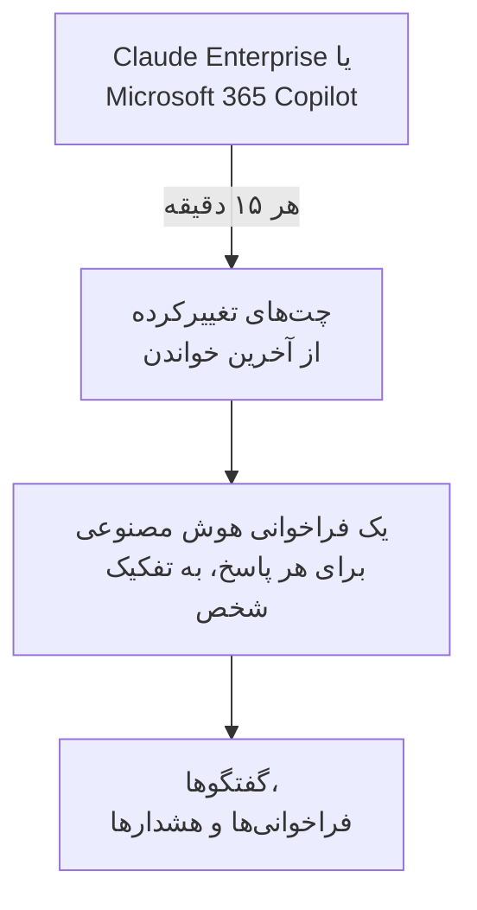

# ابزارهای هوش مصنوعی شرکت

ببینید افراد شما از ابزارهای هوش مصنوعی‌ای که شرکتتان هزینه‌شان را می‌دهد چه می‌پرسند، به‌صورت گفتگوهایی به تفکیک شخص. Claude Enterprise یا Microsoft 365 Copilot را با اعتبارنامه‌ای که فقط می‌تواند بخواند وصل کنید تا OneUptime هر ۱۵ دقیقه هر چت تازه را به **گفتگوها** بیاورد. فقط مالکان و مدیران پروژه می‌توانند آن‌ها را بخوانند، مگر اینکه شما چیز دیگری انتخاب کنید.

:::cards
- [نخست به افرادتان بگویید](#نخست-به-افرادتان-بگویید): چت‌هایشان واژه‌های خودشان است.
- [وصل کردن یک ابزار](#وصل-کردن-یک-ابزار): اعتبارنامه را بچسبانید، انتخاب کنید چه کسی بخواند، آزمایش کنید و وصل کنید.
- [حریم خصوصی](#حریم-خصوصی): چه کسی می‌تواند گفتگوها را بخواند، و اینکه واژه‌ها نگه داشته می‌شوند یا نه.
- [ابزارهای هوش مصنوعی دیگر](#ابزارهای-هوش-مصنوعی-دیگر): ChatGPT Enterprise، Gemini، Open WebUI، LibreChat و دستیارهای کدنویسی.
:::

## نخست به افرادتان بگویید

> [!IMPORTANT]
> این‌ها واژه‌های خود افراد شماست. پیش از وصل کردن یک ابزار، به آن‌ها بگویید که چت‌هایشان با آن نگه داشته می‌شود و چه کسی می‌تواند آن‌ها را بخواند، و با تیم حقوقی یا منابع انسانی خود بررسی کنید که سیاست‌هایتان و قانون محلی چه می‌خواهند.

## چگونه کار می‌کند

OneUptime هر ۱۵ دقیقه چت‌هایی را که از آخرین خواندن تغییر کرده‌اند از ابزار می‌پرسد. هر پاسخ یک فراخوانی هوش مصنوعیِ شخصِ پرسنده می‌شود، همراه با پرسش‌هایی که از پاسخ قبلی پرسیده شده، و هر چت یک گفتگو می‌شود.

چت‌ها همان‌طور می‌رسند که فراخوانی‌های هوش مصنوعی برنامه‌هایتان، پس قواعد پالایش، فیلترهای حذف، نگهداری و هشدارهای هوش مصنوعی بر آن‌ها هم اعمال می‌شوند. هزینهٔ این ابزارها به ازای هر کاربر پرداخت می‌شود، پس این فراخوانی‌ها نه توکن دارند نه هزینه. پرسشی که یک ساعت بی‌پاسخ بماند جداگانه می‌رسد، تا چتی که هوش مصنوعی هرگز به آن پاسخ نداد هم نمایش داده شود.

## پیش از شروع

- نقش Project Owner یا Project Admin. فقط آن‌ها می‌توانند ابزاری را وصل، تغییر یا حذف کنند.
- یک مدیر ابزار، برای ساختن اعتبارنامه: بخش هر ابزار در ادامه می‌گوید چه کسی.
- افرادتان باخبر شده‌اند، و پاسخ تیم حقوقی یا منابع انسانی‌تان را دارید.

## وصل کردن یک ابزار

:::steps
### صفحهٔ اتصال را باز کنید

**محصولات** > **هوش مصنوعی / LLM** > **اتصال** را باز کنید. در **ابزارهای هوش مصنوعی شرکت شما** روی کاشی ابزار کلیک کنید.

### اعتبارنامه را بچسبانید

در **اعتبارنامه‌ها** آنچه ابزار می‌خواهد را پر کنید. رازها رمزگذاری‌شده ذخیره می‌شوند و دیگر هرگز نشان داده نمی‌شوند.

### انتخاب کنید چه کسی بخواند

در **حریم خصوصی**، **چه کسی می‌تواند گفتگوها را بخواند** و **نگهداری نوشته‌ها** را تنظیم کنید، همان‌طور که [حریم خصوصی](#حریم-خصوصی) توضیح می‌دهد.

### آزمایش کنید

در **آزمایش** روی **آزمایش اتصال** کلیک کنید. OneUptime چت‌های ۷ روز گذشته را می‌شمارد: هیچ‌چیز از آنچه کسی نوشته خوانده، نمایش داده یا نگه داشته نمی‌شود.

### وصل کنید

روی **اتصال** کلیک کنید. نخستین خواندن ظرف یک دقیقه آغاز می‌شود و ۷ روز گذشته را می‌آورد.
:::

## Claude Enterprise

OneUptime هر چت claude.ai سازمان شما را از راه Compliance API می‌خواند: چه کسی پرسید، از Claude چه پرسیده شد، چه پاسخ داد و از کدام مدل استفاده کرد. چتی که پیام تازه بگیرد دوباره خوانده می‌شود، و پاسخ‌هایی که پیش‌تر آورده شده‌اند شناخته و رد می‌شوند.

:::steps
### Compliance API را روشن کنید

مالک اصلی سازمان شما در claude.ai، Organization settings، API را باز می‌کند و Compliance API را روشن می‌کند.

### یک کلید دسترسی انطباق بسازید

همان‌جا یک کلید با دامنهٔ `read:compliance_user_data` بسازید. این کلید با `sk-ant-api01-` آغاز می‌شود.

### Claude Enterprise را وصل کنید

کلید را در **کلید دسترسی انطباق** بچسبانید.
:::

## Microsoft 365 Copilot

OneUptime تاریخچهٔ تعامل هر شخص با Copilot را از Microsoft Graph می‌خواند: آنچه در Teams، Outlook، Word، Excel، PowerPoint، Loop یا Copilot Chat از Copilot پرسیده، آنچه پاسخ گرفته و در کدام برنامه. یک پرامپت و پاسخ‌هایش یک فراخوانی هوش مصنوعی می‌شوند، و یک نشست Copilot یک گفتگو. یک tenant بزرگ تکه‌تکه خوانده می‌شود و از همان جایی که آخرین خواندن ایستاد ادامه می‌یابد.

:::steps
### یک برنامه ثبت کنید

در Microsoft Entra ID یک برنامه ثبت کنید و برایش یک راز کلاینت بسازید.

### مجوزها را اعطا کنید

مجوزهای برنامه‌ای `AiEnterpriseInteraction.Read.All` و `User.Read.All` از Microsoft Graph را به برنامه بدهید و رضایت مدیر را اعطا کنید.

### Copilot را وصل کنید

**شناسه دایرکتوری (مستأجر)**، **شناسه برنامه (کلاینت)** و **راز کلاینت** را پر کنید. برای خواندن فقط برخی افراد، شناسهٔ شیء یک گروه را در **فقط افراد این گروه** در **فیلدهای بیشتر** بگذارید و `GroupMember.Read.All` را هم به برنامه بدهید. برای Azure Government، **ابر** را همان‌جا تغییر دهید.
:::

## حریم خصوصی

| تنظیم | چه می‌کند |
| --- | --- |
| **چه کسی می‌تواند گفتگوها را بخواند** | **مالکان و مدیران پروژه**، پیش‌فرض: هیچ کس دیگری در پروژه این گفتگوها، یا فراخوانی‌های هوش مصنوعی‌ای که از آن‌ها ساخته شده‌اند، را در هیچ جای OneUptime نمی‌بیند. **همه کسانی که می‌توانند فراخوانی‌های هوش مصنوعی را بخوانند**: همهٔ کسانی که می‌توانند ترِیس‌های پروژه را بخوانند. |
| **نگهداری نوشته‌ها** | روشن، پیش‌فرض: پرسش‌ها و پاسخ‌ها نگه داشته می‌شوند. خاموش: OneUptime نگه می‌دارد چه کسی، کی، با کدام مدل و در کدام برنامه پرسید، اما نه واژه‌ها را. |

تغییر در اینکه چه کسی می‌تواند بخواند ظرف یک دقیقه اعمال می‌شود. خاموش کردن **نگهداری نوشته‌ها** بر چت‌هایی اعمال می‌شود که پس از آن خوانده شوند؛ آنچه پیش‌تر نگه داشته شده تا پایان دورهٔ نگهداری‌اش می‌ماند.

برای نگه داشتن واژه‌ها اما پوشاندن بخش‌هایی از آن‌ها، مانند نشانی‌های ایمیل یا شماره‌های کارت، از **قواعد پالایش** در **ترِیس‌ها** > **تنظیمات** استفاده کنید: پیش از ذخیرهٔ هر چیزی اعمال می‌شوند. گفتگوها تا وقتی نگه داشته می‌شوند که سرویس اتصال ترِیس‌هایش را نگه دارد: [نگهداری داده](/docs/telemetry/data-retention) را ببینید. حذف یک اتصال خواندن‌هایش را متوقف می‌کند؛ آنچه خوانده، برای همان افراد خواندنی، تا پایان دورهٔ نگهداری‌اش می‌ماند.

## ابزارهای هوش مصنوعی دیگر

این ابزارها APIای ندارند که OneUptime بتواند چت‌های افراد را با آن بخواند، یا به راه دیگری نیاز دارند.

### ChatGPT Enterprise

OpenAI رابط Compliance API خود را فقط با درخواست برای یک فضای کاری باز می‌کند و منتشر نمی‌کند رکوردهایش چه دارند، پس OneUptime هنوز نمی‌تواند چت‌های ChatGPT Enterprise را بخواند. وصل کردن سازمان OpenAI شما به‌عنوان [حساب ارائه‌دهنده](/docs/telemetry/ai-provider-accounts#openai) مصرف و هزینهٔ API آن را نشان می‌دهد که ChatGPT را در بر نمی‌گیرد.

### Gemini برای Google Workspace

Google هیچ APIای برای خواندن چت‌های Gemini افراد ارائه نمی‌دهد. Google Vault آن‌ها را برای eDiscovery نگه می‌دارد.

### دستیارهای کدنویسی

Claude Code، Codex، Gemini CLI، GitHub Copilot و Cursor تله‌متری OpenTelemetry خودشان را می‌فرستند: [دستیارهای کدنویسی هوش مصنوعی](/docs/telemetry/ai-coding-assistants) را ببینید.

### Open WebUI و LibreChat

برنامه‌های چتِ خودمیزبان مدل‌ها را از راه APIای که شما تعیین می‌کنید فراخوانی می‌کنند. یک پراکسی LiteLLM جلوی مدل‌ها بگذارید و ترِیس‌هایش را همان‌طور که [دروازه‌های هوش مصنوعی](/docs/telemetry/ai-gateways#litellm-proxy) نشان می‌دهد به OneUptime بفرستید: پرامپت‌ها و پاسخ‌های هر چت به‌صورت فراخوانی هوش مصنوعی می‌رسند. یک کلید مجازی برای هر شخص نشان می‌دهد چه کسی پرسید؛ کلیدی که همه با هم به کار می‌برند نام هیچ کس را نمی‌آورد. صادرات OpenTelemetry خود Open WebUI درخواست‌های وب و فراخوانی‌های پایگاه داده‌اش را ردیابی می‌کند، نه چت‌ها را.

## رفع اشکال

:::details آزمایش هیچ چتی پیدا نمی‌کند
در ۷ روز گذشته کسی از ابزار استفاده نکرده، یا اعتبارنامه به سازمان یا tenant دیگری تعلق دارد. برای Copilot بررسی کنید که گروه در **فقط افراد این گروه** همانی باشد که منظورتان است.
:::

:::details اعتبارنامه کار می‌کند، اما نمی‌تواند آنچه اتصال لازم دارد را بخواند
برای Copilot، رضایت مدیر را برای مجوزهای Graph برنامه اعطا کنید، و وقتی گروهی را نام می‌برید `GroupMember.Read.All` را هم بدهید. برای Claude Enterprise، کلید را با دامنهٔ `read:compliance_user_data` بسازید.
:::

:::details کسی نمی‌تواند گفتگوها را ببیند
**چه کسی می‌تواند گفتگوها را بخواند** روی **مالکان و مدیران پروژه** است. یک مالک یا مدیر می‌تواند آن را با **ویرایش** در ردیف اتصال تغییر دهد.
:::

:::details گفتگوها نشان می‌دهند چه کسی پرسید، اما واژه‌ای ندارند
وقتی خوانده شدند، **نگهداری نوشته‌ها** خاموش بود. روشن کردنش بر چت‌هایی اعمال می‌شود که پس از آن خوانده شوند.
:::

## گام‌های بعدی

:::cards
- [مشاهده‌پذیری هوش مصنوعی / LLM](/docs/telemetry/ai-llm-observability): گفتگوها را بخوانید و بازپخش کنید، و وقتی پاسخ‌ها خراب می‌شوند باخبر شوید.
- [حساب‌های ارائه‌دهنده هوش مصنوعی](/docs/telemetry/ai-provider-accounts): مصرف و هزینهٔ حساب‌های OpenAI، Anthropic، Azure، Bedrock و Vertex AI شما.
- [دستیارهای کدنویسی هوش مصنوعی](/docs/telemetry/ai-coding-assistants): خرج هر مهندس برای ابزارهای کدنویسی.
- [نگهداری داده](/docs/telemetry/data-retention): گفتگوها چه مدت نگه داشته می‌شوند.
:::
