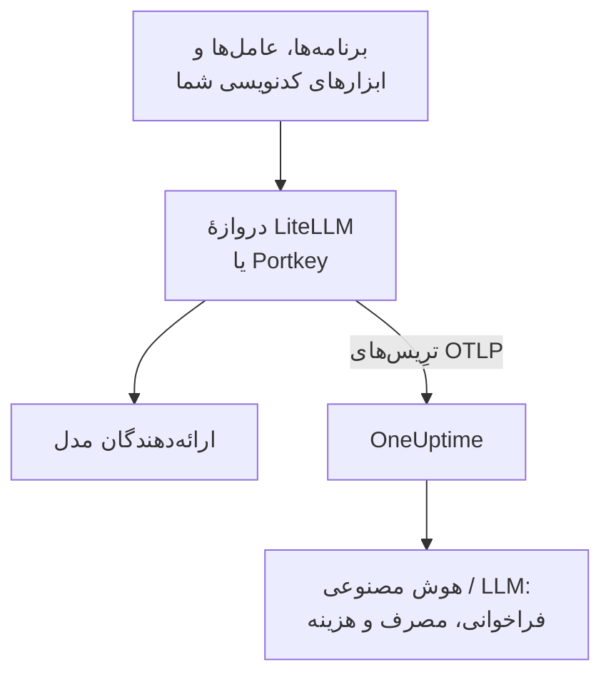

# دروازه‌های هوش مصنوعی (LiteLLM، Portkey)

دروازهٔ هوش مصنوعی میان برنامه‌های شما و ارائه‌دهندگان مدل می‌نشیند، پس هر فراخوانی مدل از آن می‌گذرد. OpenTelemetry دروازه را یک بار به OneUptime بفرستید، و هر فراخوانی پشت آن با مدل، توکن‌ها، هزینه و، مگر اینکه خاموشش کنید، پرامپت و پاسخ به [هوش مصنوعی / LLM](/docs/telemetry/ai-llm-observability) می‌رسد، بی‌آنکه هر برنامه را ابزارگذاری کنید.

:::cards
- [LiteLLM Proxy](#litellm-proxy): صادرات داخلی، با سه متغیر تنظیم می‌شود.
- [چه کسی چه خرج کرد](#یک-کلید-مجازی-برای-هر-کارمند): یک کلید مجازی LiteLLM برای هر کارمند، هر شخص را نام می‌برد.
- [Portkey](#portkey): صادرات داخلی روی دروازه‌های خودمیزبان؛ جاهای دیگر برنامه را ابزارگذاری کنید.
- [بررسی کنید که فراخوانی‌ها می‌رسند](#بررسی-کنید-که-فراخوانیها-میرسند): چه باید ببینید، و اگر ندیدید چه کنید.
:::

## چگونه کار می‌کند



| | LiteLLM Proxy | Portkey، خودمیزبان یا Enterprise | Portkey، متن‌باز یا میزبانی‌شده |
| --- | --- | --- | --- |
| صادرات به OneUptime | داخلی | داخلی، آزمایشی | ندارد: به‌جای آن برنامه را ابزارگذاری کنید |
| نقطهٔ پایانی‌ای که باید تنظیم شود | `https://oneuptime.com/otlp/v1/traces` | `https://oneuptime.com/otlp` | صادرکنندهٔ خود برنامه |
| نام بردن از هر شخص | بله، با یک کلید مجازی برای هر کارمند | نه | فقط آنچه برنامه می‌فرستد |
| پرامپت‌ها و پاسخ‌ها | فرستاده می‌شوند، مگر اینکه خاموششان کنید | همیشه فرستاده می‌شوند | به ابزارگذاری بستگی دارد |

## پیش از شروع

- یک کلید دریافت داده: **تنظیمات پروژه** > **تله‌متری و APM** > **کلیدهای دریافت داده** را باز کنید و روی **ساخت کلید دریافت داده** کلیک کنید.
- نشانی پایهٔ OTLP شما: `https://oneuptime.com/otlp` ، یا اگر OneUptime را خودتان میزبانی می‌کنید `https://YOUR-ONEUPTIME-HOST/otlp` . OneUptime پروتکل OTLP روی HTTP را، هم با protobuf و هم با JSON، می‌پذیرد.
- کلید در هدر `x-oneuptime-token` هر درخواست صادرات فرستاده می‌شود.

## LiteLLM Proxy

callback اپن‌تلمتری LiteLLM بخشی از پراکسی متن‌باز است، و ایمیج رسمی Docker (`ghcr.io/berriai/litellm`) بسته‌هایی را که لازم دارد از پیش دارد.

:::steps
### callback otel را روشن کنید

`otel` را به callbackهای `config.yaml` پراکسی اضافه کنید:

```yaml title="config.yaml"
model_list:
  - model_name: gpt-4o
    litellm_params:
      model: openai/gpt-4o
      api_key: os.environ/OPENAI_API_KEY

litellm_settings:
  callbacks: ["otel"]
```

### صادرکننده را به سمت OneUptime بگیرید

سه متغیر را روی پراکسی تنظیم کنید:

```bash
export OTEL_EXPORTER="otlp_http"
export OTEL_ENDPOINT="https://oneuptime.com/otlp/v1/traces"
export OTEL_HEADERS="x-oneuptime-token=YOUR_INGESTION_TOKEN"
```

### پراکسی را راه بیندازید

:::tabs
@tab Docker
```bash
docker run \
  -v $(pwd)/config.yaml:/app/config.yaml \
  -e OPENAI_API_KEY="sk-..." \
  -e OTEL_EXPORTER="otlp_http" \
  -e OTEL_ENDPOINT="https://oneuptime.com/otlp/v1/traces" \
  -e OTEL_HEADERS="x-oneuptime-token=YOUR_INGESTION_TOKEN" \
  -e OTEL_SERVICE_NAME="litellm-gateway" \
  -p 4000:4000 \
  ghcr.io/berriai/litellm:main-stable \
  --config /app/config.yaml
```
@tab pip
```bash
pip install 'litellm[proxy]' opentelemetry-api opentelemetry-sdk opentelemetry-exporter-otlp
litellm --config config.yaml
```
:::

`litellm[proxy]` به‌تنهایی بسته‌های OpenTelemetry را ندارد، پس آن‌ها را هم کنارش نصب کنید.

### درخواستی از آن بفرستید

پراکسی را یک بار فراخوانی کنید، سپس هوش مصنوعی / LLM را همان‌طور که در [بررسی کنید که فراخوانی‌ها می‌رسند](#بررسی-کنید-که-فراخوانیها-میرسند) آمده بررسی کنید.
:::

| متغیر | مقدار | یادداشت |
| --- | --- | --- |
| `OTEL_EXPORTER` | `otlp_http` | به‌صورت `OTEL_EXPORTER_OTLP_PROTOCOL` هم خوانده می‌شود |
| `OTEL_ENDPOINT` | `https://oneuptime.com/otlp/v1/traces` | مسیر کامل `/v1/traces` با همهٔ نسخه‌های LiteLLM کار می‌کند؛ به‌صورت `OTEL_EXPORTER_OTLP_ENDPOINT` هم خوانده می‌شود |
| `OTEL_HEADERS` | `x-oneuptime-token=YOUR_INGESTION_TOKEN` | جفت‌های `key=value` جداشده با ویرگول؛ به‌صورت `OTEL_EXPORTER_OTLP_HEADERS` هم خوانده می‌شود |
| `OTEL_SERVICE_NAME` | نام دروازهٔ شما | سرویسی که فراخوانی‌ها زیر آن نمایش داده می‌شوند؛ اگر چیزی تنظیم نکنید `litellm` |

### آنچه LiteLLM می‌فرستد

هر فراخوانی `gen_ai.system` ، `gen_ai.request.model` ، `gen_ai.response.model` ، `gen_ai.usage.input_tokens` و `gen_ai.usage.output_tokens` ، پارامترهایش، و پرامپت و پاسخ را با خود دارد: هر آنچه OneUptime برای [خواندن فراخوانی](/docs/telemetry/ai-llm-observability) لازم دارد.

از LiteLLM 1.81 این ویژگی‌ها روی span `Received Proxy Server Request` درخواست قرار دارند، و دیگر span جداگانهٔ `litellm_request` وجود ندارد. وقتی یک درخواست چند فراخوانی مدل انجام می‌دهد، هر فراخوانی ویژگی‌های فراخوانی پیشین را در آنجا بازنویسی می‌کند، پس `USE_OTEL_LITELLM_REQUEST_SPAN=true` را تنظیم کنید تا برای هر فراخوانی یک span `litellm_request` بگیرید.

LiteLLM خودش قیمت هر فراخوانی را حساب می‌کند، از جمله نرخ‌های سفارشی‌ای که روی پراکسی تنظیم کرده‌اید، و قیمت را به‌صورت `gen_ai.cost.total_cost` گزارش می‌کند. OneUptime قیمت گزارش‌شده را بر برآورد خودش ترجیح می‌دهد، و فقط وقتی [از روی توکن‌ها برآورد می‌کند](/docs/telemetry/ai-llm-observability) که LiteLLM نتوانسته باشد قیمت فراخوانی را حساب کند، مانند مدلی سفارشی که قیمتی برایش تنظیم نشده است.

### یک کلید مجازی برای هر کارمند

به هر شخص کلید مجازی LiteLLM خودش را بدهید، و هر فراخوانی‌ای که انجام می‌دهد با هویت او می‌رسد. LiteLLM شناسه، ایمیل و تیم صاحب کلید را روی span می‌نویسد، و OneUptime آن‌ها را به‌عنوان کارمند و تیم می‌خواند، پس زبانهٔ **مصرف** بی‌آنکه چیزی روی دستگاه‌هایشان تنظیم شود خرج را به تفکیک شخص رتبه‌بندی می‌کند.

کلیدهای مجازی به یک پایگاه داده و یک کلید اصلی روی پراکسی نیاز دارند (`DATABASE_URL` و `LITELLM_MASTER_KEY`). کاربری با ایمیل آن شخص بسازید، سپس کلیدی برای آن کاربر:

```bash
curl -X POST "http://localhost:4000/user/new" \
  -H "Authorization: Bearer YOUR_MASTER_KEY" \
  -H "Content-Type: application/json" \
  -d '{"user_email": "alice@example.com"}'

curl -X POST "http://localhost:4000/key/generate" \
  -H "Authorization: Bearer YOUR_MASTER_KEY" \
  -H "Content-Type: application/json" \
  -d '{"user_id": "USER_ID_FROM_THE_FIRST_CALL", "team_id": "platform"}'
```

| ویژگی span از LiteLLM | OneUptime آن را چنین می‌خواند |
| --- | --- |
| `metadata.user_api_key_user_id` | شناسهٔ کارمند |
| `metadata.user_api_key_user_email` | ایمیل کارمند |
| `metadata.user_api_key_team_id` | تیم |
| `metadata.user_api_key_end_user_id` | هرگز کارمند نیست: همان `user` است که برنامهٔ شما برای مشتری خودش می‌فرستد |

در حالت OpenTelemetry v2 در LiteLLM، همین مقدارها با پیشوند `litellm.` می‌رسند (`litellm.metadata.user_api_key_user_email` و مانند آن)، که OneUptime آن‌ها را هم می‌خواند.

### پرامپت‌ها را بیرون نگه دارید

callback `otel` به‌طور پیش‌فرض پرامپت‌ها و پاسخ‌ها را کامل می‌فرستد. برای بیرون نگه داشتنشان یکی از این گزینه‌ها را به کار ببرید:

:::tabs
@tab همهٔ callbackها
```yaml title="config.yaml"
litellm_settings:
  callbacks: ["otel"]
  turn_off_message_logging: true
```
@tab فقط callback OTel
```yaml title="config.yaml"
litellm_settings:
  callbacks: ["otel"]

callback_settings:
  otel:
    message_logging: False
```
@tab متغیر محیطی
```bash
export OTEL_INSTRUMENTATION_GENAI_CAPTURE_MESSAGE_CONTENT="NO_CONTENT"
```
:::

`callback_settings` کلیدی در بالاترین سطح است، نه کلیدی زیر `litellm_settings` . برای نگه داشتن پرامپت‌ها و پوشاندن بخش‌هایی از آن‌ها، به‌جای این کار قاعده‌های پاک‌سازی را زیر **ترِیس‌ها** > **تنظیمات** به کار ببرید.

:::details حالت OpenTelemetry v2 در LiteLLM
نسخه‌های تازه‌تر LiteLLM یک حالت اختیاری OpenTelemetry v2 دارند (`LITELLM_OTEL_V2=true` ، بدون تغییر در `config.yaml`). این حالت برای هر درخواست یک ترِیس می‌فرستد، که رسیدگی HTTP، احراز هویت، گاردریل‌ها و فراخوانی مدل را به‌صورت spanهای GenAI با نام‌هایی مانند `chat gpt-4o` در بر دارد. در حالت v2 پرامپت‌ها به‌طور پیش‌فرض خاموش‌اند؛ با `OTEL_INSTRUMENTATION_GENAI_CAPTURE_MESSAGE_CONTENT` روشنشان کنید. هزینه به‌صورت `litellm.cost.total` می‌رسد، که OneUptime آن را هم می‌خواند. یکی از دو حالت را به کار ببرید، نه هر دو را.
:::

## Portkey

آنچه Portkey می‌تواند بفرستد به این بستگی دارد که آن را چگونه اجرا می‌کنید:

| استقرار | صادرات به OneUptime |
| --- | --- |
| دروازهٔ خودمیزبان یا Enterprise | داخلی (آزمایشی): متغیرهای زیر را تنظیم کنید |
| دروازهٔ متن‌باز (`portkey-ai/gateway`) | ندارد: برنامه‌ای را که آن را فراخوانی می‌کند ابزارگذاری کنید |
| دروازهٔ میزبانی‌شده (portkey.ai) | روی دروازه ندارد: برنامه‌ای را که آن را فراخوانی می‌کند ابزارگذاری کنید |

Portkey یک نقطهٔ پایانی OpenTelemetry خودش هم دارد (`api.portkey.ai/v1/otel`). آن نقطه ترِیس‌ها را در Portkey دریافت می‌کند، یعنی در جهت مخالف این صفحه.

### دروازه‌های خودمیزبان و Enterprise

این متغیرها را روی کانتینر دروازه تنظیم کنید:

```yaml title="docker-compose.yml"
services:
  portkey-gateway:
    environment:
      EXPERIMENTAL_GEN_AI_OTEL_TRACES_ENABLED: "true"
      EXPERIMENTAL_GEN_AI_OTEL_EXPORTER_OTLP_ENDPOINT: "https://oneuptime.com/otlp"
      EXPERIMENTAL_GEN_AI_OTEL_EXPORTER_OTLP_HEADERS: "x-oneuptime-token=YOUR_INGESTION_TOKEN"
```

- نشانی پایهٔ OTLP را بدهید: Portkey خودش `/v1/traces` را اضافه می‌کند.
- هدرها جفت‌های `key=value` جداشده با ویرگول‌اند. `EXPERIMENTAL_GEN_AI_OTEL_RESOURCE_ATTRIBUTES` به همین شکل ویژگی‌های منبع اضافه می‌کند، مانند `deployment.environment=production` .
- Portkey پروتکل OTLP روی HTTP را فقط با JSON می‌فرستد، که OneUptime بی‌نیاز از کالکتوری در میان می‌پذیرد.
- هر فراخوانی یک span با نام `{operation} {model}` است، مانند `chat gpt-4o` ، زیر سرویس `portkey` ، با `gen_ai.provider.name` ، مدل درخواست‌شده و مدل پاسخ‌دهنده، شمار توکن‌ها، `gen_ai.conversation.id` ، و پیام‌ها در `gen_ai.input.messages` و `gen_ai.output.messages` .
- پرامپت‌ها و پاسخ‌های کامل همیشه همراه‌اند. آنچه را لازم است با قاعده‌های پاک‌سازی زیر **ترِیس‌ها** > **تنظیمات** بپوشانید.
- هر فراخوانی پس از پاسخ جداگانه فرستاده می‌شود، بی‌دسته‌بندی و بی‌تلاش دوباره: صادراتی که شکست بخورد از دست رفته است. آن را مشاهده‌پذیری بدانید، نه لاگ ممیزی.
- اگر `x-portkey-trace-id` شما شناسهٔ ترِیس معتبری باشد (۳۲ نویسهٔ هگزادسیمال)، Portkey آن را دوباره به کار می‌برد تا spanهای دروازه به ترِیس برنامهٔ خودتان بپیوندند.

Portkey این صادرات را آزمایشی می‌داند. اگر متغیرها اثری ندارند، مستندات کنونی Portkey را با نسخهٔ دروازهٔ خود مقایسه کنید.

### دروازه‌های متن‌باز و میزبانی‌شده

دروازهٔ متن‌باز صادرکننده ندارد، و روی دروازهٔ میزبانی‌شده نمی‌توانید متغیرهایش را تنظیم کنید. به‌جای آن برنامه‌ای را که Portkey را فراخوانی می‌کند ابزارگذاری کنید. Portkey با API OpenAI کار می‌کند، پس ابزارگذاری‌های GenAI در [مشاهده‌پذیری هوش مصنوعی / LLM](/docs/telemetry/ai-llm-observability) (OpenLLMetry، OpenInference، OpenLIT) فراخوانی‌های SDK شما را ترِیس می‌کنند، حتی وقتی نشانی پایه به Portkey اشاره دارد:

```python
from traceloop.sdk import Traceloop
from openai import OpenAI

Traceloop.init(
    app_name="my-ai-agent",
    api_endpoint="https://oneuptime.com/otlp",
    headers={"x-oneuptime-token": "YOUR_INGESTION_TOKEN"},
)

client = OpenAI(
    base_url="https://api.portkey.ai/v1",   # or your gateway's URL
    default_headers={"x-portkey-api-key": "PORTKEY_API_KEY"},
)
# Calls through Portkey are now traced to OneUptime.
```

این spanها فراخوانی را همان‌طور توصیف می‌کنند که برنامهٔ شما آن را انجام داد: مدلی که خواست، زمانی که منتظر ماند، توکن‌هایی که پس گرفت. آنچه دروازه در میانهٔ راه تصمیم گرفت، مانند جایگزین، تلاش دوباره یا برخورد با کش، در Portkey می‌ماند. برای دیدن آن در OneUptime، صادرات دروازهٔ خودمیزبان را به کار ببرید.

## بررسی کنید که فراخوانی‌ها می‌رسند

:::steps
1. درخواستی از دروازه بفرستید و چند ثانیه صبر کنید.
2. **محصولات** > **هوش مصنوعی / LLM** > **فراخوانی‌ها** را باز کنید. فراخوانی با ارائه‌دهنده، مدل و توکن‌ها در فهرست است.
3. روی فراخوانی کلیک کنید تا ترِیس آن باز شود، و زبانهٔ **LLM** آن span را باز کنید: مدل، توکن‌ها، پارامترها و، اگر خاموششان نکرده باشید، پرامپت و پاسخ.
4. **مصرف** را باز کنید: فراخوانی در جمع‌ها شمرده می‌شود، با هزینه‌ای که دروازه گزارش کرد یا OneUptime برآورد کرد.
:::

## رفع اشکال

:::details از LiteLLM چیزی نمی‌رسد
برای مدتی کوتاه `OTEL_EXPORTER="console"` را تنظیم کنید. اگر spanها در خروجی پراکسی نمایان شوند، LiteLLM ترِیس می‌کند، و مشکل در نقطهٔ پایانی یا کلید است. `DEBUG_OTEL="true"` نشان می‌دهد صادرکننده چه می‌کند.
:::

:::details کلید رد می‌شود
OneUptime برای کلیدی که وجود ندارد، ناشناخته یا منقضی است پاسخ `401` می‌دهد، و برای کلید غیرفعال یا کلید مرورگر پاسخ `422` . یک کلید سرور زیر **تنظیمات پروژه** > **تله‌متری و APM** > **کلیدهای دریافت داده** بسازید و آن را در `x-oneuptime-token` بفرستید.
:::

:::details نقطهٔ پایانی نادرست است
LiteLLM مسیر کامل را می‌گیرد، `https://oneuptime.com/otlp/v1/traces` . Portkey نشانی پایه را می‌گیرد، `https://oneuptime.com/otlp` ، و خودش `/v1/traces` را اضافه می‌کند.
:::

:::details spanها می‌رسند، اما نه در هوش مصنوعی / LLM
**ترِیس‌ها** را بر پایهٔ سرویس دروازه (`litellm` ، `portkey` یا `OTEL_SERVICE_NAME` شما) فیلتر کنید تا spanهای خام را ببینید. یک span فقط وقتی فراخوانی مدل به شمار می‌آید که ویژگی‌های `gen_ai.*` داشته باشد: بررسی کنید که callback همان `otel` باشد و فراخوانی به یک مدل رفته باشد.
:::

:::details خرج بدون انتساب نمایش داده می‌شود
فراخوانی‌ها کسی را نام نمی‌برند. همان‌طور که در [یک کلید مجازی برای هر کارمند](#یک-کلید-مجازی-برای-هر-کارمند) آمده، به هر کارمند کلید مجازی خودش را بدهید. فیلد `user` که برنامهٔ شما می‌فرستد مشتری آن را نام می‌برد، نه کارمند را، و هرگز به‌عنوان کارمند خوانده نمی‌شود.
:::

:::details از چند فراخوانی فقط آخری نمایش داده می‌شود
از LiteLLM 1.81 فراخوانی‌های مدل یک درخواست یک span مشترک دارند. `USE_OTEL_LITELLM_REQUEST_SPAN=true` را تنظیم کنید تا برای هر فراخوانی یک span بگیرید.
:::

## گام‌های بعدی

:::cards
- [مشاهده‌پذیری هوش مصنوعی / LLM](/docs/telemetry/ai-llm-observability): گفتگوها، هشدارها، مصرف و بودجه‌های هزینهٔ روزانه برای این فراخوانی‌ها.
- [دستیارهای کدنویسی هوش مصنوعی](/docs/telemetry/ai-coding-assistants): جلوی ابزارهایی که خودشان تله‌متری نمی‌فرستند یک دروازه بگذارید.
- [مدارشکن‌های عامل هوش مصنوعی](/docs/telemetry/ai-agent-circuit-breaker): وقتی هشدار یک عامل لگام‌گسیخته به صدا درآمد، آن را متوقف کنید.
- [مانیتور ترِیس‌ها](/docs/monitor/traces-monitor): بر پایهٔ الگوهای span هشدار بگیرید، مانند ابزاری که در حلقه فراخوانی می‌شود.
:::
