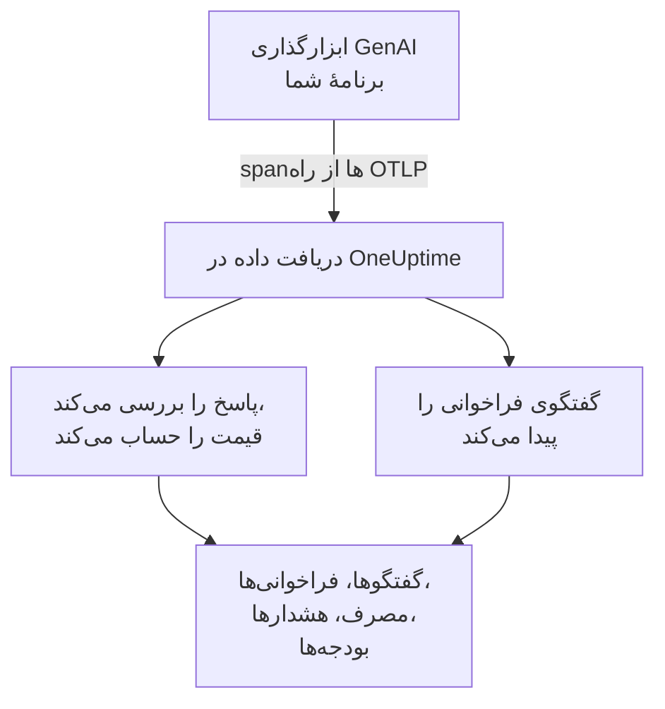
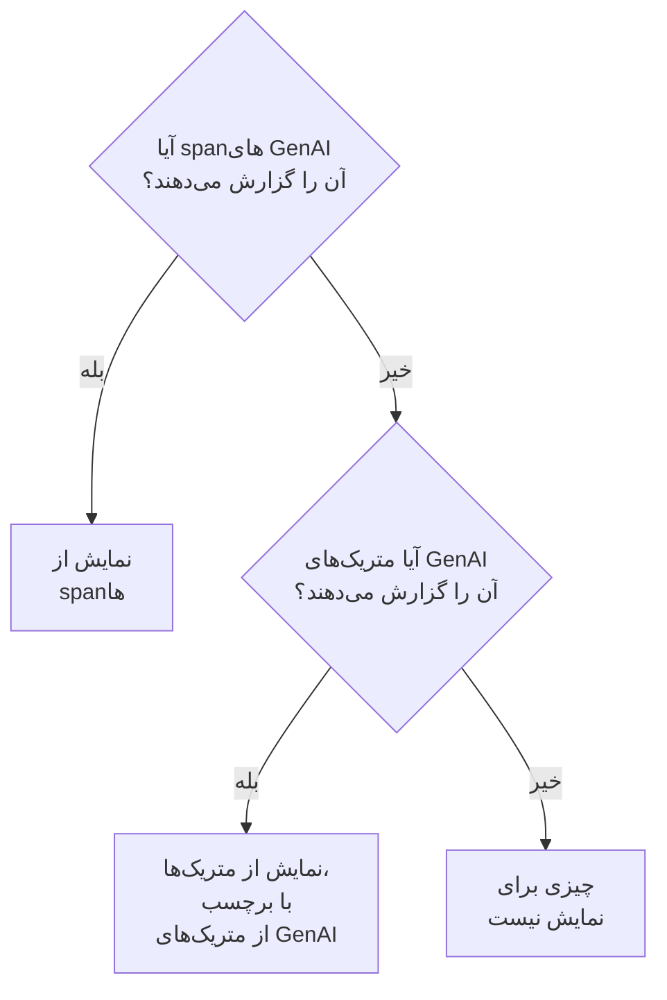

# مشاهده‌پذیری هوش مصنوعی / LLM

هر گفتگویی را که هوش مصنوعی‌تان داشته بخوانید، آن را همان‌طور که رخ داد بازپخش کنید، و وقتی بد پاسخ می‌دهد باخبر شوید. OneUptime همهٔ این‌ها را از OpenTelemetry استاندارد می‌سازد: اگر برنامهٔ شما spanهایی با **قراردادهای معنایی GenAI** (`gen_ai.*`) بفرستد، گفتگو، هشدار، مصرف و هزینه را بدون هیچ SDK اختصاصی به دست می‌آورید.

:::cards
- [راه‌اندازی](#راهاندازی-در-پنج-گام): پنج گام، از نخستین span تا پاسخ‌های علامت‌خورده.
- [بازپخش یک گفتگو](#خواندن-و-بازپخش-یک-گفتگو): یک گفتگو را همان‌طور بخوانید که شخص دید، با همان آهنگی که رخ داد.
- [دریافت هشدار](#وقتی-هوش-مصنوعی-بد-پاسخ-میدهد-باخبر-شوید): هشدارهای آماده برای پاسخ‌هایی که ناموفق، ردشده، نیمه‌کاره، علامت‌خورده یا کند هستند.
- [پاییدن خرج](#ببینید-چه-کسی-برای-چه-چیزی-خرج-میکند): هزینه به تفکیک شخص، تیم، مدل و برنامه، همراه با بودجه‌های روزانه.
:::

## چگونه کار می‌کند

ابزارگذاری GenAI برنامهٔ شما هر فراخوانی مدل را به‌صورت یک span اپن‌تلمتری صادر می‌کند. وقتی span می‌رسد، OneUptime ویژگی‌های `gen_ai.*` آن را می‌خواند، پاسخ را از نظر مشکل بررسی می‌کند، قیمت فراخوانی را حساب می‌کند و آن را زیر گفتگوی خودش قرار می‌دهد.



**محصولات** > **هوش مصنوعی / LLM** را زیر **مشاهده‌پذیری** باز کنید. این محصول هفت زبانه دارد:

| زبانه | چه چیزی نشان می‌دهد |
| --- | --- |
| **گفتگوها** | هر گفتگویی که هوش مصنوعی‌تان داشته، با آن‌هایی که نیاز به توجه دارند در صدر. بالای فهرست: گفتگوها، پاسخ‌های هوش مصنوعی، شمار آن‌هایی که نیاز به توجه دارند، هزینه و زمان معمول پاسخ. |
| **فراخوانی‌ها** | هر فراخوانی مدل، embedding، عامل و ابزار. بر پایهٔ سرویس، ارائه‌دهنده، مدل، عملیات، شخص، تیم یا گفتگو فیلتر کنید؛ روی یک فراخوانی کلیک کنید تا در نمایشگر ترِیس باز شود. |
| **مصرف** | فراخوانی‌ها، توکن‌ها و هزینهٔ یک بازهٔ زمانی، رتبه‌بندی‌شده بر پایهٔ کارمند، تیم، مدل، ارائه‌دهنده یا برنامه. |
| **هشدارها** | هشدارهای آماده برای وقتی هوش مصنوعی بد پاسخ می‌دهد، و مانیتورهای هوش مصنوعی / LLM شما. |
| **بودجه‌ها** | سقف‌های هزینهٔ روزانه که به‌صورت متریک منتشر می‌شوند تا بتوانید بر آن‌ها هشدار بگذارید. |
| **قیمت‌گذاری** | قیمت‌های خودتان برای مدل‌هایی که فهرست قیمت داخلی نمی‌شناسد. |
| **راه‌اندازی** | پنج گام زیر، همراه با نقطهٔ پایانی پروژهٔ شما. |

در نمایشگر ترِیس، span هر فراخوانی هوش مصنوعی یک زبانهٔ **LLM** هم دارد: ارائه‌دهنده، مدل، توکن‌ها، هزینه، پارامترهای درخواست، و پرامپت و پاسخ.

## پیش از شروع

- یک پروژهٔ OneUptime که در آن بتوانید کلید دریافت دادهٔ تله‌متری بسازید.
- برنامه‌ای که یک مدل را فراخوانی می‌کند، و یک ابزارگذاری GenAI برای زبان آن: **OpenLLMetry** (Traceloop)، **OpenInference** (Arize)، **Vercel AI SDK**، یا ابزارگذاری‌های OpenTelemetry برای OpenAI، Anthropic و Gemini.

> [!TIP]
> ترافیک مدلی که از دروازه‌ای مانند LiteLLM یا Portkey می‌گذرد، می‌تواند به‌جای هر برنامه از خود دروازه صادر شود: [دروازه‌های هوش مصنوعی](/docs/telemetry/ai-gateways) را ببینید. برای دستیارهای کدنویسی‌ای که مهندسانتان به کار می‌برند، [دستیارهای کدنویسی هوش مصنوعی](/docs/telemetry/ai-coding-assistants) را ببینید.

## راه‌اندازی در پنج گام

برای دیدن فراخوانی‌ها گام نخست کافی است. هر گام پس از آن چیزهای بیشتری نشان می‌دهد.

:::steps
### فراخوانی‌های هوش مصنوعی‌تان را بفرستید

یک کلید دریافت داده در **تنظیمات پروژه** > **تله‌متری و APM** > **کلیدهای دریافت داده** بسازید ([شروع سریع OpenTelemetry](/docs/telemetry/open-telemetry#ساخت-کلید-دریافت-داده) آن را گام‌به‌گام توضیح می‌دهد). سپس ابزارگذاری خود را به سمت OneUptime بفرستید:

:::tabs
@tab Python
```bash
pip install traceloop-sdk opentelemetry-exporter-otlp
```

```python
from traceloop.sdk import Traceloop

Traceloop.init(
    app_name="my-ai-agent",
    api_endpoint="https://oneuptime.com/otlp",
    headers={"x-oneuptime-token": "YOUR_INGESTION_TOKEN"},
)
# Your OpenAI, Anthropic and LangChain calls are now traced.
```
@tab Node.js
```bash
npm install @traceloop/node-server-sdk
```

```typescript
import * as traceloop from "@traceloop/node-server-sdk";

traceloop.initialize({
  appName: "my-ai-agent",
  baseUrl: "https://oneuptime.com/otlp",
  headers: { "x-oneuptime-token": "YOUR_INGESTION_TOKEN" },
});
```
@tab OpenTelemetry SDK
```bash
export OTEL_EXPORTER_OTLP_ENDPOINT="https://oneuptime.com/otlp"
export OTEL_EXPORTER_OTLP_HEADERS="x-oneuptime-token=YOUR_INGESTION_TOKEN"
export OTEL_EXPORTER_OTLP_PROTOCOL="http/protobuf"
export OTEL_SERVICE_NAME="my-ai-agent"
```
:::

OneUptime را خودتان میزبانی می‌کنید؟ به‌جای `https://oneuptime.com/otlp` از `https://YOUR-ONEUPTIME-HOST/otlp` استفاده کنید. مدل خود را یک بار فراخوانی کنید تا آن فراخوانی در **فراخوانی‌ها** نمایش داده شود.

### آنچه گفته شد را ثبت کنید

یک گفتگو فقط وقتی نشان می‌دهد افراد چه پرسیدند و هوش مصنوعی چه پاسخ داد که ابزارگذاری شما آن را ثبت کند. OpenLLMetry پرامپت‌ها و پاسخ‌ها را ثبت می‌کند، مگر اینکه `TRACELOOP_TRACE_CONTENT=false` را تنظیم کنید. ابزارگذاری‌های OpenTelemetry فقط وقتی آن‌ها را ثبت می‌کنند که درخواست کنید:

```bash
export OTEL_INSTRUMENTATION_GENAI_CAPTURE_MESSAGE_CONTENT=true
```

ابزارگذاری‌های جدیدتر OpenTelemetry به‌جای `true` مقدار `span_only`، `event_only` یا `span_and_event` را می‌پذیرند. بدون محتوای ثبت‌شده هم یک گفتگو زمان‌بندی، هزینه و مشکلاتش را نشان می‌دهد. پرامپت‌ها ممکن است دادهٔ حساس داشته باشند: [حریم خصوصی و پوشاندن داده](#حریم-خصوصی-و-پوشاندن-داده) نشان می‌دهد چگونه پیش از ذخیره آن‌ها را بپوشانید.

### فراخوانی‌ها را در گفتگوها گروه کنید

یک برنامهٔ گفتگو در هر نوبت یک بار مدل را فراخوانی می‌کند. در هر فراخوانی هوش مصنوعی، `gen_ai.conversation.id` (یا `session.id`) را برابر شناسهٔ گفتگوی خود قرار دهید تا هر گفتگو، هر چند فراخوانی و ترِیس که لازم داشته باشد، یک گفتگو نمایش داده شود. با OpenLLMetry آن را در هر درخواست یک بار تنظیم کنید:

```python
from traceloop.sdk import Traceloop

Traceloop.set_association_properties({
    "session_id": chat.id,
    "user_email": user.email,
})
```

با Vercel AI SDK، شناسهٔ گفتگو را به‌صورت `experimental_telemetry: { metadata: { sessionId } }` بفرستید. فراخوانی‌های بدون شناسهٔ گفتگو همچنان نمایش داده می‌شوند، هر بار یک درخواست (یک ترِیس).

### بگویید چه کسی پرسید

در هر فراخوانی هوش مصنوعی `user.id` یا `user.email` را تنظیم کنید (ویژگی ارتباطی بالا ایمیل را تنظیم می‌کند). آن‌گاه هر گفتگو نشان می‌دهد با چه کسی بوده، می‌توانید فهرست را بر پایهٔ شخص جست‌وجو کنید، و زبانهٔ **مصرف** خرج را بر پایهٔ کارمند رتبه‌بندی می‌کند. [انتساب به کارمندان و تیم‌ها](/docs/telemetry/ai-coding-assistants#انتساب-به-کارمندان-و-تیمها) همهٔ کلیدهای هویتی را که OneUptime می‌خواند فهرست می‌کند.

### پاسخ‌های بد را علامت بزنید

OneUptime هر پاسخ را به‌محض رسیدن بررسی می‌کند و آنچه در آن اشتباه پیش رفته را علامت می‌زند:

| مشکل | معنا | از کجا فهمیده می‌شود |
| --- | --- | --- |
| ناموفق | فراخوانی با خطا تمام شد، پس پاسخی نرسید | وضعیت span برابر Error، `error.type`، یا دلیل پایان `error` |
| ردشده | هوش مصنوعی پاسخ نداد، یا یک فیلتر ایمنی پاسخ را مسدود کرد | دلیل پایانِ امتناع یا ایمنی (`content_filter`، `refusal`، `SAFETY` و مانند آن)، امتناعی در پاسخ، یا پاسخی که با یک جملهٔ امتناع استاندارد انگلیسی آغاز شود |
| نیمه‌کاره | پاسخ در سقف توکن متوقف شد | دلیل پایان `length`، `max_tokens` یا `MAX_TOKENS` |
| خالی | نه متنی، نه فراخوانی ابزاری | محتوای ثبت‌شده‌ای که چیزی در آن نیست، یا ۰ توکن خروجی |
| علامت‌خورده | ارزیابی‌ای که برنامهٔ شما فرستاده گفته پاسخ بد بوده | یک رویداد `gen_ai.evaluation.result` |

چهار مورد نخست به کاری از سوی شما نیاز ندارند. برای علامت زدن پاسخی که guardrail، ارزیابی یا دکمهٔ «نپسندیدم» شما آن را رد می‌کند، تا وقتی span باز است یک رویداد `gen_ai.evaluation.result` به span پاسخ اضافه کنید و `gen_ai.evaluation.score.label` را برابر `fail` قرار دهید:

```python
from opentelemetry import trace

trace.get_current_span().add_event(
    "gen_ai.evaluation.result",
    {
        "gen_ai.evaluation.name": "relevance",
        "gen_ai.evaluation.score.label": "fail",
        "gen_ai.evaluation.explanation": "The answer is about another product.",
    },
)
```

برچسب‌هایی مانند `incorrect`، `wrong`، `unhelpful`، `toxic`، `unsafe` و `hallucination` هم ناموفق به شمار می‌آیند. OneUptime هرگز گفتگوهای شما را برای داوری به هوش مصنوعی دیگری نمی‌فرستد: هر بررسی فقط چیزی را می‌خواند که خود فراخوانی با خود دارد.
:::

## خواندن و بازپخش یک گفتگو

یک گفتگو کامل باز می‌شود، همان‌گونه که یک برنامهٔ گفتگو تاریخچه‌اش را نشان می‌دهد: آنچه شخص گفت در سمت راست، پاسخ‌های هوش مصنوعی در سمت چپ با مدل، زمان، توکن‌ها و هزینه‌شان، فراخوانی‌های ابزار در میان آن‌ها، و آنچه اشتباه پیش رفت در همان جایی که رخ داد علامت‌خورده. **جزئیات** زیر یک پاسخ نشان می‌دهد چرا متوقف شد، ارزیابی‌هایش، و پیوندی به آن فراخوانی در ترِیس‌ها.

نوار پایین صفحه گفتگو را همان‌گونه بازپخش می‌کند که شخص آن را از سر گذراند:

| کنترل | چه می‌کند |
| --- | --- |
| **بازپخش دوباره** | گفتگو را از نخستین پیام با همان آهنگی که رخ داد پخش می‌کند. تا وقتی پاسخی در راه است، «هوش مصنوعی در حال پاسخ دادن است…» زمان را می‌شمارد. روی زمان هر پیام کلیک کنید تا از همان‌جا پخش شود. |
| **رد شدن از انتظار** | به‌طور پیش‌فرض روشن است: هر سکوتِ بیش از ۳ ثانیه را کوتاه می‌کند. |
| `1x` | سرعت را تغییر می‌دهد: 1x، 2x، 4x یا 8x. |
| **K**، **J** یا **←**، **L** یا **→** | پخش یا مکث، رفتن به پیام قبلی، رفتن به پیام بعدی. |

نشانی صفحه پیامی را که بازپخش در آن ایستاد نگه می‌دارد (`?step=`)، پس پیوندی که به اشتراک می‌گذارید در همان لحظه باز می‌شود.

## وقتی هوش مصنوعی بد پاسخ می‌دهد باخبر شوید

زبانهٔ **هشدارها** هشدارهایی را فهرست می‌کند که بیشتر برنامه‌های هوش مصنوعی می‌خواهند. انتخاب یکی، **ساخت مانیتور** را پرشده باز می‌کند و پیش از ذخیره می‌توانید هر چیزی را تغییر دهید:

| هشدار | چه وقت خبرتان می‌کند | شدت |
| --- | --- | --- |
| پاسخ‌ها خراب می‌شوند | بیش از ۵٪ پاسخ‌ها در ۱۵ دقیقه ناموفق، ردشده، نیمه‌کاره، خالی یا علامت‌خورده باشند | Warning |
| فراخوانی‌های هوش مصنوعی ناموفق‌اند | بیش از ۱۰٪ فراخوانی‌های مدل در ۵ دقیقه با خطا پایان یابند | Critical |
| هوش مصنوعی از پاسخ دادن سر باز می‌زند | بیش از ۵٪ پاسخ‌ها در ۳۰ دقیقه امتناع باشند | Warning |
| پاسخ‌ها نیمه‌کاره می‌مانند | ۳ پاسخ یا بیشتر در ۳۰ دقیقه در سقف توکن متوقف شوند | Warning |
| پاسخ‌ها علامت می‌خورند | ارزیابی‌ای پاسخی را بد علامت بزند | Warning |
| پاسخ‌ها کندند | بیش از ۱۰٪ پاسخ‌ها در ۱۵ دقیقه بیش از ۳۰ ثانیه طول بکشند | Warning |
| هوش مصنوعی دیگر پاسخ نمی‌دهد | هوش مصنوعی ۳۰ دقیقه هیچ پاسخی ندهد | Critical |

هشدارهایی که بر پایهٔ سهمی از پاسخ‌ها هستند، منتظر دست‌کم ۳ پاسخ بد هم می‌مانند، تا یک پاسخ بد از دو پاسخ کسی را احضار نکند. هشدار Critical شدیدترین شدت هشدار پروژهٔ شما را می‌گیرد و هشدار Warning شدت بعدی را: در یک پروژهٔ تازه، High و Low.

هر هشدار یک مانیتور **هوش مصنوعی / LLM** است. تنظیماتش تعیین می‌کند چه چیزی پاسخ بد به شمار آید ( **پاسخ را بد حساب کن وقتی که** ، **یا بیشتر طول بکشد از (ثانیه)** )، هر بررسی تا کجا به عقب نگاه کند ( **بازه زمانی** ، به‌طور پیش‌فرض ۱۵ دقیقه)، کدام **برنامه‌ها** را بپاید و، زیر **فیلدهای بیشتر** ، کدام **مدل** را. یک **پیش‌نمایش** نشان می‌دهد مانیتور همین حالا چه چیزی را می‌شمارد. معیارهایش سه عدد را مقایسه می‌کنند: **پاسخ‌های بد هوش مصنوعی (٪)** ، **پاسخ‌های بد هوش مصنوعی** و **پاسخ‌های هوش مصنوعی** .

یک هشدار آماده، هشداری می‌سازد که خودش برطرف می‌شود، و تا وقتی پاسخ‌ها بدند مانیتور را **Degraded** نشان می‌دهد. رخداد آن پر شده ولی خاموش است: برای احضار کسی، آن را روشن کنید.

## ببینید چه کسی برای چه چیزی خرج می‌کند

زبانهٔ **مصرف** فراخوانی‌ها، توکن‌ها و هزینهٔ یک بازهٔ زمانی (۷ روز گذشته، مگر اینکه بازهٔ دیگری برگزینید) را نشان می‌دهد، همراه با جدولی از ۲۵ مورد برتر در یکی از پنج تفکیک: **کارمند** ، **تیم** ، **مدل** ، **ارائه‌دهنده** و **برنامه / سرویس** . فراخوانی‌هایی که نام کسی را ندارند زیر **بدون انتساب** شمرده می‌شوند و هرگز کنار گذاشته نمی‌شوند.

اشخاص و تیم‌ها از ویژگی‌های هویتی فراخوانی می‌آیند: [انتساب به کارمندان و تیم‌ها](/docs/telemetry/ai-coding-assistants#انتساب-به-کارمندان-و-تیمها) را ببینید.

### نخست spanها، متریک‌ها جای خالی را پر می‌کنند

spanهای GenAI مدل، توکن‌ها و هزینهٔ یک فراخوانی را با خود دارند، پس هر جا باشند به همه‌چیز پاسخ می‌دهند. برخی ابزارها متریک‌های توکن و هزینه منتشر می‌کنند و هیچ span GenAI نمی‌فرستند، مانند بیشتر دستیارهای کدنویسی. OneUptime این متریک‌ها را فقط برای عددی می‌خواند که spanها چیزی برایش گزارش نکرده‌اند، و هرگز این دو را با هم جمع نمی‌کند: بسیاری از ابزارگذاری‌ها برای یک فراخوانی هر دو را می‌فرستند و جمع کردنشان هر دلار را دو بار می‌شمارد.



| کجا | چه چیزی به متریک‌ها برمی‌گردد | چه وقت |
| --- | --- | --- |
| توکن‌های ورودی و خروجی | هر دو مجموع | مجموع توکن‌های spanها هر دو ۰ باشند |
| هزینه (USD) | هزینه، با تبدیل هزینهٔ میکرودلاری Codex به USD | مجموع هزینهٔ spanها ۰ باشد |
| فراخوانی‌های LLM | هیچ: فقط spanها | — |
| جدول‌های **کارمند** ، **تیم** ، **مدل** | فقط هزینه؛ خانه‌های فراخوانی و توکن `—` نشان می‌دهند | آن جدول هیچ ردیفی از spanها نیافت |
| جدول‌های **ارائه‌دهنده** ، **برنامه / سرویس** | هیچ: فقط spanها | — |
| گفتگوها | هیچ: گفتگوها از spanها ساخته می‌شوند | — |

عددی که از متریک‌ها گرفته شده با **از متریک‌های GenAI** علامت می‌خورد، چون در **فراخوانی‌ها** ردیف متناظری ندارد. پس به‌محض اینکه spanهای GenAI شما عددی را گزارش کنند، سهم ابزاری که فقط متریک می‌فرستد نمایش داده نمی‌شود. برای دیدن جداگانهٔ خرج چنین ابزاری، آن را به پروژه‌ای جداگانه بفرستید که هیچ span GenAI به آن نمی‌رسد.

## هزینهٔ یک فراخوانی

هزینه‌ای که ابزارگذاری شما گزارش می‌کند (`gen_ai.usage.cost`) همان‌طور که هست به کار می‌رود، حتی اگر ۰ باشد. وقتی هزینه‌ای گزارش نشود، OneUptime به‌محض رسیدن span، آن را از روی شمار توکن‌ها و فهرست قیمت داخلی برای مدل‌های رایج OpenAI، Anthropic، Google Gemini، Mistral، DeepSeek، xAI، Cohere، Amazon Nova و Meta Llama برآورد می‌کند. نخست مدلی که پاسخ داده قیمت‌گذاری می‌شود و سپس مدل درخواست‌شده.

مدل‌ها با طولانی‌ترین پیشوند نام تطبیق داده می‌شوند، پس شناسه‌های تاریخ‌دار یا دارای پیشوند فروشنده مانند `gpt-4o-2024-08-06` و `us.anthropic.claude-sonnet-4-5-20250929-v1:0` قیمت خانوادهٔ خود را پیدا می‌کنند. مدلی که فهرست نمی‌شناسد، حتی یک نسخهٔ تازه، هرگز حدس زده نمی‌شود: هزینه‌اش تا وقتی قیمتش را تعیین نکنید ۰ می‌ماند. برآوردها از قیمت‌های فهرست استفاده می‌کنند، بدون تخفیف‌های cache یا batch.

برای اینکه خودتان قیمت یک مدل را تعیین کنید (نرخی توافقی، مدلی fine-tune شده یا مدلی که خودتان میزبانی می‌کنید)، آن را در زبانهٔ **قیمت‌گذاری** ، زیر **قیمت‌گذاری سفارشی LLM** ، اضافه کنید: یک **پیشوند مدل** ، یک **قیمت ورودی (دلار به ازای ۱ میلیون توکن)** و یک **قیمت خروجی (دلار به ازای ۱ میلیون توکن)** . میان قیمت‌های شما و فهرست داخلی، طولانی‌ترین پیشوند منطبق برنده است؛ در صورت تساوی، قیمت شما برنده است. یک قیمت بر فراخوانی‌هایی اعمال می‌شود که حدود یک دقیقه پس از ذخیرهٔ آن می‌رسند؛ فراخوانی‌هایی که پیش‌تر ذخیره شده‌اند هزینهٔ خود را نگه می‌دارند.

## بودجه‌های هزینهٔ روزانه

یک بودجه خرج یک روز را، به دلار، در طول روز UTC دنبال می‌کند. OneUptime هر ۱۵ دقیقه خرج هوش مصنوعی آن روز را جمع می‌زند (از spanها، یا از متریک‌های هزینهٔ GenAI وقتی هیچ spanی خرجی گزارش نکرده باشد)، آن را روی بودجه نشان می‌دهد و دو متریک منتشر می‌کند:

| متریک | چیست |
| --- | --- |
| `oneuptime.llm.budget.spend.usd` | خرج روز تا این لحظه، به دلار |
| `oneuptime.llm.budget.percent.used` | خرج به‌صورت درصدی از سقف روزانه |

هر دو `oneuptime.llm.budget.id` و `oneuptime.llm.budget.name` را دارند، و اگر بودجه دامنه‌ای داشته باشد، دامنهٔ آن را هم.

:::steps
### بودجه را بسازید

در زبانهٔ **بودجه‌ها** روی **ساخت LLM Cost Budget** کلیک کنید. یک نام و یک **بودجه روزانه (USD)** به آن بدهید، و دامنه را برای کل پروژه خالی بگذارید، یا یک **سرویس (اختیاری)** ، یک **ارائه‌دهنده LLM (اختیاری)** یا یک **مدل LLM (اختیاری)** برگزینید. چند بودجه می‌توانند دامنه‌های مختلفی را بپایند.

### برای آن هشدار بگذارید

یک [مانیتور متریک‌ها](/docs/monitor/metrics-monitor) روی `oneuptime.llm.budget.percent.used` بسازید که با `oneuptime.llm.budget.id` فیلتر شده باشد (نام با تغییر نام بودجه عوض می‌شود). یک معیار `>= 80` اضافه کنید که هشداری عادی بدهد و یک معیار `>= 100` که هشدار بحرانی بدهد.

### پنجره را گسترده‌تر کنید

پنجرهٔ غلتان مانیتور را روی ۳۰ دقیقه بگذارید. یک بودجه هر ۱۵ دقیقه یک نقطه منتشر می‌کند، پس پنجرهٔ پیش‌فرض ۱ دقیقه‌ای میان دو نقطه چیزی پیدا نمی‌کند.
:::

یک هشدار بودجه می‌تواند گردش‌کاری را هم اجرا کند که یک عامل افسارگسیخته را متوقف کند: [مدارشکن‌های عامل هوش مصنوعی](/docs/telemetry/ai-agent-circuit-breaker) را ببینید.

## داشبوردها و هشدارهای متریک

متریک‌های GenAI مانند `gen_ai.client.token.usage` و `gen_ai.client.operation.duration` به‌صورت متریک‌های معمولی OpenTelemetry می‌رسند. آن‌ها را روی یک [داشبورد](/docs/dashboards/index) نمودار کنید، یا با یک [مانیتور متریک‌ها](/docs/monitor/metrics-monitor) بر آن‌ها هشدار بگذارید، برای نمونه وقتی p95 مربوط به `gen_ai.client.operation.duration`، گروه‌بندی‌شده بر پایهٔ مدل، از یک آستانه بگذرد.

## حریم خصوصی و پوشاندن داده

فراخوانی‌های هوش مصنوعی به‌صورت spanهای ترِیس ذخیره می‌شوند، پس **قواعد پالایش** و **فیلترهای حذف** ترِیس‌ها بر آن‌ها هم اعمال می‌شوند: پیش از ذخیره، یک ویژگی را بپوشانید یا یک span را حذف کنید. هر دو را در **ترِیس‌ها** > **تنظیمات** پیدا می‌کنید. ستون ایمیل کارمند همراه با ویژگی‌ای که از آن خوانده شده پالایش می‌شود، پس قاعده‌ای که ایمیل‌ها را می‌پوشاند این ستون را هم پوشش می‌دهد.

گفتگوها با همان مجوز ترِیس‌ها خوانده می‌شوند: هر کسی که بتواند ترِیس‌های پروژه را بخواند، گفتگوهای آن را هم می‌تواند بخواند، و هیچ‌کس دیگر.

## ویژگی‌هایی که OneUptime می‌خواند

OneUptime قراردادهای GenAI در OpenTelemetry را می‌خواند، و همچنین نگارش‌هایی را که OpenLLMetry، OpenInference، Vercel AI SDK و LiteLLM به کار می‌برند، پس کتابخانه‌های رایج همان‌طور که هستند کار می‌کنند. برای هر مقدار، نخستین کلیدی که span دارد برنده است:

| مقدار | کلیدها، به ترتیبی که آزموده می‌شوند |
| --- | --- |
| ارائه‌دهنده | `gen_ai.system`، `gen_ai.provider.name`، `llm.system`، `llm.provider` |
| عملیات | `gen_ai.operation.name`، `llm.request.type`، `openinference.span.kind` |
| مدل درخواست‌شده | `gen_ai.request.model`، `llm.model_name`، `llm.request.model` |
| مدل پاسخ‌دهنده | `gen_ai.response.model`، `llm.response.model` |
| توکن‌های ورودی | `gen_ai.usage.input_tokens`، `gen_ai.usage.prompt_tokens`، `llm.token_count.prompt`، `llm.usage.prompt_tokens` |
| توکن‌های خروجی | `gen_ai.usage.output_tokens`، `gen_ai.usage.completion_tokens`، `llm.token_count.completion`، `llm.usage.completion_tokens` |
| کل توکن‌ها | `gen_ai.usage.total_tokens`، `llm.token_count.total`، `llm.usage.total_tokens` |
| هزینه (USD) | `gen_ai.usage.cost`، `gen_ai.usage.cost_usd`، `gen_ai.usage.total_cost`، `llm.usage.total_cost`، `gen_ai.cost.total_cost`، `litellm.cost.total` |
| گفتگو | `gen_ai.conversation.id`، `session.id`، `langfuse.session.id`، `traceloop.association.properties.session_id`، `ai.telemetry.metadata.sessionId` |
| عامل | `gen_ai.agent.name`، `agent.name` |
| ابزار | `gen_ai.tool.name`، `tool.name`، `ai.toolCall.name` |
| دلیل پایان | `gen_ai.response.finish_reasons`، `gen_ai.response.finish_reason`، `llm.response.finish_reason`، `ai.response.finishReason` |
| خطا | `error.type` |

یک span وقتی فراخوانی هوش مصنوعی به شمار می‌آید که یکی از این مقدارها را داشته باشد، یا هر ویژگی‌ای که با `gen_ai.`، `llm.` یا `traceloop.` آغاز شود. وقتی مجموعی گزارش نشود، کل توکن‌ها برابر ورودی به‌علاوهٔ خروجی است. کلیدهای `gen_ai.usage.total_tokens` و `gen_ai.usage.cost` بخشی از قراردادها نیستند و قراردادها هیچ‌یک را تعریف نمی‌کنند؛ OneUptime آن‌ها را می‌خواند چون ابزارگذاری‌های رایج آن‌ها را می‌فرستند.

کلیدهای هویتی (چه کسی فراخوانی را انجام داد، و تیمش) در [انتساب به کارمندان و تیم‌ها](/docs/telemetry/ai-coding-assistants#انتساب-به-کارمندان-و-تیمها) فهرست شده‌اند.

### پرامپت‌ها و پاسخ‌ها از کجا خوانده می‌شوند

نمای گفتگو پیام‌های یک فراخوانی را به این ترتیب می‌خواند:

- رویداد `gen_ai.client.inference.operation.details`؛
- ویژگی‌های `gen_ai.input.messages`، `gen_ai.output.messages` و `gen_ai.system_instructions`؛
- رویدادهای قدیمی‌تر به تفکیک نقش: `gen_ai.system.message`، `gen_ai.user.message`، `gen_ai.assistant.message`، `gen_ai.tool.message` و `gen_ai.choice`؛
- ویژگی‌های شماره‌دار: `gen_ai.prompt.N.content` و `gen_ai.completion.N.content` از OpenLLMetry، و `llm.input_messages.N.message.content` و `llm.output_messages.N.message.content` از OpenInference؛
- آرایه‌های پیام در `gen_ai.prompt`، `gen_ai.completion`، `ai.prompt.messages`، `ai.response.text`، `input.value` و `output.value`.

## عیب‌یابی

:::details فراخوانی‌ها می‌رسند، ولی هیچ گفتگویی متنی نشان نمی‌دهد
ابزارگذاری شما محتوا را ثبت نمی‌کند. آن را همان‌طور که [آنچه گفته شد را ثبت کنید](#آنچه-گفته-شد-را-ثبت-کنید) نشان می‌دهد روشن کنید؛ فراخوانی‌هایی که پیش از آن انجام شده‌اند بدون متن می‌مانند.
:::

:::details هر فراخوانی یک گفتگو به‌صورت گفتگویی جداگانه نمایش داده می‌شود
فراخوانی‌ها شناسهٔ گفتگو ندارند. در هر فراخوانی گفتگو `gen_ai.conversation.id` یا `session.id` را تنظیم کنید، همان‌طور که [فراخوانی‌ها را در گفتگوها گروه کنید](#فراخوانیها-را-در-گفتگوها-گروه-کنید) نشان می‌دهد.
:::

:::details فراخوانی‌ها توکن نشان می‌دهند ولی هزینه‌شان $0 است
مدل در فهرست قیمت داخلی نیست، یا span نام هیچ مدلی را ندارد. قیمت‌های مدل را در زبانهٔ **قیمت‌گذاری** اضافه کنید؛ فراخوانی‌هایی که پس از آن برسند قیمت‌گذاری می‌شوند.
:::

:::details زبانهٔ مصرف «از متریک‌های GenAI» می‌گوید و برای فراخوانی‌ها و توکن‌ها `—` نشان می‌دهد
عددها از ابزاری می‌آیند که متریک می‌فرستد و هیچ span GenAI نمی‌فرستد، مانند یک دستیار کدنویسی. یک متریک هزینه را دارد ولی جزئیات هر فراخوانی را ندارد، پس آن خانه‌ها خالی می‌مانند. [نخست spanها، متریک‌ها جای خالی را پر می‌کنند](#نخست-spanها-متریکها-جای-خالی-را-پر-میکنند) را ببینید.
:::

:::details یک مانیتور بودجه میان دو وضعیت نوسان می‌کند
پنجرهٔ غلتان مانیتور کوتاه‌تر از ۱۵ دقیقه است، پس گاهی هیچ نقطه‌ای پیدا نمی‌کند. آن را روی ۳۰ دقیقه بگذارید.
:::

## گام‌های بعدی

:::cards
- [دستیارهای کدنویسی هوش مصنوعی](/docs/telemetry/ai-coding-assistants): خرج هر مهندس برای Claude Code، Cursor، Codex، Gemini CLI و Copilot.
- [دروازه‌های هوش مصنوعی](/docs/telemetry/ai-gateways): فراخوانی‌های مدل همهٔ برنامه‌ها را از یک دروازهٔ LiteLLM یا Portkey ترِیس کنید.
- [مدارشکن‌های عامل هوش مصنوعی](/docs/telemetry/ai-agent-circuit-breaker): وقتی هشدار بودجه به صدا درمی‌آید، یک عامل افسارگسیخته را متوقف کنید.
- [OpenTelemetry](/docs/telemetry/open-telemetry): نقطه‌های پایانی، کلیدهای دریافت داده و محدودیت‌ها برای هر سیگنال.
:::
