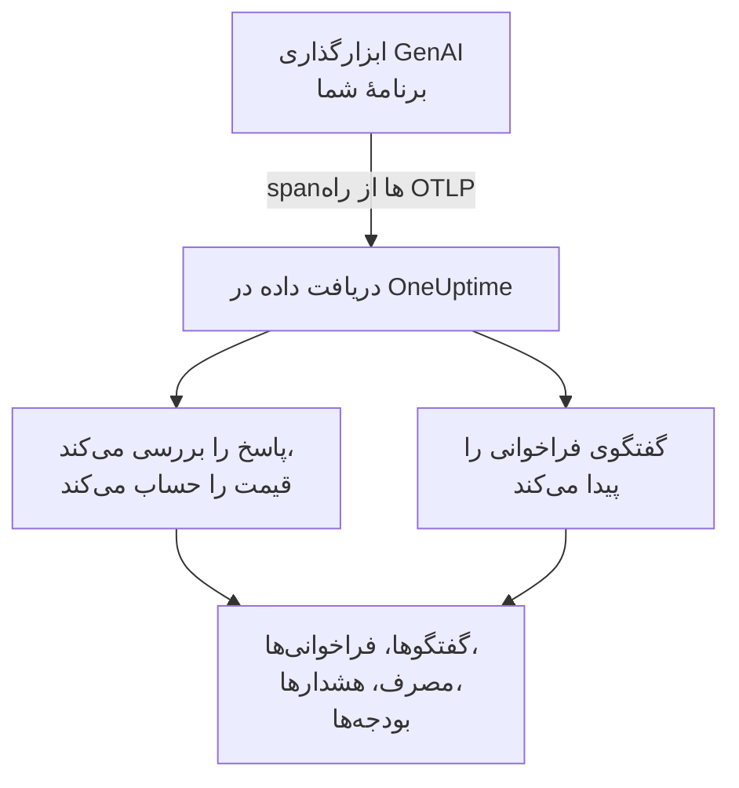
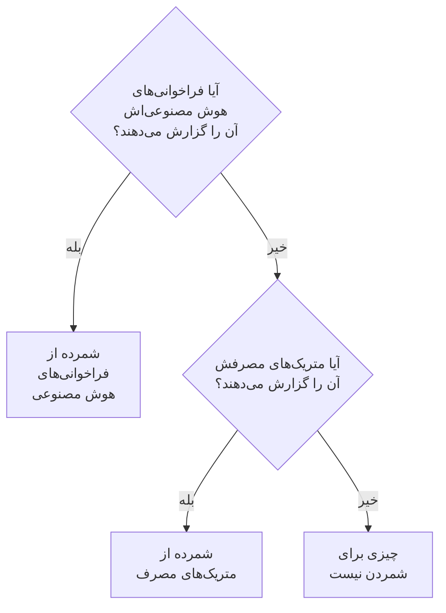

# مشاهده‌پذیری هوش مصنوعی / LLM

هر گفتگویی را که هوش مصنوعی‌تان داشته بخوانید، آن را همان‌طور که رخ داد بازپخش کنید، و وقتی بد پاسخ می‌دهد باخبر شوید. OneUptime همهٔ این‌ها را از OpenTelemetry استاندارد می‌سازد: اگر برنامهٔ شما spanهایی با **قراردادهای معنایی GenAI** (`gen_ai.*`) بفرستد، گفتگو، هشدار، مصرف و هزینه را بدون هیچ SDK اختصاصی به دست می‌آورید.

:::cards
- [سه راه ورود](#سه-راه-ورود): برنامه‌های شما، حساب‌های ارائه‌دهندهٔ هوش مصنوعی شما و ابزارهای هوش مصنوعی شرکتتان.
- [راه‌اندازی](#راهاندازی-در-پنج-گام): پنج گام، از نخستین span تا پاسخ‌های علامت‌خورده.
- [بازپخش یک گفتگو](#خواندن-و-بازپخش-یک-گفتگو): یک گفتگو را همان‌طور بخوانید که شخص دید، با همان آهنگی که رخ داد.
- [دریافت هشدار](#وقتی-هوش-مصنوعی-بد-پاسخ-میدهد-باخبر-شوید): هشدارهای آماده برای پاسخ‌هایی که ناموفق، ردشده، نیمه‌کاره، علامت‌خورده یا کند هستند.
- [پاییدن خرج](#ببینید-چه-کسی-برای-چه-چیزی-خرج-میکند): هزینه به تفکیک شخص، تیم، مدل و برنامه، همراه با بودجه‌های روزانه.
:::

## چگونه کار می‌کند

ابزارگذاری GenAI برنامهٔ شما هر فراخوانی مدل را به‌صورت یک span اپن‌تلمتری صادر می‌کند. وقتی span می‌رسد، OneUptime ویژگی‌های `gen_ai.*` آن را می‌خواند، پاسخ را از نظر مشکل بررسی می‌کند، قیمت فراخوانی را حساب می‌کند و آن را زیر گفتگوی خودش قرار می‌دهد.



**محصولات** > **هوش مصنوعی / LLM** را زیر **مشاهده‌پذیری** باز کنید. این محصول هفت زبانه دارد:

| زبانه | چه چیزی نشان می‌دهد |
| --- | --- |
| **گفتگوها** | هر گفتگویی که هوش مصنوعی‌تان داشته، با آن‌هایی که نیاز به توجه دارند در صدر. بالای فهرست: گفتگوها، پاسخ‌های هوش مصنوعی، شمار آن‌هایی که نیاز به توجه دارند، هزینه و زمان معمول پاسخ. |
| **فراخوانی‌ها** | هر فراخوانی مدل، embedding، عامل و ابزار. بر پایهٔ سرویس، ارائه‌دهنده، مدل، عملیات، شخص، تیم یا گفتگو فیلتر کنید؛ روی یک فراخوانی کلیک کنید تا در نمایشگر ترِیس باز شود. |
| **مصرف** | فراخوانی‌ها، توکن‌ها و هزینهٔ یک بازهٔ زمانی، رتبه‌بندی‌شده بر پایهٔ کارمند، تیم، مدل، ارائه‌دهنده یا برنامه؛ در **حساب‌های ارائه‌دهنده**، آنچه برای حساب‌های وصل‌شدهٔ شما صورت‌حساب شده. |
| **هشدارها** | هشدارهای آماده برای وقتی هوش مصنوعی بد پاسخ می‌دهد، و مانیتورهای هوش مصنوعی / LLM شما. |
| **بودجه‌ها** | سقف‌های هزینهٔ روزانه که به‌صورت متریک منتشر می‌شوند تا بتوانید بر آن‌ها هشدار بگذارید. |
| **قیمت‌گذاری** | قیمت‌های خودتان برای مدل‌هایی که فهرست قیمت داخلی نمی‌شناسد. |
| **اتصال** | سه راه ورود، کنار هم، که هر کدام به محض کار کردن تیک می‌خورد. |

در نمایشگر ترِیس، span هر فراخوانی هوش مصنوعی یک زبانهٔ **LLM** هم دارد: ارائه‌دهنده، مدل، توکن‌ها، هزینه، پارامترهای درخواست، و پرامپت و پاسخ.

## سه راه ورود

هر سه در **محصولات** > **هوش مصنوعی / LLM** > **اتصال** هستند. یکی، دو تا یا هر سه را به کار ببرید: همه‌چیز به همان **گفتگوها**، **مصرف**، **هشدارها** و **بودجه‌ها** می‌رسد.

| راه ورود | چه به دست می‌آورید | چگونه |
| --- | --- | --- |
| **برنامه‌های شما** | هر فراخوانی هوش مصنوعی در همان لحظه: گفتگو، شخص، پرامپت و پاسخ، توکن‌ها، هزینه و خطاها | OpenTelemetry از کد شما یا یک دروازه، در پنج گام |
| **حساب‌های ارائه‌دهنده هوش مصنوعی شما** | آنچه هر حساب OpenAI، Anthropic، Azure، Bedrock، Vertex AI یا Cursor مصرف کرده و هزینه‌اش، روز به روز یا ساعت به ساعت | اعتبارنامه‌ای فقط‌خواندنی و بدون کد: [حساب‌های ارائه‌دهنده هوش مصنوعی](/docs/telemetry/ai-provider-accounts) |
| **ابزارهای هوش مصنوعی شرکت شما** | آنچه افراد شما از Claude Enterprise یا Microsoft 365 Copilot می‌پرسند، به تفکیک شخص | اعتبارنامه‌ای فقط‌خواندنی و بدون کد: [ابزارهای هوش مصنوعی شرکت](/docs/telemetry/ai-company-tools) |

حساب‌های ارائه‌دهنده و دستیارهای برنامه‌نویسی مصرف و هزینه می‌آورند، هرگز فراخوانی: آن‌ها **مصرف** را پر می‌کنند، و **گفتگوها** و **فراخوانی‌ها** خالی می‌مانند تا برنامه‌هایتان فراخوانی‌های هوش مصنوعی خود را بفرستند یا ابزار هوش مصنوعی شرکت وصل شود. [بررسی آنچه می‌رسد](#بررسی-آنچه-میرسد) نشان می‌دهد کدام راه چه می‌آورد.

## بررسی آنچه می‌رسد

**بررسی راه‌اندازی** در بالای **اتصال** می‌گوید هر راه ورود همین حالا چه می‌آورد، و **بررسی دوباره** آن را دوباره می‌خواند. فهرست خالی **گفتگوها** یا **فراخوانی‌ها** هم با همان یافته و دکمه‌ای برای گام بعد آغاز می‌شود.

| آنچه می‌یابد | چه باید کرد |
| --- | --- |
| هیچ برنامه‌ای فراخوانی هوش مصنوعی نفرستاده است | [فراخوانی‌های هوش مصنوعی‌تان را بفرستید](#فراخوانیهای-هوش-مصنوعیتان-را-بفرستید): حساب‌های ارائه‌دهندهٔ وصل‌شده مصرف و هزینه را روزبه‌روز می‌آورند، هرگز فراخوانی |
| برنامه‌ای API یک ارائه‌دهندهٔ هوش مصنوعی را فرا می‌خواند و هیچ ابزارگذاری GenAI آن را ثبت نمی‌کند | برای زبان برنامه یکی اضافه کنید: بررسی، spanهای کلاینت HTTP برنامه را به `api.openai.com`، `*.openai.azure.com`، `*.services.ai.azure.com` یا API ارائه‌دهندهٔ دیگری یافت |
| فراخوانی‌ها بدون پرامپت یا پاسخ می‌رسند | [آنچه گفته شد را ثبت کنید](#آنچه-گفته-شد-را-ثبت-کنید)، روی spanها یا به‌صورت رویدادهای لاگ |
| پرامپت‌ها و پاسخ‌ها به‌صورت رویدادهای لاگ می‌رسند | کاری لازم نیست: گفتگوها آن‌ها را می‌خوانند، و هر کسی که بتواند لاگ‌های برنامه را بخواند، آن‌ها را در صفحهٔ **لاگ‌ها** هم می‌تواند بخواند |
| فراخوانی‌ها درست بیرون از بازهٔ زمانی‌اند | فهرست بازه‌ای را پیشنهاد می‌کند که جدیدترین را در بر دارد |
| یک حساب ارائه‌دهنده هیچ مصرفی نمی‌خواند | ردیف آن آخرین روز با مصرف یا نخستین روز خوانده‌شده را می‌گوید؛ اتصال Azure که هیچ منبعی نمی‌یابد، در جایی که منابع هستند به Monitoring Reader نیاز دارد |

## پیش از شروع

- یک پروژهٔ OneUptime که در آن بتوانید کلید دریافت دادهٔ تله‌متری بسازید.
- برنامه‌ای که یک مدل را فراخوانی می‌کند، و یک ابزارگذاری GenAI برای زبان آن: **OpenLLMetry** (Traceloop)، **OpenInference** (Arize)، **Vercel AI SDK**، یا ابزارگذاری‌های OpenTelemetry برای OpenAI، Anthropic و Gemini.

> [!TIP]
> ترافیک مدلی که از دروازه‌ای مانند LiteLLM یا Portkey می‌گذرد، می‌تواند به‌جای هر برنامه از خود دروازه صادر شود: [دروازه‌های هوش مصنوعی](/docs/telemetry/ai-gateways) را ببینید. برای دستیارهای کدنویسی‌ای که مهندسانتان به کار می‌برند، [دستیارهای کدنویسی هوش مصنوعی](/docs/telemetry/ai-coding-assistants) را ببینید.

## راه‌اندازی در پنج گام

برای دیدن فراخوانی‌ها گام نخست کافی است. هر گام پس از آن چیزهای بیشتری نشان می‌دهد.

:::steps
### فراخوانی‌های هوش مصنوعی‌تان را بفرستید

در **برنامه‌های شما** روی صفحهٔ **اتصال** یک کلید دریافت داده انتخاب کنید یا بسازید، و قطعه‌کد زبان خود را با نقطهٔ پایانی و کلیدتان در آن کپی کنید. یا یک کلید در **تنظیمات پروژه** > **تله‌متری و APM** > **کلیدهای دریافت داده** بسازید ([شروع سریع OpenTelemetry](/docs/telemetry/open-telemetry#ساخت-کلید-دریافت-داده) آن را گام‌به‌گام توضیح می‌دهد) و ابزارگذاری خود را به سمت OneUptime بفرستید:

:::tabs
@tab Python
```bash
pip install traceloop-sdk opentelemetry-exporter-otlp
```

```python
from traceloop.sdk import Traceloop

Traceloop.init(
    app_name="my-ai-agent",
    api_endpoint="https://oneuptime.com/otlp",
    headers={"x-oneuptime-token": "YOUR_INGESTION_TOKEN"},
)
# Your OpenAI, Anthropic and LangChain calls are now traced.
```
@tab Node.js
```bash
npm install @traceloop/node-server-sdk
```

```typescript
import * as traceloop from "@traceloop/node-server-sdk";

traceloop.initialize({
  appName: "my-ai-agent",
  baseUrl: "https://oneuptime.com/otlp",
  headers: { "x-oneuptime-token": "YOUR_INGESTION_TOKEN" },
});
```
@tab .NET
```bash
dotnet add package OpenTelemetry.Extensions.Hosting
dotnet add package OpenTelemetry.Exporter.OpenTelemetryProtocol
```

```csharp
// Before any OpenAI or Azure OpenAI client is created:
AppContext.SetSwitch("OpenAI.Experimental.EnableOpenTelemetry", true);

builder.Services.AddOpenTelemetry()
    .WithTracing(tracing => tracing.AddSource("OpenAI.*").AddOtlpExporter())
    .WithMetrics(metrics => metrics.AddMeter("OpenAI.*").AddOtlpExporter());
```
@tab Java
```bash
curl -L -O https://github.com/open-telemetry/opentelemetry-java-instrumentation/releases/latest/download/opentelemetry-javaagent.jar
java -javaagent:opentelemetry-javaagent.jar -jar my-ai-agent.jar
```
@tab OpenTelemetry SDK
```bash
export OTEL_EXPORTER_OTLP_ENDPOINT="https://oneuptime.com/otlp"
export OTEL_EXPORTER_OTLP_HEADERS="x-oneuptime-token=YOUR_INGESTION_TOKEN"
export OTEL_EXPORTER_OTLP_PROTOCOL="http/protobuf"
export OTEL_SERVICE_NAME="my-ai-agent"
```
:::

هر کدام فراخوانی‌ها به OpenAI، Azure OpenAI و Microsoft Foundry را به یک شکل ردیابی می‌کنند. روی .NET و Java متغیرهای زبانهٔ OpenTelemetry SDK را هم تنظیم کنید: کتابخانه‌های OpenAI و Azure.AI.OpenAI وقتی کلیدشان روشن باشد فراخوانی‌هایشان را ردیابی می‌کنند، و عامل Java، OpenAI Java SDK را ردیابی می‌کند.

OneUptime را خودتان میزبانی می‌کنید؟ به‌جای `https://oneuptime.com/otlp` از `https://YOUR-ONEUPTIME-HOST/otlp` استفاده کنید. مدل خود را یک بار فراخوانی کنید تا آن فراخوانی در **فراخوانی‌ها** نمایش داده شود.

### آنچه گفته شد را ثبت کنید

یک گفتگو فقط وقتی نشان می‌دهد افراد چه پرسیدند و هوش مصنوعی چه پاسخ داد که ابزارگذاری شما آن را ثبت کند. OpenLLMetry پرامپت‌ها و پاسخ‌ها را ثبت می‌کند، مگر اینکه `TRACELOOP_TRACE_CONTENT=false` را تنظیم کنید. ابزارگذاری‌های OpenTelemetry فقط وقتی آن‌ها را ثبت می‌کنند که درخواست کنید:

```bash
export OTEL_INSTRUMENTATION_GENAI_CAPTURE_MESSAGE_CONTENT=true
```

ابزارگذاری‌های جدیدتر OpenTelemetry به‌جای `true` مقدار `span_only`، `event_only` یا `span_and_event` را می‌پذیرند. بدون محتوای ثبت‌شده هم یک گفتگو زمان‌بندی، هزینه و مشکلاتش را نشان می‌دهد. پرامپت‌ها ممکن است دادهٔ حساس داشته باشند: [حریم خصوصی و پوشاندن داده](#حریم-خصوصی-و-پوشاندن-داده) نشان می‌دهد چگونه پیش از ذخیره آن‌ها را بپوشانید.

گفتگوها آنچه را روی span فراخوانی ثبت شده می‌خوانند، و رویدادهای لاگی را که برنامه با شناسهٔ ترِیس و span فراخوانی می‌فرستد. ابزارگذاری OpenTelemetry برای Python آن را با `span_only` روی span ثبت می‌کند؛ ابزارگذاری‌های JavaScript و Java، و ابزارگذاری Python با `true` یا `event_only`، آن را به‌صورت رویدادهای لاگ می‌فرستند که همراه لاگ‌های برنامه به OneUptime می‌رسند. SDK مربوط به AI Inference در Azure آن را با `AZURE_TRACING_GEN_AI_CONTENT_RECORDING_ENABLED=true` روی span ثبت می‌کند، Microsoft.Extensions.AI با `EnableSensitiveData`؛ کتابخانهٔ OpenAI برای .NET هیچ چیز ثبت نمی‌کند.

### فراخوانی‌ها را در گفتگوها گروه کنید

یک برنامهٔ گفتگو در هر نوبت یک بار مدل را فراخوانی می‌کند. در هر فراخوانی هوش مصنوعی، `gen_ai.conversation.id` (یا `session.id`) را برابر شناسهٔ گفتگوی خود قرار دهید تا هر گفتگو، هر چند فراخوانی و ترِیس که لازم داشته باشد، یک گفتگو نمایش داده شود. با OpenLLMetry آن را در هر درخواست یک بار تنظیم کنید:

```python
from traceloop.sdk import Traceloop

Traceloop.set_association_properties({
    "session_id": chat.id,
    "user_email": user.email,
})
```

با Vercel AI SDK، شناسهٔ گفتگو را به‌صورت `experimental_telemetry: { metadata: { sessionId } }` بفرستید. فراخوانی‌های بدون شناسهٔ گفتگو همچنان نمایش داده می‌شوند، هر بار یک درخواست (یک ترِیس).

### بگویید چه کسی پرسید

در هر فراخوانی هوش مصنوعی `user.id` یا `user.email` را تنظیم کنید (ویژگی ارتباطی بالا ایمیل را تنظیم می‌کند). آن‌گاه هر گفتگو نشان می‌دهد با چه کسی بوده، می‌توانید فهرست را بر پایهٔ شخص جست‌وجو کنید، و زبانهٔ **مصرف** خرج را بر پایهٔ کارمند رتبه‌بندی می‌کند. [انتساب به کارمندان و تیم‌ها](/docs/telemetry/ai-coding-assistants#انتساب-به-کارمندان-و-تیمها) همهٔ کلیدهای هویتی را که OneUptime می‌خواند فهرست می‌کند.

### پاسخ‌های بد را علامت بزنید

OneUptime هر پاسخ را به‌محض رسیدن بررسی می‌کند و آنچه در آن اشتباه پیش رفته را علامت می‌زند:

| مشکل | معنا | از کجا فهمیده می‌شود |
| --- | --- | --- |
| ناموفق | فراخوانی با خطا تمام شد، پس پاسخی نرسید | وضعیت span برابر Error، `error.type`، یا دلیل پایان `error` |
| ردشده | هوش مصنوعی پاسخ نداد، یا یک فیلتر ایمنی پاسخ را مسدود کرد | دلیل پایانِ امتناع یا ایمنی (`content_filter`، `refusal`، `SAFETY` و مانند آن)، امتناعی در پاسخ، یا پاسخی که با یک جملهٔ امتناع استاندارد انگلیسی آغاز شود |
| نیمه‌کاره | پاسخ در سقف توکن متوقف شد | دلیل پایان `length`، `max_tokens` یا `MAX_TOKENS` |
| خالی | نه متنی، نه فراخوانی ابزاری | محتوای ثبت‌شده‌ای که چیزی در آن نیست، یا ۰ توکن خروجی |
| علامت‌خورده | ارزیابی‌ای که برنامهٔ شما فرستاده گفته پاسخ بد بوده | یک رویداد `gen_ai.evaluation.result` |

چهار مورد نخست به کاری از سوی شما نیاز ندارند. برای علامت زدن پاسخی که guardrail، ارزیابی یا دکمهٔ «نپسندیدم» شما آن را رد می‌کند، تا وقتی span باز است یک رویداد `gen_ai.evaluation.result` به span پاسخ اضافه کنید و `gen_ai.evaluation.score.label` را برابر `fail` قرار دهید:

```python
from opentelemetry import trace

trace.get_current_span().add_event(
    "gen_ai.evaluation.result",
    {
        "gen_ai.evaluation.name": "relevance",
        "gen_ai.evaluation.score.label": "fail",
        "gen_ai.evaluation.explanation": "The answer is about another product.",
    },
)
```

برچسب‌هایی مانند `incorrect`، `wrong`، `unhelpful`، `toxic`، `unsafe` و `hallucination` هم ناموفق به شمار می‌آیند. OneUptime هرگز گفتگوهای شما را برای داوری به هوش مصنوعی دیگری نمی‌فرستد: هر بررسی فقط چیزی را می‌خواند که خود فراخوانی با خود دارد.
:::

## خواندن و بازپخش یک گفتگو

یک گفتگو کامل باز می‌شود، همان‌گونه که یک برنامهٔ گفتگو تاریخچه‌اش را نشان می‌دهد: آنچه شخص گفت در سمت راست، پاسخ‌های هوش مصنوعی در سمت چپ با مدل، زمان، توکن‌ها و هزینه‌شان، فراخوانی‌های ابزار در میان آن‌ها، و آنچه اشتباه پیش رفت در همان جایی که رخ داد علامت‌خورده. **جزئیات** زیر یک پاسخ نشان می‌دهد چرا متوقف شد، ارزیابی‌هایش، و پیوندی به آن فراخوانی در ترِیس‌ها.

نوار پایین صفحه گفتگو را همان‌گونه بازپخش می‌کند که شخص آن را از سر گذراند:

| کنترل | چه می‌کند |
| --- | --- |
| **بازپخش دوباره** | گفتگو را از نخستین پیام با همان آهنگی که رخ داد پخش می‌کند. تا وقتی پاسخی در راه است، «هوش مصنوعی در حال پاسخ دادن است…» زمان را می‌شمارد. روی زمان هر پیام کلیک کنید تا از همان‌جا پخش شود. |
| **رد شدن از انتظار** | به‌طور پیش‌فرض روشن است: هر سکوتِ بیش از ۳ ثانیه را کوتاه می‌کند. |
| `1x` | سرعت را تغییر می‌دهد: 1x، 2x، 4x یا 8x. |
| **K**، **J** یا **←**، **L** یا **→** | پخش یا مکث، رفتن به پیام قبلی، رفتن به پیام بعدی. |

نشانی صفحه پیامی را که بازپخش در آن ایستاد نگه می‌دارد (`?step=`)، پس پیوندی که به اشتراک می‌گذارید در همان لحظه باز می‌شود.

## وقتی هوش مصنوعی بد پاسخ می‌دهد باخبر شوید

زبانهٔ **هشدارها** هشدارهایی را فهرست می‌کند که بیشتر برنامه‌های هوش مصنوعی می‌خواهند. انتخاب یکی، **ساخت مانیتور** را پرشده باز می‌کند و پیش از ذخیره می‌توانید هر چیزی را تغییر دهید:

| هشدار | چه وقت خبرتان می‌کند | شدت |
| --- | --- | --- |
| پاسخ‌ها خراب می‌شوند | بیش از ۵٪ پاسخ‌ها در ۱۵ دقیقه ناموفق، ردشده، نیمه‌کاره، خالی یا علامت‌خورده باشند | هشدار |
| فراخوانی‌های هوش مصنوعی ناموفق‌اند | بیش از ۱۰٪ فراخوانی‌های مدل در ۵ دقیقه با خطا پایان یابند | Critical |
| هوش مصنوعی از پاسخ دادن سر باز می‌زند | بیش از ۵٪ پاسخ‌ها در ۳۰ دقیقه امتناع باشند | هشدار |
| پاسخ‌ها نیمه‌کاره می‌مانند | ۳ پاسخ یا بیشتر در ۳۰ دقیقه در سقف توکن متوقف شوند | هشدار |
| پاسخ‌ها علامت می‌خورند | ارزیابی‌ای پاسخی را بد علامت بزند | هشدار |
| پاسخ‌ها کندند | بیش از ۱۰٪ پاسخ‌ها در ۱۵ دقیقه بیش از ۳۰ ثانیه طول بکشند | هشدار |
| هوش مصنوعی دیگر پاسخ نمی‌دهد | هوش مصنوعی ۳۰ دقیقه هیچ پاسخی ندهد | Critical |

هشدارهایی که بر پایهٔ سهمی از پاسخ‌ها هستند، منتظر دست‌کم ۳ پاسخ بد هم می‌مانند، تا یک پاسخ بد از دو پاسخ کسی را احضار نکند. هشدار Critical شدیدترین شدت هشدار پروژهٔ شما را می‌گیرد و هشدار Warning شدت بعدی را: در یک پروژهٔ تازه، High و Low.

هر هشدار یک مانیتور **هوش مصنوعی / LLM** است. تنظیماتش تعیین می‌کند چه چیزی پاسخ بد به شمار آید ( **پاسخ را بد حساب کن وقتی که** ، **یا بیشتر طول بکشد از (ثانیه)** )، هر بررسی تا کجا به عقب نگاه کند ( **بازه زمانی** ، به‌طور پیش‌فرض ۱۵ دقیقه)، کدام **برنامه‌ها** را بپاید و، زیر **فیلدهای بیشتر** ، کدام **مدل** را. یک **پیش‌نمایش** نشان می‌دهد مانیتور همین حالا چه چیزی را می‌شمارد. معیارهایش سه عدد را مقایسه می‌کنند: **پاسخ‌های بد هوش مصنوعی (٪)** ، **پاسخ‌های بد هوش مصنوعی** و **پاسخ‌های هوش مصنوعی** .

یک هشدار آماده، هشداری می‌سازد که خودش برطرف می‌شود، و تا وقتی پاسخ‌ها بدند مانیتور را **Degraded** نشان می‌دهد. رخداد آن پر شده ولی خاموش است: برای احضار کسی، آن را روشن کنید.

## ببینید چه کسی برای چه چیزی خرج می‌کند

زبانهٔ **مصرف** فراخوانی‌ها، توکن‌ها و هزینهٔ یک بازهٔ زمانی (۷ روز گذشته، مگر اینکه بازهٔ دیگری برگزینید) را نشان می‌دهد، همراه با جدولی از ۲۵ مورد برتر در یکی از پنج تفکیک: **کارمند** ، **تیم** ، **مدل** ، **ارائه‌دهنده** و **برنامه / سرویس** . فراخوانی‌هایی که نام کسی را ندارند زیر **بدون انتساب** شمرده می‌شوند و هرگز کنار گذاشته نمی‌شوند.

این‌ها **فراخوانی‌های هوش مصنوعی شما** هستند. به‌جای آن **حساب‌های ارائه‌دهنده** را برگزینید تا ببینید برای حساب‌های وصل‌شدهٔ OpenAI، Anthropic، Azure، Bedrock، Vertex AI و Cursor شما چقدر صورت‌حساب شده: [حساب‌های ارائه‌دهنده هوش مصنوعی](/docs/telemetry/ai-provider-accounts#دیدن-مصرف) را ببینید. این دو هرگز با هم جمع نمی‌شوند.

اشخاص و تیم‌ها از ویژگی‌های هویتی فراخوانی می‌آیند: [انتساب به کارمندان و تیم‌ها](/docs/telemetry/ai-coding-assistants#انتساب-به-کارمندان-و-تیمها) را ببینید.

### هر سرویس از روی آنچه می‌فرستد شمرده می‌شود

مصرف هوش مصنوعی به دو شکل می‌رسد. spanهای GenAI فراخوانی‌های هوش مصنوعی‌اند: یکی برای هر فراخوانی، با مدل، توکن‌ها و هزینهٔ آن. متریک‌های GenAI متریک‌های مصرف‌اند: شمارنده‌های توکن و هزینه که بیشتر دستیارهای کدنویسی به‌جای span می‌فرستند و برخی ابزارگذاری‌ها در کنار spanهای خود، برای همان فراخوانی‌ها. جمع زدن این دو آن فراخوانی‌ها را دو بار می‌شمارد، پس OneUptime هر سرویس را از روی یکی از آن دو می‌شمارد: توکن‌هایش را از فراخوانی‌های هوش مصنوعی‌اش وقتی توکن گزارش کنند، وگرنه از متریک‌های مصرفش، و هزینه‌اش را به همین شکل و جداگانه. به این ترتیب دستیار کدنویسی‌ای که فقط متریک می‌فرستد کنار برنامه‌هایی که span می‌فرستند، در همان پروژه، شمرده می‌شود، و برنامه‌ای که هر دو را می‌فرستد یک بار.



| کجا | از فراخوانی‌های هوش مصنوعی | از متریک‌های مصرف |
| --- | --- | --- |
| توکن‌های ورودی و خروجی | توکن‌های هر فراخوانی مدل، یک بار | توکن‌های یک سرویس، وقتی فراخوانی‌های هوش مصنوعی‌اش هیچ توکنی گزارش نکنند |
| هزینه (USD) | هزینهٔ هر فراخوانی مدل، یک بار | هزینهٔ یک سرویس، وقتی فراخوانی‌های هوش مصنوعی‌اش هیچ هزینه‌ای گزارش نکنند، با تبدیل هزینهٔ میکرودلاری Codex به USD |
| فراخوانی‌های هوش مصنوعی | هر فراخوانی هوش مصنوعی، همان‌طور که **فراخوانی‌ها** فهرستشان می‌کند | هرگز: متریک هیچ فراخوانی‌ای نمی‌شمارد |
| جدول‌های **کارمند** ، **تیم** ، **مدل** ، **ارائه‌دهنده** ، **برنامه / سرویس** | فراخوانی‌ها، توکن‌ها و هزینهٔ هر ردیف | توکن‌ها و هزینهٔ سرویس‌هایی که از متریک‌ها شمرده می‌شوند، زیر شخص، تیم، مدل یا ارائه‌دهنده‌ای که نقطه‌هایشان نام می‌برند |
| گفتگوها | ساخته‌شده از فراخوانی‌های هوش مصنوعی | هرگز |

زیر هر عدد، زبانهٔ مصرف می‌گوید از کجا آمده است: **از فراخوانی‌های هوش مصنوعی** ، **از متریک‌های مصرف** ، یا **از فراخوانی‌های هوش مصنوعی و متریک‌های مصرف** وقتی برخی سرویس‌ها فراخوانی و برخی دیگر متریک فرستاده‌اند. ردیفی از جدول که از متریک‌های مصرف شمرده شده این را زیر نامش می‌گوید، و خانهٔ فراخوانی‌هایش وقتی هیچ فراخوانی هوش مصنوعی ندارد `—` نشان می‌دهد، چون متریک جزئیات هر فراخوانی را ندارد؛ سرصفحهٔ جدول سرویس‌هایی را که از متریک‌های مصرف شمرده شده‌اند نام می‌برد، جز در **برنامه / سرویس** که ردیف‌هایش خودِ سرویس‌ها هستند. متریک مصرفی که نام هیچ سرویسی را نمی‌آورد زیر **سرویس ناشناخته** شمرده می‌شود، سرویسی مانند هر سرویس دیگر. اگر نقش شما بتواند ترِیس‌ها را بخواند ولی متریک‌ها را نه، متریک‌های مصرف کنار گذاشته می‌شوند و جدول این را می‌گوید.

هر فراخوانی مدل یک بار شمرده می‌شود. اجرای یک عامل، یا span یک فریم‌ورک دور span خود SDK، اغلب توکن‌ها و هزینهٔ فراخوانی‌های درونش را تکرار می‌کند: توکن‌های یک span، یا هزینه‌اش، هر جا فراخوانی‌ای درون آن آن‌ها را گزارش کند کنار گذاشته می‌شوند، و اجرای یک عامل وقتی هیچ فراخوانی‌ای درونش عددی گزارش نکند عددهای خودش را نگه می‌دارد. بودجه‌ها و فهرست **گفتگوها** هم به همین شکل می‌شمارند، در حالی که **فراخوانی‌ها** هر span را با عددهای خودش فهرست می‌کند.

یک متریک توکن یا هزینه یک شمارنده است. نقطه‌های یک شمارندهٔ دلتا با هم جمع می‌شوند؛ یک شمارندهٔ تجمعی، پیش‌فرض SDKهای OpenTelemetry، می‌شمارد که در بازهٔ زمانی چقدر رشد کرده، هر سری جداگانه، پس مجموعی که هر دقیقه صادر می‌شود یک بار شمرده می‌شود، و یک افت به‌عنوان شروع دوباره از ۰ خوانده می‌شود، همان‌طور که `increase()` در Prometheus آن را می‌خواند. بودجه‌ها هم متریک‌های GenAI را به همین شکل می‌شمارند.

## هزینهٔ یک فراخوانی

هزینه‌ای که ابزارگذاری شما گزارش می‌کند (`gen_ai.usage.cost`) همان‌طور که هست به کار می‌رود، حتی اگر ۰ باشد. وقتی هزینه‌ای گزارش نشود، OneUptime به‌محض رسیدن span، آن را از روی شمار توکن‌ها و فهرست قیمت داخلی برای مدل‌های رایج OpenAI، Anthropic، Google Gemini، Mistral، DeepSeek، xAI، Cohere، Amazon Nova و Meta Llama برآورد می‌کند. نخست مدلی که پاسخ داده قیمت‌گذاری می‌شود و سپس مدل درخواست‌شده.

هر مدل با نرخ خودش قیمت‌گذاری می‌شود، شناسه‌اش به هر شکلی که باشد: `gpt-4o-2024-08-06` همان GPT-4o است و `claude-opus-4-5-20251101`، `us.anthropic.claude-opus-4-5-20251101-v1:0`، `claude-opus-4-5@20251101` و `anthropic/claude-opus-4.5` همه Claude Opus 4.5 هستند. نسخهٔ تازه‌تر هرگز قیمت مدلی قدیمی‌تر را نمی‌گیرد: مدلی که فهرست نمی‌شناسد هرگز حدس زده نمی‌شود و هزینه‌اش تا وقتی قیمتش را تعیین نکنید ۰ می‌ماند.

توکن‌هایی که یک span خوانده‌شده از cache پرامپت فراهم‌کننده یا نوشته‌شده در آن گزارش می‌کند با نرخ‌های cache فراهم‌کننده قیمت‌گذاری می‌شوند، نوشتن‌ها با نرخ ۵ دقیقه‌ای، و مدلی که برای پرامپت بلند بیشتر می‌گیرد، مانند Claude Haiku 5.5 بالای ۱۰۰٬۰۰۰ توکن، بر اساس طول پرامپتش قیمت‌گذاری می‌شود. برآوردها قیمت‌های فهرست‌اند: تخفیف‌های batch، حالت‌های سریع و افزایش‌های منطقه‌ای اعمال نمی‌شوند.

برای اینکه خودتان قیمت یک مدل را تعیین کنید (نرخی توافقی، مدلی fine-tune شده یا مدلی که خودتان میزبانی می‌کنید)، آن را در زبانهٔ **قیمت‌گذاری** ، زیر **قیمت‌گذاری سفارشی LLM** ، اضافه کنید: یک **پیشوند مدل** ، یک **قیمت ورودی (دلار به ازای ۱ میلیون توکن)** و یک **قیمت خروجی (دلار به ازای ۱ میلیون توکن)** . میان قیمت‌های شما و فهرست داخلی، طولانی‌ترین پیشوند منطبق برنده است؛ در صورت تساوی، قیمت شما برنده است. قیمت شما برای هر توکن ورودی، چه از cache باشد چه نه، به کار می‌رود. یک قیمت بر فراخوانی‌هایی اعمال می‌شود که حدود یک دقیقه پس از ذخیرهٔ آن می‌رسند؛ فراخوانی‌هایی که پیش‌تر ذخیره شده‌اند هزینهٔ خود را نگه می‌دارند.

## بودجه‌های هزینهٔ روزانه

یک بودجه خرج یک روز را، به دلار، در طول روز UTC دنبال می‌کند. OneUptime هر ۱۵ دقیقه خرج هوش مصنوعی آن روز را جمع می‌زند (هر سرویس از فراخوانی‌های هوش مصنوعی‌اش، یا از متریک‌های هزینه‌اش وقتی فراخوانی‌هایش هیچ هزینه‌ای گزارش نکنند)، آن را روی بودجه نشان می‌دهد و دو متریک منتشر می‌کند. بودجه‌ای که **شمارش هزینه از** آن **حساب‌های ارائه‌دهنده** است، به‌جای آن آنچه برای حساب‌های وصل‌شدهٔ شما صورت‌حساب شده را می‌شمارد: [حساب‌های ارائه‌دهنده هوش مصنوعی](/docs/telemetry/ai-provider-accounts#بودجهها-و-هشدارها) را ببینید.

| متریک | چیست |
| --- | --- |
| `oneuptime.llm.budget.spend.usd` | خرج روز تا این لحظه، به دلار |
| `oneuptime.llm.budget.percent.used` | خرج به‌صورت درصدی از سقف روزانه |

هر دو `oneuptime.llm.budget.id` و `oneuptime.llm.budget.name` را دارند، و اگر بودجه دامنه‌ای داشته باشد، دامنهٔ آن را هم.

:::steps
### بودجه را بسازید

در زبانهٔ **بودجه‌ها** روی **ساخت بودجه هزینه LLM** کلیک کنید. یک نام و یک **بودجه روزانه (USD)** به آن بدهید، و دامنه را برای کل پروژه خالی بگذارید، یا یک **سرویس (اختیاری)** ، یک **ارائه‌دهنده LLM (اختیاری)** یا یک **مدل LLM (اختیاری)** برگزینید. چند بودجه می‌توانند دامنه‌های مختلفی را بپایند.

### برای آن هشدار بگذارید

یک [مانیتور متریک‌ها](/docs/monitor/metrics-monitor) روی `oneuptime.llm.budget.percent.used` بسازید که با `oneuptime.llm.budget.id` فیلتر شده باشد (نام با تغییر نام بودجه عوض می‌شود). یک معیار `>= 80` اضافه کنید که هشداری عادی بدهد و یک معیار `>= 100` که هشدار بحرانی بدهد.

### پنجره را گسترده‌تر کنید

پنجرهٔ غلتان مانیتور را روی ۳۰ دقیقه بگذارید. یک بودجه هر ۱۵ دقیقه یک نقطه منتشر می‌کند، پس پنجرهٔ پیش‌فرض ۱ دقیقه‌ای میان دو نقطه چیزی پیدا نمی‌کند.
:::

یک هشدار بودجه می‌تواند گردش‌کاری را هم اجرا کند که یک عامل افسارگسیخته را متوقف کند: [مدارشکن‌های عامل هوش مصنوعی](/docs/telemetry/ai-agent-circuit-breaker) را ببینید.

## داشبوردها و هشدارهای متریک

متریک‌های GenAI مانند `gen_ai.client.token.usage` و `gen_ai.client.operation.duration` به‌صورت متریک‌های معمولی OpenTelemetry می‌رسند. آن‌ها را روی یک [داشبورد](/docs/dashboards/index) نمودار کنید، یا با یک [مانیتور متریک‌ها](/docs/monitor/metrics-monitor) بر آن‌ها هشدار بگذارید، برای نمونه وقتی p95 مربوط به `gen_ai.client.operation.duration`، گروه‌بندی‌شده بر پایهٔ مدل، از یک آستانه بگذرد.

## حریم خصوصی و پوشاندن داده

فراخوانی‌های هوش مصنوعی به‌صورت spanهای ترِیس ذخیره می‌شوند، پس **قواعد پالایش** و **فیلترهای حذف** ترِیس‌ها بر آن‌ها هم اعمال می‌شوند: پیش از ذخیره، یک ویژگی را بپوشانید یا یک span را حذف کنید. هر دو را در **ترِیس‌ها** > **تنظیمات** پیدا می‌کنید. ستون ایمیل کارمند همراه با ویژگی‌ای که از آن خوانده شده پالایش می‌شود، پس قاعده‌ای که ایمیل‌ها را می‌پوشاند این ستون را هم پوشش می‌دهد.

پرامپت‌ها و پاسخ‌هایی که به‌صورت رویداد لاگ فرستاده می‌شوند به‌صورت لاگ ذخیره می‌شوند، پس **قواعد پالایش** و **فیلترهای حذف** لاگ‌ها بر آن‌ها اعمال می‌شوند، در **لاگ‌ها** > **تنظیمات**: قاعده‌ای که ایمیل‌ها را در ترِیس‌ها می‌پوشاند، آن‌ها را در رویدادهای لاگ نمی‌پوشاند. گفتگو آن‌ها را فقط به کسی نشان می‌دهد که لاگ‌های آن برنامه را هم بتواند بخواند، و او آن‌ها را در صفحهٔ **لاگ‌ها** هم پیدا می‌کند.

در هر دو حالت، قاعده هر متنی را درون یک فهرست یا یک مقدار ساختاریافته می‌خواند، مانند پیام‌هایی که یک ابزارگذاری به‌صورت فهرست و نه متن JSON می‌فرستد، و شکل مقدار را نگه می‌دارد: نشانی ایمیلی که در یک پرامپت باشد، هر جا که باشد پوشانده می‌شود. [پالایش داده‌های حساس](/docs/telemetry/drop-filters-and-scrub-rules#پالایش-دادههای-حساس) را ببینید.

گفتگوها با همان مجوز ترِیس‌ها خوانده می‌شوند: هر کسی که بتواند ترِیس‌های پروژه را بخواند، گفتگوهای آن را هم می‌تواند بخواند، و هیچ‌کس دیگر. گفتگوهای یک ابزار هوش مصنوعی شرکت استثنا هستند: فقط مالکان و مدیران پروژه می‌توانند آن‌ها را بخوانند، مگر اینکه اتصالش چیز دیگری بگوید ([ابزارهای هوش مصنوعی شرکت](/docs/telemetry/ai-company-tools#حریم-خصوصی)).

## ویژگی‌هایی که OneUptime می‌خواند

OneUptime قراردادهای GenAI در OpenTelemetry را می‌خواند، و همچنین نگارش‌هایی را که OpenLLMetry، OpenInference، Vercel AI SDK و LiteLLM به کار می‌برند، پس کتابخانه‌های رایج همان‌طور که هستند کار می‌کنند. برای هر مقدار، نخستین کلیدی که span دارد برنده است:

| مقدار | کلیدها، به ترتیبی که آزموده می‌شوند |
| --- | --- |
| ارائه‌دهنده | `gen_ai.system`، `gen_ai.provider.name`، `llm.system`، `llm.provider` |
| عملیات | `gen_ai.operation.name`، `llm.request.type`، `openinference.span.kind` |
| مدل درخواست‌شده | `gen_ai.request.model`، `llm.model_name`، `llm.request.model` |
| مدل پاسخ‌دهنده | `gen_ai.response.model`، `llm.response.model` |
| توکن‌های ورودی | `gen_ai.usage.input_tokens`، `gen_ai.usage.prompt_tokens`، `llm.token_count.prompt`، `llm.usage.prompt_tokens` |
| توکن‌های خروجی | `gen_ai.usage.output_tokens`، `gen_ai.usage.completion_tokens`، `llm.token_count.completion`، `llm.usage.completion_tokens` |
| کل توکن‌ها | `gen_ai.usage.total_tokens`، `llm.token_count.total`، `llm.usage.total_tokens` |
| توکن‌های خوانده‌شده از cache | `gen_ai.usage.cache_read.input_tokens`، `gen_ai.usage.cache_read_input_tokens`، `llm.token_count.prompt_details.cache_read` |
| توکن‌های نوشته‌شده در cache | `gen_ai.usage.cache_write.input_tokens`، `gen_ai.usage.cache_creation.input_tokens`، `gen_ai.usage.cache_creation_input_tokens`، `llm.token_count.prompt_details.cache_write` |
| هزینه (USD) | `gen_ai.usage.cost`، `gen_ai.usage.cost_usd`، `gen_ai.usage.total_cost`، `llm.usage.total_cost`، `gen_ai.cost.total_cost`، `litellm.cost.total` |
| گفتگو | `gen_ai.conversation.id`، `session.id`، `langfuse.session.id`، `traceloop.association.properties.session_id`، `ai.telemetry.metadata.sessionId` |
| عامل | `gen_ai.agent.name`، `agent.name` |
| ابزار | `gen_ai.tool.name`، `tool.name`، `ai.toolCall.name` |
| دلیل پایان | `gen_ai.response.finish_reasons`، `gen_ai.response.finish_reason`، `llm.response.finish_reason`، `ai.response.finishReason` |
| خطا | `error.type` |

یک span وقتی فراخوانی هوش مصنوعی به شمار می‌آید که یکی از این مقدارها را داشته باشد، یا هر ویژگی‌ای که با `gen_ai.`، `llm.` یا `traceloop.` آغاز شود. وقتی مجموعی گزارش نشود، کل توکن‌ها برابر ورودی به‌علاوهٔ خروجی است. کلیدهای `gen_ai.usage.total_tokens` و `gen_ai.usage.cost` بخشی از قراردادها نیستند و قراردادها هیچ‌یک را تعریف نمی‌کنند؛ OneUptime آن‌ها را می‌خواند چون ابزارگذاری‌های رایج آن‌ها را می‌فرستند.

ارائه‌دهنده با نام قراردادها ذخیره می‌شود، با هر املایی که برسد: `az.ai.openai` و `azure_openai` به‌صورت `azure.ai.openai`، `az.ai.inference` به‌صورت `azure.ai.inference`، `OpenAI` به‌صورت `openai`. فراخوانی‌ای که یک SDK از OpenAI آن را `openai` می‌نامد ولی به نقطهٔ پایانی Azure OpenAI یا Microsoft Foundry می‌فرستد، از روی `server.address` آن یا `gen_ai.openai.api_base` در OpenLLMetry، به‌صورت `azure.ai.openai` ذخیره می‌شود. **فراخوانی‌ها** ارائه‌دهنده را با نام نشان می‌دهد، و فراخوانی یک استقرار Azure، استقرار درخواست‌شده را و زیر آن مدلی را نشان می‌دهد که آن را انجام داد و قیمتش را تعیین می‌کند.

توکن‌های ورودی، همان‌طور که قراردادها می‌شمارند، توکن‌های cache را هم می‌شمارند: وقتی شمار cache یک span از شمار ورودی‌اش بیشتر باشد، شمار ورودی آن‌ها را کنار گذاشته است و OneUptime آن‌ها را اضافه می‌کند. نسخهٔ بتای ترِیس‌های Claude Code هیچ کلید `gen_ai.usage.*` نمی‌فرستد: روی spanی که مدلش را نام می‌برد، OneUptime مقادیر `input_tokens`، `output_tokens`، `cache_read_tokens` و `cache_creation_tokens` آن را می‌خواند و دو شمار cache را به `input_tokens` اضافه می‌کند، که آن‌ها را کنار می‌گذارد.

کلیدهای هویتی (چه کسی فراخوانی را انجام داد، و تیمش) در [انتساب به کارمندان و تیم‌ها](/docs/telemetry/ai-coding-assistants#انتساب-به-کارمندان-و-تیمها) فهرست شده‌اند.

### پرامپت‌ها و پاسخ‌ها از کجا خوانده می‌شوند

نمای گفتگو پیام‌های یک فراخوانی را به این ترتیب می‌خواند:

- رویداد `gen_ai.client.inference.operation.details`؛
- ویژگی‌های `gen_ai.input.messages`، `gen_ai.output.messages` و `gen_ai.system_instructions`؛
- رویدادهای قدیمی‌تر به تفکیک نقش: `gen_ai.system.message`، `gen_ai.user.message`، `gen_ai.assistant.message`، `gen_ai.tool.message` و `gen_ai.choice`، که وقتی SDK مربوط به AI Inference در Azure یا Semantic Kernel آن‌ها را فرستاده باشد، پیام در `gen_ai.event.content` است؛
- ویژگی‌های شماره‌دار: `gen_ai.prompt.N.content` و `gen_ai.completion.N.content` از OpenLLMetry، و `llm.input_messages.N.message.content` و `llm.output_messages.N.message.content` از OpenInference؛
- آرایه‌های پیام در `gen_ai.prompt`، `gen_ai.completion`، `ai.prompt.messages`، `ai.response.text`، `input.value` و `output.value`.

وقتی span یک فراخوانی پرامپت یا پاسخی ندارد، آن از رکوردهای لاگی خوانده می‌شود که شناسهٔ ترِیس و span فراخوانی را دارند: همان رویدادها، که روی سیگنال لاگ فرستاده شده‌اند و نامشان در ویژگی `event.name` رکورد یا در فیلد نام رویداد آن است. رکوردی که شناسهٔ ترِیس دارد ولی شناسهٔ span ندارد به تنها فراخوانی مدل آن ترِیس می‌رسد، یا به فراخوانی‌ای که در حینِ آن فرستاده شده، و وقتی این یک فراخوانی نباشد کنار گذاشته می‌شود. آنچه span ثبت می‌کند مقدم است، پس فراخوانی‌ای که به هر دو شکل ثبت شده هر پیام را یک بار نشان می‌دهد.

## عیب‌یابی

:::details حساب‌های ارائه‌دهنده وصل‌اند، ولی گفتگوها و فراخوانی‌ها خالی‌اند
یک حساب ارائه‌دهنده مصرف و هزینهٔ خود را روزبه‌روز می‌آورد، هرگز یک فراخوانی یا گفتگو: آن‌ها از برنامه‌های شما می‌آیند. **بررسی راه‌اندازی** در **اتصال** می‌گوید آیا برنامه‌ای فراخوانی هوش مصنوعی می‌فرستد؛ آن‌ها را همان‌طور که [فراخوانی‌های هوش مصنوعی‌تان را بفرستید](#فراخوانیهای-هوش-مصنوعیتان-را-بفرستید) نشان می‌دهد بفرستید.
:::

:::details فراخوانی‌ها می‌رسند، ولی هیچ گفتگویی متنی نشان نمی‌دهد
ابزارگذاری شما محتوا را ثبت نمی‌کند، یا آن را به‌صورت رویدادهای لاگ می‌فرستد و لاگ‌های برنامه به OneUptime نمی‌رسند. آن را همان‌طور که [آنچه گفته شد را ثبت کنید](#آنچه-گفته-شد-را-ثبت-کنید) نشان می‌دهد روشن کنید، و لاگ‌ها را همراه ترِیس‌ها بفرستید؛ فراخوانی‌هایی که پیش از آن انجام شده‌اند بدون متن می‌مانند.
:::

:::details هر فراخوانی یک گفتگو به‌صورت گفتگویی جداگانه نمایش داده می‌شود
فراخوانی‌ها شناسهٔ گفتگو ندارند. در هر فراخوانی گفتگو `gen_ai.conversation.id` یا `session.id` را تنظیم کنید، همان‌طور که [فراخوانی‌ها را در گفتگوها گروه کنید](#فراخوانیها-را-در-گفتگوها-گروه-کنید) نشان می‌دهد.
:::

:::details فراخوانی‌ها توکن نشان می‌دهند ولی هزینه‌شان $0 است
مدل در فهرست قیمت داخلی نیست، یا span نام هیچ مدلی را ندارد. قیمت‌های مدل را در زبانهٔ **قیمت‌گذاری** اضافه کنید؛ فراخوانی‌هایی که پس از آن برسند قیمت‌گذاری می‌شوند. قیمت یک فراخوانی Azure OpenAI از مدلی است که آن را انجام داد، `gen_ai.response.model`: وقتی span آن مدلی را نام نمی‌برد، برای نام استقرار قیمت بگذارید.
:::

:::details زبانهٔ مصرف «از متریک‌های مصرف» می‌گوید و برای فراخوانی‌ها `—` نشان می‌دهد
عددها از سرویسی می‌آیند که متریک می‌فرستد و هیچ span GenAI نمی‌فرستد، مانند یک دستیار کدنویسی. یک متریک هزینه و توکن‌ها را دارد ولی جزئیات هر فراخوانی را ندارد، پس خانه‌های فراخوانی‌ها خالی می‌مانند. [هر سرویس از روی آنچه می‌فرستد شمرده می‌شود](#هر-سرویس-از-روی-آنچه-میفرستد-شمرده-میشود) را ببینید.
:::

:::details هزینهٔ زبانهٔ مصرف از جمع هزینه‌های فراخوانی‌ها کمتر است
برخی spanها توکن‌ها و هزینهٔ فراخوانی‌های درونشان را تکرار می‌کنند، مانند اجرای یک عامل یا span یک فریم‌ورک دور span خود SDK. **فراخوانی‌ها** هر span را با عددهای خودش فهرست می‌کند، در حالی که زبانهٔ مصرف، بودجه‌ها و فهرست **گفتگوها** هر فراخوانی مدل را یک بار می‌شمارند.
:::

:::details یک مانیتور بودجه میان دو وضعیت نوسان می‌کند
پنجرهٔ غلتان مانیتور کوتاه‌تر از ۱۵ دقیقه است، پس گاهی هیچ نقطه‌ای پیدا نمی‌کند. آن را روی ۳۰ دقیقه بگذارید.
:::

## گام‌های بعدی

:::cards
- [حساب‌های ارائه‌دهنده هوش مصنوعی](/docs/telemetry/ai-provider-accounts): مصرف و هزینهٔ حساب‌های OpenAI، Anthropic، Azure، Bedrock، Vertex AI و Cursor شما، بدون کد.
- [ابزارهای هوش مصنوعی شرکت](/docs/telemetry/ai-company-tools): آنچه افراد شما از Claude Enterprise و Microsoft 365 Copilot می‌پرسند.
- [دستیارهای کدنویسی هوش مصنوعی](/docs/telemetry/ai-coding-assistants): خرج هر مهندس برای Claude Code، Cursor، Codex، Gemini CLI و Copilot.
- [دروازه‌های هوش مصنوعی](/docs/telemetry/ai-gateways): فراخوانی‌های مدل همهٔ برنامه‌ها را از یک دروازهٔ LiteLLM یا Portkey ترِیس کنید.
- [مدارشکن‌های عامل هوش مصنوعی](/docs/telemetry/ai-agent-circuit-breaker): وقتی هشدار بودجه به صدا درمی‌آید، یک عامل افسارگسیخته را متوقف کنید.
- [OpenTelemetry](/docs/telemetry/open-telemetry): نقطه‌های پایانی، کلیدهای دریافت داده و محدودیت‌ها برای هر سیگنال.
:::
