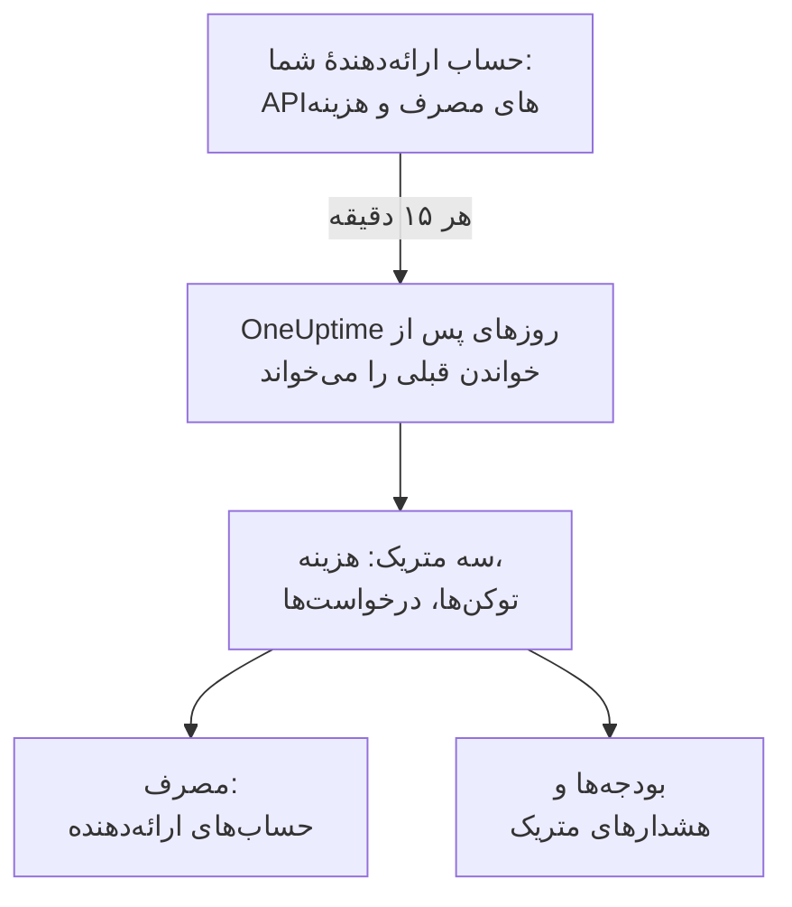

# حساب‌های ارائه‌دهنده هوش مصنوعی

ببینید حساب‌های ارائه‌دهندهٔ هوش مصنوعی شما چه مصرف کرده‌اند و هزینه‌شان چقدر بوده، بی‌آنکه چیزی در برنامه‌هایتان تغییر کند. یک حساب OpenAI، Anthropic، Azure OpenAI و Microsoft Foundry، Amazon Bedrock یا Google Vertex AI را با اعتبارنامه‌ای که فقط می‌تواند بخواند وصل کنید تا OneUptime هر ۱۵ دقیقه مصرف آن را در **مصرف**، **بودجه‌ها** و متریک‌هایی که می‌توانید رویشان هشدار بگذارید بخواند.

:::cards
- [وصل کردن یک حساب](#وصل-کردن-یک-حساب): ارائه‌دهنده را انتخاب کنید، اعتبارنامه را بچسبانید، آزمایش کنید و وصل کنید.
- [هر ارائه‌دهنده چه می‌دهد](#هر-ارائهدهنده-چه-میدهد): هزینه، توکن‌ها و درخواست‌ها، و اینکه هر ارائه‌دهنده آن‌ها را چگونه گروه‌بندی می‌کند.
- [دیدن مصرف](#دیدن-مصرف): بر پایهٔ مدل، شخص، پروژه یا منبع، کلید API و اتصال.
- [بودجه‌ها و هشدارها](#بودجهها-و-هشدارها): یک بودجهٔ روزانه روی صورت‌حساب، و هشدار روی متریک‌ها.
:::

## چگونه کار می‌کند

OneUptime هر ۱۵ دقیقه مصرف هر حساب وصل‌شده را به تفکیک روز UTC از آن می‌پرسد و آن را به‌صورت سه متریک در سرویس خود اتصال نگه می‌دارد. هر بار خواندن، روزهای پس از خواندن قبلی را برمی‌دارد و ۳ روز آخر را، با امروز، دوباره می‌خواند، چون ارائه‌دهندگان مدام به امروز اضافه می‌کنند و روزهای تازه گذشته را اصلاح می‌کنند.

مصرف یک حساب همان چیزی است که برایش صورت‌حساب شده، روز به روز. هیچ گفتگو، پرامپت یا پاسخی در آن نیست: برای آن‌ها، فراخوانی‌های هوش مصنوعی برنامه‌هایتان را بفرستید، همان‌طور که [مشاهده‌پذیری هوش مصنوعی / LLM](/docs/telemetry/ai-llm-observability) نشان می‌دهد. این دو جدا نگه داشته می‌شوند، پس هیچ‌چیز دو بار شمرده نمی‌شود.

## پیش از شروع

- نقش Project Owner یا Project Admin. فقط آن‌ها می‌توانند حسابی را وصل، تغییر یا حذف کنند؛ همهٔ کسانی که تله‌متری پروژه را می‌خوانند، اتصال‌ها و مصرف را می‌بینند.
- اعتبارنامه‌ای برای حساب، از کسی که آن را مدیریت می‌کند. بخش هر ارائه‌دهنده در ادامه می‌گوید کدام و کجا ساخته می‌شود.
- چیزی برای نصب نیست: OneUptime از سرورهای خودش API ارائه‌دهنده را فراخوانی می‌کند.

## وصل کردن یک حساب

:::steps
### صفحهٔ اتصال را باز کنید

**محصولات** > **هوش مصنوعی / LLM** > **اتصال** را باز کنید. در **حساب‌های ارائه‌دهنده هوش مصنوعی شما** روی کاشی ارائه‌دهنده کلیک کنید.

### اعتبارنامه را بچسبانید

در **اعتبارنامه‌ها** آنچه ارائه‌دهنده می‌خواهد را پر کنید. رازها رمزگذاری‌شده ذخیره می‌شوند و دیگر هرگز نشان داده نمی‌شوند، نه در داشبورد و نه از راه API. **نام** و تنظیم‌هایی که بیشتر افراد دست نمی‌زنند، در **فیلدهای بیشتر** هستند.

### آزمایش کنید

در **آزمایش** روی **آزمایش اتصال** کلیک کنید. OneUptime مصرف ۷ روز گذشته را می‌خواند و آنچه یافته را نشان می‌دهد: هزینه، توکن‌ها، درخواست‌ها، مدل‌ها، افراد، کلیدها و پروژه‌ها. تا وقتی وصل نکنید چیزی نگه داشته نمی‌شود.

### وصل کنید

روی **اتصال** کلیک کنید. نخستین خواندن ظرف یک دقیقه آغاز می‌شود و ۳۰ روز گذشته را می‌آورد.
:::

حساب‌های وصل‌شده زیر کاشی‌ها فهرست می‌شوند، با **وضعیت** و **آخرین خواندن**. **اکنون بخوان** همان لحظه می‌خواند، **آزمایش** تنظیم‌های ذخیره‌شده را دوباره بررسی می‌کند، **خاموش کردن** خواندن را متوقف می‌کند و خوانده‌ها را نگه می‌دارد، و **ویرایش** تنظیم‌ها را تغییر می‌دهد: رازی که خالی بماند، راز ذخیره‌شده را نگه می‌دارد. **View error** نشان می‌دهد چرا یک خواندن ناموفق بود، بدون هیچ رازی.

## هر ارائه‌دهنده چه می‌دهد

| ارائه‌دهنده | هزینه | گروه‌بندی بر پایهٔ | اعتبارنامه |
| --- | --- | --- | --- |
| OpenAI | آنچه OpenAI گزارش می‌دهد | پروژه، کلید API، شخص و مدل | یک کلید مدیر |
| Anthropic | آنچه Anthropic گزارش می‌دهد | فضای کاری، کلید API، شخص و مدل | یک کلید مدیر |
| Azure OpenAI و Microsoft Foundry | برآوردشده از توکن‌ها | منبع و مدل | یک برنامه با نقش Monitoring Reader |
| Amazon Bedrock | برآوردشده از توکن‌ها | منطقه و مدل | یک کلید دسترسی که CloudWatch را می‌خواند |
| Google Vertex AI | برآوردشده از توکن‌ها | منطقه و مدل | یک حساب سرویس با نقش Monitoring Viewer |

همهٔ ارائه‌دهندگان به‌جز Anthropic درخواست‌ها را هم می‌شمارند: گزارش مصرف Anthropic درخواستی ندارد. هزینهٔ برآوردشده از فهرست قیمت [هزینهٔ یک فراخوانی](/docs/telemetry/ai-llm-observability#هزینهٔ-یک-فراخوانی) و قیمت‌های خودتان در **قیمت‌گذاری** استفاده می‌کند و به‌عنوان برآورد علامت می‌خورد. مدلی که فهرست قیمت آن را نمی‌شناسد، تا وقتی آنجا برایش قیمت نگذارید هزینه‌ای ندارد.

هیچ‌یک از این اعتبارنامه‌ها نمی‌تواند مدلی را فراخوانی کند: هر کدام فقط مصرف، هزینه یا متریک‌ها را می‌خواند و نه چیز دیگری.

## OpenAI

OneUptime سازمان OpenAI شما را با یک کلید مدیر می‌خواند: مصرف completions و embeddings بر پایهٔ روز، مدل، پروژه، کلید API و شخص، و هزینه‌های هر روز بر پایهٔ پروژه و قلم هزینه. هر قلم هزینه میان کلیدها و افرادی که مدلش را به کار برده‌اند تقسیم می‌شود، پس ردیف هر شخص هم هزینه دارد. نام پروژه‌ها و کلیدها و ایمیل افراد جای شناسه‌های OpenAI را می‌گیرند.

:::steps
### یک کلید مدیر OpenAI بسازید

در داشبورد OpenAI، Settings، Organization، Admin keys را باز کنید و یک کلید بسازید. فقط مالکان سازمان می‌توانند. این کلید با `sk-admin-` آغاز می‌شود.

### OpenAI را وصل کنید

کلید را در **کلید مدیر** بچسبانید.
:::

## Anthropic

OneUptime سازمان Claude API شما را با یک کلید مدیر می‌خواند: گزارش مصرف پیام‌ها بر پایهٔ روز، مدل، فضای کاری، کلید API و شخص، و گزارش هزینه بر پایهٔ فضای کاری و قلم هزینه، که به همان شیوه تقسیم می‌شود. Claude Code که با کلیدهای سازمان یا ورودهای Console به کار رفته هم در این گزارش‌ها هست، زیر نام شخص یا کلیدی که آن را به کار برده.

:::steps
### یک کلید مدیر Anthropic بسازید

در Claude Console، Settings، Admin keys را باز کنید و یک کلید بسازید. فقط مدیران سازمان می‌توانند. این کلید با `sk-ant-admin01-` آغاز می‌شود.

### Anthropic را وصل کنید

کلید را در **کلید مدیر** بچسبانید.
:::

## Azure OpenAI و Microsoft Foundry

OneUptime هر منبع Azure OpenAI و Foundry یک اشتراک را از Azure Monitor می‌خواند: توکن‌ها و درخواست‌ها بر پایهٔ روز، منبع و مدل. Azure Monitor توکن می‌شمارد نه پول، و نه شخصی را نام می‌برد نه کلیدی را، پس هزینه برآورد OneUptime است و شخص و کلید خالی می‌مانند.

:::steps
### یک برنامه ثبت کنید

در Microsoft Entra ID یک برنامه ثبت کنید و برایش یک راز کلاینت بسازید.

### اجازهٔ خواندن متریک‌ها را بدهید

روی اشتراک، نقش Monitoring Reader را به برنامه بدهید.

### Azure را وصل کنید

**شناسه دایرکتوری (مستأجر)**، **شناسه برنامه (کلاینت)**، **شناسه اشتراک** و **راز کلاینت** را پر کنید. برای Azure Government، **ابر** را در **فیلدهای بیشتر** تغییر دهید.
:::

## Amazon Bedrock

OneUptime متریک‌های CloudWatch با نام `AWS/Bedrock` را در هر منطقه‌ای که نام ببرید می‌خواند: توکن‌های ورودی، خروجی و کش، و فراخوانی‌ها، بر پایهٔ روز و مدل. CloudWatch توکن می‌شمارد نه پول، و نه شخصی را نام می‌برد نه کلیدی را: هزینه برآورد OneUptime است و هر منطقه به‌عنوان یک پروژه فهرست می‌شود.

:::steps
### یک کلید دسترسی بسازید

یک کاربر یا نقش IAM بسازید که سیاستش `cloudwatch:GetMetricData` و `cloudwatch:ListMetrics` را مجاز کند، و برایش یک کلید دسترسی بسازید.

### Bedrock را وصل کنید

**شناسه کلید دسترسی**، **کلید دسترسی مخفی** و **مناطق** را پر کنید، با ویرگول از هم جدا: اگر تغییرش ندهید `us-east-1` است.
:::

## Google Vertex AI

OneUptime متریک‌های Cloud Monitoring را که Vertex AI برای مدل‌هایش منتشر می‌کند می‌خواند، Gemini و مدل‌های همکار مانند Claude: توکن‌های ورودی و خروجی و فراخوانی‌ها، بر پایهٔ روز، منطقه و مدل. Cloud Monitoring توکن می‌شمارد نه پول، و نه شخصی را نام می‌برد نه کلیدی را: هزینه برآورد OneUptime است.

:::steps
### یک حساب سرویس بسازید

در پروژه، یک حساب سرویس با نقش Monitoring Viewer بسازید و برایش یک کلید JSON بسازید.

### Vertex AI را وصل کنید

**شناسه پروژه** را پر کنید و کل فایل کلید را در **کلید حساب سرویس (JSON)** بچسبانید.
:::

## دیدن مصرف

**مصرف** را باز کنید و **حساب‌های ارائه‌دهنده** را برگزینید. هزینه، توکن‌ها و درخواست‌هایی که حساب‌هایتان برای بازهٔ زمانی گزارش داده‌اند را نشان می‌دهد، رتبه‌بندی‌شده بر پایهٔ **مدل**، **شخص**، **ارائه‌دهنده**، **پروژه یا منبع**، **کلید API** یا **اتصال**. بازه از نیمه‌شب UTC روز نخستش آغاز می‌شود، چون ارائه‌دهندگان روزهای کامل را گزارش می‌دهند.

**حساب‌های ارائه‌دهنده** و **فراخوانی‌های هوش مصنوعی شما** هرگز با هم جمع نمی‌شوند. فراخوانی‌ای که برنامهٔ شما با کلید یک حساب وصل‌شده انجام می‌دهد در هر دو هست، پس جمع کردنشان آن را دو بار می‌شمارد.

## بودجه‌ها و هشدارها

یک بودجه یا این را می‌شمارد یا آن را. در **بودجه‌ها** یک بودجه بسازید و **شمارش هزینه از** را روی **حساب‌های ارائه‌دهنده** بگذارید: آنچه برای روز UTC از حساب‌های وصل‌شده صورت‌حساب شده را می‌شمارد، محدود به **ارائه‌دهنده LLM (اختیاری)** و **مدل LLM (اختیاری)** وقتی آن‌ها را تنظیم کنید. ارائه‌دهندگان مصرف یک روز را چند دقیقه تا چند ساعت بعد گزارش می‌دهند، پس برای هشدار در عرض چند دقیقه، به‌جای آن برای **فراخوانی‌های هوش مصنوعی شما** بودجه بگذارید.

مصرف هر حساب به‌صورت سه متریک نگه داشته می‌شود که می‌توانید روی یک [داشبورد](/docs/dashboards/index) نشانشان دهید یا با یک [مانیتور متریک‌ها](/docs/monitor/metrics-monitor) رویشان هشدار بگذارید:

| متریک | چیست |
| --- | --- |
| `oneuptime.llm.provider.cost` | هزینهٔ یک روز، به USD |
| `oneuptime.llm.provider.tokens` | توکن‌های یک روز، بر پایهٔ `gen_ai.token.type`: `input` (با توکن‌های کش‌شده)، `output`، `cache_read` و `cache_write` |
| `oneuptime.llm.provider.requests` | درخواست‌های یک روز |

هر نقطه با آغاز روز UTC خودش زمان‌گذاری می‌شود. `oneuptime.llm.connection.id` و `oneuptime.llm.connection.name` را دارد، و آنچه ارائه‌دهنده نام می‌برد: `gen_ai.provider.name`، `gen_ai.request.model`، `user.email`، `oneuptime.llm.provider.project` و `oneuptime.llm.provider.api_key`. هزینهٔ برآوردشده `oneuptime.llm.cost.estimated` را دارد.

## خواندن‌ها چه زمانی انجام می‌شوند

| خواندن | چه زمانی |
| --- | --- |
| نخستین | ظرف یک دقیقه پس از اتصال، تا ۳۰ روز عقب |
| بعدی‌ها | هر ۱۵ دقیقه |
| پس از رد شدن یک کلید یا مجوز | ۶۰ دقیقه بعد |
| پس از هر خطای دیگر | ۱۵ دقیقه بعد |
| خاموش‌شده | هیچ، تا وقتی دوباره روشن شود |

طرحی که امکانات تله‌متری ندارد چیزی نمی‌خواند. حذف یک اتصال خواندن‌هایش را متوقف می‌کند و آنچه خوانده را تا وقتی نگهداری سرویس آن را پاک کند نگه می‌دارد.

## چرا OneUptime دروازهٔ خودش را ندارد

OneUptime حساب‌های شما را می‌خواند؛ هرگز میان برنامه‌هایتان و ارائه‌دهندگان قرار نمی‌گیرد. یک پراکسی کلیدهای ارائه‌دهندهٔ شما را نگه می‌داشت و به هر فراخوانی مدل برنامه‌هایتان یک گام اضافه می‌کرد. اگر ترافیک مدل شما از پیش از LiteLLM، Portkey یا OpenRouter می‌گذرد، ترِیس‌های دروازه را همان‌طور که [دروازه‌های هوش مصنوعی](/docs/telemetry/ai-gateways) نشان می‌دهد به OneUptime بفرستید و حساب را برای صورت‌حسابش وصل کنید.

## رفع اشکال

:::details آزمایش می‌گوید کلید یا راز پذیرفته نشد
بررسی کنید که همه‌اش را کپی کرده‌اید، باطل نشده و از همان نوعی است که این ارائه‌دهنده می‌خواهد: کلید مدیر OpenAI یا Anthropic، نه کلید پروژه یا API.
:::

:::details اعتبارنامه کار می‌کند، اما نمی‌تواند آنچه اتصال لازم دارد را بخواند
نقشی را که این صفحه برای ارائه‌دهنده نام می‌برد به آن بدهید: Monitoring Reader روی اشتراک Azure، دو اقدام CloudWatch در AWS، و Monitoring Viewer روی پروژهٔ Google Cloud.
:::

:::details آزمایش موفق است، اما برای امروز چیزی نمایش داده نمی‌شود
ارائه‌دهندگان مصرف یک روز را چند دقیقه تا چند ساعت بعد گزارش می‌دهند و یکی دو روز اصلاحش می‌کنند. خواندن‌های بعدی آن را می‌آورند.
:::

:::details هزینه با صورت‌حساب فرق دارد
هزینهٔ گزارش‌شده عدد ارائه‌دهنده پیش از مالیات، اعتبارها و تخفیف‌هاست. هزینهٔ برآوردشده توکن‌ها به قیمت فهرست است، یا به قیمت‌های خودتان در **قیمت‌گذاری**.
:::

## گام‌های بعدی

:::cards
- [مشاهده‌پذیری هوش مصنوعی / LLM](/docs/telemetry/ai-llm-observability): گفتگوها، هشدارها و هزینهٔ فراخوانی‌های هوش مصنوعی برنامه‌های خودتان.
- [ابزارهای هوش مصنوعی شرکت](/docs/telemetry/ai-company-tools): آنچه افراد شما از Claude Enterprise و Microsoft 365 Copilot می‌پرسند.
- [دروازه‌های هوش مصنوعی](/docs/telemetry/ai-gateways): هر فراخوانی مدل را از راه LiteLLM، Portkey یا OpenRouter ردیابی کنید.
- [مانیتور متریک‌ها](/docs/monitor/metrics-monitor): روی متریک‌های ارائه‌دهندگان هشدار بگذارید.
:::
