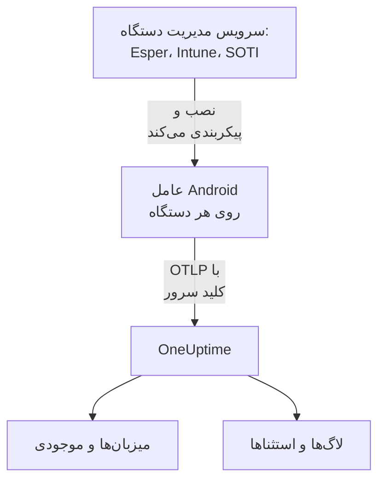

# عامل Android

عامل Android در OneUptime دستگاه Android متعلق به سازمان شما را، مانند کیوسک سفارش، پایانه POS، دستگاه دستی یا پخش‌کننده تابلوی دیجیتال، به OneUptime گزارش می‌دهد: حافظه، فضای ذخیره‌سازی، شبکه، باتری و دمای آن، راه‌اندازی‌های دوباره‌اش، برنامه‌های نصب‌شده روی آن، و کرش‌ها و لاگ‌های برنامه‌های روی آن. سرویس مدیریت دستگاه شما آن را یک‌جا روی کل ناوگان نصب و پیکربندی می‌کند. هر دستگاه، کنار سرورها و ماشین‌های Windows شما، یک میزبان در **میزبان‌ها** و یک آیتم در **موجودی** می‌شود.

:::cards
- [چه زمانی از آن استفاده کنید](#عامل-یا-ابزارگذاری-برنامه): عامل دستگاه را می‌بیند و ابزارگذاری برنامه، برنامه شما را.
- [استقرار با Esper](#استقرار-با-esper): APK را بارگذاری کنید، تنظیماتش را بفرستید و یک بار اجرایش کنید.
- [تنظیمات](#تنظیمات): همه کلیدهای پیکربندی مدیریت‌شده آن.
- [خواندن لاگ‌های برنامه‌های دیگر](#خواندن-لاگهای-برنامههای-دیگر): READ_LOGS را یک بار با adb یا سرویس مدیریت دستگاه خود اعطا کنید.
- [نشست‌های لاگ](#نشستهای-لاگ): لاگ‌های همه برنامه‌ها برای مدتی، با اجازه کسی که پای دستگاه است.
:::

## چگونه کار می‌کند

عامل برنامه کوچکی است که به‌صورت یک سرویس پیش‌زمینه اجرا می‌شود. هر دقیقه سلامت دستگاه را می‌خواند و آن را، همراه با راه‌اندازی‌های دوباره، برنامه‌های نصب‌شده و لاگ‌های دستگاه، با کلید دریافت داده **سرور** از راه OTLP به OneUptime شما می‌فرستد. وقتی دستگاه روشن می‌شود خودبه‌خود به کار می‌افتد، تا وقتی شبکه قطع است آنچه را گردآوری می‌کند روی دستگاه نگه می‌دارد، و همین که شبکه برگشت آن را می‌فرستد. هرگز مانع به خواب رفتن دستگاه نمی‌شود و آنچه را می‌فرستد فشرده می‌کند.



## عامل یا ابزارگذاری برنامه

| | [OpenTelemetry Android](/docs/rum/android-setup) در برنامه شما | عامل Android |
| --- | --- | --- |
| چه چیزی را می‌بیند | برنامه شما: کرش‌ها، ANRها، صفحه‌ها، نشست‌ها، درخواست‌ها و گردش‌کارهایش | دستگاه: حافظه، فضای ذخیره‌سازی، شبکه، باتری، راه‌اندازی‌های دوباره، برنامه‌های نصب‌شده، و کرش‌ها و ANRهای همه برنامه‌ها |
| کجا دیده می‌شود | **پایش کاربر واقعی**، **ترِیس‌ها** و **استثناها** | **میزبان‌ها**، **موجودی**، **لاگ‌ها** و **استثناها** |
| چگونه نصبش می‌کنید | در کد برنامه‌تان | به‌صورت یک برنامه، از راه سرویس مدیریت دستگاه شما |

روی دستگاه‌هایی که مال خودتان است، از هر دو استفاده کنید و در هر دو نامی یکسان به دستگاه بدهید: در تنظیم `device_name` عامل و در `host.name` که برنامه‌تان تنظیم می‌کند. آن‌وقت دستگاه یک آیتم در **موجودی** است که تله‌متری برنامه و تله‌متری دستگاه را با هم دارد.

## پیش از شروع

- دستگاه‌هایی با Android 7.0 یا جدیدتر، که یک سرویس مدیریت دستگاه با پشتیبانی از پیکربندی‌های مدیریت‌شده Android آن‌ها را مدیریت می‌کند: Esper، Microsoft Intune، Workspace ONE، SOTI و دیگر سرویس‌های مدیریت دستگاه Android Enterprise. برای یک دستگاه تنها، adb کافی است.
- یک کلید دریافت داده **سرور** که در **تنظیمات پروژه** > **تله‌متری و APM** > **کلیدهای دریافت داده** با **ساخت کلید دریافت داده** ساخته شده باشد.
- خود عامل: `oneuptime-android-agent.apk`، که به هر [انتشار OneUptime](https://github.com/OneUptime/oneuptime/releases/latest) پیوست شده است.
- HTTPS خروجی از دستگاه‌ها به نشانی OneUptime شما. عامل نشانی‌ای را که `https://` نباشد نمی‌پذیرد، چون هر درخواست کلید دریافت داده را با خود دارد.

## استقرار با Esper

:::steps
### APK را بارگذاری کنید

در کنسول Esper، `oneuptime-android-agent.apk` را در **App Library** بارگذاری کنید و آن را به blueprint دستگاه‌هایی که می‌خواهید پایش کنید بیفزایید.

### تنظیماتش را بفرستید

در blueprint، **Managed Configuration** عامل را باز کنید و تنظیماتش را بچسبانید. Esper جای‌نگهدارها را روی هر دستگاه پر می‌کند، با Esper Agent 8.00.0764 یا جدیدتر:

```json title="Managed configuration"
{
  "oneuptime_url": "https://oneuptime.com",
  "oneuptime_token": "YOUR_TELEMETRY_INGESTION_TOKEN",
  "device_name": "${esper.deviceName}",
  "device_serial": "${esper.serialNumber}",
  "device_type": "kiosk",
  "labels": "region=emea"
}
```

اگر OneUptime را خودتان میزبانی می‌کنید، نشانی خودتان را در `oneuptime_url` بگذارید. سپس دستگاه‌ها را Converge کنید تا تنظیمات تازه را بخوانند.

### یک بار اجرایش کنید

Android برنامه‌ای را که تازه نصب شده است، تا یک بار باز نشود، هنگام روشن شدن دستگاه اجرا نمی‌کند. **Launch on Start** را برای عامل در blueprint، در حالت چندبرنامه‌ای (Multi-App mode)، روشن کنید، یا عامل را یک بار روی هر دستگاه باز کنید. از آن پس هر بار که دستگاه روشن شود، و پس از هر به‌روزرسانی، خودبه‌خود اجرا می‌شود.

### دستگاه‌ها را در OneUptime پیدا کنید

ظرف یک دقیقه هر دستگاه با نام `device_name` خود زیر **میزبان‌ها** و نیز در **موجودی** پدیدار می‌شود. صفحه خود عامل روی دستگاه می‌گوید که آیا گزارش می‌دهد یا نه، و اگر نه، چه چیزی جلویش را گرفته است.
:::

دیگر سرویس‌های مدیریت دستگاه هم به همین شکل کار می‌کنند: APK را به‌عنوان برنامه سازمانی (line-of-business) یا برنامه داخلی بیفزایید، همین کلیدها را در پیکربندی برنامه آن تنظیم کنید، و آن را یک بار روی هر دستگاه باز کنید.

## تنظیمات

عامل این کلیدها را از پیکربندی مدیریت‌شده‌اش می‌خواند. دستگاهی را که چنین پیکربندی‌ای ندارد می‌توان به‌جای آن در صفحه خود عامل پیکربندی کرد، با نشانی، کلید دریافت داده و نام دستگاه. کلیدی که آنجا وارد شود به‌صورت رمزنگاری‌شده با Android Keystore ذخیره می‌شود.

| کلید | چه چیزی را تنظیم می‌کند | پیش‌فرض |
| --- | --- | --- |
| `oneuptime_url` | نشانی OneUptime شما | `https://oneuptime.com` |
| `oneuptime_token` | یک کلید دریافت داده **سرور** | ندارد: عامل بدون آن چیزی نمی‌فرستد |
| `device_name` | نام دستگاه در **میزبان‌ها** و **موجودی**، که هویت آن در آنجاست | مدل دستگاه و ابتدای Android ID آن |
| `device_serial` | شماره سریال دستگاه، که Android از Android 10 به بعد آن را در اختیار برنامه‌ها نمی‌گذارد | ندارد |
| `device_type` | اینکه چه دستگاهی است، مانند کیوسک، پایانه POS یا دستگاه دستی | `Android device` |
| `device_location` | جایی که دستگاه قرار دارد، مانند شماره یک فروشگاه | ندارد |
| `labels` | برچسب‌های میزبان، به‌صورت جفت‌های `name=value` که با ویرگول از هم جدا شده‌اند | ندارد |
| `collection_interval_seconds` | هر چند وقت یک بار گزارش می‌دهد، از ۳۰ تا ۶۰۰ ثانیه | `60` |
| `logcat_enabled` | اینکه آنچه را از Logcat می‌خواند بفرستد یا نه | `true` |
| `logcat_min_level` | کمترین سطح شدت خطوط Logcat که روی Android 12 و قدیمی‌تر فرستاده می‌شوند: `verbose`، `debug`، `info`، `warn`، `error` یا `fatal` | `warn` |
| `installed_apps_enabled` | اینکه برنامه‌های نصب‌شده را بفرستد یا نه | `true` |

جای‌نگهداری که سرویس مدیریت دستگاه شما پر نکرده باشد، مانند `${esper.deviceName}` که همان‌طور که هست فرستاده شده، نادیده گرفته می‌شود و صفحه عامل این را اعلام می‌کند. وقتی دستگاهی گزارش داد، `device_name` آن را ثابت نگه دارید: نام تازه یعنی میزبان تازه.

صفحه عامل، اعلان‌هایش، و عنوان‌ها و توضیح‌هایی که سرویس مدیریت دستگاه شما برای این کلیدها نشان می‌دهد به زبان دستگاه هستند، در هر زبانی که داشبورد OneUptime به آن سخن می‌گوید.

## خواندن لاگ‌های برنامه‌های دیگر

Android فقط با مجوز READ_LOGS به یک برنامه اجازه می‌دهد لاگ‌های برنامه‌های دیگر را بخواند، و فقط adb می‌تواند این مجوز را اعطا کند: نه خود برنامه، و نه یک سیاست دستگاه. آن را یک بار روی هر دستگاه اعطا کنید تا پس از راه‌اندازی‌های دوباره و به‌روزرسانی‌ها هم برقرار بماند:

```bash
adb shell pm grant com.oneuptime.androidagent android.permission.READ_LOGS
```

در Esper، این فرمان را از راه **Secure Remote ADB** اجرا کنید: دسترسی ADB را برای دستگاه روشن کنید، با `espercli secureadb connect --device DEVICE_ID` وصل شوید و سپس فرمان را اجرا کنید. وقتی مجوز اعطا شود، Android عامل را دوباره راه‌اندازی می‌کند و عامل بی‌درنگ شروع به خواندن می‌کند. ستون **شناسه در سرویس مدیریت دستگاه** در موجودی، `DEVICE_ID` هر دستگاه را نگه می‌دارد.

آنچه عامل پس از آن می‌خواند به نسخه Android بستگی دارد:

- Android 13 و جدیدتر: کرش‌ها و ANRهای همه برنامه‌ها. Android خطوط لاگ برنامه‌های دیگر را فقط به برنامه‌ای نشان می‌دهد که روی صفحه است، آن هم پس از اینکه کسی که پای دستگاه است اجازه دهد، پس عاملی که در پس‌زمینه اجرا می‌شود نمی‌تواند آن‌ها را بخواند. آن‌ها را برای مدتی با یک [نشست لاگ](#نشستهای-لاگ) درخواست کنید.
- Android 12 و قدیمی‌تر: کرش‌ها و ANRهای همه برنامه‌ها، و خطوط لاگ همه برنامه‌ها در سطح `logcat_min_level` و بالاتر.

بدون READ_LOGS، عامل همه چیزهای دیگر را گزارش می‌دهد، و صفحه آن و لاگ‌های دستگاه می‌گویند که این مجوز را چگونه اعطا کنید.

### پشته‌های کرش و دلیل‌های راه‌اندازی دوباره

Android گزارش کامل هر کرش برنامه، کرش کد بومی و ANR، و دلیل هر راه‌اندازی دوباره را در DropBox خود نگه می‌دارد. عامل وقتی READ_LOGS و دسترسی به داده‌های مصرف را داشته باشد، و روی Android 15 و جدیدتر READ_DROPBOX_DATA را هم، آن‌ها را برای همه برنامه‌ها می‌خواند. این‌ها را هم مانند READ_LOGS یک بار با adb اعطا کنید:

```bash
adb shell pm grant com.oneuptime.androidagent android.permission.READ_DROPBOX_DATA
adb shell appops set com.oneuptime.androidagent GET_USAGE_STATS allow
```

فرمان نخست برای Android 15 و جدیدتر است؛ دسترسی به داده‌های مصرف را در **تنظیمات ← دسترسی به داده‌های مصرف** دستگاه هم می‌توان روشن کرد. یک سیاست دستگاه نمی‌تواند این‌ها را اعطا کند، و صفحه عامل فرمان‌هایی را که هنوز باید اجرا شوند فهرست می‌کند. با آن‌ها، هر کرش در **استثناها** ردیابی پشته کامل خود را دارد، یک کرش کد بومی سیگنال خود و کتابخانه‌ای را که در آن کرش کرده است، یک ANR پشته رشته اصلی‌اش را، و یک راه‌اندازی دوباره در **لاگ‌ها** دلیلی را که Android برایش می‌آورد. شماره کارت‌ها، نشانی‌های ایمیل، توکن‌ها و گذرواژه‌ها در آنچه عامل می‌خواند، پیش از ارسال با `[card number]`، `[email]`، `[token]` و `[redacted]` جایگزین می‌شوند.

### اعطای این مجوزها در کل ناوگان

هر گزارش عامل می‌گوید کدام‌یک از این مجوزها هنوز به آن اعطا نشده است. برای فهرست کردن دستگاه‌هایی که به آن‌ها نیاز دارند، **موجودی** را باز کنید، سپس **همه موارد** را، و فیلتر **دسترسی‌های عامل** را روی **مفقود** بگذارید. ستون **دسترسی‌های عامل** را روشن کنید تا ببینید هر دستگاه چه چیزی کم دارد، و از فهرست خروجی CSV بگیرید. ستون **شناسه در سرویس مدیریت دستگاه** را هم روشن کنید تا خروجی، شناسه Esper هر دستگاه را داشته باشد، یعنی همان `DEVICE_ID` که `espercli secureadb connect --device` می‌گیرد.

یک سیاست دستگاه نمی‌تواند این‌ها را اعطا کند: READ_LOGS و READ_DROPBOX_DATA مجوزهایی هستند که فقط adb، خود سیستم یا سازنده دستگاه می‌تواند بدهد، و دسترسی به داده‌های مصرف را adb یا کسی که پای دستگاه است تنظیم می‌کند. آنچه Esper ارائه می‌دهد، و اینکه چرا هیچ‌کدام از آن‌ها این مجوزها را اعطا نمی‌کند:

- **مجوزهای برنامه**، در یک blueprint یا با فرمان `SET_APP_PERMISSION`، از API مالک دستگاه در Android می‌گذرند، که فقط مجوزهایی را اعطا می‌کند که یک برنامه از کسی که پای دستگاه است درخواست می‌کند. Android این مجوزها را رد می‌کند.
- **پیکربندی مدیریت‌شده** تنظیمات خود عامل را تعیین می‌کند، و هرگز مجوزهای Android را.
- **Run Shell Script** روی دستگاه‌های Linux و Windows اجرا می‌شود، نه روی دستگاه‌های Android.
- **Secure Remote ADB** هر بار فقط به یک دستگاه می‌رسد، از رایانه‌ای که `espercli` را اجرا می‌کند. روی دستگاه‌های Esper Foundation به حضور کسی پای دستگاه نیازی ندارد. روی دستگاه‌های دیگر، بار نخست کسی که پای دستگاه است **Allow USB debugging?** را می‌پذیرد.

پس آن‌ها را با adb اعطا کنید:

- **پیش از ارسال دستگاه**، وقتی با کابل USB آماده‌سازی می‌شود. این کار هر سه را روی همه دستگاه‌هایی که به رایانه وصل‌اند اعطا می‌کند:

  ```bash
  for serial in $(adb devices | awk 'NR > 1 && $2 == "device" { print $1 }'); do
    adb -s "$serial" shell pm grant com.oneuptime.androidagent android.permission.READ_LOGS
    adb -s "$serial" shell pm grant com.oneuptime.androidagent android.permission.READ_DROPBOX_DATA
    adb -s "$serial" shell appops set com.oneuptime.androidagent GET_USAGE_STATS allow
  done
  ```

  روی Android 14 و قدیمی‌تر، فرمان دوم می‌گوید این مجوز ناشناخته است: آن دستگاه به آن نیازی ندارد.
- **روی دستگاهی که مستقر شده است**، از راه Secure Remote ADB، هر بار یک دستگاه از فهرست **مفقود**.
- **تنها دسترسی به داده‌های مصرف** را کسی که پای دستگاه است می‌تواند خودش روشن کند، در **تنظیمات ← دسترسی به داده‌های مصرف**، یا با دکمه روی صفحه عامل.

گزارش بعدی دستگاه، ظرف یک دقیقه، آن را از فهرست **مفقود** بیرون می‌برد.

### مصرف CPU

Android 8 و جدیدتر مصرف CPU دستگاه را از برنامه‌ها پنهان می‌کنند. فقط برنامه‌ای که مالک دستگاه (device owner) است می‌تواند آن را بخواند، آن هم فقط روی دستگاه‌هایی که سخت‌افزارشان آن را گزارش می‌دهد. عامل وقتی مالک دستگاه باشد آن را می‌خواند، و این را با adb روی دستگاهی تنظیم می‌کنید که هیچ حسابی و هیچ مالک دستگاه دیگری ندارد:

```bash
adb shell dpm set-device-owner com.oneuptime.androidagent/.admin.AgentDeviceAdminReceiver
```

دستگاهی که سرویس مدیریت دستگاه شما از پیش مالک آن است نمی‌تواند مالک دومی داشته باشد، پس مصرف CPU آن در دسترس نیست و صفحه عامل این را اعلام می‌کند. آن‌وقت مصرف CPU آن در فهرست میزبان‌ها نشان داده نمی‌شود و الگوی **High CPU Utilization** برای آن پیشنهاد نمی‌شود.

## نشست‌های لاگ

یک نشست لاگ، لاگ‌های همه برنامه‌های یک دستگاه را برای مدتی می‌فرستد تا اشکال آن را رفع کنید. روی Android 13 و جدیدتر این تنها راه خواندن خطوط لاگ برنامه‌های دیگر است، چون Android آن‌ها را فقط به برنامه‌ای نشان می‌دهد که روی صفحه است، آن هم پس از اینکه کسی که پای دستگاه است اجازه دهد.

:::steps
### یک نشست درخواست کنید

دستگاه را در **میزبان‌ها** باز کنید، سپس **لاگ‌ها** را، و در **نشست‌های لاگ** روی **درخواست نشست لاگ** کلیک کنید. انتخاب کنید دستگاه چه مدت لاگ‌هایش را بفرستد، از ۱۵ دقیقه تا ۴ ساعت، و پایین‌ترین سطحی که می‌فرستد: **اطلاعات**، **اشکال‌زدایی** یا **پرجزئیات**. یک **یادداشت** بیفزایید تا بگویید چرا درخواست می‌کنید، مانند «بررسی اینکه چرا برنامه پرداخت بعد از ساعت ۶ عصر کرش می‌کند».

### پای دستگاه اجازه دهید

ظرف یک دقیقه، دستگاه اعلانی نشان می‌دهد که کسی لاگ‌هایش را درخواست کرده است، همراه با نام او و یادداشت شما. کسی که پای دستگاه است عامل را باز می‌کند، که درخواست را همراه با یادداشت شما در زیر آن نشان می‌دهد، و روی **اجازه دادن** می‌زند. روی Android 13 و جدیدتر، Android سپس می‌پرسد که آیا اجازه دسترسی به همه گزارش‌های دستگاه را می‌دهد، و او این را هم اجازه می‌دهد.

### خطوط را بخوانید

نشست **در حال جمع‌آوری** خوانده می‌شود و خطوط همه برنامه‌ها به لاگ‌های دستگاه می‌رسند. روی **نمایش خط‌ها** کلیک کنید تا خطوط همین نشست را جداگانه ببینید، یا روی **بارگیری خط‌ها** تا آن‌ها را به‌صورت یک فایل ذخیره کنید. نشست وقتی زمانش تمام شود پایان می‌یابد، یا وقتی کسی آن را روی دستگاه متوقف کند یا در OneUptime لغو کند.
:::

یادداشت یک خط است با حداکثر ۲۰۰ نویسه. تا وقتی نشست در انتظار است یا اجرا می‌شود، دستگاه آن را همان‌طور که نوشته‌اید، داخل گیومه، در اعلان و روی صفحه عامل نشان می‌دهد؛ یادداشت هرگز ترجمه نمی‌شود. شکست‌های خط به فاصله تبدیل می‌شوند، و شماره کارت‌ها، نشانی‌های ایمیل، توکن‌ها و گذرواژه‌های درون آن پیش از نگه‌داری با `[card number]`، `[email]`، `[token]` و `[redacted]` جایگزین می‌شوند، همان‌طور که در آنچه عامل می‌فرستد. فهرست نشست‌ها آن را زیر نام درخواست‌کننده نشان می‌دهد، و **گزارش‌های ممیزی** میزبان آن را همراه با درخواست نگه می‌دارند.

**بارگیری خط‌ها** خطوط نشست را در یک فایل متنی ذخیره می‌کند، در همان قالبی که `logcat -v threadtime` چاپ می‌کند و پشتیبانی یک فروشنده می‌تواند آن را بخواند: هر خط با زمانش تا میلی‌ثانیه، فرایند و رشته‌اش، سطحش، برچسبش و پیامش. زمان‌ها به وقت UTC هستند. نخستین خطوط فایل می‌گویند فایل مربوط به کدام نشست، دستگاه و یادداشت است، و چه کسی آن را درخواست کرده است. فایل همان خطوطی را دارد که **لاگ‌ها** نشان می‌دهد، با همان جایگزینی‌هایی که عامل انجام داده است، پس به همان مجوزی نیاز دارد که خواندن لاگ‌های دستگاه. یک فایل حداکثر ۱۰۰٬۰۰۰ خط و ۳۲ MB را در خود جا می‌دهد؛ فایل نشستی طولانی‌تر در پایان می‌گوید که نشست چند خط دارد.

یک نشست به READ_LOGS و `logcat_enabled` نیاز دارد؛ بدون آن‌ها نشست **در دسترس نیست** خوانده می‌شود. روی هر دستگاه در هر زمان فقط یک نشست اجرا می‌شود. درخواستی که ظرف یک ساعت کسی اجازه‌اش را ندهد منقضی می‌شود، و نشستی که دستگاه در میانه آن دوباره راه‌اندازی شود همراه با آن پایان می‌یابد، چون مجوز Android با فرایند عامل پایان می‌یابد. درخواست یک نشست به مجوز ویرایش میزبان نیاز دارد، و **گزارش‌های ممیزی** میزبان نگه می‌دارند چه کسی و چه زمانی آن را درخواست کرده است.

## چه چیزهایی گزارش می‌دهد

| چه چیزی | کجای OneUptime دیده می‌شود |
| --- | --- |
| حافظه، فضای ذخیره‌سازی، شبکه و مدت روشن بودن | صفحه دستگاه در **میزبان‌ها**: همان متریک‌هایی که کالکتور یک سرور می‌فرستد، پس الگوهای هشدار میزبان کار می‌کنند |
| شارژ و دمای باتری، و اینکه دستگاه به برق خارجی وصل است یا نه | متریک‌های `hw.battery.charge`، `hw.temperature` و `android.battery.plugged` |
| وضعیت حرارتی | متریک‌های `android.thermal.status` و `android.thermal.headroom` |
| مصرف CPU | متریک `system.cpu.utilization`: روی Android 7، و روی Android 8 و جدیدتر وقتی عامل [مالک دستگاه](#مصرف-cpu) باشد |
| راه‌اندازی‌های دوباره | **لاگ‌ها**، با `@event.name:device.boot`: دستگاه چه مدت روشن بوده، آیا درست خاموش شده، چه مدت خاموش بوده، چرا دوباره راه‌اندازی شده، و چرخه‌های راه‌اندازی دوباره |
| برنامه‌های نصب‌شده | **لاگ‌ها**، با `@event.name:android.package.inventory`، روزی یک بار، و هر نصب، به‌روزرسانی و حذف |
| کرش‌ها و ANRهای همه برنامه‌ها | **استثناها**، به‌عنوان مدیریت‌نشده، به نام برنامه، همراه با پشته‌هایشان وقتی عامل [DropBox](#پشتههای-کرش-و-دلیلهای-راهاندازی-دوباره) را می‌خواند |
| سازنده، مدل، شماره سریال، نسخه سیستم‌عامل، سطح وصله امنیتی و میان‌افزار | آیتم دستگاه در **موجودی**، با فیلتر و ستون **سطح وصله امنیتی** |
| سطح وصله امنیتی‌اش چقدر قدیمی است | متریک `android.os.security_patch.age`، بر حسب روز |
| مجوزهایی که عامل هنوز ندارد | آیتم دستگاه در **موجودی**، با فیلتر و ستون **دسترسی‌های عامل** |

در **میزبان‌ها**، سیستم‌عامل دستگاه Android خوانده می‌شود، همراه با نماد Android.

یک دستگاه وقتی از وصله‌های امنیتی‌اش عقب است که سطح وصله امنیتی آن بیش از ۹۰ روز قدمت داشته باشد. Google هر ماه یک بولتن امنیتی Android منتشر می‌کند، و Android Enterprise Recommended سازنده دستگاه را موظف می‌کند هر کدام را ظرف ۹۰ روز عرضه کند، پس دستگاهی که بیش از این عقب باشد اصلاحاتی را ندارد که سازنده‌اش باید عرضه می‌کرد. در **موجودی**، فیلتر **سطح وصله امنیتی** دستگاه‌های **قدیمی** را فهرست می‌کند؛ الگوی **Security Patch Out of Date** برای هر یک از آن‌ها هشدار می‌دهد. اگر یک سرویس مدیریت دستگاه، دستگاه Android را وارد کند و عامل روی آن اجرا نشود، الگوی خودِ اتصالش، مانند **Esper Security Patch Out of Date**، از روی سطح وصله‌ای که سرویس مدیریت دستگاه گزارش می‌دهد هشدار می‌دهد؛ دستگاهی که عامل روی آن اجرا می‌شود به همین الگو سپرده می‌شود تا هرگز دو بار هشدار ندهد.

شمار دفعات روشن شدن دستگاه در یک ساعت گذشته متریک `android.boot.recent_count` است، و دستگاهی که پیوسته دوباره راه‌اندازی می‌شود، در هر بار روشن شدن لاگی با سطح هشدار ثبت می‌کند. در **میزبان‌ها** به یک دستگاه Android الگوهای هشدار مخصوص خودش پیشنهاد می‌شود: Device Unplugged، Low Battery، Device Overheating، Restart Loop، Storage Nearly Full و Security Patch Out of Date، همراه با Host Stopped Reporting، Host Restarted و High Memory Utilization، و High CPU Utilization وقتی مصرف CPU را گزارش دهد. نخستین فرمان‌های اشکال‌زدایی هر هشدار، فرمان‌های adb هستند. [مانیتور میزبان](/docs/monitor/host-monitor#دستگاههای-android) را ببینید.

## رفع اشکال

:::details دستگاهی در میزبان‌ها پدیدار نمی‌شود
عامل را روی دستگاه باز کنید: صفحه‌اش می‌گوید چه چیزی کم است، مانند کلید دریافت داده، نشانی‌ای که نمی‌تواند به کار ببرد، یا ارسالی که ناموفق بوده و دلیل آن. روی دستگاهی که عامل پس از نصب هرگز باز نشده، عامل اجرا نشده است: یک بار بازش کنید، یا **Launch on Start** را روشن کنید.
:::

:::details عامل می‌گوید OneUptime کلید دریافت داده را رد کرده است
از یک کلید **سرور** استفاده کنید که روشن باشد و منقضی نشده باشد. کلید **مرورگر** از دستگاه رد می‌شود.
:::

:::details هیچ لاگی از برنامه‌های دیگر نمی‌رسد
READ_LOGS را همان‌طور که [خواندن لاگ‌های برنامه‌های دیگر](#خواندن-لاگهای-برنامههای-دیگر) می‌گوید اعطا کنید. روی Android 13 و جدیدتر فقط کرش‌ها و ANRهای برنامه‌های دیگر خوانده می‌شوند، مگر اینکه یک [نشست لاگ](#نشستهای-لاگ) در حال اجرا باشد.
:::

:::details یک نشست لاگ روی «در انتظار تأیید» می‌ماند
هنوز کسی پای دستگاه اجازه‌اش را نداده است. کسی باید عامل را روی دستگاه باز کند و روی **اجازه دادن** بزند، و روی Android 13 و جدیدتر، تا وقتی عامل روی صفحه است، در پنجره Android هم اجازه دهد. نشستی که در پنجره Android رد شده باشد **ردشده** خوانده می‌شود: نشست دیگری درخواست کنید.
:::

:::details دو دستگاه به‌صورت یک میزبان دیده می‌شوند
`device_name` آن‌ها یکسان است. جای‌نگهداری به کار ببرید که از دستگاهی به دستگاه دیگر فرق کند، مانند `${esper.deviceName}` یا `${esper.serialNumber}`.
:::

## گام‌های بعدی

:::cards
- [راه‌اندازی اندروید](/docs/rum/android-setup): برنامه خودتان را با OpenTelemetry Android ابزارگذاری کنید.
- [میزبان‌ها](/docs/telemetry/hosts): صفحه‌ها، خوانش‌ها و هشدارهای یک میزبان.
- [مانیتور میزبان](/docs/monitor/host-monitor): وقتی دستگاهی دیگر گزارش نمی‌دهد یا فضای ذخیره‌سازی‌اش رو به پایان است، هشدار بگیرید.
- [استثناها](/docs/telemetry/exceptions): کرش‌ها و ANRهایی را که دستگاه‌هایتان گزارش می‌دهند دسته‌بندی کنید.
:::
