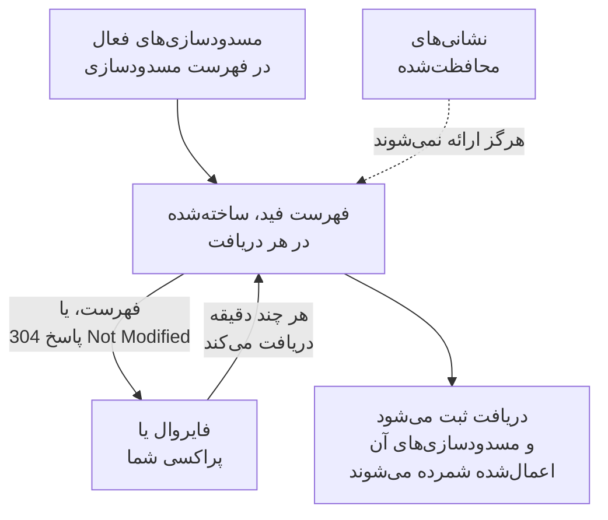

# فیدهای فهرست مسدودسازی برای فایروال‌ها و پراکسی‌ها

یک فید فهرست مسدودسازی یک URL محرمانه است که فایروال یا پراکسی شما هر چند دقیقه [فهرست مسدودسازی](/docs/telemetry/security-cases#فهرست-مسدودسازی) پروژه‌تان را از آن می‌خواند. Palo Alto Networks، FortiGate، Check Point، Cisco Secure Firewall، OPNsense و pfSense آن را به‌صورت یک فهرست خارجی می‌خوانند، و دستورهایی که از OneUptime کپی می‌کنید آن را با nftables، ipset، nginx، HAProxy یا فایروال Windows اعمال می‌کنند. فایروال شما به OneUptime وصل می‌شود: OneUptime هرگز به مسیری به درون شبکهٔ شما یا رمز عبور فایروال شما نیاز ندارد.

:::cards
- [یک فید بسازید](#یک-فید-بسازید): فایروال را برگزینید، راز را کپی کنید و گام‌های آن را دنبال کنید.
- [فایروال خود را راه‌اندازی کنید](#فایروال-خود-را-راهاندازی-کنید): گام‌های هر فایروال و پراکسی، و اینکه هر چند وقت یک بار دریافت می‌کند.
- [چه زمانی یک مسدودسازی اعمال می‌شود](#چه-زمانی-یک-مسدودسازی-اعمال-میشود): فقط وقتی فایروالی فهرستی را دریافت کرده باشد که آن را در بر دارد.
- [راز را بچرخانید یا لغو کنید](#راز-را-بچرخانید-یا-لغو-کنید): رازی تازه با یک روز هم‌پوشانی، یا بی‌درنگ هیچ رازی.
:::

## چگونه کار می‌کند



هر دریافت فهرست را از مسدودسازی‌هایی می‌سازد که در همان لحظه فعال‌اند. مسدودسازی‌ای که منقضی یا رفع شود از دریافت بعدی حذف می‌شود، و یک نشانی محافظت‌شده هرگز در آن نیست، حتی نشانی‌ای که پس از مسدود شدنش محافظت شده باشد. یک مسدودسازی فقط وقتی در فید اعمال‌شده به شمار می‌آید که فایروالی فهرستی را دریافت کرده باشد که آن را در بر دارد.

## پیش از شروع

- فایروال یا پراکسی‌ای که فهرستی از نشانی‌ها را از یک URL `https` بخواند، یا یک میزبان Linux یا Windows که بتوانید روی آن دستورها را با root یا به‌عنوان مدیر سیستم اجرا کنید.
- راهی برای خروج از فایروال به OneUptime روی HTTPS: `https://oneuptime.com`، یا نشانی سرور OneUptime خودتان.
- نقشی که بتواند فید بسازد: مالک پروژه، مدیر پروژه یا مدیر امنیت. عضو امنیت و بیننده امنیت می‌توانند فیدها و دریافت‌های آن‌ها را بخوانند. [نقش‌ها](/docs/permissions/reference#نقشها) را ببینید.

## یک فید بسازید

:::steps
### فیدهای فهرست مسدودسازی را باز کنید

**محصولات ← رویدادهای امنیتی ← پلی‌بوک‌ها ← فیدهای فهرست مسدودسازی** را باز کنید.

### فید را بسازید

روی **ساخت فید فهرست مسدودسازی** کلیک کنید و در **فایروال** فایروالی را که آن را می‌خواند برگزینید. **نام** همان نامی است که فهرست مسدودسازی در جای اعمال یک مسدودسازی برای فید نشان می‌دهد؛ اگر خالی بماند، از روی نام فایروال نام‌گذاری می‌شود، مانند «FortiGate feed». در **فیلدهای بیشتر**، فیلد **ارائه می‌کند** یکی از IPv4 و IPv6، فقط IPv4 یا فقط IPv6 را برمی‌گزیند، و **نشانی‌های مبدأ مجاز** محدود می‌کند چه کسی بتواند فید را بخواند.

### راز را کپی کنید

صفحهٔ فید با راز آن باز می‌شود، که فقط یک بار نشان داده می‌شود: OneUptime فقط هش آن را نگه می‌دارد. آن را کپی کنید، سپس روی **انجام شد** کلیک کنید. تا وقتی صفحه را ترک نکرده‌اید، گام‌های روی آن راز را برایتان پر می‌کنند.

### گام‌های فایروال خود را دنبال کنید

**راه‌اندازی فایروال** URLی را که باید بچسبانید، شیوهٔ فرستادن راز توسط فایروال شما و گام‌های کنسول خود آن را، پرشده، نشان می‌دهد. برای دیدن گام‌های فایروالی دیگر، همان‌جا آن را برگزینید. پس از نخستین دریافت فایروال شما، وضعیت فید **در حال خواندن** را نشان می‌دهد و **دریافت‌ها** آن دریافت را فهرست می‌کند.
:::

## آنچه یک فید ارائه می‌کند

| فایل | برای | محتوای آن |
| --- | --- | --- |
| `blocklist.txt` | Palo Alto Networks، pfSense، ipset، HAProxy، فایروال Windows و هر فایروال دیگری | در هر خط یک نشانی یا بازه. |
| `blocklist.txt?comments=1` | FortiGate، Check Point، Cisco Secure Firewall و OPNsense، که خط‌هایی را که با `#` آغاز می‌شوند نادیده می‌گیرند | هر نشانی یا بازه پس از خطی که می‌گوید چرا مسدود شده است. |
| `nftables.nft` | nftables | فایلی برای `nft -f` که مجموعه‌های `blocklist_v4` و `blocklist_v6` جدول `inet oneuptime` را خالی و دوباره پر می‌کند. |
| `nginx.conf` | nginx | یک خط `deny` برای هر نشانی یا بازه. |
| نام یک فایل و پس از آن `.md5`، مانند `blocklist.txt.md5` | Cisco Secure Firewall | MD5 فایل، تا فایروال فهرست را فقط وقتی تغییر کرده است دانلود کند. |

URL یک فید `https://oneuptime.com/api/blocklist-feed/<feed ID>/<file>` است، و صفحهٔ فید آن را برای فایروال شما پرشده نشان می‌دهد. با `?comments=1`، فهرست چنین است:

```text
# OneUptime case CASE-42 until 2026-11-21 10:42 UTC
203.0.113.7
# OneUptime blocklist until lifted
198.51.100.0/24
```

یک فید مسدودسازی‌های فعالی را ارائه می‌کند که اقدام آن‌ها **مسدود کردن** است. هرگز یک چالش را ارائه نمی‌کند، که فایروال نمی‌تواند انجامش دهد، و فیدی که فقط IPv4 یا فقط IPv6 ارائه می‌کند نشانی‌های دیگر را کنار می‌گذارد. فایل nftables نشانی‌ای را که یکی از بازه‌های فهرست از پیش در بر دارد کنار می‌گذارد، چون nftables ورودی‌های هم‌پوشان را در یک مجموعه نمی‌پذیرد.

وقتی چیزی مسدود نیست، `blocklist.txt` یک نشانی دارد، `192.0.2.1` (`2001:db8::1` برای فیدی که فقط IPv6 ارائه می‌کند). این نشانی برای مستندسازی کنار گذاشته شده است و هیچ ترافیکی روی اینترنت از آن نمی‌آید: Palo Alto Networks و Cisco وقتی فهرستی خالی برگردد آخرین فهرستی را که خوانده‌اند نگه می‌دارند، پس یک فهرست خالی همچنان آنچه را رفع کرده‌اید مسدود می‌کرد.

هر پاسخ یک `ETag` دارد. فایروالی که آن را در `If-None-Match` بازپس بفرستد، تا وقتی فهرست تغییر نکرده است `304 Not Modified` می‌گیرد، و دستورهایی که OneUptime به شما می‌دهد همین کار را می‌کنند.

## فایروال چگونه راز را می‌فرستد

| شیوه | آنچه فایروال می‌فرستد | استفاده‌شده در |
| --- | --- | --- |
| احراز هویت پایه | هر نام کاربری، مانند `oneuptime`، با راز به‌عنوان رمز عبور | Palo Alto Networks (فقط روی HTTPS)، FortiGate و Check Point |
| توکن Bearer | `Authorization: Bearer <secret>` | دستورهای nftables، ipset، nginx، HAProxy و فایروال Windows |
| راز در URL | `https://oneuptime.com/api/blocklist-feed/<feed ID>/<secret>/blocklist.txt` | Cisco Secure Firewall، OPNsense و pfSense، که هیچ راهی برای فرستادن راز مستند نکرده‌اند |

درخواستی بدون راز، یا با رازی نادرست، `401 Unauthorized` می‌گیرد. URLی که رازی نادرست در آن است `404 Not Found` می‌گیرد، درست مانند نشانی‌ای که وجود ندارد. وب‌سرور خود OneUptime URLهای فید را در گزارش دسترسی‌اش نمی‌نویسد، پس رازی که در یک URL است آنجا نمی‌ماند.

## محدود کنید چه کسی فید را بخواند

**نشانی‌های مبدأ مجاز**، زیر **فیلدهای بیشتر**، حداکثر ۵۰ نشانی و بازه می‌پذیرد، در هر خط یکی، مانند `203.0.113.7` یا `198.51.100.0/24`. درخواستی از هر نشانی دیگری، حتی با راز درست، `403 Forbidden` می‌گیرد. آن را خالی بگذارید تا هر نشانی‌ای که راز را دارد بتواند فید را بخواند.

هر نشانی می‌تواند یک فید را ۶۰ بار در دقیقه، و همهٔ فیدها را روی هم ۶۰۰ بار در دقیقه دریافت کند. بیش از آن، `429 Too Many Requests` با سرآیند `Retry-After` می‌گیرد.

## چه زمانی یک مسدودسازی اعمال می‌شود

یک مسدودسازی وقتی در یک فید اعمال‌شده به شمار می‌آید که فایروالی پس از ساخته شدن آن، فهرستی را دریافت کرده باشد که آن را در بر دارد، و تا ده دقیقه پس از هر دریافتی از این دست. پاسخ `304 Not Modified` دریافت همان فهرست به شمار می‌آید. آنگاه در **فهرست مسدودسازی**، تراشهٔ فید در **محل اعمال** سبز می‌شود، و راهنمای ابزار آن می‌گوید فایروال چه مدت پس از ساخته شدن مسدودسازی آن را دریافت کرده است، مانند «یک فایروال این مسدودسازی را ۳ دقیقه پس از ساخته شدنش از FortiGate feed دریافت کرد. آخرین دریافت: ۲ دقیقه پیش.»

اگر ده دقیقه دریافتی نباشد، تراشه می‌گوید فایروال از آن زمان فید را دریافت نکرده است: ممکن است فایروال همچنان نشانی را مسدود کند، اما OneUptime نمی‌تواند این را بداند. پس فایروال خود را طوری تنظیم کنید که فید را هر پنج دقیقه یا زودتر دریافت کند. فایروالی که کمتر دریافت می‌کند، مانند OPNsense، در فاصلهٔ میان دریافت‌هایش هم مسدود می‌کند، و OneUptime مسدودسازی را آنجا فقط تا ده دقیقه پس از هر دریافت اعمال‌شده می‌داند.

مسدودسازی‌ای که منقضی یا رفع شود از دریافت بعدی حذف می‌شود، و تراشهٔ آن منتظر می‌ماند تا فایروالی فهرست را بدون آن دریافت کند. وقتی OneUptime نمی‌تواند بخواند کدام نشانی‌ها محافظت‌شده‌اند، فید به‌جای فهرستی که ممکن است یکی از آن‌ها را در بر داشته باشد، با `503 Service Unavailable` و `Retry-After: 60` پاسخ می‌دهد، و فایروال فهرستی را که دارد نگه می‌دارد.

## وقتی یک فایروال خواندن را متوقف می‌کند

OneUptime یاد می‌گیرد هر فید هر چند وقت یک بار دریافت می‌شود. وقتی فیدی به اندازهٔ سه برابر فاصلهٔ معمول خود، و دست‌کم ده دقیقه، دریافت نشده باشد، وضعیت آن **خواندن متوقف شده است** را نشان می‌دهد، **فهرست مسدودسازی** نام آن را بالای فهرستش می‌آورد، و مالکان پروژه یک ایمیل می‌گیرند: «Your firewall stopped reading the blocklist feed _نام فید_». تا وقتی فایروالی فیدی را دو بار دریافت نکرده است، OneUptime انتظار دارد هر پنج دقیقه یک دریافت باشد، از OPNsense هر ساعت و از pfSense هر روز.

دریافت بعدی این وضعیت را پاک می‌کند، و توقفی دوباره در آینده ایمیل دیگری می‌فرستد. فیدی که رازش لغو شده باشد هرگز متوقف‌شده به شمار نمی‌آید.

## راز را بچرخانید یا لغو کنید

**چرخش راز**، در صفحهٔ فید، رازی تازه می‌سازد و آن را یک بار نشان می‌دهد. رازی که جایگزین می‌شود تا ۲۴ ساعت کار می‌کند، تا بتوانید راز تازه را به همهٔ فایروال‌ها بدهید؛ **دریافت‌ها** دریافتی را که هنوز راز قدیمی را فرستاده است با **راز پیشین** نشان‌گذاری می‌کند. چرخش دوباره در همان ۲۴ ساعت، قدیمی‌ترین راز را بی‌درنگ از کار می‌اندازد.

**لغو راز** راز را، و راز پیش از آن را، بی‌درنگ از کار می‌اندازد: وقتی رازی به بیرون درز کرده است از آن استفاده کنید. آنگاه فید به هیچ‌کس پاسخ نمی‌دهد، و فایروال‌های آن فهرستی را که دارند بدون تازه کردن نگه می‌دارند، تا وقتی **چرخش راز** رازی تازه بسازد. حذف یک فید، خود آن، راز آن و دریافت‌هایش را از میان می‌برد.

## فایروال خود را راه‌اندازی کنید

صفحهٔ فید این گام‌ها را برای فایروالی که برمی‌گزینید نشان می‌دهد، با URL، نام کاربری و، درست پس از ساخته شدن راز، خود راز پرشده.

| فایروال | فایل | راز | دریافت در هر | حداکثر ظرفیت |
| --- | --- | --- | --- | --- |
| Palo Alto Networks | `blocklist.txt` | احراز هویت پایه | ۵ دقیقه، کوتاه‌ترین گزینهٔ آن | ۳۰ فهرست سفارشی، و در مجموع ۵۰٬۰۰۰ نشانی (۱۵۰٬۰۰۰ در سری‌های PA-3200، PA-5200 و PA-7000) |
| FortiGate | `blocklist.txt?comments=1` | احراز هویت پایه | ۵ دقیقه (۱ تا ۴۳٬۲۰۰؛ پیش‌فرض ۵) | ۳۰۰٬۰۰۰ نشانی در همهٔ فیدهای تهدیدش |
| Check Point | `blocklist.txt?comments=1`، IPv4 | احراز هویت پایه | ۵ دقیقه (پیش‌فرض هر ساعت) | ۵۰٬۰۰۰ نشانی در هر فید |
| Cisco Secure Firewall | `blocklist.txt?comments=1` و MD5 آن | در URL | ۵ دقیقه (پیش‌فرض ۲ ساعت) | |
| OPNsense | `blocklist.txt?comments=1` | در URL | ۱ ساعت، کوتاه‌ترین گزینهٔ آن | |
| pfSense | `blocklist.txt` | در URL | ۱ روز، کوتاه‌ترین گزینهٔ آن | |
| nftables، ipset، nginx، HAProxy، فایروال Windows | فایل‌های خودشان | توکن Bearer | ۱ دقیقه | |

### Palo Alto Networks

1. در رابط وب به **Objects → External Dynamic Lists** بروید و روی **Add** کلیک کنید.
2. **Type** را روی **IP List** و **Source** را روی URL فید، `https://oneuptime.com/api/blocklist-feed/<feed ID>/blocklist.txt`، بگذارید.
3. **Client Authentication** را روشن کنید، با **Username** برابر `oneuptime` و راز فید به‌عنوان **Password**.
4. **Check for updates** را روی **Every Five Minutes** بگذارید، روی **OK** کلیک کنید و commit کنید.
5. در **Policies → Security** قاعده‌ای اضافه کنید که **Source Address** آن این فهرست و action آن **Deny** باشد، سپس commit کنید.

Palo Alto Networks نام کاربری و رمز عبور را فقط روی HTTPS می‌فرستد. یک توضیح را فقط پس از یک نشانی می‌خواند، هرگز در خطی جداگانه، پس فید آن فهرست ساده است. [Configure the Firewall to Access an External Dynamic List](https://docs.paloaltonetworks.com/pan-os/11-1/pan-os-admin/policy/use-an-external-dynamic-list-in-policy/configure-the-firewall-to-access-an-external-dynamic-list) را ببینید.

### FortiGate

1. به **Security Fabric → External Connectors** بروید، روی **Create New** کلیک کنید و در بخش **Threat Feeds** گزینهٔ **IP Address** را انتخاب کنید.
2. **URL of external resource** را روی URL فید، `https://oneuptime.com/api/blocklist-feed/<feed ID>/blocklist.txt?comments=1`، بگذارید.
3. **HTTP basic authentication** را روشن کنید، با **Username** برابر `oneuptime` و راز فید به‌عنوان **Password**.
4. **Refresh Rate** را روی ۵ دقیقه بگذارید و روی **OK** کلیک کنید.
5. در **Policy & Objects → Firewall Policy** فید را به‌عنوان **Source** یک policy به کار ببرید و **Action** را روی **DENY** بگذارید.

[Configuring a threat feed](https://docs.fortinet.com/document/fortigate/7.6.0/administration-guide/379433/configuring-a-threat-feed) را ببینید.

### Check Point

1. در SmartConsole، **Object Explorer** را باز کنید و **New → More → Network Object → Network Feed** را انتخاب کنید.
2. **Feed URL** را روی URL فید، `https://oneuptime.com/api/blocklist-feed/<feed ID>/blocklist.txt?comments=1`، **Format** را روی **Flat list** و **Data type** را روی **IP Address** بگذارید.
3. در **Advanced Settings**، **Username** را `oneuptime` و راز فید را به‌عنوان رمز عبور برای **Authentication** وارد کنید.
4. **Check feed interval** را روی ۵ دقیقه بگذارید، روی **Test Feed** و سپس **OK** کلیک کنید.
5. فید را به‌عنوان **Source** یک قاعدهٔ Access Control که action آن **Drop** است به کار ببرید و policy را نصب کنید.

Check Point برای فید شبکه نشانی‌های IPv4 را مستند کرده است، پس فیدی که برای آن ساخته می‌شود فقط IPv4 ارائه می‌کند. [Network Feed](https://sc1.checkpoint.com/documents/R82/WebAdminGuides/EN/CP_R82_SecurityManagement_AdminGuide/Content/Topics-SECMG/Network_Feed.htm) را ببینید.

### Cisco Secure Firewall

1. در مرکز مدیریت، **Objects → Security Intelligence** را انتخاب کنید و روی **Add Network Lists and Feeds** کلیک کنید.
2. **Type** را روی **Feed**، **Feed URL** را روی URL فید، `https://oneuptime.com/api/blocklist-feed/<feed ID>/<secret>/blocklist.txt?comments=1`، و **MD5 URL** را روی همان URL با `.md5` پس از `blocklist.txt` بگذارید.
3. **Update Frequency** را روی ۵ دقیقه بگذارید و ذخیره کنید.
4. در access control policy خود، **Security Intelligence → Networks** را باز کنید، فید را به **Block List** اضافه کنید، سپس ذخیره و deploy کنید.

Cisco برای بسامد به‌روزرسانی ۳۰ دقیقه یا کمتر یک MD5 URL لازم دارد، و دستگاه‌های مدیریت‌شدهٔ آن هر ۳۰ دقیقه به‌روزرسانی‌ها را از مرکز مدیریت می‌گیرند، پس یک مسدودسازی حداکثر ۳۰ دقیقه پس از دریافت فید به آن‌ها می‌رسد. [Creating Security Intelligence feeds](https://docs.manage.security.cisco.com/cdfmc/t_creating_security_intelligence_feeds.html) را ببینید.

### OPNsense

1. به **Firewall → Aliases** بروید و یک alias از نوع **URL Table (IPs)** اضافه کنید.
2. **Content** را روی URL فید، `https://oneuptime.com/api/blocklist-feed/<feed ID>/<secret>/blocklist.txt?comments=1`، و **Refresh Frequency** را روی ۰ روز و ۱ ساعت بگذارید.
3. ذخیره کنید و روی **Apply** کلیک کنید، سپس در **Firewall → Rules** قاعده‌ای اضافه کنید که ترافیکی را که **Source** آن همین alias است مسدود کند.

OPNsense یک URL table را حداکثر هر یک ساعت یک بار دریافت می‌کند، پس OneUptime مسدودسازی‌های آن را فقط تا ده دقیقه پس از هر دریافت تأیید می‌کند. با این حال، OPNsense در فاصلهٔ میان دریافت‌ها نیز آن‌ها را مسدود می‌کند. [Aliases](https://docs.opnsense.org/manual/aliases.html) را ببینید.

### pfSense

1. به **Firewall → Aliases** بروید، روی **Add** کلیک کنید و **URL Table (IPs)** را انتخاب کنید.
2. URL فید، `https://oneuptime.com/api/blocklist-feed/<feed ID>/<secret>/blocklist.txt`، را وارد کنید و آن را طوری تنظیم کنید که هر ۱ روز تازه شود.
3. روی **Save** و **Apply Changes** کلیک کنید، سپس در **Firewall → Rules** قاعده‌ای اضافه کنید که **Source** آن همین alias و action آن **Block** باشد.

> [!WARNING]
> pfSense یک URL table را حداکثر روزی یک بار دریافت می‌کند: برای مسدود کردن یک حمله در حین وقوع بیش از حد کند است. از آن برای مسدودسازی‌های طولانی، در کنار فایروالی که هر چند دقیقه دریافت می‌کند، استفاده کنید.

[Alias Types](https://docs.netgate.com/pfsense/en/latest/firewall/aliases-types.html) را ببینید.

### nftables

دستورهایی را که صفحهٔ فید نشان می‌دهد یک بار با root اجرا کنید. این دستورها جدول `inet oneuptime` را با دو مجموعه، `blocklist_v4` و `blocklist_v6`، قاعده‌هایی در زنجیره‌های `input` و `forward` آن که ترافیک نشانی‌های درون این مجموعه‌ها را دور می‌ریزند، و اسکریپت `/usr/local/sbin/oneuptime-blocklist` را می‌سازند، که راز را در `/etc/oneuptime-blocklist` نگه می‌دارد، جایی که فقط root می‌تواند بخواند.

```bash
# Run once, as root.
install -d -m 700 /etc/oneuptime-blocklist /var/lib/oneuptime-blocklist
printf 'Authorization: Bearer %s\n' 'YOUR_FEED_SECRET' > /etc/oneuptime-blocklist/auth
chmod 600 /etc/oneuptime-blocklist/auth
cat > /usr/local/sbin/oneuptime-blocklist <<'SCRIPT'
#!/bin/sh
# Loads the OneUptime blocklist into nftables when it changed.
set -eu
URL='https://oneuptime.com/api/blocklist-feed/<feed ID>/nftables.nft'
STATE=/var/lib/oneuptime-blocklist
if ! nft list table inet oneuptime >/dev/null 2>&1; then
  rm -f "$STATE/etag"
  nft -f - <<'NFT'
table inet oneuptime {
  set blocklist_v4 { type ipv4_addr; flags interval; auto-merge; }
  set blocklist_v6 { type ipv6_addr; flags interval; auto-merge; }
  chain input {
    type filter hook input priority filter; policy accept;
    ip saddr @blocklist_v4 drop
    ip6 saddr @blocklist_v6 drop
  }
  chain forward {
    type filter hook forward priority filter; policy accept;
    ip saddr @blocklist_v4 drop
    ip6 saddr @blocklist_v6 drop
  }
}
NFT
fi
TMP=$(mktemp)
trap 'rm -f "$TMP" "$TMP.h"' EXIT
ETAG=$(cat "$STATE/etag" 2>/dev/null || true)
CODE=$(curl --silent --show-error --max-time 60 --header @/etc/oneuptime-blocklist/auth \
  ${ETAG:+--header "If-None-Match: $ETAG"} \
  --dump-header "$TMP.h" --output "$TMP" --write-out '%{http_code}' "$URL")
[ "$CODE" = 304 ] && exit 0
[ "$CODE" = 200 ] || { echo "oneuptime-blocklist: the feed answered $CODE" >&2; exit 1; }
nft -f "$TMP"
sed -n 's/^[Ee][Tt][Aa][Gg]:[[:space:]]*//p' "$TMP.h" | tr -d '\r' > "$STATE/etag"
SCRIPT
chmod 700 /usr/local/sbin/oneuptime-blocklist
echo '* * * * * root flock -n /run/oneuptime-blocklist.lock /usr/local/sbin/oneuptime-blocklist' > /etc/cron.d/oneuptime-blocklist
/usr/local/sbin/oneuptime-blocklist
```

اسکریپت هر دقیقه از `/etc/cron.d/oneuptime-blocklist` اجرا می‌شود. `nftables.nft` را فقط وقتی فهرست تغییر کرده باشد، در یک تراکنش بارگذاری می‌کند، پس مجموعه‌ها هرگز نیمه‌پر نیستند. [Sets](https://wiki.nftables.org/wiki-nftables/index.php/Sets) را ببینید.

### ipset و iptables

دستورهایی را که صفحهٔ فید نشان می‌دهد یک بار با root اجرا کنید. این دستورها دو مجموعه، `oneuptime_v4` و `oneuptime_v6`، و قاعده‌هایی در زنجیرهٔ `PREROUTING` جدول `raw`، برای iptables و ip6tables، می‌سازند که ترافیک نشانی‌های درون این مجموعه‌ها را دور می‌ریزند.

اسکریپت هر دقیقه از طریق cron اجرا می‌شود. وقتی فهرست تغییر کرده باشد، دو مجموعهٔ تازه را پر می‌کند و آن‌ها را جایگزین می‌کند، تا قاعده‌ها هرگز مجموعه‌ای نیمه‌پر نبینند. [ipset](https://ipset.netfilter.org/ipset.man.html) را ببینید.

### nginx

خط include را به بلوک `server` هر سایتی که باید محافظت شود اضافه کنید، سپس دستورهایی را که صفحهٔ فید نشان می‌دهد یک بار با root اجرا کنید:

```nginx
server {
    include /etc/nginx/oneuptime-blocklist.conf;
}
```

```bash
# Run once, as root.
install -d -m 700 /etc/oneuptime-blocklist /var/lib/oneuptime-blocklist
printf 'Authorization: Bearer %s\n' 'YOUR_FEED_SECRET' > /etc/oneuptime-blocklist/auth
chmod 600 /etc/oneuptime-blocklist/auth
touch /etc/nginx/oneuptime-blocklist.conf
cat > /usr/local/sbin/oneuptime-blocklist <<'SCRIPT'
#!/bin/sh
# Writes the OneUptime blocklist for nginx when it changed, and reloads nginx.
set -eu
URL='https://oneuptime.com/api/blocklist-feed/<feed ID>/nginx.conf'
STATE=/var/lib/oneuptime-blocklist
TMP=$(mktemp)
trap 'rm -f "$TMP" "$TMP.h"' EXIT
ETAG=$(cat "$STATE/etag" 2>/dev/null || true)
CODE=$(curl --silent --show-error --max-time 60 --header @/etc/oneuptime-blocklist/auth \
  ${ETAG:+--header "If-None-Match: $ETAG"} \
  --dump-header "$TMP.h" --output "$TMP" --write-out '%{http_code}' "$URL")
[ "$CODE" = 304 ] && exit 0
[ "$CODE" = 200 ] || { echo "oneuptime-blocklist: the feed answered $CODE" >&2; exit 1; }
cp /etc/nginx/oneuptime-blocklist.conf "$STATE/last.conf"
cp "$TMP" /etc/nginx/oneuptime-blocklist.conf
if nginx -t -q; then nginx -s reload; else cp "$STATE/last.conf" /etc/nginx/oneuptime-blocklist.conf; exit 1; fi
sed -n 's/^[Ee][Tt][Aa][Gg]:[[:space:]]*//p' "$TMP.h" | tr -d '\r' > "$STATE/etag"
SCRIPT
chmod 700 /usr/local/sbin/oneuptime-blocklist
echo '* * * * * root flock -n /run/oneuptime-blocklist.lock /usr/local/sbin/oneuptime-blocklist' > /etc/cron.d/oneuptime-blocklist
/usr/local/sbin/oneuptime-blocklist

# Then add this line to the server block of the site to protect, and reload nginx:
#   include /etc/nginx/oneuptime-blocklist.conf;
```

اسکریپت هر دقیقه از طریق cron اجرا می‌شود. وقتی فهرست تغییر کرده باشد، `/etc/nginx/oneuptime-blocklist.conf` را می‌نویسد، پیکربندی را با `nginx -t` بررسی می‌کند و nginx را دوباره بارگذاری می‌کند، و اگر بررسی شکست بخورد فایل پیشین را برمی‌گرداند.

پشت یک متعادل‌کننده بار یا یک CDN، nginx نشانی متعادل‌کننده را می‌بیند، نه نشانی بازدیدکننده را، مگر اینکه ماژول realip راه‌اندازی شده باشد: `set_real_ip_from` را روی نشانی‌های متعادل‌کننده و `real_ip_header` را روی سرآیندی که می‌فرستد بگذارید، یا به‌جای آن در خود متعادل‌کننده مسدود کنید. [ngx_http_access_module](https://nginx.org/en/docs/http/ngx_http_access_module.html) را ببینید.

### HAProxy

با root فایل فهرست را بسازید و دو خط به `haproxy.cfg` اضافه کنید، سپس HAProxy را یک بار دوباره بارگذاری کنید: Runtime API آن فقط فهرستی را به‌روز می‌کند که HAProxy از پیش می‌خواند.

```text
global
    stats socket /run/haproxy/admin.sock mode 660 level admin

frontend www
    http-request deny if { src -n -f /etc/haproxy/oneuptime-blocklist.lst }
```

سپس بقیهٔ دستورهایی را که صفحهٔ فید نشان می‌دهد اجرا کنید. اسکریپت هر دقیقه از طریق cron اجرا می‌شود و وقتی فهرست تغییر کرده باشد، `/etc/haproxy/oneuptime-blocklist.lst` را می‌نویسد و HAProxy را بدون بارگذاری دوباره، از طریق Runtime API آن به‌روز می‌کند. [The Runtime API](https://docs.haproxy.org/3.4/management.html#9.3) را ببینید.

### فایروال Windows

در PowerShell به‌عنوان مدیر سیستم، دستورهایی را که صفحهٔ فید نشان می‌دهد یک بار اجرا کنید. این دستورها یک اسکریپت و راز را در `C:\ProgramData\OneUptime\Blocklist` ذخیره می‌کنند، که فقط SYSTEM و Administrators می‌توانند آن را بخوانند، و کار زمان‌بندی‌شدهٔ «OneUptime Blocklist» را ثبت می‌کنند، که اسکریپت را هر دقیقه به‌عنوان SYSTEM اجرا می‌کند.

اسکریپت قاعده‌های ورودی‌ای نگه می‌دارد که همهٔ نشانی‌های فهرست را مسدود می‌کنند، ۱٬۰۰۰ نشانی در هر قاعده: «OneUptime blocklist 0»، «OneUptime blocklist 1» و به همین ترتیب. [Set-NetFirewallRule](https://learn.microsoft.com/en-us/powershell/module/netsecurity/set-netfirewallrule) را ببینید.

### فایروال‌های دیگر

1. فایروال یا پراکسی خود را به URL فید، `https://oneuptime.com/api/blocklist-feed/<feed ID>/blocklist.txt`، ارجاع دهید: در هر خط یک نشانی یا بازه.
2. راز فید را به‌عنوان رمز عبور احراز هویت پایه با هر نام کاربری، یا به‌عنوان توکن Bearer بفرستید.
3. آن را طوری تنظیم کنید که فهرست را هر ۵ دقیقه یا زودتر دریافت کند: یک مسدودسازی تا ده دقیقه پس از هر دریافت، در آنجا اعمال‌شده به شمار می‌آید.

### Kubernetes

در لبهٔ شبکه یا WAF ابری جلوی کلاستر مسدود کنید، که به‌عنوان مقصد فهرست مسدودسازی زیر **اتصال‌های امنیتی** یا **اتصال‌های ابری** وصل شده است، یا روی پراکسی‌ای که خودتان جلوی آن اجرا می‌کنید، با دستورهای nginx یا HAProxy. کنترلر Ingress NGINX جامعه بازنشسته شده و مخزن آن در مارس ۲۰۲۶ بایگانی شده است، پس OneUptime annotationهای آن را مستند نمی‌کند. [Ingress NGINX Retirement](https://kubernetes.io/blog/2025/11/11/ingress-nginx-retirement/) را ببینید.

## محدودیت‌ها

| مورد | محدودیت |
| --- | --- |
| ورودی‌های یک فید | ۲۰٬۰۰۰ |
| نشانی‌های مبدأ مجاز | ۵۰ نشانی و بازه |
| دریافت‌های یک فید از یک نشانی | ۶۰ در دقیقه |
| دریافت‌های همهٔ فیدها از یک نشانی | ۶۰۰ در دقیقه |
| راز جایگزین‌شده همچنان کار می‌کند | ۲۴ ساعت |
| یک مسدودسازی پس از یک دریافت اعمال‌شده به شمار می‌آید | ۱۰ دقیقه |
| نگهداری دریافت‌ها | ۳۰ روز |

## عیب‌یابی

:::details فایروال پاسخ 401 Unauthorized می‌گیرد
رازی که می‌فرستد راز فید نیست. بررسی کنید که رمز عبور، یا توکن Bearer، کل راز باشد، بدون چیزی پیش یا پس از آن. رازی که بیش از ۲۴ ساعت پیش جایگزین شده است دیگر کار نمی‌کند: **چرخش راز** رازی تازه می‌سازد.
:::

:::details فایروال پاسخ 404 Not Found می‌گیرد
URL به فیدی اشاره می‌کند که وجود ندارد، یا به فایلی که فید ارائه نمی‌کند، یا رازی نادرست در خود دارد. URL را دوباره از صفحهٔ فید کپی کنید.
:::

:::details فایروال پاسخ 403 Forbidden می‌گیرد
**نشانی‌های مبدأ مجاز** فید نشانی‌ای را که فایروال از آن دریافت می‌کند در بر ندارد. **دریافت‌ها** نشانی‌ای را که هر دریافت از آن آمده است نشان می‌دهد.
:::

:::details تراشهٔ یک مسدودسازی می‌گوید منتظر است تا فایروالی فید را دریافت کند
از زمان ساخته شدن مسدودسازی هیچ فایروالی فید را دریافت نکرده است. **دریافت‌ها** را در صفحهٔ فید بررسی کنید: فایروالی که هر پنج دقیقه دریافت می‌کند، مسدودسازی را در کمتر از پنج دقیقه در خود دارد.
:::

## گام‌های بعدی

:::cards
- [پرونده‌های امنیتی و پلی‌بوک‌ها](/docs/telemetry/security-cases): یک نشانی را از یک پرونده، دستی یا با یک پلی‌بوک، مسدود کنید.
- [هوش تهدید](/docs/telemetry/threat-intelligence): نشانی‌های شناخته‌شدهٔ مخرب را به OneUptime بیاورید.
- [رویدادهای امنیتی](/docs/telemetry/security-events): نشانی‌هایی را که ارزش مسدود کردن دارند پیدا کنید.
:::
