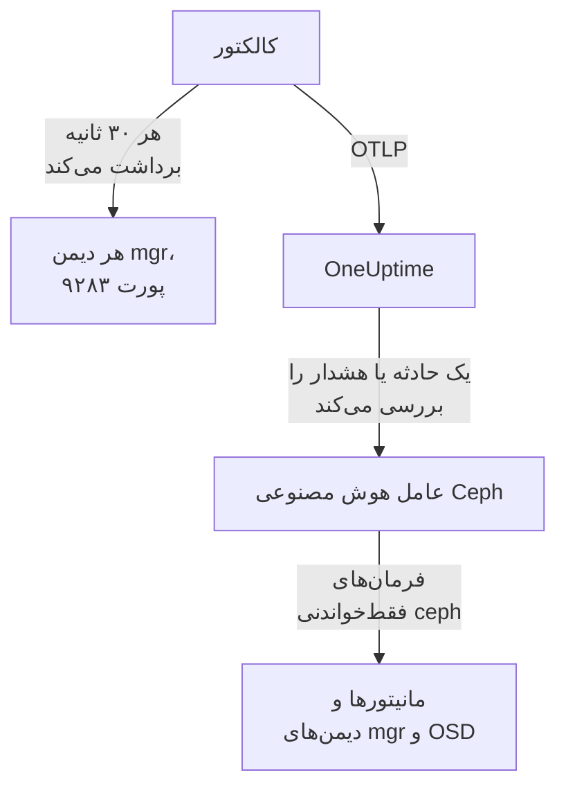

# عامل Ceph

عامل Ceph در OneUptime یک خوشه Ceph را زیر نظر دارد: سلامت آن، حد نصاب مانیتورها، OSDها، استخرها و گروه‌های جای‌گذاری. ماژول `prometheus` در mgr مربوط به Ceph را روی هر دیمن mgr برداشت می‌کند، هر متریک را با نام خوشه شما مُهر می‌زند و آن را به OneUptime می‌فرستد، جایی که خوشه با OSDها، استخرها و دیمن‌هایش نمایان می‌شود. [مانیتورهای Ceph](/docs/monitor/ceph-monitor) بر پایه آنچه می‌رسد هشدار می‌دهند.

:::cards
- [نصب عامل](#نصب-عامل): ماژول mgr را فعال کنید، سپس اسکریپت نصب یا Docker Compose.
- [آنچه عامل جمع می‌کند](#آنچه-عامل-گردآوری-میکند): سری‌هایی که صفحه‌های Ceph، متریک‌ها و الگوهای هشدار بر آن‌ها بنا شده‌اند.
- [عامل هوش مصنوعی](#عامل-هوش-مصنوعی): بگذارید OneUptime AI هنگام بررسی، خوشه را بخواند.
- [رفع اشکال](#رفع-اشکال): یک اسکریپت تشخیصی، و مشکلات معمول.
:::

## چگونه کار می‌کند

عامل دو کانتینر است که با Docker Compose روی یک ماشین اجرا می‌کنید. یک OpenTelemetry Collector ماژول `prometheus` در mgr را روی هر دیمن mgr هر ۳۰ ثانیه برداشت می‌کند. فقط mgr فعال با متریک پاسخ می‌دهد، پس وقتی به یک mgr آماده‌به‌کار جابه‌جا شود، متریک‌ها بی هیچ تغییری همچنان می‌رسند. عامل هوش مصنوعی Ceph در کنار آن به OneUptime AI اجازه می‌دهد هنگام بررسی یک حادثه یا هشدار، فرمان‌های فقط‌خواندنی `ceph` را اجرا کند.



خوشه با نخستین داده‌هایش، با نامی که عامل به‌صورت `ceph.cluster.name` روی هر متریک مُهر می‌زند، خود را ثبت می‌کند.

## پیش از شروع

- Docker Engine 20.10 یا بعد از آن با افزونه Docker Compose v2، روی ماشینی که بتواند روی پورت ۹۲۸۳ به دیمن‌های mgr در Ceph شما برسد.
- یک پوسته روی یک گره مدیریتی Ceph، جایی که CLI ‏`ceph` با دسترسی مدیر کار کند.
- یک کلید دریافت داده. آن را زیر **تنظیمات پروژه** > **تله‌متری و APM** > **کلیدهای دریافت داده** بسازید و مقدارش را کپی کنید.
- HTTPS خروجی از آن ماشین به نشانی OneUptime شما.

## نصب عامل

:::steps
### ماژول prometheus در mgr را فعال کنید

روی یک گره مدیریتی Ceph:

```bash
ceph mgr module enable prometheus
```

از آن پس هر دیمن mgr متریک‌های Prometheus را روی پورت `9283` در مسیر `/metrics` ارائه می‌کند. فقط mgr فعال متریک برمی‌گرداند: mgrهای آماده‌به‌کار با پاسخی خالی جواب می‌دهند، یا اگر `mgr/prometheus/standby_behaviour` روی `error` تنظیم شده باشد با یک خطای HTTP. به همین دلیل عامل هر mgr را برداشت می‌کند. فهرستشان کنید:

```bash
ceph mgr stat                    # active mgr
ceph orch ps --daemon-type mgr   # all mgrs (cephadm clusters)
```

### عامل را نصب و اجرا کنید

:::tabs
@tab install.sh
اسکریپت نصب را دانلود کنید و روی ماشینی که میزبان عامل خواهد بود اجرا کنید:

```bash
curl -sSL https://raw.githubusercontent.com/OneUptime/oneuptime/master/agents/CephAgent/install.sh -o install.sh
bash install.sh
```

اسکریپت نشانی OneUptime شما، کلید دریافت داده، نامی برای خوشه و نقطه‌های پایانی mgr را می‌پرسد، و اینکه آیا [عامل هوش مصنوعی](#عامل-هوش-مصنوعی) می‌تواند اصلاح‌ها را اعمال کند. جایی که `ceph` با دسترسی مدیر کار می‌کند، پیشنهاد می‌دهد کلاینت Ceph ویژه عامل هوش مصنوعی را هم بسازد. در `/opt/oneuptime-ceph-agent` نصب می‌کند، یک فایل `.env` با مجوز `0600` می‌نویسد و عامل را با Docker Compose راه می‌اندازد. اجرای دوباره اسکریپت به‌جای پرسیدن دوباره، همه‌چیز را از همان `.env` دوباره به کار می‌برد، و [به‌روزرسانی عامل](#بهروزرسانی-عامل) هم همین‌گونه است.
@tab Docker Compose
`docker-compose.yml` و `otel-collector-config.yaml` را از [پوشه CephAgent](https://github.com/OneUptime/oneuptime/tree/master/agents/CephAgent) در یک پوشه تازه دانلود کنید:

```bash
mkdir oneuptime-ceph-agent && cd oneuptime-ceph-agent
curl -fsSLO https://raw.githubusercontent.com/OneUptime/oneuptime/master/agents/CephAgent/docker-compose.yml
curl -fsSLO https://raw.githubusercontent.com/OneUptime/oneuptime/master/agents/CephAgent/otel-collector-config.yaml
```

کنار آن‌ها یک فایل `.env` بسازید:

```bash title=".env"
ONEUPTIME_URL=YOUR_ONEUPTIME_URL
ONEUPTIME_TELEMETRY_INGESTION_KEY=YOUR_TELEMETRY_INGESTION_TOKEN
CEPH_CLUSTER_NAME=my-ceph-cluster
CEPH_MGR_ENDPOINTS=[ceph-mon-1:9283,ceph-mon-2:9283,ceph-mon-3:9283]
```

هر دیمن mgr را، چه فعال و چه آماده‌به‌کار، جداشده با ویرگول و درون کروشه فهرست کنید: کروشه‌ها باعث می‌شوند کالکتور مقدار را فهرستی از هدف‌های برداشت بخواند. عامل را راه بیندازید:

```bash
docker compose up -d
```

کانتینر عامل هوش مصنوعی هم راه می‌افتد و منتظر یک کلاینت Ceph ویژه خودش می‌ماند: [عامل هوش مصنوعی](#عامل-هوش-مصنوعی) را ببینید.
:::

### بررسی کنید که عامل اجرا می‌شود

```bash
docker compose ps
docker logs -f oneuptime-ceph-agent
```

`docker compose ps` کالکتور (`oneuptime-ceph-agent`) و عامل هوش مصنوعی (`oneuptime-ceph-ai-agent`) را فهرست می‌کند. پس از راه‌اندازی کالکتور، لاگ‌هایش باید این خط را نشان دهند:

```text
Everything is ready. Begin running and processing data.
```

### خوشه را در OneUptime پیدا کنید

**محصولات** > **زیرساخت** > **Ceph** > **همه خوشه‌ها** را باز کنید. خوشه در حدود یک دقیقه با `CEPH_CLUSTER_NAME` خود، همراه با OSDها، استخرها و دیمن‌هایش نمایان می‌شود.
:::

## متغیرهای محیطی

اسکریپت نصب این‌ها را در `/opt/oneuptime-ceph-agent/.env` می‌نویسد؛ نصب با Docker Compose آن‌ها را از `.env` کنار `docker-compose.yml` می‌خواند. پس از تغییر یکی از آن‌ها، `docker compose up -d` را در همان پوشه اجرا کنید.

| متغیر | الزامی | توضیح |
| --- | --- | --- |
| `ONEUPTIME_URL` | بله | نشانی OneUptime شما، مانند `https://oneuptime.com` یا نمونه خودمیزبان شما. اگر نمونه فقط HTTP دارد، از `http://` و پورتش استفاده کنید. |
| `ONEUPTIME_TELEMETRY_INGESTION_KEY` | بله | کلید دریافت داده از **تنظیمات پروژه** > **تله‌متری و APM** > **کلیدهای دریافت داده**. |
| `CEPH_CLUSTER_NAME` | بله | نام خوشه در OneUptime، که به‌صورت ویژگی منبع `ceph.cluster.name` روی هر متریک مُهر زده می‌شود. ثابتش نگه دارید: تغییرش در آینده خوشه دومی ثبت می‌کند. پیش‌فرض آن `ceph` است. |
| `CEPH_MGR_ENDPOINTS` | بله | همه دیمن‌های mgr به‌صورت فهرست `host:port` جداشده با ویرگول درون کروشه، برای نمونه `[ceph-mon-1:9283,ceph-mon-2:9283,ceph-mon-3:9283]`. اسکریپت نصب کروشه‌ها را برایتان می‌افزاید. |

تنظیمات ویژه عامل هوش مصنوعی زیر [عامل هوش مصنوعی](#عامل-هوش-مصنوعی) آمده است.

## عامل چگونه برداشت می‌کند

- **هر mgr، هر ۳۰ ثانیه.** ماژول `prometheus` در mgr هر برداشت را به مدت `mgr/prometheus/scrape_interval` (به‌طور پیش‌فرض ۱۵ ثانیه) در حافظه نهان نگه می‌دارد. هرگز بیشتر از آن برداشت نکنید: فقط حافظه نهان را دوباره می‌خوانید.
- **`honor_labels: true`.** برچسب‌هایی که Ceph صادر می‌کند (`ceph_daemon`، `pool_id`، برچسب‌های نمونه به ازای هر دیمن) همان‌طور که هستند نگه داشته می‌شوند. بدون آن، برچسب `instance` به ازای هر هدف برداشت بازنویسی می‌شد و هر بار که mgr فعال عوض شود تغییر می‌کرد، و این هر سری را می‌شکند.

## آنچه عامل گردآوری می‌کند

عامل هر چیزی را که ماژول `prometheus` در mgr صادر می‌کند می‌فرستد. صفحه‌های Ceph، کاتالوگ متریک‌ها و الگوهای هشدار OneUptime بر این سری‌ها بنا شده‌اند:

| دسته | متریک‌ها |
| --- | --- |
| سلامت خوشه | `ceph_health_status` (0 = OK، 1 = WARN، 2 = ERR)، `ceph_health_detail` (یک سری به ازای هر بررسی سلامت فعال، با برچسب‌های `name` و `severity`، از Quincy به بعد؛ پشتوانه الگوهای هشدار بررسی سلامت و **Active Health Checks** در نمای کلی)، `ceph_healthcheck_slow_ops`، `ceph_daemon_health_metrics` (به ازای هر دیمن، با کلید `type`)، `ceph_mon_quorum_status`، `ceph_mon_metadata`، `ceph_cluster_total_bytes`، `ceph_cluster_total_used_bytes` |
| OSD | `ceph_osd_up`، `ceph_osd_in`، `ceph_osd_apply_latency_ms`، `ceph_osd_commit_latency_ms`، `ceph_osd_stat_bytes`، `ceph_osd_stat_bytes_used`، `ceph_osd_numpg`، `ceph_osd_metadata`، به ازای هر OSD با برچسب `ceph_daemon` (مانند `osd.3`) |
| استخر | `ceph_pool_stored`، `ceph_pool_max_avail`، `ceph_pool_objects`، `ceph_pool_rd`، `ceph_pool_wr`، `ceph_pool_rd_bytes`، `ceph_pool_wr_bytes`، `ceph_pool_metadata`. سری‌های داده فقط یک برچسب `pool_id` دارند؛ نام استخر روی `ceph_pool_metadata` است. |
| گروه‌های جای‌گذاری | `ceph_pg_total`، `ceph_pg_active`، `ceph_pg_clean`، `ceph_pg_degraded`، `ceph_pg_undersized` (همه به ازای هر استخر، با `pool_id`)، `ceph_num_objects_degraded`، `ceph_num_objects_misplaced` |
| دیمن‌ها | `ceph_mgr_metadata`، `ceph_mds_metadata` و `ceph_rgw_metadata`، در کنار فراداده مانیتورها و OSDها در بالا. هر کدام یک دیمن را نام می‌برد و نسخه آن را در برچسب `ceph_version` دارد: صفحه **Daemons** آن‌ها را فهرست می‌کند. |

### هدف‌های برداشت بیشتر

ماژول mgr سلامت و ظرفیت خوشه را پوشش می‌دهد. برای نگاهی نزدیک‌تر، کارهای بیشتری زیر `scrape_configs` در `otel-collector-config.yaml` بیفزایید:

- **`ceph-exporter` (Reef 18.2 و بعد از آن).** cephadm روی هر میزبان خوشه یک دیمن `ceph-exporter` اجرا می‌کند که شمارنده‌های کارایی هر دیمن را روی پورت `9926` ارائه می‌کند. برای هر میزبان یک هدف بیفزایید.
- **`node_exporter`.** همراه همیشگی برای متریک‌های CPU، حافظه، دیسک و شبکه هر میزبان Ceph، به‌طور پیش‌فرض روی پورت `9100`.

هر دو ویژگی منبع `ceph.cluster.name` را از پردازشگر `resource` همراه بسته می‌گیرند، پس در OneUptime روی همان خوشه می‌نشینند.

## اختیاری — ارسال لاگ خوشه Ceph

عامل می‌تواند `/var/log/ceph/ceph.log` را دنبال کند و به OneUptime بفرستد، که صفحه **Cluster Log** خوشه را پر می‌کند. این به‌طور پیش‌فرض خاموش است، چون در این حالت عامل باید روی میزبانی اجرا شود که لاگ خوشه را دارد: به‌طور پیش‌فرض یک میزبان مانیتور.

:::steps
### گیرنده را روشن کنید

در `otel-collector-config.yaml`، گیرنده `filelog` و خط لوله `logs` را از حالت توضیح خارج کنید.

### پوشه لاگ را سوار کنید

در `docker-compose.yml`، حجمی را که پوشه را درون کالکتور سوار می‌کند از حالت توضیح خارج کنید:

```yaml
- /var/log/ceph:/var/log/ceph:ro
```

### عامل را دوباره راه‌اندازی کنید

```bash
docker compose up -d
```
:::

خط‌ها همان‌طور که نوشته می‌شوند فرستاده می‌شوند. OneUptime هنگام نمایش، قالب `ceph.log` (زمان، دیمن، سطح `INF`/`WRN`/`ERR`، پیام) را می‌خواند، و پردازشگر `resource` مُهر `ceph.cluster.name` را می‌زند، پس لاگ روی همین خوشه می‌نشیند.

## برچسب‌گذاری خوشه با برچسب‌های پروژه

ویژگی منبعی که با `oneuptime.label.` آغاز شود، به برچسب پروژه روی خوشه تبدیل می‌شود: `oneuptime.label.<dimension>=<value>` همان برچسب `<dimension>:<value>` است. ویژگی‌ها را در `otel-collector-config.yaml` به پردازشگر `resource`، کنار `ceph.cluster.name`، بیفزایید:

```yaml
processors:
  resource:
    attributes:
      # ...existing attributes...
      - key: oneuptime.label.team
        value: storage
        action: upsert
      - key: oneuptime.label.env
        value: production
        action: upsert
```

کالکتور پیکربندی‌اش را فقط هنگام راه‌اندازی می‌خواند: `docker compose restart oneuptime-ceph-agent` را اجرا کنید. سپس خوشه برچسب‌های `team:storage` و `env:production` را نشان می‌دهد. برچسب‌ها بدون توجه به بزرگی و کوچکی حروف مقایسه می‌شوند، پس برچسب موجود `Production` به‌جای تکرار دوباره به کار می‌رود، و عامل هرگز برچسبی را که کسی در OneUptime افزوده است برنمی‌دارد.

## اجرا به‌صورت یک سرویس systemd

برای اینکه عامل همراه ماشین شروع شود و اگر از کار افتاد دوباره راه‌اندازی شود، واحد systemd آن را نصب کنید. این واحد فرض می‌کند عامل در `/opt/oneuptime-ceph-agent` است، جایی که اسکریپت نصب آن را می‌گذارد:

```bash
sudo curl -fsSL https://raw.githubusercontent.com/OneUptime/oneuptime/master/agents/CephAgent/systemd/oneuptime-ceph-agent.service -o /etc/systemd/system/oneuptime-ceph-agent.service
sudo systemctl daemon-reload
sudo systemctl enable --now oneuptime-ceph-agent
```

## به‌روزرسانی عامل

عامل نسخه کالکتوری را که فایل‌هایش روی آن ثابت شده‌اند به‌عنوان **نسخه عامل** خود گزارش می‌کند. وقتی این نسخه از نسخه‌ای که این انتشار OneUptime روی آن ثابت شده قدیمی‌تر باشد، یک نشانه هشدار کنارش در **نمای کلی** خوشه دیده می‌شود. آن را برگزینید تا این فرمان‌ها را ببینید. عاملی که پیش از آنکه فایل‌هایش نسخه‌ای گزارش کنند نصب شده، تا وقتی به این شیوه به‌روز نشود نسخه‌ای نشان نمی‌دهد.

ایمیج کالکتور در `docker-compose.yml` ثابت شده و پیکربندی‌اش فایلی کنار آن است، پس فقط کشیدن ایمیج‌ها عامل را جلو نمی‌برد. `install.sh` را دوباره اجرا کنید: هر مقداری را در `.env` موجود شما دوباره به کار می‌برد (هیچ چیزی دوباره پرسیده نمی‌شود)، `docker-compose.yml` و `otel-collector-config.yaml` را تازه می‌کند (فایلی که ویرایش کرده‌اید به‌صورت `<file>.bak.<timestamp>` نگه داشته می‌شود)، ایمیج‌ها را می‌کشد و عامل را دوباره می‌سازد تا کالکتور پیکربندی تازه‌اش را بخواند. پوشه `ceph/` عامل هوش مصنوعی دست‌نخورده می‌ماند.

```bash
curl -sSL https://raw.githubusercontent.com/OneUptime/oneuptime/master/agents/CephAgent/install.sh -o install.sh
bash install.sh
```

به‌جایش با Docker Compose نصبش کرده‌اید؟ در پوشه عامل، هر دو فایل را دوباره دانلود کنید (و هر تغییری را که در آن‌ها داده بودید دوباره اعمال کنید)، سپس ایمیج‌ها را بکشید و عامل را دوباره بسازید:

```bash
curl -fsSLO https://raw.githubusercontent.com/OneUptime/oneuptime/master/agents/CephAgent/docker-compose.yml
curl -fsSLO https://raw.githubusercontent.com/OneUptime/oneuptime/master/agents/CephAgent/otel-collector-config.yaml
docker compose pull
docker compose up -d --force-recreate
```

## حذف عامل

```bash
cd /opt/oneuptime-ceph-agent
docker compose down
```

اگر کلاینت Ceph عامل هوش مصنوعی را ساخته‌اید، آن را روی یک گره مدیریتی با `ceph auth del client.oneuptime-ai` حذف کنید.

## عامل هوش مصنوعی

فایل `docker-compose.yml` عامل، **عامل هوش مصنوعی Ceph** را هم اجرا می‌کند، یعنی `oneuptime-ceph-ai-agent` (ایمیج `oneuptime/resource-ai-agent:release`). وقتی OneUptime AI یک حادثه یا هشدار را روی این خوشه بررسی می‌کند، از طریق آن فرمان‌های فقط‌خواندنی `ceph` را اجرا می‌کند — `ceph health detail`، `ceph osd tree`، `ceph pg dump_stuck`، `ceph crash ls` — و فقط اگر اجازه دهید، اصلاح‌هایی مانند علامت‌زدن دوباره یک OSD به‌عنوان in یا پاک کردن `noout` را اعمال می‌کند. این عامل مانند کالکتور، به‌عنوان خوشه‌ای با نام `CEPH_CLUSTER_NAME` ثبت می‌شود و در OneUptime در صفحه **هوش مصنوعی** > **عامل هوش مصنوعی** خوشه نمایان می‌شود.

- **بررسی‌های هوش مصنوعی به‌طور پیش‌فرض روشن‌اند.** همین که عامل وصل شود، OneUptime AI حادثه‌ها و هشدارهای این خوشه را با آن بررسی می‌کند و **نمای کلی** خوشه وضعیت عامل را نشان می‌دهد. برای توقف، `ONEUPTIME_AI_INVESTIGATION=false` را جایی که عامل اجرا می‌شود تنظیم کنید (**تغییر** زیر **کارهای مجاز هوش مصنوعی** در صفحه عامل هوش مصنوعی روشش را نشان می‌دهد)، یا عامل را کنار بگذارید.
- **کلاینت Ceph ویژه خودش مرز قطعی است.** با نام `client.oneuptime-ai` وصل می‌شود، با `ceph.conf` حداقلی خوشه و کلیدحلقه همان کلاینت در پوشه `ceph/` کنار `docker-compose.yml` (که به‌صورت فقط‌خواندنی در `/etc/ceph` سوار می‌شود). با caps خواندن، هیچ چیزی که اجرا می‌کند نمی‌تواند خوشه را تغییر دهد. در نصب تازه، `install.sh` پیشنهاد ساختن کلاینت را می‌دهد؛ اجرای دوباره آن هرگز این کار را نمی‌کند. هرگز کلیدحلقه مدیر را در آن پوشه نگذارید.
- این عامل **فقط‌خواندنی** است، مگر اینکه `ONEUPTIME_AI_ALLOW_WRITES=true` را تنظیم کنید و caps لازم برای اصلاح‌ها را به کلاینت بدهید (README عامل آن‌ها را فهرست کرده است)؛ `ONEUPTIME_AI_WRITE_TARGETS` (برای نمونه `osd.*,cluster`) محدود می‌کند که یک اصلاح به چه چیزی دست بزند. `ONEUPTIME_AI_FIXES` در همان `.env` تعیین می‌کند اصلاح‌ها چگونه اجرا شوند — `ask-for-approval` (یک نفر هر کدام را تأیید می‌کند)، `automatic` یا `bypass-approval` — و صفحه عامل هوش مصنوعی آن را فقط‌خواندنی نشان می‌دهد ([کارهای مجاز هوش مصنوعی، تعیین‌شده توسط عامل](/docs/ai/infrastructure-ai-agents#what-ai-may-do-set-by-the-agent)).
- به مانیتورها (TCP 3300 و 6789) و دیمن‌های mgr و OSD (TCP 6800–7300) اتصال خروجی می‌گیرد، به‌صورت UID 1000 و بدون capabilities اجرا می‌شود، و هرگز `auth`، `config-key`، `tell` یا چیزی که داده را پاک کند اجرا نمی‌کند. اگر از OneUptime AI استفاده نمی‌کنید، سرویس `oneuptime-ceph-ai-agent` را از `docker-compose.yml` حذف کنید.

برای ساختن دستی کلاینت، این را روی یک گره مدیریتی Ceph، در پوشه عامل، اجرا کنید (اگر ماشین عامل ماشین دیگری است، دو فایل را در پوشه `ceph/` آن ماشین کپی کنید):

```bash
mkdir -p ceph
ceph config generate-minimal-conf > ceph/ceph.conf
ceph auth get-or-create client.oneuptime-ai mon 'allow r' mgr 'allow r' osd 'allow r' -o ceph/ceph.client.oneuptime-ai.keyring
sudo chown 1000:1000 ceph/ceph.client.oneuptime-ai.keyring
sudo chmod 600 ceph/ceph.client.oneuptime-ai.keyring
docker compose up -d
```

آنچه می‌تواند اجرا کند، اینکه اصلاح‌ها چگونه کار می‌کنند و چگونه اشکال آن را رفع کنید: [عامل‌های AI زیرساخت](/docs/ai/infrastructure-ai-agents#ceph-clusters).

## رفع اشکال

:::details نخست اسکریپت تشخیصی را اجرا کنید
عامل با یک اسکریپت، [`troubleshoot.sh`](https://github.com/OneUptime/oneuptime/blob/master/agents/CephAgent/troubleshoot.sh)، عرضه می‌شود که کل زنجیره را بررسی می‌کند: محیط اجرای کانتینر، هر نقطه پایانی mgr که پیکربندی کرده‌اید، نام خوشه‌ای که روی هر متریک مُهر زده می‌شود، شکل توکن، متریک‌های خود کالکتور، و اینکه آیا OneUptime کلید دریافت داده را می‌پذیرد. وقتی هیچ نقطه پایانی `ceph_health_status` برنگرداند، یا فقط یکی پیکربندی شده باشد، هشدار می‌دهد، چون فقط mgr فعال متریک ارائه می‌کند. بررسی کلید از همه مهم‌تر است. OneUptime کلید بد را با `401` رد می‌کند (`422` برای کلید غیرفعال یا کلید مرورگر)، و کالکتور هر دو را دائمی می‌داند: دسته را کنار می‌گذارد و یک خطای `Exporting failed` در لاگ می‌نویسد، که در حالی که کانتینر سالم می‌ماند آسان از چشم می‌افتد. اسکریپت از درون شبکه عامل `GET <url>/otlp/v1/validate` را می‌پرسد تا یک `200` (معتبر) یا `401` (نامعتبر) مستقیم بگیرد، و روی سرورهای قدیمی‌تر به `POST /fluentd/v1/logs` برمی‌گردد.

```bash
curl -sSL https://raw.githubusercontent.com/OneUptime/oneuptime/master/agents/CephAgent/troubleshoot.sh -o troubleshoot.sh
bash troubleshoot.sh    # add -d <dir> if you installed outside /opt/oneuptime-ceph-agent
```

در پایان، حکمی با محتمل‌ترین علت می‌دهد.
:::

:::details هیچ خوشه‌ای در OneUptime دیده نمی‌شود
1. لاگ‌های کالکتور را بخوانید: `docker logs oneuptime-ceph-agent`. یک `401` هنگام صدور یعنی کلید دریافت داده بد است؛ اتصال ردشده یعنی `ONEUPTIME_URL` نادرست است.
2. بررسی کنید که یک mgr متریک ارائه می‌کند: `curl http://ACTIVE_MGR_HOST:9283/metrics | head` باید خط‌های `ceph_*` را چاپ کند. اگر نکرد، ماژول را با `ceph mgr module enable prometheus` فعال کنید.
3. بررسی کنید که `CEPH_MGR_ENDPOINTS` درون کروشه باشد. بدون کروشه، کالکتور کل فهرست جداشده با ویرگول را یک هدف واحد می‌خواند که وجود ندارد.
:::

:::details خوشه قطع‌شده نشان داده می‌شود
وقتی OneUptime به مدت ۱۵ دقیقه هیچ چیزی از یک خوشه دریافت نکند، خوشه قطع‌شده می‌شود؛ OneUptime هر ۵ دقیقه بررسی می‌کند، و زمانی که خودش داده دریافت نمی‌کرد به حساب نمی‌آید. بررسی کنید که کالکتور در حال اجراست (`docker compose ps`)، لاگ‌هایش خطای صدور نشان نمی‌دهند، و ماشین هنوز به نشانی OneUptime شما می‌رسد. خوشه با داده‌های بعدی‌اش دوباره متصل می‌شود.
:::

:::details متریک‌ها پس از جابه‌جایی mgr متوقف می‌شوند
احتمالاً فقط mgrی را برداشت می‌کنید که پیش‌تر فعال بود. هر دیمن mgr را در `CEPH_MGR_ENDPOINTS` فهرست کنید: برداشت mgrهای آماده‌به‌کار تقریباً هزینه‌ای ندارد و آن‌ها با پاسخ خالی جواب می‌دهند.
:::

:::details خطاهای برداشت mgrهای آماده‌به‌کار در لاگ‌های کالکتور
وقتی `mgr/prometheus/standby_behaviour` روی خوشه شما روی `error` تنظیم شده باشد، این مورد انتظار است: در این حالت mgrهای آماده‌به‌کار با HTTP 500 پاسخ می‌دهند. برداشت mgr فعال همچنان موفق است، پس این خطاها فقط نویزند؛ برای خاموش کردنشان رفتار را به `default` برگردانید.
:::

:::details متریک‌ها زیر خوشه نادرست می‌نشینند
OneUptime یک خوشه Ceph را با `ceph.cluster.name` آن ثبت می‌کند، که عامل آن را از `CEPH_CLUSTER_NAME` می‌گیرد. تغییر آن پس از نخستین داده‌ها به‌جای تغییر نام خوشه نخست، خوشه دومی می‌سازد.
:::

## گام‌های بعدی

:::cards
- [مانیتور Ceph](/docs/monitor/ceph-monitor): هشدار بر پایه سلامت، OSDها، گروه‌های جای‌گذاری، ظرفیت، کرش‌ها و عملیات کند.
- [عامل Proxmox](/docs/telemetry/proxmox): Ceph را زیر Proxmox VE اجرا می‌کنید؟ خوشه را هم زیر نظر بگیرید.
- [عامل‌های AI زیرساخت](/docs/ai/infrastructure-ai-agents): آنچه عامل هوش مصنوعی Ceph می‌تواند اجرا کند، و اینکه اصلاح‌ها چگونه کار می‌کنند.
- [کالکتور OpenTelemetry روی میزبان](/docs/telemetry/host-otel-collector): نمای سیستم‌عامل از هر میزبان Ceph.
:::
