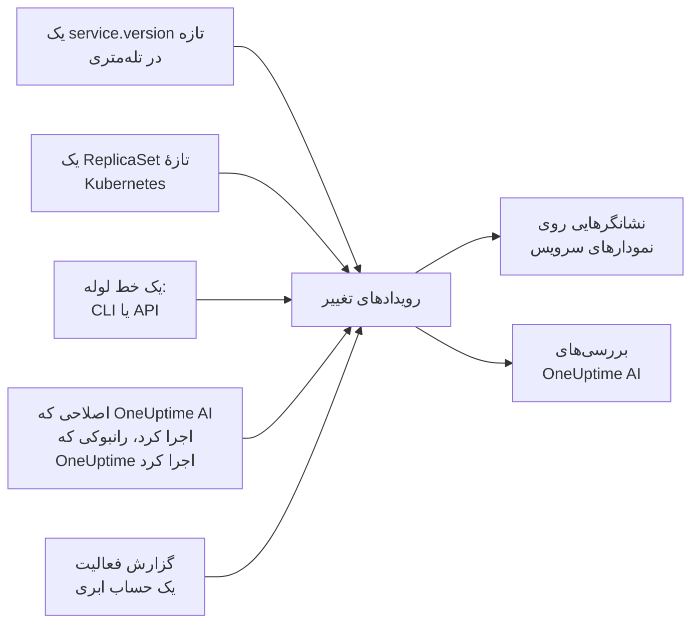

# استقرارها و تغییرها

OneUptime سابقه‌ای از آنچه در پروژهٔ شما تغییر کرده است نگه می‌دارد: استقرارها، به‌روزرسانی‌های تدریجی Kubernetes، تغییرهای پیکربندی، تغییرهای حساب‌های ابری متصل شما، و اصلاح‌هایی که خودش اجرا کرده است. هر تغییر به‌صورت یک نشانگر روی نمودارهای سرویس یا منبع ابری‌اش کشیده می‌شود، و OneUptime AI هنگام بررسی یک حادثه آن‌ها را می‌خواند، پس «درست پس از استقرار ساعت ۱۰:۰۲ شروع شد» نخستین چیزی است که می‌فهمید، نه آخرین.

:::cards
- [آنچه OneUptime خودش ثبت می‌کند](#آنچه-oneuptime-خودش-ثبت-میکند): استقرارها و به‌روزرسانی‌های تدریجی از روی تله‌متری، تغییرهای حساب‌های ابری شما، و اصلاح‌های خودش.
- [ثبت یک استقرار از خط لوله](#ثبت-یک-استقرار-از-خط-لوله): CLI، GitHub Actions و API.
- [OneUptime AI چگونه از تغییرها استفاده می‌کند](#oneuptime-ai-چگونه-از-تغییرها-استفاده-میکند): تغییرهای مشکوک در هر بررسی.
- [مرجع](#مرجع): فیلدها، ویژگی‌ها و محدودیت‌ها.
:::

## چگونه کار می‌کند



## آنچه OneUptime خودش ثبت می‌کند

برای این‌ها لازم نیست چیزی بفرستید. OneUptime آن‌ها را از تله‌متری‌ای که از قبل دریافت می‌کند، و از کارهایی که خودش انجام می‌دهد، ثبت می‌کند.

| تغییر | چه وقت ثبت می‌شود | منبع |
| --- | --- | --- |
| یک استقرار | سرویسی شروع به گزارش یک `service.version` می‌کند که پیش‌تر در محیط خودش گزارش نکرده است | `service-version` |
| یک به‌روزرسانی تدریجی | پادهای یک Deployment در Kubernetes شروع به اجرای ReplicaSetی می‌کنند که پیش‌تر اجرا نکرده‌اند: یک ایمیج تازه، یک متغیر محیطی یا ارجاع پیکربندی تغییرکرده، یا یک راه‌اندازی دوباره | `kubernetes` |
| اصلاحی که OneUptime AI اجرا کرد | یک عامل هوش مصنوعی نتیجهٔ فرمانی را گزارش می‌دهد که چیزی را تغییر می‌دهد، مانند `kubectl rollout restart` | `oneuptime-ai` |
| یک رانبوک | رانبوکی که OneUptime اجرا کرده است، پس از شروع، کامل می‌شود، شکست می‌خورد یا لغو می‌شود | `runbook` |
| یک تغییر ابری | گزارش فعالیت یک حساب ابری متصل تغییری را ثبت می‌کند: AWS CloudTrail، گزارش فعالیت Azure یا گزارش ممیزی Admin Activity در Google Cloud | `cloud` |
| یک رویداد ارائه‌دهنده | ارائه‌دهندهٔ ابر یک رویداد سلامت دربارهٔ حساب منتشر می‌کند: AWS Health، Azure Service Health یا Resource Health، یا Google Cloud Service Health | `cloud-health` |

- **نخستین نسخه‌ای که یک سرویس گزارش می‌دهد خط پایهٔ آن است، نه یک استقرار.** سرویسی که ماه‌ها در حال اجرا بوده است، در لحظه‌ای که OneUptime دریافت تله‌متری‌اش را آغاز می‌کند مستقر نمی‌شود.
- **بازگشت به نسخه‌ای که در ۳۰ روز گذشته دیده شده است ثبت نمی‌شود،** چون آن نسخه تازه نیست. بازگشتی که OneUptime AI اجرا کند به‌عنوان یک اصلاح ثبت می‌شود.
- **بیش از ۶ نسخه یا ReplicaSet تازه در یک ساعت، تا پایان آن ساعت دیگر ثبت نمی‌شوند.** وگرنه «نسخه‌ای» که با هر پاد تغییر می‌کند، مانند مهر زمانی یک build، برای هر پاد یک استقرار ثبت می‌کرد.

استقرار فقط برای سرویسی ثبت می‌شود که `service.version` را گزارش می‌دهد. آن را همراه با محیط و کامیت، در ویژگی‌های منبع SDK یا کالکتور OpenTelemetry خود تنظیم کنید:

```bash
OTEL_RESOURCE_ATTRIBUTES="service.version=2.3.1,deployment.environment.name=production,vcs.ref.head.revision=$GIT_SHA"
```

به‌روزرسانی تدریجی به [عامل Kubernetes](/docs/telemetry/kubernetes-agent) نیاز دارد، که تله‌متری هر پاد را با Deployment و ReplicaSet آن مهر می‌زند.

یک تغییر ابری یا یک رویداد ارائه‌دهنده به یک [حساب ابری متصل](/docs/telemetry/cloud-accounts) نیاز دارد. هر کدام به منبع ابری‌ای که نام می‌برد پیوند می‌خورد، اگر OneUptime آن منبع را فهرست کرده باشد، و روی نمودارهای آن منبع کشیده می‌شود. نوع آن از عملیات می‌آید: `deployment`، `scaling` یا `rollback` وقتی نام عملیات چنین بگوید، وگرنه `config-change`، و `provider-event` برای یک رویداد سلامت. نمودارهایی که به هیچ منبعی فیلتر نشده‌اند گزارش فعالیت حساب ابری را کنار می‌گذارند، تا یک حساب شلوغ استقرارهای شما را کنار نزند؛ رویدادهای سلامت ارائه‌دهنده روی آن‌ها می‌مانند.

## ثبت یک استقرار از خط لوله

یک خط لوله می‌تواند یک استقرار، یا هر تغییر دیگری، را همان لحظه که رخ می‌دهد ثبت کند: یک تغییر پیکربندی، یک مهاجرت، یک پرچم ویژگی. با یک کلید دریافت دادهٔ تله‌متری از پروژهٔ شما می‌نویسد، از همان نوعی که برنامه‌هایتان تله‌متری را با آن می‌فرستند. یکی را در **تنظیمات پروژه → تله‌متری و APM → کلیدهای دریافت داده** بسازید.

کلیدی که به یک سرویس سنجاق شده باشد، هر تغییری را زیر همان سرویس ثبت می‌کند.

:::tabs
@tab CLI
```bash
oneuptime deploy \
  --service checkout \
  --service-version 2.3.1 \
  --commit "$GIT_SHA" \
  --environment production \
  --url https://oneuptime.com \
  --ingestion-key "$ONEUPTIME_TELEMETRY_INGESTION_KEY"
```
@tab GitHub Actions
```yaml title=".github/workflows/deploy.yml"
- name: Record the deploy in OneUptime
  env:
    ONEUPTIME_URL: https://oneuptime.com
    ONEUPTIME_TELEMETRY_INGESTION_KEY: ${{ secrets.ONEUPTIME_TELEMETRY_INGESTION_KEY }}
  run: |
    npx -y @oneuptime/cli deploy \
      --service checkout \
      --service-version "${{ github.ref_name }}" \
      --commit "${{ github.sha }}" \
      --repository "${{ github.server_url }}/${{ github.repository }}" \
      --environment production
```
@tab API
```bash
curl -X POST https://oneuptime.com/telemetry/change-events/v1/ingest \
  -H "Content-Type: application/json" \
  -H "x-oneuptime-token: $ONEUPTIME_TELEMETRY_INGESTION_KEY" \
  -d '{"events": [{"serviceName": "checkout", "version": "2.3.1", "commit": "1a2b3c4", "environment": "production"}]}'
```
:::

روی یک OneUptime خودمیزبان، به‌جای `https://oneuptime.com` نشانی خودتان را به کار ببرید. API پاسخ می‌دهد که چند رویداد را ذخیره کرد و چند تا را کنار گذاشت:

```json
{ "ingested": 1, "skipped": 0 }
```

برای همهٔ گزینه‌های CLI، [`oneuptime deploy`](/docs/cli/command-reference#oneuptime-deploy) را ببینید.

## OneUptime AI چگونه از تغییرها استفاده می‌کند

هر [بررسی هوش مصنوعی](/docs/ai/ai-sre) برای یک حادثه یا هشدار از تغییرهایی آغاز می‌شود که در ۲ ساعت پیش از آن، و در ۱۰ دقیقهٔ پس از آن، ثبت شده‌اند؛ این ۱۰ دقیقه برای خط لوله‌ای است که استقرارش را پس از پایان به‌روزرسانی تدریجی ثبت می‌کند. تغییرهای روی سرویس‌ها، خوشه‌ها، میزبان‌ها و منابع ابری‌ای که حادثه به آن‌ها پیوند دارد، اول می‌آیند.

برای حداکثر ۴ تا از آن‌ها که نام یک سرویس را دارند، OneUptime تله‌متری سرویس را در ۳۰ دقیقهٔ پیش و پس از تغییر می‌خواند، و اگر سرویس درست پس از تغییر به‌طور محسوسی بدتر شده باشد، آن تغییر را **مشکوک** علامت می‌زند:

| سیگنال | چه وقت مشکوک است |
| --- | --- |
| اسپن‌های ناموفق | نرخ خطا دست‌کم دو برابر شده و دست‌کم ۱ واحد درصد بالا رفته است، روی دست‌کم ۱۰ اسپن ناموفق |
| تأخیر | p99 دست‌کم ۱٫۵ برابر شده، و دست‌کم ۱۰۰ میلی‌ثانیه افزایش یافته است |
| استثناها | در هر دقیقه دست‌کم ۳ برابر، و دست‌کم ۱۰ مورد |
| استثناهای تازه | نوعی استثنا که نخستین بار در نسخه‌ای که تغییر منتشر کرد، از ۱۰ دقیقه پیش از تغییر تا ۳۰ دقیقه پس از آن، دیده شد، دست‌کم ۳ بار رخ داده است |

OneUptime از روی همین اعداد تصمیم می‌گیرد کدام تغییر مشکوک است، نه از روی آنچه عنوان یک تغییر می‌گوید. بررسی اول تغییر مشکوک را وارسی می‌کند، می‌گوید که آیا آن تغییر باعث حادثه شده است یا نه، و می‌گوید که آیا بازگرداندنش سریع‌ترین اصلاح امن است یا نه.

وقتی تغییر مشکوک یک به‌روزرسانی تدریجی Kubernetes روی خوشه‌ای باشد که [اصلاح‌های هوش مصنوعی](/docs/ai/ai-sre#اصلاحها-چگونه-کار-میکنند) در آن روشن است، OneUptime AI اول آن را بازمی‌گرداند، با یک `kubectl rollout undo` که OneUptime از روی تغییر ثبت‌شده می‌سازد. استقراری که کد منتشر می‌کند از راه کامیت‌هایش بازگردانده می‌شود: بررسی، کامیت یا Pull Requestی را که مشکل را ایجاد کرده نام می‌برد، تا یک [Pull Request اصلاحی](/docs/ai/ai-sre#اصلاح-خودکار-کد) بتواند دقیقاً همان را برگرداند.

OneUptime همچنین هر استقرار را خودش وارسی می‌کند، چه کسی خبر شود چه نه. وقتی ۳۰ دقیقهٔ پس از یک استقرار گذشت، آن‌ها را با همان آستانه‌ها با ۳۰ دقیقهٔ پیش از آن مقایسه می‌کند، و اگر سرویس بدتر شده باشد، یک [بینش هوش مصنوعی](/docs/ai/ai-sre#بینشها-شناسایی-پیشدستانه) آن استقرار را روی همان سرویس نام می‌برد.

یک Pull Request اصلاحی که OneUptime AI باز کرده نیز به همین شکل وارسی می‌شود: به‌محض اینکه یک استقرار ثبت‌شده کامیت آن را در خود داشته باشد، OneUptime همان‌جا آنچه را اصلاح برایش بود زیر نظر می‌گیرد - استثنا، عملیاتی که سریع‌ترش کرده، مانیتورِ پشت حادثه یا هشدار، تله‌متری‌ای که می‌افزاید - و می‌گوید که آیا اصلاح جواب داد یا نه (ببینید [اصلاح خودکار کد](/docs/ai/ai-sre#اصلاح-خودکار-کد)). اصلاحِ مستقرشده فقط وقتی در نسخه استقرار خوانده می‌شود که تله‌متری خود سرویس آن نسخه را گزارش کند، و در غیر این صورت از ۱۰ دقیقه پس از استقرار، وقتی نمونه‌های قدیمی متوقف شده‌اند.

در یک بررسی و در [پرسش از هوش مصنوعی](/docs/ai/ask-ai)، `recent_changes` تغییرهای هر بازه‌ای را فهرست می‌کند، و `get_change_details` نشان می‌دهد که یک استقرار چه چیزی را منتشر کرد: کامیت‌ها از استقرار پیشین سرویس به این سو، نویسندگانشان، Pull Requestها و فایل‌هایی که تغییر دادند. این کار به کامیتِ ثبت‌شده روی تغییر نیاز دارد، و به اینکه مخزنش در کد متصل باشد: از طریق [GitHub App](/docs/ai/github-app)، یا یک اتصال GitLab، Forgejo یا Gitea ([اتصال یک مخزن](/docs/ai/ai-agent#اتصال-یک-مخزن) را ببینید).

## مرجع

### فیلدها

| فیلد | چیست |
| --- | --- |
| `title` | چه چیزی تغییر کرد، مانند `Deploy 2.3.1`. استقراری که `version` را می‌فرستد می‌تواند آن را نفرستد |
| `eventType` | نوع تغییر: `deployment` (پیش‌فرض)، `config-change`، `scaling`، `rollback`، `feature-flag` یا نوع دلخواه خودتان |
| `serviceName` | سرویسی که تغییر به آن تعلق دارد. بدون آن، تغییر در سطح کل پروژه است |
| `time` | زمان رخ دادن آن، به‌صورت ISO 8601 یا ثانیه یا میلی‌ثانیهٔ epoch. پیش‌فرض، زمان رسیدن آن است |
| `description` | جزئیات تغییر |
| `version` | نسخهٔ مستقرشده |
| `previousVersion` | نسخه‌ای که جایگزینش شد |
| `commit` | کامیت مستقرشده (یا `commitSha` یا `sha`) |
| `repository` | مخزن کامیت (یا `repositoryUrl`) |
| `branch` | شاخهٔ مستقرشده |
| `pullRequest` | Pull Request مستقرشده |
| `environment` | محیطی که در آن مستقر شد |
| `attributes` | حداکثر ۵۰ ویژگی دیگر، به‌صورت متن، عدد یا بولی |

فیلدهای سطح بالا به‌صورت ویژگی با نام‌های OpenTelemetry ذخیره می‌شوند: `version` به‌صورت `service.version`، `commit` به‌صورت `vcs.ref.head.revision`، `repository` به‌صورت `vcs.repository.url.full`، `branch` به‌صورت `vcs.ref.head.name`، `pullRequest` به‌صورت `vcs.change.id` و `environment` به‌صورت `deployment.environment.name`. ویژگی‌ای که با یکی از این نام‌ها فرستاده شود بر فیلد متناظرش مقدم است.

ویژگی‌هایی که نامشان با `oneuptime.` آغاز می‌شود متعلق به خود OneUptime هستند و از آنچه یک خط لوله می‌فرستد حذف می‌شوند. هر تغییری که یک خط لوله ثبت می‌کند این را در `oneuptime.change.source` می‌گوید، که مقدارش `api` است.

تغییری که از یک حساب ابری خوانده می‌شود، حساب و منبع را با نام‌های OpenTelemetry، یعنی `cloud.provider`، `cloud.account.id`، `cloud.region` و `cloud.resource_id`، نام می‌برد و عملیات را در `oneuptime.cloud.operation`، اجراکنندهٔ آن را در `oneuptime.cloud.actor`، شکست خوردن یا نخوردنش را در `oneuptime.change.status` و حساب ابری‌اش را در `oneuptime.cloud_account.id` نگه می‌دارد.

### محدودیت‌ها

| محدودیت | مقدار |
| --- | --- |
| رویدادها در یک درخواست | ۱۰۰ |
| عنوان | ۵۰۰ نویسه |
| توضیحات | ۵٬۰۰۰ نویسه |
| ویژگی‌ها | ۵۰ |
| زمان | زمانی که بیش از ۳۶۶ روز پیش یا بیش از ۶۰ دقیقه جلوتر باشد، با زمان رسیدن رویداد جایگزین می‌شود |

## گام‌های بعدی

:::cards
- [AI SRE](/docs/ai/ai-sre): یک بررسی چه چیزهایی را می‌خواند، و آنچه را پیدا می‌کند چگونه اصلاح می‌کند.
- [مرجع دستورها](/docs/cli/command-reference): همهٔ دستورهای CLI.
- [OpenTelemetry](/docs/telemetry/open-telemetry): تله‌متری سرویس‌هایتان را همراه با نسخه‌هایشان بفرستید.
- [اتصال یک حساب ابری](/docs/telemetry/cloud-accounts): تغییرها و رویدادهای سلامت حساب‌های AWS، Azure و Google Cloud شما.
:::
