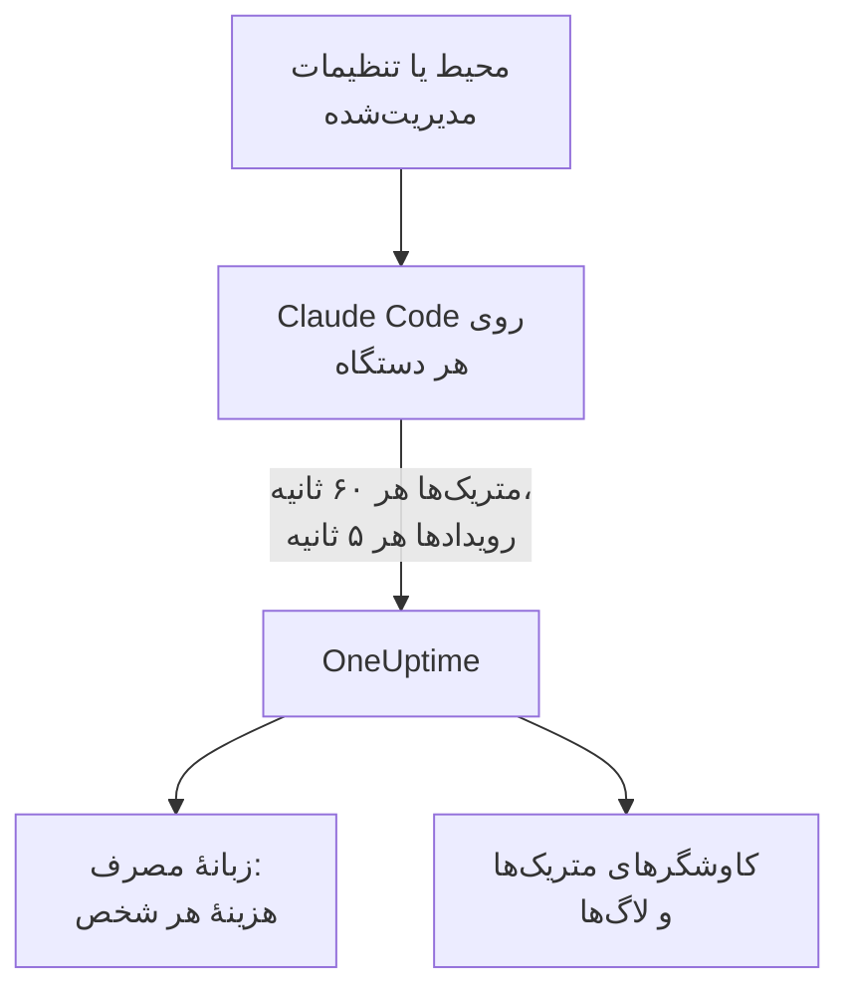

# Claude Code

Claude Code خودش متریک‌ها و رویدادهای OpenTelemetry را مستقیم به OneUptime صادر می‌کند: نه Collectorی در میان است و نه دروازه‌ای. آن را با چند متغیر محیطی روشن کنید، یا برای همهٔ دستگاه‌ها با یک فایل تنظیمات مدیریت‌شده، و هزینه، توکن‌ها، نشست‌ها، کامیت‌ها و ویرایش‌های پذیرفته‌شدهٔ هر توسعه‌دهنده را ببینید.

:::cards
- [راه‌اندازی یک دستگاه](#راهاندازی-یک-دستگاه): شش متغیر محیطی و یک راه‌اندازی دوباره.
- [گسترش به همهٔ دستگاه‌ها](#گسترش-به-همهٔ-دستگاهها): یک فایل تنظیمات مدیریت‌شده روی هر دستگاه.
- [انتساب خرج به اشخاص](#انتساب-مصرف-به-اشخاص-و-تیمها): چه کسی وارد شده است، و چه وقت باید هویت را خودتان تنظیم کنید.
- [عیب‌یابی](#عیبیابی): وقتی چیزی نمی‌رسد چه چیزی را بررسی کنید.
:::

## چگونه کار می‌کند



Claude Code این‌ها را می‌فرستد:

- **هزینه و توکن‌ها**: `claude_code.cost.usage` (USD) و `claude_code.token.usage`، به تفکیک مدل، عامل اصلی یا زیرعامل، و عامل، مهارت، افزونه یا سرور MCP که فراخوانی را انجام داد.
- **فعالیت**: نشست‌ها، کامیت‌ها، pull requestها، خطوط کد افزوده و حذف‌شده، و زمان فعال.
- **تصمیم‌های ویرایش**: `claude_code.code_edit_tool.decision` ویرایش‌های پذیرفته و ردشده را می‌شمارد، پس نرخ پذیرش برابر `accept / (accept + reject)` است، به تفکیک زبان و ابزار.
- **رویدادها**: پرامپت‌ها، نتایج ابزارها، درخواست‌ها و خطاهای API، تغییرات حالت مجوز و اتصال‌های سرور MCP، به‌صورت رکوردهای لاگ OTLP.

وقتی توسعه‌دهنده با حساب Claude وارد شده باشد، هر نقطهٔ دادهٔ متریک و هر رویداد `user.email` را با خود دارد، و OneUptime آن را روی متریک‌ها، یعنی جایی که هزینه و توکن‌ها هستند، به‌عنوان کارمند می‌خواند.

## پیش از شروع

1. یک کلید دریافت دادهٔ تله‌متری در **تنظیمات پروژه** > **تله‌متری و APM** > **کلیدهای دریافت داده** بسازید.
2. نقطهٔ پایانی OTLP شما `https://oneuptime.com/otlp` است، یا اگر OneUptime را خودتان میزبانی می‌کنید `https://YOUR-ONEUPTIME-HOST/otlp`.
3. برای همهٔ دستگاه‌ها یک کلید به کار ببرید. این کلید روی هر دستگاه توسعه‌دهنده قرار می‌گیرد، پس آن را اعتبارنامه‌ای مشترک بدانید که فقط می‌تواند داده بفرستد، و مانند هر اعتبارنامهٔ دیگری آن را دوره‌ای عوض کنید.

## راه‌اندازی یک دستگاه

:::steps
### متغیرها را صادر کنید

آن‌ها را به پروفایل shell خود (`.zshrc` یا `.bashrc`) اضافه کنید، یا در ترمینالی که Claude Code را از آن اجرا می‌کنید صادرشان کنید:

```bash
export CLAUDE_CODE_ENABLE_TELEMETRY=1
export OTEL_METRICS_EXPORTER=otlp
export OTEL_LOGS_EXPORTER=otlp
export OTEL_EXPORTER_OTLP_PROTOCOL=http/protobuf
export OTEL_EXPORTER_OTLP_ENDPOINT="https://oneuptime.com/otlp"
export OTEL_EXPORTER_OTLP_HEADERS="x-oneuptime-token=YOUR_INGESTION_TOKEN"
```

| متغیر | چه می‌کند |
| --- | --- |
| `CLAUDE_CODE_ENABLE_TELEMETRY` | کلید اصلی: بدون آن هیچ چیزی صادر نمی‌شود. |
| `OTEL_METRICS_EXPORTER`، `OTEL_LOGS_EXPORTER` | `otlp` به OneUptime می‌فرستد. `otlp,console` آنچه فرستاده می‌شود را چاپ هم می‌کند، که هنگام راه‌اندازی به کار می‌آید. |
| `OTEL_EXPORTER_OTLP_PROTOCOL` | `http/protobuf`؛ `http/json` و `grpc` هم کار می‌کنند. |
| `OTEL_EXPORTER_OTLP_ENDPOINT` | نشانی پایه. Claude Code خودش `/v1/metrics` و `/v1/logs` را اضافه می‌کند. |
| `OTEL_EXPORTER_OTLP_HEADERS` | جفت‌های `key=value` جداشده با ویرگول؛ اینجا کلید دریافت دادهٔ شما. |

### Claude Code را دوباره راه‌اندازی کنید

متغیرها هنگام آغاز Claude Code خوانده می‌شوند. متریک‌ها هر ۶۰ ثانیه و رویدادها هر ۵ ثانیه فرستاده می‌شوند، پس پیش از نگاه کردن یک دقیقه با Claude Code کار کنید.

### بررسی کنید که داده می‌رسد

**متریک‌ها** را باز کنید و `claude_code.token.usage` را بیابید، سپس **محصولات** > **هوش مصنوعی / LLM** را باز کنید و به **مصرف** بروید: هزینهٔ شما زیر ایمیلتان با برچسب **از متریک‌های GenAI** نمایش داده می‌شود.
:::

برای فرستادن متریک‌ها و رویدادها به جاهای مختلف، به‌جای آن `OTEL_EXPORTER_OTLP_METRICS_ENDPOINT` و `OTEL_EXPORTER_OTLP_LOGS_ENDPOINT` را با مسیر کامل تنظیم کنید (`https://oneuptime.com/otlp/v1/metrics`، `https://oneuptime.com/otlp/v1/logs`).

## گسترش به همهٔ دستگاه‌ها

برای یک سازمان، همین متغیرها را در یک فایل تنظیمات مدیریت‌شده توزیع کنید. این فایل شکل `settings.json` را دارد و متغیرها در یک بلوک `env` قرار می‌گیرند:

```json title="managed-settings.json"
{
  "env": {
    "CLAUDE_CODE_ENABLE_TELEMETRY": "1",
    "OTEL_METRICS_EXPORTER": "otlp",
    "OTEL_LOGS_EXPORTER": "otlp",
    "OTEL_EXPORTER_OTLP_PROTOCOL": "http/protobuf",
    "OTEL_EXPORTER_OTLP_ENDPOINT": "https://oneuptime.com/otlp",
    "OTEL_EXPORTER_OTLP_HEADERS": "x-oneuptime-token=YOUR_INGESTION_TOKEN",
    "OTEL_RESOURCE_ATTRIBUTES": "team.id=platform,cost_center=eng-123"
  }
}
```

:::steps
### فایل را جایی بگذارید که Claude Code آن را می‌خواند

| پلتفرم | مسیر |
| --- | --- |
| macOS | `/Library/Application Support/ClaudeCode/managed-settings.json` |
| Linux و WSL | `/etc/claude-code/managed-settings.json` |
| Windows | `C:\Program Files\ClaudeCode\managed-settings.json` |

Claude Code دیگر مسیر قدیمی ویندوز `C:\ProgramData\ClaudeCode\managed-settings.json` را نمی‌خواند. اگر از قبل یک فایل تنظیمات مدیریت‌شده توزیع می‌کنید، به‌جای آن یک فایل افزودنی، مانند `managed-settings.d/10-telemetry.json`، کنارش اضافه کنید: Claude Code نخست `managed-settings.json` را ادغام می‌کند و سپس هر فایل `*.json` در `managed-settings.d/` را به ترتیب الفبایی.

### یک دستگاه را بررسی کنید

`/status` را در Claude Code اجرا کنید. خط `Setting sources` باید `Enterprise managed settings (file)` باشد، یا برای یک فایل افزودنی `(drop-ins)` یا `(file + drop-ins)`. منبع دیگری در پرانتز یعنی منبعی با اولویت بالاتر برنده شده و منبع شما به کار نرفته است.

### رسیدن دستگاه‌ها را تماشا کنید

در زبانهٔ **مصرف**، هر توسعه‌دهنده به‌محض اینکه با تنظیمات تازه از Claude Code استفاده کند، به‌صورت یک ردیف نمایش داده می‌شود.
:::

همین JSON می‌تواند از تنظیمات مدیریت‌شده توسط سرور در کنسول مدیریت claude.ai (که هنگام آغاز و هر ساعت دریافت می‌شود)، از یک پروفایل پیکربندی macOS در دامنهٔ `com.anthropic.claudecode`، یا از یک مقدار `Settings` زیر `HKLM\SOFTWARE\Policies\ClaudeCode` در ویندوز هم بیاید.

:::details کدام منبع مدیریت‌شده برنده می‌شود، و متغیرهای تله‌متری چگونه ترکیب می‌شوند
به‌طور پیش‌فرض، Claude Code از منبعی با بالاترین اولویت که هر کلید سیاستی را تنظیم کند استفاده می‌کند و بقیه را نادیده می‌گیرد: تنظیمات مدیریت‌شده توسط سرور، سپس یک سیاست MDM یا سیستم‌عامل، سپس فایل‌های تنظیمات مدیریت‌شده، و سپس مقدار رجیستری `HKCU` برای هر کاربر. بلوک `env` استثناست: از نسخهٔ 2.1.223، این بلوک متغیربه‌متغیر در میان منبع‌های مدیریتی ادغام می‌شود.

متغیرهای تله‌متری این‌طور نیستند: متغیرهای `OTEL_EXPORTER_OTLP_*`، کلیدهای محتوای `OTEL_LOG_*`، `OTEL_LOGS_EXPORTER` و متغیرهای ردیابی بتا با هم از منبعی با بالاترین اولویت می‌آیند که هر کدام از آن‌ها را تنظیم کند، پس نقطهٔ پایانی یک منبع هرگز با اعتبارنامه‌های منبعی دیگر جفت نمی‌شود. اگر منبعی با اولویت بالاتر هر کدام از آن‌ها را تنظیم کند، فایل افزودنی تله‌متری هیچ اثری ندارد.

تنظیمات مدیریت‌شده توسط سرور یک گام دیگر هم لازم دارند: یک `OTEL_EXPORTER_OTLP_ENDPOINT` غیرخالی فقط پس از اینکه هر توسعه‌دهنده در یک نشست تعاملی پنجرهٔ تأیید امنیتی را بپذیرد اعمال می‌شود، و تغییرات تنظیمات صادرکننده از اجرای بعدی اعمال می‌شوند. فایل‌ها و سیاست‌های MDM پنجرهٔ تأیید ندارند.
:::

:::details عوض کردن کلید دریافت داده بدون ویرایش هر دستگاه
به‌جای یک سرآیند ثابت، `"otelHeadersHelper": "/path/to/generate-otel-headers.sh"` را در تنظیمات قرار دهید. اسکریپت یک شیء JSON تخت از سرآیندها چاپ می‌کند، مانند `{"x-oneuptime-token":"..."}`. Claude Code آن را هنگام آغاز و سپس هر `CLAUDE_CODE_OTEL_HEADERS_HELPER_DEBOUNCE_MS` میلی‌ثانیه دوباره اجرا می‌کند (به‌طور پیش‌فرض `1740000`، یعنی ۲۹ دقیقه). خطاها در `/status` نمایش داده می‌شوند.
:::

## انتساب مصرف به اشخاص و تیم‌ها

**کارمند همان `user.email` است.** Claude Code وقتی توسعه‌دهنده با حساب Claude وارد شده باشد آن را می‌فرستد، و هیچ متغیری برای خاموش کردنش وجود ندارد. OneUptime آن را بدون هیچ تنظیمی از هر نقطهٔ دادهٔ هزینه و توکن می‌خواند.

**روش‌های دیگر ورود هیچ ایمیلی نمی‌فرستند.** با یک کلید API، یا با Claude روی Amazon Bedrock، Google Cloud یا Microsoft Foundry، هیچ حساب Claudeی در نشست نیست و Claude Code فقط `user.id` و `session.id` را می‌فرستد. هویت را خودتان، برای هر دستگاه، در تنظیمات مدیریت‌شده یا یک اسکریپت اجرا تنظیم کنید:

```bash
export OTEL_RESOURCE_ATTRIBUTES="user.email=jdoe@example.com,team.id=platform"
```

**`user.id` یک شخص نیست.** شناسه‌ای تصادفی است که Claude Code در نخستین اجرا در `~/.claude.json` می‌نویسد: یکی برای هر نصب، و اگر فایل پاک شود یکی تازه. بدون ایمیل، هر نصب به‌صورت ردیف جداگانهٔ خودش نمایش داده می‌شود. یک استثنا: نشستی که به دروازهٔ برنامه‌های Claude وارد شده باشد، هویت واردشده را می‌فرستد (`user.id` شناسهٔ موضوع در ارائه‌دهندهٔ هویت است و `user.email` ایمیل) و کلیدهای `user.*` را که خودتان تنظیم کرده‌اید نادیده می‌گیرد.

**تیم‌ها و مراکز هزینه** از `OTEL_RESOURCE_ATTRIBUTES` می‌آیند: OneUptime `team.id`، `team`، `cost_center` و `department` را می‌خواند. مقدارها نمی‌توانند فاصله داشته باشند و گیومه هم آن‌ها را محافظت نمی‌کند: `team=Platform_Engineering` بنویسید، یا از کدگذاری درصدی استفاده کنید، مانند `team=Platform%20Engineering`. Claude Code این کلیدها را روی هر نقطهٔ داده کپی می‌کند (`OTEL_METRICS_INCLUDE_RESOURCE_ATTRIBUTES`، به‌طور پیش‌فرض روشن)، و OneUptime آن‌ها را در هر دو حالت می‌خواند. کلیدی که شما تنظیم می‌کنید هرگز کلیدی را که Claude Code خودش تنظیم می‌کند بازنویسی نمی‌کند.

## آنچه OneUptime نشان می‌دهد

در **محصولات** > **هوش مصنوعی / LLM** > **مصرف**، `claude_code.cost.usage` جدول‌های **کارمند** ، **تیم** و **مدل** را پر می‌کند، و `claude_code.token.usage` مجموع توکن‌ها را. دو قاعده تعیین می‌کند چه می‌بینید:

- **متریک‌ها جای خالی spanها را پر می‌کنند؛ هرگز به آن‌ها افزوده نمی‌شوند.** اگر همان پروژه از برنامه‌های خودتان spanهای GenAI دارای هزینه دریافت کند، خرج Claude Code نمایش داده نمی‌شود. Claude Code را به پروژه‌ای جداگانه بفرستید. [نخست spanها، متریک‌ها جای خالی را پر می‌کنند](/docs/telemetry/ai-llm-observability#نخست-spanها-متریکها-جای-خالی-را-پر-میکنند) را ببینید.
- **ردیفی که از متریک‌ها می‌آید فقط هزینه دارد.** خانه‌های فراخوانی و توکن آن `—` نشان می‌دهند، و جدول‌های **ارائه‌دهنده** و **برنامه / سرویس** خالی می‌مانند: متریک‌ها نام هیچ ارائه‌دهنده‌ای را نمی‌آورند و به هیچ سرویس OneUptime تعلق ندارند.

هر چیز دیگری، مانند نرخ پذیرش، خطوط کد، کامیت‌ها و pull requestهای هر توسعه‌دهنده، یا خرج به تفکیک `query_source`، را از متریک‌های زیر روی یک [داشبورد](/docs/dashboards/index) نمودار می‌کنید و با یک [مانیتور متریک‌ها](/docs/monitor/metrics-monitor) برایش هشدار می‌گذارید.

## متریک‌ها

هر متریک یک شمارنده است و علاوه بر ویژگی‌های خودش، ویژگی‌های استاندارد را هم دارد.

| متریک | واحد | ویژگی‌های خودش |
| --- | --- | --- |
| `claude_code.session.count` | ندارد | `start_type`: `fresh`، `resume`، `continue`، `agents_view` |
| `claude_code.lines_of_code.count` | ندارد | `type`: `added`، `removed`؛ `model` |
| `claude_code.commit.count` | ندارد | ندارد |
| `claude_code.pull_request.count` | ندارد | ندارد |
| `claude_code.cost.usage` | USD | `model`؛ `query_source`: `main`، `subagent`، `auxiliary`؛ `speed`: `fast`، `normal`؛ `effort`؛ `agent.name`، `skill.name`، `plugin.name`، `marketplace.name`، `mcp_server.name`، `mcp_tool.name` |
| `claude_code.token.usage` | توکن | `type`: `input`، `output`، `cacheRead`، `cacheCreation`؛ و همان ویژگی‌های `claude_code.cost.usage` |
| `claude_code.code_edit_tool.decision` | ندارد | `tool_name`: `Edit`، `Write`، `NotebookEdit`؛ `decision`: `accept`، `reject`؛ `source`؛ `language` |
| `claude_code.active_time.total` | ثانیه | `type`: `user` (پشت صفحه‌کلید)، `cli` (ابزارها و پاسخ‌های مدل) |

ویژگی‌های استاندارد عبارت‌اند از `session.id`، `app.version`، `app.entrypoint`، `organization.id`، `user.account_uuid`، `user.account_id`، `user.id`، `user.email` و `terminal.type`، به‌علاوهٔ `OTEL_RESOURCE_ATTRIBUTES` شما. برخی از آن‌ها را می‌توان خاموش کرد: [حجم متریک‌ها را پایین نگه دارید](#حجم-متریکها-را-پایین-نگه-دارید) را ببینید.

- نوع‌های توکن cache با camelCase نوشته می‌شوند: `cacheRead` و `cacheCreation`. مجموع توکن‌های OneUptime فقط `input` و `output` را می‌شمارد.
- روی متریک‌های هزینه و توکن، نام عامل‌ها و سرورهای MCP خودتان، و افزونه‌ها و مهارت‌های شخص ثالث، `custom` یا `third-party` نمایش داده می‌شود، مگر اینکه `OTEL_LOG_TOOL_DETAILS=1` تنظیم شده باشد (Claude Code 2.1.273 یا جدیدتر).

## رویدادها

رویدادها به‌صورت رکوردهای لاگ OTLP می‌رسند، هر کدام با `event.name`، `event.timestamp` و `event.sequence`. آن‌هایی که بیش از همه به کار می‌برید:

| رویداد | چه چیزی را ثبت می‌کند |
| --- | --- |
| `claude_code.user_prompt` | یک پرامپت: طول و فرمانش؛ متن فقط اگر آن را روشن کنید |
| `claude_code.api_request` | یک درخواست به مدل: `model`، `cost_usd`، `cost_usd_micros`، `duration_ms`، `input_tokens`، `output_tokens`، توکن‌های cache |
| `claude_code.api_error` | درخواستی که پس از تلاش‌های دوباره‌اش ناموفق ماند: `model`، `error`، `status_code`، `attempt` |
| `claude_code.tool_result` | یک اجرای ابزار: `tool_name`، `success`، `duration_ms`، و تصمیمی که اجازه‌اش را داد |
| `claude_code.tool_decision` | اینکه آیا یک ابزار مجاز شد، و چه چیزی تصمیم گرفت |
| `claude_code.mcp_server_connection` | اتصال یا شکست یک سرور MCP |

Claude Code رویدادهای بسیار دیگری هم می‌فرستد، مانند امتناع‌ها، تغییرات حالت مجوز و رویدادهای افزونه، hook و مهارت: [مرجع پایش](https://code.claude.com/docs/en/monitoring-usage) در Anthropic همهٔ آن‌ها را فهرست می‌کند. در `cost_usd_micros`، هزینه عددی صحیح از یک‌میلیونیم‌های دلار است که بدون خطای گرد کردن جمع می‌شود.

## حجم متریک‌ها را پایین نگه دارید

Claude Code به‌طور پیش‌فرض `session.id` را روی هر نقطهٔ داده می‌گذارد و هر نشست یک سری تازه است. در میان همهٔ دستگاه‌ها، همین یک ویژگی حجم متریک‌ها را بالا می‌برد، و گزارش هزینه به آن نیازی ندارد:

```bash
export OTEL_METRICS_INCLUDE_SESSION_ID=false
```

| متغیر | پیش‌فرض | اضافه می‌کند |
| --- | --- | --- |
| `OTEL_METRICS_INCLUDE_SESSION_ID` | `true` | `session.id`، مقداری تازه در هر نشست |
| `OTEL_METRICS_INCLUDE_VERSION` | `false` | `app.version` |
| `OTEL_METRICS_INCLUDE_ACCOUNT_UUID` | `true` | `user.account_uuid` و `user.account_id` |
| `OTEL_METRICS_INCLUDE_ENTRYPOINT` | `false` | `app.entrypoint` |
| `OTEL_METRICS_INCLUDE_RESOURCE_ATTRIBUTES` | `true` | کلیدهای `OTEL_RESOURCE_ATTRIBUTES` شما |
| `OTEL_METRICS_INCLUDE_REPOSITORY` | `false` | ویژگی‌های `vcs.*` مخزن |

`user.email`، `user.id`، `organization.id` و `terminal.type` هیچ کلید خاموش‌کننده‌ای ندارند. رویدادها پرحجم‌ترین سیگنال‌اند: هر توسعه‌دهندهٔ فعال هر ۵ ثانیه ارسال می‌کند (`OTEL_LOGS_EXPORT_INTERVAL`، به میلی‌ثانیه). آن را بالا ببرید تا دسته‌های کمتر و بزرگ‌تری فرستاده شوند، یا اگر فقط به هزینه و مصرف نیاز دارید، که همه در متریک‌ها هستند، `OTEL_LOGS_EXPORTER=none` را تنظیم کنید.

## محتوای پرامپت و ابزار به‌طور پیش‌فرض خاموش است

Claude Code پرامپت‌ها، پاسخ‌ها، آرگومان‌های ابزار یا خروجی ابزار را صادر نمی‌کند، مگر اینکه هر کدام را روشن کنید:

| متغیر | پیش‌فرض | `1` چه چیزی را روشن می‌کند |
| --- | --- | --- |
| `OTEL_LOG_USER_PROMPTS` | خاموش | متن پرامپت |
| `OTEL_LOG_ASSISTANT_RESPONSES` | خاموش | متن پاسخ؛ اگر تنظیم نشده باشد، از `OTEL_LOG_USER_PROMPTS` پیروی می‌کند |
| `OTEL_LOG_TOOL_DETAILS` | خاموش | پارامترهای ابزار، فرمان‌های Bash، و نام واقعی عامل‌ها، افزونه‌ها، مهارت‌ها و سرورهای MCP |
| `OTEL_LOG_TOOL_CONTENT` | خاموش | ورودی و خروجی ابزار، فقط روی spanهای ترِیس |
| `OTEL_LOG_RAW_API_BODIES` | خاموش | بدنهٔ کامل درخواست‌ها و پاسخ‌های API (`file:<dir>` به‌جای آن، آن‌ها را روی دیسک می‌نویسد) |

پیشنهاد می‌کنیم آن‌ها را خاموش بگذارید: متریک‌ها و رویدادهای پوشانده‌شده از پیش پاسخ می‌دهند چه کسی، روی کدام مدل و با چه نرخ پذیرشی، چه خرج کرده است. ثبت محتوا پرامپت‌ها، کد منبع و خروجی ابزار را به انبار تله‌متری‌ای می‌برد که کنترل دسترسی‌اش با مخزن‌های شما فرق دارد. اگر آن را برای یک بررسی روشن می‌کنید، `CLAUDE_CODE_OTEL_CONTENT_MAX_LENGTH` (به‌طور پیش‌فرض `61440`) مقدار ارسالی در هر رکورد را محدود می‌کند، و **قواعد پالایش** و **فیلترهای حذف** ترِیس‌ها، در **ترِیس‌ها** > **تنظیمات**، آن را پیش از ذخیره می‌پوشانند یا حذف می‌کنند.

## متریک‌ها به‌صورت دلتا می‌رسند

Claude Code به‌طور پیش‌فرض متریک‌های دلتا می‌فرستد: هر نقطهٔ داده افزایشی است از آخرین صادرات، نه یک مجموع جاری. وقتی آن‌ها را نمودار می‌کنید یا برایشان هشدار می‌گذارید، نقطه‌های داده را در طول پنجره جمع بزنید، و مانند یک شمارندهٔ انباشتی تابع نرخ یا بازنشانی شمارنده به کار نبرید: عددها اشتباه درمی‌آیند، بی‌آنکه خراب به نظر برسند.

```bash
export OTEL_EXPORTER_OTLP_METRICS_TEMPORALITY_PREFERENCE=cumulative
```

`cumulative` را فقط وقتی ثابت کنید که همهٔ صادرکننده‌های سازمانتان از آن استفاده کنند، و این دو را در میان دستگاه‌ها مخلوط نکنید.

## ترِیس‌ها (بتا)

Claude Code یک صادرکنندهٔ ترِیس در نسخهٔ بتا هم دارد که هر تعامل را به‌صورت درختی از spanها رسم می‌کند: `claude_code.interaction`، با `claude_code.llm_request` و `claude_code.tool` زیر آن.

```bash
export CLAUDE_CODE_ENHANCED_TELEMETRY_BETA=1
export OTEL_TRACES_EXPORTER=otlp
```

> [!WARNING]
> نسخهٔ بتای ترِیس‌ها را از پروژه‌ای که برای خرج به کار می‌برید دور نگه دارید. spanهای مدل آن `gen_ai.system` و `gen_ai.request.model` را دارند، پس OneUptime آن‌ها را در **فراخوانی‌ها** فهرست می‌کند، ولی توکن‌هایشان در `input_tokens` و `output_tokens` است، نه در کلیدهای `gen_ai.usage.*`، پس بدون توکن و بدون هزینه می‌رسند. به‌محض اینکه وجود داشته باشند، همین‌ها ردیف‌هایی‌اند که جدول‌های **کارمند** ، **تیم** و **مدل** نشان می‌دهند، با $0، به‌جای خرجی که از متریک‌ها می‌آید.

در نشست‌های Agent SDK و نشست‌های غیرتعاملی `-p`، Claude Code یک `TRACEPARENT` ورودی را برمی‌دارد تا spanهایش به ترِیس فراخواننده بپیوندند؛ نشست‌های تعاملی آن را نادیده می‌گیرند. سرآیند `traceparent` را فقط وقتی به مدل می‌فرستد که `ANTHROPIC_BASE_URL` تنظیم نشده یا API از Anthropic باشد؛ پشت پراکسی خودتان، `CLAUDE_CODE_PROPAGATE_TRACEPARENT=1` را تنظیم کنید.

## عیب‌یابی

:::details اصلاً چیزی نمی‌رسد
نخست `CLAUDE_CODE_ENABLE_TELEMETRY=1` را بررسی کنید: بدون آن هیچ متغیر دیگری کاری نمی‌کند. سپس `console` را به صادرکننده‌ها اضافه کنید (`OTEL_METRICS_EXPORTER=otlp,console`) و ترمینال را تماشا کنید: اگر نقطه‌های داده چاپ می‌شوند، Claude Code درست کار می‌کند و مشکل در نقطهٔ پایانی، کلید یا شبکه است.
:::

:::details فایل تنظیمات مدیریت‌شده نادیده گرفته می‌شود
`/status` را اجرا کنید و خط `Setting sources` را بخوانید. اگر هیچ منبع مدیریت‌شده‌ای فهرست نشده، فایل در مسیر اشتباه است، JSON معتبر نیست، یا حساب توسعه‌دهنده نمی‌تواند آن را بخواند. اگر منبع دیگری فهرست شده، همان برنده شده و منبع شما به کار نرفته است. تنظیمات مدیریت‌شده توسط سرور همچنین منتظر می‌مانند تا توسعه‌دهنده در یک نشست تعاملی پنجرهٔ تأیید را بپذیرد.
:::

:::details خرج به‌صورت بدون انتساب، یا یک ردیف برای هر نصب، نمایش داده می‌شود
این توسعه‌دهندگان با حساب Claude وارد نشده‌اند: از یک کلید API، Amazon Bedrock، Google Cloud یا Microsoft Foundry استفاده می‌کنند. برای آن‌ها `user.email` را در `OTEL_RESOURCE_ATTRIBUTES` تنظیم کنید، همان‌طور که [انتساب مصرف به اشخاص و تیم‌ها](#انتساب-مصرف-به-اشخاص-و-تیمها) نشان می‌دهد.
:::

:::details تیم یا مرکز هزینه وجود ندارد
بررسی کنید که `OTEL_RESOURCE_ATTRIBUTES` روی دستگاه تنظیم شده، فاصله ندارد، و کلیدی را که Claude Code خودش تنظیم می‌کند دوباره به کار نمی‌برد: مقدار Claude Code برنده است.
:::

:::details عددها خیلی کوچک یا خیلی بزرگ به نظر می‌رسند
Claude Code دلتا می‌فرستد: نقطه‌های داده را در طول پنجره جمع بزنید، همان‌طور که [متریک‌ها به‌صورت دلتا می‌رسند](#متریکها-بهصورت-دلتا-میرسند) توضیح می‌دهد. و یک دقیقهٔ کامل صبر کنید: متریک‌ها هر ۶۰ ثانیه فرستاده می‌شوند.
:::

:::details کلید رد می‌شود
OneUptime یک `x-oneuptime-token` نادرست را رد می‌کند. کلید را دوباره از **تنظیمات پروژه** > **تله‌متری و APM** > **کلیدهای دریافت داده** کپی کنید، و بررسی کنید که سرآیند بدون فاصله در دو طرف `=` به شکل `x-oneuptime-token=YOUR_INGESTION_TOKEN` باشد.
:::

## گام‌های بعدی

:::cards
- [دستیارهای کدنویسی هوش مصنوعی](/docs/telemetry/ai-coding-assistants): خرج در میان همهٔ دستیارهای کدنویسی چگونه منتسب می‌شود.
- [مشاهده‌پذیری هوش مصنوعی / LLM](/docs/telemetry/ai-llm-observability): گفتگوها، هشدارها، هزینه و بودجه‌ها برای فراخوانی‌های هوش مصنوعی خودتان.
- [مانیتور متریک‌ها](/docs/monitor/metrics-monitor): برای خرج یا توکن‌های هر توسعه‌دهنده هشدار بگذارید.
:::
