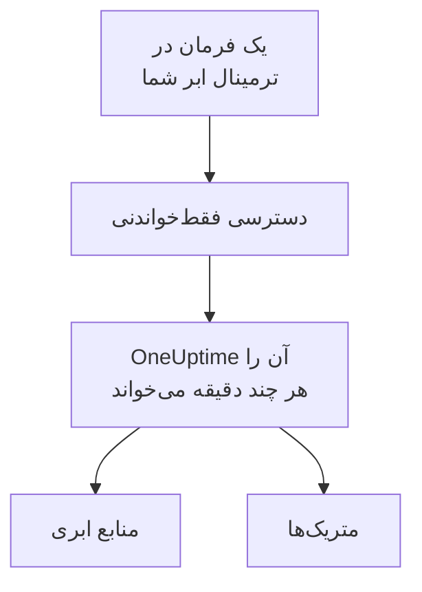

# اتصال یک حساب ابری

یک حساب AWS، یک اشتراک Azure یا یک پروژهٔ Google Cloud را از داشبورد متصل کنید تا OneUptime منابع آن را فهرست کند و متریک‌های کلیدی‌شان را طبق زمان‌بندی بخواند. یک فرمان را در ترمینال مرورگرِ خود ابرتان اجرا می‌کنید و آنچه چاپ می‌کند را جای‌گذاری می‌کنید: نه Collectorی برای اجرا هست و نه چیزی برای نصب.

:::cards
- [Amazon Web Services](#amazon-web-services): یک نقش IAM که OneUptime با آن وارد می‌شود، یا یک کلید دسترسی.
- [Microsoft Azure](#microsoft-azure): یک برنامه با نقش Monitoring Reader.
- [Google Cloud](#google-cloud): یک حساب سرویس با نقش Monitoring Viewer.
- [آنچه OneUptime می‌خواند](#آنچه-oneuptime-میخواند): کدام منابع و متریک‌ها، هر چند وقت یک‌بار، و با چه هزینه‌ای.
:::

## چگونه کار می‌کند



- **این دسترسی فقط می‌تواند بخواند.** فرمان دسترسی‌ای می‌سازد که متریک‌ها را می‌خواند و هیچ کار دیگری نمی‌کند: سه کنش خواندن در AWS، نقش **Monitoring Reader** در Azure و نقش **Monitoring Viewer** در Google Cloud. برای قطع دسترسی OneUptime آن را حذف کنید.
- **OneUptime طبق زمان‌بندی می‌خواند.** برای Azure و Google Cloud هر ۵ دقیقه و برای AWS هر ۱۰ دقیقه، مگر اینکه هنگام اتصال بازهٔ دیگری انتخاب کنید.
- **هر منبع صفحهٔ خودش را دارد.** منابع در **ابر** > **همه منابع** همراه با متریک‌های کلیدی، مالکان و برچسب‌هایشان نمایش داده می‌شوند، مانند منابعی که یک Collector گزارش می‌دهد.

## پیش از شروع

- **مالک یا مدیر پروژه.** فقط آن‌ها می‌توانند حساب‌های ابری را متصل، آزمایش و ویرایش کنند.
- **ترمینال ابر شما** (AWS CloudShell، Azure Cloud Shell یا Google Cloud Shell)، که کسی در آن وارد شده باشد که بتواند نقش یا کاربر IAM، ثبت برنامه یا حساب سرویس بسازد.

## Amazon Web Services

:::steps
### فرم AWS را باز کنید

به **ابر** > **اتصال** بروید و **Amazon Web Services** را انتخاب کنید.

### فرمان را در AWS CloudShell اجرا کنید

انتخاب کنید OneUptime چگونه وارد شود. **نقش IAM** روش توصیه‌شده است: هیچ چیز محرمانه‌ای ذخیره نمی‌شود و هر زمان بخواهید می‌توانید نقش را حذف کنید. فرم فرمانی را نشان می‌دهد که برای پروژهٔ شما نوشته شده است: نقشی می‌سازد که با شناسهٔ خارجی پروژهٔ شما به حساب AWS متعلق به OneUptime اعتماد می‌کند، و ARN نقش را چاپ می‌کند. وقتی استفاده از نقش ممکن نیست، از **کلید دسترسی** استفاده کنید. این فرمان کاربری با همان مجوزها می‌سازد و کلید آن را چاپ می‌کند:

```bash
aws iam create-user --user-name OneUptimeReadOnly > /dev/null 2>&1 || true
aws iam put-user-policy --user-name OneUptimeReadOnly --policy-name OneUptimeReadOnly --policy-document '{"Version":"2012-10-17","Statement":[{"Effect":"Allow","Action":["cloudwatch:GetMetricData","cloudwatch:ListMetrics","tag:GetResources"],"Resource":"*"}]}'
aws iam create-access-key --user-name OneUptimeReadOnly
```

### آنچه فرمان AWS چاپ کرد را جای‌گذاری کنید

همهٔ آنچه فرمان چاپ کرد را در **آنچه فرمان چاپ کرد** جای‌گذاری کنید. OneUptime از آن ARN نقش، یا شناسهٔ کلید دسترسی و راز آن را برمی‌دارد.

### AWS را آزمایش و متصل کنید

با باز شدن این مرحله، OneUptime اتصال را آزمایش می‌کند: وارد می‌شود، منابعی را که پیدا می‌کند می‌شمارد و می‌گوید خواندن آن‌ها چه هزینه‌ای دارد. برای ذخیره، **اتصال** را انتخاب کنید.
:::

این نقش و این کاربر سه کار می‌توانند بکنند، و نه هیچ کار دیگری:

| کنش | OneUptime از آن برای چه استفاده می‌کند |
| --- | --- |
| `cloudwatch:ListMetrics` | یافتن منابعی که در هر منطقه متریک گزارش می‌دهند |
| `cloudwatch:GetMetricData` | خواندن متریک‌های کلیدی آن‌ها |
| `tag:GetResources` | نام‌گذاری هر منبع با برچسب `Name` آن |

> [!NOTE]
> در یک OneUptime خودمیزبان، روش **نقش IAM** به یک هویت AWS متعلق به خودِ OneUptime نیاز دارد: `CLOUD_CONNECT_AWS_ACCESS_KEY_ID` و `CLOUD_CONNECT_AWS_SECRET_ACCESS_KEY` را روی کلید یک کاربر IAM تنظیم کنید که بتواند `sts:AssumeRole` را فراخوانی کند. بدون آن‌ها، فرم یک **کلید دسترسی** پیشنهاد می‌دهد.

## Microsoft Azure

:::steps
### فرم Azure را باز کنید

به **ابر** > **اتصال** بروید و **Microsoft Azure** را انتخاب کنید.

### فرمان را در Azure Cloud Shell اجرا کنید

این فرمان برنامه‌ای با نقش **Monitoring Reader** روی اشتراک فعلی شما می‌سازد و جزئیات آن را چاپ می‌کند:

```bash
az ad sp create-for-rbac --name OneUptimeReadOnly --role "Monitoring Reader" --scopes "/subscriptions/$(az account show --query id --output tsv)"
```

### آنچه فرمان Azure چاپ کرد را جای‌گذاری کنید

همهٔ آنچه فرمان چاپ کرد را در **آنچه فرمان چاپ کرد** جای‌گذاری کنید. OneUptime از آن `tenant`، `appId` و `password` را برمی‌دارد.

### Azure را آزمایش و متصل کنید

با باز شدن این مرحله، OneUptime اتصال را آزمایش می‌کند. برای ذخیره، **اتصال** را انتخاب کنید.
:::

برای خواندن اشتراک‌های بیشتر با همان برنامه، نقش را روی هر یک از آن‌ها به برنامه بدهید:

```bash
az role assignment create --assignee <APP_ID> --role "Monitoring Reader" --scope /subscriptions/<SUBSCRIPTION_ID>
```

OneUptime همهٔ اشتراک‌هایی را که برنامه می‌تواند بخواند می‌خواند، مگر اینکه چند اشتراک را در **اشتراک‌ها** فهرست کنید.

## Google Cloud

:::steps
### فرم Google Cloud را باز کنید

به **ابر** > **اتصال** بروید و **Google Cloud** را انتخاب کنید.

### فرمان را در Google Cloud Shell اجرا کنید

آن را در پروژه‌ای اجرا کنید که می‌خواهید پایش شود. API مربوط به Cloud Monitoring را روشن می‌کند، یک حساب سرویس با نقش **Monitoring Viewer** می‌سازد و کلید آن را چاپ می‌کند:

```bash
PROJECT_ID=$(gcloud config get-value project)
gcloud services enable monitoring.googleapis.com
gcloud iam service-accounts create oneuptime-read-only --display-name "OneUptime (read only)"
gcloud projects add-iam-policy-binding "$PROJECT_ID" --member "serviceAccount:oneuptime-read-only@$PROJECT_ID.iam.gserviceaccount.com" --role roles/monitoring.viewer --condition=None > /dev/null
gcloud iam service-accounts keys create oneuptime-key.json --iam-account "oneuptime-read-only@$PROJECT_ID.iam.gserviceaccount.com"
cat oneuptime-key.json && rm oneuptime-key.json
```

### کلید را جای‌گذاری کنید

همهٔ آنچه فرمان چاپ کرد را جای‌گذاری کنید. OneUptime پروژهٔ خودِ کلید را می‌خواند و کلید را رمزگذاری‌شده ذخیره می‌کند.

### Google Cloud را آزمایش و متصل کنید

با باز شدن این مرحله، OneUptime اتصال را آزمایش می‌کند. برای ذخیره، **اتصال** را انتخاب کنید.
:::

برای خواندن پروژه‌های بیشتر با همان حساب سرویس، نقش را در هر یک از آن‌ها به آن بدهید و آن‌ها را در **پروژه‌ها** فهرست کنید:

```bash
gcloud projects add-iam-policy-binding <PROJECT_ID> --member "serviceAccount:oneuptime-read-only@<KEY_PROJECT_ID>.iam.gserviceaccount.com" --role roles/monitoring.viewer
```

## آنچه OneUptime می‌خواند

| | AWS | Azure | Google Cloud |
| --- | --- | --- | --- |
| منابع | منابعی که در هر منطقه‌ای که استفاده می‌کنید به CloudWatch متریک گزارش می‌دهند | همهٔ منابع اشتراک‌ها | منابعی که به Cloud Monitoring متریک گزارش می‌دهند |
| متریک‌ها | متریک‌های کلیدی هر سرویس، مانند CPU، شبکه و بررسی‌های وضعیت یک نمونه | تا ۸ متریک کلیدی برای هر منبع | متریک‌های کلیدی هر نوع منبع |
| خواندن هر | ۱۰ دقیقه | ۵ دقیقه | ۵ دقیقه |
| منبع حذف‌شده | پس از ۷ روز بدون متریک بایگانی می‌شود | در خواندن بعدی بایگانی می‌شود | پس از ۷ روز بدون متریک بایگانی می‌شود |

هر خواندن از جایی ادامه می‌یابد که خواندن قبلی متوقف شد، پس هر نقطهٔ داده فقط یک‌بار نوشته می‌شود. نخستین خواندن یک اتصال تازه ظرف یک دقیقه آغاز می‌شود و یک ساعت به عقب برمی‌گردد؛ پس از یک وقفه، یک خواندن حداکثر ۶ ساعت به عقب برمی‌گردد.

فراخوانی‌های OneUptime با قیمت‌های ابر شما به حساب ابری‌تان صورت‌حساب می‌شود. آزمایش هزینهٔ آنچه را پیدا می‌کند برآورد می‌کند، و خواندنِ کم‌تر هزینهٔ کم‌تری دارد: **فاصلهٔ خواندن متریک‌ها** را در **فیلدهای بیشتر** تغییر دهید.

| ابر | قیمت |
| --- | --- |
| AWS | CloudWatch `GetMetricData`: $۰٫۰۱ برای هر ۱٬۰۰۰ متریک، و هر متریک کلیدی یک منبع در هر خواندن یک متریک است |
| Azure | نخستین ۱٬۰۰۰٬۰۰۰ خواندن متریک در ماه برای هر اشتراک رایگان است، سپس $۰٫۰۱ برای هر ۱٬۰۰۰ |
| Google Cloud | نخستین ۱٬۰۰۰٬۰۰۰ سری زمانی خوانده‌شده در ماه رایگان است، سپس $۰٫۵۰ برای هر میلیون |

## عیب‌یابی

:::details آزمایش می‌گوید کلید یا راز پذیرفته نشد
همهٔ آنچه فرمان چاپ کرد را کپی کنید و دوباره جای‌گذاری کنید. کلیدی که یک دقیقه پیش ساخته شده ممکن است یک دقیقه طول بکشد تا کار کند.
:::

:::details آزمایش وارد می‌شود، اما نمی‌تواند بخواند
فرمان را دوباره اجرا کنید: نقشی را که OneUptime نیاز دارد اعطا می‌کند. در AWS، فرمانی را اجرا کنید که فرم برای همین پروژه نشان می‌دهد: نقشی که برای پروژهٔ دیگری ساخته شده به شناسهٔ خارجی آن پروژه اعتماد دارد، نه به شناسهٔ این پروژه.
:::

:::details Google Cloud اجازه نمی‌دهد فرمان کلید بسازد
یک خط‌مشی سازمانی، `iam.disableServiceAccountKeyCreation`، می‌تواند کلیدهای حساب سرویس را ممنوع کند. از مدیر سازمانتان برای این پروژه استثنا بخواهید، یا [متریک‌ها را با Collector خودتان بفرستید](/docs/telemetry/cloud-resources).
:::

:::details هیچ منبعی نمایش داده نمی‌شود
در AWS و Google Cloud، یک منبع زمانی نمایش داده می‌شود که متریک گزارش دهد. اگر اتصالی کار نمی‌کند، **View error** در **ابر** > **اتصال** می‌گوید چرا آخرین خواندنش ناموفق بود.
:::

## گام‌های بعدی

:::cards
- [منابع ابری](/docs/telemetry/cloud-resources): به‌جای آن Collector خودتان را با OpenTelemetry اجرا کنید، یا متریک‌های CloudWatch را جریانی بفرستید.
- [مانیتور متریک‌ها](/docs/monitor/metrics-monitor): بر اساس متریک‌های یک منبع هشدار بگیرید.
:::
