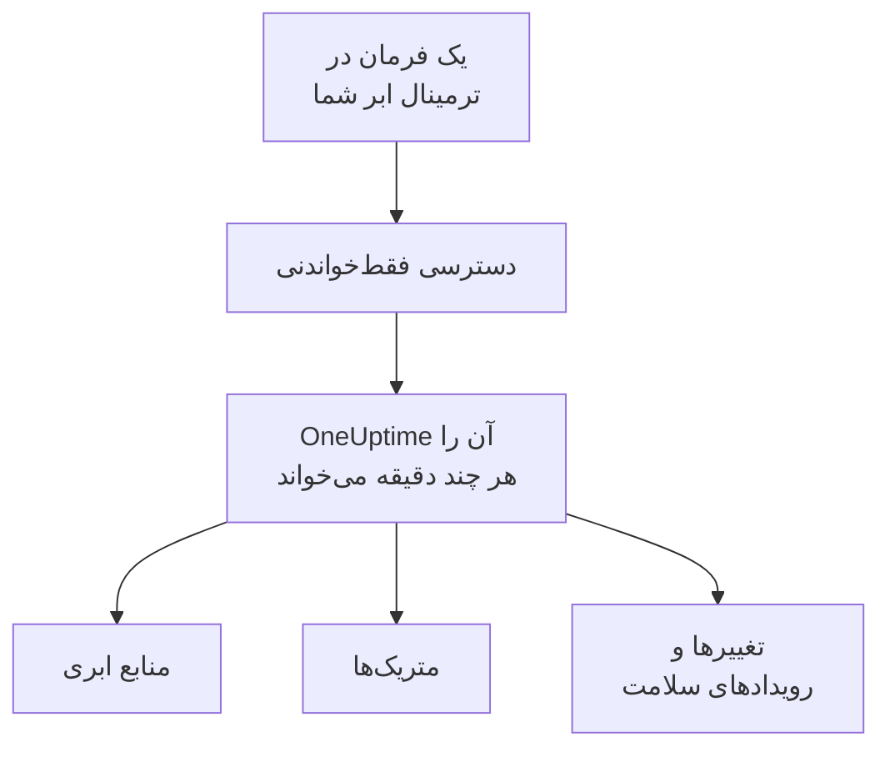

# اتصال یک حساب ابری

یک حساب AWS، یک اشتراک Azure یا یک پروژهٔ Google Cloud را از داشبورد متصل کنید تا OneUptime همهٔ منابع آن را فهرست کند، متریک‌های کلیدی‌شان را بخواند، و ثبت کند چه چیزی در آن‌ها تغییر کرده و ارائه‌دهندهٔ ابر شما دربارهٔ سلامت آن‌ها چه می‌گوید. یک فرمان را در ترمینال مرورگرِ خود ابرتان اجرا می‌کنید و آنچه چاپ می‌کند را جای‌گذاری می‌کنید: نه Collectorی برای اجرا هست و نه چیزی برای نصب.

:::cards
- [Amazon Web Services](#amazon-web-services): یک نقش IAM که OneUptime با آن وارد می‌شود، یا یک کلید دسترسی.
- [Microsoft Azure](#microsoft-azure): یک برنامه با نقش Monitoring Reader.
- [Google Cloud](#google-cloud): یک حساب سرویس با چهار نقش فقط‌خواندنی.
- [آنچه OneUptime می‌خواند](#آنچه-oneuptime-میخواند): منابع، متریک‌ها، تغییرها و رویدادهای سلامت، هر چند وقت یک‌بار، و با چه هزینه‌ای.
- [اجازه به هوش مصنوعی برای رفع مشکلات](#اجازه-به-هوش-مصنوعی-برای-رفع-مشکلات): یک فرمان دیگر، و OneUptime AI می‌تواند آنچه را پیدا می‌کند رفع کند.
:::

## چگونه کار می‌کند



- **این دسترسی فقط می‌تواند بخواند.** فرمان دسترسی‌ای می‌سازد که منابع شما و پیکربندی آن‌ها، متریک‌هایشان، آنچه تغییر کرده و رویدادهای سلامت ارائه‌دهندهٔ شما را می‌خواند و هیچ کار دیگری نمی‌کند: کنش‌های فهرست‌شده در زیر در AWS، نقش **Monitoring Reader** در Azure و چهار نقش بیننده در Google Cloud. OneUptime هرگز با آن داده یا رازها را نمی‌خواند، جز خط‌های لاگ، وقتی اجازه دهید هوش مصنوعی لاگ‌های یک حساب را بخواند. برای قطع دسترسی OneUptime آن را حذف کنید.
- **OneUptime طبق زمان‌بندی می‌خواند.** برای Azure و Google Cloud هر ۵ دقیقه و برای AWS هر ۱۰ دقیقه، مگر اینکه هنگام اتصال بازهٔ دیگری انتخاب کنید. هر خواندن همچنین ثبت می‌کند که از خواندن قبلی چه چیزی تغییر کرده، و هر ۳۰ دقیقه یک خواندن همهٔ منابع را دوباره فهرست می‌کند.
- **هر منبع صفحهٔ خودش را دارد.** منابع در **ابر** > **همه منابع** همراه با متریک‌های کلیدی، مالکان و برچسب‌هایشان نمایش داده می‌شوند. صفحهٔ یک منبع فهرست‌شده همچنین کارت **منابع مرتبط** (اینکه در چه چیزی اجرا می‌شود، چه چیزی به آن ترافیک می‌فرستد)، نقطه‌های پایانی، تگ‌ها و تنظیماتش، و برگه‌های **حوادث**، **هشدارها** و **تغییرها** را نشان می‌دهد.
- **هر حساب صفحهٔ خودش را دارد.** حساب‌ها در **ابر** > **حساب‌ها** همراه با منابعشان بر اساس نوع و منطقه، برگهٔ **تغییرها** و یک **توپولوژی** از چگونگی پیوند منابعشان با هم نمایش داده می‌شوند.
- **OneUptime AI آنچه را تغییر کرده می‌خواند.** بررسی یک حادثه یا هشدارِ پیوندشده به یک منبع ابری، نخست تغییرهای آن منبع را می‌خواند و هنگام شروع، گزارش فعالیت حساب را دوباره می‌خواند.

## پیش از شروع

- **مالک یا مدیر پروژه.** فقط آن‌ها می‌توانند حساب‌های ابری را متصل، آزمایش و ویرایش کنند.
- **ترمینال ابر شما** (AWS CloudShell، Azure Cloud Shell یا Google Cloud Shell)، که کسی در آن وارد شده باشد که بتواند نقش یا کاربر IAM، ثبت برنامه یا حساب سرویس بسازد.

## Amazon Web Services

:::steps
### فرم AWS را باز کنید

به **ابر** > **اتصال** بروید و **Amazon Web Services** را انتخاب کنید.

### فرمان را در AWS CloudShell اجرا کنید

انتخاب کنید OneUptime چگونه وارد شود. **نقش IAM** روش توصیه‌شده است: هیچ چیز محرمانه‌ای ذخیره نمی‌شود و هر زمان بخواهید می‌توانید نقش را حذف کنید. فرم فرمانی را نشان می‌دهد که برای پروژهٔ شما نوشته شده است: نقشی می‌سازد که با شناسهٔ خارجی پروژهٔ شما به حساب AWS متعلق به OneUptime اعتماد می‌کند، و ARN نقش را چاپ می‌کند.

در **چه چیزی خوانده شود**، این حساب یا همهٔ حساب‌های AWS Organization خود را انتخاب کنید. فرمان سازمان را در حساب مدیریت آن اجرا کنید: یک StackSet اضافه می‌کند که همان نقش را در هر حساب قرار می‌دهد، اکنون و هنگامی که حساب‌های تازه می‌پیوندند، و به نقش حساب مدیریت اجازه می‌دهد حساب‌ها را فهرست کند. یک اتصال حداکثر ۵۰ حساب را می‌خواند.

وقتی استفاده از نقش ممکن نیست، از **کلید دسترسی** استفاده کنید: فقط حساب خودش را می‌خواند. این فرمان کاربری با همان مجوزها می‌سازد و کلید آن را چاپ می‌کند:

```bash
aws iam create-user --user-name OneUptimeReadOnly > /dev/null 2>&1 || true
aws iam put-user-policy --user-name OneUptimeReadOnly --policy-name OneUptimeReadOnly --policy-document '{"Version":"2012-10-17","Statement":[{"Effect":"Allow","Action":["cloudwatch:GetMetricData","cloudwatch:ListMetrics","tag:GetResources","iam:ListAccountAliases","cloudformation:ListResources","ec2:DescribeInstances","ec2:DescribeVolumes","ec2:DescribeVpcs","ec2:DescribeNatGateways","autoscaling:DescribeAutoScalingGroups","elasticloadbalancing:DescribeLoadBalancers","elasticloadbalancing:DescribeLoadBalancerAttributes","elasticloadbalancing:DescribeTargetGroups","elasticloadbalancing:DescribeTargetGroupAttributes","elasticloadbalancing:DescribeTargetHealth","elasticloadbalancing:DescribeTags","ecs:ListClusters","ecs:DescribeClusters","ecs:ListServices","ecs:DescribeServices","lambda:ListFunctions","rds:DescribeDBInstances","rds:DescribeDBClusters","elasticache:DescribeReplicationGroups","sqs:ListQueues","sqs:GetQueueAttributes","sns:ListTopics","sns:GetTopicAttributes","sns:ListSubscriptionsByTopic","dynamodb:ListTables","dynamodb:DescribeTable","kinesis:ListStreams","kinesis:DescribeStreamSummary","states:ListStateMachines","states:DescribeStateMachine","cloudfront:ListDistributions","elasticfilesystem:DescribeFileSystems","es:ListDomainNames","es:DescribeDomains","apprunner:ListServices","apprunner:DescribeService","cloudtrail:LookupEvents","health:DescribeEvents","health:DescribeEventDetails","rds:DescribeEvents","autoscaling:DescribeScalingActivities","ec2:DescribeInstanceStatus","ecs:DescribeTaskDefinition","lambda:GetFunctionConfiguration","lambda:GetFunctionConcurrency","lambda:GetAlias","servicequotas:ListServiceQuotas","logs:DescribeLogGroups","logs:FilterLogEvents"],"Resource":"*"},{"Effect":"Allow","Action":["apigateway:GET"],"Resource":["arn:aws:apigateway:*::/restapis","arn:aws:apigateway:*::/restapis/*","arn:aws:apigateway:*::/apis","arn:aws:apigateway:*::/apis/*"]}]}'
aws iam create-access-key --user-name OneUptimeReadOnly
```

### آنچه فرمان AWS چاپ کرد را جای‌گذاری کنید

همهٔ آنچه فرمان چاپ کرد را در **آنچه فرمان چاپ کرد** جای‌گذاری کنید. OneUptime ARN نقش، یا شناسهٔ کلید دسترسی و راز آن را بیرون می‌کشد.

### AWS را آزمایش و متصل کنید

OneUptime همین که این مرحله باز می‌شود اتصال را آزمایش می‌کند: وارد می‌شود، منابعی را که پیدا می‌کند می‌شمارد و می‌گوید خواندن آن‌ها چه هزینه‌ای دارد. برای ذخیره، **اتصال** را انتخاب کنید.
:::

این نقش و این کاربر این کارها را می‌توانند بکنند، و نه هیچ کار دیگری:

| OneUptime از آن‌ها برای چه استفاده می‌کند | کنش‌ها |
| --- | --- |
| یافتن منابعی که متریک گزارش می‌دهند، و خواندن متریک‌هایشان | `cloudwatch:GetMetricData`, `cloudwatch:ListMetrics` |
| نام‌گذاری هر منبع و خواندن تگ‌هایش | `tag:GetResources`, `iam:ListAccountAliases` |
| فهرست کردن هر منبع و پیکربندی آن، از راه Cloud Control | `cloudformation:ListResources`, `ec2:DescribeInstances`, `ec2:DescribeVolumes`, `ec2:DescribeVpcs`, `ec2:DescribeNatGateways`, `autoscaling:DescribeAutoScalingGroups`, `elasticloadbalancing:DescribeLoadBalancers`, `elasticloadbalancing:DescribeLoadBalancerAttributes`, `elasticloadbalancing:DescribeTargetGroups`, `elasticloadbalancing:DescribeTargetGroupAttributes`, `elasticloadbalancing:DescribeTargetHealth`, `elasticloadbalancing:DescribeTags`, `ecs:ListClusters`, `ecs:DescribeClusters`, `ecs:ListServices`, `ecs:DescribeServices`, `lambda:ListFunctions`, `rds:DescribeDBInstances`, `rds:DescribeDBClusters`, `elasticache:DescribeReplicationGroups`, `sqs:ListQueues`, `sqs:GetQueueAttributes`, `sns:ListTopics`, `sns:GetTopicAttributes`, `sns:ListSubscriptionsByTopic`, `dynamodb:ListTables`, `dynamodb:DescribeTable`, `kinesis:ListStreams`, `kinesis:DescribeStreamSummary`, `states:ListStateMachines`, `states:DescribeStateMachine`, `cloudfront:ListDistributions`, `elasticfilesystem:DescribeFileSystems`, `es:ListDomainNames`, `es:DescribeDomains`, `apprunner:ListServices`, `apprunner:DescribeService`, `apigateway:GET` |
| خواندن آنچه تغییر کرده: رویدادهای مدیریتی حساب | `cloudtrail:LookupEvents` |
| خواندن رویدادهای سلامت خودِ AWS برای حساب | `health:DescribeEvents`, `health:DescribeEventDetails` |
| خواندن وضعیت کنونی و رویدادهای اخیر یک منبع در حین بررسی | `rds:DescribeEvents`, `autoscaling:DescribeScalingActivities`, `ec2:DescribeInstanceStatus`, `ecs:DescribeTaskDefinition`, `lambda:GetFunctionConfiguration`, `lambda:GetFunctionConcurrency`, `lambda:GetAlias` |
| خواندن سهمیه‌های حساب در حین بررسی | `servicequotas:ListServiceQuotas` |
| خواندن خط‌های لاگ، فقط وقتی اجازه دهید هوش مصنوعی لاگ‌های یک حساب را بخواند | `logs:DescribeLogGroups`, `logs:FilterLogEvents` |
| فهرست کردن حساب‌های سازمان، از حساب مدیریت آن | `organizations:ListAccounts` |

`apigateway:GET` فقط روی تعریف‌های خودِ APIها مجاز است، هرگز روی کلیدهایشان، و فقط نقش حساب مدیریت می‌تواند حساب‌های سازمان را فهرست کند. AWS Health فقط به حساب‌هایی پاسخ می‌دهد که طرح پشتیبانی Business، Enterprise On-Ramp یا Enterprise دارند: بدون آن، OneUptime یک روز بعد دوباره می‌پرسد.

> [!NOTE]
> در یک OneUptime خودمیزبان، روش **نقش IAM** به یک هویت AWS متعلق به خودِ OneUptime نیاز دارد: `CLOUD_CONNECT_AWS_ACCESS_KEY_ID` و `CLOUD_CONNECT_AWS_SECRET_ACCESS_KEY` را روی کلید یک کاربر IAM تنظیم کنید که بتواند `sts:AssumeRole` را فراخوانی کند. بدون آن‌ها، فرم یک **کلید دسترسی** پیشنهاد می‌دهد.

## Microsoft Azure

:::steps
### فرم Azure را باز کنید

به **ابر** > **اتصال** بروید و **Microsoft Azure** را انتخاب کنید.

### فرمان را در Azure Cloud Shell اجرا کنید

این فرمان برنامه‌ای با نقش **Monitoring Reader** روی اشتراک فعلی شما می‌سازد و جزئیات آن را همراه با تاریخ انقضای رازش چاپ می‌کند:

```bash
SCOPE="/subscriptions/$(az account show --query id --output tsv)"
OUT=$(az ad sp create-for-rbac --name OneUptimeReadOnly --role "Monitoring Reader" --scopes "$SCOPE")
APP=$(echo "$OUT" | jq -r .appId)
END=$(az ad app credential list --id "$APP" --query "max([].endDateTime)" --output tsv)
echo "$OUT" | jq --arg end "$END" '. + {endDateTime: $end}'
```

در **چه چیزی خوانده شود** به‌جای آن همهٔ اشتراک‌های مستأجر را انتخاب کنید تا نقش روی گروه مدیریت ریشهٔ مستأجر قرار گیرد:

```bash
SCOPE="/providers/Microsoft.Management/managementGroups/$(az account show --query tenantId --output tsv)"
OUT=$(az ad sp create-for-rbac --name OneUptimeReadOnly --role "Monitoring Reader" --scopes "$SCOPE")
APP=$(echo "$OUT" | jq -r .appId)
END=$(az ad app credential list --id "$APP" --query "max([].endDateTime)" --output tsv)
echo "$OUT" | jq --arg end "$END" '. + {endDateTime: $end}'
```

### آنچه فرمان Azure چاپ کرد را جای‌گذاری کنید

همهٔ آنچه فرمان چاپ کرد را در **آنچه فرمان چاپ کرد** جای‌گذاری کنید. OneUptime مقدارهای `tenant`، `appId`، `password` و تاریخ انقضا را بیرون می‌کشد.

### Azure را آزمایش و متصل کنید

OneUptime همین که این مرحله باز می‌شود اتصال را آزمایش می‌کند. برای ذخیره، **اتصال** را انتخاب کنید.
:::

برای خواندن اشتراک‌های بیشتر با همان برنامه، نقش را در هر کدام از آن‌ها به آن بدهید:

```bash
az role assignment create --assignee <APP_ID> --role "Monitoring Reader" --scope /subscriptions/<SUBSCRIPTION_ID>
```

OneUptime هر اشتراکی را که برنامه می‌تواند بخواند، تا ۵۰ اشتراک، می‌خواند، مگر اینکه چند اشتراک را در **اشتراک‌ها** فهرست کنید. راز برنامه در تاریخ انقضایش از کار می‌افتد: از ۳۰ روز پیش از آن، هر خواندن دربارهٔ آن اخطار می‌دهد. برای دادن یک راز تازه، فرمان را دوباره اجرا کنید و آنچه چاپ می‌کند را جای‌گذاری کنید.

## Google Cloud

:::steps
### فرم Google Cloud را باز کنید

به **ابر** > **اتصال** بروید و **Google Cloud** را انتخاب کنید.

### فرمان را در Google Cloud Shell اجرا کنید

آن را در پروژه‌ای که باید پایش شود اجرا کنید. APIهایی را که OneUptime می‌خواند روشن می‌کند، یک حساب سرویس با نقش‌های **Monitoring Viewer**، **Cloud Asset Viewer**، **Logs Viewer** و **Service Health Viewer** می‌سازد، و کلید آن را چاپ می‌کند:

```bash
PROJECT_ID=$(gcloud config get-value project)
gcloud services enable monitoring.googleapis.com cloudasset.googleapis.com logging.googleapis.com cloudresourcemanager.googleapis.com servicehealth.googleapis.com
gcloud iam service-accounts create oneuptime-read-only --display-name "OneUptime (read only)" > /dev/null 2>&1 || true
gcloud projects add-iam-policy-binding "$PROJECT_ID" --member "serviceAccount:oneuptime-read-only@$PROJECT_ID.iam.gserviceaccount.com" --role roles/monitoring.viewer --condition=None > /dev/null
gcloud projects add-iam-policy-binding "$PROJECT_ID" --member "serviceAccount:oneuptime-read-only@$PROJECT_ID.iam.gserviceaccount.com" --role roles/cloudasset.viewer --condition=None > /dev/null
gcloud projects add-iam-policy-binding "$PROJECT_ID" --member "serviceAccount:oneuptime-read-only@$PROJECT_ID.iam.gserviceaccount.com" --role roles/logging.viewer --condition=None > /dev/null
gcloud projects add-iam-policy-binding "$PROJECT_ID" --member "serviceAccount:oneuptime-read-only@$PROJECT_ID.iam.gserviceaccount.com" --role roles/servicehealth.viewer --condition=None > /dev/null
gcloud iam service-accounts keys create oneuptime-key.json --iam-account "oneuptime-read-only@$PROJECT_ID.iam.gserviceaccount.com"
cat oneuptime-key.json && rm oneuptime-key.json
```

در **چه چیزی خوانده شود** به‌جای آن همهٔ پروژه‌های سازمان را انتخاب کنید تا نقش‌ها روی سازمانِ پروژه قرار گیرند:

```bash
PROJECT_ID=$(gcloud config get-value project)
ORG_ID=$(gcloud projects get-ancestors "$PROJECT_ID" --format="value(id)" | tail -1)
gcloud services enable monitoring.googleapis.com cloudasset.googleapis.com logging.googleapis.com cloudresourcemanager.googleapis.com servicehealth.googleapis.com
gcloud iam service-accounts create oneuptime-read-only --display-name "OneUptime (read only)" > /dev/null 2>&1 || true
gcloud organizations add-iam-policy-binding "$ORG_ID" --member "serviceAccount:oneuptime-read-only@$PROJECT_ID.iam.gserviceaccount.com" --role roles/monitoring.viewer --condition=None > /dev/null
gcloud organizations add-iam-policy-binding "$ORG_ID" --member "serviceAccount:oneuptime-read-only@$PROJECT_ID.iam.gserviceaccount.com" --role roles/cloudasset.viewer --condition=None > /dev/null
gcloud organizations add-iam-policy-binding "$ORG_ID" --member "serviceAccount:oneuptime-read-only@$PROJECT_ID.iam.gserviceaccount.com" --role roles/logging.viewer --condition=None > /dev/null
gcloud organizations add-iam-policy-binding "$ORG_ID" --member "serviceAccount:oneuptime-read-only@$PROJECT_ID.iam.gserviceaccount.com" --role roles/servicehealth.viewer --condition=None > /dev/null
gcloud iam service-accounts keys create oneuptime-key.json --iam-account "oneuptime-read-only@$PROJECT_ID.iam.gserviceaccount.com"
cat oneuptime-key.json && rm oneuptime-key.json
```

### کلید را جای‌گذاری کنید

همهٔ آنچه فرمان چاپ کرد را جای‌گذاری کنید. OneUptime پروژهٔ خودِ کلید را می‌خواند و کلید را رمزگذاری‌شده ذخیره می‌کند.

### Google Cloud را آزمایش و متصل کنید

OneUptime همین که این مرحله باز می‌شود اتصال را آزمایش می‌کند. برای ذخیره، **اتصال** را انتخاب کنید.
:::

برای خواندن پروژه‌های بیشتر با همان حساب سرویس، چهار نقش را در هر کدام از آن‌ها به آن بدهید و آن‌ها را در **پروژه‌ها** فهرست کنید:

```bash
for ROLE in roles/monitoring.viewer roles/cloudasset.viewer roles/logging.viewer roles/servicehealth.viewer; do gcloud projects add-iam-policy-binding <PROJECT_ID> --member "serviceAccount:oneuptime-read-only@<KEY_PROJECT_ID>.iam.gserviceaccount.com" --role "$ROLE"; done
```

اتصال یک سازمان حداکثر ۵۰ پروژهٔ آن را می‌خواند، مگر اینکه چند پروژه را در **پروژه‌ها** فهرست کنید.

## آنچه OneUptime می‌خواند

| | AWS | Azure | Google Cloud |
| --- | --- | --- | --- |
| منابع | هر منبع از نوع‌هایی که OneUptime می‌شناسد، در هر منطقه‌ای که استفاده می‌کنید، از Cloud Control | هر منبع در اشتراک‌ها، از Resource Graph | هر منبع در پروژه‌ها، از Cloud Asset Inventory |
| متریک‌ها | متریک‌های کلیدی هر سرویس، مانند CPU، شبکه و بررسی‌های وضعیت یک نمونه | تا ۸ متریک کلیدی برای هر منبع | متریک‌های کلیدی هر نوع منبع |
| تغییرها | رویدادهای مدیریتی CloudTrail | رویدادهای اداری گزارش فعالیت | گزارش ممیزی Admin Activity |
| رویدادهای سلامت | AWS Health | Service Health و Resource Health | Service Health |
| خواندن هر | ۱۰ دقیقه | ۵ دقیقه | ۵ دقیقه |
| منبع حذف‌شده | وقتی یک فهرست کامل دیگر آن را ندارد بایگانی می‌شود | وقتی یک فهرست کامل دیگر آن را ندارد بایگانی می‌شود | وقتی یک فهرست کامل دیگر آن را ندارد بایگانی می‌شود |

هر خواندن از جایی ادامه می‌یابد که خواندن قبلی متوقف شد، پس هر نقطهٔ داده و هر تغییر فقط یک‌بار نوشته می‌شود. نخستین خواندن یک اتصال تازه ظرف یک دقیقه آغاز می‌شود و برای متریک‌ها یک ساعت و برای تغییرها ۲ ساعت به عقب برمی‌گردد؛ پس از یک وقفه، یک خواندن حداکثر ۶ ساعت به عقب برمی‌گردد. منبعی که فقط متریک گزارش می‌دهد و هیچ فهرستی آن را ندارد، پس از ۷ روز بدون متریک بایگانی می‌شود.

فراخوانی‌های OneUptime با قیمت‌های ابر شما به حساب ابری‌تان صورت‌حساب می‌شود. فهرست کردن منابع و خواندن تغییرها و رویدادهای سلامت در هر سه ابر رایگان است؛ خواندن متریک‌ها هزینه دارد. آزمایش هزینهٔ آنچه را پیدا می‌کند برآورد می‌کند، و خواندنِ کم‌تر هزینهٔ کم‌تری دارد: **فاصلهٔ خواندن متریک‌ها** را در **فیلدهای بیشتر** تغییر دهید.

| ابر | قیمت |
| --- | --- |
| AWS | CloudWatch `GetMetricData`: $۰٫۰۱ برای هر ۱٬۰۰۰ متریک، و هر متریک کلیدی یک منبع در هر خواندن یک متریک است |
| Azure | نخستین ۱٬۰۰۰٬۰۰۰ خواندن متریک در ماه برای هر اشتراک رایگان است، سپس $۰٫۰۱ برای هر ۱٬۰۰۰ |
| Google Cloud | نخستین ۱٬۰۰۰٬۰۰۰ سری زمانی خوانده‌شده در ماه رایگان است، سپس $۰٫۵۰ برای هر میلیون |

## آنچه در OneUptime می‌بینید

- **صفحهٔ یک حساب.** در **ابر** > **حساب‌ها**، نمای کلی یک حساب منابع آن را بر اساس نوع و منطقه می‌شمارد و می‌گوید یک اتصال آخرین بار کی آن را خوانده است. برگهٔ **منابع** آن‌ها را فهرست می‌کند، برگهٔ **تغییرها** آنچه در آن تغییر کرده را از تازه‌ترین فهرست می‌کند، و **توپولوژی** منطقه‌هایش، شبکه‌های درون آن‌ها و آنچه در هر کدام اجرا می‌شود را می‌کشد، همراه با حوادث و هشدارهای باز روی منابعی که به آن‌ها پیوند خورده‌اند.
- **تغییرهای یک منبع.** یک تغییر به‌صورت یک رویداد تغییر نگه داشته می‌شود که به منبعی که تغییر داد و به حساب آن پیوند خورده، و به‌صورت یک نشانگر روی نمودارهای متریک منبع همراه با حوادث و هشدارهایش کشیده می‌شود. نمودارهایی که به هیچ منبعی فیلتر نشده‌اند گزارش فعالیت حساب ابری را کنار می‌گذارند، تا یک حساب شلوغ استقرارهای شما را کنار نزند؛ رویدادهای سلامت ارائه‌دهنده روی آن‌ها می‌مانند.
- **حوادث و هشدارها.** یک منبع ابری را در منابع پیوندشدهٔ یک مانیتور، یک حادثه یا یک هشدار پیوند دهید تا حوادث و هشدارهای آن در صفحهٔ منبع فهرست شوند. یک مانیتور وب‌سایت، API، SSL، ping یا پورت که میزبانش، مستقیم یا از راه DNS، به نقطهٔ پایانی یک منبع می‌رسد، آن منبع را زیر **منابع ابری پیشنهادی** روی کارت **منابع پیوندشده** خود فهرست می‌کند: برای پیوند دادنش **پیوند منبع** را انتخاب کنید.

## اجازه به هوش مصنوعی برای رفع مشکلات

OneUptime AI هنگام بررسی، هر حساب متصل را با همان دسترسی فقط‌خواندنی بالا می‌خواند. برای اینکه مشکلات را هم رفع کند، مانند راه‌اندازی دوبارهٔ یک سرویس، افزایش مقیاس آن یا بازگرداندنش به نسخهٔ قبل، حساب را در **ابر** > **حساب‌ها** باز کنید و در کارت **عامل هوش مصنوعی** در **نمای کلی** آن، **اجازه به هوش مصنوعی برای رفع مشکلات** را انتخاب کنید.

این کادر گفت‌وگو یک پرسش دارد، **هوش مصنوعی تا کجا پیش برود؟** و دو پاسخ: **اول از من بپرسد**، که پیش‌فرض است و در آن OneUptime AI هر اصلاح را پیشنهاد می‌دهد و یک نفر آن را با یک کلیک تأیید می‌کند، یا **مشکلات کم‌خطر را خودش رفع کند**، که در آن تغییرهای بی‌خطر خودبه‌خود اجرا می‌شوند و تغییرهای پرخطرتر همچنان منتظر تأیید می‌مانند. بقیهٔ تنظیمات زیر **پیشرفته** یک پیش‌فرض امن دارند. سپس فرمانی را نشان می‌دهد که برای همین حساب نوشته شده است: آن را در AWS CloudShell، Azure Cloud Shell یا Google Cloud Shell اجرا کنید، در حالی که به‌عنوان کسی وارد شده‌اید که می‌تواند در حساب نقش بسازد. این فرمان نقشی می‌سازد که فقط می‌تواند تغییرهای روشن‌شده را انجام دهد، و عامل هوش مصنوعی ابری را با آن در حساب شما راه‌اندازی می‌کند. عامل خودش ظرف چند دقیقه وصل می‌شود و کادر گفت‌وگو همین را نشان می‌دهد: چیزی برای جای‌گذاری برگشتی نیست.

عامل یک کانتینر کوچک است که تمام ماه در حساب شما اجرا می‌شود، و ابرتان با قیمت‌های اعلام‌شدهٔ خودش صورت‌حساب آن را می‌دهد:

| ابر | چه اجرا می‌شود | حدود |
| --- | --- | --- |
| AWS | یک وظیفهٔ ECS Fargate با ۰٫۲۵ vCPU و ۰٫۵ GB، و نشانی IPv4 عمومی آن، با قیمت‌های `us-east-1` | $۱۳ در ماه |
| Azure | یک replica از Container Apps با ۰٫۲۵ vCPU و ۰٫۵ GiB، پس از سهمیهٔ رایگان ماهانهٔ اشتراک، یعنی ۱۸۰٬۰۰۰ vCPU-ثانیه و ۳۶۰٬۰۰۰ GiB-ثانیه | $۱۴ در ماه |
| Google Cloud | یک نمونهٔ Cloud Run با ۱ vCPU و ۰٫۵ GiB و CPU همیشه تخصیص‌یافته، که یک vCPU کامل را می‌گیرد، پس از ردهٔ رایگان ماهانه، یعنی ۲۴۰٬۰۰۰ vCPU-ثانیه و ۴۵۰٬۰۰۰ GiB-ثانیه | $۴۵ در ماه |

آنچه عامل می‌تواند تغییر دهد، اینکه هر تغییر چگونه سطح‌بندی و بازگردانده می‌شود، و اینکه لاگ‌هایش را چگونه بخوانید: [عامل‌های هوش مصنوعی زیرساخت](/docs/ai/infrastructure-ai-agents#در-یک-حساب-ابری).

## عیب‌یابی

:::details آزمایش می‌گوید کلید یا راز پذیرفته نشد
همهٔ آنچه فرمان چاپ کرد را کپی کنید و دوباره جای‌گذاری کنید. کلیدی که یک دقیقه پیش ساخته شده ممکن است یک دقیقه طول بکشد تا کار کند. راز منقضی‌شدهٔ Azure هم پذیرفته نمی‌شود: فرمان را دوباره اجرا کنید.
:::

:::details آزمایش وارد می‌شود، اما نمی‌تواند بخواند
فرمان را دوباره اجرا کنید: نقش‌هایی را که OneUptime نیاز دارد اعطا می‌کند. در AWS، فرمانی را اجرا کنید که فرم برای همین پروژه نشان می‌دهد: نقشی که برای پروژهٔ دیگری ساخته شده به شناسهٔ خارجی آن پروژه اعتماد دارد، نه به شناسهٔ این پروژه.
:::

:::details Google Cloud اجازه نمی‌دهد فرمان کلید بسازد
یک خط‌مشی سازمانی، `iam.disableServiceAccountKeyCreation`، می‌تواند کلیدهای حساب سرویس را ممنوع کند. از مدیر سازمانتان برای این پروژه استثنا بخواهید، یا [متریک‌ها را با Collector خودتان بفرستید](/docs/telemetry/cloud-resources).
:::

:::details هیچ منبعی نمایش داده نمی‌شود
نخستین خواندن همهٔ منابع حساب را فهرست می‌کند، چه متریک گزارش دهند چه نه. اگر اتصالی کار نمی‌کند، **View error** در **ابر** > **اتصال** می‌گوید چرا آخرین خواندنش ناموفق بود.
:::

:::details برخی از حساب‌های سازمان نیستند
یک اتصال حداکثر ۵۰ حساب، اشتراک یا پروژه را می‌خواند، و هر خواندن وقتی بیشتر باشند این را می‌گوید. بقیه را با یک اتصال جداگانه متصل کنید.
:::

## گام‌های بعدی

:::cards
- [منابع ابری](/docs/telemetry/cloud-resources): به‌جای آن Collector خودتان را با OpenTelemetry اجرا کنید، یا متریک‌های CloudWatch را جریانی بفرستید.
- [استقرارها و تغییرها](/docs/telemetry/change-events): هر تغییری که OneUptime ثبت می‌کند، و اینکه OneUptime AI چگونه آن‌ها را می‌خواند.
- [مانیتور متریک‌ها](/docs/monitor/metrics-monitor): بر اساس متریک‌های یک منبع هشدار بگیرید.
:::
