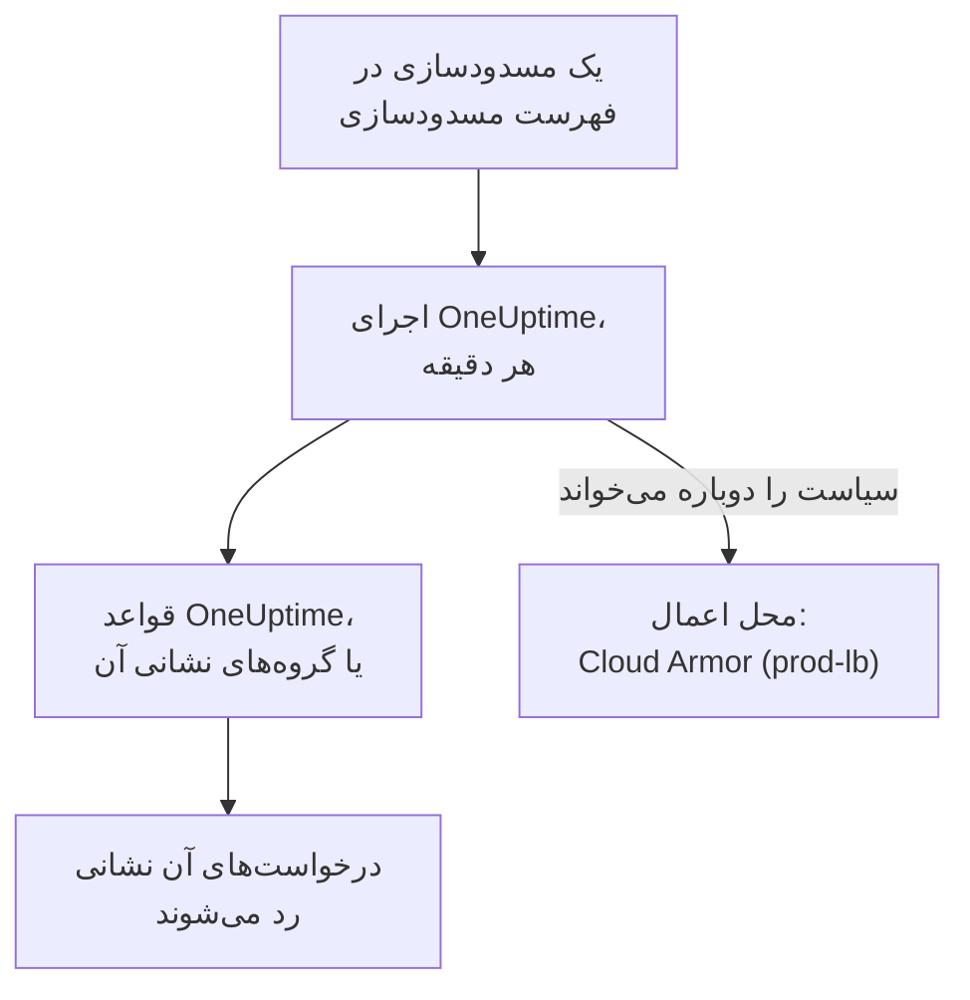

# مسدود کردن نشانی‌ها در Cloud Armor

فهرست مسدودسازی پروژهٔ شما را می‌توان در سیاست‌های امنیتی Google Cloud Armor مربوط به متعادل‌کننده‌های بار شما اعمال کرد. آن را برای یک اتصال Google Cloud که از قبل دارید روشن کنید، سیاست‌های امنیتی را انتخاب کنید، و هر نشانی‌ای که فهرست مسدودسازی مسدود می‌کند در آنجا هم مسدود می‌شود، چه یک نفر آن را مسدود کرده باشد، چه یک پلی‌بوک یا OneUptime AI.

:::cards
- [روشن کردن](#روشن-کردن): یک تنظیم روی اتصال Google Cloud، و نقشی که لازم دارد.
- [آنچه OneUptime می‌سازد](#آنچه-oneuptime-میسازد): قواعد خودش در هر سیاست، یا گروه‌های نشانی با Cloud Armor Enterprise.
- [کدام نشانی تطبیق داده می‌شود](#کدام-نشانی-تطبیق-داده-میشود): نشانی‌ای که متصل شد، یا نشانی IP کاربر پشت یک پراکسی.
:::

## چگونه کار می‌کند

OneUptime در هر سیاست امنیتی که انتخاب می‌کنید قواعد خودش را نگه می‌دارد و نشانی‌هایی را که فهرست مسدودسازی مسدود می‌کند در آن‌ها قرار می‌دهد. هر دقیقه آنچه را تغییر کرده، قاعده به قاعده، تغییر می‌دهد و سپس سیاست را دوباره می‌خواند. در صفحهٔ **فهرست مسدودسازی**، ستون **محل اعمال** یک مسدودسازی تنها زمانی Cloud Armor (prod-lb) را نام می‌برد که سیاست آن مسدودسازی را در خود داشته باشد؛ تا آن زمان، آن مسدودسازی اعمال نمی‌شود.

## پیش از شروع

- یک پروژهٔ Google Cloud متصل به OneUptime (به [اتصال یک حساب ابری](/docs/telemetry/cloud-accounts#google-cloud) مراجعه کنید).
- نقشی که اجازهٔ تغییر محل اعمال فهرست مسدودسازی را دارد: **مالک پروژه**، **مدیر پروژه** یا **مدیر امنیت**.
- کسی که بتواند در پروژهٔ Google Cloud نقش بسازد و اعطا کند، تا یک فرمان را در Cloud Shell اجرا کند.

## روشن کردن

:::steps
### اتصال را باز کنید
به **ابر** > **اتصال** بروید و اتصال Google Cloud را ویرایش کنید.

### تنظیم را روشن کنید
زیر **فیلدهای بیشتر**، **مسدود کردن نشانی‌ها در Cloud Armor** را روی **روشن** بگذارید و ذخیره کنید. فرمان راه‌اندازی‌ای که فرم اکنون نشان می‌دهد، نقش زیر را همان جایی اعطا می‌کند که نقش‌های دیگر را اعطا می‌کند. اتصالی که از قبل دارید لازم نیست آن را دوباره اجرا کند: کادر **افزودن WAF** خطوطی را می‌دهد که نقش را در پروژهٔ سیاست اعطا می‌کنند.

### سیاست‌های امنیتی را اضافه کنید
**رویدادهای امنیتی** > **پلی‌بوک‌ها** > **فهرست مسدودسازی** را باز کنید. زیر **WAFهای ابری**، روی **افزودن WAF** کلیک کنید و یک سیاست امنیتی انتخاب کنید. OneUptime بدون نوشتن چیزی، از Google Cloud می‌پرسد که آیا اتصال اجازهٔ نوشتن در آن را دارد.

### اگر نقش وجود ندارد، آن را اعطا کنید
وقتی مجوزی وجود نداشته باشد، کادر خطوطی را نشان می‌دهد که آن را در پروژهٔ سیاست اعطا می‌کنند. آن‌ها را در Cloud Shell اجرا کنید، روی **بررسی دوباره** کلیک کنید و سپس سیاست را اضافه کنید. وقتی OneUptime آن را راه‌اندازی کرد، **وضعیت** آن **اعمال‌شده** را نشان می‌دهد.
:::

سیاست‌های امنیتی از موجودی اتصال می‌آیند: سیاستی که OneUptime هنوز نخوانده است، پس از خواندن بعدی فهرست می‌شود. تا وقتی یک سیاست فهرست مسدودسازی را اعمال می‌کند، تنظیم اتصال آن را نمی‌توان خاموش کرد و اتصال را نمی‌توان حذف کرد: ابتدا سیاست را حذف کنید تا OneUptime قواعدش را از آن بردارد.

## آنچه OneUptime می‌سازد

OneUptime هنگام افزودن یک سیاست انتخاب می‌کند که آن سیاست فهرست مسدودسازی را چگونه در خود نگه دارد.

| چه چیزی | نام | کجا |
| --- | --- | --- |
| قواعدی که با 403 رد می‌کنند، هر یک با حداکثر ۱۰ نشانی یا محدوده | توضیح آن‌ها با `OneUptime blocklist <project> #1`, `#2`, ... شروع می‌شود | در هر سیاستی که انتخاب می‌کنید، حداکثر ۲۰ قاعده. |
| دو گروه نشانی، IPv4 و IPv6 | `oneuptime-<project>-block-ipv4`, `oneuptime-<project>-block-ipv6` | سراسری، در پروژهٔ سیاست. فقط با Cloud Armor Enterprise. |
| یک قاعده که هر آنچه را هر یک از دو گروه در خود دارد با 403 رد می‌کند | توضیح آن با `OneUptime blocklist <project>, address groups` شروع می‌شود | در هر سیاست بک‌اند سراسری که انتخاب می‌کنید، با Cloud Armor Enterprise. |

`<project>` هشت نویسهٔ نخست شناسهٔ خارجی پروژهٔ شماست، پس دو پروژهٔ OneUptime که یک سیاست را انتخاب می‌کنند هرگز در قواعد یکدیگر نمی‌نویسند. Cloud Armor هر قاعده را فقط با اولویتش نام می‌برد، پس OneUptime قواعد خودش را از روی توضیحشان تشخیص می‌دهد.

- **قواعد.** Cloud Armor در هر قاعده ۱۰ نشانی یا محدوده نگه می‌دارد، پس یک سیاست در ۲۰ قاعدهٔ OneUptime حداکثر ۲۰۰ مسدودسازی در خود دارد؛ مسدودسازی‌ای که جا نشود، این را در ردیف خود می‌گوید.
- **گروه‌های نشانی.** یک سیاست بک‌اند سراسری در پروژه‌ای با Cloud Armor Enterprise، فهرست مسدودسازی را به‌جای آن در دو گروه نشانی نگه می‌دارد: ۱۰٬۰۰۰ محدودهٔ IPv4 و ۲٬۰۰۰ محدودهٔ IPv6. همهٔ این سیاست‌های پروژه این گروه‌ها را به اشتراک می‌گذارند، و یک قاعده در هر سیاست آنچه را در آن‌هاست رد می‌کند. این گروه‌ها ۱۶٬۰۰۰ واحد از سهمیهٔ گروه نشانی پروژه را می‌گیرند.

OneUptime هر یک از قواعدش را جداگانه، با متدهای قاعدهٔ Cloud Armor، اضافه، تغییر و حذف می‌کند: هرگز سیاست را به‌طور کامل نمی‌نویسد و هرگز در قاعده‌ای از شما نمی‌نویسد. یک نشانی تکی به‌صورت `/32` یا `/128` نوشته می‌شود.

## جایگاه قواعد در سیاست

OneUptime قواعد خود را در اولویت‌های آزاد پیش از نخستین قاعدهٔ شما که اجازهٔ عبور به یک درخواست می‌دهد قرار می‌دهد، از کمترین عدد، تا هیچ‌یک از قواعد شما اجازهٔ عبور به یک نشانی مسدودشده ندهد: قاعده‌ای که اجازه می‌دهد، محدود می‌کند، بر اساس نرخ مسدود می‌کند یا سهم منصفانه می‌دهد. قاعده‌ای از شما که رد می‌کند می‌تواند پیش از آن‌ها بیاید. OneUptime هرگز قواعد شما را دوباره شماره‌گذاری، تغییر یا حذف نمی‌کند: وقتی پیش از نخستین قاعده از این دست اولویتی آزاد نباشد، سیاست **بدون اولویت آزاد** را نشان می‌دهد، و OneUptime به‌محض اینکه یکی را آزاد کنید قاعده‌اش را اضافه می‌کند.

## کدام نشانی تطبیق داده می‌شود

| سیاست امنیتی | نشانی کلاینت | چه زمانی آن را انتخاب کنید |
| --- | --- | --- |
| بک‌اند | **نشانی‌ای که به متعادل‌کننده بار متصل شد (ویژگی origin.ip)** | پیش‌فرض. |
| بک‌اند | نشانی IP کاربر از سرآیندهای درخواست سیاست (ویژگی origin.user_ip) | برای متعادل‌کننده باری که پشت یک پراکسی یا CDN دیگر است. |
| لبه | نشانی‌ای که به متعادل‌کننده بار متصل شد (ویژگی origin.ip) | تنها گزینه: یک سیاست لبه نشانی دیگری را نمی‌خواند. |

`origin.user_ip` نشانی موجود در سرآیندهای درخواست IP کاربر در سیاست (`userIpRequestHeaders`) است، که یک پراکسی یا CDN جلوی متعادل‌کننده بار آن‌ها را می‌نویسد. اگر هیچ‌کدام تعیین نشده باشد، یا نشانی معتبری در آن‌ها نباشد، همان `origin.ip` است. آن را فقط زمانی انتخاب کنید که چنین پراکسی‌ای این سرآیندها را بنویسد، چون کلاینتی که مستقیماً به متعادل‌کننده بار می‌رسد می‌تواند خودش آن‌ها را بنویسد. این گزینه زیر **فیلدهای بیشتر** در کادر **افزودن WAF** است، و می‌توانید بعداً آن را با **نشانی کلاینت** در ردیف سیاست تغییر دهید.

یک سیاست امنیتی لبهٔ شبکه، برای متعادل‌کننده‌های بار شبکه از نوع passthrough، قابل انتخاب نیست و کادر **افزودن WAF** دلیلش را می‌گوید: قواعد آن با بسته‌ها تطبیق داده می‌شوند، نه با درخواست‌ها.

قواعد OneUptime در Cloud Armor فقط رد می‌کنند. مسدودسازی‌ای که می‌خواهد یک نشانی را به چالش بکشد، در Cloud Armor اعمال نمی‌شود و این را می‌گوید. چالش یک سیاست پاسخ خودکار در آنجا به‌صورت مسدودسازی برای همان مدت اعمال می‌شود.

## وقتی یک قاعده به‌صورت دستی تغییر می‌کند

وقتی کسی یکی از قواعد OneUptime را در حالت پیش‌نمایش بگذارد، تغییر دهد یا حذف کند، یا یکی از گروه‌های نشانی آن را حذف کند، OneUptime آن را همان‌طور که او گذاشته رها می‌کند. سیاست **تغییر دستی** را نشان می‌دهد، و مسدودسازی‌هایی که در آن بودند، همراه با دلیلش، اعمال نمی‌شوند تا وقتی کسی روی **بازگرداندن** در ردیف سیاست کلیک کند. دکمهٔ بازگرداندن قاعده را دوباره همان‌طور که OneUptime می‌نویسد، در اولویت خودش تا وقتی آزاد باشد، می‌نویسد و گروه نشانی حذف‌شده را دوباره می‌سازد.

OneUptime بررسی نمی‌کند که یک سیاست به یک سرویس بک‌اند متصل باشد. سیاستی که به هیچ سرویسی متصل نباشد، چیزی را مسدود نمی‌کند.

## نگه‌داشتن یک سیاست در Terraform

یک `google_compute_security_policy` با بلوک‌های `rule` مالک همهٔ قواعد سیاست است، پس plan بعدی آن قواعد OneUptime را حذف می‌کند. قواعد خود را به‌صورت منابع `google_compute_security_policy_rule` نگه دارید، که به قواعد دیگر کاری ندارند، یا `ignore_changes = [rule]` را به بلوک `lifecycle` سیاست اضافه کنید.

## مجوزها

فرمان راه‌اندازی یک نقش سفارشی به نام `oneuptimeCloudArmorBlocklist` را همان جایی می‌سازد که نقش‌های دیگر اتصال را اعطا می‌کند، و آن را به حساب سرویس اتصال اعطا می‌کند. خطوطی که کادر **افزودن WAF** نشان می‌دهد، همین نقش را در پروژهٔ سیاست اضافه می‌کنند. سیاستی که فهرست مسدودسازی را در قواعد نگه می‌دارد، نه در گروه‌های نشانی، فقط به مجوزهای مربوط به خود سیاست نیاز دارد.

| مجوز | چرا |
| --- | --- |
| `compute.securityPolicies.get`, `compute.securityPolicies.update` | خواندن یک سیاست سراسری و تغییر قواعد OneUptime در آن. |
| `compute.regionSecurityPolicies.get`, `compute.regionSecurityPolicies.update` | خواندن یک سیاست منطقه‌ای و تغییر قواعد OneUptime در آن. |
| `compute.globalOperations.get`, `compute.regionOperations.get` | صبر کردن تا پایان یک تغییر. |
| `compute.projects.get` | خواندن اینکه آیا پروژه Cloud Armor Enterprise دارد. |
| `networksecurity.addressGroups.get`, `networksecurity.addressGroups.list`, `networksecurity.addressGroups.create`, `networksecurity.addressGroups.update`, `networksecurity.addressGroups.delete`, `networksecurity.addressGroups.use` | نگه‌داشتن گروه‌های نشانی OneUptime، و ارجاع به آن‌ها از قاعدهٔ آن. فقط با Cloud Armor Enterprise. |
| `networksecurity.operations.get` | صبر کردن تا پایان تغییر یک گروه نشانی. |

این نقش نمی‌تواند یک سیاست را حذف کند، و OneUptime هرگز چیز دیگری نمی‌نویسد. فرمان راه‌اندازی APIهای Compute Engine و Network Security را هم روشن می‌کند.

## حذف کردن

:::steps
### سیاست امنیتی را حذف کنید
در **رویدادهای امنیتی** > **پلی‌بوک‌ها** > **فهرست مسدودسازی**، روی **حذف** در ردیف سیاست کلیک کنید. OneUptime قواعدش را از سیاست برمی‌دارد و گروه‌های نشانی خود را وقتی هیچ سیاست دیگری در پروژه از آن‌ها استفاده نکند، حذف می‌کند.

### تنظیم را خاموش کنید
اتصال را ویرایش کنید، **مسدود کردن نشانی‌ها در Cloud Armor** را روی **خاموش** بگذارید و ذخیره کنید. این تنظیم را زمانی می‌توان خاموش کرد که هیچ سیاستی از اتصال، فهرست مسدودسازی را اعمال نکند.
:::

وقتی OneUptime دیگر نمی‌تواند در سیاست بنویسد، در کادر **حذف WAF** گزینهٔ **حذف فقط از OneUptime** را علامت بزنید. OneUptime آن سیاست را از فهرست مسدودسازی حذف می‌کند و قواعد و گروه‌های نشانی‌ای را که باقی گذاشته نام می‌برد: آن‌ها تا وقتی در Google Cloud حذفشان نکنید، همچنان آنچه را در خود دارند مسدود می‌کنند.

## عیب‌یابی

:::details اعمال‌نشده
وضعیت سیاست می‌گوید Google Cloud چه پاسخی داد و چه باید کرد. یک رد، مجوزی را که کم دارد نام می‌برد: خطوطی را که **افزودن WAF** برای سیاست نشان می‌دهد اجرا کنید، سپس روی **بررسی دوباره** کلیک کنید. ردی که به‌خاطر یک سهمیه باشد، آن سهمیه را نام می‌برد: از Google Cloud سهمیهٔ بیشتری بخواهید، یا قواعدی را که دیگر استفاده نمی‌کنید حذف کنید.
:::

:::details بدون اولویت آزاد
همهٔ اولویت‌های پیش از نخستین قاعدهٔ شما که اجازهٔ عبور به یک درخواست می‌دهد گرفته شده‌اند. آن قاعده را به عدد بالاتری ببرید، سپس روی **بررسی دوباره** کلیک کنید.
:::

:::details یک سیاست در فهرست نیست
OneUptime سیاست‌های امنیتی اتصال‌هایی را که این تنظیم در آن‌ها روشن است، پس از خواندنشان فهرست می‌کند. سیاستی که از آن پس اضافه شده باشد، پس از خواندن بعدی اتصال نمایان می‌شود.
:::

## گام‌های بعدی

:::cards
- [پرونده‌های امنیتی و پلی‌بوک‌ها](/docs/telemetry/security-cases): یک نشانی را از یک پرونده مسدود کنید و ببینید گام آن بررسی می‌شود.
- [اتصال یک حساب ابری](/docs/telemetry/cloud-accounts): اتصالی که این تنظیم بخشی از آن است.
:::
