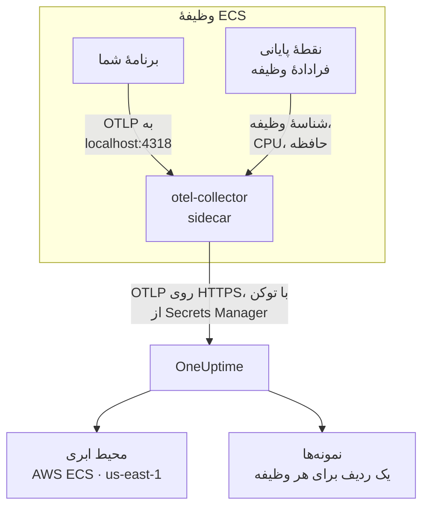

# AWS ECS / Fargate

ترِیس‌ها، لاگ‌ها و متریک‌های وظیفه‌های Amazon ECS خود را به OneUptime بفرستید، چه با نوع راه‌اندازی Fargate و چه EC2. هر وظیفه‌ای که `cloud.platform=aws_ecs` را گزارش کند، برای هر حساب AWS و منطقه در یک **Cloud Environment** قرار می‌گیرد، مانند _AWS ECS · us-east-1 · 123456789012_، چه یک سرویس اجرا کند چه پنجاه.

:::cards
- [چگونه کار می‌کند](#چگونه-کار-میکند): تشخیص‌دهندهٔ ECS و کالکتور sidecar چه می‌کنند.
- [راه‌اندازی](#راهاندازی): توکن را ذخیره کنید، تنظیمات را به تعریف وظیفه بیفزایید، استقرار دهید و بررسی کنید.
- [تعریف کامل وظیفه](#تعریف-کامل-وظیفه): یک تعریف وظیفهٔ کامل Fargate برای ثبت.
- [عیب‌یابی](#عیبیابی): وظیفه‌هایی که در PENDING گیر می‌کنند، صادرات ردشده، نمونه‌ها یا کاشی‌های خالی.
:::

## چگونه کار می‌کند



- **تشخیص‌دهندهٔ ECS محیط را نام‌گذاری می‌کند.** تشخیص‌دهندهٔ منبع ECS در اپن‌تلمتری، در SDK یا در یک Collector، نقطهٔ پایانی فرادادهٔ وظیفه را که ECS به هر کانتینر می‌دهد می‌خواند و حساب، منطقه و وظیفه را روی همهٔ داده‌هایی که وظیفه می‌فرستد مهر می‌زند. هیچ‌چیز در کد ثابت نوشته نمی‌شود.
- **وظیفه هر نمونه را نام‌گذاری می‌کند.** زبانهٔ **نمونه‌ها** در محیط، وظیفه‌های در حال اجرا را بر اساس شناسهٔ وظیفه، همراه با CPU و حافظه‌شان فهرست می‌کند.
- **یک کالکتور sidecar، CPU و حافظه را اضافه می‌کند.** گیرندهٔ `awsecscontainermetrics` آن، CPU و حافظهٔ هر وظیفه را از همان نقطهٔ پایانی می‌خواند، و توکن نزد آن است تا برنامه هرگز آن را نبیند.

تشخیص‌دهندهٔ ECS این ویژگی‌های منبع را تنظیم می‌کند:

| ویژگی | مقداری که تشخیص‌دهندهٔ ECS می‌گذارد | کاربرد |
| ------------------------------------------------------------------ | ----------------------- | --------------------------------------------------------------------------------------------------------- |
| `cloud.platform` | `aws_ecs` | تله‌متری را در **محیط‌های ابری** بایگانی می‌کند. مقدار باید دقیق باشد |
| `cloud.account.id` | `123456789012` | بخشی از کلید محیط |
| `cloud.region` | `us-east-1` | بخشی از کلید محیط |
| `aws.ecs.task.arn` | ARN وظیفه | یک وظیفهٔ در حال اجرا را در **نمونه‌ها** با شناسهٔ وظیفه در انتهای آن نام‌گذاری می‌کند |
| `aws.ecs.task.id` | شناسهٔ وظیفه | همان؛ نسخه‌های تازه‌تر تشخیص‌دهنده هر دو را تنظیم می‌کنند |
| `aws.ecs.cluster.arn`, `aws.ecs.task.family`, `aws.ecs.launchtype` | خوشه و وظیفه | روی هر اسپن، لاگ و متریک برای جست‌وجوی شما نگه داشته می‌شوند؛ بخشی از محیط نیستند |

کلید محیط `aws_ecs|123456789012|us-east-1` است. شناسهٔ وظیفه حتی وقتی SDK هم `service.instance.id` را تنظیم می‌کند، نام نمونه را تعیین می‌کند: متریک‌های کانتینر sidecar فقط شناسهٔ وظیفه را دارند، پس کلید کردن بر اساس آن اسپن‌های یک وظیفه و CPU و حافظهٔ آن را در یک ردیف نگه می‌دارد. قاعدهٔ کامل را در [محیط‌های ابری](/docs/telemetry/cloud-environments) ببینید.

## پیش از شروع

- **یک کلید دریافت داده.** در **تنظیمات پروژه** > **تله‌متری و APM** > **کلیدهای دریافت داده** یک کلید **سرور** بسازید و توکن آن را کپی کنید.
- **یک خوشهٔ ECS و یک تعریف وظیفه که بتوانید ویرایش کنید**، و AWS CLI پیکربندی‌شده برای آن حساب.
- **برنامهٔ شما که با یک SDK اپن‌تلمتری ابزارگذاری شده** و OTLP صادر می‌کند، به هر زبانی.

## انتخاب این‌که تله‌متری چگونه از وظیفه خارج شود

| | Sidecar collector | SDK direct |
| ----------------------- | ---------------------------------------------- | ----------------------------------------------- |
| کانتینر اضافه | `otel-collector` در هر وظیفه | هیچ |
| CPU و حافظه برای هر وظیفه | بله، از گیرندهٔ `awsecscontainermetrics` | خیر |
| نگه‌دارندهٔ توکن | Collector | برنامه |
| محتوای راز | فقط توکن | کل سرآیند `x-oneuptime-token=...` |

بیشتر تیم‌ها از کالکتور sidecar استفاده می‌کنند: این کالکتور ویژگی‌های `cloud.*` را حتی روی تله‌متری کتابخانه‌هایی که چیزی دربارهٔ ECS نمی‌دانند مهر می‌زند. SDK direct ساده‌ترین گزینه برای یک سرویس تنها است. هر گام زیر برای هر دو یک زبانه دارد؛ یکی را برگزینید تا همهٔ گام‌ها از آن پیروی کنند.

## راه‌اندازی

:::steps
### ذخیرهٔ توکن در Secrets Manager

> [!IMPORTANT]
> توکن یک راز است. آن را در AWS Secrets Manager نگه دارید و از تعریف وظیفه با `secrets` و `valueFrom` به آن ارجاع دهید. توکنی که در یک مدخل عادی `environment` باشد برای هر کسی که بتواند تعریف وظیفه را بخواند دیده می‌شود، و در هر خروجی `describe-task-definition` و هر diff در CloudFormation ظاهر می‌شود.

:::tabs
@tab Sidecar collector
```bash
aws secretsmanager create-secret \
  --name oneuptime/ingestion-token \
  --region us-east-1 \
  --secret-string "YOUR_TELEMETRY_INGESTION_TOKEN"
```

پیکربندی Collector نام سرآیند را اضافه می‌کند، پس این راز فقط توکن را نگه می‌دارد.
@tab SDK direct
```bash
aws secretsmanager create-secret \
  --name oneuptime/ingestion-token \
  --region us-east-1 \
  --secret-string "x-oneuptime-token=YOUR_TELEMETRY_INGESTION_TOKEN"
```

ECS مقدار یک راز را همان‌طور که هست در متغیر می‌گذارد، و `OTEL_EXPORTER_OTLP_HEADERS` به کل جفت `name=value` نیاز دارد، پس این راز کل سرآیند را نگه می‌دارد.
:::

ARNای را که فرمان چاپ می‌کند یادداشت کنید. این ARN با یک پسوند تصادفی تمام می‌شود، مانند `oneuptime/ingestion-token-AbCdEf`، و آن را در تعریف وظیفه جای‌گذاری می‌کنید.

### اجازهٔ خواندن راز به وظیفه

نقش اجرای وظیفه (نقشی که ECS وظیفه را با آن آغاز می‌کند، نه نقشی که کد شما با آن اجرا می‌شود) باید بتواند راز را بخواند. این سیاست را به `ecsTaskExecutionRole` پیوست کنید:

```json title="secret-access-policy.json"
{
  "Version": "2012-10-17",
  "Statement": [
    {
      "Effect": "Allow",
      "Action": ["secretsmanager:GetSecretValue"],
      "Resource": "arn:aws:secretsmanager:us-east-1:123456789012:secret:oneuptime/ingestion-token-*"
    }
  ]
}
```

اگر یک کلید KMS که مشتری مدیریت می‌کند راز را رمزگذاری کند، نقش به `kms:Decrypt` روی آن کلید هم نیاز دارد. بدون هر یک از این‌ها وظیفه آغاز نمی‌شود: با `ResourceInitializationError: unable to pull secrets` متوقف می‌شود.

### افزودن تنظیمات به تعریف وظیفه

:::tabs
@tab Sidecar collector
1. **AWS Console → Amazon Elastic Container Service → Task definitions**؛ خانواده را برگزینید و سپس **Create new revision** را بزنید.
2. زیر **Container - 1** (برنامهٔ شما)، **Environment variables** را باز کنید و متغیرهای برنامهٔ زیر را اضافه کنید.
3. **+ Add container**: نام `otel-collector`، ایمیج `otel/opentelemetry-collector-contrib:latest` (وقتی کار کرد یک نسخه را ثابت کنید)، **Essential container: No**. زیر **Docker configuration → Command** مقدار `--config=env:OTEL_COLLECTOR_CONFIG` را وارد کنید.
4. روی کانتینر Collector، متغیر محیطی `ONEUPTIME_TOKEN` را با **Value type: ValueFrom** و ARN راز اضافه کنید، و `OTEL_COLLECTOR_CONFIG` را با **Value type: Value** و پیکربندی Collector زیر.
5. زیر **Startup dependency ordering** در کانتینر برنامه، `otel-collector` را با شرط **Start** اضافه کنید، تا برنامه هرگز پیش از آن‌که چیزی روی پورت ۴۳۱۸ گوش دهد آغاز نشود.
6. زیر **Task execution role** بررسی کنید که همان نقشی است که سیاست را به آن پیوست کرده‌اید.

متغیرهای برنامه. در حالت شبکهٔ `awsvpc` (که روی Fargate همیشه همین است) کانتینرهای یک وظیفه یک شبکه را به اشتراک می‌گذارند، پس `localhost` همان sidecar است:

```bash
OTEL_SERVICE_NAME=checkout-api
OTEL_EXPORTER_OTLP_ENDPOINT=http://localhost:4318
OTEL_EXPORTER_OTLP_PROTOCOL=http/protobuf
```

پیکربندی Collector. Collector همهٔ آن را از متغیر `OTEL_COLLECTOR_CONFIG` می‌خواند، پس هیچ فایلی برای ساختن در ایمیج نیست، و `${env:ONEUPTIME_TOKEN}` را از رازی که ECS در محیطش می‌گذارد پر می‌کند:

```yaml title="OTEL_COLLECTOR_CONFIG"
receivers:
  otlp:
    protocols:
      http:
        endpoint: 0.0.0.0:4318
      grpc:
        endpoint: 0.0.0.0:4317
  # Per-task and per-container CPU / memory from the ECS task metadata
  # endpoint. This is what fills the CPU and memory tiles in OneUptime.
  awsecscontainermetrics:
    collection_interval: 20s
processors:
  # Stamps cloud.provider, cloud.platform=aws_ecs, cloud.account.id,
  # cloud.region and aws.ecs.task.arn on every span, log and metric.
  resourcedetection:
    detectors: [env, ecs]
    timeout: 5s
  batch: {}
exporters:
  otlphttp/oneuptime:
    endpoint: https://oneuptime.com/otlp
    headers:
      x-oneuptime-token: ${env:ONEUPTIME_TOKEN}
service:
  pipelines:
    traces:
      receivers: [otlp]
      processors: [resourcedetection, batch]
      exporters: [otlphttp/oneuptime]
    metrics:
      receivers: [otlp, awsecscontainermetrics]
      processors: [resourcedetection, batch]
      exporters: [otlphttp/oneuptime]
    logs:
      receivers: [otlp]
      processors: [resourcedetection, batch]
      exporters: [otlphttp/oneuptime]
```

نه تشخیص‌دهندهٔ `ecs` و نه گیرندهٔ `awsecscontainermetrics` به مجوز IAM نیاز ندارند: هر دو نقطهٔ پایانی فراداده‌ای را می‌خوانند که ECS در `ECS_CONTAINER_METADATA_URI_V4` به هر کانتینر می‌دهد.
@tab SDK direct
1. **AWS Console → Amazon Elastic Container Service → Task definitions**؛ خانواده را برگزینید و سپس **Create new revision** را بزنید.
2. زیر **Container - 1** (برنامهٔ شما)، **Environment variables** را باز کنید و متغیرهای زیر را اضافه کنید. `OTEL_EXPORTER_OTLP_HEADERS` را با **Value type: ValueFrom** و ARN راز به‌عنوان مقدارش اضافه کنید.
3. کلیدی را که تشخیص‌دهندهٔ منبع ECS زبان شما را روشن می‌کند، از جدول زیر اضافه کنید.
4. زیر **Task execution role** بررسی کنید که همان نقشی است که سیاست را به آن پیوست کرده‌اید.

```bash
OTEL_SERVICE_NAME=checkout-api
OTEL_EXPORTER_OTLP_ENDPOINT=https://oneuptime.com/otlp
OTEL_EXPORTER_OTLP_PROTOCOL=http/protobuf
# Injected from Secrets Manager (secrets / valueFrom), not typed here.
OTEL_EXPORTER_OTLP_HEADERS=x-oneuptime-token=YOUR_TELEMETRY_INGESTION_TOKEN
```

| زبان | روشن کردن تشخیص‌دهندهٔ ECS |
| -------- | --------------------------------------------------------------------------------------------------------------- |
| Node.js | `OTEL_NODE_RESOURCE_DETECTORS=env,host,os,aws` (auto-instrumentations-node) |
| Python | `pip install opentelemetry-sdk-extension-aws`، سپس `OTEL_EXPERIMENTAL_RESOURCE_DETECTORS=aws_ecs` |
| Java | `-Dotel.resource.providers.aws.enabled=true` (این ارائه‌دهنده در agent به‌طور پیش‌فرض خاموش است) |
| Go | `import "go.opentelemetry.io/contrib/detectors/aws/ecs"` و `ecs.NewResourceDetector()` را به `resource.New` بدهید |
| .NET | بستهٔ `OpenTelemetry.Resources.AWS`: `.ConfigureResource(r => r.AddAWSECSDetector())` |

در یک فایل تعریف وظیفه، راز چنین است: `"secrets": [{ "name": "OTEL_EXPORTER_OTLP_HEADERS", "valueFrom": "<secret ARN>" }]`.
:::

اگر OneUptime را خودتان میزبانی می‌کنید، از `https://YOUR-ONEUPTIME-HOST/otlp` به‌عنوان نقطهٔ پایانی استفاده کنید.

### استقرار بازبینی تازه

روی **Create** کلیک کنید، سپس **Clusters → your cluster → Services → select the service → Update → Task definition revision: latest → Deploy**. یا از CLI:

```bash
aws ecs update-service \
  --cluster production \
  --service checkout-api \
  --task-definition checkout-api
```

### بررسی اتصال

اول توکن را بررسی کنید: ارزان‌ترین بررسی است، و بدون آن هیچ‌چیز بعدی کار نمی‌کند.

```bash
curl -i https://oneuptime.com/otlp/v1/validate \
  -H "x-oneuptime-token: YOUR_TELEMETRY_INGESTION_TOKEN"
```

`200` همراه با `"valid": true` یعنی توکن پذیرفته شده است. `401` یعنی توکن ناشناخته، لغوشده، غیرفعال یا منقضی است. همین فرمان را با ECS Exec از درون وظیفه اجرا کنید تا ثابت شود خود وظیفه می‌تواند به OneUptime برسد:

```bash
aws ecs execute-command --cluster production --task <task id> \
  --container app --interactive --command "sh"
```

جریان لاگ CloudWatch در Collector (`otel/otel-collector/...`) باید `Everything is ready` را نشان دهد، بدون هیچ خطی با `401` یا `connection refused`. ظرف یک دقیقه پس از نخستین اسپن، لاگ یا متریک، محیط در **ابر** > **All Environments** با نام _AWS ECS · us-east-1 · 123456789012_ نمایش داده می‌شود.
:::

## تعریف کامل وظیفه

پیکربندی sidecar به‌صورت فایلی که با `aws ecs register-task-definition --cli-input-json file://task-definition.json` ثبت می‌کنید. شناسهٔ حساب، منطقه، ایمیج و ARN راز را جایگزین کنید:

```json title="task-definition.json"
{
  "family": "checkout-api",
  "requiresCompatibilities": ["FARGATE"],
  "networkMode": "awsvpc",
  "cpu": "512",
  "memory": "1024",
  "executionRoleArn": "arn:aws:iam::123456789012:role/ecsTaskExecutionRole",
  "taskRoleArn": "arn:aws:iam::123456789012:role/checkout-api-task-role",
  "containerDefinitions": [
    {
      "name": "app",
      "image": "123456789012.dkr.ecr.us-east-1.amazonaws.com/checkout-api:1.4.2",
      "essential": true,
      "portMappings": [{ "containerPort": 8080, "protocol": "tcp" }],
      "environment": [
        { "name": "OTEL_SERVICE_NAME", "value": "checkout-api" },
        {
          "name": "OTEL_EXPORTER_OTLP_ENDPOINT",
          "value": "http://localhost:4318"
        },
        { "name": "OTEL_EXPORTER_OTLP_PROTOCOL", "value": "http/protobuf" }
      ],
      "dependsOn": [
        { "containerName": "otel-collector", "condition": "START" }
      ],
      "logConfiguration": {
        "logDriver": "awslogs",
        "options": {
          "awslogs-group": "/ecs/checkout-api",
          "awslogs-region": "us-east-1",
          "awslogs-stream-prefix": "app"
        }
      }
    },
    {
      "name": "otel-collector",
      "image": "otel/opentelemetry-collector-contrib:latest",
      "essential": false,
      "command": ["--config=env:OTEL_COLLECTOR_CONFIG"],
      "secrets": [
        {
          "name": "ONEUPTIME_TOKEN",
          "valueFrom": "arn:aws:secretsmanager:us-east-1:123456789012:secret:oneuptime/ingestion-token-AbCdEf"
        }
      ],
      "environment": [
        {
          "name": "OTEL_COLLECTOR_CONFIG",
          "value": "receivers:\n  otlp:\n    protocols:\n      http:\n        endpoint: 0.0.0.0:4318\n      grpc:\n        endpoint: 0.0.0.0:4317\n  awsecscontainermetrics:\n    collection_interval: 20s\nprocessors:\n  resourcedetection:\n    detectors: [env, ecs]\n    timeout: 5s\n  batch: {}\nexporters:\n  otlphttp/oneuptime:\n    endpoint: https://oneuptime.com/otlp\n    headers:\n      x-oneuptime-token: ${env:ONEUPTIME_TOKEN}\nservice:\n  pipelines:\n    traces:\n      receivers: [otlp]\n      processors: [resourcedetection, batch]\n      exporters: [otlphttp/oneuptime]\n    metrics:\n      receivers: [otlp, awsecscontainermetrics]\n      processors: [resourcedetection, batch]\n      exporters: [otlphttp/oneuptime]\n    logs:\n      receivers: [otlp]\n      processors: [resourcedetection, batch]\n      exporters: [otlphttp/oneuptime]\n"
        }
      ],
      "logConfiguration": {
        "logDriver": "awslogs",
        "options": {
          "awslogs-group": "/ecs/checkout-api",
          "awslogs-region": "us-east-1",
          "awslogs-stream-prefix": "otel"
        }
      }
    }
  ]
}
```

مقدار `OTEL_COLLECTOR_CONFIG` همان پیکربندی Collector به‌صورت یک رشتهٔ JSON است. به‌جای escape کردن دستی، YAML را در `collector.yaml` نگه دارید و بگذارید `jq` این کار را بکند:

```bash
jq --rawfile cfg collector.yaml \
  '.containerDefinitions[1].environment[0].value = $cfg' \
  task-definition.json > task-definition.rendered.json
aws ecs register-task-definition --cli-input-json file://task-definition.rendered.json
```

## شبکه

وظیفه باید به دو چیز بیرون از VPC شما برسد: Secrets Manager برای آغاز شدن، و OneUptime برای صادر کردن.

- **وظیفه‌های Fargate در زیرشبکه‌های خصوصی** به مسیری به اینترنت نیاز دارند: یک NAT gateway در جدول مسیر زیرشبکه، یا یک زیرشبکهٔ عمومی با `assignPublicIp=ENABLED`. وظیفه‌ای که هیچ‌کدام را نداشته باشد، پیش از آن‌که Collector چیزی بفرستد، روی راز در `PENDING` می‌ماند.
- **ترافیک خروجی گروه امنیتی** باید TCP ۴۴۳ را به میزبان OneUptime اجازه دهد: `oneuptime.com`، یا میزبان خودتان روی پورتی که گوش می‌دهد. گروه امنیتی پیش‌فرض همهٔ ترافیک خروجی را اجازه می‌دهد؛ گروهی که محدود شده اغلب نه. تله‌متری به هیچ قاعدهٔ ورودی نیاز ندارد.
- **نقطه‌های پایانی رابط VPC** برای `com.amazonaws.us-east-1.secretsmanager` (و `ecr.api`، `ecr.dkr` و S3 برای کشیدن ایمیج‌ها) فراخوانی‌های AWS را از مسیر NAT دور نگه می‌دارند. خود OneUptime همچنان به مسیر اینترنت نیاز دارد.

```bash
aws ecs update-service \
  --cluster production \
  --service checkout-api \
  --task-definition checkout-api \
  --network-configuration "awsvpcConfiguration={subnets=[subnet-0abc1234],securityGroups=[sg-0def5678],assignPublicIp=ENABLED}"
```

## چه چیزی به دست می‌آورید

- **نمای کلی**: درخواست‌ها، نرخ خطا و تأخیر p95 از ترِیس‌های شما، کاشی‌های **CPU** و **حافظه** و **بیشترین نمونه‌ها بر اساس پردازنده**. کاشی‌ها از `ecs.task.cpu.utilized` و `ecs.task.memory.utilized` در گیرندهٔ `awsecscontainermetrics`، یا از هر متریک `container.cpu.utilization` و `container.memory.usage` که شناسهٔ وظیفه را داشته باشد پر می‌شوند. SDK direct هیچ‌کدام را نمی‌فرستد.
- **نمونه‌ها**: یک ردیف برای هر وظیفهٔ در حال اجرا، با نام شناسهٔ وظیفه (انتهای `aws.ecs.task.arn`)، همراه با آخرین CPU، حافظه و زمان آخرین مشاهده. وظیفه‌ای که دیگر گزارش ندهد **Stale** می‌شود.
- **لاگ‌ها**، **ترِیس‌ها** و **متریک‌ها**: هر چیزی که `cloud.platform=aws_ecs` را برای این حساب و منطقه داشت.
- **سرویس‌ها**: همان وظیفه‌ها، به تفکیک `service.name`.

## عیب‌یابی

خطاهای ECS، به همان ترتیبی که رخ می‌دهند:

:::details وظیفه با "unable to pull secrets" در PENDING گیر کرده است
خطای کامل `ResourceInitializationError: unable to pull secrets` است. یا نقش اجرای وظیفه روی راز `secretsmanager:GetSecretValue` (یا روی کلیدش `kms:Decrypt`) را ندارد، یا وظیفه هیچ مسیری به Secrets Manager ندارد: نه NAT gateway و نه نقطهٔ پایانی VPC. [شبکه](#شبکه) را ببینید.
:::

:::details Collector کد ۴۰۱ را لاگ می‌کند
راز مقدار نادرستی دارد. برای کالکتور sidecar باید فقط توکن باشد؛ برای SDK direct، کل سرآیند `x-oneuptime-token=...`. خود توکن را با فرمان [بررسی اتصال](#بررسی-اتصال) بررسی کنید.
:::

:::details محیط نمایش داده می‌شود، اما نمونه‌ها خالی است
تله‌متری هیچ شناسهٔ وظیفه‌ای ندارد. مطمئن شوید تشخیص‌دهندهٔ `ecs` اجرا می‌شود: منبع باید `aws.ecs.task.arn`، `aws.ecs.task.id` یا `service.instance.id` را داشته باشد.
:::

:::details نمونه‌ها پر می‌شوند، اما کاشی‌های CPU و حافظه خالی می‌مانند
گیرندهٔ `awsecscontainermetrics` در خط لولهٔ `metrics` نیست، یا آن خط لوله پردازشگر `resourcedetection` را نادیده می‌گیرد، پس متریک‌های کانتینر بدون `cloud.platform` می‌رسند. SDK direct هرگز این کاشی‌ها را پر نمی‌کند.
:::

محیطی که هرگز نمایش داده نمی‌شود، در **میزبان‌ها** یا **توابع بدون سرور** قرار می‌گیرد، **قطع‌شده** نشان داده می‌شود یا دو تا می‌شود، در [رفع اشکال ابر](/docs/telemetry/cloud-troubleshooting) پوشش داده شده است.

## گام‌های بعدی

:::cards
- [محیط‌های ابری](/docs/telemetry/cloud-environments): محیط‌ها و نمونه‌ها چگونه شناسایی می‌شوند.
- [رفع اشکال ابر](/docs/telemetry/cloud-troubleshooting): خطاهایی که همهٔ بسترها در آن‌ها مشترک‌اند.
- [منابع ابری (IaaS و PaaS)](/docs/telemetry/cloud-resources): متعادل‌کننده‌های بار، پایگاه‌های دادهٔ RDS و باکت‌های شما، از CloudWatch.
- [OpenTelemetry](/docs/telemetry/open-telemetry): ابزارگذاری برنامه، و نقطه‌های پایانی و محدودیت‌ها.
:::
