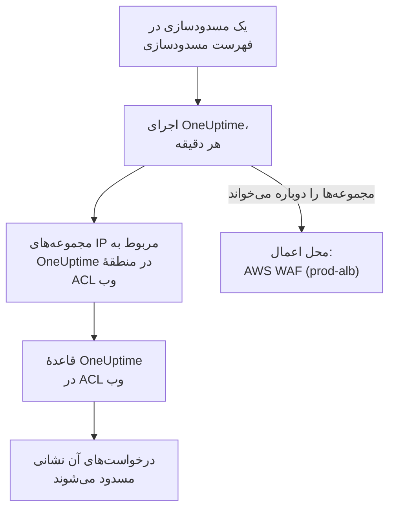

# مسدود کردن نشانی‌ها در AWS WAF

فهرست مسدودسازی پروژهٔ شما را می‌توان در ACLهای وب AWS WAF که جلوی توزیع‌های CloudFront، متعادل‌کننده‌های بار و API Gatewayهای شما قرار دارند اعمال کرد. آن را برای یک اتصال ابری AWS که از قبل دارید روشن کنید، ACLهای وب را انتخاب کنید، و هر نشانی‌ای که فهرست مسدودسازی مسدود می‌کند در آنجا هم مسدود می‌شود، چه یک نفر آن را مسدود کرده باشد، چه یک پلی‌بوک یا OneUptime AI.

:::cards
- [روشن کردن](#روشن-کردن): یک تنظیم روی اتصال AWS، و اجرای دوبارهٔ فرمان راه‌اندازی آن.
- [آنچه OneUptime می‌سازد](#آنچه-oneuptime-میسازد): چهار مجموعهٔ IP در هر منطقه، و دو قاعده در هر ACL وب.
- [مدیریت ACL وب در کد](#مدیریت-acl-وب-در-کد): قواعد را خودتان در Terraform یا CloudFormation اضافه کنید.
:::

## چگونه کار می‌کند

OneUptime مجموعه‌های IP خودش را در هر منطقه‌ای که یک ACL وب انتخاب‌شده در آن است نگه می‌دارد، و در هر ACL وب قاعده‌ای که نشانی‌های درون آن‌ها را مسدود می‌کند. هر دقیقه هر مجموعه را یک بار با آنچه فهرست مسدودسازی در خود دارد می‌نویسد و سپس مجموعه‌ها را دوباره می‌خواند. در صفحهٔ **فهرست مسدودسازی**، ستون **محل اعمال** یک مسدودسازی تنها زمانی AWS WAF (prod-alb) را نام می‌برد که AWS WAF آن مسدودسازی را در خود داشته باشد و قاعدهٔ ACL وب مجموعهٔ آن را مسدود کند؛ تا آن زمان، آن مسدودسازی اعمال نمی‌شود.

## پیش از شروع

- یک حساب AWS متصل به OneUptime (به [اتصال یک حساب ابری](/docs/telemetry/cloud-accounts#amazon-web-services) مراجعه کنید).
- نقشی که اجازهٔ تغییر محل اعمال فهرست مسدودسازی را دارد: **مالک پروژه**، **مدیر پروژه** یا **مدیر امنیت**.
- کسی که بتواند فرمان راه‌اندازی اتصال را دوباره در حساب AWS اجرا کند.

## روشن کردن

:::steps
### اتصال را باز کنید
به **ابر** > **اتصال** بروید و اتصال AWS را ویرایش کنید.

### انتخاب کنید چه کسی قاعده را اضافه کند
زیر **فیلدهای بیشتر**، **مسدود کردن نشانی‌ها در AWS WAF** را روی **روشن، و OneUptime قاعدهٔ خود را اضافه می‌کند** بگذارید، یا اگر ACLهای وب شما در Terraform یا CloudFormation مدیریت می‌شوند، روی **روشن، و قاعده را خودم در کد اضافه می‌کنم**.

### فرمان راه‌اندازی را دوباره اجرا کنید
فرمانی که فرم اکنون نشان می‌دهد دسترسی لازم برای مجموعه‌های IP را می‌دهد، و اگر OneUptime قاعده را اضافه کند، دسترسی لازم برای قاعده را هم. آن را در AWS CloudShell اجرا کنید و سپس اتصال را ذخیره کنید.

### ACLهای وب را اضافه کنید
**رویدادهای امنیتی** > **پلی‌بوک‌ها** > **فهرست مسدودسازی** را باز کنید. زیر **WAFهای ابری**، روی **افزودن ACL وب** کلیک کنید، یک ACL وب و جایی را که نشانی کلاینت را از آن می‌خواند انتخاب کنید و آن را اضافه کنید. OneUptime بی‌درنگ آن را راه‌اندازی می‌کند، و وقتی قاعده‌اش مجموعه‌ها را مسدود کند، **وضعیت** آن **اعمال‌شده** را نشان می‌دهد.
:::

ACLهای وب از موجودی اتصال می‌آیند: ACL وبی که OneUptime هنوز نخوانده است، پس از خواندن بعدی فهرست می‌شود. تا وقتی یک ACL وب فهرست مسدودسازی را اعمال می‌کند، تنظیم اتصال آن را نمی‌توان خاموش کرد یا از افزودن قاعده به دست OneUptime به افزودن آن در کد تغییر داد، و اتصال را نمی‌توان حذف کرد: ابتدا ACL وب را حذف کنید تا OneUptime قاعده‌اش را از آن بردارد.

## آنچه OneUptime می‌سازد

| چه چیزی | نام | کجا |
| --- | --- | --- |
| چهار مجموعهٔ IP: مسدودسازی و چالش، IPv4 و IPv6 | `oneuptime-<project>-block-ipv4`, `oneuptime-<project>-block-ipv6`, `oneuptime-<project>-challenge-ipv4`, `oneuptime-<project>-challenge-ipv6` | در هر منطقه‌ای که یک ACL وب انتخاب‌شده در آن است. ACLهای وب CloudFront سراسری‌اند و مجموعه‌هایشان در `us-east-1` قرار دارند. |
| دو قاعده: یکی مسدود می‌کند، دیگری با چالش روبه‌رو می‌کند | `OneUptime-Blocklist-<project>`, `OneUptime-Challenge-<project>` | در هر ACL وب انتخاب‌شده، وقتی OneUptime قاعده‌اش را اضافه می‌کند. |

`<project>` هشت نویسهٔ نخست شناسهٔ خارجی پروژهٔ شماست، پس دو پروژهٔ OneUptime در یک حساب هرگز در مجموعه‌های یکدیگر نمی‌نویسند. ACLهای وب یک منطقه مجموعه‌ها را به اشتراک می‌گذارند. یک نشانی تکی به‌صورت `/32` یا `/128` نوشته می‌شود. AWS WAF در هر مجموعه ۱۰٬۰۰۰ نشانی و در هر منطقه ۱۰۰ مجموعهٔ IP نگه می‌دارد، مگر اینکه AWS این سقف را برایتان بالا برده باشد؛ مسدودسازی‌ای که جا نشود، این را در ردیف خود می‌گوید.

## جایگاه قاعده در ACL وب

OneUptime دو قاعدهٔ خود را در اولویت‌های آزادی با عدد کمتر از اولویت نخستین قاعدهٔ شما قرار می‌دهد تا پیش از قواعدی که نوشته‌اید اجرا شوند. اگر ACL وب هیچ قاعده‌ای نداشته باشد، اولویت‌های ۰ و ۱ را می‌گیرند. OneUptime هرگز قواعد شما را دوباره شماره‌گذاری، تغییر یا حذف نمی‌کند: وقتی پیش از نخستین قاعدهٔ شما دو اولویت آزاد نباشد، ACL وب **بدون اولویت آزاد** را نشان می‌دهد، و OneUptime به‌محض اینکه دو اولویت را آزاد کنید قواعدش را اضافه می‌کند.

هر قاعده وقتی مطابقت دارد که یکی از مجموعه‌هایش، IPv4 یا IPv6، نشانی کلاینت را در خود داشته باشد. AWS WAF یک ACL وب را یکجا به‌روزرسانی می‌کند، پس OneUptime آن را می‌خواند، قواعدش را اضافه می‌کند و آن را با توکن قفل ACL وب بازنویسی می‌کند، و اگر کس دیگری در این میان آن را نوشته باشد، دوباره آن را می‌خواند.

## نشانی‌های ارسال‌شده

یک ACL وب پشت یک پراکسی یا CDN دیگر، نشانی پراکسی را می‌بیند، نه نشانی کلاینت را. زیر **نشانی کلاینت** انتخاب کنید که نشانی کلاینت را از کجا بخواند:

| نشانی کلاینت | آنچه قاعده می‌خواند |
| --- | --- |
| **نشانی مبدأ درخواست** | نشانی‌ای که درخواست از آن آمده است. پیش‌فرض. |
| آخرین نشانی در سرآیند `X-Forwarded-For` | نشانی‌ای که آخرین پراکسی افزوده است. نشانی پیش از آن، نشانی‌ای است که خود درخواست ادعا کرده است. |
| سرآیند `CF-Connecting-IP` | تنها نشانی‌ای که Cloudflare می‌نویسد. |
| سرآیند `True-Client-IP` | تنها نشانی‌ای که Akamai یا Cloudflare Enterprise می‌نویسد. |

درخواستی که این سرآیند را نداشته باشد مطابقت ندارد: AWS WAF به‌جای مسدود کردن نشانی یک پراکسی، اجازه می‌دهد آن درخواست عبور کند.

## مدیریت ACL وب در کد

با **روشن، و قاعده را خودم در کد اضافه می‌کنم**، OneUptime فقط مجموعه‌های IP را می‌سازد و هرگز در ACL وب شما نمی‌نویسد. روی **نمایش قاعده** در ردیف ACL وب کلیک کنید: هر دو قاعده را به‌صورت Terraform (بلوک‌های `rule` در `aws_wafv2_web_acl`) و CloudFormation، همراه با ARN هر مجموعه و سرآیندی که ACL وب می‌خواند، به شما می‌دهد. آن‌ها را پیش از دیگر قواعدتان به کد خود اضافه کنید و آن را اعمال کنید.

تا وقتی قواعد آنجا نباشند، ACL وب **در انتظار قاعدهٔ شما** را نشان می‌دهد و مسدودسازی‌هایش اعمال نمی‌شوند. OneUptime در هر اجرا ACL وب را می‌خواند، و مسدودسازی‌هایش از نخستین اجرایی اعمال می‌شوند که قاعده‌ای پیدا کند که هر مجموعه را مسدود می‌کند، هر نامی که به آن داده باشید.

## مجوزها

فرمان راه‌اندازی یک سیاست درون‌خطی به نام `OneUptimeWafBlocklist` به نقش اضافه می‌کند. با کلید دسترسی، محدودیت IAM بر سیاست‌های خود کاربر باعث می‌شود این سیاست روی یک گروه به نام `OneUptimeWafBlocklist-<project>` قرار بگیرد که کاربر به آن می‌پیوندد.

| اقدام | منبع | چرا |
| --- | --- | --- |
| `wafv2:ListIPSets` | هر منبعی | پیدا کردن مجموعه‌های IP مربوط به OneUptime در یک منطقه. |
| `wafv2:GetIPSet`, `wafv2:CreateIPSet`, `wafv2:UpdateIPSet`, `wafv2:DeleteIPSet` | فقط مجموعه‌های IP مربوط به OneUptime (`oneuptime-<project>-*`) | نگه‌داشتن مجموعه‌ها، و حذف آن‌ها وقتی آخرین ACL وب یک منطقه را حذف می‌کنید. |
| `wafv2:GetSampledRequests` | ACLهای وب | خواندن درخواست‌هایی که یک قاعده رد کرده است: شواهدی که گام مسدودسازی یک پرونده با آن بررسی می‌شود. |
| `wafv2:UpdateWebACL` | ACLهای وب، و مجموعه‌های IP، مجموعه‌های regex و گروه‌های قاعده‌ای که به آن‌ها ارجاع می‌دهند | افزودن قواعد OneUptime. فقط با **روشن، و OneUptime قاعدهٔ خود را اضافه می‌کند**. |

خواندن یک ACL وب، `wafv2:GetWebACL`، از پیش در سیاست فقط‌خواندنی اتصال هست.

## حذف کردن

:::steps
### ACL وب را حذف کنید
در **رویدادهای امنیتی** > **پلی‌بوک‌ها** > **فهرست مسدودسازی**، روی **حذف** در ردیف ACL وب کلیک کنید. OneUptime قواعدش را از ACL وب برمی‌دارد، و مجموعه‌های IP خود را وقتی هیچ ACL وب دیگری در منطقه از آن‌ها استفاده نکند، خالی و حذف می‌کند.

### تنظیم را خاموش کنید
اتصال را ویرایش کنید، **مسدود کردن نشانی‌ها در AWS WAF** را روی **خاموش** بگذارید و ذخیره کنید. این تنظیم را زمانی می‌توان خاموش کرد که هیچ ACL وبی از اتصال، فهرست مسدودسازی را اعمال نکند.
:::

وقتی OneUptime دیگر نمی‌تواند در ACL وب بنویسد، در کادر **حذف ACL وب** گزینهٔ **حذف فقط از OneUptime** را علامت بزنید. OneUptime آن ACL وب را از فهرست مسدودسازی حذف می‌کند و قواعد و مجموعه‌های IP را که در AWS WAF باقی گذاشته نام می‌برد: آن‌ها تا وقتی در آنجا حذفشان نکنید، همچنان آنچه را در خود دارند مسدود می‌کنند. اگر یکی از قواعد شما هنوز به یک مجموعه ارجاع دهد، آن مجموعه هم باقی می‌ماند: OneUptime آن را خالی می‌کند و نامش را می‌برد.

## عیب‌یابی

:::details اعمال‌نشده
وضعیت ACL وب می‌گوید AWS چه پاسخی داد و چه باید کرد. یک رد، اقدام و تنظیمی را که آن را اعطا می‌کند نام می‌برد: آن تنظیم را روشن کنید، یا **روشن، و OneUptime قاعدهٔ خود را اضافه می‌کند** را انتخاب کنید، سپس فرمان راه‌اندازی اتصال را دوباره اجرا کنید و روی **بررسی دوباره** کلیک کنید.
:::

:::details بدون اولویت آزاد
نخستین قاعدهٔ شما در اولویت ۰ یا ۱ است، پس پیش از آن دو اولویت آزاد وجود ندارد. عدد اولویت قواعد خود را دو واحد بالا ببرید و سپس روی **بررسی دوباره** کلیک کنید.
:::

:::details یک ACL وب در فهرست نیست
OneUptime ACLهای وب اتصال‌هایی را که این تنظیم در آن‌ها روشن است، پس از خواندنشان فهرست می‌کند. ACLهای وبی که فقط از روی متریک‌هایشان دیده شده‌اند، به اجرای دوبارهٔ فرمان راه‌اندازی اتصال نیاز دارند، که به OneUptime اجازه می‌دهد آن‌ها را بخواند.
:::

## گام‌های بعدی

:::cards
- [پرونده‌های امنیتی و پلی‌بوک‌ها](/docs/telemetry/security-cases): یک نشانی را از یک پرونده مسدود کنید و ببینید گام آن بررسی می‌شود.
- [اتصال یک حساب ابری](/docs/telemetry/cloud-accounts): اتصالی که این تنظیم بخشی از آن است.
:::
