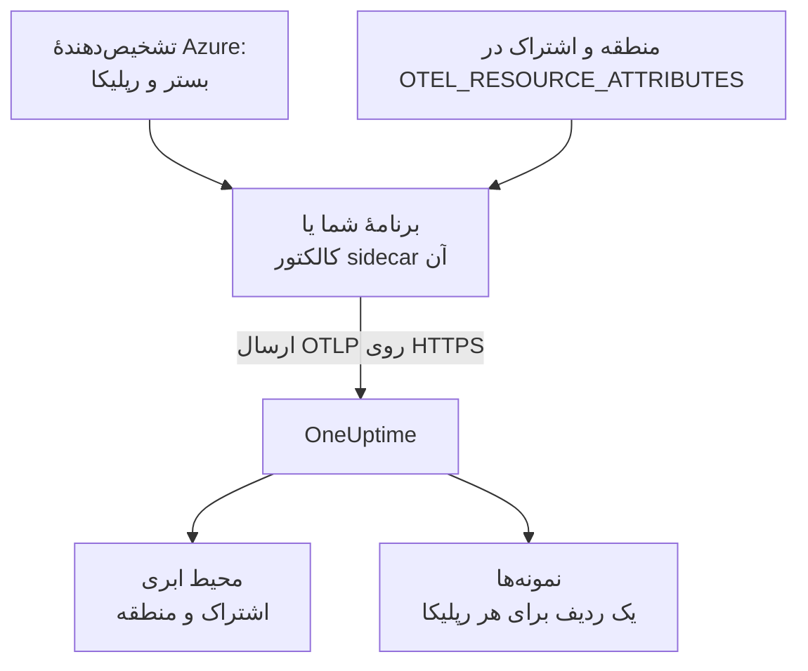

# Azure Container Apps

ترِیس‌ها، لاگ‌ها و متریک‌های Azure Container Apps خود را به OneUptime بفرستید. هر رپلیکایی که `cloud.platform=azure_container_apps` را گزارش کند، برای هر اشتراک Azure و منطقه در یک **Cloud Environment** قرار می‌گیرد، مانند _Azure Container Apps · eastus · 00000000-0000-0000-0000-000000000000_، و رپلیکاهای در حال اجرا در **نمونه‌ها** فهرست می‌شوند.

:::cards
- [چگونه کار می‌کند](#چگونه-کار-میکند): تشخیص‌دهنده‌ها چه چیزی را تنظیم می‌کنند، و دو ویژگی‌ای که خودتان تنظیم می‌کنید.
- [راه‌اندازی](#راهاندازی): توکن را ذخیره کنید، برنامه را با Azure CLI یا پورتال پیکربندی کنید، و بررسی کنید.
- [استفاده از عامل مدیریت‌شدهٔ OpenTelemetry محیط](#استفاده-از-عامل-مدیریتشدهٔ-opentelemetry-محیط): ارسال دادهٔ همهٔ برنامه‌های محیط بدون sidecar.
- [عیب‌یابی](#عیبیابی): صادرات ردشده، محیط‌های گم‌شده و نمونه‌های خالی.
:::

## چگونه کار می‌کند



Container Apps تشخیص‌دهنده‌های منبع دارد: تشخیص‌دهندهٔ `azurecontainerapps` در Collector، و تشخیص‌دهنده‌های Node.js (`@opentelemetry/resource-detector-azure`) و .NET (`OpenTelemetry.Resources.Azure`). این‌ها `CONTAINER_APP_NAME` و `CONTAINER_APP_REPLICA_NAME` را می‌خوانند و `cloud.provider`، `cloud.platform`، `service.name` و شناسهٔ رپلیکا را تنظیم می‌کنند. هیچ‌کدام منطقه یا اشتراک را نمی‌داند، پس `cloud.region` و `cloud.account.id` را خودتان در `OTEL_RESOURCE_ATTRIBUTES` تنظیم می‌کنید.

| ویژگی | مقدار | کاربرد |
| --------------------------------- | ------------------------------------------------------------------------- | ------------------------------------------------------------ |
| `cloud.provider` | `azure` | در نمای کلی نشان داده می‌شود |
| `cloud.platform` | `azure_container_apps` | تله‌متری را در **محیط‌های ابری** بایگانی می‌کند |
| `cloud.region` | منطقهٔ محیط، مانند `eastus`: با تنظیم شما | بخشی از کلید محیط |
| `cloud.account.id` | شناسهٔ اشتراک: با تنظیم شما | بخشی از کلید محیط |
| `azure.container_app.instance.id` | نام رپلیکا، که تشخیص‌دهنده‌ها از `CONTAINER_APP_REPLICA_NAME` تنظیم می‌کنند | یک رپلیکای در حال اجرا را نام‌گذاری می‌کند: برای هر کدام یک ردیف در **نمونه‌ها** |
| `service.instance.id` | نام رپلیکا، اگر خودتان تنظیمش کنید | وقتی به کار می‌رود که هیچ تشخیص‌دهنده‌ای شناسهٔ رپلیکا را تنظیم نکرده باشد |

- **نگارش نقطه‌دار هم کار می‌کند.** تشخیص‌دهنده‌های Node.js و .NET بستر را با نقطه به‌صورت `azure.container_apps` می‌نویسند. OneUptime هنگام دریافت آن را به `azure_container_apps` بازنویسی می‌کند، پس هر دو نگارش در یک محیط قرار می‌گیرند.
- **نام میزبان همان نام رپلیکا است.** SDKای که فقط تشخیص‌دهندهٔ `host` را اجرا کند، نام رپلیکا را به‌عنوان `host.name` گزارش می‌کند، و OneUptime وقتی چیز دقیق‌تری نباشد نمونه را با آن نام‌گذاری می‌کند.

کلید محیط `azure_container_apps|<subscription id>|eastus` است.

## پیش از شروع

- **یک کلید دریافت داده.** در **تنظیمات پروژه** > **تله‌متری و APM** > **کلیدهای دریافت داده** یک کلید **سرور** بسازید و توکن آن را کپی کنید.
- **Azure CLI با افزونهٔ `containerapp`** (`az extension add --name containerapp --upgrade`)، واردشده به اشتراک، یا پورتال Azure.
- **برنامهٔ شما که با یک SDK اپن‌تلمتری ابزارگذاری شده** و OTLP صادر می‌کند.

## انتخاب این‌که تله‌متری چگونه از برنامه خارج شود

| | SDK direct | Sidecar collector |
| ------------------ | ------------------------------------------- | ------------------------------------------------------------ |
| کانتینر اضافه | هیچ | `otel-collector` در برنامه، که CPU و حافظهٔ رپلیکا را با آن شریک است |
| تنظیم‌کنندهٔ ویژگی‌ها | SDK و `OTEL_RESOURCE_ATTRIBUTES` روی برنامه | Collector، برای هر چیزی که از آن می‌گذرد |
| راز | `oneuptime-otlp-headers`، کل سرآیند | `oneuptime-token`، فقط توکن |

راه سوم، عامل مدیریت‌شدهٔ OpenTelemetry محیط، دادهٔ همهٔ برنامه‌های محیط را بدون sidecar ارسال می‌کند: [استفاده از عامل مدیریت‌شدهٔ OpenTelemetry محیط](#استفاده-از-عامل-مدیریتشدهٔ-opentelemetry-محیط) را ببینید. هر گام زیر یک زبانه برای SDK direct و یکی برای کالکتور sidecar دارد؛ یکی را برگزینید تا همهٔ گام‌ها از آن پیروی کنند.

## راه‌اندازی

:::steps
### ذخیرهٔ توکن به‌عنوان راز Container Apps

> [!IMPORTANT]
> توکن یک راز است. آن را به‌عنوان یک راز Container Apps ذخیره کنید و از متغیرهای محیطی با `secretref:` به آن ارجاع دهید. رازی که تنظیم شد در `az containerapp show` یا در پورتال نشان داده نمی‌شود؛ اما یک متغیر محیطی عادی نشان داده می‌شود.

:::tabs
@tab SDK direct
```bash
az containerapp secret set \
  --name checkout-api \
  --resource-group my-rg \
  --secrets oneuptime-otlp-headers="x-oneuptime-token=YOUR_TELEMETRY_INGESTION_TOKEN"
```

`OTEL_EXPORTER_OTLP_HEADERS` در SDK کل سرآیند `name=value` را می‌خواهد، پس راز همان را نگه می‌دارد.
@tab Sidecar collector
```bash
az containerapp secret set \
  --name checkout-api \
  --resource-group my-rg \
  --secrets oneuptime-token=YOUR_TELEMETRY_INGESTION_TOKEN
```

Collector خودش نام سرآیند را اضافه می‌کند، پس راز فقط توکن را نگه می‌دارد.
:::

در پورتال: **Azure portal → Container Apps → your app → Settings → Secrets → + Add**. کلید را بنویسید، نوع **Container Apps secret** را برگزینید، مقدار را جای‌گذاری کنید و روی **Add** کلیک کنید.

اگر رازها را در Key Vault نگه می‌دارید، به‌جای کپی کردن مقدار، به راز ارجاع دهید. هویت مدیریت‌شدهٔ برنامه به نقش **Key Vault Secrets User** روی گاوصندوق نیاز دارد:

```bash
az containerapp secret set \
  --name checkout-api --resource-group my-rg \
  --secrets "oneuptime-token=keyvaultref:https://my-vault.vault.azure.net/secrets/oneuptime-token,identityref:system"
```

### پیکربندی برنامهٔ کانتینری

:::tabs
@tab SDK direct
صادرکننده، و ویژگی‌هایی که هیچ تشخیص‌دهنده‌ای نمی‌داند، را روی کانتینر برنامه تنظیم کنید. منطقه و شناسهٔ اشتراک را با مقدارهای خودتان جایگزین کنید:

```bash
az containerapp update \
  --name checkout-api \
  --resource-group my-rg \
  --set-env-vars \
    OTEL_SERVICE_NAME=checkout-api \
    OTEL_EXPORTER_OTLP_ENDPOINT=https://oneuptime.com/otlp \
    OTEL_EXPORTER_OTLP_PROTOCOL=http/protobuf \
    OTEL_EXPORTER_OTLP_HEADERS=secretref:oneuptime-otlp-headers \
    "OTEL_RESOURCE_ATTRIBUTES=cloud.provider=azure,cloud.platform=azure_container_apps,cloud.region=eastus,cloud.account.id=00000000-0000-0000-0000-000000000000"
```

برای شناسهٔ رپلیکا، تشخیص‌دهندهٔ Azure در SDK را روشن کنید: `OTEL_NODE_RESOURCE_DETECTORS=env,host,os,azure` در Node.js، یا `.ConfigureResource(r => r.AddAzureContainerAppsDetector())` همراه با `OpenTelemetry.Resources.Azure` در .NET. این تشخیص‌دهنده `azure.container_app.instance.id` را از `CONTAINER_APP_REPLICA_NAME` تنظیم می‌کند.

Container Apps نمی‌تواند یک متغیر محیطی را درون دیگری بگذارد، پس در زبان‌های دیگر `service.instance.id` نمی‌تواند در `OTEL_RESOURCE_ATTRIBUTES` قرار بگیرد. تشخیص‌دهندهٔ میزبان را روشن کنید (`host.name` آن همان نام رپلیکا است)، یا آن را در کد تنظیم کنید:

```js title="tracing.js"
// Node.js: the file you load with --require before the app starts
const { NodeSDK } = require("@opentelemetry/sdk-node");
const { resourceFromAttributes } = require("@opentelemetry/resources");

const sdk = new NodeSDK({
  resource: resourceFromAttributes({
    "service.instance.id": process.env.CONTAINER_APP_REPLICA_NAME,
  }),
});
sdk.start();
```

```python title="tracing.py"
# Python: before the tracer provider is created
import os
from opentelemetry.sdk.resources import Resource

resource = Resource.create({"service.instance.id": os.environ.get("CONTAINER_APP_REPLICA_NAME", "")})
```

از هر تشخیص‌دهنده‌ای که استفاده کنید، `cloud.region` و `cloud.account.id` را در `OTEL_RESOURCE_ATTRIBUTES` نگه دارید: هیچ تشخیص‌دهندهٔ Container Apps آن‌ها را تنظیم نمی‌کند، و کلید محیط به آن‌ها نیاز دارد.

یا در پورتال:

1. **Application → Containers → Edit and deploy** را باز کنید، کانتینر خود را در زبانهٔ **Container** برگزینید و روی **Edit** کلیک کنید.
2. زیر **Environment variables** هر متغیر بالا را با منبع **Manual entry** اضافه کنید، و `OTEL_EXPORTER_OTLP_HEADERS` را با منبع **Reference a secret** که به `oneuptime-otlp-headers` اشاره می‌کند.
3. روی **Save** کلیک کنید.
@tab Sidecar collector
sidecar در همان رپلیکا اجرا می‌شود، پس همان `CONTAINER_APP_NAME` و `CONTAINER_APP_REPLICA_NAME` را می‌بیند. تشخیص‌دهندهٔ `azurecontainerapps` آن، این‌ها را به `cloud.provider`، `cloud.platform`، `service.name` و `azure.container_app.instance.id` تبدیل می‌کند، و تشخیص‌دهندهٔ `env` آن، `cloud.region` و `cloud.account.id` را از `OTEL_RESOURCE_ATTRIBUTES` در محیط خود Collector می‌خواند. برنامه فقط به `http://localhost:4318` صادر می‌کند.

تعریف برنامه را صادر کنید، Collector را به `template.containers` اضافه کنید، و آن را اعمال کنید:

```bash
az containerapp show --name checkout-api --resource-group my-rg -o yaml > checkout-api.yaml
# edit checkout-api.yaml as below
az containerapp update --name checkout-api --resource-group my-rg --yaml checkout-api.yaml
```

```yaml title="checkout-api.yaml"
properties:
  configuration:
    secrets:
      - name: oneuptime-token
        value: YOUR_TELEMETRY_INGESTION_TOKEN
  template:
    containers:
      - name: app
        image: myregistry.azurecr.io/checkout-api:1.4.2
        env:
          - name: OTEL_SERVICE_NAME
            value: checkout-api
          - name: OTEL_EXPORTER_OTLP_ENDPOINT
            value: http://localhost:4318
          - name: OTEL_EXPORTER_OTLP_PROTOCOL
            value: http/protobuf
        resources:
          cpu: 0.5
          memory: 1Gi
      - name: otel-collector
        image: otel/opentelemetry-collector-contrib:latest
        args:
          - --config=env:OTEL_COLLECTOR_CONFIG
        env:
          - name: ONEUPTIME_TOKEN
            secretRef: oneuptime-token
          # Read by the resourcedetection processor's env detector.
          - name: OTEL_RESOURCE_ATTRIBUTES
            value: cloud.provider=azure,cloud.platform=azure_container_apps,cloud.region=eastus,cloud.account.id=00000000-0000-0000-0000-000000000000
          - name: OTEL_COLLECTOR_CONFIG
            value: |
              receivers:
                otlp:
                  protocols:
                    http:
                      endpoint: 0.0.0.0:4318
                    grpc:
                      endpoint: 0.0.0.0:4317
              processors:
                # env: cloud.region + cloud.account.id from OTEL_RESOURCE_ATTRIBUTES.
                # azurecontainerapps: cloud.provider, cloud.platform, service.name
                # and azure.container_app.instance.id from the CONTAINER_APP_*
                # variables. override: false keeps the service.name the
                # application set instead of the Container App's name.
                resourcedetection:
                  detectors: [env, azurecontainerapps]
                  timeout: 2s
                  override: false
                batch: {}
              exporters:
                otlphttp/oneuptime:
                  endpoint: https://oneuptime.com/otlp
                  headers:
                    x-oneuptime-token: ${env:ONEUPTIME_TOKEN}
              service:
                pipelines:
                  traces:
                    receivers: [otlp]
                    processors: [resourcedetection, batch]
                    exporters: [otlphttp/oneuptime]
                  metrics:
                    receivers: [otlp]
                    processors: [resourcedetection, batch]
                    exporters: [otlphttp/oneuptime]
                  logs:
                    receivers: [otlp]
                    processors: [resourcedetection, batch]
                    exporters: [otlphttp/oneuptime]
        resources:
          cpu: 0.25
          memory: 0.5Gi
```

`az containerapp show` مقدار رازها را صادر نمی‌کند، پس مدخل `secrets` را دستی دوباره اضافه کنید، یا اگر راز را در گام اول تنظیم کرده‌اید آن را حذف کنید: به‌روزرسانی رازهای موجود را نگه می‌دارد. Container Apps CPU و حافظهٔ همهٔ کانتینرهای یک رپلیکا را با هم جمع می‌کند، پس `resources` در sidecar از سهم برنامه کم می‌شود.

یا در پورتال:

1. **Application → Containers → Edit and deploy** را باز کنید. در زبانهٔ **Container**، با **+ Add** کانتینری به نام `otel-collector` با ایمیج `otel/opentelemetry-collector-contrib:latest` و **Arguments override** برابر `--config=env:OTEL_COLLECTOR_CONFIG` اضافه کنید.
2. متغیرهای محیطی آن را اضافه کنید: `ONEUPTIME_TOKEN` (**Reference a secret**: `oneuptime-token`)، `OTEL_RESOURCE_ATTRIBUTES` و `OTEL_COLLECTOR_CONFIG` (**Manual entry**، با مقدارهای بالا).
3. روی **Save** کلیک کنید.
:::

اگر OneUptime را خودتان میزبانی می‌کنید، از `https://YOUR-ONEUPTIME-HOST/otlp` به‌عنوان نقطهٔ پایانی استفاده کنید.

### استقرار بازبینی تازه

`az containerapp update` خودش یک بازبینی تازه مستقر می‌کند. در پورتال روی **Create** کلیک کنید. اگر چند بازبینی فعال است، ترافیک را زیر **Revisions and replicas** به بازبینی تازه منتقل کنید.

### بررسی اتصال

```bash
curl -i https://oneuptime.com/otlp/v1/validate \
  -H "x-oneuptime-token: YOUR_TELEMETRY_INGESTION_TOKEN"
```

`200` همراه با `"valid": true` یعنی توکن پذیرفته شده است. `401` یعنی توکن ناشناخته، لغوشده، غیرفعال یا منقضی است. سپس خروجی Collector را بخوانید:

```bash
az containerapp logs show --name checkout-api --resource-group my-rg \
  --container otel-collector --follow
```

دنبال `Everything is ready` بگردید، و این‌که هیچ `401` یا `connection refused` نباشد. ظرف یک دقیقه پس از نخستین اسپن، لاگ یا متریک، محیط در **ابر** > **All Environments** با نام _Azure Container Apps · eastus · 00000000-0000-0000-0000-000000000000_ نمایش داده می‌شود.
:::

## استفاده از عامل مدیریت‌شدهٔ OpenTelemetry محیط

یک محیط Container Apps می‌تواند عامل مدیریت‌شدهٔ OpenTelemetry در Azure را اجرا کند. این عامل OTLP را از همهٔ برنامه‌های محیط دریافت می‌کند و به نقطهٔ پایانی‌ای که پیکربندی می‌کنید می‌فرستد، بدون sidecar در هر برنامه. این عامل **فقط با OTLP/gRPC** صادر می‌کند، پس نمی‌تواند از مسیر HTTP یعنی `/otlp` استفاده کند. در عوض آن را به میزبان OneUptime روی پورت ۴۴۳ هدایت کنید، جایی که OneUptime پروتکل OTLP/gRPC را روی TLS ارائه می‌دهد:

```bash
az containerapp env telemetry otlp add \
  --name my-aca-env \
  --resource-group my-rg \
  --otlp-name oneuptime \
  --endpoint oneuptime.com:443 \
  --insecure false \
  --headers "x-oneuptime-token=YOUR_TELEMETRY_INGESTION_TOKEN" \
  --enable-open-telemetry-traces true \
  --enable-open-telemetry-logs true \
  --enable-open-telemetry-metrics true
```

- **میزبانی شخصی:** از `YOUR-ONEUPTIME-HOST:443` استفاده کنید. OneUptime با میزبانی شخصی OTLP/gRPC را فقط روی TLS می‌پذیرد: [OTLP روی gRPC](/docs/telemetry/open-telemetry#otlp-روی-grpc) را ببینید.
- **ویژگی‌ها را همچنان برنامه‌ها تنظیم می‌کنند.** عامل `OTEL_EXPORTER_OTLP_ENDPOINT` و `OTEL_EXPORTER_OTLP_PROTOCOL=grpc` خودش را در هر برنامه می‌گذارد، پس این دو را از برنامه حذف کنید و `OTEL_SERVICE_NAME` و `OTEL_RESOURCE_ATTRIBUTES` را نگه دارید. عامل همان چیزی را که برنامه‌ها می‌فرستند ارسال می‌کند، پس `cloud.*` و شناسهٔ رپلیکا همچنان از هر برنامه می‌آیند.
- **`OTEL_RESOURCE_ATTRIBUTES` شما برنده است.** عامل هم `OTEL_RESOURCE_ATTRIBUTES` را تنظیم می‌کند، و مقداری که روی برنامه تنظیم شود جای آن را می‌گیرد: نام Container App و شناسهٔ رپلیکا را در مقدار خود بگنجانید، یا آن‌ها را در کد تنظیم کنید.

## شبکه

- **ترافیک خروجی به‌طور پیش‌فرض باز است.** یک رپلیکا بدون هیچ پیکربندی‌ای به `oneuptime.com:443` می‌رسد، چه ورودی محیط بیرونی باشد چه درونی.
- **VNetهای سفارشی استثنا هستند.** روی یک VNet با مسیر تعریف‌شده توسط کاربر که `0.0.0.0/0` را به یک فایروال یا NAT gateway می‌فرستد، یا با یک گروه امنیت شبکه روی زیرشبکه، TCP ۴۴۳ را به میزبان OneUptime (یا پورت میزبان خودتان) روی فایروال یا NSG اجازه دهید.
- **OneUptime با میزبانی شخصی درون VNet** باید از زیرشبکهٔ محیط قابل resolve و مسیریابی باشد.
- **تله‌متری به هیچ نقش Azure نیاز ندارد.** فقط ارجاع‌های Key Vault نیاز دارند که هویت مدیریت‌شدهٔ برنامه روی گاوصندوق نقش **Key Vault Secrets User** را داشته باشد.

## چه چیزی به دست می‌آورید

- **نمای کلی**: درخواست‌ها، نرخ خطا و تأخیر p95 از ترِیس‌های شما. Container Apps مصرف منابع یک رپلیکا را به sidecar نشان نمی‌دهد، پس کاشی‌های **CPU** و **حافظه** فقط وقتی پر می‌شوند که متریک‌های `container.cpu.utilization` و `container.memory.usage` را با شناسهٔ رپلیکا بفرستید. بیشتر تیم‌ها این‌ها را به Azure Monitor می‌سپارند.
- **نمونه‌ها**: یک ردیف برای هر رپلیکا، با نامی از `azure.container_app.instance.id` تشخیص‌دهنده‌ها، از `service.instance.id` وقتی خودتان تنظیمش کنید، یا از `host.name` وقتی فقط تشخیص‌دهندهٔ میزبان اجرا شده باشد.
- **لاگ‌ها**، **ترِیس‌ها** و **متریک‌ها**، فیلترشده روی محیط، و نمای هر سرویس در **سرویس‌ها**.

## عیب‌یابی

:::details چیزی نمایش داده نمی‌شود و Collector کد ۴۰۱ را لاگ می‌کند
راز مقدار نادرستی دارد. `oneuptime-token` باید فقط توکن باشد؛ `oneuptime-otlp-headers` کل سرآیند `x-oneuptime-token=...`.
:::

:::details برنامه در سرویس‌ها هست، اما هیچ محیطی وجود ندارد
`OTEL_RESOURCE_ATTRIBUTES` وجود ندارد، یا `cloud.platform` دقیقاً `azure_container_apps` نیست. ببینید برنامه چه دارد: `az containerapp show ... --query properties.template.containers[].env`.
:::

:::details محیط وجود دارد، اما نمونه‌ها خالی است
هیچ‌کدام از `service.instance.id`، `azure.container_app.instance.id` یا `host.name` روی منبع نیست. تشخیص‌دهندهٔ `azurecontainerapps` را به Collector اضافه کنید، تشخیص‌دهندهٔ Azure یا میزبان در SDK را روشن کنید، یا `service.instance.id` را در کد تنظیم کنید.
:::

:::details دو محیط برای یک اشتراک
یک برنامه `cloud.region` (یا `cloud.account.id`) را تنظیم می‌کند و دیگری نه، یا یکی منطقه را جور دیگری می‌نویسد (`eastus` و `East US`). مقدارها باید نویسه به نویسه یکسان باشند.
:::

هر چیز دیگری در [رفع اشکال ابر](/docs/telemetry/cloud-troubleshooting) است.

## گام‌های بعدی

:::cards
- [محیط‌های ابری](/docs/telemetry/cloud-environments): محیط‌ها و نمونه‌ها چگونه شناسایی می‌شوند.
- [سایر پلتفرم‌های ابری](/docs/telemetry/cloud-other-platforms): Azure App Service و Azure Container Instances.
- [رفع اشکال ابر](/docs/telemetry/cloud-troubleshooting): خطاهایی که همهٔ بسترها در آن‌ها مشترک‌اند.
- [منابع ابری (IaaS و PaaS)](/docs/telemetry/cloud-resources): همهٔ منابع اشتراک شما، از Azure Monitor.
:::
