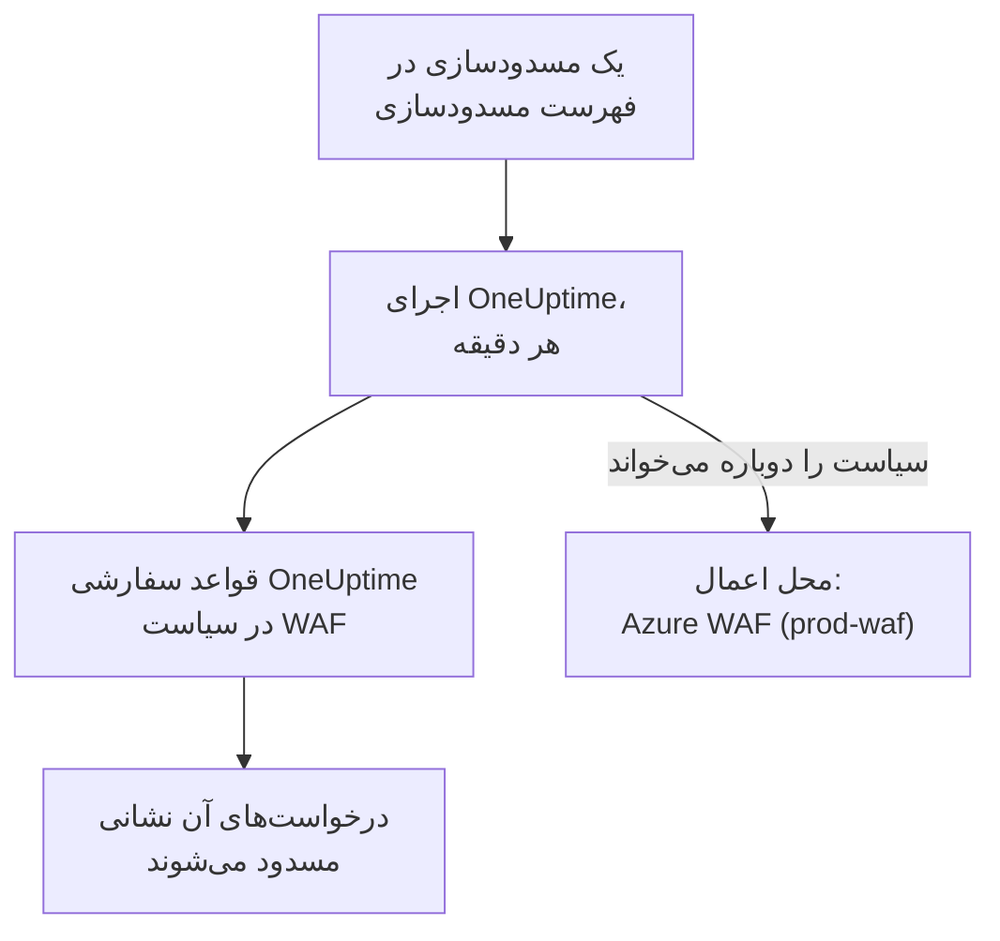

# مسدود کردن نشانی‌ها در Azure WAF

فهرست مسدودسازی پروژهٔ شما را می‌توان در سیاست‌های Azure WAF مربوط به Application Gatewayها و Front Doorهای شما اعمال کرد. آن را برای یک اتصال ابری Azure که از قبل دارید روشن کنید، سیاست‌های WAF را انتخاب کنید، و هر نشانی‌ای که فهرست مسدودسازی مسدود می‌کند در آنجا هم مسدود می‌شود، چه یک نفر آن را مسدود کرده باشد، چه یک پلی‌بوک یا OneUptime AI.

:::cards
- [روشن کردن](#روشن-کردن): یک تنظیم روی اتصال Azure، و نقشی که لازم دارد.
- [آنچه OneUptime می‌سازد](#آنچه-oneuptime-میسازد): قواعد سفارشی خودش در هر سیاستی که انتخاب می‌کنید.
- [کدام نشانی تطبیق داده می‌شود](#کدام-نشانی-تطبیق-داده-میشود): نشانی‌ای که متصل شد، یا کلاینت اصلی پشت یک پراکسی.
:::

## چگونه کار می‌کند

OneUptime در هر سیاست WAF که انتخاب می‌کنید قواعد سفارشی خودش را نگه می‌دارد و نشانی‌هایی را که فهرست مسدودسازی مسدود می‌کند در آن‌ها قرار می‌دهد. هر دقیقه سیاست را یک بار با آنچه فهرست مسدودسازی در خود دارد می‌نویسد و سپس آن را دوباره می‌خواند. در صفحهٔ **فهرست مسدودسازی**، ستون **محل اعمال** یک مسدودسازی تنها زمانی Azure WAF (prod-waf) را نام می‌برد که سیاست آن مسدودسازی را در خود داشته باشد و Azure تغییر را اعمال کرده باشد؛ تا آن زمان، آن مسدودسازی اعمال نمی‌شود.

## پیش از شروع

- یک اشتراک Azure متصل به OneUptime (به [اتصال یک حساب ابری](/docs/telemetry/cloud-accounts#microsoft-azure) مراجعه کنید).
- نقشی که اجازهٔ تغییر محل اعمال فهرست مسدودسازی را دارد: **مالک پروژه**، **مدیر پروژه** یا **مدیر امنیت**.
- کسی که بتواند در اشتراک Azure نقش تخصیص دهد، تا یک فرمان را در Azure Cloud Shell اجرا کند.

## روشن کردن

:::steps
### اتصال را باز کنید
به **ابر** > **اتصال** بروید و اتصال Azure را ویرایش کنید.

### تنظیم را روشن کنید
زیر **فیلدهای بیشتر**، **مسدود کردن نشانی‌ها در Azure WAF** را روی **روشن** بگذارید و ذخیره کنید. فرمان راه‌اندازی‌ای که فرم اکنون نشان می‌دهد، نقش زیر را روی کل اشتراک اعطا می‌کند. اتصالی که از قبل دارید لازم نیست آن را دوباره اجرا کند: کادر **افزودن WAF** خطوطی را می‌دهد که نقش را فقط روی یک سیاست اعطا می‌کنند.

### سیاست‌های WAF را اضافه کنید
**رویدادهای امنیتی** > **پلی‌بوک‌ها** > **فهرست مسدودسازی** را باز کنید. زیر **WAFهای ابری**، روی **افزودن WAF** کلیک کنید و یک سیاست WAF انتخاب کنید. OneUptime بدون نوشتن چیزی، از Azure می‌پرسد که آیا اتصال اجازهٔ نوشتن در آن را دارد.

### اگر نقش وجود ندارد، آن را اعطا کنید
وقتی مجوزی وجود نداشته باشد، کادر خطوطی را نشان می‌دهد که آن را فقط روی همان سیاست اعطا می‌کنند. آن‌ها را در Azure Cloud Shell اجرا کنید، روی **بررسی دوباره** کلیک کنید و سپس سیاست را اضافه کنید. وقتی OneUptime آن را خواند، **وضعیت** آن **اعمال‌شده** را نشان می‌دهد.
:::

سیاست‌های WAF از موجودی اتصال می‌آیند: سیاستی که OneUptime هنوز نخوانده است، پس از خواندن بعدی فهرست می‌شود. تا وقتی یک سیاست فهرست مسدودسازی را اعمال می‌کند، تنظیم اتصال آن را نمی‌توان خاموش کرد و اتصال را نمی‌توان حذف کرد: ابتدا سیاست را حذف کنید تا OneUptime قواعدش را از آن بردارد.

## آنچه OneUptime می‌سازد

| چه چیزی | نام | کجا |
| --- | --- | --- |
| قواعد سفارشی، هر یک با یک شرط تطبیق IP و اقدام Block | `OneUptime<project>Block1`, `OneUptime<project>Block2`, ... | در هر سیاست WAF که انتخاب می‌کنید، حداکثر ۱۰ قاعده. |

`<project>` هشت نویسهٔ نخست شناسهٔ خارجی پروژهٔ شماست، پس دو پروژهٔ OneUptime که یک سیاست را انتخاب می‌کنند هرگز در قواعد یکدیگر نمی‌نویسند. هر قاعده روی Application Gateway تا ۵۴۰ نشانی یا محدوده در خود نگه می‌دارد، با CRS 3.2 یا یک Default Rule Set تا ۶۰۰، و روی Front Door نیز تا ۶۰۰. با ده قاعده، یک سیاست ۵٬۴۰۰ یا ۶٬۰۰۰ مسدودسازی در خود نگه می‌دارد؛ مسدودسازی‌ای که جا نشود، این را در ردیف خود می‌گوید.

OneUptime در یک سیاست جز قواعد خودش چیزی را تغییر نمی‌دهد. Azure یک سیاست WAF را فقط به‌طور کامل می‌نویسد، پس OneUptime سیاست را همراه با ETag آن می‌خواند، قواعد خودش را تغییر می‌دهد و آن را با همان ETag در `If-Match` بازنویسی می‌کند: هر قاعده، تنظیم و مجموعهٔ قواعد مدیریت‌شدهٔ دیگری همان‌طور که خوانده شده بود نوشته می‌شود. اگر کس دیگری در این میان سیاست را نوشته باشد، Azure نوشتن را رد می‌کند و OneUptime آن را دوباره می‌خواند و تغییرش را روی آنچه آن‌ها نوشته‌اند اعمال می‌کند.

## جایگاه قواعد در سیاست

OneUptime قواعد خود را در اولویت‌های آزاد پیش از نخستین قاعدهٔ شما که ترافیک را مجاز می‌کند قرار می‌دهد، از کمترین عدد، تا هیچ‌یک از قواعد شما اجازهٔ عبور به یک نشانی مسدودشده ندهد. قاعده‌ای از شما که مسدود یا ثبت می‌کند می‌تواند پیش از آن‌ها بیاید. OneUptime هرگز قواعد شما را دوباره شماره‌گذاری، تغییر یا حذف نمی‌کند: وقتی پیش از نخستین قاعدهٔ Allow شما اولویتی آزاد نباشد، سیاست **بدون اولویت آزاد** را نشان می‌دهد، و OneUptime به‌محض اینکه یکی را آزاد کنید قاعده‌اش را اضافه می‌کند.

## کدام نشانی تطبیق داده می‌شود

| سیاست WAF | نشانی کلاینت | چه زمانی آن را انتخاب کنید |
| --- | --- | --- |
| Front Door | **نشانی‌ای که به Front Door متصل شد (متغیر SocketAddr)** | پیش‌فرض. |
| Front Door | کلاینت اصلی، برگرفته از سرآیند X-Forwarded-For (متغیر RemoteAddr) | برای Front Doorی که پشت یک پراکسی یا CDN دیگر است. |
| Application Gateway | نشانی‌ای که به درگاه متصل شد (متغیر RemoteAddr) | تنها گزینه: تطبیق IP آن نشانی دیگری را نمی‌خواند. |

Front Door مقدار `RemoteAddr` را از سرآیند `X-Forwarded-For` می‌گیرد، که کلاینتی که مستقیماً به Front Door وصل می‌شود خودش آن را می‌نویسد. آن را فقط زمانی انتخاب کنید که پراکسی یا CDN دیگری جلوی Front Door این سرآیند را بنویسد. این گزینه زیر **فیلدهای بیشتر** در کادر **افزودن WAF** است، و می‌توانید بعداً آن را با **نشانی کلاینت** در ردیف سیاست تغییر دهید.

تطبیق IP در Application Gateway فقط نشانی‌های IPv4 را می‌خواند، پس یک مسدودسازی IPv6 در آنجا اعمال نمی‌شود و ردیف آن دلیلش را می‌گوید.

قواعد OneUptime در Azure WAF فقط مسدود می‌کنند. مسدودسازی‌ای که می‌خواهد یک نشانی را به چالش بکشد، در Azure WAF اعمال نمی‌شود و این را می‌گوید. چالش یک سیاست پاسخ خودکار در آنجا به‌صورت مسدودسازی برای همان مدت اعمال می‌شود.

## یک تغییر چقدر طول می‌کشد

Application Gateway یک تغییر را همان وقتی که Azure آن را می‌نویسد اعمال می‌کند. Front Door تغییر را می‌پذیرد و در چند دقیقهٔ بعد آن را به لبه‌هایش می‌رساند: سیاست **در حال اعمال** را نشان می‌دهد، و **محل اعمال** یک مسدودسازی تازه منتظر سیاست می‌ماند تا Azure گزارش دهد که سیاست تأمین شده است. از آن پس مسدودسازی اعمال می‌شود.

## وقتی یک قاعده به‌صورت دستی تغییر می‌کند

وقتی کسی یکی از قواعد OneUptime را در Azure خاموش، تغییر یا حذف کند، OneUptime آن را همان‌طور که او گذاشته رها می‌کند. سیاست **تغییر دستی** را نشان می‌دهد، و مسدودسازی‌هایی که آن قاعده در خود داشت، همراه با دلیلش، اعمال نمی‌شوند تا وقتی کسی روی **بازگرداندن** در ردیف سیاست کلیک کند. دکمهٔ بازگرداندن قاعده را دوباره همان‌طور که OneUptime می‌نویسد، در اولویت خودش تا وقتی آزاد باشد، می‌نویسد.

سیاستی که چیزی را مسدود نمی‌کند هم این را می‌گوید، و مسدودسازی‌هایش اعمال نمی‌شوند:

- سیاستی که خاموش است.
- سیاستی در حالت **Detection**، که فقط آنچه را قواعد OneUptime با آن مطابقت دارند ثبت می‌کند.
- سیاستی که به هیچ Application Gateway، شنونده، قاعدهٔ مسیر یا دامنهٔ Front Door مرتبط نیست.

## نگه‌داشتن یک سیاست در Terraform

Terraform هم یک سیاست WAF را به‌طور کامل می‌نویسد، پس plan بعدی آن قواعد OneUptime را حذف می‌کند. برای اینکه OneUptime بتواند آن‌ها را نگه دارد، `ignore_changes = [custom_rules]` را به بلوک `lifecycle` یک `azurerm_web_application_firewall_policy`، یا `ignore_changes = [custom_rule]` را به بلوک متناظر در یک `azurerm_cdn_frontdoor_firewall_policy` اضافه کنید، و قواعد سفارشی خودتان را بیرون از کد آن سیاست نگه دارید.

## مجوزها

فرمان راه‌اندازی یک نقش سفارشی به نام `OneUptime WAF Blocklist` می‌سازد و آن را روی اشتراک به برنامهٔ اتصال تخصیص می‌دهد. خطوطی که کادر **افزودن WAF** نشان می‌دهد، همین نقش را فقط روی یک سیاست تخصیص می‌دهند.

| اقدام | چرا |
| --- | --- |
| `Microsoft.Network/ApplicationGatewayWebApplicationFirewallPolicies/read`, `Microsoft.Network/ApplicationGatewayWebApplicationFirewallPolicies/write` | خواندن یک سیاست WAF مربوط به Application Gateway و نوشتن قواعد OneUptime در آن. |
| `Microsoft.Network/FrontDoorWebApplicationFirewallPolicies/read`, `Microsoft.Network/FrontDoorWebApplicationFirewallPolicies/write` | خواندن یک سیاست WAF مربوط به Front Door و نوشتن قواعد OneUptime در آن. |

این نقش نمی‌تواند یک سیاست را حذف کند، و OneUptime هرگز چیز دیگری نمی‌نویسد.

## حذف کردن

:::steps
### سیاست WAF را حذف کنید
در **رویدادهای امنیتی** > **پلی‌بوک‌ها** > **فهرست مسدودسازی**، روی **حذف** در ردیف سیاست کلیک کنید. OneUptime قواعدش را از سیاست برمی‌دارد و چیز دیگری را در آن تغییر نمی‌دهد.

### تنظیم را خاموش کنید
اتصال را ویرایش کنید، **مسدود کردن نشانی‌ها در Azure WAF** را روی **خاموش** بگذارید و ذخیره کنید. این تنظیم را زمانی می‌توان خاموش کرد که هیچ سیاستی از اتصال، فهرست مسدودسازی را اعمال نکند.
:::

وقتی OneUptime دیگر نمی‌تواند در سیاست بنویسد، در کادر **حذف WAF** گزینهٔ **حذف فقط از OneUptime** را علامت بزنید. OneUptime آن سیاست را از فهرست مسدودسازی حذف می‌کند و قواعدی را که در آن باقی گذاشته نام می‌برد: آن‌ها تا وقتی در Azure حذفشان نکنید، همچنان آنچه را در خود دارند مسدود می‌کنند.

## عیب‌یابی

:::details اعمال‌نشده
وضعیت سیاست می‌گوید Azure چه پاسخی داد و چه باید کرد. یک رد، مجوزی را که کم دارد نام می‌برد: خطوطی را که **افزودن WAF** برای سیاست نشان می‌دهد اجرا کنید، سپس روی **بررسی دوباره** کلیک کنید.
:::

:::details بدون اولویت آزاد
نخستین قاعدهٔ شما که ترافیک را مجاز می‌کند در اولویت ۱ است، یا همهٔ اولویت‌های پیش از آن گرفته شده‌اند. عدد اولویت بالاتری به آن بدهید، سپس روی **بررسی دوباره** کلیک کنید.
:::

:::details یک سیاست در فهرست نیست
OneUptime سیاست‌های WAF اتصال‌هایی را که این تنظیم در آن‌ها روشن است، پس از خواندنشان فهرست می‌کند. سیاستی که از آن پس اضافه شده باشد، پس از خواندن بعدی اتصال نمایان می‌شود.
:::

## گام‌های بعدی

:::cards
- [پرونده‌های امنیتی و پلی‌بوک‌ها](/docs/telemetry/security-cases): یک نشانی را از یک پرونده مسدود کنید و ببینید گام آن بررسی می‌شود.
- [اتصال یک حساب ابری](/docs/telemetry/cloud-accounts): اتصالی که این تنظیم بخشی از آن است.
:::
