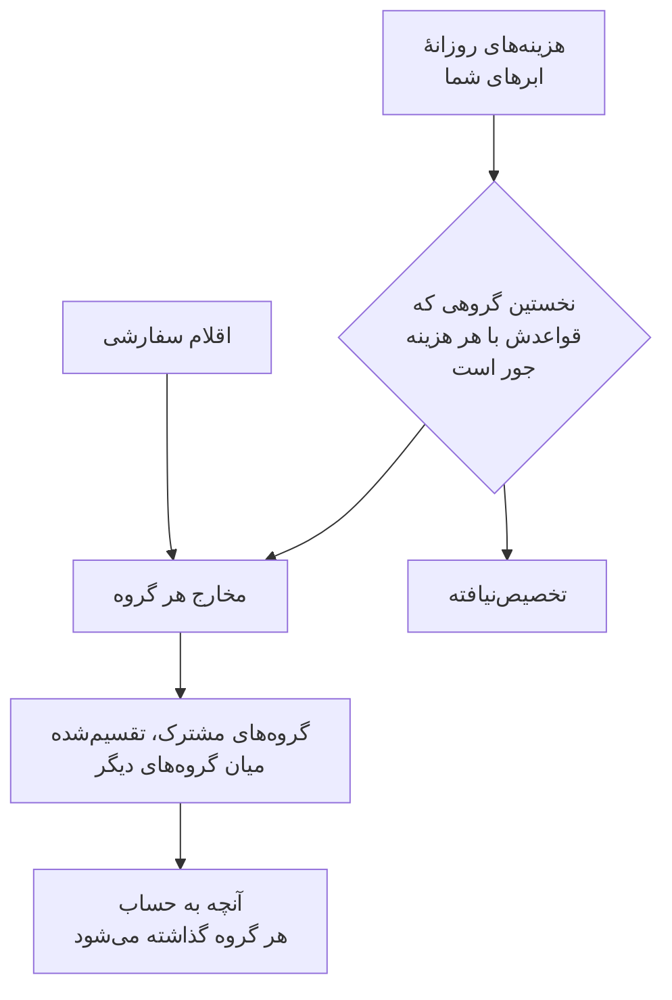

# تخصیص هزینه‌های ابر

گروه‌های هزینه به نخستین پرسش هر صورت‌حساب ماهانهٔ ابر پاسخ می‌دهند: چه کسی خرج کرد. یک **نمای هزینه** مانند «بر پایهٔ تیم» یا «بر پایهٔ مرکز هزینه» مخارج حساب‌های متصل شما را با قواعد در **گروه‌های هزینه** بخش می‌کند و هیچ چیز را دو بار نمی‌شمارد. آنچه هیچ قاعده‌ای برنمی‌دارد، به‌صورت مخارج تخصیص‌نیافته در دید می‌ماند، و هزینه‌های مشترک میان گروه‌ها تقسیم می‌شوند. آن‌ها را در **ابر** > **مخارج** > **گروه‌های هزینه** پیدا می‌کنید.

:::cards
- [ساختن یک نما](#ساختن-یک-نما): بر پایهٔ تیم از مالکانی که پیش‌تر تعیین کرده‌اید، بر پایهٔ یک تگ، یا با گروه‌های خودتان.
- [نوشتن قواعد یک گروه](#نوشتن-قواعد-یک-گروه): حساب‌ها، سرویس‌ها، تگ‌ها، تیم‌های مالک، برچسب‌ها و بیشتر.
- [مخارج تخصیص‌نیافته](#مخارج-تخصیصنیافته): آنچه هیچ قاعده‌ای برنمی‌دارد، و یک کلیک برای بخش کردنش.
- [هزینه‌های مشترک](#هزینههای-مشترک): یک طرح پشتیبانی یا یک خوشهٔ مشترک، تقسیم‌شده میان گروه‌ها.
:::

## چگونه کار می‌کند



- **نخستین گروهی که جور باشد، هزینه را برمی‌دارد.** گروه‌های یک نما ترتیب دارند و هر هزینه به نخستین گروهی می‌رود که قواعدش با آن جور باشد، پس هیچ چیز دو بار شمرده نمی‌شود. گروه‌ها و مخارج تخصیص‌نیافته روی‌هم همیشه برابر جمع دوره‌اند.
- **قواعد هر چیزی را که یک هزینه دارد می‌خوانند.** حساب، ابر، سرویس، منطقه، منبع و تگ‌هایش، و آنچه OneUptime از منبع می‌داند: تیم‌های مالکش، برچسب‌هایش، محیط App Platforms و برنامه‌اش.
- **همه چیز هنگام دیدن محاسبه می‌شود.** برای هر هزینه چیزی نوشته نمی‌شود. قاعده‌ای که تغییر می‌دهید، هر ماهی را که OneUptime نگه می‌دارد، تا ۴۰۰ روز پیش، دوباره بخش می‌کند، بی‌آنکه منتظر چیزی بمانید.
- **چند نما می‌توانند همان مخارج را بخش کنند.** «بر پایهٔ تیم» و «بر پایهٔ مرکز هزینه» هر کدام همهٔ مخارج را به روش خود بخش می‌کنند.

## پیش از شروع

- **هزینه‌هایی که خوانده می‌شوند.** [یک حساب ابری متصل کنید](/docs/telemetry/cloud-accounts) و بگذارید [هزینه‌هایش را بخواند](/docs/telemetry/cloud-costs).
- **تگ‌ها یا مالکان، اگر آن‌ها را بخواهید.** قواعد بر پایهٔ تگ به هزینه‌هایی نیاز دارند که آن تگ‌ها را دارند؛ در AWS، [هزینه به تفکیک منبع](/docs/telemetry/cloud-costs#هزینه-به-تفکیک-منبع) را روشن کنید. تیم‌های مالک از مالکان هر منبع می‌آیند که دستی یا با [قواعد مالک](/docs/configuration/label-and-owner-rules) تعیین شده‌اند.

## ساختن یک نما

**ابر** > **مخارج** > **گروه‌های هزینه** را باز کنید. به پروژه‌ای که هنوز نمایی ندارد، سه راه برای شروع پیشنهاد می‌شود:

| شروع | آنچه می‌سازد |
| --- | --- |
| **بر پایهٔ تیم، از مالکان** | یک گروه برای هر تیمی که منابع ابری دارد، پیوندخورده به آن تیم. |
| **بر پایهٔ یک تگ** | یک گروه برای هر مقدارِ تگی که هزینه‌های شما دارند، مانند `team` یا `cost-center`. |
| **گروه‌های خودتان** | یک نمای خالی. قواعد هر گروه را خودتان می‌نویسید. |

OneUptime گروه‌های یک نما بر پایهٔ تگ یا تیم مالک را هنگام ذخیره کردنش می‌سازد، و سپس هر ساعت با پیدا شدن مقدارهای تازهٔ تگ و مالکان تازه. می‌توانید نام این گروه‌ها را عوض کنید، آن‌ها را به تیمی پیوند دهید یا مشترکشان کنید. قواعدشان از آنِ OneUptime می‌ماند. برای ساختن همین حالای گروه‌های جاافتاده، نما را باز کنید و **ساخت گروه‌ها همین حالا** را بزنید.

## نوشتن قواعد یک گروه

یک نما را باز کنید، سپس **ساخت گروه هزینه** را زیر **گروه‌ها** بزنید. هزینه‌ای از آنِ گروه است که **هر یک** از قواعد گروه با آن جور باشد، و قاعده‌ای جور است که **همهٔ** شرط‌هایش جور باشند. یک شرط، چیزی را که هزینه دارد با مقدارهایی که انتخاب یا وارد می‌کنید مقایسه می‌کند:

| فیلد | آنچه می‌خواند |
| --- | --- |
| **برچسب** | مقدار یک تگ، با کلید آن تگ. **تنظیم شده است** و **تنظیم نشده است** می‌پرسند که آیا هزینه آن تگ را دارد. |
| **حساب** | حساب متصلی که هزینه به آن صورت‌حساب می‌شود. |
| **تیم مالک** | تیم‌هایی که در OneUptime مالک منبع هستند. |
| **سرویس** | سرویس، همان‌گونه که صورت‌حساب ابر شما آن را می‌نامد. |
| **برچسب** | برچسب‌های منبع، یا حسابش، در OneUptime. |
| **منطقه** | منطقه. برای سرویسی سراسری، مقدار را خالی بگذارید. |
| **ابر** | AWS، Azure یا Google Cloud. |
| **منبع** | منبع، همان‌گونه که ابر شما آن را می‌نامد. |
| **محیط App Platforms** و **برنامه** | آنچه برای یک محیط یا برنامه صورت‌حساب می‌شود، همان‌گونه که **ابر** > **مخارج** > **هزینه‌ها** می‌شمارد. |
| **Namespace در Kubernetes** و **خوشه Kubernetes** | Namespaceهای یک خوشه، وقتی گروهی مشترک بر پایهٔ آن‌ها تقسیم می‌شود. [خوشه‌های Kubernetes](#خوشههای-kubernetes) را ببینید. |

متن بدون توجه به بزرگی و کوچکی حروف مقایسه می‌شود: `Payments` و `payments` یک تیم‌اند. کلید یک تگ همان‌گونه که نوشته شده، و ابرهای شما نگهش می‌دارند، مقایسه می‌شود.

برای نمونه، گروه **پرداخت‌ها** با سه قاعده هزینه‌ای را برمی‌دارد که تگ `team: payments` دارد، **یا** به حساب payments صورت‌حساب شده، **یا** از آنِ تیم پرداخت‌هاست.

### ترتیب گروه‌ها

برای تغییر ترتیب، گروه‌ها را زیر **گروه‌ها** بکشید. گروهی که گروهی پیشین قواعدش را از پیش پوشش می‌دهد، هرگز هزینه‌ای برنمی‌دارد، و سطرش می‌گوید کدام گروه همه را برمی‌دارد. گروهی که قواعدش با هزینه‌هایی هم جور است که گروهی پیشین برمی‌دارد، می‌گوید چقدر از آن‌ها به خودش می‌رسد.

### منابعی با چند تیم مالک

منبعی که دو تیم مالکش هستند، به‌طور برابر میان آن‌ها تقسیم می‌شود: نیمهٔ هر تیم جداگانه از قواعد می‌گذرد. قاعده‌ای که دربارهٔ مالکان چیزی نمی‌پرسد، مانند یک تگ یا یک حساب، همچنان کل هزینه را برمی‌دارد. نیمه‌ای که تیمش گروهی ندارد، تخصیص‌نیافته می‌ماند.

## مخارج تخصیص‌نیافته

صفحهٔ یک نما آنچه را هنوز هیچ قاعده‌ای برنمی‌دارد فهرست می‌کند: سرویس‌ها، حساب‌ها، مقدارهای تگ و تیم‌های مالکی که از آن‌ها ساخته شده، گران‌ترین‌ها اول. کنار یکی از آن‌ها **افزودن به گروه** را بزنید تا قاعده‌ای برایش به یک گروه یا گروهی تازه افزوده شود. هزینه‌هایش بی‌درنگ به گروه می‌روند، از جمله ماه‌های گذشته.

## هزینه‌های مشترک

یک طرح پشتیبانی، یک خوشهٔ مشترک یا یک هاب شبکه از آنِ همه است. برایش گروهی جدا بسازید، سپس زیر **فیلدهای بیشتر**، **مشترک** را روشن کنید و انتخاب کنید هزینه‌هایش چگونه میان گروه‌های دیگر نما تقسیم شوند:

| تقسیم | چگونه |
| --- | --- |
| **تقسیم به نسبت سهم از مخارج** | هر گروه سهم خود را از مخارج ابری گروه‌های دیگر در آن ماه برمی‌دارد. ماهی که در آن چیزی خرج نکرده‌اند، برابر تقسیم می‌شود. |
| **تقسیم برابر** | مبلغی یکسان برای هر گروه. |
| **تقسیم با درصدهای ثابت** | درصدهایی که برای هر گروه تعیین می‌کنید و روی‌هم ۱۰۰ می‌شوند. |
| **تقسیم بر پایهٔ Namespaceهای Kubernetes** | هزینهٔ هر Namespace یک خوشه در آن ماه. پایین‌تر را ببینید. |

هزینه‌های یک گروه مشترک روزبه‌روز با سهم‌های هر ماه تقسیم می‌شوند، پس یک ماه، چه روزانه خوانده شود چه ماهانه، به همان رقم‌ها می‌رسد. مخارج تخصیص‌نیافته هرگز سهمی نمی‌گیرند.

### خوشه‌های Kubernetes

ابر شما نودهای یک خوشه را صورت‌حساب می‌کند، در حالی که موتور هزینهٔ خود خوشه می‌گوید هر Namespace چه مصرف کرده است. برای اینکه هزینهٔ بارهای کاری هر تیم در خوشه‌ای مشترک به حساب همان تیم گذاشته شود:

1. گروهی بسازید که قواعدش با نودهای خوشه جور باشد، برای نمونه **برچسب** `eks:cluster-name` **یکی از این‌ها است** `prod`.
2. **مشترک** را روشن کنید، **تقسیم بر پایهٔ Namespaceهای Kubernetes** را انتخاب کنید و **خوشه Kubernetes** را برگزینید.
3. به گروه‌های تیم‌ها قواعدی بدهید که labelهای Namespaceها را می‌خوانند، که تگ به شمار می‌آیند. برای نمونه، **برچسب** `team` **یکی از این‌ها است** `payments`، یا **Namespace در Kubernetes** **شروع می‌شود با** `payments-`.

هر ماه، هزینه‌های نودها بر پایهٔ هزینهٔ هر Namespace در [موتور هزینهٔ](/docs/telemetry/kubernetes-cost) خوشه تقسیم می‌شوند، و سهم هر Namespace به نخستین گروهی می‌رود که قواعدش با آن جور باشد. ظرفیت بیکار، و Namespaceی که هیچ گروهی برنمی‌دارد، نزد گروه خوشه می‌مانند. هزینه‌های قیمت‌گذاری‌شدهٔ خود خوشه هرگز به صورت‌حساب شما افزوده نمی‌شوند، پس هیچ چیز دو بار شمرده نمی‌شود.

## اقلام سفارشی

در **ابر** > **مخارج** > **گروه‌های هزینه** > **اقلام سفارشی**، بدهی یا اعتباری بیفزایید که صورت‌حساب ابرهای شما ندارد: سهمی از قرارداد پشتیبانی، تخفیف سازمانی، افزودهٔ داخلی یا کارمزد پلتفرم.

- **یک بار یا هر ماه.** قلم ماهانه بر روزهای هر ماه پخش می‌شود، پس بخشی از یک ماه سهم خودش را می‌گیرد.
- **روی یک حساب یا یک گروه.** قلمی که به یک حساب افزوده شود، مانند هزینه‌های آن حساب از قواعد هر نما می‌گذرد. قلمی که به یک گروه افزوده شود، مستقیم به همان گروه می‌رود.
- **همیشه جدا.** هر رقم اقلام را جدا از آنچه ابرها صورت‌حساب کرده‌اند نگه می‌دارد، پس رقم‌های خود ابرها همچنان با کنسول‌هایشان یکی است.

## دیدن مخارج هر گروه

- **ابر** > **مخارج** > **هزینه‌ها**: زیر **پول کجا می‌رود**، **گروه‌های هزینه** و یک نما را انتخاب کنید. مخارج هر گروه، در مقایسه با دورهٔ قبل.
- **صفحهٔ یک نما**: آنچه به حساب هر گروه گذاشته شد، با هزینه‌های مشترکش، آنچه هیچ قاعده‌ای برنمی‌دارد، و **دانلود CSV** برای بازپرداخت داخلی ماه.
- **صفحهٔ یک گروه**: مخارجش روزبه‌روز، سرویس‌ها، منابع و حساب‌هایی که بیشترین هزینه را برایش دارند، و قواعدش. این صفحه فقط مخارج همان گروه را نشان می‌دهد، پس گروه را به **تیم** آن پیوند دهید و صفحه‌اش را برای تیم بفرستید: هر کسی که اجازهٔ خواندن مخارج ابر را دارد، می‌تواند بازش کند.

## API، CLI و MCP

نماها، گروه‌ها و اقلام، منابع API هستند (`cloud-cost-view`، `cloud-cost-group`، `cloud-cost-line-item`) و مانند هر منبعی فرمان‌های CLI و ابزارهای MCP دارند. قواعد یک گروه JSON است:

```json
[
  { "conditions": [{ "field": "tag", "key": "team", "operator": "is", "values": ["payments"] }] },
  { "conditions": [{ "field": "ownerTeam", "operator": "is", "values": ["<team ID>"] }] }
]
```

برای خواندن آنچه یک نما بخش می‌کند، برای روزهای کامل UTC از `startDate` تا `endDate`:

```bash
curl -X POST "https://oneuptime.com/api/cloud-cost-view/<view ID>/allocation" \
  -H "apikey: <API key>" -H "tenantid: <project ID>" -H "Content-Type: application/json" \
  -d '{"startDate": "2026-11-01", "endDate": "2026-11-30", "currency": "USD"}'
```

پاسخ `total` هر گروه و اجزای آن (`cloud`، `lineItems`، `sharedIn`، `sharedOut`)، رقم‌هایش به‌تفکیک روز یا ماه، دورهٔ قبل، و اجزای مخارج تخصیص‌نیافته را دارد. `POST /cloud-cost-group/<group ID>/spend` برای یک گروه پاسخ می‌دهد.

## محدودیت‌ها

- یک نما حداکثر ۵۰۰ گروه دارد. نمای بر پایهٔ تگ برای ۵۰۰ مقدار پرهزینه‌تر گروه می‌سازد.
- یک گروه حداکثر ۲۵ قاعده دارد، یک قاعده ۲۰ شرط، و یک شرط ۲۰۰ مقدار.
- هزینه‌ها ۴۰۰ روز نگه داشته می‌شوند، پس یک نما حداکثر ۴۰۰ روز را می‌خواند.

## عیب‌یابی

:::details گروهی چیزی نمی‌گیرد
شاید قواعدش هنوز با هیچ هزینه‌ای جور نباشند، یا گروهی پیشین همهٔ هزینه‌هایی را که با آن‌ها جورند بردارد. در این صورت سطرش زیر **گروه‌ها** نام آن گروه را می‌آورد: این گروه را بالای آن بکشید، یا قواعد گروه پیشین را محدودتر کنید.
:::

:::details هزینه‌ای در گروه نادرست است
هر هزینه به نخستین گروهی می‌رود که قواعدش با آن جور باشد. گروهی را که هزینه به آن تعلق دارد بالای گروهی بکشید که آن را برمی‌دارد، یا قواعد آن گروه را محدودتر کنید.
:::

:::details قاعده‌ای بر پایهٔ تگ با چیزی جور نیست
هزینه تگ‌هایی را که هنگام خوانده شدن داشت نگه می‌دارد: برچسب‌های خروجی صورت‌حساب Google Cloud، و گرنه تگ‌های منبعی که به آن صورت‌حساب می‌شود، که در AWS به [هزینه به تفکیک منبع](/docs/telemetry/cloud-costs#هزینه-به-تفکیک-منبع) نیاز دارد. کلید یک تگ همان‌گونه که نوشته شده مقایسه می‌شود.
:::

:::details نمای بر پایهٔ تگ یا تیم مالک گروهی کم دارد
OneUptime گروه‌های جاافتاده را هر ساعت می‌سازد: یکی برای هر مقدار تگ در هزینه‌های ۴۰۰ روز گذشته، یا برای هر تیمی که منابع ابری دارد، تا ۵۰۰ گروه. برای ساختن بی‌درنگ آن‌ها، **ساخت گروه‌ها همین حالا** را در صفحهٔ نما بزنید.
:::

:::details رقم‌ها حسابی را کنار می‌گذارند
رقم‌های یک نما به ارزی است که بیشتر حساب‌های شما با آن صورت‌حساب می‌شوند. حسابی که با ارزی دیگر صورت‌حساب شود از آن‌ها کنار می‌ماند، و قلمی به ارزی دیگر هم همین‌طور.
:::

## گام‌های بعدی

:::cards
- [هزینه‌ها و صرفه‌جویی‌های ابر](/docs/telemetry/cloud-costs): هزینهٔ حساب‌های متصل شما، و چگونه کم‌تر خرج کنید.
- [قواعد برچسب و مالکیت](/docs/configuration/label-and-owner-rules): به منابع تیم‌های مالک و برچسب‌هایی بدهید که قواعد می‌خوانند.
- [مشاهده‌پذیری هزینه Kubernetes](/docs/telemetry/kubernetes-cost): هزینهٔ هر بار کاری Kubernetes.
:::
