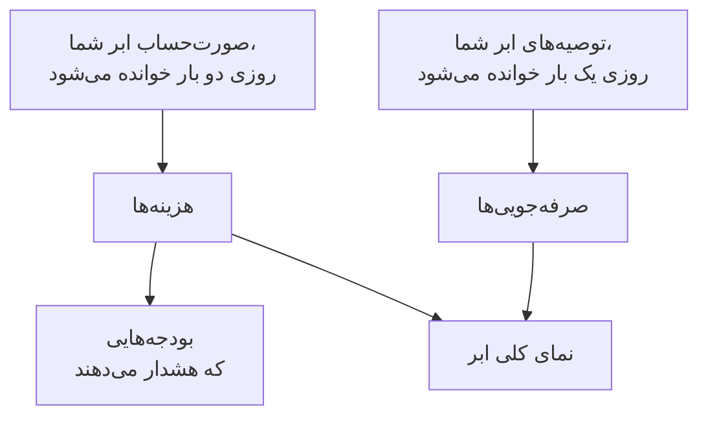

# هزینه‌ها و صرفه‌جویی‌های ابر

یک حساب ابری متصل همچنین می‌گوید چقدر هزینه دارد و چطور می‌تواند کم‌تر هزینه داشته باشد. OneUptime هزینه‌های هر روز را از صورت‌حساب خود ابر شما و توصیه‌های سرویس توصیهٔ خود ابر شما را می‌خواند، آن‌ها را در **ابر** > **مخارج** > **هزینه‌ها** و **ابر** > **مخارج** > **صرفه‌جویی‌ها** نشان می‌دهد، Savings Plans، رزروها و تخفیف‌های استفادهٔ تعهدشدهٔ شما را در **ابر** > **مخارج** > **تعهدها** فهرست می‌کند، و پیش از آنکه یک ماه بیش از بودجه‌اش هزینه داشته باشد در **ابر** > **مخارج** > **بودجه‌ها** هشدار می‌دهد. اگر اجازه دهید، صرفه‌جویی‌هایی را که یک مالک تأیید می‌کند هم اجرا می‌کند، منابع غیرتولیدی را خارج از ساعات کاری متوقف می‌کند و هر تغییر را با صورت‌حساب می‌سنجد.

:::cards
- [Amazon Web Services](#amazon-web-services): Cost Explorer و Cost Optimization Hub، هر کدام یک بار روشن می‌شوند.
- [Microsoft Azure](#microsoft-azure): Cost Management و Azure Advisor، با یک نقش بیشتر.
- [Google Cloud](#google-cloud): خروجی صورت‌حساب شما به BigQuery، و Recommender.
- [صورت‌حساب‌شده، مستهلک‌شده و خالص](#صورتحسابشده-مستهلکشده-و-خالص): هر هزینه به سه شکل، تا تعهدها و اعتبارها همان‌جا بنشینند که پول واقعاً رفت.
- [تعهدها و تمدیدها](#تعهدها-و-تمدیدها): هر تعهد، هشدار پیش از پایان یکی یا وقتی کم استفاده می‌شود، و اینکه چه چیزی را تمدید کنید یا بخرید.
- [اجرای صرفه‌جویی‌ها](#اجرای-صرفهجوییها): یک صرفه‌جویی را با تأیید مالکش اعمال کنید، و آن را واگرد کنید.
- [زمان‌بندی‌های خارج از ساعات کاری](#زمانبندیهای-خارج-از-ساعات-کاری): منابع غیرتولیدی را شب‌ها و آخر هفته‌ها متوقف کنید.
- [قواعد هوش مصنوعی صرفه‌جویی](#قواعد-هوش-مصنوعی-صرفهجویی): پیشنهاد به مالکان، یا تغییر تا یک سقف.
- [بودجه‌ها](#بودجهها): هشداری وقتی مخارج یک ماه از سهمی از بودجه‌اش بگذرد.
- [تگ‌های الزامی](#تگهای-الزامی): چه سهمی از مخارج شما تگ‌هایی را که الزامی کرده‌اید دارد، و منابع تازهٔ بدون آن‌ها.
:::

## چگونه کار می‌کند



- **هزینه‌ها از صورت‌حساب خود ابر شما می‌آیند.** AWS Cost Explorer، Azure Cost Management و خروجی صورت‌حساب Google Cloud به BigQuery، به ارزی که حساب با آن صورت‌حساب می‌شود، و هر کدام به شکل صورت‌حساب‌شده، مستهلک‌شده و خالص نگه داشته می‌شود: [صورت‌حساب‌شده، مستهلک‌شده و خالص](#صورتحسابشده-مستهلکشده-و-خالص) را ببینید. هر رقم مال یک روز است، در روزهای UTC، همان‌طور که ابر شما آن‌ها را صورت‌حساب می‌کند.
- **یک ابر آخرین روز یا دو روز را با تأخیر گزارش می‌دهد.** هر خواندن هفتهٔ گذشته را دوباره می‌خواند، و در نخستین روزهای یک ماه کل ماه گذشته را، تا هزینهٔ یک روز همان‌طور که ابر شما آن را می‌بندد تثبیت شود. نخستین خواندن یک اتصال تا آغاز ماهِ پیش از ماه گذشته به عقب برمی‌گردد.
- **پیش‌بینی ماه از سرعت هفتهٔ گذشته پیروی می‌کند.** این همان هزینهٔ ماه تا اکنون است، به‌علاوهٔ هر روز باقی‌مانده با میانگین هفت روز کامل گذشته.
- **صرفه‌جویی‌ها از سرویس توصیهٔ خود ابر شما می‌آیند.** AWS Cost Optimization Hub، Azure Advisor و Recommender در Google Cloud: اندازه‌ای کوچک‌تر، منبعی بیکار، تعهدی که می‌ارزد، هر کدام با آنچه در ماه صرفه‌جویی می‌کند. توصیه‌ای که در کنسول ابر خود اجرا یا رد کنید در خواندن بعدی ناپدید می‌شود.

## پیش از شروع

- **یک حساب متصل.** [اتصال یک حساب ابری](/docs/telemetry/cloud-accounts) با فرمان راه‌اندازی امروز: این فرمان به اتصال اجازه می‌دهد هزینه‌ها و توصیه‌ها را بخواند. اتصالی که پیش‌تر ساخته شده هیچ‌کدام را نمی‌خواند تا فرمانش را دوباره اجرا کنید.

## Amazon Web Services

اتصال هزینه‌ها را با `ce:GetCostAndUsage`، تعهدها را با `ce:GetSavingsPlansCoverage`، `ce:GetSavingsPlansUtilization`، `ce:GetSavingsPlansUtilizationDetails`، `ce:GetReservationCoverage` و `ce:GetReservationUtilization`، Savings Plans خریده‌شده را با `savingsplans:DescribeSavingsPlans`، و توصیه‌ها را با `cost-optimization-hub:ListRecommendations` و `cost-optimization-hub:GetRecommendation` می‌خواند. فرمان راه‌اندازی خواندن‌های Cost Explorer را به شکل سه خانواده می‌دهد، `ce:GetCostAndUsage*`، `ce:GetSavingsPlans*` و `ce:GetReservation*`، که همه فقط خواندن‌اند، تا کاربرِ یک کلید دسترسی همچنان در ۲٬۰۴۸ نویسه‌ای که IAM برای سیاستش مجاز می‌داند جا شود. Cost Explorer و Cost Optimization Hub باید ابتدا در حساب روشن شوند:

:::steps
### روشن کردن Cost Explorer

Cost Explorer را یک بار در کنسول AWS Billing and Cost Management باز کنید: AWS ظرف یک روز هزینه‌های حساب را آماده می‌کند. حساب مدیریت سازمان را متصل کنید تا هزینه‌های هر حساب عضو خوانده شود.

### پیوستن به Cost Optimization Hub

Cost Optimization Hub را در همان کنسول باز کنید و به آن بپیوندید، برای سازمان از حساب مدیریتش یا فقط برای همین حساب. توصیه‌هایش ظرف یک روز می‌رسند.
:::

Cost Explorer برای هر درخواست $۰٫۰۱ می‌گیرد: هر خواندن هزینه‌ها دو یا چند درخواست بیشتر می‌فرستد، یکی برای صورت‌حساب‌شده و مستهلک‌شده و یکی برای خالص، و تعهدها با چهار درخواست در روز برای پوشش و مصرفشان، و شش تا دوازده درخواست بیشتر در روز برای خود هر کدام خوانده می‌شوند. API مربوط به Savings Plans و Cost Optimization Hub رایگان‌اند.

### هزینه به تفکیک منبع

وقتی داده‌های سطح منبع روشن باشد، Cost Explorer هزینهٔ هر منبع را هم برای ۱۴ روز گذشته می‌گوید. در کنسول AWS Billing and Cost Management، تنظیمات Cost Management را باز کنید و داده‌های سطح منبع را با دانه‌بندی روزانه روشن کنید، برای سازمان از حساب مدیریتش. AWS ظرف ۴۸ ساعت آن را آماده می‌کند.

سپس اتصال را در **ابر** > **اتصال** ویرایش کنید و در **فیلدهای بیشتر** گزینهٔ **هزینه به تفکیک منبع** را روشن کنید. اتصال آن‌ها را روزی یک بار با `ce:GetCostAndUsageWithResources` می‌خواند: بار اول ۱۴ روز، سپس دوباره سه روز آخر، هر بار با چند درخواست. آنچه می‌خواند پس از آنکه Cost Explorer فراموشش کند، همراه هزینه‌های حساب می‌ماند. اتصالی که پیش‌تر ساخته شده باید دستور راه‌اندازی‌اش را دوباره اجرا کند تا این کنش افزوده شود.

## Microsoft Azure

برنامه هزینه‌ها را با نقش **Cost Management Reader** می‌خواند، در همان دامنهٔ **Monitoring Reader**: فرمان راه‌اندازی هر دو را می‌دهد. توصیه‌های Azure Advisor با **Monitoring Reader** خوانده می‌شوند، پس چیزی برای روشن کردن نیست. برای دادن این نقش به برنامه‌ای که پیش‌تر ساخته شده، اجرا کنید:

```bash
az role assignment create --assignee <APP_ID> --role "Cost Management Reader" --scope /subscriptions/<SUBSCRIPTION_ID>
```

Cost Management برای هر اشتراک پاسخ می‌دهد، همراه با منبعی که هر هزینه به آن مربوط است، و خواندنش رایگان است. وقتی نتواند برای یک اشتراک پاسخ دهد، **هزینه‌ها** حساب می‌گوید چرا.

Cost Management سرعت خواندن هزینه‌های یک مستأجر را محدود می‌کند، برای همهٔ کسانی که آن‌ها را می‌خوانند یکسان: هر پرس‌وجو برای هر ماه داده‌ای که می‌خواند یک واحد پردازش پرس‌وجو (QPU) مصرف می‌کند، و هر مستأجر هر ۱۰ ثانیه ۱۲ QPU، هر دقیقه ۶۰ و هر ساعت ۶۰۰ دارد. OneUptime اشتراک‌های یک مستأجر را یکی‌یکی و در حد دو سوم هر سهمیه می‌خواند، وقتی Cost Management پرس‌وجویی را رد کند به اندازه‌ای که بخواهد صبر می‌کند، و در خواندن بعدی از همان جایی که مانده بود ادامه می‌دهد. اشتراکی که هنوز خوانده نشده، **در صف** و زمان خوانده شدنش را نشان می‌دهد؛ اشتراکی که رقم دارد، در این مدت رقم‌هایش را نگه می‌دارد. هزینهٔ مستهلک‌شدهٔ آن در هر خواندن و هزینهٔ واقعی‌اش روزی یک بار خوانده می‌شود، بنابراین نخستین خواندن یک اشتراک دو بار از Cost Management می‌پرسد و دو برابر واحد پرس‌وجو مصرف می‌کند: نخستین رقم‌های یک مستأجر بزرگ چند خواندن بیشتر طول می‌کشد.

رزروها و طرح‌های صرفه‌جویی مستأجر با **Reservations Reader** و **Savings plan Reader** خوانده می‌شوند، که Azure آن‌ها را در دامنهٔ خود مستأجر می‌دهد، جایی که فقط یک مدیر سراسری با دسترسی ارتقایافته می‌تواند آن‌ها را اعطا کند. فرمان راه‌اندازی تلاش می‌کند، و وقتی نتواند این را می‌گوید. برای اعطای آن‌ها در زمانی دیگر، به‌عنوان مدیر سراسری با دسترسی ارتقایافته:

```bash
az role assignment create --assignee <APP_ID> --role "Reservations Reader" --scope /providers/Microsoft.Capacity
az role assignment create --assignee <APP_ID> --role "Savings plan Reader" --scope /providers/Microsoft.BillingBenefits
```

بدون آن‌ها، هزینه‌ها و توصیه‌ها مثل قبل خوانده می‌شوند، و **ابر** > **مخارج** > **تعهدها** می‌گوید کدام نقش را بدهید.

## Google Cloud

Google Cloud هیچ API برای هزینه‌های یک پروژه ندارد: OneUptime آن‌ها را از خروجی حساب صورت‌حساب شما به BigQuery می‌خواند.

:::steps
### خروجی گرفتن از صورت‌حساب به BigQuery

در کنسول Google Cloud، Billing و سپس Billing export را باز کنید و خروجی هزینهٔ مصرف جزئی را به یک مجموعه‌دادهٔ BigQuery روشن کنید. Google آن را با چند ساعت تأخیر می‌نویسد، از روزی که آن را روشن می‌کنید.

### اجازه دادن به حساب سرویس برای خواندن آن

به حساب سرویس اتصال نقش **BigQuery Data Viewer** را روی مجموعه‌دادهٔ خروجی بدهید. فرمان راه‌اندازی پیش‌تر **BigQuery Job User** را به آن داده است، تا پرس‌وجو را در پروژهٔ خودش اجرا کند.

### وارد کردن جدول خروجی

اتصال را در **ابر** > **اتصال** ویرایش کنید و در **فیلدهای بیشتر**، **جدول خروجی صورت‌حساب** را برابر نام کامل جدول قرار دهید: `<PROJECT_ID>.<DATASET>.gcp_billing_export_resource_v1_<BILLING_ACCOUNT_ID>`.
:::

خروجی جزئی منبعی را که هر هزینه به آن مربوط است نام می‌برد؛ خروجی استاندارد فقط سرویس و منطقه را می‌گوید. BigQuery برای پرس‌وجو هزینه می‌گیرد: نخستین ۱ TiB در ماه رایگان است، سپس $۶٫۲۵ برای هر TiB، و یک ماه از یک خروجی از چند مگابایت تا چند گیگابایت است. توصیه‌های Recommender دربارهٔ نوع ماشین و منابع بیکار با **Compute Recommender Viewer** خوانده می‌شوند، که فرمان راه‌اندازی آن را می‌دهد، و هزینه‌ای ندارند. تعهدهای Compute Engine از Cloud Asset Inventory با **Cloud Asset Viewer** فهرست می‌شوند، که فرمان راه‌اندازی از قبل آن را می‌دهد: چیز دیگری لازم نیست.

## صورت‌حساب‌شده، مستهلک‌شده و خالص

هر هزینه به سه شکل نگه داشته می‌شود، و **ابر** > **مخارج** > **هزینه‌ها**، **هزینه‌ها** در صفحهٔ هر حساب، نمای کلی ابر و بودجه‌ها همان شکلی را نشان می‌دهند که انتخاب کنید:

- **صورت‌حساب‌شده** هر هزینه در روزی است که ابر شما آن را صورت‌حساب کرد، پیش از اعتبارها و بازپرداخت‌ها. یک Savings Plan یا رزرو پیش‌پرداخت، یک هزینهٔ بزرگ در روز خرید آن است، و مصرفی که پوشش می‌دهد در باقی مدتش رایگان به نظر می‌رسد.
- **مستهلک‌شده** کارمزدهای هر تعهد را روی روزها و منابعی که پوشش می‌دهد پخش می‌کند، تا پول همان‌جا بنشیند که خرج شد. هنوز پیش از اعتبارها و بازپرداخت‌ها است. صفحه‌ها همین را نشان می‌دهند، مگر اینکه شکل دیگری انتخاب کنید.
- **خالص** همان مستهلک‌شده است، منهای اعتبارها، بازپرداخت‌ها و تخفیف‌ها: آنچه صورت‌حساب به آن می‌رسد.

| | صورت‌حساب‌شده | مستهلک‌شده | خالص |
|---|---|---|---|
| AWS | هزینهٔ ترکیب‌نشدهٔ (unblended) Cost Explorer | هزینهٔ مستهلک‌شدهٔ Cost Explorer | هزینهٔ مستهلک‌شدهٔ خالص Cost Explorer، با اعتبارها و بازپرداخت‌ها |
| Azure | هزینهٔ واقعی Cost Management | هزینهٔ مستهلک‌شدهٔ Cost Management | هزینهٔ مستهلک‌شده: Azure اعتبارها را روی حساب صورت‌حساب کم می‌کند، که اتصال یک اشتراک آن را نمی‌خواند |
| Google Cloud | هزینهٔ خروجی | هزینه منهای اعتبارهای تخفیف‌های استفادهٔ تعهدشده و اشتراک‌ها | هزینه منهای همهٔ اعتبارها |

انتخابگر بالای رقم‌ها مبنا را در صفحه عوض می‌کند، و OneUptime انتخاب شما را برای این پروژه در مرورگرتان به یاد می‌سپارد. مبنای خود پروژه، که صفحه‌ها با آن باز می‌شوند و بودجه‌ها آن را می‌پایند، در **ابر** > **تنظیمات** > **تنظیمات هزینه** است. یک بودجه می‌تواند مبنای خودش را بپاید: آن را ویرایش کنید و **مبنای هزینه** را تنظیم کنید.

هزینه‌هایی که پیش از نگه‌داری هر سه شکل خوانده شده‌اند، در هر مبنا رقم صورت‌حساب‌شدهٔ خود را نشان می‌دهند. هر اتصال هزینه‌هایش را یک بار دوباره می‌خواند، به همان اندازهٔ عقب که یک خواندن نخستین، تا هر مبنا پر شود.

## راه‌های کم‌تر خرج کردن

**ابر** > **مخارج** > **صرفه‌جویی‌ها** هر توصیه را فهرست می‌کند، بزرگ‌ترین صرفه‌جویی اول: چه باید کرد، روی کدام منبع، چه چیزی تغییر می‌کند و در ماه چقدر صرفه‌جویی می‌کند. نوار بالای آن جمع آن‌ها را نشان می‌دهد، در کل و بر اساس نوع: اندازه‌ای کوچک‌تر، منبعی بیکار، تعهدی. یک توصیه وقتی OneUptime آن منبع را دارد به صفحهٔ منبعش پیوند می‌دهد، و توصیه‌ای که OneUptime بتواند اجرایش کند دکمهٔ **اعمال** دارد: [اجرای صرفه‌جویی‌ها](#اجرای-صرفهجوییها) را ببینید.

### تعیین اندازهٔ مناسب با خوانده‌های خود OneUptime

منبعی که هیچ سرویس توصیه‌ای دربارهٔ آن چیزی نمی‌گوید، چون روشن نیست، نوع آن را پوشش نمی‌دهد یا آن را بیش از حد تازه می‌داند، اندازه‌اش را OneUptime از خوانده‌های CPU و حافظه‌ای تعیین می‌کند که اتصالش در ۱۴ روز گذشته گرفته است. OneUptime اندازهٔ نمونه‌های EC2، پایگاه‌های دادهٔ RDS و خوشه‌های ElastiCache در AWS، ماشین‌های مجازی، سرورهای انعطاف‌پذیر PostgreSQL و MySQL و طرح‌های App Service در Azure، و ماشین‌های مجازی Compute Engine و نمونه‌های Cloud SQL در Google Cloud را تعیین می‌کند:

- **بیش‌تخصیص** وقتی اندازهٔ نصف، یا یک‌چهارم، هنوز جا داشته باشد: در اندازهٔ کوچک‌تر، صدک ۹۵ CPU آن حداکثر ۶۰٪، بالاترین خواندهٔ CPU آن حداکثر ۱۰۰٪ و اوج حافظه‌اش حداکثر ۷۰٪ می‌شود، وقتی حافظه‌اش خوانده شود.
- **کم‌تخصیص** وقتی صدک ۹۵ CPU آن ۸۵٪ یا بیشتر باشد، یا اوج حافظه‌اش ۹۰٪ یا بیشتر: اندازهٔ دو برابر.

اندازهٔ یک منبع وقتی تعیین می‌شود که ۶ روز خوانده داشته باشد. صفحهٔ آن **تعیین اندازهٔ مناسب** را کنار هزینه‌اش نشان می‌دهد، و منبع بیش‌تخصیص با OneUptime به‌عنوان منبع توصیه در **ابر** > **مخارج** > **صرفه‌جویی‌ها** فهرست می‌شود. صرفه‌جویی یک تغییر، سهم آن از هزینهٔ منبع در ۳۰ روز گذشته است، پس وقتی معلوم می‌شود که ابر شما منبع را با نام صورت‌حساب کند: خروجی تفصیلی Azure و Google Cloud این کار را می‌کند، و AWS هم وقتی «هزینه به تفکیک منبع» روشن باشد. برای اندازه‌های انفجاری مانند t3، سری B و e2-micro هرگز اندازه تعیین نمی‌شود.

ابر شما حافظهٔ یک ماشین مجازی را فقط با عاملی از خودش درون آن ماشین می‌خواند: عامل CloudWatch روی یک نمونهٔ EC2، Ops Agent روی یک ماشین مجازی Compute Engine، و هیچ عاملی برای یک ماشین مجازی Azure، که به‌جای حافظهٔ مصرف‌شده حافظهٔ باقی‌مانده را گزارش می‌دهد. ماشین مجازی‌ای که [کالکتور میزبان OneUptime](/docs/telemetry/hosts) روی آن اجرا می‌شود، به‌جای آن بر اساس حافظه‌ای اندازه می‌گیرد که کالکتور میزبان می‌خواند:

- **ماشین مجازی و میزبان یک ماشین‌اند** وقتی ارائه‌دهنده، حساب، منطقه و شناسهٔ نمونه همه یکی باشند: شناسهٔ نمونهٔ EC2، شناسهٔ عددی یک ماشین مجازی Compute Engine یا `vmId` یک ماشین مجازی Azure. نام میزبان به‌تنهایی هرگز تطابق نمی‌سازد، و ماشین مجازی‌ای که دو میزبان آن را از آنِ خود بدانند، مانند یک ماشین کلون‌شده، به هیچ‌کدام پیوند نمی‌خورد. صفحهٔ ماشین مجازی میزبانش را نام می‌برد و صفحهٔ میزبان ماشین مجازی‌اش را، و هر کدام به دیگری پیوند دارد.
- **حافظه همان حافظهٔ مصرف‌شدهٔ میزبان است، بدون کش و بافرها**، همان عددی که صفحهٔ میزبان در نمودار نشان می‌دهد، در همان ۱۴ روز. کش پرکار فایل‌ها هرگز به‌معنای ماشینِ پر خوانده نمی‌شود. میزبان هم به ۶ روز خوانده نیاز دارد.
- **جایی که هر دو حافظه را می‌خوانند**، مانند یک ماشین مجازی Compute Engine با Ops Agent و کالکتور میزبان، آن که خواندهٔ بیشتری دارد به کار می‌رود. CPU همیشه خواندهٔ ابر شماست.

**تعیین اندازهٔ مناسب** ماشین مجازی می‌گوید حافظه‌اش از کجا آمده است، و ردیف آن در **ابر** > **مخارج** > **صرفه‌جویی‌ها** هم همین را می‌گوید. ماشین مجازی‌ای که فقط با CPU اندازه می‌گیرد همین را می‌گوید، با پیوندی برای نصب کالکتور میزبان. کالکتور میزبان هویت ابرش را با مرحلهٔ `resourcedetection/cloud` مُهر می‌زند که [پیکربندی راهنمای میزبان‌ها](/docs/telemetry/host-otel-collector) دارد. میزبانی که پیکربندی پیش‌فرض OneUptime را دارد این مرحله را با نسخهٔ بعدی OneUptime می‌گیرد، و میزبانی با پیکربندی خودتان باید آن را اضافه کند. گره‌های Kubernetes به [مشاهده‌پذیری هزینهٔ Kubernetes](/docs/telemetry/kubernetes-cost) سپرده می‌شوند، که درخواست‌های آنچه روی آن‌ها اجرا می‌شود را اندازه می‌گیرد.

### تعهدها

**ابر** > **مخارج** > **صرفه‌جویی‌ها** و **هزینه‌ها** یک حساب نشان می‌دهند تعهدهای هر حساب چه بخشی از هزینه‌های ۳۰ روز گذشته را پرداخت کردند و چه بخشی از آن‌ها استفاده شد، برای هر نوع یک خط:

- AWS: Savings Plans و Reserved Instances، از Cost Explorer. حساب مدیریت یک سازمان آن‌ها را برای همهٔ حساب‌های سازمان می‌خواند.
- Azure: طرح‌های صرفه‌جویی و رزروها، از Cost Management، با هزینهٔ مستهلک‌شده.
- Google Cloud: تخفیف‌های استفادهٔ تعهدشده، از خروجی صورت‌حساب شما. خروجی نمی‌گوید چه بخشی از یک تعهد بی‌استفاده ماند، پس میزان استفاده نشان داده نمی‌شود.

حسابی که تعهدی ندارد نشان می‌دهد چه چیزی با نرخ درخواستی اجرا شد که یک تعهد آن را ارزان‌تر می‌پرداخت. ارقام هر نوع ارقام خود ابر آن است و انواع هرگز با هم جمع نمی‌شوند: یک رزرو و یک Savings Plan هر دو ممکن است هزینهٔ همان ماشین را سهم خود بشمارند. هر تعهد جداگانه در **ابر** > **مخارج** > **تعهدها** فهرست شده است: [تعهدها و تمدیدها](#تعهدها-و-تمدیدها) را ببینید.

## تعهدها و تمدیدها

**ابر** > **مخارج** > **تعهدها** هر Savings Plan، رزرو و تخفیف استفادهٔ تعهدشده‌ای را که اتصال‌های شما می‌توانند بخوانند فهرست می‌کند، تا هیچ‌کدام بی‌خبر تمام نشود:

- **تعهدهای فعال** در بالا، تعهدهای فعال و آن‌هایی را که تا ۹۰ روز دیگر تمام می‌شوند می‌شمارد، **مصرف** اینکه چه بخشی از آن‌ها در ۳۰ روز گذشته استفاده شد و چه چیزی بی‌استفاده ماند، و **پوشش** اینکه چه بخشی از مخارج را پوشش می‌دهند.
- **به‌زودی تمام می‌شوند** آن‌هایی را فهرست می‌کند که تا ۹۰ روز دیگر تمام می‌شوند و خودشان تمدید نمی‌شوند، هر کدام با برنامهٔ تمدیدش: چه چیزی بخرید تا تخفیفش بماند (تعهد ساعتی یا نمونه‌هایش، به اندازهٔ بخشی که استفاده شد)، ماهانه چقدر هزینه دارد و صرفه‌جویی می‌کند، کی هزینه‌اش برمی‌گردد، و چه بخشی از مخارج اکنون و پس از پایانش پوشش داده می‌شود. **تمدید در کنسول** صفحه‌ای را باز می‌کند که ابر شما در آن آن را تمدید می‌کند.
- **همهٔ تعهدها** فهرست کامل است: هر کدام چیست و چه چیزی را پوشش می‌دهد، حسابش، کی تمام می‌شود، مدت و گزینهٔ پرداختش، چه بخشی از آن در ۳۰ روز گذشته استفاده شد، و مصرفی که هزینه‌اش را پرداخت و صرفه‌جویی‌ای که کرد.
- **برنامه‌های خرید** چیزهایی هستند که سرویس توصیهٔ ابر شما پیشنهاد می‌کند بخرید، هر کدام با اینکه ماهانه چقدر هزینه و صرفه‌جویی دارد، کی هزینه‌اش برمی‌گردد و پوشش چطور تغییر می‌کند. **خرید در کنسول** صفحهٔ خرید آن را باز می‌کند.
- زیر آن‌ها، تعهدهای هر حساب بر اساس نوع، همان‌طور که صفحهٔ **هزینه‌ها** در آن حساب نشانشان می‌دهد، و اینکه تعهدها کی هشدار می‌دهند، با **تغییر هشدارها**.

OneUptime فقط برنامه‌ریزی می‌کند: هرگز تعهدی را نمی‌خرد، تمدید نمی‌کند یا پس نمی‌دهد. خرید را خودتان در کنسول ابرتان انجام می‌دهید.

| | تعهدها از کجا می‌آیند | چه چیزی دربارهٔ هر کدام دانسته است |
|---|---|---|
| AWS | Savings Plans و Reserved Instances از Cost Explorer، هر کدام با مصرف خودش، و API مربوط به Savings Plans برای طرح‌های خریده‌شده، از جمله آن‌هایی که در صف شروع هستند | پایان، مدت، گزینهٔ پرداخت، تعهد ساعتی یا نمونه‌ها، کارمزدها و مصرف در ۳۰ و ۷ روز گذشته |
| Azure | رزروها و طرح‌های صرفه‌جویی مستأجر | پایان، مدت، طرح صورت‌حساب، اینکه خودش تمدید می‌شود یا نه، و مصرف در ۳۰ و ۷ روز گذشته |
| Google Cloud | تعهدهای Compute Engine، از Cloud Asset Inventory | پایان، طرح، منابع و اینکه خودش تمدید می‌شود یا نه. Google Cloud نمی‌گوید چه بخشی از یک تعهد استفاده می‌شود |

حساب مدیریت یک سازمان، تعهدهای همهٔ حساب‌ها را در AWS فهرست می‌کند. تخفیف‌های استفادهٔ تعهدشدهٔ مبتنی بر مخارج، که Google Cloud آن‌ها را به‌جای یک پروژه روی حساب صورت‌حساب نگه می‌دارد، هنوز فهرست نمی‌شوند.

### هشدارهای تعهد

تعهدها هشدار می‌سازند، که مثل هر هشداری از راه سیاست‌های آنکال فراخوان می‌کنند. در **ابر** > **تنظیمات** > **تنظیمات هزینه**، **هشدارهای تعهد** می‌گوید کی:

- **هشدار پیش از پایان تعهد**: برای شروع ۹۰، ۳۰ و ۷ روز پیش از پایانش. یک هشدار در نزدیک‌ترینِ آن روزها که تعهد به آن رسیده، و هر نزدیک‌تر جای قبلی را می‌گیرد. تعهدی که خودش تمدید می‌شود، یا تمدیدش در صف است تا با پایانش شروع شود، هیچ هشداری نمی‌سازد.
- **هشدار وقتی مصرف کمتر باشد از**: برای شروع ۸۰٪، از ۷ روز گذشتهٔ یک تعهد، پس از آنکه یک هفته کار کرده باشد. وقتی مصرفش برگردد هشدار حل می‌شود.
- **هشدار وقتی پوشش کمتر شود از**: برای شروع ۶۰٪، از مخارجی که تعهدهای یک نوع در یک حساب می‌توانستند پوشش دهند، پس از آنکه بیشتر پوشش داده باشند. وقتی پوشش برگردد حل می‌شود. اگر خالی باشد، پوشش هیچ هشداری نمی‌سازد.

**هشدار دربارهٔ تعهدها** همهٔ آن‌ها را خاموش می‌کند، و **شدت هشدار**، **سیاست‌های آنکال** و **مالکان** می‌گویند چقدر جدی‌اند، چه کسی فراخوانده می‌شود و مال کیستند. هر هشدار می‌گوید تعهد چه چیزی را پوشش می‌دهد و هزینهٔ چه چیزی را پرداخت، و به برنامهٔ تمدیدش اشاره می‌کند. وقتی تعهدش تمام شود، تمدید شود یا دیگر فهرست نشود، هشدار خودبه‌خود حل می‌شود.

## اجرای صرفه‌جویی‌ها

OneUptime یک صرفه‌جویی را از طریق اتصال ابری حساب اجرا می‌کند، به محض اینکه تنظیم **اقدام‌های صرفه‌جویی** آن اجازه دهد: [اقدام‌های صرفه‌جویی](/docs/telemetry/cloud-accounts#اقدامهای-صرفهجویی) می‌گوید هر گزینه چه دسترسی‌ای می‌دهد. فقط تغییرهای یک‌گامی را انجام می‌دهد: نمونه یا پایگاه دادهٔ بیکار را متوقف می‌کند، ولوم gp2 را به gp3 تغییر می‌دهد، دیسک جداشده، تصویر لحظه‌ای قدیمی یا تصویر بی‌استفاده را حذف می‌کند، نشانی بی‌استفاده را آزاد می‌کند و، اگر اجازه دهید، اندازهٔ نمونه یا پایگاه داده را به اندازهٔ پیشنهادی تغییر می‌دهد. هرگز تعهد نمی‌خرد: **خرید در کنسول** صفحهٔ ابر شما را برای آن باز می‌کند.

:::steps
### اعمال را انتخاب کنید

در **ابر** > **مخارج** > **صرفه‌جویی‌ها** روی یک صرفه‌جویی **اعمال** را انتخاب کنید. کادر گفتگو می‌گوید چه چیزی تغییر می‌کند، در ماه چقدر صرفه‌جویی می‌شود، چطور واگرد می‌شود یا اینکه نمی‌شود، و چه کسی آن را تأیید می‌کند.

### یک مالک تأیید می‌کند

کسی که مالک منبع تعیین شده، یا عضوی از تیم مالک آن، که بتواند آن را ویرایش هم بکند، تغییر را تأیید می‌کند. منبع بدون مالک را مالک پروژه یا مدیر پروژه تأیید می‌کند. اگر خودتان بتوانید آن را تأیید کنید، **اعمال** آن را فوراً و به نام شما انجام می‌دهد. وگرنه در **در انتظار تأیید** می‌ماند تا یک مالک **تأیید** را انتخاب کند، یا **پنهان کردن** را همراه با یک دلیل.

### OneUptime آن را انجام می‌دهد

تغییر از طریق اتصال انجام می‌شود و همراه با تأییدکننده در خط زمانی منبع و حساب ثبت می‌شود. از دیسکی که حذف می‌شود ابتدا یک تصویر لحظه‌ای نهایی گرفته می‌شود، مگر اینکه **ابتدا تصویر لحظه‌ای نهایی گرفته شود** را خاموش کنید.
:::

هر تغییر می‌گوید چطور واگرد می‌شود: **واگرد** در **تغییرهای انجام‌شده** نمونهٔ متوقف‌شده را دوباره روشن می‌کند، ولوم یا اندازه را برمی‌گرداند، یا دیسک حذف‌شده را از تصویر لحظه‌ای نهایی‌اش دوباره می‌سازد. آنچه برای همیشه حذف می‌شود، مثل تصویر لحظه‌ای، تصویر یا نشانی آزادشده، قابل واگرد نیست و کادر گفتگو پیش از اعمال این را می‌گوید. جایی که پروژه با **الزام دو تأیید برای اصلاح‌های پرخطرتر** دو تأیید می‌خواهد، تغییری که قابل واگرد نیست به دو نفر نیاز دارد.

منبعی که برچسب‌هایش می‌گویند به‌صورت کد مدیریت می‌شود، مثلاً با Terraform یا CloudFormation، به‌جای آن در کدش تغییر می‌کند: کادر گفتگو **باز کردن Pull Request** را برای مخزنی که آن را تعریف می‌کند پیشنهاد می‌دهد، تا apply بعدی صرفه‌جویی را برنگرداند.

### اثبات با صورت‌حساب

**صرفه‌جویی این ماه** فقط چیزی را می‌شمارد که صورت‌حساب ابر شما نشان می‌دهد. به محض اینکه ۳ روز پس از یک تغییر در صورت‌حساب قطعی شود، هزینهٔ روزانهٔ منبع با هفتهٔ پیش از تغییر مقایسه می‌شود: اگر هزینه دست‌کم یک‌چهارم مبلغ وعده‌داده‌شده کم شده باشد **در صورت‌حساب دیده شد**، اگر نه **در صورت‌حساب دیده نشد**، و اگر ابر شما منبع را با نامش صورت‌حساب نکند **قابل اندازه‌گیری نیست** است. **در حال بررسی صورت‌حساب** تغییرهایی را می‌شمارد که هنوز منتظر آن روزها هستند.

## زمان‌بندی‌های خارج از ساعات کاری

در **ابر** > **مخارج** > **زمان‌بندی‌ها** یک زمان‌بندی نمونه‌ها و پایگاه‌های دادهٔ غیرتولیدی را خارج از ساعات کاری متوقف و دوباره روشن می‌کند:

:::steps
### منابع را انتخاب کنید

برچسب ابری را که آن‌ها را انتخاب می‌کند نام ببرید، مثلاً `Schedule` = `office-hours`، در یک حساب یا در همهٔ حساب‌ها.

### بگویید کی روشن هستند

روزهای کاری، زمان روشن شدن و زمان توقف را در قالب ۲۴ ساعته، و منطقه زمانی را انتخاب کنید.
:::

وقتی ساعات کاری تمام می‌شود، زمان‌بندی از طریق اتصال حسابش هر منبع روشنی را که برچسبش انتخاب می‌کند و معلوم است تولید نیست متوقف می‌کند، و وقتی ساعات کاری شروع می‌شود فقط آنچه را خودش متوقف کرده دوباره روشن می‌کند: منبعی که کسی دستی متوقف کرده متوقف می‌ماند. **دیدن منابع** نشان می‌دهد زمان‌بندی اکنون چه چیزهایی را انتخاب می‌کند و چرا برخی را روشن نگه می‌دارد. نمونه‌های EC2 و پایگاه‌های دادهٔ RDS در AWS، ماشین‌های مجازی در Azure و نمونه‌های Compute Engine در Google Cloud را متوقف می‌کند. AWS پایگاه داده‌ای را که هفت روز متوقف مانده خودش دوباره روشن می‌کند.

زمان‌بندی هرگز تولید را متوقف نمی‌کند، و نه منبعی را که هیچ چیز محیطش را نمی‌گوید. معلوم است منبعی تولید نیست وقتی:

- یکی از برچسب‌هایش این را بگوید، با کلیدی مثل `environment`، `env`، `stage`، `tier` یا `deployment.environment` و کلمه‌ای مثل `dev`، `test`، `qa`، `staging` یا `sandbox`؛
- حسابش در **محیط** در **تنظیمات** حساب **غیرتولیدی** علامت خورده باشد؛
- یا یکی از برچسب‌های OneUptime آن این را بگوید، مثلاً `Staging` یا `env: dev`.

تولید مقدم است: برچسبی که `prod`، `production` یا `live` بگوید، یا حسابی که **تولید** علامت خورده، منبع را روشن نگه می‌دارد، هر چه بقیه بگویند. نام منبع هرگز برای این خوانده نمی‌شود. اگر زمان‌بندی را خاموش کنید دیگر چیزی را متوقف نمی‌کند و آنچه را متوقف کرده با شروع ساعات کاری‌اش روشن می‌کند؛ اگر حذفش کنید، آنچه متوقف کرده فوراً روشن می‌شود.

## قواعد هوش مصنوعی صرفه‌جویی

وقتی **فعال کردن هوش مصنوعی** روشن است، OneUptime AI پس از هر بار خواندن صرفه‌جویی‌های حساب، هر صرفه‌جویی‌ای را که بتواند اجرا کند به مالکان منبع پیشنهاد می‌دهد و آن‌ها در **در انتظار تأیید** آن را تأیید یا رد می‌کنند. در **ابر** > **تنظیمات** > **قواعد هوش مصنوعی صرفه‌جویی** یک قاعده می‌گوید OneUptime AI با صرفه‌جویی‌هایی که با آن جور درمی‌آیند چه کند، بر اساس نوع تغییر، محیط منبع و ابر آن: **خاموش**، **پیشنهاد به مالک** یا **اجرا بدون پرسیدن** تا یک سقف ماهانه. بدون قاعده هر صرفه‌جویی پیشنهاد می‌شود و هیچ‌کدام اجرا نمی‌شود؛ با قاعده‌ها فقط آنچه با یک قاعده جور درمی‌آید، و میان قاعده‌های جور، محتاط‌ترین مقدم است.

یک قاعده فقط روی منبعی که معلوم است تولید نیست، فقط برای تغییری که قابل واگرد است، فقط تا کوچک‌ترین سقف قاعده‌های جور، و حداکثر ۱۰ بار در ساعت در هر پروژه بدون پرسیدن اجرا می‌کند: بقیه پیشنهاد می‌شوند. تغییری که بدون پرسیدن انجام شده همراه با قاعده‌ای که آن را انجام داده در خط زمانی ثبت می‌شود و مالکانش می‌توانند آن را واگرد کنند. صرفه‌جویی ردشده یا واگردشده تا ۳۰ روز دوباره پیشنهاد نمی‌شود.

## بودجه‌ها

:::steps
### ساختن یک بودجه

در **ابر** > **مخارج** > **بودجه‌ها** یک بودجه بسازید: **مبلغ ماهانه** آن، **حساب** که برای آن است، یا هیچ‌کدام برای همهٔ حساب‌ها، و **مبنای هزینه** که می‌شمارد، یا هیچ‌کدام برای مبنای پروژه.

### انتخاب زمان هشدار

**هشدار در** سهم‌هایی از بودجه را که باید در آن‌ها هشدار داد، به درصد، می‌گیرد: برای شروع ۸۰ و ۱۰۰. **هشدار هنگام پیش‌بینی عبور** همچنین ماهی یک بار هشدار می‌دهد، وقتی سرعت هفتهٔ گذشته ماه را از بودجه فراتر ببرد. **هشدار برای روزهای غیرعادی** همچنین روز بعد از روزی که بسیار بیشتر از معمول هزینه داشته هشدار می‌دهد: [روزهای غیرعادی](#روزهای-غیرعادی) را ببینید. **شدت هشدار** و **سیاست‌های آنکال** می‌گویند هشدارها چقدر جدی‌اند و چه کسی فراخوانده می‌شود.
:::

یک بودجه پس از هر خواندن هزینه‌ها و هر ساعت بررسی می‌شود. وقتی مخارج ماه از یک آستانه بگذرد، یک هشدار برای آن ساخته می‌شود، برای بالاترین آستانه وقتی یک خواندن از چند آستانه با هم بگذرد، و ماه تازه هشدارهای ماه گذشته را حل‌شده می‌کند. یک بودجه فقط حساب‌هایی را می‌شمارد که با ارز آن صورت‌حساب می‌شوند، بر مبنای خودش: یک بودجهٔ مستهلک‌شده با تعهدی که پیش‌خرید شده فعال نمی‌شود، تعهدی که یک بودجهٔ صورت‌حساب‌شده در روز خریدش می‌شمارد.

عامل‌های هوش مصنوعی می‌توانند از طریق [سرور MCP](/docs/ai/mcp-server) بودجه بسازند و تغییر دهند، و اسکریپت‌ها با فرمان `oneuptime cloud-budget` در CLI: [عملیات روی منابع](/docs/cli/resource-operations) را ببینید.

### روزهای غیرعادی

پس از هر خواندن، هر یک از ۱۴ روز کامل اخیر یک حساب با ۱۴ روز پیش از آن سنجیده می‌شود. یک روز غیرعادی است وقتی هزینهٔ یک سرویس دو برابر روز معمولش یا بیشتر بوده، یا هزینهٔ کل حساب یک و نیم برابر روز معمولش یا بیشتر. در هر دو حالت باید دست‌کم ۱۰ بیشتر از معمول، به ارز حساب، و دست‌کم ۵٪ روز معمول حساب باشد، تا چند سنت هرگز جهش به حساب نیاید. مقدار معمول یک روز میانهٔ ۱۴ روز پیش از آن است، پس یک جهش آن را کم جابه‌جا می‌کند، و یک حساب تنها وقتی سنجیده می‌شود که یک هفته هزینه داشته باشد.

**ابر** > **مخارج** > **هزینه‌ها** روزهای غیرعادی را روی هزینهٔ روزانه، بالای ستون‌هایشان، علامت می‌زند و زیر آن فهرست می‌کند. روی همهٔ حساب‌ها، هر علامت **هزینه‌ها** حساب خودش را باز می‌کند. بودجه‌ای که این حساب را در بر می‌گیرد، برای هر حساب و روز یک هشدار می‌سازد، روز بعد، و هر سرویسی را که بالا رفته نام می‌برد. جهشی که چند روز ادامه دارد در روزی که آغاز شده اعلام می‌شود، و روزی که بیش از یک هفته از آن گذشته اعلام نمی‌شود. بودجه‌ای که پیش از آمدن این هشدارها ساخته شده، تا وقتی آن را ویرایش نکنید و روشنشان نکنید، آن‌ها را نمی‌سازد.

## پول کجا می‌رود

**ابر** > **مخارج** > **هزینه‌ها** هزینه‌های یک دوره را بر اساس سرویس، منطقه، حساب یا منبع تفکیک می‌کند، و به سه شیوهٔ دیگر:

- بر اساس محیط بسترهای برنامه: سرویس بستر هر محیط در حساب و منطقه‌اش، مانند Amazon ECS یا Cloud Run، و منابع یک محیط Elastic Beanstalk بر اساس تگی که AWS به آن‌ها می‌دهد.
- بر اساس برنامه: آنچه یک بستر به نام یک برنامه صورت‌حساب می‌کند، مانند یک سرویس Cloud Run یا یک Container App. Amazon ECS وظایفش و App Service طرح‌هایش را صورت‌حساب می‌کند، پس هزینهٔ برنامه‌های آن‌ها به محیطشان تعلق می‌ماند.
- بر اساس تگ: هر مقدار تگی که انتخاب می‌کنید. هر هزینه تگ‌هایی را که هنگام خوانده‌شدن داشت نگه می‌دارد: برچسب‌های خروجی صورت‌حساب Google Cloud، وگرنه تگ‌های منبعی که هزینه به آن تعلق می‌گیرد، که در AWS به «هزینه به تفکیک منبع» نیاز دارد.

زیر فهرست، کارت می‌گوید بقیه چقدر شد: آنچه در هیچ محیطی نیست، آنچه به کل یک محیط صورت‌حساب می‌شود، یا آنچه این تگ را ندارد. هزینه‌هایی که پیش از نگه‌داشتن تگ‌ها خوانده شده‌اند یک بار دیگر خوانده می‌شوند، به همان اندازهٔ یک خواندن نخست به عقب، تا تگ‌هایشان پر شود.

## تگ‌های الزامی

مخارج فقط به اندازهٔ تگ‌هایی که دارند درست تقسیم می‌شوند. در **ابر** > **مخارج** > **تگ‌ها** بگویید هر منبع چه تگ‌هایی باید داشته باشد، مانند `team`، `env` و `cost-center`، و ببینید چه سهمی از مخارج و منابع شما آن‌ها را دارد، کدام منابع ندارند، و چه کسی هر منبع تازه را بدون آن‌ها ساخته است.

:::steps
### یک تگ را الزامی کنید

**الزامی کردن تگ** را انتخاب کنید و **کلید برچسب** آن را وارد کنید. در **مقدارهای مجاز**، مقدارهایی را که می‌تواند بگیرد با ویرگول جدا کنید، یا آن را خالی بگذارید تا هر مقداری پذیرفته شود. یک **حساب** انتخاب کنید تا تگ فقط در همان حساب الزامی باشد. **توضیحات**، زیر **فیلدهای بیشتر**، در ایمیل‌ها می‌گوید این تگ برای چیست.

### پوشش را بخوانید

صفحه با این آغاز می‌شود که چه سهمی از مخارج ۳۰ روز گذشته و منابع شما همهٔ تگ‌های الزامی را دارد. زیر آن منابعی هستند که یک تگ را ندارند، پرهزینه‌ترین‌ها اول، سپس هر تگ به‌تنهایی، روند ۱۲ هفتهٔ گذشته و هر حساب.

### تگ‌های ناموجود را بزنید

هر منبعی که تگی ندارد، مقداری را که OneUptime پیشنهاد می‌کند و فرمانی را که آن را در ابر شما تنظیم می‌کند نشان می‌دهد. منبعی که در کد تعریف شده است می‌گوید کدام کد آن را تعریف می‌کند: تگ را همان‌جا اضافه کنید، وگرنه استقرار بعدی دوباره آن را برمی‌دارد.
:::

- **کلیدها بدون توجه به حروف بزرگ و کوچک یکی گرفته می‌شوند.** `Team`، `team` و `TEAM` یک کلید هستند، و منبع وقتی تگ را دارد که هر نگارشی از آن مقداری مجاز داشته باشد. مقدارها هم بدون توجه به حروف بزرگ و کوچک یکی گرفته می‌شوند، و مقدار خالی مقدار به حساب نمی‌آید.
- **یک مقدار مجاز می‌تواند الگو باشد.** `*` به‌جای هر نویسه‌ای و `?` به‌جای یک نویسه می‌آید، پس `prod-*` شامل `prod-eu` و `prod-us` می‌شود. الگوها عبارت باقاعده نیستند.
- **تگ‌های خودِ یک حساب.** تگی که در یک حساب الزامی شده است، در آن حساب جای تگ پروژه با همان کلید را می‌گیرد، و یک حساب می‌تواند کلیدی از آنِ خود را الزامی کند. **تگ‌ها**ی یک حساب هر دو را نشان می‌دهد.
- **چیزی در ابر شما تغییر نمی‌کند.** OneUptime هرگز منبعی را به‌خاطر تگ ناموجود متوقف نمی‌کند یا تگ نمی‌زند. به افراد خبر می‌دهد و مقدار را پیشنهاد می‌کند.

### پوشش

- **مخارج دارای تگ** سهمی از هزینه‌های ۳۰ روز گذشته است که همهٔ تگ‌های الزامی را دارد، بر اساس تگ‌هایی که هر هزینه با آن‌ها خوانده شد. هر بار که صفحه را باز می‌کنید محاسبه می‌شود، پس تگی که امروز الزامی می‌کنید برای ۳۰ روز گذشته هم سنجیده می‌شود. هزینه‌های AWS فقط وقتی تگ دارند که [هزینه به تفکیک منبع](#هزینه-به-تفکیک-منبع) روشن باشد: تا آن زمان، مخارج یک حساب AWS به‌جای ۰٪ **اندازه‌گیری نشد** را نشان می‌دهد.
- **منابع دارای تگ** سهمی از منابعی است که اتصال‌های شما فهرست می‌کنند و همهٔ تگ‌های الزامی را دارند، بر اساس تگ‌های کنونی‌شان.
- **پوشش در طول زمان** هر یک از ۱۲ هفتهٔ گذشته را نشان می‌دهد: مخارج از هزینه‌ها، و منابع از شمارشی که OneUptime هر روز انجام می‌دهد.

### منابع تازه

منبعی که اتصال شما پس از نخستین فهرست کامل حسابش فهرست کند تازه است. اتصال هر ۳۰ دقیقه فهرست می‌گیرد، پس منبع تازه در همان ساعتی که ساخته می‌شود پیدا می‌شود. دربارهٔ منبعی که یک تگ الزامی ندارد یک بار خبر داده می‌شود:

- **چه کسی باخبر می‌شود.** کسی که آن را ساخته است، وقتی گزارش تغییرات حساب یکی از اعضای پروژهٔ شما را با نشانی ایمیلش نام ببرد، و مالکان منبع، بر پایهٔ قواعد مالکیت و تیم‌ها. وقتی به هیچ‌کدام نتوان خبر داد، مالکان پروژه باخبر می‌شوند. هر کدام باید بتوانند منابع ابری شما را بخوانند.
- **هر چند وقت یک بار.** هر ساعت یک ایمیل همهٔ موارد تازه را برای هر فرد فهرست می‌کند. در **تنظیمات بیشتر**، **یک ایمیل برای هر منبع** هر کدام را جداگانه می‌فرستد، و **ایجاد هشدار** برای هر حساب یک هشدار هم ایجاد می‌کند، با شدت و سیاست‌های آنکالی که در **مقصد هشدارها** تعیین شده‌اند.
- **وقتی تگ می‌خورد.** منبعی که پیش از فرستادن ایمیل تگ بخورد از آن کنار گذاشته می‌شود، و فهرست **منابع تازه** هر کدام را به‌محض داشتن تگ‌ها **دارای تگ** نشان می‌دهد.

### مقدارهای پیشنهادی

OneUptime فقط وقتی مقداری را پیشنهاد می‌کند که تگ آن را مجاز بداند:

- **کلیدی از جنس تیم**، مانند `team`، `owner` یا `squad`: تیمی که مالک منبع است.
- **کلیدی از جنس محیط**، مانند `env`، `environment` یا `stage`: محیط App Platforms برنامه‌ای که به‌عنوان آن منبع اجرا می‌شود، یا برای یک ماشین مجازی، محیط استقراری که میزبانش گزارش می‌دهد.
- **هر کلیدی**: مقداری که بیشتر منابع کنار آن دارند، در همان پشتهٔ CloudFormation، همان گروه منابع Azure یا با همان نامِ پیش از شماره‌شان، مانند `web-1` و `web-2`. دست‌کم دو تا باید هم‌نظر باشند.
- **تگی که فقط یک مقدار را مجاز می‌داند**: همان مقدار.

فرمان تگ را در یک گام، از پوستهٔ خودِ ابر شما، تنظیم می‌کند: `aws resourcegroupstaggingapi tag-resources` در AWS، `az tag update --operation Merge` در Azure، و `gcloud ... add-labels` یا `--update-labels` برای ماشین‌های مجازی و دیسک‌های Compute Engine، باکت‌های Cloud Storage و نمونه‌های Cloud SQL در Google Cloud.

## آنچه در OneUptime می‌بینید

- **نمای کلی ابر.** **ابر** > **نمای کلی** مخارج ماه را در برابر مخارج ماه گذشته تا همان روز، سرویس‌های پرهزینه‌تر و بزرگ‌ترین راه‌های کم‌تر خرج کردن را، کنار آنچه به توجه نیاز دارد، نشان می‌دهد.
- **مخارج هر روز.** **ابر** > **مخارج** > **هزینه‌ها** هر یک از ۳۰ روز گذشته را رسم می‌کند و روزهایی را که بسیار بیشتر از معمول هزینه داشته‌اند علامت می‌زند، آن روزها را فهرست می‌کند و یک دوره را بر اساس سرویس، منطقه، حساب، منبع، محیط بسترهای برنامه، برنامه یا تگ تفکیک می‌کند، به شکل صورت‌حساب‌شده، مستهلک‌شده یا خالص. حساب‌هایی که هزینه‌هایشان خوانده نمی‌شود زیر آن فهرست می‌شوند، هر کدام با دلیل.
- **هر تعهد.** **ابر** > **مخارج** > **تعهدها** هر کدام را با زمان پایانش و اینکه چه بخشی از آن استفاده می‌شود فهرست می‌کند، آن‌هایی را که به‌زودی تمام می‌شوند با اینکه چه چیزی تمدید شود، و اینکه چه چیزی بخرید.
- **هزینه‌های یک حساب.** **هزینه‌ها** یک حساب همین را فقط برای آن حساب نشان می‌دهد، همراه با تعهدها و راه‌های کم‌تر خرج کردنش.
- **تگ‌های الزامی.** **ابر** > **مخارج** > **تگ‌ها** نشان می‌دهد چه سهمی از مخارج و منابع تگ‌های الزامی شما را دارد، و **تگ‌ها**ی یک حساب همین را فقط برای آن حساب نشان می‌دهد.
- **هزینهٔ یک منبع.** صفحهٔ یک منبع، وقتی ابرش آن را با نام صورت‌حساب می‌کند، نشان می‌دهد این ماه و در ۳۰ روز گذشته چقدر هزینه داشته است، همراه با راه‌های کم‌تر خرج کردنش و تعیین اندازهٔ مناسبش.
- **آنچه صرفه‌جویی شد.** **ابر** > **مخارج** > **صرفه‌جویی‌ها** با این شروع می‌شود که تغییرهای انجام‌شده این ماه طبق صورت‌حساب چقدر صرفه‌جویی کرده‌اند، تغییرهای منتظر تأیید و انجام‌شده، و ساعت‌هایی که زمان‌بندی‌ها منابع را متوقف کرده‌اند.

## عیب‌یابی

:::details یک حساب می‌گوید نیاز به مجوز
اتصال هنوز اجازه ندارد هزینه‌های حساب را بخواند. فرمان راه‌اندازی آن را از **ابر** > **اتصال** دوباره اجرا کنید: آنچه خواندن هزینه‌ها نیاز دارد را می‌افزاید. در Google Cloud، به حساب سرویس نقش **BigQuery Data Viewer** را هم روی مجموعه‌دادهٔ خروجی بدهید.
:::

:::details یک حساب می‌گوید راه‌اندازی نشده
ابرش هنوز هزینه‌ای برای دادن ندارد. در AWS، Cost Explorer را روشن کنید؛ در Google Cloud، جدول خروجی را در **جدول خروجی صورت‌حساب** وارد کنید. نخستین رقم‌ها با خواندن بعدی، ظرف ۱۲ ساعت، می‌رسند.
:::

:::details یک حساب می‌گوید در صف
هزینه‌هایش منتظر نوبت‌اند: Azure Cost Management سرعت خواندن هزینه‌های یک مستأجر را محدود می‌کند. حساب نشان می‌دهد چه زمانی خوانده می‌شوند، در نخستین خواندن اتصال از آن پس، و کاری لازم نیست. حسابی که از قبل رقم دارد، در این مدت رقم‌هایش را نگه می‌دارد.
:::

:::details هزینه به تفکیک منبع می‌گوید راه‌اندازی نشده
داده‌های سطح منبع برای این حساب روشن نیست. آن را با دانه‌بندی روزانه در تنظیمات Cost Management کنسول AWS Billing and Cost Management روشن کنید، برای اعضای سازمان از حساب مدیریتش. AWS ظرف ۴۸ ساعت آن را آماده می‌کند و خواندن روز بعد آن را برمی‌دارد.
:::

:::details تعهدها می‌گویند نیاز به مجوز
اتصال هنوز اجازه ندارد Savings Plans و رزروهای حساب را بخواند. دستور راه‌اندازی‌اش را دوباره از **ابر** > **اتصال** اجرا کنید: کنش‌هایی را که با آن‌ها خوانده می‌شوند می‌افزاید. در Azure، یک مدیر سراسری با دسترسی ارتقایافته **Reservations Reader** و **Savings plan Reader** را اعطا می‌کند: [Microsoft Azure](#microsoft-azure) را ببینید.
:::

:::details مستهلک‌شده و خالص همان صورت‌حساب‌شده را نشان می‌دهند
هزینه‌هایی که پیش از نگه‌داری هر سه شکل خوانده شده‌اند، تا خواندن بعدی هزینه‌های اتصال، در هر مبنا رقم صورت‌حساب‌شدهٔ خود را نشان می‌دهند، و آن خواندن آن‌ها را به همان اندازهٔ عقب که نخستین خواندن دوباره می‌خواند. در Azure، خالص همیشه همان هزینهٔ مستهلک‌شده است.
:::

:::details یک تعهد تمام می‌شود و هیچ هشداری نیامد
تعهدی که خودش تمدید می‌شود، یا تمدیدش در صف است تا با پایانش شروع شود، هیچ هشداری نمی‌سازد، و همین‌طور تعهد پروژه‌ای که هشدارهای تعهدش در **ابر** > **تنظیمات** > **تنظیمات هزینه** خاموش است. یک هشدار همچنین نیاز دارد پروژه یک شدت هشدار داشته باشد.
:::

:::details رقم‌ها یک حساب را کنار می‌گذارند
رقم‌ها به ارزی هستند که بیشتر حساب‌های شما با آن صورت‌حساب می‌شوند. حسابی که با ارز دیگری صورت‌حساب می‌شود زیر آن‌ها با ارزش فهرست می‌شود، و یک بودجه فقط حساب‌هایی را می‌شمارد که با ارز خودش صورت‌حساب می‌شوند.
:::

:::details یک صرفه‌جویی دکمهٔ اعمال ندارد
OneUptime فقط تغییرهای یک‌گامی را انجام می‌دهد: تعهد، یا توصیه‌ای که بیش از یک چیز را تغییر می‌دهد، در کنسول ابر شما انجام می‌شود. وقتی اتصال حساب اجازه نمی‌دهد، اعمال کادر گفتگویی باز می‌کند که می‌گوید چرا از اینجا نمی‌شود: **اقدام‌های صرفه‌جویی** آن را روشن کنید و فرمان راه‌اندازی‌اش را دوباره اجرا کنید.
:::

:::details یک زمان‌بندی منبعی را روشن نگه می‌دارد
**دیدن منابع** دلیل را می‌گوید: تولید است، هیچ چیز نمی‌گوید تولید نیست، یا اتصال حسابش اقدام‌های صرفه‌جویی را اجازه نمی‌دهد. به آن برچسب بزنید، مثلاً `environment` = `dev`، یا حسابش را **غیرتولیدی** علامت بزنید.
:::

:::details این ماه کم‌تر از کنسول ابر شما است
ابر شما آخرین روز یا دو روز را با تأخیر گزارش می‌دهد، و رقم‌های صورت‌حساب‌شده و مستهلک‌شده پیش از اعتبارها و بازپرداخت‌ها هستند. خواندن‌های بعدی عقب‌ماندگی را جبران می‌کنند. با مبنایی مقایسه کنید که کنسول ابر شما نشان می‌دهد: AWS با هزینه‌های ترکیب‌نشده باز می‌شود، که صورت‌حساب‌شده‌اند.
:::

## گام‌های بعدی

:::cards
- [تخصیص هزینه‌های ابر](/docs/telemetry/cloud-cost-allocation): هزینه‌ها را میان تیم‌ها، محصولات و مراکز هزینه تقسیم کنید.
- [اتصال یک حساب ابری](/docs/telemetry/cloud-accounts): حساب دیگری را متصل کنید، یا فرمانش را دوباره اجرا کنید.
- [منابع ابری](/docs/telemetry/cloud-resources): متریک‌های هر منبع، از Collector خودتان.
- [مشاهده‌پذیری هزینهٔ Kubernetes](/docs/telemetry/kubernetes-cost): هزینهٔ هر بار کاری Kubernetes.
:::
