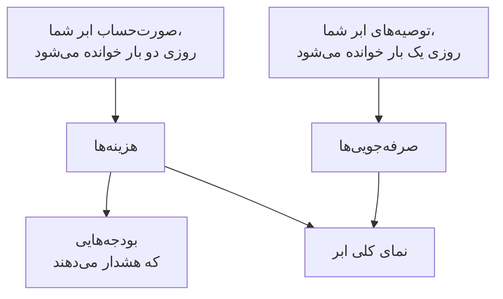

# هزینه‌ها و صرفه‌جویی‌های ابر

یک حساب ابری متصل همچنین می‌گوید چقدر هزینه دارد و چطور می‌تواند کم‌تر هزینه داشته باشد. OneUptime هزینه‌های هر روز را از صورت‌حساب خود ابر شما و توصیه‌های سرویس توصیهٔ خود ابر شما را می‌خواند، آن‌ها را در **ابر** > **مخارج** > **هزینه‌ها** و **ابر** > **مخارج** > **صرفه‌جویی‌ها** نشان می‌دهد، و پیش از آنکه یک ماه بیش از بودجه‌اش هزینه داشته باشد در **ابر** > **مخارج** > **بودجه‌ها** هشدار می‌دهد.

:::cards
- [Amazon Web Services](#amazon-web-services): Cost Explorer و Cost Optimization Hub، هر کدام یک بار روشن می‌شوند.
- [Microsoft Azure](#microsoft-azure): Cost Management و Azure Advisor، با یک نقش بیشتر.
- [Google Cloud](#google-cloud): خروجی صورت‌حساب شما به BigQuery، و Recommender.
- [بودجه‌ها](#بودجهها): هشداری وقتی مخارج یک ماه از سهمی از بودجه‌اش بگذرد.
:::

## چگونه کار می‌کند



- **هزینه‌ها از صورت‌حساب خود ابر شما می‌آیند.** AWS Cost Explorer، Azure Cost Management و خروجی صورت‌حساب Google Cloud به BigQuery، پیش از اعتبارها و بازپرداخت‌ها، به ارزی که حساب با آن صورت‌حساب می‌شود. هر رقم مال یک روز است، در روزهای UTC، همان‌طور که ابر شما آن‌ها را صورت‌حساب می‌کند.
- **یک ابر آخرین روز یا دو روز را با تأخیر گزارش می‌دهد.** هر خواندن هفتهٔ گذشته را دوباره می‌خواند، و در نخستین روزهای یک ماه کل ماه گذشته را، تا هزینهٔ یک روز همان‌طور که ابر شما آن را می‌بندد تثبیت شود. نخستین خواندن یک اتصال تا آغاز ماهِ پیش از ماه گذشته به عقب برمی‌گردد.
- **پیش‌بینی ماه از سرعت هفتهٔ گذشته پیروی می‌کند.** این همان هزینهٔ ماه تا اکنون است، به‌علاوهٔ هر روز باقی‌مانده با میانگین هفت روز کامل گذشته.
- **صرفه‌جویی‌ها از سرویس توصیهٔ خود ابر شما می‌آیند.** AWS Cost Optimization Hub، Azure Advisor و Recommender در Google Cloud: اندازه‌ای کوچک‌تر، منبعی بیکار، تعهدی که می‌ارزد، هر کدام با آنچه در ماه صرفه‌جویی می‌کند. توصیه‌ای که در کنسول ابر خود اجرا یا رد کنید در خواندن بعدی ناپدید می‌شود.

## پیش از شروع

- **یک حساب متصل.** [اتصال یک حساب ابری](/docs/telemetry/cloud-accounts) با فرمان راه‌اندازی امروز: این فرمان به اتصال اجازه می‌دهد هزینه‌ها و توصیه‌ها را بخواند. اتصالی که پیش‌تر ساخته شده هیچ‌کدام را نمی‌خواند تا فرمانش را دوباره اجرا کنید.

## Amazon Web Services

اتصال هزینه‌ها را با `ce:GetCostAndUsage` و توصیه‌ها را با `cost-optimization-hub:ListRecommendations` می‌خواند. هر کدام نیاز دارد ابتدا چیزی در حساب روشن شود:

:::steps
### روشن کردن Cost Explorer

Cost Explorer را یک بار در کنسول AWS Billing and Cost Management باز کنید: AWS ظرف یک روز هزینه‌های حساب را آماده می‌کند. حساب مدیریت سازمان را متصل کنید تا هزینه‌های هر حساب عضو خوانده شود.

### پیوستن به Cost Optimization Hub

Cost Optimization Hub را در همان کنسول باز کنید و به آن بپیوندید، برای سازمان از حساب مدیریتش یا فقط برای همین حساب. توصیه‌هایش ظرف یک روز می‌رسند.
:::

Cost Explorer برای هر درخواست $۰٫۰۱ می‌گیرد، و هر خواندن هزینه‌ها چند درخواست می‌فرستد. Cost Optimization Hub رایگان است.

## Microsoft Azure

برنامه هزینه‌ها را با نقش **Cost Management Reader** می‌خواند، در همان دامنهٔ **Monitoring Reader**: فرمان راه‌اندازی هر دو را می‌دهد. توصیه‌های Azure Advisor با **Monitoring Reader** خوانده می‌شوند، پس چیزی برای روشن کردن نیست. برای دادن این نقش به برنامه‌ای که پیش‌تر ساخته شده، اجرا کنید:

```bash
az role assignment create --assignee <APP_ID> --role "Cost Management Reader" --scope /subscriptions/<SUBSCRIPTION_ID>
```

Cost Management برای هر اشتراک پاسخ می‌دهد، همراه با منبعی که هر هزینه به آن مربوط است، و خواندنش رایگان است. وقتی نتواند برای یک اشتراک پاسخ دهد، **هزینه‌ها** حساب می‌گوید چرا.

## Google Cloud

Google Cloud هیچ API برای هزینه‌های یک پروژه ندارد: OneUptime آن‌ها را از خروجی حساب صورت‌حساب شما به BigQuery می‌خواند.

:::steps
### خروجی گرفتن از صورت‌حساب به BigQuery

در کنسول Google Cloud، Billing و سپس Billing export را باز کنید و خروجی هزینهٔ مصرف جزئی را به یک مجموعه‌دادهٔ BigQuery روشن کنید. Google آن را با چند ساعت تأخیر می‌نویسد، از روزی که آن را روشن می‌کنید.

### اجازه دادن به حساب سرویس برای خواندن آن

به حساب سرویس اتصال نقش **BigQuery Data Viewer** را روی مجموعه‌دادهٔ خروجی بدهید. فرمان راه‌اندازی پیش‌تر **BigQuery Job User** را به آن داده است، تا پرس‌وجو را در پروژهٔ خودش اجرا کند.

### وارد کردن جدول خروجی

اتصال را در **ابر** > **اتصال** ویرایش کنید و در **فیلدهای بیشتر**، **جدول خروجی صورت‌حساب** را برابر نام کامل جدول قرار دهید: `<PROJECT_ID>.<DATASET>.gcp_billing_export_resource_v1_<BILLING_ACCOUNT_ID>`.
:::

خروجی جزئی منبعی را که هر هزینه به آن مربوط است نام می‌برد؛ خروجی استاندارد فقط سرویس و منطقه را می‌گوید. BigQuery برای پرس‌وجو هزینه می‌گیرد: نخستین ۱ TiB در ماه رایگان است، سپس $۶٫۲۵ برای هر TiB، و یک ماه از یک خروجی از چند مگابایت تا چند گیگابایت است. توصیه‌های Recommender دربارهٔ نوع ماشین و منابع بیکار با **Compute Recommender Viewer** خوانده می‌شوند، که فرمان راه‌اندازی آن را می‌دهد، و هزینه‌ای ندارند.

## راه‌های کم‌تر خرج کردن

**ابر** > **مخارج** > **صرفه‌جویی‌ها** هر توصیه را فهرست می‌کند، بزرگ‌ترین صرفه‌جویی اول: چه باید کرد، روی کدام منبع، چه چیزی تغییر می‌کند و در ماه چقدر صرفه‌جویی می‌کند. نوار بالای آن جمع آن‌ها را نشان می‌دهد، در کل و بر اساس نوع: اندازه‌ای کوچک‌تر، منبعی بیکار، تعهدی. یک توصیه وقتی OneUptime آن منبع را دارد به صفحهٔ منبعش پیوند می‌دهد.

### تعیین اندازهٔ مناسب با خوانده‌های خود OneUptime

منبعی که هیچ سرویس توصیه‌ای دربارهٔ آن چیزی نمی‌گوید، چون روشن نیست، نوع آن را پوشش نمی‌دهد یا آن را بیش از حد تازه می‌داند، اندازه‌اش را OneUptime از خوانده‌های CPU و حافظه‌ای تعیین می‌کند که اتصالش در ۱۴ روز گذشته گرفته است. OneUptime اندازهٔ نمونه‌های EC2، پایگاه‌های دادهٔ RDS و خوشه‌های ElastiCache در AWS، ماشین‌های مجازی، سرورهای انعطاف‌پذیر PostgreSQL و MySQL و طرح‌های App Service در Azure، و ماشین‌های مجازی Compute Engine و نمونه‌های Cloud SQL در Google Cloud را تعیین می‌کند:

- **بیش‌تخصیص** وقتی اندازهٔ نصف، یا یک‌چهارم، هنوز جا داشته باشد: در اندازهٔ کوچک‌تر، صدک ۹۵ CPU آن حداکثر ۶۰٪، بالاترین خواندهٔ CPU آن حداکثر ۱۰۰٪ و اوج حافظه‌اش حداکثر ۷۰٪ می‌شود، وقتی حافظه‌اش خوانده شود.
- **کم‌تخصیص** وقتی صدک ۹۵ CPU آن ۸۵٪ یا بیشتر باشد، یا اوج حافظه‌اش ۹۰٪ یا بیشتر: اندازهٔ دو برابر.

اندازهٔ یک منبع وقتی تعیین می‌شود که ۶ روز خوانده داشته باشد. صفحهٔ آن **تعیین اندازهٔ مناسب** را کنار هزینه‌اش نشان می‌دهد، و منبع بیش‌تخصیص با OneUptime به‌عنوان منبع توصیه در **ابر** > **مخارج** > **صرفه‌جویی‌ها** فهرست می‌شود. صرفه‌جویی یک تغییر، سهم آن از هزینهٔ منبع در ۳۰ روز گذشته است، پس وقتی معلوم می‌شود که ابر شما منبع را با نام صورت‌حساب کند: خروجی تفصیلی Azure و Google Cloud این کار را می‌کند، AWS Cost Explorer نه. یک نمونهٔ EC2 حافظه‌اش را فقط با عامل CloudWatch گزارش می‌دهد و یک ماشین مجازی Compute Engine فقط با Ops Agent: بدون آن، اندازه‌اش فقط با CPU تعیین می‌شود. برای اندازه‌های انفجاری مانند t3، سری B و e2-micro هرگز اندازه تعیین نمی‌شود.

## بودجه‌ها

:::steps
### ساختن یک بودجه

در **ابر** > **مخارج** > **بودجه‌ها** یک بودجه بسازید: **مبلغ ماهانه** آن و **حساب** که برای آن است، یا هیچ‌کدام برای همهٔ حساب‌ها.

### انتخاب زمان هشدار

**هشدار در** سهم‌هایی از بودجه را که باید در آن‌ها هشدار داد، به درصد، می‌گیرد: برای شروع ۸۰ و ۱۰۰. **هشدار هنگام پیش‌بینی عبور** همچنین ماهی یک بار هشدار می‌دهد، وقتی سرعت هفتهٔ گذشته ماه را از بودجه فراتر ببرد. **هشدار برای روزهای غیرعادی** همچنین روز بعد از روزی که بسیار بیشتر از معمول هزینه داشته هشدار می‌دهد: [روزهای غیرعادی](#روزهای-غیرعادی) را ببینید. **شدت هشدار** و **سیاست‌های آنکال** می‌گویند هشدارها چقدر جدی‌اند و چه کسی فراخوانده می‌شود.
:::

یک بودجه پس از هر خواندن هزینه‌ها و هر ساعت بررسی می‌شود. وقتی مخارج ماه از یک آستانه بگذرد، یک هشدار برای آن ساخته می‌شود، برای بالاترین آستانه وقتی یک خواندن از چند آستانه با هم بگذرد، و ماه تازه هشدارهای ماه گذشته را حل‌شده می‌کند. یک بودجه فقط حساب‌هایی را می‌شمارد که با ارز آن صورت‌حساب می‌شوند.

عامل‌های هوش مصنوعی می‌توانند از طریق [سرور MCP](/docs/ai/mcp-server) بودجه بسازند و تغییر دهند، و اسکریپت‌ها با فرمان `oneuptime cloud-budget` در CLI: [عملیات روی منابع](/docs/cli/resource-operations) را ببینید.

### روزهای غیرعادی

پس از هر خواندن، هر یک از ۱۴ روز کامل اخیر یک حساب با ۱۴ روز پیش از آن سنجیده می‌شود. یک روز غیرعادی است وقتی هزینهٔ یک سرویس دو برابر روز معمولش یا بیشتر بوده، یا هزینهٔ کل حساب یک و نیم برابر روز معمولش یا بیشتر. در هر دو حالت باید دست‌کم ۱۰ بیشتر از معمول، به ارز حساب، و دست‌کم ۵٪ روز معمول حساب باشد، تا چند سنت هرگز جهش به حساب نیاید. مقدار معمول یک روز میانهٔ ۱۴ روز پیش از آن است، پس یک جهش آن را کم جابه‌جا می‌کند، و یک حساب تنها وقتی سنجیده می‌شود که یک هفته هزینه داشته باشد.

**ابر** > **مخارج** > **هزینه‌ها** روزهای غیرعادی را زیر هزینهٔ روزانه فهرست می‌کند. بودجه‌ای که این حساب را در بر می‌گیرد، برای هر حساب و روز یک هشدار می‌سازد، روز بعد، و هر سرویسی را که بالا رفته نام می‌برد. جهشی که چند روز ادامه دارد در روزی که آغاز شده اعلام می‌شود، و روزی که بیش از یک هفته از آن گذشته اعلام نمی‌شود.

## آنچه در OneUptime می‌بینید

- **نمای کلی ابر.** **ابر** > **نمای کلی** مخارج ماه را در برابر مخارج ماه گذشته تا همان روز، سرویس‌های پرهزینه‌تر و بزرگ‌ترین راه‌های کم‌تر خرج کردن را، کنار آنچه به توجه نیاز دارد، نشان می‌دهد.
- **مخارج هر روز.** **ابر** > **مخارج** > **هزینه‌ها** هر یک از ۳۰ روز گذشته را رسم می‌کند، روزهایی را که بسیار بیشتر از معمول هزینه داشته‌اند فهرست می‌کند و یک دوره را بر اساس سرویس، منطقه، حساب یا منبع تفکیک می‌کند. حساب‌هایی که هزینه‌هایشان خوانده نمی‌شود زیر آن فهرست می‌شوند، هر کدام با دلیل.
- **هزینه‌های یک حساب.** **هزینه‌ها** یک حساب همین را فقط برای آن حساب نشان می‌دهد، همراه با راه‌های کم‌تر خرج کردنش.
- **هزینهٔ یک منبع.** صفحهٔ یک منبع، وقتی ابرش آن را با نام صورت‌حساب می‌کند، نشان می‌دهد این ماه و در ۳۰ روز گذشته چقدر هزینه داشته است، همراه با راه‌های کم‌تر خرج کردنش و تعیین اندازهٔ مناسبش.

## عیب‌یابی

:::details یک حساب می‌گوید نیاز به مجوز
اتصال هنوز اجازه ندارد هزینه‌های حساب را بخواند. فرمان راه‌اندازی آن را از **ابر** > **اتصال** دوباره اجرا کنید: آنچه خواندن هزینه‌ها نیاز دارد را می‌افزاید. در Google Cloud، به حساب سرویس نقش **BigQuery Data Viewer** را هم روی مجموعه‌دادهٔ خروجی بدهید.
:::

:::details یک حساب می‌گوید راه‌اندازی نشده
ابرش هنوز هزینه‌ای برای دادن ندارد. در AWS، Cost Explorer را روشن کنید؛ در Google Cloud، جدول خروجی را در **جدول خروجی صورت‌حساب** وارد کنید. نخستین رقم‌ها با خواندن بعدی، ظرف ۱۲ ساعت، می‌رسند.
:::

:::details رقم‌ها یک حساب را کنار می‌گذارند
رقم‌ها به ارزی هستند که بیشتر حساب‌های شما با آن صورت‌حساب می‌شوند. حسابی که با ارز دیگری صورت‌حساب می‌شود زیر آن‌ها با ارزش فهرست می‌شود، و یک بودجه فقط حساب‌هایی را می‌شمارد که با ارز خودش صورت‌حساب می‌شوند.
:::

:::details این ماه کم‌تر از کنسول ابر شما است
ابر شما آخرین روز یا دو روز را با تأخیر گزارش می‌دهد، و رقم‌ها پیش از اعتبارها و بازپرداخت‌ها هستند. خواندن‌های بعدی عقب‌ماندگی را جبران می‌کنند.
:::

## گام‌های بعدی

:::cards
- [اتصال یک حساب ابری](/docs/telemetry/cloud-accounts): حساب دیگری را متصل کنید، یا فرمانش را دوباره اجرا کنید.
- [منابع ابری](/docs/telemetry/cloud-resources): متریک‌های هر منبع، از Collector خودتان.
- [مشاهده‌پذیری هزینهٔ Kubernetes](/docs/telemetry/kubernetes-cost): هزینهٔ هر بار کاری Kubernetes.
:::
