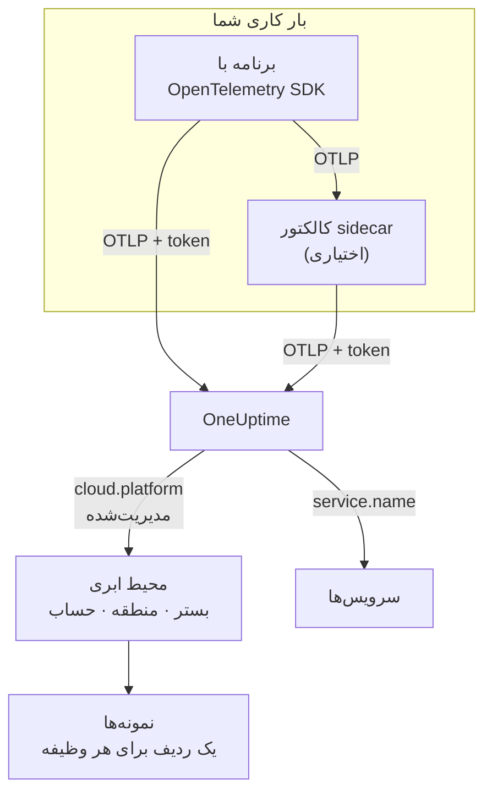

# محیط‌های ابری

**Cloud Environment** جایی است که کانتینرهای شما روی یک بستر ابری مدیریت‌شده اجرا می‌شوند: حساب و منطقهٔ یک خوشهٔ ECS، پروژه و منطقهٔ Cloud Run، اشتراک و منطقهٔ Container Apps. OneUptime نخستین باری که تله‌متری شما با ویژگی‌های منبع درست می‌رسد یک محیط می‌سازد و همهٔ بارهای کاری‌ای را که آنجا اجرا می‌شوند در آن گرد می‌آورد. لازم نیست چیزی را دستی ثبت کنید.

:::cards
- [AWS ECS / Fargate](/docs/telemetry/cloud-aws-ecs): وظیفه‌ها روی Fargate یا EC2، همراه با CPU و حافظهٔ هر وظیفه.
- [Google Cloud Run](/docs/telemetry/cloud-gcp-cloud-run): سرویس‌ها و jobها، که به‌صورت توابع بدون سرور هم فهرست می‌شوند.
- [Azure Container Apps](/docs/telemetry/cloud-azure-container-apps): رپلیکاها، با منطقه و اشتراکی که دستی تنظیم می‌شوند.
- [سایر پلتفرم‌های ابری](/docs/telemetry/cloud-other-platforms): Elastic Beanstalk، App Runner، App Engine، App Service و Container Instances.
:::

## چگونه کار می‌کند



- **یک تشخیص‌دهندهٔ منبع می‌گوید بار کاری کجا اجرا می‌شود.** یک تشخیص‌دهندهٔ منبع اپن‌تلمتری، در SDK یا در یک Collector، فرادادهٔ بستر را می‌خواند و `cloud.platform`، `cloud.account.id` و `cloud.region` را روی همهٔ داده‌هایی که بار کاری می‌فرستد می‌گذارد. جایی که تشخیص‌دهنده‌ای وجود ندارد، خودتان آن‌ها را تنظیم می‌کنید.
- **محیط همه‌چیز را گرد می‌آورد.** همهٔ بارهای کاری با بستر، حساب و منطقهٔ یکسان در یک محیط قرار می‌گیرند. سرویس‌ها ردیف‌های خودشان را در **سرویس‌ها** نگه می‌دارند.
- **هر وظیفهٔ در حال اجرا یک نمونه است.** زبانهٔ **نمونه‌ها** در محیط، وظیفه‌ها، نمونه‌ها یا رپلیکاهای در حال اجرا را فهرست می‌کند، همراه با CPU و حافظهٔ زنده هرجا که بستر بتواند آن‌ها را فراهم کند.

## پیش از شروع

- **یک کلید دریافت داده.** در **تنظیمات پروژه** > **تله‌متری و APM** > **کلیدهای دریافت داده** یک کلید **سرور** بسازید و توکن آن را کپی کنید: [ساخت کلید دریافت داده](/docs/telemetry/open-telemetry#ساخت-کلید-دریافت-داده) را ببینید. توکن یک راز است: صفحهٔ هر بستر نشان می‌دهد آن را کجای انبار راز همان ابر نگه دارید.
- **اپن‌تلمتری در برنامهٔ شما.** یک SDK اپن‌تلمتری که OTLP صادر می‌کند، یا یک OpenTelemetry Collector که کنار برنامه اجرا می‌شود.

## بسترهای پشتیبانی‌شده

| بستر | `cloud.platform` | چه کسی `cloud.*` را پر می‌کند | شناسهٔ نمونه | راهنما |
| ------------------------- | --------------------------- | ---------------------- | --------------------------------- | ------------------------------------------------------------------ |
| AWS ECS / Fargate | `aws_ecs` | تشخیص‌دهندهٔ منبع | `aws.ecs.task.arn` | [AWS ECS / Fargate](/docs/telemetry/cloud-aws-ecs) |
| AWS Elastic Beanstalk | `aws_elastic_beanstalk` | تشخیص‌دهندهٔ منبع | `host.id` | [سایر پلتفرم‌های ابری](/docs/telemetry/cloud-other-platforms) |
| AWS App Runner | `aws_app_runner` | دستی | `host.name` | [سایر پلتفرم‌های ابری](/docs/telemetry/cloud-other-platforms) |
| Google Cloud Run | `gcp_cloud_run` | تشخیص‌دهندهٔ منبع | `faas.instance` | [Google Cloud Run](/docs/telemetry/cloud-gcp-cloud-run) |
| Google App Engine | `gcp_app_engine` | تشخیص‌دهندهٔ منبع | `faas.instance` | [سایر پلتفرم‌های ابری](/docs/telemetry/cloud-other-platforms) |
| Azure Container Apps | `azure_container_apps` | تشخیص‌دهندهٔ منبع | `azure.container_app.instance.id` | [Azure Container Apps](/docs/telemetry/cloud-azure-container-apps) |
| Azure Container Instances | `azure_container_instances` | دستی | `host.name` | [سایر پلتفرم‌های ابری](/docs/telemetry/cloud-other-platforms) |
| Azure App Service | `azure_app_service` | تشخیص‌دهندهٔ منبع | `host.id` | [سایر پلتفرم‌های ابری](/docs/telemetry/cloud-other-platforms) |

- **تشخیص‌دهندهٔ منبع:** یک تشخیص‌دهندهٔ منبع اپن‌تلمتری، در SDK یا در پردازشگر `resourcedetection` در Collector، ویژگی‌های `cloud.*` را برای شما تنظیم می‌کند.
- **دستی:** هیچ تشخیص‌دهنده‌ای وجود ندارد، پس ویژگی‌ها را در `OTEL_RESOURCE_ATTRIBUTES` می‌گذارید. صفحهٔ بستر خط دقیق را نشان می‌دهد.
- **تشخیص‌دهنده‌های Azure کمتر می‌دانند.** تشخیص‌دهنده‌های Container Apps نه منطقه را می‌دانند و نه اشتراک را، و تشخیص‌دهنده‌های App Service اشتراک را نمی‌دانند: هرچه کم است را خودتان تنظیم کنید.
- **نگارش نقطه‌دار Azure هم کار می‌کند.** تشخیص‌دهنده‌های Azure در Node.js و .NET مقدارهای `azure.container_apps` و `azure.app_service` را می‌نویسند. OneUptime هنگام دریافت، آن‌ها را به مقدارهای زیرخط‌دار بالا بازنویسی می‌کند.

## OneUptime چگونه یک محیط را شناسایی می‌کند

برای هر ترکیب از سه ویژگی منبع، یک محیط وجود دارد:

| ویژگی | الزامی | چیست |
| ------------------ | -------- | ------------------------------------------------------------------------------------------- |
| `cloud.platform` | بله | یکی از مقدارهای [بسترهای پشتیبانی‌شده](#بسترهای-پشتیبانیشده) |
| `cloud.account.id` | خیر | شناسهٔ حساب AWS، شناسهٔ پروژهٔ Google Cloud یا شناسهٔ اشتراک Azure |
| `cloud.region` | خیر | منطقه، مانند `us-east-1`، `us-central1` یا `eastus` |

OneUptime این سه را با `|` به هم می‌پیوندد و **کلید محیط** را می‌سازد، و محیط را با همین مقدارها نام‌گذاری می‌کند، مانند _AWS ECS · us-east-1 · 123456789012_:

```text title="Environment keys"
aws_ecs|123456789012|us-east-1
gcp_cloud_run|my-project|us-central1
azure_container_apps|00000000-0000-0000-0000-000000000000|eastus
```

> [!IMPORTANT]
> بخشی که وجود ندارد به‌صورت یک بخش خالی در کلید می‌ماند: `aws_ecs||us-east-1`. پس بار کاری‌ای که `cloud.account.id` را حذف می‌کند، در محیطی جدا از بار کاری‌ای قرار می‌گیرد که آن را تنظیم می‌کند. این رایج‌ترین دلیل دیدن دو محیط در جایی است که انتظار یکی را داشتید.

### شناسهٔ نمونه

درون یک محیط، هر وظیفه، نمونه یا رپلیکای در حال اجرا یک ردیف در **نمونه‌ها** می‌گیرد. نامش از نخستین ویژگی منبعی از این فهرست می‌آید که تله‌متری داشته باشد:

1. `aws.ecs.task.id`
2. `aws.ecs.task.arn` (کوتاه‌شده به شناسهٔ وظیفه)
3. `faas.instance`
4. `azure.container_app.instance.id`
5. `service.instance.id`
6. `container.id`
7. `host.id`
8. `host.name`

شناسهٔ خودِ بستر عمداً اول می‌آید. هم کالکتور sidecar و هم SDK برنامه آن را می‌بینند، و پس از راه‌اندازی دوباره هم باقی می‌ماند. SDK معمولاً برای هر فرایند یک `service.instance.id` تازه می‌سازد (SDK در Node.js به‌طور پیش‌فرض همین کار را می‌کند)، پس اگر کلید اول همین بود، یک وظیفهٔ ECS به دو ردیف تقسیم می‌شد. `service.instance.id` وقتی به کار می‌رود که بستر شناسهٔ خودش را تنظیم نکند. ستون **شناسهٔ نمونه** در [بسترهای پشتیبانی‌شده](#بسترهای-پشتیبانیشده) ویژگی‌ای را نام می‌برد که یک پیکربندی معمولی روی هر بستر به کار می‌برد.

### محیط‌هایی که دستی می‌سازید

به‌ندرت لازم است: دریافت داده خودش محیط‌ها را برایتان می‌سازد. برای ساختن محیطی پیش از رسیدن تله‌متری‌اش، **ابر** > **All Environments** را باز کنید و روی **ساخت منبع ابری** کلیک کنید. **بستر ابری** را برگزینید، سپس **شناسه حساب ابری** و **منطقه ابری** را دقیقاً همان‌طور بنویسید که تله‌متری شما گزارش می‌کند. OneUptime کلید `platform|account|region` را از این سه می‌سازد، و دریافت داده یک محیط را فقط با کلیدش تطبیق می‌دهد. محیط همان نامی را می‌گیرد که دریافت داده به آن می‌داد؛ برای نمایش نامی دیگر، **فیلدهای بیشتر** را باز کنید و یک **نام نمایشی** بنویسید.

## چه چیزی محیط ابری نیست

| روی چه اجرا می‌کنید | کجا نمایش داده می‌شود | چرا |
| ------------------------------------------------------------------------------------------------- | ------------------------ | ---------------------------------------------------------------------------------------------------- |
| EC2, Compute Engine, Azure VM (`aws_ec2`, `gcp_compute_engine`, `azure_vm`) | **میزبان‌ها** | ماشین مجازی یک میزبان است. [کالکتور OpenTelemetry روی میزبان](/docs/telemetry/host-otel-collector) را ببینید |
| EKS، GKE، AKS، Kubernetes خودمدیریت | **Kubernetes** | با ویژگی‌های `k8s.*` مسیریابی می‌شود. [عامل Kubernetes](/docs/telemetry/kubernetes-agent) را ببینید |
| Lambda, Cloud Functions, Azure Functions (`aws_lambda`, `gcp_cloud_functions`, `azure_functions`) | **توابع بدون سرور** | با `faas.name` مسیریابی می‌شود، یا با `service.name` وقتی `cloud.platform` از نوع FaaS باشد. [توابع بدون سرور](/docs/telemetry/serverless-functions) را ببینید |
| متعادل‌کننده‌های بار، باکت‌ها، پایگاه‌های دادهٔ مدیریت‌شده و دیگر منابع IaaS یا PaaS | **Cloud Resources** | از متریک‌هایی که Azure Monitor، CloudWatch و Cloud Monitoring منتشر می‌کنند کشف می‌شوند. [منابع ابری](/docs/telemetry/cloud-resources) را ببینید |

> [!NOTE]
> Cloud Run و App Engine عمداً در دو جا نمایش داده می‌شوند. تشخیص‌دهندهٔ آن‌ها هم یک `cloud.platform` مدیریت‌شده و هم `faas.name` را تنظیم می‌کند، پس هر سرویس یک **تابع بدون سرور** مستقل هم هست، در حالی که **Cloud Environment** همهٔ سرویس‌های آن پروژه و منطقه را گرد می‌آورد. همان تله‌متری زیر هر دو ثبت می‌شود.

## اتصال یک بار کاری

صفحهٔ هر بستر این گام‌ها را با فرمان‌ها و صفحه‌های کنسول همان ابر دارد. به‌طور خلاصه:

:::steps
### گذاشتن ویژگی‌های ابری روی تله‌متری

:::tabs
@tab Sidecar collector
یک کانتینر دوم در وظیفه، نمونه یا رپلیکا. برنامه به `localhost:4318` صادر می‌کند، و پردازشگر `resourcedetection` در Collector روی هرچه از آن می‌گذرد `cloud.*` را مهر می‌زند. توکن نزد Collector است، و روی ECS، CPU و حافظهٔ هر وظیفه را هم می‌فرستد:

```yaml title="collector.yaml"
processors:
  resourcedetection:
    detectors: [env, ecs] # [env, gcp] on Cloud Run and App Engine; [env, azurecontainerapps] on Container Apps
    timeout: 5s
```
@tab SDK direct
SDK برنامه مستقیم به OneUptime صادر می‌کند. تشخیص‌دهندهٔ منبع بستر را در SDK روشن کنید، مانند `OTEL_NODE_RESOURCE_DETECTORS=env,host,os,aws` در Node.js: صفحهٔ هر بستر این کلید را برای هر زبان فهرست می‌کند. کانتینر اضافه‌ای نیست، و CPU یا حافظهٔ کانتینر هم نیست.
:::

### صادر کردن OTLP به OneUptime

:::tabs
@tab Sidecar collector
```yaml title="collector.yaml"
exporters:
  otlphttp/oneuptime:
    endpoint: https://oneuptime.com/otlp
    headers:
      x-oneuptime-token: ${env:ONEUPTIME_TOKEN}

service:
  pipelines:
    traces:
      receivers: [otlp]
      processors: [resourcedetection, batch]
      exporters: [otlphttp/oneuptime]
    metrics:
      receivers: [otlp]
      processors: [resourcedetection, batch]
      exporters: [otlphttp/oneuptime]
    logs:
      receivers: [otlp]
      processors: [resourcedetection, batch]
      exporters: [otlphttp/oneuptime]
```

Collector مقدار `${env:ONEUPTIME_TOKEN}` را از یک متغیر محیطی پر می‌کند که بستر آن را از انبار راز خود پر می‌کند: Secrets Manager، Secret Manager یا رازهای Container Apps.
@tab SDK direct
```bash
OTEL_EXPORTER_OTLP_ENDPOINT="https://oneuptime.com/otlp"
OTEL_EXPORTER_OTLP_HEADERS="x-oneuptime-token=YOUR_TELEMETRY_INGESTION_TOKEN"
```
:::

اگر OneUptime را خودتان میزبانی می‌کنید، از `https://YOUR-ONEUPTIME-HOST/otlp` استفاده کنید.

### بررسی اتصال

```bash
curl -i https://oneuptime.com/otlp/v1/validate \
  -H "x-oneuptime-token: YOUR_TELEMETRY_INGESTION_TOKEN"
```

`200` همراه با `"valid": true` یعنی توکن پذیرفته شده است. `401` یعنی توکن ناشناخته، لغوشده، غیرفعال یا منقضی است، و `message` در پاسخ می‌گوید کدام. ظرف یک دقیقه پس از نخستین اسپن، لاگ یا متریک، محیط در **ابر** > **All Environments** نمایش داده می‌شود.
:::

> [!TIP]
> همین گام‌ها در داشبورد هم هست، با توکن شما که از پیش پر شده: در **ابر** > **All Environments** تا وقتی نخستین محیط شما برسد، و در زبانهٔ **مستندات** هر محیط.

## چه چیزی به دست می‌آورید

**نمای کلی** یک محیط این‌ها را نشان می‌دهد:

- **درخواست‌ها**، **نرخ خطا** و **p95 latency** از ترِیس‌های شما، همراه با نمودارهای درخواست‌ها، خطاها و حافظه در بازهٔ زمانی‌ای که برمی‌گزینید.
- **CPU** و **حافظه** در میان نمونه‌های زنده، و فهرست **بیشترین نمونه‌ها بر اساس پردازنده**. این‌ها از متریک‌های `container.cpu.utilization` و `container.memory.usage` می‌آیند که شناسهٔ نمونه را دارند؛ روی ECS، از `ecs.task.cpu.utilized` و `ecs.task.memory.utilized` در گیرندهٔ `awsecscontainermetrics`.
- **نمونه‌ها**: تعداد نمونه‌هایی که در ۱۵ دقیقهٔ گذشته گزارش داده‌اند. زبانهٔ **نمونه‌ها** برای هر کدام یک ردیف دارد.
- زبانه‌های **لاگ‌ها**، **ترِیس‌ها** و **متریک‌ها**، فیلترشده روی محیط.

محیطی که تله‌متری‌اش ۱۵ دقیقه متوقف شود **قطع‌شده** نشان داده می‌شود، و اسپن، لاگ یا متریک بعدی آن را به **متصل** برمی‌گرداند. زمانی که خود OneUptime از کار افتاده بود یا در حال جبران عقب‌ماندگی بود، جزو این ۱۵ دقیقه حساب نمی‌شود.

### برچسب‌ها و مالکان

- **از تله‌متری شما:** یک ویژگی منبع مانند `oneuptime.label.team=payments` برچسب `team:payments` را به محیط اضافه می‌کند.
- **از قواعد:** **ابر** > **تنظیمات** > **قواعد برچسب** و **قواعد مالکیت** به محیط‌های منطبق برچسب و مالک اضافه می‌کنند. [قواعد برچسب و مالکیت](/docs/configuration/label-and-owner-rules) را ببینید.

## عیب‌یابی

[رفع اشکال ابر](/docs/telemetry/cloud-troubleshooting) همهٔ خطاها را به همان ترتیبی که رخ می‌دهند بررسی می‌کند: محیطی که هرگز نمایش داده نمی‌شود، در **میزبان‌ها** یا فقط در **توابع بدون سرور** قرار می‌گیرد، نمونه یا CPU و حافظه ندارد، **قطع‌شده** نشان داده می‌شود، دو تا می‌شود، یا دستی ساخته شده و هرگز تطبیق نمی‌یابد.

## گام‌های بعدی

:::cards
- [AWS ECS / Fargate](/docs/telemetry/cloud-aws-ecs): رایج‌ترین پیکربندی، همراه با یک تعریف وظیفهٔ کامل.
- [رفع اشکال ابر](/docs/telemetry/cloud-troubleshooting): وقتی محیطی وجود ندارد یا نادرست است، چه چیزی را بررسی کنید.
- [منابع ابری (IaaS و PaaS)](/docs/telemetry/cloud-resources): متعادل‌کننده‌های بار، باکت‌ها و پایگاه‌های دادهٔ مدیریت‌شده، از پایش خودِ ابر شما.
- [توابع بدون سرور](/docs/telemetry/serverless-functions): Lambda، Cloud Functions و Azure Functions.
:::
