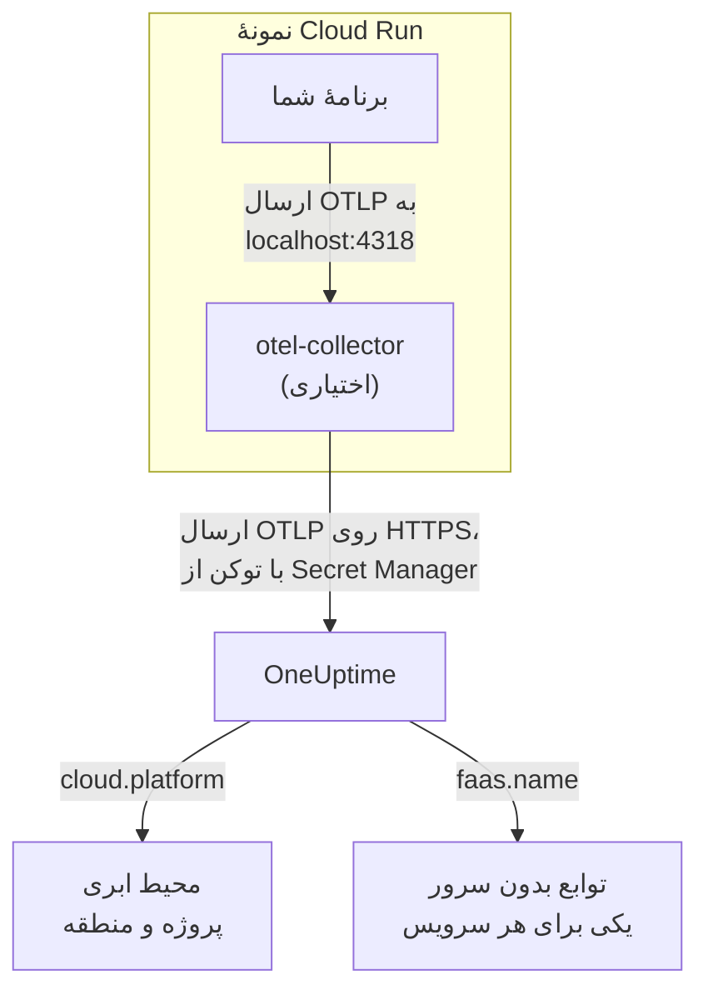

# Google Cloud Run

ترِیس‌ها، لاگ‌ها و متریک‌های سرویس‌ها و jobهای Cloud Run خود را به OneUptime بفرستید. هر چیزی که `cloud.platform=gcp_cloud_run` را گزارش کند، برای هر پروژهٔ Google Cloud و منطقه در یک **Cloud Environment** قرار می‌گیرد، مانند _GCP Cloud Run · us-central1 · my-project_، و هر سرویس در **توابع بدون سرور** هم نمایش داده می‌شود.

:::cards
- [چگونه کار می‌کند](#چگونه-کار-میکند): تشخیص‌دهندهٔ GCP چه چیزی را تنظیم می‌کند، و چرا یک سرویس در دو جا نمایش داده می‌شود.
- [راه‌اندازی](#راهاندازی): توکن را ذخیره کنید، سرویس را پیکربندی کنید، استقرار دهید و بررسی کنید.
- [YAML سرویس با یک sidecar](#yaml-سرویس-با-یک-sidecar): یک سرویس کامل Cloud Run همراه با یک Collector.
- [عیب‌یابی](#عیبیابی): خطاهای راز، ترتیب آغاز sidecar و محیط‌های گم‌شده.
:::

## چگونه کار می‌کند



تشخیص‌دهندهٔ منبع GCP در اپن‌تلمتری، سرور فراداده و متغیرهای محیطی `K_SERVICE` و `K_REVISION` را می‌خواند و این‌ها را تنظیم می‌کند:

| ویژگی | مقدار روی Cloud Run | کاربرد |
| ------------------ | ------------------------------ | ----------------------------------------------------------------------------------------- |
| `cloud.platform` | `gcp_cloud_run` | تله‌متری را در **محیط‌های ابری** بایگانی می‌کند |
| `cloud.account.id` | شناسهٔ پروژه | بخشی از کلید محیط |
| `cloud.region` | `us-central1` | بخشی از کلید محیط |
| `faas.name` | نام سرویس (`K_SERVICE`) | سرویس را در **توابع بدون سرور** هم فهرست می‌کند |
| `faas.version` | بازبینی (`K_REVISION`) | در نمای کلی تابع بدون سرور سرویس نشان داده می‌شود؛ محیط از آن استفاده نمی‌کند |
| `faas.instance` | شناسهٔ نمونه | یک نمونهٔ در حال اجرا را نام‌گذاری می‌کند: برای هر کدام یک ردیف در **نمونه‌ها** |

> [!NOTE]
> Cloud Run عمداً در دو جا نمایش داده می‌شود. چون تشخیص‌دهنده `faas.name` را تنظیم می‌کند، هر سرویس یک **تابع بدون سرور** هم هست، با فراخوانی‌ها، نرخ خطا و مدت‌زمان خودش. **Cloud Environment** همهٔ سرویس‌های آن پروژه و منطقه را گرد می‌آورد. هیچ‌چیز دو بار ذخیره نمی‌شود: همان تله‌متری زیر هر دو ثبت می‌شود.

کلید محیط `gcp_cloud_run|my-project|us-central1` است.

## پیش از شروع

- **یک کلید دریافت داده.** در **تنظیمات پروژه** > **تله‌متری و APM** > **کلیدهای دریافت داده** یک کلید **سرور** بسازید و توکن آن را کپی کنید.
- **`gcloud`**، واردشده به پروژه، با API Secret Manager روشن: `gcloud services enable secretmanager.googleapis.com`.
- **برنامهٔ شما که با یک SDK اپن‌تلمتری ابزارگذاری شده** و OTLP صادر می‌کند.

## انتخاب این‌که تله‌متری چگونه از سرویس خارج شود

| | SDK direct | Sidecar collector |
| --------------- | ---------------------------------------------------- | ---------------------------------------------------------------------- |
| کانتینر اضافه | هیچ | `otel-collector` در سرویس |
| مناسب برای | یک سرویس، و jobهای Cloud Run | چند سرویس در یک پروژه، یا SDKای که نمی‌تواند تشخیص‌دهنده اجرا کند |
| نگه‌دارندهٔ توکن | برنامه | Collector |
| راز | `oneuptime-otlp-headers`، کل سرآیند | `oneuptime-ingestion-token`، فقط توکن |

یک job تا پایان اجرا می‌شود، پس چیزی نیست که sidecar را برایش زنده نگه دارید: از SDK direct استفاده کنید. هر گام زیر برای هر دو یک زبانه دارد؛ یکی را برگزینید تا همهٔ گام‌ها از آن پیروی کنند.

## راه‌اندازی

:::steps
### ذخیرهٔ توکن در Secret Manager

> [!IMPORTANT]
> توکن یک راز است. آن را در Secret Manager بگذارید و از سرویس به‌عنوان یک متغیر محیطی مبتنی بر راز به آن ارجاع دهید. یک متغیر محیطی عادی برای هر کسی که پروژه را می‌بیند، در کنسول و در `gcloud run services describe` نمایان است.

:::tabs
@tab SDK direct
```bash
printf '%s' "x-oneuptime-token=YOUR_TELEMETRY_INGESTION_TOKEN" | gcloud secrets create oneuptime-otlp-headers \
  --data-file=- \
  --replication-policy=automatic

gcloud secrets add-iam-policy-binding oneuptime-otlp-headers \
  --member="serviceAccount:checkout-api@my-project.iam.gserviceaccount.com" \
  --role="roles/secretmanager.secretAccessor"
```

Cloud Run مقدار یک راز را همان‌طور که هست در متغیر می‌گذارد، و `OTEL_EXPORTER_OTLP_HEADERS` به کل جفت `name=value` نیاز دارد، پس این راز کل سرآیند را نگه می‌دارد.
@tab Sidecar collector
```bash
printf '%s' "YOUR_TELEMETRY_INGESTION_TOKEN" | gcloud secrets create oneuptime-ingestion-token \
  --data-file=- \
  --replication-policy=automatic

gcloud secrets add-iam-policy-binding oneuptime-ingestion-token \
  --member="serviceAccount:checkout-api@my-project.iam.gserviceaccount.com" \
  --role="roles/secretmanager.secretAccessor"
```

پیکربندی Collector نام سرآیند را اضافه می‌کند، پس این راز فقط توکن را نگه می‌دارد.
:::

در `--member` حساب سرویس زمان اجرای سرویس را بگذارید، نه کاربر خودتان را. بدون `roles/secretmanager.secretAccessor`، استقرار بازبینی با `Permission denied on secret` شکست می‌خورد. اگر سرویس هنوز با حساب سرویس پیش‌فرض Compute اجرا می‌شود، نقش را به همان حساب بدهید، و دادن یک حساب اختصاصی به سرویس را در نظر بگیرید: حساب پیش‌فرض میان همهٔ چیزهای پروژه مشترک است.

### پیکربندی سرویس

:::tabs
@tab SDK direct
1. **Google Cloud console → Cloud Run → click the service → Edit & deploy new revision**.
2. در زبانهٔ **Containers** کانتینر خود را باز کنید و به **Variables & Secrets** بروید. متغیرهای زیر را اضافه کنید.
3. روی **Reference a secret** کلیک کنید، `oneuptime-otlp-headers` و نسخهٔ `latest` را برگزینید و آن را به‌عنوان متغیر محیطی `OTEL_EXPORTER_OTLP_HEADERS` در دسترس بگذارید.
4. در زبانهٔ **Security** بررسی کنید که **Service account** همان حسابی است که `roles/secretmanager.secretAccessor` را به آن داده‌اید.

```bash
OTEL_SERVICE_NAME=checkout-api
OTEL_EXPORTER_OTLP_ENDPOINT=https://oneuptime.com/otlp
OTEL_EXPORTER_OTLP_PROTOCOL=http/protobuf
# Secret-backed (Variables & Secrets → Reference a secret), not typed here.
OTEL_EXPORTER_OTLP_HEADERS=x-oneuptime-token=YOUR_TELEMETRY_INGESTION_TOKEN
```

سپس تشخیص‌دهندهٔ منبع GCP زبان خود را روشن کنید:

| زبان | روشن کردن تشخیص‌دهندهٔ GCP |
| -------- | ------------------------------------------------------------------------------------------------------------------- |
| Node.js | `OTEL_NODE_RESOURCE_DETECTORS=env,host,os,gcp` (auto-instrumentations-node) |
| Python | `pip install opentelemetry-resourcedetector-gcp`، سپس `OTEL_EXPERIMENTAL_RESOURCE_DETECTORS=gcp_resource_detector` |
| Java | `-Dotel.resource.providers.gcp.enabled=true` |
| Go | `import "go.opentelemetry.io/contrib/detectors/gcp"` و `gcp.NewDetector()` را به `resource.New` بدهید |
| .NET | بستهٔ `OpenTelemetry.Resources.Gcp`: `.ConfigureResource(r => r.AddGcpDetector())` |

یا همه را از CLI تنظیم کنید:

```bash
gcloud run services update checkout-api --region us-central1 \
  --set-env-vars "^@^OTEL_SERVICE_NAME=checkout-api@OTEL_EXPORTER_OTLP_ENDPOINT=https://oneuptime.com/otlp@OTEL_EXPORTER_OTLP_PROTOCOL=http/protobuf@OTEL_NODE_RESOURCE_DETECTORS=env,host,os,gcp" \
  --set-secrets "OTEL_EXPORTER_OTLP_HEADERS=oneuptime-otlp-headers:latest"
```

پیشوند `^@^` باعث می‌شود `gcloud` فهرست آن پرچم را به‌جای `,` روی `@` تقسیم کند. بدون آن، `gcloud` مقدار `OTEL_NODE_RESOURCE_DETECTORS=env,host,os,gcp` را در هر ویرگول می‌شکند و با `Bad syntax for dict arg [host]` شکست می‌خورد.
@tab Sidecar collector
1. **Google Cloud console → Cloud Run → click the service → Edit & deploy new revision**.
2. در زبانهٔ **Containers** کانتینر خود را باز کنید و به **Variables & Secrets** بروید. متغیرهای برنامهٔ زیر را اضافه کنید.
3. روی **+ Add container** کلیک کنید. نشانی ایمیج کانتینر را `otel/opentelemetry-collector-contrib:latest` بگذارید و زیر **Container command and arguments** آرگومان `--config=env:OTEL_COLLECTOR_CONFIG` را اضافه کنید.
4. در زبانهٔ **Variables & Secrets** کانتینر تازه، با **Reference a secret** مقدار `oneuptime-ingestion-token` را به‌عنوان متغیر محیطی `ONEUPTIME_TOKEN` بدهید. متغیر `OTEL_COLLECTOR_CONFIG` را با پیکربندی Collector از [YAML سرویس با یک sidecar](#yaml-سرویس-با-یک-sidecar) اضافه کنید.
5. در زبانهٔ **Settings** کالکتور یک **Startup probe** (HTTP، مسیر `/`، پورت `13133`) اضافه کنید، و زیر **Container start-up order** کانتینر خود را وابسته به `otel-collector` کنید.
6. در زبانهٔ **Security** بررسی کنید که **Service account** همان حسابی است که `roles/secretmanager.secretAccessor` را به آن داده‌اید.

کانتینرهای یک نمونهٔ Cloud Run، `localhost` را به اشتراک می‌گذارند، پس برنامه همان‌جا به sidecar صادر می‌کند:

```bash
OTEL_SERVICE_NAME=checkout-api
OTEL_EXPORTER_OTLP_ENDPOINT=http://localhost:4318
OTEL_EXPORTER_OTLP_PROTOCOL=http/protobuf
```

از CLI، sidecar همان YAML سرویس زیر است که با `gcloud run services replace service.yaml --region us-central1` مستقر می‌شود.
:::

اگر OneUptime را خودتان میزبانی می‌کنید، از `https://YOUR-ONEUPTIME-HOST/otlp` به‌عنوان نقطهٔ پایانی استفاده کنید.

### استقرار بازبینی تازه

در کنسول روی **Deploy** کلیک کنید. Cloud Run یک بازبینی تازه با این تنظیمات آغاز می‌کند و وقتی آماده شد ترافیک را به آن می‌فرستد. فرمان‌های `gcloud` خودشان یک بازبینی تازه مستقر می‌کنند.

### بررسی اتصال

```bash
curl -i https://oneuptime.com/otlp/v1/validate \
  -H "x-oneuptime-token: YOUR_TELEMETRY_INGESTION_TOKEN"
```

`200` همراه با `"valid": true` یعنی توکن پذیرفته شده است. `401` یعنی توکن ناشناخته، لغوشده، غیرفعال یا منقضی است. سپس یک درخواست به سرویس بفرستید و در Cloud Logging لاگ‌های Collector را (با فیلتر روی کانتینر `otel-collector`) برای `401`، `connection refused` یا `context deadline exceeded` بگردید. ظرف یک دقیقه، محیط در **ابر** > **All Environments** با نام _GCP Cloud Run · us-central1 · my-project_ و سرویس در **توابع بدون سرور** نمایش داده می‌شوند.
:::

## YAML سرویس با یک sidecar

Collector کل پیکربندی خود را از `OTEL_COLLECTOR_CONFIG` (`--config=env:OTEL_COLLECTOR_CONFIG`) و توکن را از راز با `${env:ONEUPTIME_TOKEN}` می‌خواند. حاشیه‌نویسی `run.googleapis.com/container-dependencies` باعث می‌شود Cloud Run اول Collector را آغاز کند و پیش از آغاز برنامه منتظر کاوشگر آغاز آن بماند:

```yaml title="service.yaml"
apiVersion: serving.knative.dev/v1
kind: Service
metadata:
  name: checkout-api
spec:
  template:
    metadata:
      annotations:
        # "app" depends on "otel-collector": the collector starts first and
        # must pass its startup probe before the app container is started.
        run.googleapis.com/container-dependencies: '{"app":["otel-collector"]}'
    spec:
      serviceAccountName: checkout-api@my-project.iam.gserviceaccount.com
      containers:
        - name: app
          image: us-central1-docker.pkg.dev/my-project/apps/checkout-api:1.4.2
          ports:
            - containerPort: 8080
          env:
            - name: OTEL_SERVICE_NAME
              value: checkout-api
            - name: OTEL_EXPORTER_OTLP_ENDPOINT
              value: http://localhost:4318
            - name: OTEL_EXPORTER_OTLP_PROTOCOL
              value: http/protobuf
        - name: otel-collector
          image: otel/opentelemetry-collector-contrib:latest
          args:
            - --config=env:OTEL_COLLECTOR_CONFIG
          env:
            - name: ONEUPTIME_TOKEN
              valueFrom:
                secretKeyRef:
                  name: oneuptime-ingestion-token
                  key: latest
            - name: OTEL_COLLECTOR_CONFIG
              value: |
                receivers:
                  otlp:
                    protocols:
                      http:
                        endpoint: 0.0.0.0:4318
                      grpc:
                        endpoint: 0.0.0.0:4317
                processors:
                  # Stamps cloud.provider, cloud.platform=gcp_cloud_run,
                  # cloud.account.id, cloud.region and faas.* on everything.
                  resourcedetection:
                    detectors: [env, gcp]
                    timeout: 5s
                  batch: {}
                exporters:
                  otlphttp/oneuptime:
                    endpoint: https://oneuptime.com/otlp
                    headers:
                      x-oneuptime-token: ${env:ONEUPTIME_TOKEN}
                extensions:
                  health_check:
                    endpoint: 0.0.0.0:13133
                service:
                  extensions: [health_check]
                  pipelines:
                    traces:
                      receivers: [otlp]
                      processors: [resourcedetection, batch]
                      exporters: [otlphttp/oneuptime]
                    metrics:
                      receivers: [otlp]
                      processors: [resourcedetection, batch]
                      exporters: [otlphttp/oneuptime]
                    logs:
                      receivers: [otlp]
                      processors: [resourcedetection, batch]
                      exporters: [otlphttp/oneuptime]
          startupProbe:
            httpGet:
              path: /
              port: 13133
            periodSeconds: 2
            failureThreshold: 15
          resources:
            limits:
              cpu: 500m
              memory: 256Mi
```

آن را مستقر کنید:

```bash
gcloud run services replace service.yaml --region us-central1
```

فقط کانتینری که درخواست‌ها را دریافت می‌کند (`app`) مقدار `ports` را اعلام می‌کند؛ sidecar نباید این کار را بکند.

## شبکه

- **به‌طور پیش‌فرض**، یک سرویس Cloud Run مستقیم به اینترنت می‌رسد و صادر کردن به `oneuptime.com` به چیز دیگری نیاز ندارد.
- **با VPC egress: All traffic** (`--vpc-egress all-traffic`، از راه Direct VPC egress یا یک کانکتور Serverless VPC Access)، ترافیک خروجی از VPC شما می‌گذرد که در این حالت برای رسیدن به میزبان OneUptime به Cloud NAT (یا مسیری به یک پراکسی) نیاز دارد. با مقدار پیش‌فرض `private-ranges-only`، فقط نشانی‌های خصوصی از VPC استفاده می‌کنند و OneUptime مستقیم در دسترس است.
- **قواعد خروجی فایروال** در VPC باید TCP ۴۴۳ را به میزبان OneUptime اجازه دهند.
- **OneUptime با میزبانی شخصی درون VPC** حالت وارونه است: ترافیک را از VPC عبور دهید (`private-ranges-only` یا `all-traffic`) تا `https://YOUR-ONEUPTIME-HOST/otlp` همان‌جا resolve شود.

## چه چیزی به دست می‌آورید

- **نمای کلی**: درخواست‌ها، نرخ خطا و تأخیر p95 از ترِیس‌های شما.
- **نمونه‌ها**: یک ردیف برای هر نمونهٔ Cloud Run، با نام `faas.instance`. Cloud Run مصرف منابع یک کانتینر را به sidecar نشان نمی‌دهد، پس کاشی‌های **CPU** و **حافظه** خالی می‌مانند مگر آن‌که خودتان متریک‌های `container.cpu.utilization` و `container.memory.usage` را با همان `faas.instance` بفرستید. کاشی‌های درخواست را اینجا بخوانید، و CPU و حافظهٔ نمونه‌ها را به Cloud Monitoring بسپارید.
- **لاگ‌ها**، **ترِیس‌ها** و **متریک‌ها**، فیلترشده روی محیط.
- همان سرویس در **توابع بدون سرور** (بر اساس `faas.name`) و در **سرویس‌ها** (بر اساس `service.name`).

## عیب‌یابی

:::details بازبینی با "Permission denied on secret" شکست می‌خورد
حساب سرویس زمان اجرا روی راز `roles/secretmanager.secretAccessor` را ندارد، یا اتصال نقش روی رازی جدا از رازی است که سرویس به آن ارجاع می‌دهد. فرمان `gcloud secrets add-iam-policy-binding` را با حساب سرویس زمان اجرا به‌عنوان `--member` دوباره اجرا کنید.
:::

:::details Cloud Run مقدار container-dependencies را رد می‌کند
حاشیه‌نویسی کانتینری را نام می‌برد که وجود ندارد، یا Collector کاوشگر آغاز ندارد، پس Cloud Run نمی‌تواند بفهمد کی آماده است.
:::

:::details سرویس در توابع بدون سرور هست، اما هیچ محیطی وجود ندارد
تله‌متری `cloud.platform` ندارد: تشخیص‌دهندهٔ GCP در SDK روشن نیست، یا `gcp` در فهرست `detectors` در Collector نیست.
:::

:::details محیط وجود دارد، اما نمونه‌ها خالی است
تله‌متری نه `faas.instance` دارد نه `service.instance.id`. علت همان است: تشخیص‌دهنده اجرا نمی‌شود.
:::

محیطی که هرگز نمایش داده نمی‌شود، **قطع‌شده** نشان داده می‌شود یا دو تا می‌شود، در [رفع اشکال ابر](/docs/telemetry/cloud-troubleshooting) پوشش داده شده است.

## گام‌های بعدی

:::cards
- [محیط‌های ابری](/docs/telemetry/cloud-environments): محیط‌ها و نمونه‌ها چگونه شناسایی می‌شوند.
- [توابع بدون سرور](/docs/telemetry/serverless-functions): نمای هر سرویس Cloud Run به‌تنهایی.
- [رفع اشکال ابر](/docs/telemetry/cloud-troubleshooting): خطاهایی که همهٔ بسترها در آن‌ها مشترک‌اند.
- [منابع ابری (IaaS و PaaS)](/docs/telemetry/cloud-resources): Cloud SQL، متعادل‌کننده‌های بار و باکت‌های شما، از Cloud Monitoring.
:::
