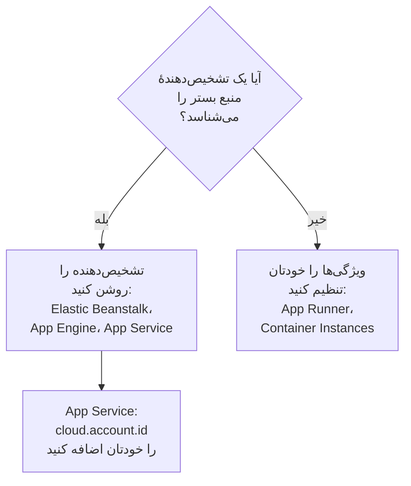

# سایر پلتفرم‌های ابری

بسترهای مدیریت‌شده‌ای را که صفحهٔ جداگانه ندارند راه‌اندازی کنید: AWS Elastic Beanstalk، AWS App Runner، Google App Engine، Azure App Service و Azure Container Instances. قاعده همانی است که روی هر بستری هست: تله‌متری‌ای که یک `cloud.platform` مدیریت‌شده همراه با `cloud.account.id` و `cloud.region` دارد، برای هر بستر، حساب و منطقه در یک **Cloud Environment** قرار می‌گیرد، و شناسهٔ نمونه به هر نمونهٔ در حال اجرا یک ردیف در **نمونه‌ها** می‌دهد.

:::cards
- [AWS Elastic Beanstalk](#aws-elastic-beanstalk): یک Collector روی هر نمونه، با تشخیص‌دهنده‌های Beanstalk و EC2.
- [AWS App Runner](#aws-app-runner): ویژگی‌هایی که دستی تنظیم می‌شوند، و توکن از Secrets Manager.
- [Google App Engine](#google-app-engine): تشخیص‌دهندهٔ GCP، با تنظیمات در `app.yaml`.
- [Azure App Service](#azure-app-service): تشخیص‌دهنده‌های Azure، یک ارجاع Key Vault و اشتراکی که دستی تنظیم می‌شود.
- [Azure Container Instances](#azure-container-instances): ویژگی‌هایی که دستی تنظیم می‌شوند، و توکن به‌صورت یک متغیر امن.
:::

## هر بستر به چه چیزی نیاز دارد

تفاوت این بسترها در این است که چه کسی ویژگی‌های `cloud.*` را تنظیم می‌کند، و تنظیمات در کجای کنسول ابر قرار می‌گیرند:



| بستر | `cloud.platform` | چه کسی `cloud.*` را پر می‌کند | شناسهٔ نمونه |
| ------------------------- | --------------------------- | ------------------------------------------------------------------------------------------ | ----------------------------------------------------------- |
| AWS Elastic Beanstalk | `aws_elastic_beanstalk` | تشخیص‌دهنده‌های `elastic_beanstalk` و `ec2` در Collector؛ `aws` در Node.js | `host.id` (`service.instance.id` استقرار را حذف کنید) |
| AWS App Runner | `aws_app_runner` | شما (بدون تشخیص‌دهنده) | `host.name` |
| Google App Engine | `gcp_app_engine` | تشخیص‌دهندهٔ `gcp` (در Collector و در هر SDK) | `faas.instance` |
| Azure App Service | `azure_app_service` | `azureappservice` در Collector، تشخیص‌دهنده‌های `azure` در Node.js و .NET؛ `cloud.account.id` با شما | `service.instance.id`، سپس `host.id` |
| Azure Container Instances | `azure_container_instances` | شما (بدون تشخیص‌دهنده) | `host.name` |

هر بخش زیر به یک کلید دریافت دادهٔ **سرور** از **تنظیمات پروژه** > **تله‌متری و APM** > **کلیدهای دریافت داده** نیاز دارد، و به برنامه‌ای که با یک SDK اپن‌تلمتری ابزارگذاری شده باشد. اگر OneUptime را خودتان میزبانی می‌کنید، `https://oneuptime.com/otlp` را با `https://YOUR-ONEUPTIME-HOST/otlp` جایگزین کنید.

> [!IMPORTANT]
> روی همهٔ این بسترها توکن یک راز است. هر بخش انبار راز آن بستر را نام می‌برد. توکنی که در یک متغیر محیطی عادی نوشته شود، برای هر کسی که بتواند پیکربندی برنامه را بخواند خواندنی است.

## AWS Elastic Beanstalk

`cloud.platform`: `aws_elastic_beanstalk`. تشخیص‌دهندهٔ Beanstalk فایل `/var/elasticbeanstalk/xray/environment.conf` را روی نمونه می‌خواند و `cloud.platform`، `service.instance.id`، `service.version` و نام محیط را تنظیم می‌کند. این تشخیص‌دهنده حساب و منطقه را نمی‌داند، پس آن را با تشخیص‌دهندهٔ EC2 همراه کنید که آن‌ها را می‌داند و `host.id` را هم تنظیم می‌کند.

روی هر نمونه یک OpenTelemetry Collector با این پیکربندی اجرا کنید:

```yaml title="config.yaml"
receivers:
  otlp:
    protocols:
      http:
        endpoint: 0.0.0.0:4318
      grpc:
        endpoint: 0.0.0.0:4317
processors:
  # elastic_beanstalk sets cloud.platform and service.instance.id; ec2 adds
  # cloud.account.id, cloud.region and host.id. The first detector to set an
  # attribute wins, so elastic_beanstalk comes first.
  resourcedetection:
    detectors: [env, elastic_beanstalk, ec2]
    timeout: 5s
  # The Beanstalk detector's service.instance.id is the deployment ID, shared
  # by every instance of a deployment: drop it, so that ec2's host.id names
  # each instance.
  resource:
    attributes:
      - key: service.instance.id
        action: delete
  batch: {}
exporters:
  otlphttp/oneuptime:
    endpoint: https://oneuptime.com/otlp
    headers:
      x-oneuptime-token: ${env:ONEUPTIME_TOKEN}
service:
  pipelines:
    traces:
      receivers: [otlp]
      processors: [resourcedetection, resource, batch]
      exporters: [otlphttp/oneuptime]
    metrics:
      receivers: [otlp]
      processors: [resourcedetection, resource, batch]
      exporters: [otlphttp/oneuptime]
    logs:
      receivers: [otlp]
      processors: [resourcedetection, resource, batch]
      exporters: [otlphttp/oneuptime]
```

:::steps
1. توکن را در Secrets Manager ذخیره کنید: `aws secretsmanager create-secret --name oneuptime/ingestion-token --secret-string "YOUR_TELEMETRY_INGESTION_TOKEN"`. ویژگی‌های محیطی Beanstalk در پیکربندی محیط نگه داشته می‌شوند، نه در یک انبار راز، پس به‌جای آن راز را با پروفایل نمونه از یک hook بستر بخوانید. پروفایل نمونه روی آن راز به `secretsmanager:GetSecretValue` نیاز دارد.
2. Collector را از یک اسکریپت در `.platform/hooks/postdeploy/` (یا `.ebextensions`) نصب کنید: بستهٔ `otelcol-contrib`، با پیکربندی بالا و راز در محیط آن به‌صورت `ONEUPTIME_TOKEN`.
3. **AWS Console → Elastic Beanstalk → Environments → your environment → Configuration**.
4. در دستهٔ **Updates, monitoring, and logging** روی **Edit** کلیک کنید و تا **Environment properties** پایین بروید. `OTEL_SERVICE_NAME`، `OTEL_EXPORTER_OTLP_ENDPOINT` با مقدار `http://localhost:4318`، و `OTEL_EXPORTER_OTLP_PROTOCOL` با مقدار `http/protobuf` را اضافه کنید.
5. روی **Apply** کلیک کنید. Beanstalk برنامه را با ویژگی‌های تازه دوباره راه‌اندازی می‌کند.
:::

برنامه‌های Node.js می‌توانند از Collector بگذرند: تشخیص‌دهنده‌های SDK شامل Beanstalk و EC2 هستند. `OTEL_EXPORTER_OTLP_ENDPOINT` را `https://oneuptime.com/otlp`، `OTEL_EXPORTER_OTLP_HEADERS` را `x-oneuptime-token=YOUR_TELEMETRY_INGESTION_TOKEN` و `OTEL_NODE_RESOURCE_DETECTORS=env,host,os,aws` را تنظیم کنید. در این حالت توکن در یک ویژگی محیطی قرار می‌گیرد. پس از آن ویژگی‌های منبع یک ترِیس را بررسی کنید: اگر `cloud.platform` برابر `aws_ec2` باشد، نسخهٔ SDK شما گذاشته است تشخیص‌دهندهٔ EC2 برنده شود، و Collector راه مطمئن است.

**شبکه:** نمونه‌های یک زیرشبکهٔ خصوصی به یک NAT gateway نیاز دارند، و گروه امنیتی نمونه باید ترافیک خروجی روی TCP ۴۴۳ به میزبان OneUptime را اجازه دهد.

## AWS App Runner

`cloud.platform`: `aws_app_runner`. هیچ تشخیص‌دهنده‌ای وجود ندارد، پس ویژگی‌ها را خودتان تنظیم می‌کنید. App Runner می‌تواند یک راز Secrets Manager (یا SSM Parameter Store) را در یک متغیر محیطی بگذارد.

```bash
OTEL_SERVICE_NAME=checkout-api
OTEL_EXPORTER_OTLP_ENDPOINT=https://oneuptime.com/otlp
OTEL_EXPORTER_OTLP_PROTOCOL=http/protobuf
# From Secrets Manager: the secret holds the whole header.
OTEL_EXPORTER_OTLP_HEADERS=x-oneuptime-token=YOUR_TELEMETRY_INGESTION_TOKEN
OTEL_RESOURCE_ATTRIBUTES=cloud.provider=aws,cloud.platform=aws_app_runner,cloud.region=us-east-1,cloud.account.id=123456789012
OTEL_NODE_RESOURCE_DETECTORS=env,host,os
```

منطقه و شناسهٔ حساب را با مقدارهای خودتان جایگزین کنید. تشخیص‌دهندهٔ `host` مقدار `host.name` را فراهم می‌کند، یعنی نام میزبان کانتینر که برای هر نمونهٔ App Runner متفاوت است، و OneUptime نمونه را با آن نام‌گذاری می‌کند.

:::steps
1. کل سرآیند را در Secrets Manager ذخیره کنید: `aws secretsmanager create-secret --name oneuptime/otlp-headers --secret-string "x-oneuptime-token=YOUR_TELEMETRY_INGESTION_TOKEN"`. App Runner مقدار راز را همان‌طور که هست در متغیر می‌گذارد.
2. **AWS Console → App Runner → Services → your service → Configuration → Configure service** (در زبانهٔ **Configuration** روی **Edit** کلیک کنید).
3. زیر **Environment variables** برای هر مقدار عادی بالا روی **Add environment variable** کلیک کنید.
4. `OTEL_EXPORTER_OTLP_HEADERS` را با **Source: Secrets Manager** و ARN راز اضافه کنید. زیر **Security → Instance role** نقشی را برگزینید که روی راز `secretsmanager:GetSecretValue` دارد: نقش نمونه، نه نقش دسترسی‌ای که ایمیج را می‌کشد.
5. روی **Save changes** کلیک کنید. App Runner نسخهٔ تازه‌ای مستقر می‌کند.
:::

**شبکه:** سرویسی که کانکتور VPC ندارد مستقیم به اینترنت می‌رسد. با **Outgoing network traffic: Custom VPC**، ترافیک خروجی از VPC شما می‌گذرد که به یک NAT gateway و یک قاعدهٔ خروجی گروه امنیتی روی TCP ۴۴۳ به میزبان OneUptime نیاز دارد.

## Google App Engine

`cloud.platform`: `gcp_app_engine`. تشخیص‌دهندهٔ GCP محیط استاندارد و منعطف App Engine را از `GAE_SERVICE`، `GAE_VERSION` و `GAE_INSTANCE` و سرور فراداده تشخیص می‌دهد. این تشخیص‌دهنده `cloud.account.id` (پروژه)، `cloud.region`، `faas.name`، `faas.version` و `faas.instance` را تنظیم می‌کند. مانند Cloud Run، `faas.name` باعث می‌شود هر سرویس App Engine در **توابع بدون سرور** هم نمایش داده شود، در حالی که محیط پروژه و منطقه را گرد می‌آورد.

| زبان | روشن کردن تشخیص‌دهندهٔ GCP |
| -------- | ------------------------------------------------------------------------------------------------------------------- |
| Node.js | `OTEL_NODE_RESOURCE_DETECTORS=env,host,os,gcp` |
| Python | `pip install opentelemetry-resourcedetector-gcp`، سپس `OTEL_EXPERIMENTAL_RESOURCE_DETECTORS=gcp_resource_detector` |
| Java | `-Dotel.resource.providers.gcp.enabled=true` |
| Go | `go.opentelemetry.io/contrib/detectors/gcp`، سپس `gcp.NewDetector()` |
| .NET | `OpenTelemetry.Resources.Gcp`، سپس `.AddGcpDetector()` |

App Engine در کنسول ویرایشگری برای متغیرهای محیطی ندارد: این متغیرها در `app.yaml` قرار دارند.

```yaml title="app.yaml"
runtime: nodejs22
env_variables:
  OTEL_SERVICE_NAME: checkout-api
  OTEL_EXPORTER_OTLP_ENDPOINT: https://oneuptime.com/otlp
  OTEL_EXPORTER_OTLP_PROTOCOL: http/protobuf
  OTEL_NODE_RESOURCE_DETECTORS: env,host,os,gcp
  # Do not commit the real value. Template it in CI, or read the secret at
  # start-up with the Secret Manager client instead.
  OTEL_EXPORTER_OTLP_HEADERS: x-oneuptime-token=YOUR_TELEMETRY_INGESTION_TOKEN
```

:::steps
1. کل سرآیند را در Secret Manager ذخیره کنید: `printf '%s' "x-oneuptime-token=YOUR_TELEMETRY_INGESTION_TOKEN" | gcloud secrets create oneuptime-otlp-headers --data-file=-`. به حساب سرویس App Engine (`my-project@appspot.gserviceaccount.com`) روی آن نقش `roles/secretmanager.secretAccessor` را بدهید.
2. راز را در خط لولهٔ استقرار خود در `app.yaml` بگذارید و در فایل commitشده یک جای‌نگهدار نگه دارید. یا هنگام آغاز، `projects/PROJECT_ID/secrets/oneuptime-otlp-headers/versions/latest` را بخوانید و در کد به گزینهٔ `headers` در صادرکننده بدهید.
3. با `gcloud app deploy` مستقر کنید. در کنسول، **App Engine → Versions** نسخهٔ تازه را نشان می‌دهد، و **App Engine → Services** سرویسی را که در **توابع بدون سرور** نمایش داده می‌شود.
:::

**شبکه:** محیط استاندارد App Engine مستقیم به اینترنت می‌رسد. نمونه‌های محیط منعطف در یک VPC قرار دارند: اگر زیرشبکه IP بیرونی نداشته باشد، به Cloud NAT و یک قاعدهٔ خروجی فایروال روی TCP ۴۴۳ به میزبان OneUptime نیاز دارند.

## Azure App Service

`cloud.platform`: `azure_app_service`. تشخیص‌دهنده‌های Azure در Node.js و .NET، و تشخیص‌دهندهٔ `azureappservice` در Collector، متغیرهای `WEBSITE_*` را که App Service تنظیم می‌کند می‌خوانند. این‌ها `cloud.platform`، `cloud.region`، `service.instance.id` (از `WEBSITE_INSTANCE_ID`)، `deployment.environment` (اسلات) و `host.id` را پر می‌کنند. هیچ‌کدام `cloud.account.id` را تنظیم نمی‌کند: شناسهٔ اشتراک را خودتان اضافه کنید، وگرنه کلید محیط یک بخش حساب خالی می‌گیرد.

```bash
OTEL_SERVICE_NAME=checkout-api
OTEL_EXPORTER_OTLP_ENDPOINT=https://oneuptime.com/otlp
OTEL_EXPORTER_OTLP_PROTOCOL=http/protobuf
# The Key Vault reference, which resolves to the whole header.
OTEL_EXPORTER_OTLP_HEADERS=@Microsoft.KeyVault(SecretUri=https://my-vault.vault.azure.net/secrets/oneuptime-otlp-headers/)
OTEL_RESOURCE_ATTRIBUTES=cloud.account.id=00000000-0000-0000-0000-000000000000
# Node.js:
OTEL_NODE_RESOURCE_DETECTORS=env,host,os,azure
```

تشخیص‌دهنده‌های SDK بستر را با نقطه به‌صورت `azure.app_service` می‌نویسند؛ OneUptime هنگام دریافت آن را به `azure_app_service` بازنویسی می‌کند. در .NET، `OpenTelemetry.Resources.Azure` را اضافه کنید و `.ConfigureResource(r => r.AddAzureAppServiceDetector())` را فراخوانی کنید. زبان‌های دیگر `cloud.provider=azure,cloud.platform=azure_app_service,cloud.region=<region>` را به `OTEL_RESOURCE_ATTRIBUTES` اضافه می‌کنند، و `service.instance.id` را در کد از `WEBSITE_INSTANCE_ID` می‌گیرند.

:::steps
1. هویت مدیریت‌شدهٔ اختصاص‌یافته توسط سیستم را برای برنامه روشن کنید (**Settings → Identity**)، و روی گاوصندوق به آن **Key Vault Secrets User** بدهید. کل سرآیند، `x-oneuptime-token=YOUR_TELEMETRY_INGESTION_TOKEN`، را به‌عنوان راز `oneuptime-otlp-headers` ذخیره کنید.
2. **Azure portal → App Services → your app → Settings → Environment variables** (در پورتال‌های قدیمی‌تر **Configuration → Application settings**).
3. هر متغیر بالا را با **+ Add** اضافه کنید. مقدار `OTEL_EXPORTER_OTLP_HEADERS` همان ارجاع Key Vault است.
4. روی **Apply** و سپس **Confirm** کلیک کنید: برنامه با تنظیمات تازه دوباره راه‌اندازی می‌شود. اسلات‌های استقرار تنظیمات جداگانهٔ خود را دارند: اگر فقط یک اسلات باید تله‌متری بفرستد، توکن را به‌عنوان **deployment slot setting** علامت بزنید.
:::

**شبکه:** App Service مستقیم به اینترنت می‌رسد، مگر آن‌که **VNet integration** همراه با **Route All** روشن باشد. در آن صورت VNet به یک NAT gateway نیاز دارد، یا به مسیری به فایروالی که TCP ۴۴۳ به میزبان OneUptime را اجازه دهد.

## Azure Container Instances

`cloud.platform`: `azure_container_instances`. هیچ تشخیص‌دهنده‌ای وجود ندارد، پس ویژگی‌ها را خودتان تنظیم می‌کنید. متغیرهای محیطی یک گروه کانتینر هنگام ساخت ثابت می‌شوند: تغییر یکی از آن‌ها یعنی ساختن دوبارهٔ گروه. توکن را با `--secure-environment-variables` بدهید تا `az container show` آن را برنگرداند:

```bash
az container create \
  --resource-group my-rg \
  --name checkout-api \
  --image myregistry.azurecr.io/checkout-api:1.4.2 \
  --location eastus \
  --environment-variables \
    OTEL_SERVICE_NAME=checkout-api \
    OTEL_EXPORTER_OTLP_ENDPOINT=https://oneuptime.com/otlp \
    OTEL_EXPORTER_OTLP_PROTOCOL=http/protobuf \
    "OTEL_RESOURCE_ATTRIBUTES=cloud.provider=azure,cloud.platform=azure_container_instances,cloud.region=eastus,cloud.account.id=00000000-0000-0000-0000-000000000000" \
    OTEL_NODE_RESOURCE_DETECTORS=env,host,os \
  --secure-environment-variables \
    "OTEL_EXPORTER_OTLP_HEADERS=x-oneuptime-token=YOUR_TELEMETRY_INGESTION_TOKEN"
```

`host.name` تشخیص‌دهندهٔ `host`، یعنی نام میزبان گروه کانتینر، نمونه را نام‌گذاری می‌کند. یک کالکتور sidecar اینجا هم کار می‌کند، چون یک گروه کانتینر مانند یک وظیفهٔ ECS چند کانتینر اجرا می‌کند: الگوی `detectors: [env]` همراه با `OTEL_RESOURCE_ATTRIBUTES` از [Azure Container Apps](/docs/telemetry/cloud-azure-container-apps) را به کار ببرید. همین کالکتور است که کاشی‌های **CPU** و **حافظه** را پر می‌کند، اگر `container.cpu.utilization` و `container.memory.usage` را با شناسهٔ گروه بفرستد.

:::steps
1. **Azure portal → Container Instances → + Create**. زبانهٔ **Basics** را پر کنید: گروه منابع، نام، منطقه و ایمیج.
2. در زبانهٔ **Advanced**، زیر **Environment variables** هر متغیر را اضافه کنید. برای `OTEL_EXPORTER_OTLP_HEADERS`، **Mark as secure** را روی **Yes** بگذارید تا پورتال و API مقدار آن را نشان ندهند.
3. روی **Review + create** و سپس **Create** کلیک کنید. برای تغییر یک متغیر در آینده، گروه را حذف کنید و دوباره بسازید.
:::

**شبکه:** گروه کانتینری که IP عمومی دارد مستقیم به اینترنت می‌رسد. گروهی که در یک زیرشبکهٔ VNet است فقط از مسیر VNet بیرون می‌رود: یک NAT gateway اضافه کنید، یا TCP ۴۴۳ به میزبان OneUptime را روی فایروال یا NSG اجازه دهید.

## بررسی اتصال

هر بستری را که راه‌اندازی کرده‌اید، اول توکن را بررسی کنید، سپس دنبال محیط بگردید:

```bash
curl -i https://oneuptime.com/otlp/v1/validate \
  -H "x-oneuptime-token: YOUR_TELEMETRY_INGESTION_TOKEN"
```

`200` همراه با `"valid": true` یعنی توکن پذیرفته شده است. `401` یعنی توکن ناشناخته، لغوشده، غیرفعال یا منقضی است. ظرف یک دقیقه پس از نخستین اسپن، لاگ یا متریک، محیط در **ابر** > **All Environments** نمایش داده می‌شود، با نامی برگرفته از بستر، منطقه و حساب.

## عیب‌یابی

:::details نمونه‌های Beanstalk در میزبان‌ها نمایش داده می‌شوند
`cloud.platform=aws_ec2` از تشخیص‌دهندهٔ EC2 برنده شد. نخستین تشخیص‌دهنده‌ای که یک ویژگی را تنظیم کند برنده است، پس `elastic_beanstalk` را در `detectors` پیش از `ec2` نگه دارید. بدون Collector، SDK در Node.js هم ممکن است تشخیص‌دهندهٔ EC2 را ترجیح دهد: Collector را اجرا کنید.
:::

:::details همهٔ نمونه‌های Beanstalk یک ردیف در نمونه‌ها را شریک‌اند
`service.instance.id` تشخیص‌دهندهٔ Beanstalk همان شناسهٔ استقرار است که همهٔ نمونه‌های یک استقرار در آن شریک‌اند، و پیش از `host.id` خوانده می‌شود. پردازشگر `resource` را که آن را حذف می‌کند در هر خط لوله نگه دارید.
:::

:::details یک برنامهٔ App Service کد ۴۰۱ می‌گیرد
ارجاع Key Vault resolve نشد، پس App Service متن خام `@Microsoft.KeyVault(...)` را به‌عنوان سرآیند فرستاد. به هویت مدیریت‌شدهٔ برنامه روی گاوصندوق **Key Vault Secrets User** بدهید، و بررسی کنید که راز کل سرآیند `x-oneuptime-token=...` را نگه می‌دارد.
:::

:::details یک محیط App Service بخش حساب خالی دارد
هیچ‌کدام از تشخیص‌دهنده‌های App Service، `cloud.account.id` را تنظیم نمی‌کند. شناسهٔ اشتراک را روی هر برنامه به `OTEL_RESOURCE_ATTRIBUTES` اضافه کنید: تله‌متری با آن و بدون آن در دو محیط قرار می‌گیرد.
:::

:::details تغییر یک متغیر Container Instances اثری ندارد
متغیرهای محیطی یک گروه کانتینر هنگام ساخت ثابت می‌شوند. گروه را حذف کنید و با مقدارهای تازه دوباره بسازید.
:::

برای باقی موارد [رفع اشکال ابر](/docs/telemetry/cloud-troubleshooting) را ببینید، به‌ویژه محیطی که در **میزبان‌ها**، فقط در **توابع بدون سرور** (App Engine بدون تشخیص‌دهندهٔ GCP)، یا دو بار (`cloud.account.id` روی برخی استقرارها تنظیم شده و روی برخی نه) نمایش داده می‌شود.

## گام‌های بعدی

:::cards
- [محیط‌های ابری](/docs/telemetry/cloud-environments): محیط‌ها و نمونه‌ها چگونه شناسایی می‌شوند.
- [رفع اشکال ابر](/docs/telemetry/cloud-troubleshooting): خطاهایی که همهٔ بسترها در آن‌ها مشترک‌اند.
- [توابع بدون سرور](/docs/telemetry/serverless-functions): Lambda، Cloud Functions و Azure Functions.
- [منابع ابری (IaaS و PaaS)](/docs/telemetry/cloud-resources): منابع پیرامون برنامه‌های شما، از پایش خودِ ابر شما.
:::
