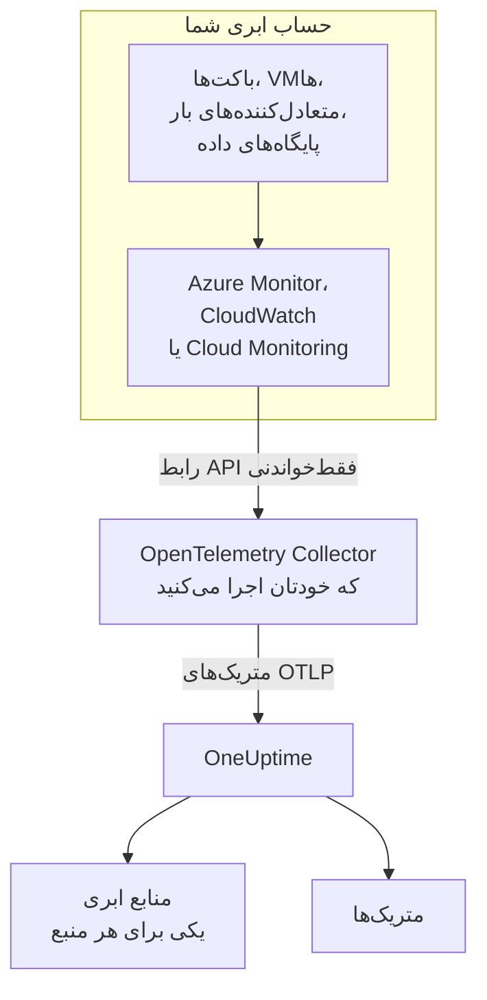
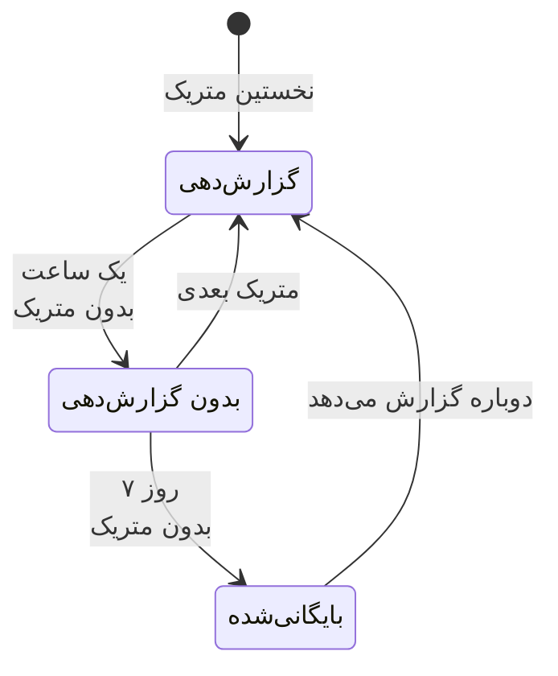

# منابع ابری (IaaS و PaaS)

**Cloud Resources** منابع IaaS و PaaS را در حساب‌های AWS، Azure و Google Cloud شما فهرست می‌کند: ماشین‌های مجازی، دیسک‌ها، متعادل‌کننده‌های بار، باکت‌ها، پایگاه‌های دادهٔ مدیریت‌شده، کش‌ها، صف‌ها، دروازه‌های API و بقیه. هر منبع صفحهٔ خودش را دارد، با نوع، منطقه و حساب، شناسه‌ای که ارائه‌دهنده به آن داده، همهٔ متریک‌هایی که ارائه‌دهنده دربارهٔ آن منتشر می‌کند، و مالکان و برچسب‌ها مانند هر منبع دیگری در OneUptime. آن‌ها را در **ابر** > **همه منابع** پیدا کنید.

:::cards
- [اتصال Azure](#اتصال-azure): همهٔ منابع یک اشتراک را از Azure Monitor بخوانید.
- [اتصال AWS](#اتصال-aws): CloudWatch را پرس‌وجو کنید، یا آن را از راه Amazon Data Firehose جریان دهید.
- [اتصال Google Cloud](#اتصال-google-cloud): سرویس‌های یک پروژه را از Cloud Monitoring بخوانید.
- [یک منبع چگونه شناسایی می‌شود](#یک-منبع-چگونه-شناسایی-میشود): همهٔ نوع‌های منبعی که OneUptime می‌شناسد، به تفکیک ارائه‌دهنده.
:::

## چگونه کار می‌کند



- **ارائه‌دهنده از پیش منابع شما را اندازه می‌گیرد.** Azure Monitor، Amazon CloudWatch و Google Cloud Monitoring دربارهٔ هر منبعی که برای شما اجرا می‌کنند متریک منتشر می‌کنند.
- **یک Collector که خودتان اجرا می‌کنید آن‌ها را می‌خواند.** یک OpenTelemetry Collector با دسترسی فقط‌خواندنی به آن سرویس پایش، متریک‌ها را به OneUptime صادر می‌کند. هیچ‌چیز روی منابع نصب نمی‌شود، و OneUptime هرگز اعتبارنامه‌های ابری شما را نگه نمی‌دارد: آن‌ها نزد Collector و در محیط خود شما هستند.
- **هر منبع با نخستین متریکش نمایش داده می‌شود.** OneUptime از هر نقطهٔ داده تشخیص می‌دهد که دربارهٔ کدام منبع است، و نخستین باری که آن را می‌بیند منبع ابری را می‌سازد.

منابع ابری یکی از چند جایی است که ابر شما در آن‌ها نمایش داده می‌شود:

| چه اجرا می‌کنید | کجا نمایش داده می‌شود | چگونه |
| --- | --- | --- |
| کانتینرها روی ECS، Cloud Run، Container Apps، App Service، … | **ابر** > **All Environments** | تله‌متری خودِ بارهای کاری شما، بر اساس `cloud.platform` آن. [محیط‌های ابری](/docs/telemetry/cloud-environments) را ببینید |
| هر منبع IaaS یا PaaS که ارائه‌دهنده پایش می‌کند | **ابر** > **همه منابع** | API پایش ارائه‌دهنده که یک Collector آن را می‌خواند: همین صفحه |
| ماشین‌های مجازی‌ای که OpenTelemetry Collector رویشان نصب است | **میزبان‌ها** | متریک‌ها و لاگ‌های خودِ میزبان. [کالکتور OpenTelemetry روی میزبان](/docs/telemetry/host-otel-collector) را ببینید |
| صف‌ها و موضوع‌هایی که برنامه‌های شما به کار می‌برند | **Queues** | اسپن‌ها، و همان متریک‌های ابری. [صف‌ها](/docs/telemetry/queues) را ببینید |

یک منبع می‌تواند در بیش از یک جا نمایش داده شود. ماشین مجازی‌ای که Collector رویش نصب است یک **میزبان** است، و متریک‌های بستر آن (اعتبار CPU، دیسک و شبکه آن‌طور که hypervisor می‌بیند) آن را یک **منبع ابری** هم می‌کنند. یک صف SQS هم یک **Queue** است و هم یک **منبع ابری**. هر نما چیزی را نشان می‌دهد که منبع داده‌اش می‌داند.

## پیش از شروع

- **یک کلید دریافت داده.** در **تنظیمات پروژه** > **تله‌متری و APM** > **کلیدهای دریافت داده** یک کلید **سرور** بسازید. Collectorهای زیر آن را از متغیر محیطی `ONEUPTIME_TOKEN` می‌خوانند، هرگز از فایل پیکربندی‌شان.
- **جایی برای اجرای OpenTelemetry Collector**: توزیع `otelcol-contrib`، با ایمیج `otel/opentelemetry-collector-contrib`، که دسترسی خروجی به ارائه‌دهندهٔ ابری شما و به OneUptime داشته باشد. یک VM کوچک، یک کانتینر یا خوشهٔ Kubernetes شما کافی است، و یک Collector می‌تواند چند حساب و ارائه‌دهنده را بخواند.
- **دسترسی خواندن به API پایش ارائه‌دهنده.** نخستین گام هر ارائه‌دهنده در ادامه آن را می‌سازد.

> [!TIP]
> همین گام‌ها در داشبورد هم هست، با توکن شما که از پیش پر شده: در **ابر** > **همه منابع** تا وقتی نخستین منبع برسد، و در زبانهٔ **مستندات** هر منبع، که روی ارائه‌دهندهٔ خودِ آن منبع باز می‌شود.

اگر OneUptime را خودتان میزبانی می‌کنید، `https://oneuptime.com/otlp` را با `https://YOUR-ONEUPTIME-HOST/otlp` جایگزین کنید.

## اتصال Azure

گیرندهٔ `azure_monitor` منابع یک اشتراک را فهرست می‌کند و هر دقیقه متریک‌های بستر آن‌ها را می‌خواند. بدون فهرست `services` همهٔ نوع‌های منبع را می‌خواند، پس هر منبع در اشتراک به یک منبع ابری تبدیل می‌شود.

:::steps
### ساخت یک service principal با Monitoring Reader

**Monitoring Reader** متریک‌ها را می‌خواند و منابع را فهرست می‌کند، و نمی‌تواند چیزی را تغییر دهد:

```bash
az ad sp create-for-rbac \
  --name oneuptime-cloud-collector \
  --role "Monitoring Reader" \
  --scopes /subscriptions/<SUBSCRIPTION_ID>
```

این فرمان یک `appId` (شناسهٔ کلاینت)، یک `password` (راز کلاینت) و `tenant` را چاپ می‌کند. به همان service principal روی اشتراک‌های بیشتر همین نقش را بدهید تا آن‌ها را با همان Collector بخوانید.

### پیکربندی گیرندهٔ Azure Monitor

این را به‌عنوان `config.yaml` ذخیره کنید:

```yaml
extensions:
  azure_auth:
    service_principal:
      tenant_id: ${env:AZURE_TENANT_ID}
      client_id: ${env:AZURE_CLIENT_ID}
      client_secret: ${env:AZURE_CLIENT_SECRET}

receivers:
  azure_monitor:
    subscription_ids: ["${env:AZURE_SUBSCRIPTION_ID}"]
    auth:
      authenticator: azure_auth
    collection_interval: 60s
    # No `services` list: every resource type in the subscription.
    # Series Azure returns per metric and resource (default 10).
    maximum_number_of_records_per_resource: 50

processors:
  batch: {}

exporters:
  otlphttp/oneuptime:
    endpoint: https://oneuptime.com/otlp
    headers:
      x-oneuptime-token: ${env:ONEUPTIME_TOKEN}

service:
  extensions: [azure_auth]
  pipelines:
    metrics:
      receivers: [azure_monitor]
      processors: [batch]
      exporters: [otlphttp/oneuptime]
```

### اجرای Collector برای Azure

```bash
docker run -d --name oneuptime-cloud-collector --restart unless-stopped \
  -e ONEUPTIME_TOKEN=YOUR_TELEMETRY_INGESTION_TOKEN \
  -e AZURE_TENANT_ID=<TENANT> \
  -e AZURE_CLIENT_ID=<APP_ID> \
  -e AZURE_CLIENT_SECRET=<PASSWORD> \
  -e AZURE_SUBSCRIPTION_ID=<SUBSCRIPTION_ID> \
  -v "$(pwd)/config.yaml:/etc/otelcol-contrib/config.yaml" \
  otel/opentelemetry-collector-contrib:latest
```

منابع ظرف چند دقیقه در **ابر** > **همه منابع** نمایش داده می‌شوند.
:::

گزینه‌های گیرندهٔ `azure_monitor`:

| گزینه | چه می‌کند |
| --- | --- |
| `resource_groups`, `services`, `resource_tags` | خواندن کمتر: فهرستی از گروه‌های منابع، از نوع‌های Resource Manager (`Microsoft.Compute/virtualMachines`)، یا از برچسب‌هایی که یک منبع باید داشته باشد |
| `metrics` | هر نوع منبع را به متریک‌ها و تجمیع‌هایی که فهرست می‌کنید محدود می‌کند. وقتی نوعی فهرست شد، فقط متریک‌های فهرست‌شدهٔ آن خوانده می‌شوند |
| `discover_subscriptions: true` | به‌جای `subscription_ids`، همهٔ اشتراک‌هایی را که service principal می‌بیند می‌خواند |
| `maximum_number_of_records_per_resource` | تعداد سری‌هایی که Azure برای هر متریک و منبع برمی‌گرداند (پیش‌فرض ۱۰). وقتی یک متریک بر اساس بُعدی با مقدارهای زیاد تقسیم می‌شود، آن را بالا ببرید |
| `use_batch_api: true` | برای اشتراک‌های بزرگ. گیرنده برای هر منبع و هر دستهٔ ۲۰ متریکی یک فراخوانی Resource Manager انجام می‌دهد، و Resource Manager حدود ۱۲٬۰۰۰ خواندن در ساعت را اجازه می‌دهد؛ API دسته‌ای در هر فراخوانی تا ۵۰ منبع را از سطح دادهٔ Azure Monitor می‌خواند که سقف آن بسیار بالاتر است |
| `cache_resources` | هر چند ثانیه یک بار گیرنده منابع را فهرست کند: به‌طور پیش‌فرض روزی یک بار. منبعی که پس از آغاز Collector ساخته شود ممکن است تا یک روز طول بکشد تا نمایش داده شود؛ برای فهرست کردن فوری، Collector را دوباره راه‌اندازی کنید |

## اتصال AWS

متریک‌های CloudWatch از یکی از دو راه به OneUptime می‌رسند:

| | Polling | Metric Streams |
| --- | --- | --- |
| چگونه | گیرندهٔ `aws_cloudwatch` در Collector از CloudWatch پرس‌وجو می‌کند | CloudWatch از راه Amazon Data Firehose به گیرندهٔ `awsfirehose` در Collector می‌فرستد |
| نیاز در سمت AWS | فقط اعتبارنامه‌ها | یک جریان Firehose و یک metric stream در هر منطقه |
| Collector باید از AWS در دسترس باشد | خیر | بله، روی HTTPS و پورت ۴۴۳ |
| تأخیر | ۱۰ تا ۲۰ دقیقه | چند دقیقه |
| مناسب برای | بیشتر حساب‌ها | حساب‌های بزرگ |

### پرس‌وجو با گیرندهٔ aws_cloudwatch

:::steps
#### اجازهٔ خواندن CloudWatch به Collector

این سیاست را به نقشی که Collector با آن اجرا می‌شود (یک پروفایل نمونهٔ EC2، یک نقش وظیفهٔ ECS، یک حساب سرویس EKS) پیوست کنید، یا به یک کاربر IAM که کلیدهای دسترسی‌اش را به Collector می‌دهید:

```json
{
  "Version": "2012-10-17",
  "Statement": [
    {
      "Effect": "Allow",
      "Action": [
        "cloudwatch:ListMetrics",
        "cloudwatch:GetMetricData",
        "sts:GetCallerIdentity"
      ],
      "Resource": "*"
    }
  ]
}
```

`sts:GetCallerIdentity` به گیرنده اجازه می‌دهد شناسهٔ حساب را گزارش کند، که ARN هر منبع به آن نیاز دارد.

#### پیکربندی گیرنده‌های CloudWatch

یک گیرنده یک namespace را در یک منطقه می‌خواند، پس برای هر namespace و منطقه‌ای که می‌خواهید یک گیرنده اضافه کنید. این نمونه namespaceهای رایج را می‌خواند؛ آن را به‌عنوان `config.yaml` ذخیره کنید:

```yaml
receivers:
  aws_cloudwatch/ec2:
    region: ${env:AWS_REGION}
    metrics:
      collection_interval: 5m
      period: 5m
      delay: 10m
      discovery:
        filters:
          namespace: AWS/EC2
        # Metrics read per scrape, at most. Each costs 4 GetMetricData queries.
        limit: 1000
  aws_cloudwatch/ebs:
    region: ${env:AWS_REGION}
    metrics:
      collection_interval: 5m
      period: 5m
      delay: 10m
      discovery:
        filters:
          namespace: AWS/EBS
        # Metrics read per scrape, at most. Each costs 4 GetMetricData queries.
        limit: 1000
  aws_cloudwatch/applicationelb:
    region: ${env:AWS_REGION}
    metrics:
      collection_interval: 5m
      period: 5m
      delay: 10m
      discovery:
        filters:
          namespace: AWS/ApplicationELB
        # Metrics read per scrape, at most. Each costs 4 GetMetricData queries.
        limit: 1000
  aws_cloudwatch/rds:
    region: ${env:AWS_REGION}
    metrics:
      collection_interval: 5m
      period: 5m
      delay: 10m
      discovery:
        filters:
          namespace: AWS/RDS
        # Metrics read per scrape, at most. Each costs 4 GetMetricData queries.
        limit: 1000
  aws_cloudwatch/lambda:
    region: ${env:AWS_REGION}
    metrics:
      collection_interval: 5m
      period: 5m
      delay: 10m
      discovery:
        filters:
          namespace: AWS/Lambda
        # Metrics read per scrape, at most. Each costs 4 GetMetricData queries.
        limit: 1000
  aws_cloudwatch/dynamodb:
    region: ${env:AWS_REGION}
    metrics:
      collection_interval: 5m
      period: 5m
      delay: 10m
      discovery:
        filters:
          namespace: AWS/DynamoDB
        # Metrics read per scrape, at most. Each costs 4 GetMetricData queries.
        limit: 1000

processors:
  batch: {}

exporters:
  otlphttp/oneuptime:
    endpoint: https://oneuptime.com/otlp
    headers:
      x-oneuptime-token: ${env:ONEUPTIME_TOKEN}

service:
  pipelines:
    metrics:
      receivers: [aws_cloudwatch/ec2, aws_cloudwatch/ebs, aws_cloudwatch/applicationelb, aws_cloudwatch/rds, aws_cloudwatch/lambda, aws_cloudwatch/dynamodb]
      processors: [batch]
      exporters: [otlphttp/oneuptime]
```

#### اجرای Collector برای CloudWatch

```bash
docker run -d --name oneuptime-cloud-collector --restart unless-stopped \
  -e ONEUPTIME_TOKEN=YOUR_TELEMETRY_INGESTION_TOKEN \
  -e AWS_REGION=us-east-1 \
  -e AWS_ACCESS_KEY_ID=<ACCESS_KEY_ID> \
  -e AWS_SECRET_ACCESS_KEY=<SECRET_ACCESS_KEY> \
  -v "$(pwd)/config.yaml:/etc/otelcol-contrib/config.yaml" \
  otel/opentelemetry-collector-contrib:latest
```

روی یک نمونهٔ EC2، وظیفهٔ ECS یا pod در EKS که این نقش را دارد، دو متغیر کلید را کنار بگذارید.
:::

- **`stats` را تنظیم نکنید.** در این صورت هر متریک به‌صورت یک خلاصه برای هر دوره خوانده می‌شود: چهار آماره، چهار پرس‌وجوی `GetMetricData`، و AWS برای هر متریک درخواست‌شده هزینهٔ `GetMetricData` را می‌گیرد. `discovery.limit` تعداد متریک‌هایی را که یک گیرنده در هر بار جمع‌آوری می‌خواند محدود می‌کند (آن را تنظیم کنید: پیش‌فرض خود گیرنده ۱۰۰ است)، و `collection_interval` طولانی‌تر آن‌ها را کمتر می‌خواند.
- **داده دیر می‌رسد.** `delay` منتظر می‌ماند تا CloudWatch یک دوره را منتشر کند، پس نقطه‌های داده ۱۰ تا ۲۰ دقیقه پس از زمانی که اندازه می‌گیرند می‌رسند، و منابع ظرف حدود بیست دقیقه نمایش داده می‌شوند.

### جریان دادن با CloudWatch Metric Streams

:::steps
#### پیکربندی گیرندهٔ Firehose

Collector برای نشانی خود به یک گواهی نیاز دارد: Firehose فقط به `https://` روی پورت ۴۴۳ تحویل می‌دهد. این را به‌عنوان `config.yaml` ذخیره کنید:

```yaml
extensions:
  awscloudwatchmetricstreams_encoding:
    format: opentelemetry1.0

receivers:
  awsfirehose:
    # Firehose delivers to HTTPS on port 443 only: expose this port as
    # 443, for example behind a load balancer.
    endpoint: 0.0.0.0:4433
    encoding: awscloudwatchmetricstreams_encoding
    access_key: ${env:FIREHOSE_ACCESS_KEY}
    tls:
      cert_file: /etc/otelcol-contrib/tls/server.crt
      key_file: /etc/otelcol-contrib/tls/server.key

processors:
  batch: {}

exporters:
  otlphttp/oneuptime:
    endpoint: https://oneuptime.com/otlp
    headers:
      x-oneuptime-token: ${env:ONEUPTIME_TOKEN}

service:
  extensions: [awscloudwatchmetricstreams_encoding]
  pipelines:
    metrics:
      receivers: [awsfirehose]
      processors: [batch]
      exporters: [otlphttp/oneuptime]
```

#### اجرای Collector برای Firehose

```bash
docker run -d --name oneuptime-cloud-collector --restart unless-stopped \
  -e ONEUPTIME_TOKEN=YOUR_TELEMETRY_INGESTION_TOKEN \
  -e FIREHOSE_ACCESS_KEY=<A_LONG_RANDOM_SECRET> \
  -p 4433:4433 \
  -v "$(pwd)/tls:/etc/otelcol-contrib/tls:ro" \
  -v "$(pwd)/config.yaml:/etc/otelcol-contrib/config.yaml" \
  otel/opentelemetry-collector-contrib:latest
```

گواهی و کلید آن به‌صورت `server.crt` و `server.key` در `tls/` قرار می‌گیرند. پورت ۴۴۳۳ را پشت چیزی منتشر کنید که روی ۴۴۳ پاسخ می‌دهد، مانند یک متعادل‌کنندهٔ بار.

#### ساخت جریان Firehose و metric stream

1. **Amazon Data Firehose → Create Firehose stream**: منبع **Direct PUT**، مقصد **HTTP Endpoint**. نشانی endpoint همان نشانی `https://` در Collector است؛ کلید دسترسی `FIREHOSE_ACCESS_KEY` است. یک باکت S3 برای تحویل‌های ناموفق برگزینید یا بسازید.
2. **CloudWatch → Metrics → Streams → Create metric stream**: namespaceهایی که باید شامل شوند (یا همه)، جریان Firehose، و قالب خروجی **OpenTelemetry 1.0**.
3. این کار را در هر منطقه تکرار کنید: یک metric stream متریک‌های منطقهٔ خودش را حمل می‌کند.
:::

AWS برای هر به‌روزرسانی متریکی که یک metric stream تحویل دهد هزینه می‌گیرد، به‌علاوهٔ هزینهٔ دادهٔ Firehose، پس فقط namespaceهایی را که می‌خواهید شامل کنید. جریانی در قالب **JSON** (`format: json` روی افزونهٔ کدگذاری) همان منابع را نام می‌برد، اما هر namespace را در `service.name` هم می‌نویسد، پس هر namespace در **سرویس‌ها** هم نمایش داده می‌شود: **OpenTelemetry 1.0** را ترجیح دهید.

## اتصال Google Cloud

گیرندهٔ `googlecloudmonitoring` نوع‌های متریکی را که `metrics_list` آن نام می‌برد، برای یک پروژه می‌خواند.

:::steps
### ساخت یک حساب سرویس با Monitoring Viewer

**Monitoring Viewer** متریک‌ها را می‌خواند و نمی‌تواند چیزی را تغییر دهد:

```bash
gcloud iam service-accounts create oneuptime-cloud-collector \
  --project <PROJECT_ID>

gcloud projects add-iam-policy-binding <PROJECT_ID> \
  --member "serviceAccount:oneuptime-cloud-collector@<PROJECT_ID>.iam.gserviceaccount.com" \
  --role roles/monitoring.viewer

gcloud iam service-accounts keys create key.json \
  --iam-account oneuptime-cloud-collector@<PROJECT_ID>.iam.gserviceaccount.com
```

روی خودِ Google Cloud، به‌جای ساختن کلید، Collector را با همین حساب سرویس اجرا کنید.

### پیکربندی گیرندهٔ Cloud Monitoring

هر فیلتر همهٔ نوع‌های متریک یک سرویس را می‌خواند. این را به‌عنوان `config.yaml` ذخیره کنید:

```yaml
receivers:
  googlecloudmonitoring:
    project_id: ${env:GCP_PROJECT_ID}
    collection_interval: 2m
    # Only the metric types these filters list are read.
    metrics_list:
      - metric_descriptor_filter: 'metric.type = starts_with("compute.googleapis.com/")'
      - metric_descriptor_filter: 'metric.type = starts_with("cloudsql.googleapis.com/")'
      - metric_descriptor_filter: 'metric.type = starts_with("loadbalancing.googleapis.com/")'
      - metric_descriptor_filter: 'metric.type = starts_with("storage.googleapis.com/")'
      - metric_descriptor_filter: 'metric.type = starts_with("redis.googleapis.com/")'
      - metric_descriptor_filter: 'metric.type = starts_with("run.googleapis.com/")'

processors:
  batch: {}

exporters:
  otlphttp/oneuptime:
    endpoint: https://oneuptime.com/otlp
    headers:
      x-oneuptime-token: ${env:ONEUPTIME_TOKEN}

service:
  pipelines:
    metrics:
      receivers: [googlecloudmonitoring]
      processors: [batch]
      exporters: [otlphttp/oneuptime]
```

### اجرای Collector برای Google Cloud

```bash
docker run -d --name oneuptime-cloud-collector --restart unless-stopped \
  -e ONEUPTIME_TOKEN=YOUR_TELEMETRY_INGESTION_TOKEN \
  -e GCP_PROJECT_ID=<PROJECT_ID> \
  -e GOOGLE_APPLICATION_CREDENTIALS=/etc/otelcol-contrib/key.json \
  -v "$(pwd)/key.json:/etc/otelcol-contrib/key.json:ro" \
  -v "$(pwd)/config.yaml:/etc/otelcol-contrib/config.yaml" \
  otel/opentelemetry-collector-contrib:latest
```
:::

- **فهرست هنگام آغاز Collector خوانده می‌شود:** پس از هر تغییر آن را دوباره راه‌اندازی کنید. `metric_name: compute.googleapis.com/instance/cpu/utilization` به‌جای همهٔ نوع‌های یک سرویس، فقط یک نوع را می‌خواند.
- **یک گیرنده یک پروژه را می‌خواند:** برای هر پروژه یک گیرنده اضافه کنید.
- **خواندن هزینه و سهمیه دارد.** هر نوع متریک در هر بازهٔ جمع‌آوری یک خواندن از API Cloud Monitoring است. خواندن متریک‌های خودِ Google Cloud در محدودهٔ سهمیهٔ ماهانهٔ رایگان API رایگان است؛ `collection_interval` طولانی‌تر یک پروژهٔ بزرگ را در همان محدوده، و در سهمیهٔ هر دقیقه، نگه می‌دارد.

## خط لوله را از تشخیص منبع دور نگه دارید

> [!WARNING]
> پردازشگر `resourcedetection` را به خط لوله‌ای که پایش ابر را می‌خواند اضافه نکنید. این پردازشگر `host.name` و `os.type` خودِ ماشین Collector را روی هر نقطهٔ داده مهر می‌زند، و OneUptime آنگاه متریک‌های ابر شما را زیر همان ماشین در **میزبان‌ها** هم بایگانی می‌کند. Collectorی که میزبان خودش را هم پایش می‌کند، باید این کار را در یک خط لولهٔ جداگانه انجام دهد.

## یک منبع چگونه شناسایی می‌شود

هر نقطهٔ داده از این گیرنده‌ها یک منبع را نام می‌برد، و OneUptime منبع ابری را بر اساس شناسهٔ آن منبع کلید می‌کند، هرگز بر اساس نامش که می‌توانید تغییرش دهید. شناسه بدون توجه به بزرگی و کوچکی حروف مقایسه می‌شود، پس منبعی که با دو نگارش گزارش شود یک منبع است.

### Azure

هر نقطهٔ داده شناسهٔ منبع Azure منبع خود را دارد (`azuremonitor.resource_id`)، پس هر منبعی که گیرنده می‌خواند به یک منبع ابری تبدیل می‌شود: نوع‌های زیر با نامی خوانا، و هر نوع دیگری با نوع Resource Manager خودش. شناسهٔ منبع، منطقه، اشتراک و گروه منابع همگی روی منبع نشان داده می‌شوند.

:::details نوع‌های منبع Azure با نامی خوانا
| نوع منبع | نمایش به‌صورت | مدل |
| --- | --- | --- |
| `Microsoft.Compute/virtualMachines` | Virtual Machine | IaaS |
| `Microsoft.Compute/virtualMachineScaleSets` | Virtual Machine Scale Set | IaaS |
| `Microsoft.Compute/disks` | Managed Disk | IaaS |
| `Microsoft.Network/loadBalancers` | Load Balancer | IaaS |
| `Microsoft.Network/applicationGateways` | Application Gateway | IaaS |
| `Microsoft.Network/publicIPAddresses` | Public IP Address | IaaS |
| `Microsoft.Network/natGateways` | NAT Gateway | IaaS |
| `Microsoft.Network/virtualNetworkGateways` | Virtual Network Gateway | IaaS |
| `Microsoft.Network/expressRouteCircuits` | ExpressRoute Circuit | IaaS |
| `Microsoft.Network/azureFirewalls` | Azure Firewall | IaaS |
| `Microsoft.Network/frontdoors` | Front Door (classic) | IaaS |
| `Microsoft.Cdn/profiles` | Front Door and CDN Profile | IaaS |
| `Microsoft.Network/trafficmanagerprofiles` | Traffic Manager Profile | IaaS |
| `Microsoft.Network/networkInterfaces` | Network Interface | IaaS |
| `Microsoft.Network/virtualNetworks` | Virtual Network | IaaS |
| `Microsoft.Network/privateEndpoints` | Private Endpoint | IaaS |
| `Microsoft.Network/dnszones` | DNS Zone | IaaS |
| `Microsoft.Network/bastionHosts` | Bastion | IaaS |
| `Microsoft.Storage/storageAccounts` | Storage Account | IaaS |
| `Microsoft.RecoveryServices/vaults` | Recovery Services Vault | PaaS |
| `Microsoft.Web/sites` | App Service or Function App | PaaS |
| `Microsoft.Web/serverfarms` | App Service Plan | PaaS |
| `Microsoft.Web/staticSites` | Static Web App | PaaS |
| `Microsoft.App/containerApps` | Container App | PaaS |
| `Microsoft.App/managedEnvironments` | Container Apps Environment | PaaS |
| `Microsoft.ContainerInstance/containerGroups` | Container Instance | PaaS |
| `Microsoft.ContainerService/managedClusters` | AKS Cluster | PaaS |
| `Microsoft.ContainerRegistry/registries` | Container Registry | PaaS |
| `Microsoft.SignalRService/SignalR` | SignalR Service | PaaS |
| `Microsoft.Sql/servers/databases` | SQL Database | PaaS |
| `Microsoft.Sql/servers/elasticpools` | SQL Elastic Pool | PaaS |
| `Microsoft.Sql/managedInstances` | SQL Managed Instance | PaaS |
| `Microsoft.DBforPostgreSQL/flexibleServers` | PostgreSQL Flexible Server | PaaS |
| `Microsoft.DBforMySQL/flexibleServers` | MySQL Flexible Server | PaaS |
| `Microsoft.DocumentDB/databaseAccounts` | Cosmos DB Account | PaaS |
| `Microsoft.Cache/redis` | Azure Cache for Redis | PaaS |
| `Microsoft.Cache/redisEnterprise` | Azure Managed Redis | PaaS |
| `Microsoft.ServiceBus/namespaces` | Service Bus Namespace | PaaS |
| `Microsoft.EventHub/namespaces` | Event Hubs Namespace | PaaS |
| `Microsoft.EventGrid/topics` | Event Grid Topic | PaaS |
| `Microsoft.EventGrid/systemTopics` | Event Grid System Topic | PaaS |
| `Microsoft.EventGrid/namespaces` | Event Grid Namespace | PaaS |
| `Microsoft.ApiManagement/service` | API Management | PaaS |
| `Microsoft.Logic/workflows` | Logic App | PaaS |
| `Microsoft.DataFactory/factories` | Data Factory | PaaS |
| `Microsoft.Synapse/workspaces` | Synapse Workspace | PaaS |
| `Microsoft.Kusto/clusters` | Data Explorer Cluster | PaaS |
| `Microsoft.StreamAnalytics/streamingjobs` | Stream Analytics Job | PaaS |
| `Microsoft.CognitiveServices/accounts` | Azure AI Services or OpenAI | PaaS |
| `Microsoft.Search/searchServices` | AI Search Service | PaaS |
| `Microsoft.MachineLearningServices/workspaces` | Machine Learning Workspace | PaaS |
| `Microsoft.KeyVault/vaults` | Key Vault | PaaS |
| `Microsoft.Insights/components` | Application Insights | PaaS |
| `Microsoft.OperationalInsights/workspaces` | Log Analytics Workspace | PaaS |
| `Microsoft.Automation/automationAccounts` | Automation Account | PaaS |
| `Microsoft.Devices/IotHubs` | IoT Hub | PaaS |
:::

### AWS

یک متریک CloudWatch منبع خود را در بُعدی نام می‌برد که به namespace بستگی دارد. نقطهٔ داده‌ای که بُعدهای ستون **شناسایی بر اساس** را داشته باشد، همراه با حساب و منطقه‌اش به همان منبع تعلق دارد؛ بُعدهای اضافه سری را محدود می‌کنند، نه منبع را (سری‌های یک Application Load Balancer به تفکیک گروه هدف به همان متعادل‌کنندهٔ بار تعلق دارند). نقطهٔ داده‌ای که روی چیز دیگری تجمیع شده باشد (`InstanceType`، `DatabaseClass`، جمع کل حساب) هیچ منبعی را نام نمی‌برد و کشف نمی‌شود. namespaceی هم که در فهرست نیست کشف نمی‌شود: متریک‌هایش همچنان به **متریک‌ها** می‌رسند.

هر منبع جایی که متریک‌هایش ARN آن را کامل نام ببرند با ARN خود نمایش داده می‌شود؛ جایی که نبرند (ARN یک گروه Auto Scaling یک UUID دارد که هیچ متریکی گزارش نمی‌کند)، با namespace و بُعدهایش.

:::details namespaceهای CloudWatch و بُعدهایی که یک منبع را شناسایی می‌کنند
| Namespace | شناسایی بر اساس | نمایش به‌صورت | نوع منبع | مدل |
| --- | --- | --- | --- | --- |
| `AWS/EC2` | `InstanceId` | EC2 Instance | `AWS::EC2::Instance` | IaaS |
| `AWS/EC2` | `AutoScalingGroupName` (without `InstanceId`) | Auto Scaling Group | `AWS::AutoScaling::AutoScalingGroup` | IaaS |
| `AWS/AutoScaling` | `AutoScalingGroupName` | Auto Scaling Group | `AWS::AutoScaling::AutoScalingGroup` | IaaS |
| `AWS/EBS` | `VolumeId` | EBS Volume | `AWS::EC2::Volume` | IaaS |
| `AWS/ELB` | `LoadBalancerName` | Classic Load Balancer | `AWS::ElasticLoadBalancing::LoadBalancer` | IaaS |
| `AWS/ApplicationELB` | `LoadBalancer` | Elastic Load Balancer (ALB, NLB, GWLB) | `AWS::ElasticLoadBalancingV2::LoadBalancer` | IaaS |
| `AWS/NetworkELB` | `LoadBalancer` | Elastic Load Balancer (ALB, NLB, GWLB) | `AWS::ElasticLoadBalancingV2::LoadBalancer` | IaaS |
| `AWS/GatewayELB` | `LoadBalancer` | Elastic Load Balancer (ALB, NLB, GWLB) | `AWS::ElasticLoadBalancingV2::LoadBalancer` | IaaS |
| `AWS/NATGateway` | `NatGatewayId` | NAT Gateway | `AWS::EC2::NatGateway` | IaaS |
| `AWS/TransitGateway` | `TransitGateway` | Transit Gateway | `AWS::EC2::TransitGateway` | IaaS |
| `AWS/VPN` | `VpnId` | Site-to-Site VPN Connection | `AWS::EC2::VPNConnection` | IaaS |
| `AWS/DX` | `ConnectionId` | Direct Connect Connection | `AWS::DirectConnect::Connection` | IaaS |
| `AWS/CloudFront` | `DistributionId` | CloudFront Distribution | `AWS::CloudFront::Distribution` | IaaS |
| `AWS/GlobalAccelerator` | `Accelerator` (without `Listener`, `EndpointGroup`) | Global Accelerator | `AWS::GlobalAccelerator::Accelerator` | IaaS |
| `AWS/Route53` | `HealthCheckId` | Route 53 Health Check | `AWS::Route53::HealthCheck` | IaaS |
| `AWS/NetworkFirewall` | `FirewallName` | Network Firewall | `AWS::NetworkFirewall::Firewall` | IaaS |
| `AWS/WAFV2` | `WebACL` (without `Rule`, `RuleGroup`) | WAF Web ACL | `AWS::WAFv2::WebACL` | PaaS |
| `AWS/S3` | `BucketName` | S3 Bucket | `AWS::S3::Bucket` | IaaS |
| `AWS/EFS` | `FileSystemId` | EFS File System | `AWS::EFS::FileSystem` | IaaS |
| `AWS/FSx` | `FileSystemId` | FSx File System | `AWS::FSx::FileSystem` | IaaS |
| `AWS/ECS` | `ClusterName` + `ServiceName` | ECS Service | `AWS::ECS::Service` | PaaS |
| `AWS/ECS` | `ClusterName` (without `ServiceName`) | ECS Cluster | `AWS::ECS::Cluster` | PaaS |
| `AWS/AppRunner` | `ServiceName` | App Runner Service | `AWS::AppRunner::Service` | PaaS |
| `AWS/ElasticBeanstalk` | `EnvironmentName` | Elastic Beanstalk Environment | `AWS::ElasticBeanstalk::Environment` | PaaS |
| `AWS/Lambda` | `FunctionName` | Lambda Function | `AWS::Lambda::Function` | PaaS |
| `AWS/States` | `StateMachineArn` | Step Functions State Machine | `AWS::StepFunctions::StateMachine` | PaaS |
| `AWS/RDS` | `DBInstanceIdentifier` | RDS DB Instance | `AWS::RDS::DBInstance` | PaaS |
| `AWS/RDS` | `DBClusterIdentifier` (without `DBInstanceIdentifier`) | Aurora / RDS DB Cluster | `AWS::RDS::DBCluster` | PaaS |
| `AWS/DocDB` | `DBInstanceIdentifier` | DocumentDB Instance | `AWS::DocDB::DBInstance` | PaaS |
| `AWS/DocDB` | `DBClusterIdentifier` (without `DBInstanceIdentifier`) | DocumentDB Cluster | `AWS::DocDB::DBCluster` | PaaS |
| `AWS/Neptune` | `DBInstanceIdentifier` | Neptune Instance | `AWS::Neptune::DBInstance` | PaaS |
| `AWS/Neptune` | `DBClusterIdentifier` (without `DBInstanceIdentifier`) | Neptune Cluster | `AWS::Neptune::DBCluster` | PaaS |
| `AWS/DynamoDB` | `TableName` | DynamoDB Table | `AWS::DynamoDB::Table` | PaaS |
| `AWS/ElastiCache` | `CacheClusterId` | ElastiCache Cluster | `AWS::ElastiCache::CacheCluster` | PaaS |
| `AWS/ElastiCache` | `ReplicationGroupId` (without `CacheClusterId`) | ElastiCache Replication Group | `AWS::ElastiCache::ReplicationGroup` | PaaS |
| `AWS/ElastiCache` | `clusterId` (without `CacheClusterId`) | ElastiCache Serverless Cache | `AWS::ElastiCache::ServerlessCache` | PaaS |
| `AWS/MemoryDB` | `ClusterName` | MemoryDB Cluster | `AWS::MemoryDB::Cluster` | PaaS |
| `AWS/Redshift` | `ClusterIdentifier` | Redshift Cluster | `AWS::Redshift::Cluster` | PaaS |
| `AWS/ES` | `DomainName` | OpenSearch Domain | `AWS::OpenSearchService::Domain` | PaaS |
| `AWS/SQS` | `QueueName` | SQS Queue | `AWS::SQS::Queue` | PaaS |
| `AWS/SNS` | `TopicName` | SNS Topic | `AWS::SNS::Topic` | PaaS |
| `AWS/Kinesis` | `StreamName` | Kinesis Data Stream | `AWS::Kinesis::Stream` | PaaS |
| `AWS/Firehose` | `DeliveryStreamName` | Data Firehose Stream | `AWS::KinesisFirehose::DeliveryStream` | PaaS |
| `AWS/AmazonMQ` | `Broker` | Amazon MQ Broker | `AWS::AmazonMQ::Broker` | PaaS |
| `AWS/Kafka` | `Cluster Name` | MSK Cluster | `AWS::MSK::Cluster` | PaaS |
| `AWS/Events` | `RuleName` | EventBridge Rule | `AWS::Events::Rule` | PaaS |
| `AWS/ApiGateway` | `ApiName` | API Gateway REST API | `AWS::ApiGateway::RestApi` | PaaS |
| `AWS/ApiGateway` | `ApiId` (without `ApiName`) | API Gateway HTTP or WebSocket API | `AWS::ApiGatewayV2::Api` | PaaS |
| `AWS/AppSync` | `GraphQLAPIId` | AppSync GraphQL API | `AWS::AppSync::GraphQLApi` | PaaS |
| `AWS/CertificateManager` | `CertificateArn` | ACM Certificate | `AWS::CertificateManager::Certificate` | PaaS |
| `AWS/KMS` | `KeyId` | KMS Key | `AWS::KMS::Key` | PaaS |
| `AWS/Cognito` | `UserPool` | Cognito User Pool | `AWS::Cognito::UserPool` | PaaS |
| `AWS/SageMaker` | `EndpointName` | SageMaker Endpoint | `AWS::SageMaker::Endpoint` | PaaS |
| `AWS/Logs` | `LogGroupName` | CloudWatch Log Group | `AWS::Logs::LogGroup` | PaaS |
:::

### Google Cloud

Cloud Monitoring منبع پایش‌شدهٔ هر متریک را با یک نوع و برچسب‌هایی نام می‌برد. نقطهٔ داده‌ای از یکی از نوع‌های زیر به همان منبع تعلق دارد، که با برچسب‌های فهرست‌شده شناسایی می‌شود؛ برچسب‌های دیگر منبع، و برچسب‌های فراداده‌اش، هرگز آن را تقسیم نمی‌کنند. نوع‌های Kubernetes (`k8s_container`، `k8s_pod`، …) به محصول [Kubernetes](/docs/telemetry/kubernetes-agent) واگذار شده‌اند.

:::details نوع‌های منبع Cloud Monitoring و برچسب‌هایی که آن‌ها را شناسایی می‌کنند
| نوع منبع پایش‌شده | شناسایی بر اساس | نمایش به‌صورت | مدل |
| --- | --- | --- | --- |
| `gce_instance` | `project_id`, `zone`, `instance_id` | Compute Engine VM Instance | IaaS |
| `instance_group` | `project_id`, `location`, `instance_group_id` | Instance Group | IaaS |
| `gcs_bucket` | `project_id`, `bucket_name` | Cloud Storage Bucket | IaaS |
| `filestore_instance` | `project_id`, `location`, `instance_name` | Filestore Instance | IaaS |
| `https_lb_rule` | `project_id`, `url_map_name` | External Application Load Balancer | IaaS |
| `internal_http_lb_rule` | `project_id`, `region`, `url_map_name` | Internal Application Load Balancer | IaaS |
| `vpn_gateway` | `project_id`, `region`, `gateway_id` | Cloud VPN Gateway | IaaS |
| `nat_gateway` | `project_id`, `region`, `router_id`, `gateway_name` | Cloud NAT Gateway | IaaS |
| `gce_router` | `project_id`, `region`, `router_id` | Cloud Router | IaaS |
| `cloudsql_database` | `project_id`, `database_id` | Cloud SQL Instance | PaaS |
| `alloydb.googleapis.com/Instance` | `resource_container`, `location`, `cluster_id`, `instance_id` | AlloyDB Instance | PaaS |
| `redis_instance` | `project_id`, `region`, `instance_id` | Memorystore for Redis Instance | PaaS |
| `spanner_instance` | `project_id`, `instance_id` | Spanner Instance | PaaS |
| `bigtable_table` | `project_id`, `instance` | Bigtable Instance | PaaS |
| `bigquery_dataset` | `project_id`, `dataset_id` | BigQuery Dataset | PaaS |
| `cloud_function` | `project_id`, `region`, `function_name` | Cloud Run Function | PaaS |
| `cloud_run_revision` | `project_id`, `location`, `service_name` | Cloud Run Service | PaaS |
| `cloud_run_job` | `project_id`, `location`, `job_name` | Cloud Run Job | PaaS |
| `gae_app` | `project_id`, `module_id` | App Engine Service | PaaS |
| `pubsub_topic` | `project_id`, `topic_id` | Pub/Sub Topic | PaaS |
| `pubsub_subscription` | `project_id`, `subscription_id` | Pub/Sub Subscription | PaaS |
| `cloud_tasks_queue` | `project_id`, `location`, `queue_id` | Cloud Tasks Queue | PaaS |
| `cloud_composer_environment` | `project_id`, `location`, `environment_name` | Cloud Composer Environment | PaaS |
| `dataproc_cluster` | `project_id`, `region`, `cluster_name` | Dataproc Cluster | PaaS |
| `aiplatform.googleapis.com/Endpoint` | `resource_container`, `location`, `endpoint_id` | Vertex AI Endpoint | PaaS |
:::

### نام‌ها

نام یک منبع همان چیزی است که ارائه‌دهنده آن را می‌نامد (`vm-prod-01`، `checkout`، `orders`). نام‌ها در یک پروژه یکتا هستند، اما نام‌های ارائه‌دهنده نه: دو اشتراک هر کدام یک `web-01` دارند، و یک App Service plan و برنامه‌اش هر دو `checkout` نام دارند. پس منبعی که نامش پیش‌تر گرفته شده، با نوع خود، سپس گروه منابع یا منطقه‌اش، سپس حسابش نام‌گذاری می‌شود: `web-01 (Virtual Machine, rg-prod)`. هر منبعی را در زبانهٔ **تنظیمات** آن تغییر نام دهید: متریک‌ها با شناسهٔ آن تطبیق داده می‌شوند، نه با نامش.

## وضعیت، بایگانی و محدودیت‌ها



- **گزارش‌دهی** یعنی ارائه‌دهنده در یک ساعت گذشته متریکی دربارهٔ منبع فرستاده است؛ پس از یک ساعت بدون متریک **بدون گزارش‌دهی** نشان داده می‌شود. برخی منابع ذاتاً کم‌صدا هستند، مانند یک Key Vault که کسی آن را فراخوانی نکرده یا باکتی که CloudWatch متریک‌های ذخیره‌سازی‌اش را روزی یک بار منتشر می‌کند، و با نقطهٔ دادهٔ بعدی‌شان برمی‌گردند.
- منبعی که **۷ روز هیچ متریکی نفرستد** به‌طور خودکار بایگانی می‌شود: نمونه‌ای که یک گروه Auto Scaling جایگزینش کرده، یک volume حذف‌شده، باکتی که دیگر وجود ندارد. این منبع برچسب‌ها، مالکان و تاریخچه‌اش را در **ابر** > **پیشرفته** > **بایگانی‌شده** نگه می‌دارد، و به‌محض این‌که دوباره گزارش دهد خودبه‌خود بازگردانده می‌شود. منبعی که خودتان بایگانی کنید بایگانی می‌ماند؛ منبعی که در حالت کم‌صدا بازگردانید تا وقتی گزارش دهد در فهرست می‌ماند.
- حذف منبعی که ارائه‌دهنده هنوز گزارشش را می‌دهد ماندگار نیست: از متریک‌های بعدی‌اش دوباره کشف می‌شود. به‌جای آن بایگانی‌اش کنید.
- کشف، وقتی یک پروژه **۵٬۰۰۰** منبع زنده (بایگانی‌نشده) داشته باشد، ساختن منبع را متوقف می‌کند و یک هشدار لاگ می‌کند؛ منابع بایگانی‌شده شمرده نمی‌شوند.

نصب‌های با میزبانی شخصی می‌توانند این‌ها را با متغیرهای محیطی روی برنامه تغییر دهند:

| متغیر | پیش‌فرض | معنا |
| --- | --- | --- |
| `CLOUD_RESOURCE_AUTO_ARCHIVE_DAYS` | `7` | روزهای بدون متریک پیش از بایگانی شدن یک منبع (دست‌کم ۱) |
| `CLOUD_RESOURCE_AUTO_CREATE_BUDGET` | `5000` | تعداد منابع زنده‌ای که یک پروژه می‌تواند داشته باشد پیش از آن‌که کشف از ساختن منابع بیشتر دست بکشد (`0` کشف را خاموش می‌کند) |

## هشدار روی یک منبع

:::steps
1. منبع و زبانهٔ **متریک‌ها** در آن را باز کنید، که همهٔ متریک‌هایی را که ارائه‌دهنده دربارهٔ آن گزارش می‌دهد فهرست می‌کند.
2. یک متریک را باز کنید تا در کاوشگر متریک‌ها نمودارش را ببینید، که از پیش روی همان منبع فیلتر شده است.
3. روی **ساخت مانیتور از این نما** کلیک کنید: مانیتور آن متریک را برای آن منبع زیر نظر می‌گیرد.
:::

> [!IMPORTANT]
> پایش ابری هر عدد را چند دقیقه پس از زمانی که اندازه می‌گیرد منتشر می‌کند: ۱۰ تا ۲۰ دقیقه برای CloudWatch که مانند بالا پرس‌وجو شود، و چند دقیقه برای Azure Monitor و Cloud Monitoring. آن عدد زیر همان زمانی که اندازه می‌گیرد ذخیره می‌شود. به مانیتوری که روی این متریک‌هاست پنجره‌ای طولانی‌تر از این تأخیر بدهید (۳۰ دقیقه برای CloudWatch، ۱۵ برای بقیه)، وگرنه هیچ داده‌ای نمی‌بیند و هرگز فعال نمی‌شود.

## موجودی و قواعد

- **موجودی:** منابع ابری در [موجودی](/docs/inventory/overview) به‌صورت آیتم‌های **منبع ابری** فهرست می‌شوند، با شناسهٔ ارائه‌دهنده به‌عنوان `cloud.resource.id` و نوع به‌عنوان `cloud.resource.type`. ابزارهای منبع عامل هوش مصنوعی هم آن‌ها را فهرست می‌کنند.
- **قواعد:** **ابر** > **تنظیمات** > **قواعد برچسب** و **قواعد مالکیت** همان‌طور که روی محیط‌های ابری اعمال می‌شوند، روی این منابع هم اعمال می‌شوند.

## عیب‌یابی

### هیچ منبعی نمایش داده نمی‌شود

1. توکن را بررسی کنید: `curl -i https://oneuptime.com/otlp/v1/validate -H "x-oneuptime-token: YOUR_TELEMETRY_INGESTION_TOKEN"` باید `200` را همراه با `"valid": true` برگرداند.
2. لاگ Collector را بخوانید (`docker logs oneuptime-cloud-collector`). یک خطای مجوز، مجوزی را که کم است نام می‌برد: `AuthorizationFailed` (Azure: **Monitoring Reader** روی اشتراک)، `AccessDenied` روی `cloudwatch:GetMetricData` (AWS: سیاست بالا)، `PermissionDenied` (Google Cloud: **Monitoring Viewer**).
3. در **متریک‌ها** دنبال متریک‌های ارائه‌دهنده بگردید (`azure_…`، `amazonaws.com/aws/…`، `compute.googleapis.com/…`). اگر متریک‌ها هستند اما هیچ منبعی نیست، نقطه‌های داده هیچ منبعی را که OneUptime بشناسد نام نمی‌برند: یک namespace در AWS یا یک نوع Google Cloud که در فهرست‌های بالا نیست، یا نقطهٔ داده‌ای که روی چیزی جز یک منبع تجمیع شده است.
4. منتظر دادهٔ دیررس بمانید: CloudWatch که مانند بالا پرس‌وجو شود ۱۰ تا ۲۰ دقیقه عقب است.

### یک منبع وجود ندارد

- **Azure:** گیرنده منابع را روزی یک بار فهرست می‌کند؛ برای فهرست کردن منابع تازه همین حالا، Collector را دوباره راه‌اندازی کنید. نوع منبعی که در Azure Monitor هیچ متریک بستری ندارد چیزی برای گزارش ندارد.
- **AWS:** هر گیرنده یک namespace را در یک منطقه می‌خواند، و `discovery.limit` تعداد متریک‌هایی را که می‌خواند محدود می‌کند: وقتی حسابی بیشتر دارد آن را بالا ببرید.
- **Google Cloud:** `metrics_list` باید سرویس آن منبع را نام ببرد.
- **هر ارائه‌دهنده:** پروژه‌ای که به سقف رسیده تا وقتی برخی منابع بایگانی نشوند منبع تازه‌ای نمی‌سازد. [وضعیت، بایگانی و محدودیت‌ها](#وضعیت-بایگانی-و-محدودیتها) را ببینید.

### همان منبع دو بار نمایش داده می‌شود

یک منبع AWS که یک بار با شناسهٔ حساب و یک بار بدون آن خوانده شود، دو منبع است: گیرندهٔ پرس‌وجو فقط وقتی حساب را گزارش می‌کند که اجازهٔ فراخوانی `sts:GetCallerIdentity` را داشته باشد. این مجوز را به همهٔ Collectorها بدهید، و نسخهٔ بدون حساب را بایگانی کنید.

### متریک‌های ابر من زیر یک میزبان نمایش داده می‌شوند

خط لوله یک پردازشگر `resourcedetection` دارد. [خط لوله را از تشخیص منبع دور نگه دارید](#خط-لوله-را-از-تشخیص-منبع-دور-نگه-دارید) را ببینید.

## محدودیت‌ها

- **فقط متریک.** APIهای پایش ارائه‌دهنده‌ها هیچ لاگ یا ترِیسی دربارهٔ یک منبع منتشر نمی‌کنند. آن‌ها را با اپن‌تلمتری از بارهای کاری خود بفرستید.
- **کشف از متریک‌ها پیروی می‌کند.** منبعی که ارائه‌دهنده هیچ متریکی دربارهٔ آن منتشر نمی‌کند، یا Collector آن را نمی‌خواند، کشف نمی‌شود.
- **تنظیم نگه‌داری جداگانه‌ای ندارد.** متریک‌های یک منبع به اندازهٔ بقیهٔ متریک‌هایی که Collector آن می‌فرستد نگه داشته می‌شوند.
- **پرس‌وجو هزینه دارد** و از سقف APIهای ابری کم می‌کند: یادداشت‌های هر ارائه‌دهنده را در بالا ببینید.

## گام‌های بعدی

:::cards
- [محیط‌های ابری](/docs/telemetry/cloud-environments): کانتینرهای شما روی ECS، Cloud Run و Container Apps، از تله‌متری خودشان.
- [صف‌ها](/docs/telemetry/queues): SQS، Service Bus و Pub/Sub، با همان متریک‌های ابری.
- [قواعد برچسب و مالکیت](/docs/configuration/label-and-owner-rules): به منابع هنگام کشف برچسب بزنید و مالک اختصاص دهید.
- [موجودی](/docs/inventory/overview): همهٔ میزبان‌ها، دستگاه‌ها و منابع ابری در یک فهرست.
:::
