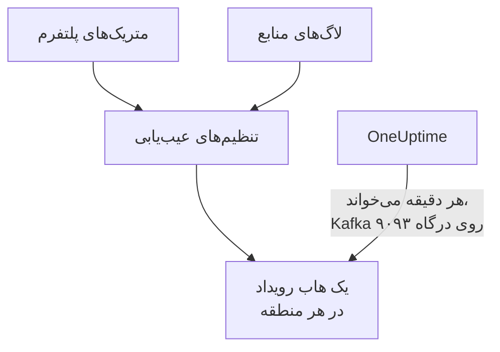

# جریان‌دادن متریک‌ها و لاگ‌های Azure Monitor

یک اشتراک Azure متصل می‌تواند متریک‌های Azure Monitor و لاگ‌های منابع خود را به OneUptime جریان دهد. تنظیم‌های عیب‌یابی آن‌ها را به هاب‌های رویداد اشتراک شما می‌فرستند و OneUptime این هاب‌ها را هر دقیقه می‌خواند: بیشتر متریک‌های کلیدی چند دقیقه پس از آنکه Azure Monitor آن‌ها را دارد می‌رسند، نه در خواندن بعدی اتصال، و لاگ‌های منابع به شکل لاگ‌های OneUptime می‌رسند و هر کدام زیر منبعی که درباره‌اش است بایگانی می‌شود. یک فرمان در Azure Cloud Shell همه چیز را راه‌اندازی می‌کند و چیزی برای اجرا باقی نمی‌ماند.

:::cards
- [چگونه کار می‌کند](#چگونه-کار-میکند): تنظیم‌های عیب‌یابی به یک هاب رویداد در هر منطقه می‌فرستند و OneUptime آن‌ها را می‌خواند.
- [راه‌اندازی جریان‌دادن](#راهاندازی-جریاندادن): انتخاب کنید چه چیزی جریان داده شود، خواندن را روشن کنید و یک فرمان اجرا کنید.
- [چه چیزی می‌رسد](#چه-چیزی-میرسد): متریک‌ها روی منابعی که اندازه می‌گیرند، و لاگ‌ها روی منابعی که از آن‌ها می‌آیند.
- [فرمان چه چیزهایی می‌سازد](#فرمان-چه-چیزهایی-میسازد): هر منبع و هر مجوزی که فرمان در اشتراک شما می‌سازد.
- [توقف جریان‌دادن](#توقف-جریاندادن): خواندن را متوقف کنید، سپس آنچه فرمان ساخته را حذف کنید.
:::

## چگونه کار می‌کند



- **یک هاب رویداد در هر منطقه.** یک تنظیم عیب‌یابی فقط به هاب رویدادی در منطقهٔ خود منبعش می‌فرستد، پس فرمان در هر منطقه‌ای که منابع شما در آن هستند یک فضای نام Event Hubs می‌سازد، همه در یک گروه منابع، و تنظیم عیب‌یابی هر منبع را به هاب رویداد منطقهٔ آن می‌برد.
- **OneUptime آن‌ها را می‌خواند.** Azure Monitor فقط به یک هاب رویداد، یک حساب ذخیره‌سازی یا یک فضای کاری Log Analytics می‌فرستد، هرگز به نشانی‌ای از شما: هاب رویدادی که OneUptime می‌خواند راهی است که لازم نیست چیزی را اجرا کنید. OneUptime با برنامهٔ خود اتصال وارد می‌شود که فقط اجازهٔ خواندن همین هاب‌های رویداد را دارد و نه چیز دیگری.
- **خواندن‌ها متریک‌های جریان‌یافته را به جریان می‌سپارند.** تا وقتی جریان متریک‌های کلیدی یک نوع منبع را در یک منطقه تحویل می‌دهد، خواندن‌های اتصال دیگر آن‌هایی را که جریان می‌برد نمی‌نویسند، تا هیچ نقطهٔ داده‌ای دو بار شمرده نشود، و [آن‌هایی را که جریان نمی‌تواند ببرد](#چه-چیزی-میرسد) همچنان می‌نویسند. خواندن‌ها همچنان منابع، وضعیت آن‌ها و تغییراتشان را پیدا می‌کنند و پس از ۱۵ دقیقه بدون رویداد، متریک‌ها را دوباره به دست می‌گیرند.
- **تا وقتی OneUptime نتواند بخواند، چیزی از دست نمی‌رود.** رویدادها تا هر زمان که هاب‌های رویداد نگهشان دارند، در آن‌ها منتظر می‌مانند تا OneUptime بخواندشان، و OneUptime به یاد دارد هر پارتیشن را تا کجا خوانده تا از همان جایی که ایستاده ادامه دهد.

## پیش از شروع

- **یک اشتراک Azure متصل.** نخست آن را در **ابر** > **اتصال** متصل کنید: [اتصال یک حساب ابری](/docs/telemetry/cloud-accounts) را ببینید.
- **مالک یا مدیر پروژه.** فقط آن‌ها می‌توانند خواندن را روشن کنند و جریان‌دادن را متوقف کنند.
- **Azure Cloud Shell**، وارد شده با نقش **Owner** اشتراک‌ها، یا به‌عنوان **Contributor**ی که **User Access Administrator** هم باشد: فرمان یک گروه منابع و یک انتساب نقش می‌سازد و تنظیم‌های عیب‌یابی را تغییر می‌دهد.
- **راهی به Azure، در OneUptime خودمیزبان.** OneUptime هر فضای نام را در `<namespace>.servicebus.windows.net` روی درگاه ۹۰۹۳ می‌خواند و فضاهای نام اتصال از اینترنت را می‌پذیرند.

## راه‌اندازی جریان‌دادن

:::steps
### پنجرهٔ جریان‌دادن را باز کنید

به **ابر** > **اتصال** بروید و در ردیف اشتراک Azure، **جریان‌دادن متریک‌ها و لاگ‌ها** را انتخاب کنید.

### انتخاب کنید چه چیزی جریان داده شود

**متریک‌ها** متریک‌های کلیدی هر منبع را دقیقه به دقیقه جریان می‌دهد، یعنی متریک‌هایی که OneUptime نمودار هر منبع را با آن‌ها می‌کشد و آن را می‌سنجد، جز [آن‌هایی که یک تنظیم عیب‌یابی نمی‌تواند بفرستد](#چه-چیزی-میرسد) و اتصال همچنان آن‌ها را می‌خواند. **متریک‌ها و لاگ‌ها** لاگ‌های خود هر منبع، یعنی هر دسته‌ای که Azure برای آن نگه می‌دارد، را می‌افزاید و **لاگ‌ها** فقط لاگ‌های منابع را جریان می‌دهد.

### خواندن را روشن کنید

**روشن کردن خواندن** را انتخاب کنید. OneUptime هر دقیقه دنبال هاب‌های رویداد می‌گردد و تا وقتی فرمان آن‌ها را بسازد منتظرشان می‌ماند.

### فرمان را در Azure Cloud Shell اجرا کنید

فرمان را کپی کنید، در Azure Cloud Shell اجرا کنید و منتظر بمانید تا تمام شود. فرمان هر منطقه‌ای را که در آن هاب رویداد ساخته، تعداد منابعی را که به آن‌ها می‌فرستند و منابعی را که کنار گذاشته، همراه با دلیل Azure، می‌گوید.

### منتظر نخستین رویدادها بمانید

پنجره هر چند ثانیه می‌پرسد چه چیزی رسیده است. Azure چند دقیقه پس از پایان فرمان شروع به فرستادن می‌کند؛ آنگاه پنجره می‌گوید چه چیزی از کجا آمده و ردیف اتصال **در حال جریان** را نشان می‌دهد.
:::

**فیلدهای بیشتر** بقیه را در خود دارد:

| فیلد | چه می‌کند |
| --- | --- |
| **اشتراک‌ها** | اشتراک‌هایی که از آن‌ها جریان داده می‌شود: در آغاز، همان‌هایی که اتصال می‌خواند. نخستین، هاب‌های رویداد را در خود دارد و OneUptime آن‌ها را همان‌جا می‌خواند. حداکثر ۵۰ |
| **راه‌اندازی به روشی دیگر** | نام‌هایی که فرمان به کار می‌برد، برای راه‌اندازی با Terraform یا پورتال |

وقتی اتصال هنوز هیچ اشتراکی را نخوانده است، یا بیش از ۵۰ اشتراک را می‌خواند، پنجره به‌جای آن، پیش از گام‌هایش **اشتراک‌ها** را می‌پرسد.

وقتی نخستین اشتراک همان اشتراکی نیست که OneUptime هاب‌های رویداد را در آن می‌خواند، پنجره این را می‌گوید: پیش از اجرای فرمان، **خواندن در آنجا** را انتخاب کنید.

## چه چیزی می‌رسد

| چه چیزی | کجا می‌رسد |
| --- | --- |
| متریک‌های کلیدی | روی منابع ابری‌ای که اندازه می‌گیرند، در همان سری‌هایی که خواندن‌های اتصال می‌نویسند |
| لاگ‌های منابع | در کاوشگر لاگ، زیر سرویس تله‌متری اتصال، با اشتراک، منطقه و دسته به‌عنوان ویژگی |
| لاگ‌های منبعی که OneUptime می‌شناسد | روی همان منبع هم: صفحهٔ آن در ابر یک زبانهٔ **لاگ‌ها** می‌گیرد |

جریان متریک‌های کلیدی‌ای را می‌برد که اتصال دقیقه به دقیقه می‌خواند. خواندن‌ها بقیه را طبق برنامهٔ خود همچنان می‌نویسند: متریکی که با فاصلهٔ درشت‌تری می‌خوانند، مانند فضای ذخیره‌سازی مصرف‌شدهٔ یک رجیستری کانتینر، و هر متریک کلیدی‌ای که یک تنظیم عیب‌یابی نمی‌تواند بفرستد، که فهرست متریک‌های پشتیبانی‌شدهٔ Azure Monitor آن را در ستون DS Export صادرنشدنی علامت می‌زند:

- ماشین‌های مجازی و مجموعه‌های مقیاس: `Network In Total`، `Network Out Total`.
- دیسک‌ها: `Composite Disk Read Bytes/sec`، `Composite Disk Write Bytes/sec`، `Composite Disk Read Operations/sec`، `Composite Disk Write Operations/sec`.
- حساب‌های Azure Cosmos DB: `TotalRequests`، `TotalRequestUnits`، `NormalizedRUConsumption`، `ServerSideLatency`.
- حساب‌های ذخیره‌سازی: `UsedCapacity`.
- خوشه‌های AKS: `kube_pod_status_ready`.
- دروازه‌های برنامه: `ApplicationGatewayTotalTime`، `Throughput`.
- دیوارهای آتش: `Throughput`.
- دروازه‌های NAT: `ByteCount`، `SNATConnectionCount`، `DatapathAvailability`.

یک فضای نام Service Bus یا Event Hubs هیچ متریکی را جریان نمی‌دهد. خواندن‌ها متریک‌های کلیدی آن را برای هر صف، تاپیک و هاب رویداد می‌خوانند و مجموع‌های خود فضای نام آن‌ها را با هم جمع می‌زنند، در حالی که یک تنظیم عیب‌یابی فقط مجموع‌های فضای نام را می‌فرستد و ۴ تا از ۶ متریک کلیدی یک فضای نام Service Bus، یا ۲ تا از ۴ متریک یک فضای نام Event Hubs را اصلاً نمی‌فرستد. پس خواندن‌ها همهٔ آن‌ها را می‌نویسند، چه جریان باشد چه نباشد، و هیچ پیامی دو بار شمرده نمی‌شود.

یک لاگ با شناسهٔ ARM منبع زیر همان منبع بایگانی می‌شود، که به‌صورت `cloud.resource_id` همراهش است، و دسته، عملیات، نتیجه و ویژگی‌هایش را به‌عنوان ویژگی نگه می‌دارد، مانند `azure.category`.

ماشین‌های مجازی، مجموعه‌های مقیاس، دیسک‌ها، رابط‌های شبکه، شبکه‌های مجازی، نقاط پایانی خصوصی، دروازه‌های NAT، ناحیه‌های DNS و طرح‌های App Service لاگ منبع خودشان را نمی‌فرستند، پس صفحه‌هایشان زبانهٔ **لاگ‌ها** ندارد. لاگ‌های یک حساب ذخیره‌سازی لاگ‌های سرویس‌های آن است و لاگ‌های یک برنامهٔ کانتینری لاگ‌های محیط آن.

## فرمان چه چیزهایی می‌سازد

نام گروه منابع `oneuptime-stream-` و پس از آن ۸ نویسهٔ نخست شناسهٔ اتصال است. این گروه به OneUptime هیچ دسترسی‌ای به منابع شما نمی‌دهد: برنامهٔ اتصال می‌تواند هاب‌های رویداد را بخواند و نه بیشتر.

| منبع | چه کاری مجاز است |
| --- | --- |
| یک گروه منابع، `oneuptime-stream-<suffix>`، در نخستین اشتراک | هاب‌های رویداد را در خود دارد و شناسهٔ اتصال به‌صورت `oneuptime-connection` برچسبش است |
| یک فضای نام Event Hubs در هر منطقه، `oneuptime-<suffix>-<region>`، در سطح Standard با ۱ واحد توان عملیاتی | آنچه تنظیم‌های عیب‌یابی منطقه‌اش می‌فرستند را می‌پذیرد |
| یک هاب رویداد در هر کدام، `oneuptime`، با ۲ پارتیشن | رویدادها را تا وقتی OneUptime بخواندشان نگه می‌دارد |
| نقش **Azure Event Hubs Data Receiver** برای برنامهٔ اتصال، فقط روی گروه منابع | به برنامه اجازه می‌دهد هاب‌های رویداد را بخواند، و نه چیز دیگری |
| یک تنظیم عیب‌یابی روی هر منبع، `OneUptime-<suffix>` | متریک‌ها، لاگ‌ها یا هر دوی منبع را به هاب رویداد منطقه‌اش می‌فرستد |

منبعی در یک منطقهٔ سراسری، مانند Front Door، به هاب رویداد نخستین منطقه می‌فرستد. منبعی که Azure فقط متریک یا فقط لاگ آن را نگه می‌دارد با همان چیزی که دارد راه‌اندازی می‌شود، و منبعی که از قبل ۵ تنظیم عیب‌یابی دارد، یعنی بیشترین تعدادی که Azure اجازه می‌دهد، کنار گذاشته می‌شود. Azure هزینهٔ واحد توان عملیاتی هر فضای نام را ساعتی دریافت می‌کند، و هزینهٔ رویدادهایی که تنظیم‌های عیب‌یابی می‌فرستند.

## توقف جریان‌دادن

:::steps
### خواندن را متوقف کنید

در ردیف اشتراک در **ابر** > **اتصال**، **توقف جریان‌دادن** را انتخاب کنید. OneUptime بی‌درنگ خواندن هاب‌های رویداد را متوقف می‌کند و اتصال دوباره همهٔ متریک‌هایش را طبق زمان‌بندی‌اش می‌خواند. آنچه خوانده شده باقی می‌ماند.

### آنچه فرمان ساخته را حذف کنید

هاب‌های رویداد و تنظیم‌های عیب‌یابی تا وقتی حذف نشوند در Azure می‌مانند و Azure هزینه‌شان را دریافت می‌کند. پنجره فرمان را نشان می‌دهد: تنظیم عیب‌یابی هر منبع و سپس گروه منابع را، در هر اشتراکی که باشد، حذف می‌کند.

```bash
oneuptime_stream_stop() {
  local SUB ID N=0
  for SUB in '11111111-aaaa-4aaa-8aaa-111111111111' '22222222-bbbb-4bbb-8bbb-222222222222'; do
    while IFS= read -r ID; do
      if [ -z "$ID" ]; then continue; fi
      az monitor diagnostic-settings delete --name OneUptime-6f1c3a2e --resource "$ID" --output none 2> /dev/null &
      N=$((N + 1))
      if [ $((N % 4)) -eq 0 ]; then wait; fi
    done < <(az resource list --subscription "$SUB" --query "[].id" --output tsv)
  done
  wait
  for SUB in '11111111-aaaa-4aaa-8aaa-111111111111' '22222222-bbbb-4bbb-8bbb-222222222222'; do
    if [ "$(az group exists --subscription "$SUB" --name oneuptime-stream-6f1c3a2e 2> /dev/null)" = true ]; then
      az group delete --subscription "$SUB" --name oneuptime-stream-6f1c3a2e --yes --no-wait && echo "Deleting oneuptime-stream-6f1c3a2e in $SUB."
    fi
  done
}
oneuptime_stream_stop
```
:::

برای تغییر آنچه جریان داده می‌شود، **جریان‌دادن متریک‌ها و لاگ‌ها** را دوباره باز کنید، انتخاب کنید چه چیزی جریان داده شود و فرمان تازه را اجرا کنید: آنچه اجرای نخست ساخته را به‌روز می‌کند و هیچ چیز را دو بار نمی‌سازد.

## راه‌اندازی به روشی دیگر

با Terraform یا پورتال، آنچه فرمان می‌سازد را با این نام‌ها بسازید:

| تنظیم | مقدار |
| --- | --- |
| گروه منابع | `oneuptime-stream-<suffix>`، در اشتراکی که OneUptime هاب‌های رویداد را در آن می‌خواند |
| فضای نام Event Hubs | `oneuptime-<suffix>-<region>`، یکی در هر منطقه‌ای که منبعی برای جریان‌دادن دارد |
| هاب رویداد | `oneuptime`، در هر فضای نام |
| تنظیم عیب‌یابی | `OneUptime-<suffix>` روی هر منبع، به هاب رویداد منطقه‌اش، با قاعدهٔ `RootManageSharedAccessKey` فضای نام |
| نقش | **Azure Event Hubs Data Receiver** برای برنامهٔ اتصال، روی گروه منابع |

سپس خواندن را روشن کنید، با آن اشتراک به‌عنوان نخستین مورد در **اشتراک‌ها**.

## عیب‌یابی

:::details پنجره همچنان منتظر نخستین رویدادهاست
بررسی کنید که فرمان تمام شده و گفته که هاب رویداد یک منطقه آماده است: `az eventhubs namespace list --resource-group oneuptime-stream-6f1c3a2e` فضاهای نام را فهرست می‌کند. یک تنظیم عیب‌یابی فقط آنچه Azure Monitor دارد را می‌فرستد، پس منبعی که کاری نمی‌کند کم می‌فرستد. اجرایی شدن نقش تازه ممکن است چند دقیقه طول بکشد: تا آن زمان خواندن‌ها رویدادها را نمی‌بینند.
:::

:::details اتصال جریان ناموفق را نشان می‌دهد
پنجره و راهنمای ابزار ردیف دلیل را می‌گویند. اگر برنامه اجازهٔ خواندن هاب‌های رویداد را ندارد، فرمان را دوباره اجرا کنید: نقش برنامه را دوباره به آن می‌دهد. اگر OneUptime نتوانست به آن‌ها برسد، بررسی کنید که فضاهای نام اتصال از اینترنت را بپذیرند و OneUptime خودمیزبان بتواند به درگاه ۹۰۹۳ برسد.
:::

:::details فرمان منابعی را کنار گذاشت
آن‌ها را، هر کدام با دلیل Azure، فهرست می‌کند. منبعی از نوعی که تنظیم عیب‌یابی ندارد چیزی نمی‌فرستد، و در منبعی که از قبل ۵ تنظیم عیب‌یابی دارد، نخست باید یکی از آن‌ها حذف شود. سپس فرمان را دوباره اجرا کنید.
:::

## گام‌های بعدی

:::cards
- [اتصال یک حساب ابری](/docs/telemetry/cloud-accounts): یک اتصال چه چیزی را می‌خواند و هر چند وقت یک‌بار.
- [جریان‌دادن لاگ‌های Google Cloud](/docs/telemetry/cloud-streaming-google-cloud): لاگ‌های یک پروژهٔ Google Cloud، ارسال‌شده از راه Pub/Sub.
- [جریان‌دادن متریک‌ها و لاگ‌های CloudWatch](/docs/telemetry/cloud-streaming): متریک‌ها و لاگ‌های یک حساب AWS، که Amazon Data Firehose تحویلشان می‌دهد.
- [کاوشگر لاگ](/docs/telemetry/logs-explorer): آنچه جریان‌ها تحویل داده‌اند را جست‌وجو و فیلتر کنید.
:::
