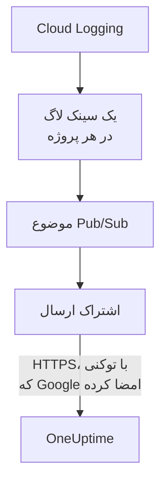

# جریان‌دادن لاگ‌های Google Cloud

یک پروژهٔ Google Cloud متصل می‌تواند لاگ‌هایش را همان لحظه که نوشته می‌شوند به OneUptime جریان دهد. Cloud Logging آن‌ها را از راه یک سینک لاگ به یک موضوع Pub/Sub می‌فرستد و اشتراک ارسال موضوع هر مدخل را ظرف یک دقیقه به OneUptime تحویل می‌دهد، به شکل لاگی از OneUptime که زیر منبعی که درباره‌اش است بایگانی می‌شود. یک فرمان در Google Cloud Shell همه چیز را راه‌اندازی می‌کند و چیزی برای اجرا باقی نمی‌ماند. Cloud Monitoring هیچ برون‌بری‌ای ندارد که متریک‌ها را ارسال کند، پس اتصال همچنان متریک‌ها را طبق زمان‌بندی‌اش می‌خواند.

:::cards
- [چگونه کار می‌کند](#چگونه-کار-میکند): یک سینک لاگ در هر پروژه، یک موضوع و اشتراک ارسال آن.
- [راه‌اندازی جریان‌دادن](#راهاندازی-جریاندادن): لاگ‌ها را انتخاب کنید، یک کلید جریان بسازید و یک فرمان اجرا کنید.
- [چه چیزی می‌رسد](#چه-چیزی-میرسد): لاگ‌ها روی منابعی که از آن‌ها می‌آیند.
- [فرمان چه چیزهایی می‌سازد](#فرمان-چه-چیزهایی-میسازد): هر منبع و هر مجوزی که فرمان در پروژه‌های شما می‌سازد.
- [توقف جریان‌دادن](#توقف-جریاندادن): کلیدها را خاموش کنید، سپس آنچه فرمان ساخته را حذف کنید.
:::

## چگونه کار می‌کند



- **یک سینک لاگ در هر پروژه.** سینک هر پروژه مدخل‌هایی را که با فیلترش جور می‌شوند به یک موضوع Pub/Sub می‌فرستد که در پروژهٔ حساب سرویس خود اتصال است.
- **دو بررسی در هر ارسال.** Pub/Sub یک توکن OpenID Connect برای حساب سرویسی امضا می‌کند که فقط برای ارسال‌ها ساخته شده، و مخاطب (audience) توکن کلید جریان اتصال است. OneUptime یک ارسال را فقط وقتی می‌پذیرد که Google توکن آن را برای همان حساب سرویس امضا کرده باشد و کلید یکی از کلیدهای اتصال باشد. کلید اتصال، و در نتیجه پروژه، را نام می‌برد: هیچ چیز در یک ارسال تعیین نمی‌کند کجا نوشته شود. OneUptime فقط SHA-256 کلید را نگه می‌دارد.
- **تا وقتی OneUptime نتواند بپذیرد، چیزی از دست نمی‌رود.** Pub/Sub مدخل ردشده را دوباره ارسال می‌کند، میان تلاش‌ها از ۱۰ ثانیه تا ۱۰ دقیقه صبر می‌کند و آن را یک روز نگه می‌دارد.

## پیش از شروع

- **یک پروژهٔ Google Cloud متصل.** نخست آن را در **ابر** > **اتصال** متصل کنید: [اتصال یک حساب ابری](/docs/telemetry/cloud-accounts) را ببینید.
- **مالک یا مدیر پروژه.** فقط آن‌ها می‌توانند کلید جریان بسازند و جریان‌دادن را متوقف کنند.
- **Google Cloud Shell**، وارد شده با نقش **Owner** پروژه‌ها، یا با کاربری که بتواند در آن‌ها حساب سرویس، موضوع Pub/Sub و سینک لاگ بسازد.
- **یک نشانی HTTPS، در OneUptime خودمیزبان.** Pub/Sub فقط به نشانی‌های `https://` ارسال می‌کند، با گواهی‌ای که Google به آن اعتماد دارد، و نشانی باید از Google Cloud در دسترس باشد.

## راه‌اندازی جریان‌دادن

:::steps
### پنجرهٔ جریان‌دادن را باز کنید

به **ابر** > **اتصال** بروید و در ردیف پروژهٔ Google Cloud، **جریان‌دادن لاگ‌ها** را انتخاب کنید.

### انتخاب کنید کدام لاگ‌ها

**هشدارها و خطاها** هر مدخل با شدت `WARNING` یا بالاتر را جریان می‌دهد: آنچه خراب شد، نه هر درخواست. **همه لاگ‌ها** هر مدخلی جز لاگ‌های حسابرسی Data Access را جریان می‌دهد، که هر خواندن را ثبت می‌کنند و می‌توانند از هر چیز دیگری که پروژه می‌نویسد بیشتر شوند. **فیلتری از خودتان** مدخل‌هایی را جریان می‌دهد که با یک پرس‌وجوی Cloud Logging جور می‌شوند، که در فیلد **فیلتر** نوشته می‌شود.

### یک کلید جریان بسازید

**ساخت کلید جریان** را انتخاب کنید. کلید فقط همین یک بار، در فرمان، نمایش داده می‌شود: OneUptime فقط SHA-256 آن را نگه می‌دارد.

### فرمان را در Google Cloud Shell اجرا کنید

فرمان را کپی کنید، در Google Cloud Shell اجرا کنید و منتظر بمانید تا تمام شود. فرمان هر پروژه‌ای را که در آن سینک راه‌اندازی کرده می‌گوید، و در نخستین گامی که Google رد کند، همراه با دلیل Google، می‌ایستد.

### منتظر نخستین ارسال بمانید

پنجره هر چند ثانیه می‌پرسد چه چیزی رسیده است. وقتی پروژه‌ای مدخلی بنویسد که فیلتر می‌پذیرد، Pub/Sub ظرف یک دقیقه آن را ارسال می‌کند؛ آنگاه پنجره می‌گوید چه چیزی از کجا آمده و ردیف اتصال **در حال جریان** را نشان می‌دهد.
:::

**فیلدهای بیشتر** بقیه را در خود دارد:

| فیلد | چه می‌کند |
| --- | --- |
| **پروژه‌ها** | پروژه‌هایی که لاگ‌هایشان جریان داده می‌شود: در آغاز، همان‌هایی که اتصال می‌خواند. موضوع در پروژهٔ حساب سرویس اتصال ساخته می‌شود. حداکثر ۱۰۰ |
| **راه‌اندازی به روشی دیگر** | نقطهٔ پایانی ارسال، حساب سرویس ارسال و کلید، برای راه‌اندازی با Terraform یا کنسول |

## چه چیزی می‌رسد

| چه چیزی | کجا می‌رسد |
| --- | --- |
| لاگ‌ها | در کاوشگر لاگ، زیر سرویس تله‌متری اتصال، با پروژه، منطقه و نام لاگ به‌عنوان ویژگی |
| لاگ‌های منبعی که OneUptime می‌شناسد | روی همان منبع هم: صفحهٔ آن در ابر یک زبانهٔ **لاگ‌ها** می‌گیرد |

هر لاگ زمان مدخلش را تا نانوثانیه، شدتش، trace و span خود و درخواست HTTP خود را با نام‌های قراردادهای معنایی OpenTelemetry نگه می‌دارد. وقتی منبع پایش‌شدهٔ آن از نوعی باشد که OneUptime متریک‌هایش را می‌خواند، مانند یک VM (`gce_instance`)، یک سرویس Cloud Run (`cloud_run_revision`) یا یک نمونهٔ Cloud SQL (`cloudsql_database`)، لاگ زیر آن منبع بایگانی می‌شود و شناسهٔ منبع را به‌صورت `cloud.resource_id` همراه دارد. لاگ‌های درخواست یک متعادل‌کننده بار بیرونی زیر `http_load_balancer` نوشته می‌شوند، اما زیر نگاشت URL آن، یعنی همان `https_lb_rule` که متریک‌هایش به آن می‌رسند، بایگانی می‌شوند.

لاگ‌های یک گروه نمونه لاگ‌های VMهای آن است، پس صفحه‌اش زبانهٔ **لاگ‌ها** ندارد. مدخلی از نوعی دیگر هم با این حال، زیر پروژه‌اش، جریان داده می‌شود.

## فرمان چه چیزهایی می‌سازد

نام منابعی که می‌سازد از ۸ نویسهٔ نخست شناسهٔ اتصال گرفته می‌شود. فرمان به OneUptime هیچ دسترسی‌ای به پروژه‌های شما نمی‌دهد: مدخل‌ها فقط بیرون می‌روند.

| منبع | چه کاری مجاز است |
| --- | --- |
| یک حساب سرویس، `oneuptime-push-<suffix>`، در پروژهٔ حساب سرویس اتصال | هیچ نقشی ندارد: Pub/Sub توکن‌های ارسال‌هایش را برای آن امضا می‌کند |
| نقش **Service Account OpenID Connect Identity Token Creator** برای عامل سرویس Pub/Sub، فقط روی همان حساب سرویس | به Pub/Sub اجازه می‌دهد همان توکن‌ها را بسازد، و نه چیز دیگری |
| یک موضوع Pub/Sub، `oneuptime-stream-<suffix>` | مدخل‌هایی را که سینک‌ها می‌فرستند در خود دارد |
| اشتراک ارسال آن، `oneuptime-stream-<suffix>-push` | هر مدخل را با مهلت تأیید ۶۰ ثانیه به OneUptime ارسال می‌کند و آنچه را نتوانست ارسال کند یک روز نگه می‌دارد |
| یک سینک لاگ در هر پروژه، `oneuptime-stream-<suffix>` | مدخل‌هایی را که با فیلترش جور می‌شوند به موضوع می‌فرستد |
| نقش **Pub/Sub Publisher** برای نویسندهٔ هر سینک، فقط روی موضوع | به سینک اجازه می‌دهد در موضوع منتشر کند، و نه چیز دیگری |

اگر APIهای Pub/Sub و Cloud Logging در پروژهٔ موضوع خاموش باشند، فرمان آن‌ها را روشن می‌کند. Google هزینهٔ Pub/Sub را برای لاگ‌هایی که تحویل می‌دهد دریافت می‌کند: فقط لاگ‌هایی را که لازم دارید جریان دهید.

## توقف جریان‌دادن

:::steps
### کلیدها را خاموش کنید

در ردیف پروژه در **ابر** > **اتصال**، **توقف جریان‌دادن** را انتخاب کنید. همهٔ کلیدهای جریان اتصال بی‌درنگ از کار می‌افتند و OneUptime آنچه Pub/Sub ارسال می‌کند را رد می‌کند. آنچه تحویل شده باقی می‌ماند.

### آنچه فرمان ساخته را حذف کنید

سینک‌ها، موضوع و اشتراک ارسال آن تا وقتی حذف نشوند در Google Cloud می‌مانند و Pub/Sub به ارسال ادامه می‌دهد. پنجره فرمان را برای پروژه‌هایی که اتصال می‌خواند نشان می‌دهد:

```bash
for SOURCE in 'acme-prod' 'acme-data'; do
  gcloud logging sinks delete oneuptime-stream-6f1c3a2e --project "$SOURCE" --quiet
done
gcloud pubsub subscriptions delete oneuptime-stream-6f1c3a2e-push --project 'acme-prod' --quiet
gcloud pubsub topics delete oneuptime-stream-6f1c3a2e --project 'acme-prod' --quiet
gcloud iam service-accounts delete 'oneuptime-push-6f1c3a2e@acme-prod.iam.gserviceaccount.com' --project 'acme-prod' --quiet
```
:::

برای تغییر لاگ‌هایی که جریان داده می‌شوند، **جریان‌دادن لاگ‌ها** را دوباره باز کنید، **ساخت کلید جدید** را انتخاب کنید و فرمان تازه را اجرا کنید. کلیدی که جایگزین می‌شود ۲۴ ساعت دیگر کار می‌کند، تا هنگام به‌روزرسانی اشتراک هیچ ارسالی رد نشود. حداکثر ۳ کلید جایگزین‌شده هم‌زمان کار می‌کنند.

## راه‌اندازی به روشی دیگر

به یک موضوع Pub/Sub یک اشتراک ارسال با این مقادیر بدهید و بگذارید عامل سرویس Pub/Sub برای حساب سرویس ارسال توکن بسازد:

| تنظیم | مقدار |
| --- | --- |
| نقطهٔ پایانی ارسال | `https://oneuptime.com/telemetry/gcp-pubsub/v1/logs` |
| احراز هویت | یک توکن OpenID Connect برای `oneuptime-push-<suffix>@<project>.iam.gserviceaccount.com` |
| مخاطب (audience) | کلید جریان |
| محموله | بسته‌بندی‌شده، همان‌طور که Pub/Sub اگر چیز دیگری گفته نشود می‌فرستد |
| مهلت تأیید | ۶۰ ثانیه |
| نگهداری پیام | ۱ روز |

سپس لاگ‌های هر پروژه را با یک سینک لاگ به موضوع هدایت کنید و به نویسندهٔ هر سینک **Pub/Sub Publisher** را روی موضوع بدهید. در OneUptime خودمیزبان، `https://oneuptime.com` را با نشانی HTTPS خود OneUptime جایگزین کنید.

OneUptime به هر ارسال همان‌طور که Pub/Sub انتظار دارد پاسخ می‌دهد:

| پاسخ | چه وقت | Pub/Sub چه می‌کند |
| --- | --- | --- |
| `204` | مدخل پذیرفته شد، یا پیش‌تر پذیرفته شده بود، یا پیام مدخل لاگ نیست | ادامه می‌دهد |
| `400` | یک ارسال Pub/Sub نیست که OneUptime بتواند بخواند | دوباره ارسال می‌کند، هر بار با صبر بیشتر، تا یک روز |
| `401` | توکن را Google برای حساب سرویس ارسال امضا نکرده، یا مخاطبش کلیدی از اتصال نیست | دوباره ارسال می‌کند، هر بار با صبر بیشتر، تا یک روز |
| `402` | برای تله‌متری پروژه نمی‌توان صورت‌حساب صادر کرد | دوباره ارسال می‌کند، هر بار با صبر بیشتر، تا یک روز |
| `403` | اتصال خاموش است، یا پروژه نمی‌تواند تله‌متری بپذیرد | دوباره ارسال می‌کند، هر بار با صبر بیشتر، تا یک روز |
| `413` | درخواست بزرگ‌تر از ۱ MiB است، یا مدخلش بزرگ‌تر از ۵۱۲ KiB | دوباره ارسال می‌کند، هر بار با صبر بیشتر، تا یک روز |
| `429` | اشتراک اتصال در یک دقیقه بیش از ۱۲٬۰۰۰ مدخل ارسال کرد | دوباره ارسال می‌کند، هر بار با صبر بیشتر، تا یک روز |
| `503` | OneUptime در آن لحظه نتوانست توکن را بررسی کند یا مدخل را در صف بگذارد | دوباره ارسال می‌کند، هر بار با صبر بیشتر، تا یک روز |

## عیب‌یابی

:::details پنجره همچنان منتظر نخستین ارسال است
بررسی کنید که فرمان بی‌آنکه بایستد تمام شده، و پروژه‌ای مدخلی نوشته که فیلتر می‌پذیرد: با **هشدارها و خطاها**، پروژهٔ آرام چیزی نمی‌فرستد. `gcloud pubsub subscriptions describe oneuptime-stream-6f1c3a2e-push --project acme-prod` نقطهٔ پایانی اشتراک را نشان می‌دهد. در OneUptime خودمیزبان، بررسی کنید که Google Cloud از راه HTTPS به نشانی آن برسد.
:::

:::details اتصال جریان ردشده را نشان می‌دهد
پنجره و راهنمای ابزار ردیف دلیل را می‌گویند. کلید نادرست یعنی اشتراک با کلیدی ارسال می‌کند که دیگر کار نمی‌کند: کلیدی تازه بسازید و فرمان را دوباره اجرا کنید. ارسالی که برای حساب سرویس ارسال امضا نشده یعنی اشتراک به نام حساب دیگری امضا می‌کند، یا Pub/Sub اجازهٔ امضا برای آن را ندارد: فرمان را دوباره اجرا کنید.
:::

:::details لاگ‌های یک منبع در صفحهٔ آن نمایش داده نمی‌شوند
صفحه لاگ‌هایی را نشان می‌دهد که Cloud Logging زیر منبع پایش‌شدهٔ آن منبع، با برچسب‌هایی که متریک‌هایش دارند، بایگانی می‌کند. لاگ‌هایی که یک بار کاری زیر منبع دیگری می‌نویسد، مانند لاگ‌های یک کانتینر، فقط زیر پروژه‌شان جریان داده می‌شوند.
:::

## گام‌های بعدی

:::cards
- [اتصال یک حساب ابری](/docs/telemetry/cloud-accounts): یک اتصال چه چیزی را می‌خواند و هر چند وقت یک‌بار.
- [جریان‌دادن متریک‌ها و لاگ‌های Azure Monitor](/docs/telemetry/cloud-streaming-azure): متریک‌ها و لاگ‌های یک اشتراک Azure، خوانده‌شده از هاب‌های رویداد.
- [جریان‌دادن متریک‌ها و لاگ‌های CloudWatch](/docs/telemetry/cloud-streaming): متریک‌ها و لاگ‌های یک حساب AWS، که Amazon Data Firehose تحویلشان می‌دهد.
- [کاوشگر لاگ](/docs/telemetry/logs-explorer): آنچه جریان‌ها تحویل داده‌اند را جست‌وجو و فیلتر کنید.
:::
