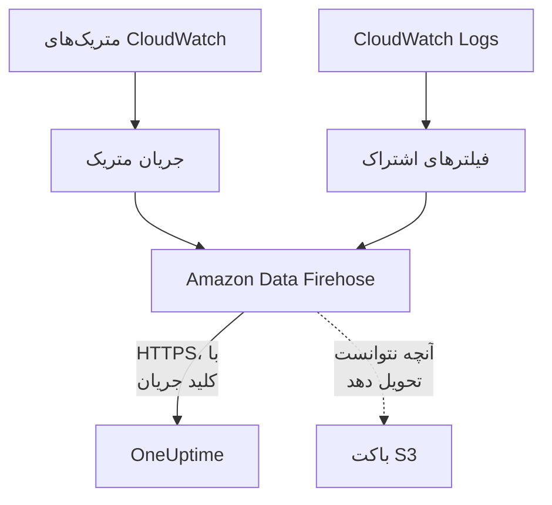

# جریان‌دادن متریک‌ها و لاگ‌های CloudWatch

یک حساب AWS متصل می‌تواند متریک‌ها و لاگ‌های CloudWatch خود را از طریق Amazon Data Firehose به OneUptime جریان دهد. آنگاه متریک‌ها چند دقیقه پس از آنکه CloudWatch آن‌ها را دارد می‌رسند، نه در خواندن بعدی اتصال، و CloudWatch Logs به شکل لاگ‌های OneUptime می‌رسد و هر کدام زیر منبعی که درباره‌اش است بایگانی می‌شود. یک فرمان در AWS CloudShell همه چیز را راه‌اندازی می‌کند و چیزی برای اجرا باقی نمی‌ماند.

:::cards
- [چگونه کار می‌کند](#چگونه-کار-میکند): یک جریان متریک و اشتراک‌های لاگ در هر منطقه، که Firehose تحویلشان می‌دهد.
- [راه‌اندازی جریان‌دادن](#راهاندازی-جریاندادن): انتخاب کنید چه چیزی جریان داده شود، یک کلید جریان بسازید و یک فرمان اجرا کنید.
- [چه چیزی می‌رسد](#چه-چیزی-میرسد): متریک‌ها روی منابعی که اندازه می‌گیرند، و لاگ‌ها روی منابعی که از آن‌ها می‌آیند.
- [پشته چه چیزهایی می‌سازد](#پشته-چه-چیزهایی-میسازد): هر منبع و هر مجوزی که فرمان در حساب شما می‌سازد.
- [توقف جریان‌دادن](#توقف-جریاندادن): کلیدها را خاموش کنید، سپس پشته‌ها را حذف کنید.
:::

## چگونه کار می‌کند



- **یک پشته در هر منطقه.** فرمان در هر منطقه‌ای که از آن جریان می‌دهید یک پشتهٔ CloudFormation مستقر می‌کند. جریان متریک و فیلترهای اشتراک لاگ آن همه چیز را به دو جریان Firehose می‌سپارند و Firehose آن را روی HTTPS به OneUptime تحویل می‌دهد.
- **کلید جریان می‌گوید مال کیست.** Firehose کلید جریان اتصال را با هر تحویل می‌فرستد. کلید اتصال، و در نتیجه پروژه، را نام می‌برد: هیچ چیز در یک تحویل تعیین نمی‌کند کجا نوشته شود. OneUptime فقط SHA-256 کلید را نگه می‌دارد.
- **خواندن‌ها متریک‌های جریان‌یافته را به جریان می‌سپارند.** تا وقتی جریانی یک فضای نام از یک منطقه را تحویل می‌دهد، خواندن‌های اتصال دیگر متریک‌های آن فضای نام را نمی‌نویسند، تا هیچ نقطهٔ داده‌ای دو بار شمرده نشود. خواندن‌ها همچنان منابع، وضعیت آن‌ها و تغییراتشان را پیدا می‌کنند و پس از ۱۵ دقیقه بدون تحویل، فضای نام را دوباره به دست می‌گیرند.
- **تا وقتی OneUptime نتواند بپذیرد، چیزی از دست نمی‌رود.** Firehose یک دستهٔ ردشده را تا یک ساعت دوباره می‌فرستد و سپس آن را ۳۰ روز در باکت S3 پشته نگه می‌دارد.

## پیش از شروع

- **یک حساب AWS متصل.** نخست آن را در **ابر** > **اتصال** متصل کنید: [اتصال یک حساب ابری](/docs/telemetry/cloud-accounts) را ببینید.
- **مالک یا مدیر پروژه.** فقط آن‌ها می‌توانند کلید جریان بسازند و جریان‌دادن را متوقف کنند.
- **AWS CloudShell در آن حساب**، وارد شده با کاربری که اجازهٔ ساختن پشته‌های CloudFormation و نقش‌های IAM را دارد.
- **یک نشانی HTTPS، در OneUptime خودمیزبان.** Firehose فقط به نشانی‌های `https://` روی درگاه ۴۴۳ تحویل می‌دهد، با گواهی‌ای که AWS به آن اعتماد دارد، و نشانی باید از AWS در دسترس باشد.

## راه‌اندازی جریان‌دادن

:::steps
### پنجرهٔ جریان‌دادن را باز کنید

به **ابر** > **اتصال** بروید و در ردیف حساب AWS، **جریان‌دادن متریک‌ها و لاگ‌ها** را انتخاب کنید.

### انتخاب کنید چه چیزی جریان داده شود

**متریک‌ها** هر متریک کلیدی هر منبع را دقیقه‌ای یک بار جریان می‌دهد: متریک‌هایی که OneUptime نمودار هر منبع را با آن‌ها می‌کشد و آن را می‌سنجد. **متریک‌ها و لاگ‌ها** CloudWatch Logs را می‌افزاید و **لاگ‌ها** فقط CloudWatch Logs را جریان می‌دهد.

برای لاگ‌ها، **گروه‌های لاگ** را هر خط یکی بنویسید، با نام در **منطقه** کناری یا با ARN در منطقهٔ خودشان، یا **همه گروه‌های لاگ حساب، از جمله گروه‌های جدید** را انتخاب کنید. یک فرمان حداکثر ۵۰ گروه لاگ را با نام، در حداکثر ۱۰ منطقه مشترک می‌کند.

### یک کلید جریان بسازید

**ساخت کلید جریان** را انتخاب کنید. کلید فقط همین یک بار، درون فرمان، نمایش داده می‌شود: OneUptime فقط SHA-256 آن را نگه می‌دارد.

### فرمان را در AWS CloudShell اجرا کنید

فرمان را کپی کنید، در AWS CloudShell اجرا کنید و منتظر بمانید تا تمام شود. فرمان الگو را در `oneuptime-stream.json` می‌نویسد و آن را در هر منطقه مستقر می‌کند، با کلید به‌عنوان پارامتری که دیگر هرگز نمایش داده نمی‌شود.

### منتظر نخستین تحویل بمانید

پنجره هر چند ثانیه می‌پرسد چه چیزی رسیده است. Firehose ظرف چند دقیقه پس از پایان فرمان تحویل می‌دهد؛ سپس پنجره می‌گوید چه چیزی از کجا آمد، و ردیف اتصال **در حال جریان** را نشان می‌دهد.
:::

**فیلدهای بیشتر** باقی موارد را در بر دارد:

| فیلد | چه می‌کند |
| --- | --- |
| **همه متریک‌ها، نه فقط متریک‌های کلیدی** | همه متریک‌هایی را که CloudWatch برای حساب دارد جریان می‌دهد، از جمله متریک‌های خودتان. AWS برای هر به‌روزرسانی متریکی که جریان می‌فرستد هزینه می‌گیرد، پس ممکن است چندین برابر گران‌تر باشد |
| **مناطق** | از کجا جریان داده شود: در آغاز، مناطقی که اتصال در آن‌ها منبع پیدا کرده است. اگر خالی بماند، فرمان از منطقهٔ خود AWS CloudShell جریان می‌دهد. حداکثر ۳۰ |
| **راه‌اندازی به روشی دیگر** | نقطه‌های پایانی متریک‌ها و لاگ‌ها و کلید، برای راه‌اندازی جریان‌ها با Terraform یا کنسول |

**دانلود الگو** الگویی را که فرمان مستقر می‌کند ذخیره می‌کند تا آن را به روش خودتان مستقر کنید.

## چه چیزی می‌رسد

| چه چیزی | کجا می‌رسد |
| --- | --- |
| متریک‌ها | روی منابع ابری‌ای که اندازه می‌گیرند، با همان نام‌ها و ویژگی‌هایی که خواندن‌های اتصال به آن‌ها می‌دهند |
| لاگ‌ها | در کاوشگر لاگ، زیر سرویس تله‌متری اتصال، با حساب، منطقه و گروه لاگ به‌عنوان ویژگی |
| لاگ‌های گروه لاگی که AWS آن را به نام یک منبع می‌نامد | روی همان منبع هم: صفحهٔ آن در ابر یک زبانهٔ **لاگ‌ها** می‌گیرد |

وقتی AWS گروه لاگی را به نام منبعی نام‌گذاری کرده باشد، آن گروه زیر همان منبع بایگانی می‌شود:

| گروه لاگ | نوع منبع |
| --- | --- |
| `/aws/lambda/<function>` | `AWS::Lambda::Function` |
| `/aws/rds/instance/<instance>/<log>` | `AWS::RDS::DBInstance` |
| `/aws/rds/cluster/<cluster>/<log>` | `AWS::RDS::DBCluster` |
| `/aws/docdb/<cluster>/<log>` | `AWS::DocDB::DBCluster` |
| `/aws/neptune/<cluster>/<log>` | `AWS::Neptune::DBCluster` |
| `/aws/redshift/cluster/<cluster>/<log>` | `AWS::Redshift::Cluster` |
| `/aws/OpenSearchService/domains/<domain>/<log>` | `AWS::OpenSearchService::Domain` |
| `/aws/aes/domains/<domain>/<log>` | `AWS::OpenSearchService::Domain` |
| `/aws/apprunner/<service>/<service-id>/<log>` | `AWS::AppRunner::Service` |
| `/aws/elasticbeanstalk/<environment>/<log>` | `AWS::ElasticBeanstalk::Environment` |
| `/aws/ecs/containerinsights/<cluster>/performance` | `AWS::ECS::Cluster` |

هر لاگ شناسهٔ منبع را به‌عنوان `cloud.resource_id` دارد، و لاگ‌های یک تابع Lambda همچنین `faas.name` دارند، پس روی آن تابع در Serverless هم نمایش داده می‌شوند. گروه لاگی با هر نام دیگری هم جریان داده می‌شود، زیر حساب و منطقهٔ خودش. شدت یک لاگ همانی است که پیامش می‌گوید، به همان شیوه‌ای که Lambda آن را می‌نویسد.

## پشته چه چیزهایی می‌سازد

نام پشته `OneUptimeStream-` است و پس از آن ۸ نویسهٔ نخست شناسهٔ اتصال. پشته هیچ دسترسی‌ای به حساب شما به OneUptime نمی‌دهد: داده فقط بیرون می‌رود.

| منبع | چه کاری مجاز است |
| --- | --- |
| یک جریان متریک CloudWatch در قالب OpenTelemetry 1.0 | فقط نوشتن رکورد در جریان Firehose متریک‌ها |
| فیلترهای اشتراک لاگ، یا یک خط‌مشی اشتراک برای کل حساب برای همهٔ گروه‌های لاگ | فقط نوشتن رکورد در جریان Firehose لاگ‌ها |
| دو جریان Firehose، `OneUptime-<suffix>-metrics` و `OneUptime-<suffix>-logs` | تحویل به OneUptime با GZIP، بافر ۱ MiB یا ۶۰ ثانیه و یک ساعت تلاش دوباره، و نوشتن آنچه نتوانستند تحویل دهند در باکت |
| یک باکت S3 برای آنچه تحویل داده نشد | دسترسی عمومی مسدود، رمزگذاری‌شده، پس از ۳۰ روز خالی، و با حذف پشته باقی می‌ماند |
| یک گروه لاگ، `/aws/kinesisfirehose/OneUptime-<suffix>` | خطاهای تحویل خود Firehose را نگه می‌دارد و هرگز جریان داده نمی‌شود |
| سه نقش IAM | هر کدام به یک سرویس AWS این حساب اعتماد دارد و فقط آنچه ردیف‌های بالا می‌گویند را مجاز می‌کند |

AWS برای جریان متریک بابت هر به‌روزرسانی متریکی که می‌فرستد، و برای Firehose بابت آنچه تحویل می‌دهد هزینه می‌گیرد. فقط متریک‌ها و گروه‌های لاگی را که لازم دارید جریان دهید.

## توقف جریان‌دادن

:::steps
### کلیدها را خاموش کنید

در ردیف حساب در **ابر** > **اتصال**، **توقف جریان‌دادن** را انتخاب کنید. همهٔ کلیدهای جریان اتصال بی‌درنگ از کار می‌افتند، OneUptime آنچه جریان‌ها تحویل می‌دهند را رد می‌کند و اتصال دوباره همهٔ متریک‌ها را طبق زمان‌بندی خود می‌خواند. آنچه جریان‌ها تحویل داده‌اند باقی می‌ماند.

### پشته‌ها را حذف کنید

تا وقتی پشته‌هایشان حذف نشوند، جریان‌ها در AWS می‌مانند و AWS بابت آن‌ها هزینه می‌گیرد. پنجره فرمان را برای مناطقی که اتصال در آن‌ها منبع پیدا کرده نشان می‌دهد:

```bash
for REGION in us-east-1 eu-west-1; do
  aws cloudformation delete-stack --region "$REGION" --stack-name OneUptimeStream-6f1c3a2e
done
```
:::

برای تغییر آنچه یک پشته جریان می‌دهد، **جریان‌دادن متریک‌ها و لاگ‌ها** را دوباره باز کنید، **ساخت کلید جدید** را انتخاب کنید و فرمان تازه را اجرا کنید. کلیدی که جایگزین می‌شود تا ۲۴ ساعت همچنان کار می‌کند، پس هنگام به‌روزرسانی پشته‌ها هیچ تحویلی رد نمی‌شود. حداکثر ۳ کلید جایگزین‌شده هم‌زمان کار می‌کنند.

## راه‌اندازی به روشی دیگر

به هر جریان Firehose یک مقصد نقطهٔ پایانی HTTP با این مقادیر بدهید، و برای جریان متریک قالب خروجی OpenTelemetry 1.0 را تعیین کنید:

| تنظیم | مقدار |
| --- | --- |
| نقطهٔ پایانی متریک‌ها | `https://oneuptime.com/telemetry/aws-firehose/v1/metrics` |
| نقطهٔ پایانی لاگ‌ها | `https://oneuptime.com/telemetry/aws-firehose/v1/logs` |
| کلید دسترسی | کلید جریان، که به‌صورت `X-Amz-Firehose-Access-Key` فرستاده می‌شود |
| رمزگذاری محتوا | `GZIP` |
| بافر | ۱ MiB یا ۶۰ ثانیه |
| مدت تلاش دوباره | ۳۶۰۰ ثانیه، با یک باکت S3 برای آنچه تحویل داده نشد |

در OneUptime خودمیزبان، `https://oneuptime.com` را با نشانی HTTPS خود OneUptime جایگزین کنید. نقطهٔ پایانی متریک‌ها جریان متریک در قالب JSON را هم می‌پذیرد.

OneUptime به هر تحویل همان‌طور پاسخ می‌دهد که Firehose انتظار دارد:

| پاسخ | چه وقت | Firehose چه می‌کند |
| --- | --- | --- |
| `200` | تحویل پذیرفته شد، یا پیش‌تر پذیرفته شده بود | ادامه می‌دهد |
| `400` | این تحویلی از Firehose نیست که OneUptime بتواند بخواند، مانند تحویلی با بیش از ۱۰٬۰۰۰ رکورد | تا یک ساعت دوباره می‌فرستد |
| `401` | کلید یکی از کلیدهای اتصال نیست | تا یک ساعت دوباره می‌فرستد |
| `402` | نمی‌توان هزینهٔ تله‌متری را از پروژه گرفت | تا یک ساعت دوباره می‌فرستد |
| `403` | اتصال خاموش است، یا پروژه نمی‌تواند تله‌متری بپذیرد | تا یک ساعت دوباره می‌فرستد |
| `413` | درخواست بزرگ‌تر از ۴ MiB است، یا پس از بازگشایی از ۳۲ MiB بیشتر می‌شود | آن را در باکت نگه می‌دارد |
| `429` | جریان‌های اتصال در یک دقیقه بیش از ۶۰۰ تحویل فرستادند | بعداً دوباره می‌فرستد |

## عیب‌یابی

:::details پنجره همچنان منتظر نخستین تحویل است
بررسی کنید که فرمان در هر منطقه بدون خطا تمام شده باشد: `aws cloudformation describe-stacks --stack-name OneUptimeStream-6f1c3a2e` وضعیت پشته را می‌گوید. جریان متریک فقط متریک‌هایی را تحویل می‌دهد که CloudWatch دارد، پس منطقه‌ای بدون منبع چیزی نمی‌فرستد. در OneUptime خودمیزبان، بررسی کنید که AWS از طریق HTTPS روی درگاه ۴۴۳ به نشانی آن می‌رسد.
:::

:::details اتصال جریان ردشده را نشان می‌دهد
پنجره و راهنمای ابزار ردیف دلیل را می‌گویند. کلید نادرست یعنی پشته‌ها با کلیدی کار می‌کنند که دیگر کار نمی‌کند: کلید جدیدی بسازید و فرمان را دوباره اجرا کنید. Firehose آنچه را نگه داشته همچنان می‌فرستد و به محض درست شدن کلید پذیرفته می‌شود.
:::

:::details لاگ‌های یک تابع Lambda در صفحهٔ آن نمایش داده نمی‌شوند
صفحه لاگ‌های گروه لاگی را نشان می‌دهد که به نام تابع است، `/aws/lambda/<function>`. تابعی که در گروه لاگی با نام دیگری می‌نویسد، لاگ‌هایش را فقط زیر حساب و منطقهٔ خودش جریان می‌دهد.
:::

## گام‌های بعدی

:::cards
- [اتصال یک حساب ابری](/docs/telemetry/cloud-accounts): یک اتصال چه چیزی را می‌خواند، و هر چند وقت یک‌بار.
- [منابع ابری (IaaS و PaaS)](/docs/telemetry/cloud-resources): هر نوع منبعی که OneUptime می‌شناسد.
- [کاوشگر لاگ](/docs/telemetry/logs-explorer): آنچه جریان‌ها تحویل داده‌اند را جست‌وجو و فیلتر کنید.
:::
