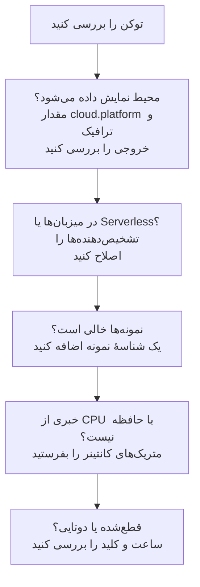

# رفع اشکال ابر

دریابید چرا یک محیط ابری وجود ندارد، در جای نادرست بایگانی شده، خالی است یا تکراری شده. بخش‌ها به همان ترتیبی آمده‌اند که این مشکلات رخ می‌دهند، و هر بخش یک لایه را کنار می‌گذارد، پس از بالا به پایین پیش بروید. خطاهایی که به یک بستر تعلق دارند در انتهای صفحهٔ همان بستر آمده‌اند: [AWS ECS / Fargate](/docs/telemetry/cloud-aws-ecs)، [Google Cloud Run](/docs/telemetry/cloud-gcp-cloud-run)، [Azure Container Apps](/docs/telemetry/cloud-azure-container-apps) و [سایر پلتفرم‌های ابری](/docs/telemetry/cloud-other-platforms).



## اول توکن را بررسی کنید

ارزان‌ترین بررسی است، و بدون آن هیچ‌چیز در ادامه کار نمی‌کند:

```bash
curl -i https://oneuptime.com/otlp/v1/validate \
  -H "x-oneuptime-token: YOUR_TELEMETRY_INGESTION_TOKEN"
```

| پاسخ | معنای آن |
| ------------------------- | -------------------------------------------------------------------------------------------------------------------------- |
| `200`, `"valid": true` | توکن پذیرفته شده است. `keyType` آن باید `Server` باشد: کلید `Browser` از سوی یک Collector یا یک سرویس بک‌اند رد می‌شود. |
| `401`, `"valid": false` | توکن وجود ندارد، ناشناخته، لغوشده، غیرفعال یا منقضی است، و `message` در پاسخ می‌گوید کدام. یک کلید تازه در **تنظیمات پروژه** > **تله‌متری و APM** > **کلیدهای دریافت داده** بسازید و دوباره مستقرش کنید. |

اگر OneUptime را خودتان میزبانی می‌کنید، از `https://YOUR-ONEUPTIME-HOST/otlp/v1/validate` استفاده کنید. هرجا می‌توانید، بررسی را از درون وظیفه، نمونه یا رپلیکا اجرا کنید (ECS Exec، `az containerapp exec`): این کار ثابت می‌کند خودِ بار کاری می‌تواند به OneUptime برسد، نه فقط لپ‌تاپ شما.

## محیط نمایش داده نمی‌شود

یک دقیقه پس از نخستین درخواست، چیزی در **ابر** > **All Environments** نیست. این سه مورد را به همین ترتیب بررسی کنید.

**`cloud.platform` وجود ندارد، یا مقدار مدیریت‌شده‌ای نیست.** OneUptime تله‌متری را فقط وقتی در محیط‌های ابری بایگانی می‌کند که منبع یکی از این مقدارها را داشته باشد: `aws_ecs`، `aws_elastic_beanstalk`، `aws_app_runner`، `gcp_cloud_run`، `gcp_app_engine`، `azure_container_apps`، `azure_container_instances` یا `azure_app_service`. علت‌های رایج:

- تشخیص‌دهندهٔ منبع در SDK خاموش است (`OTEL_NODE_RESOURCE_DETECTORS`، `OTEL_EXPERIMENTAL_RESOURCE_DETECTORS`، `-Dotel.resource.providers.<cloud>.enabled=true`).
- خط لولهٔ Collector پردازشگر `resourcedetection` را نادیده می‌گیرد.
- روی بستری بدون تشخیص‌دهنده، `OTEL_RESOURCE_ATTRIBUTES` غلط تایپی دارد.

تشخیص‌دهنده‌های Azure در Node.js و .NET مقدارهای `azure.container_apps`، `azure.app_service` و `azure.functions` را می‌نویسند؛ OneUptime آن‌ها را به مقدارهای زیرخط‌دار بازنویسی می‌کند، پس به حساب می‌آیند. برای دیدن این‌که تله‌متری شما چه دارد، سرویس را در **سرویس‌ها** باز کنید، یکی از ترِیس‌هایش را از زبانهٔ **ترِیس‌ها** باز کنید، و ویژگی‌های منبع را بخوانید. اگر `cloud.platform` آنجا نیست، همهٔ مشکل همین است.

**توکن نادرست است.** بررسی توکن پاسخ `401` داد. Collector آن را به‌صورت `Permanent error: ... 401` لاگ می‌کند. یک SDK آن را یک بار لاگ می‌کند و تلاش دوباره را متوقف می‌کند، که رفتار درست OTLP است و به‌آسانی از چشم می‌افتد.

**ترافیک خروجی مسدود است.** Collector خطای `connection refused`، `context deadline exceeded`، `i/o timeout` یا یک خطای DNS را لاگ می‌کند:

- **ECS و Fargate:** یک زیرشبکهٔ خصوصی به NAT gateway یا `assignPublicIp=ENABLED` نیاز دارد، و گروه امنیتی باید ترافیک خروجی روی TCP ۴۴۳ را اجازه دهد.
- **Cloud Run:** **VPC egress: All traffic** به Cloud NAT نیاز دارد.
- **Container Apps:** یک مسیر تعریف‌شده توسط کاربر به یک فایروال باید میزبان OneUptime را اجازه دهد.
- **همه‌جا:** یک OneUptime با میزبانی شخصی پشت یک نام DNS خصوصی باید از شبکهٔ بار کاری قابل resolve باشد.

## به‌جای آن در میزبان‌ها نمایش داده می‌شود

منبع، بستر یک ماشین مجازی (`aws_ec2`، `gcp_compute_engine` یا `azure_vm`) را دارد، پس OneUptime آن را در **میزبان‌ها** بایگانی می‌کند: برای یک ماشین مجازی درست است، برای محاسبات مدیریت‌شده نادرست. تشخیص‌دهندهٔ یک ماشین مجازی بر تشخیص‌دهندهٔ مدیریت‌شده برنده شد: `detectors: [ec2, elastic_beanstalk]` در یک Collector، که در آن نخستین تشخیص‌دهنده‌ای که `cloud.platform` را تنظیم کند برنده است، یا SDKای که ترتیبش تشخیص‌دهندهٔ EC2 را ترجیح می‌دهد. `elastic_beanstalk` را اول بگذارید، یا `cloud.platform` را خودتان در `OTEL_RESOURCE_ATTRIBUTES` تنظیم کنید و فقط تشخیص‌دهندهٔ `env` را نگه دارید.

## فقط در توابع بدون سرور نمایش داده می‌شود

منبع `faas.name` را دارد اما هیچ `cloud.platform` مدیریت‌شده‌ای ندارد. Cloud Run و App Engine وقتی تشخیص‌دهندهٔ GCP اجرا شود هر دو را تنظیم می‌کنند. اگر `faas.name` را دستی تنظیم کنید، یا یک Collector ویژگی‌های منبعی را که تشخیص‌دهندهٔ SDK تنظیم کرده دور بریزد، فقط شرط سمت بدون سرور برآورده می‌شود. تشخیص‌دهنده را روشن کنید، یا `cloud.platform=gcp_cloud_run` (یا `gcp_app_engine`)، `cloud.account.id` و `cloud.region` را خودتان تنظیم کنید.

> [!NOTE]
> روی Cloud Run و App Engine قرار است یک سرویس در هر دو جا نمایش داده شود: محیط پروژه و منطقه را گرد می‌آورد، و **توابع بدون سرور** سرویس تکی را نشان می‌دهد.

## نمونه‌ها خالی است

محیط وجود دارد، اما زبانهٔ **نمونه‌ها** در آن چیزی فهرست نمی‌کند: تله‌متری هیچ شناسهٔ نمونه‌ای ندارد. OneUptime یک نمونه را از نخستین ویژگی منبعی از این فهرست که پیدا کند نام‌گذاری می‌کند:

1. `aws.ecs.task.id`
2. `aws.ecs.task.arn` (کوتاه‌شده به شناسهٔ وظیفه)
3. `faas.instance`
4. `azure.container_app.instance.id`
5. `service.instance.id`
6. `container.id`
7. `host.id`
8. `host.name`

شناسهٔ خودِ بستر پیش از `service.instance.id` می‌آید، پس شناسه‌ای که SDK برای هر فرایند می‌سازد (SDK در Node.js به‌طور پیش‌فرض همین کار را می‌کند) نمی‌تواند یک وظیفه را از CPU و حافظهٔ sidecar آن جدا کند. چه چیزی شناسه را روی هر بستر تنظیم می‌کند:

| بستر | چه چیزی شناسه را تنظیم می‌کند |
| ----------------------------------------- | ------------------------------------------------------------------------------------------------------------------------------------------------ |
| ECS | تشخیص‌دهندهٔ `ecs` شناسهٔ ARN وظیفه را تنظیم می‌کند |
| Cloud Run, App Engine | تشخیص‌دهندهٔ `gcp` مقدار `faas.instance` را تنظیم می‌کند |
| Container Apps | تشخیص‌دهندهٔ `azurecontainerapps` در Collector شناسهٔ رپلیکا را تنظیم می‌کند؛ یا `service.instance.id` را از `CONTAINER_APP_REPLICA_NAME` تنظیم کنید، یا تشخیص‌دهندهٔ میزبان را اجرا کنید |
| App Runner, Container Instances | `host.name` تشخیص‌دهندهٔ میزبان |
| App Service, Elastic Beanstalk | تشخیص‌دهندهٔ بستر `service.instance.id` را تنظیم می‌کند؛ روی Beanstalk آن را حذف کنید تا `host.id` هر نمونه را نام‌گذاری کند |

یک نمونه ظرف یک دقیقه پس از نخستین سیگنالی که این ویژگی را دارد نمایش داده می‌شود.

## CPU و حافظه خالی است

نمونه‌ها فهرست شده‌اند، اما کاشی‌های **CPU** و **حافظه** در نمای کلی، و ستون‌های CPU و حافظه در **نمونه‌ها**، خالی‌اند. این‌ها از متریک‌ها می‌آیند، نه از ترِیس‌ها: نقطه‌های دادهٔ `container.cpu.utilization` و `container.memory.usage` (یا `container.memory.usage.total`) که منبعشان همان شناسهٔ نمونهٔ ترِیس‌ها و `cloud.platform` را دارد.

- **روی ECS،** گیرندهٔ `awsecscontainermetrics` در یک کالکتور sidecar آن‌ها را به‌صورت `ecs.task.cpu.utilized` و `ecs.task.memory.utilized` فراهم می‌کند. آن را در خط لولهٔ `metrics` نگه دارید، و `resourcedetection` را هم در همان خط لوله نگه دارید، وگرنه متریک‌ها بدون `cloud.platform` می‌رسند و جای دیگری بایگانی می‌شوند.
- **روی Cloud Run، Container Apps و بسترهای دیگر،** بستر مصرف کانتینر را به sidecar نشان نمی‌دهد. کاشی‌ها خالی می‌مانند مگر آن‌که خودتان این متریک‌ها را بفرستید: به‌جای آن کاشی‌های درخواست را بخوانید.
- **با SDK direct،** هیچ‌چیز متریک کانتینر نمی‌فرستد، پس کاشی‌های خالی طبیعی‌اند.

## محیط قطع‌شده نشان داده می‌شود

یک محیط وقتی **قطع‌شده** نشان داده می‌شود که ۱۵ دقیقه هیچ تله‌متری‌ای برایش نرسیده باشد، و اسپن، لاگ یا متریک بعدی آن را برمی‌گرداند. زمانی که خود OneUptime از کار افتاده بود یا در حال جبران عقب‌ماندگی بود حساب نمی‌شود. وقتی تله‌متری جریان دارد، زمان آخرین مشاهده ممکن است تا پنج دقیقه عقب باشد، و به همین دلیل آستانه ۱۵ است.

- **محیطی پرکار قطع‌شده نشان داده می‌شود:** صادرکننده متوقف شده است. لاگ‌های Collector را برای خطاهای `401` و خطاهای ترافیک خروجی که در بالا آمد بررسی کنید.
- **یک محیط staging که شب‌ها تا صفر کوچک می‌شود** تا نخستین درخواست صبح قطع‌شده نشان داده می‌شود، که درست است.

نمونه‌ها از دو ساعت پیروی می‌کنند:

- **Stale:** زبانهٔ **نمونه‌ها** یک وظیفه، نمونه یا رپلیکا را وقتی در ۱۵ دقیقهٔ گذشته گزارشی نداده باشد **Stale** علامت می‌زند، و نمای کلی فقط بقیه را زنده می‌شمارد.
- **حذف‌شده:** یک پاک‌سازی ردیف‌های نمونه‌ای را که به مدت `CLOUD_INSTANCE_STALE_MINUTES` (پیش‌فرض ۱۵، دست‌کم ۱۰) دیده نشده‌اند حذف می‌کند، که از آخرین تله‌متری خودِ محیط اندازه گرفته می‌شود، پس از کار افتادن Collector آن ساعت را متوقف می‌کند به‌جای آن‌که آخرین فهرست شناخته‌شدهٔ وظیفه‌ها را پاک کند. توابع بدون سرور از `SERVERLESS_INSTANCE_STALE_MINUTES` استفاده می‌کنند. بالا بردن آستانه ردیف‌ها را بیشتر نگه می‌دارد؛ زمان **Stale** شدن آن‌ها را تغییر نمی‌دهد.

## دو محیط به‌جای یکی

کلید محیط `cloud.platform|cloud.account.id|cloud.region` است و نویسه به نویسه مقایسه می‌شود. اگر برخی بارهای کاری `cloud.account.id` را تنظیم کنند و برخی نه، یکی `eastus` بنویسد و دیگری `East US`، یا یک Collector تشخیص‌دهندهٔ `ecs` را اجرا کند و دیگری نه، `aws_ecs|123456789012|us-east-1` و `aws_ecs||us-east-1` را کنار هم خواهید داشت.

**نمای کلی** هر محیط را باز کنید: **کلید محیط** آن نشان می‌دهد کدام بخش متفاوت است. بار کاری‌ای را که مقدار را ندارد اصلاح کنید. محیطی که بخش خالی دارد دیگر تله‌متری دریافت نمی‌کند، و می‌توانید آن را بایگانی کنید.

## یک محیط دستی هرگز تطبیق نمی‌یابد

دریافت داده یک محیط را فقط با کلیدش تطبیق می‌دهد، و کلید باید دقیقاً `platform|account|region` باشد، مانند `aws_ecs|123456789012|us-east-1`: همان مقدار بستر، شناسهٔ حساب و منطقه‌ای که تله‌متری دارد. فرم ساخت (**ساخت منبع ابری** در **ابر** > **All Environments**) کلید را از فیلدهای **بستر ابری**، **شناسه حساب ابری** و **منطقه ابری** می‌سازد، پس این سه باید نویسه به نویسه با تله‌متری یکسان باشند. اگر نباشند، دریافت داده یک محیط دوم با کلیدی که خودش به دست آورده می‌سازد، و محیط شما خالی می‌ماند. محیط دستی را بایگانی کنید و بگذارید دریافت داده محیط درست را بسازد، یا آن را با مقدارهای اصلاح‌شده دوباره بسازید.

## هنوز گیر کرده‌اید

پیش از درخواست کمک این‌ها را جمع کنید:

- ویژگی‌های منبع یک اسپن یا رکورد لاگ واقعی از بار کاری. صادرکنندهٔ `debug` در Collector آن‌ها را چاپ می‌کند، یا یک ترِیس از سرویس را در **سرویس‌ها** باز کنید.
- پاسخ بررسی `/otlp/v1/validate` که از درون بار کاری اجرا شده باشد.
- ۵۰ خط آخر لاگ Collector، یا لاگ تشخیصی SDK با `OTEL_LOG_LEVEL=debug`.
- **کلید محیط** هر محیطی که نمایش داده شد.

سپس با support@oneuptime.com تماس بگیرید، یا یک issue در [GitHub](https://github.com/OneUptime/oneuptime) باز کنید.

## گام‌های بعدی

:::cards
- [محیط‌های ابری](/docs/telemetry/cloud-environments): محیط‌ها و نمونه‌ها چگونه شناسایی می‌شوند.
- [AWS ECS / Fargate](/docs/telemetry/cloud-aws-ecs): راه‌اندازی ECS، همراه با یک تعریف وظیفهٔ کامل.
- [OpenTelemetry](/docs/telemetry/open-telemetry): نقطه‌های پایانی، محدودیت‌ها و معنای هر پاسخ.
:::
