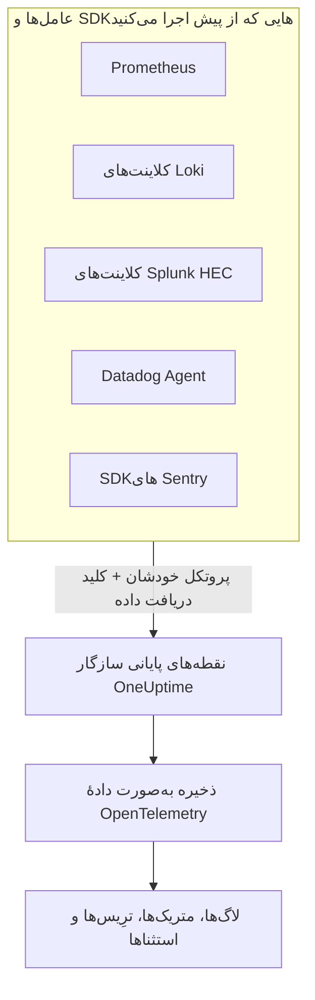

# Prometheus, Loki, Splunk, Datadog & Sentry

Prometheus، یک کلاینت Loki، یک فورواردر Splunk، Datadog Agent یا یک SDK Sentry را از پیش اجرا می‌کنید؟ همان را نگه دارید. OneUptime آنچه هرکدام از این ابزارها می‌فرستد را در همان مسیرهایی که خود ابزار از پیش به کار می‌برد می‌پذیرد و آن را به‌صورت دادهٔ OpenTelemetry ذخیره می‌کند. امتحان کردن OneUptime یعنی عوض کردن یک نشانی و یک کلید، نه ابزارگذاری دوباره، و فیلترهای حذف، قواعد پالایش، خط‌لوله‌های لاگ، نگهداری داده و بودجه‌های دریافت دادهٔ شما روی این داده هم مانند هر دادهٔ دیگری اعمال می‌شوند.

:::cards
- [Prometheus remote write](#prometheus-remote-write): متریک‌ها از Prometheus، Grafana Alloy یا هر فرستندهٔ remote write.
- [Loki](#loki): لاگ‌ها از Promtail، Grafana Alloy، Fluent Bit یا Vector.
- [Splunk HTTP Event Collector](#splunk-http-event-collector): لاگ‌ها و رویدادهای متریک از هر کلاینت HEC.
- [Datadog Agent](#datadog-agent): متریک‌ها و لاگ‌ها از Datadog Agent.
- [SDKهای Sentry](#sdkهای-sentry): خطاها، تراکنش‌ها و لاگ‌ها از هر SDK Sentry.
:::

## چگونه کار می‌کند



هر نقطهٔ پایانی به زبان ابزار خودش پاسخ می‌دهد — `204` برای Prometheus و Loki، `{"text": "Success", "code": 0}` برای HEC، `202` برای Datadog و شناسهٔ رویداد برای Sentry — پس ابزار موفقیت و شکست را همان‌طور گزارش می‌کند که همیشه کرده است. سپس داده دقیقاً مانند داده‌ای که از یک SDK OpenTelemetry می‌رسد پردازش می‌شود.

## پیش از شروع

- **یک پروژهٔ OneUptime** – در OneUptime Cloud هزینهٔ تله‌متری بر پایهٔ هر گیگابایت دریافت‌شده محاسبه می‌شود، و پروژه‌ای که روی پلن Free است پیش از ارسال تله‌متری به یک روش پرداخت نیاز دارد.
- **کلید دریافت دادهٔ تله‌متری** – یک کلید **سرور** در **محصولات ← تنظیمات پروژه ← تله‌متری و APM ← کلیدهای دریافت داده** بسازید و **کلید محرمانه** آن را کپی کنید. هر ابزار آن را همان جایی می‌فرستد که اعتبارنامهٔ خودش را می‌فرستد. برای DSN Sentry در یک برنامهٔ مرورگری، به‌جای آن یک کلید **مرورگر** با مبداهای سایت‌تان به کار ببرید.
- **میزبان شما** – نمونه‌ها از `oneuptime.com` استفاده می‌کنند. اگر OneUptime را خودتان میزبانی می‌کنید، از میزبان خودتان استفاده کنید.

> [!TIP]
> زبانهٔ راهنمای راه‌اندازی در لاگ‌ها، متریک‌ها، ترِیس‌ها و استثناها این ابزارها را میان راه‌های ارسال خودش آورده است، و میزبان شما و کلیدی را که برمی‌گزینید از پیش پر کرده است.

## نقطه‌های پایانی

| ابزار | نشانی مقصد | کلید کجا می‌رود |
| --- | --- | --- |
| Prometheus remote write | `https://oneuptime.com/telemetry/prometheus/api/v1/write` | یک توکن bearer، یا احراز هویت basic با کلید به‌عنوان گذرواژه. |
| Loki | `https://oneuptime.com/telemetry/loki/api/v1/push` | احراز هویت basic با کلید به‌عنوان گذرواژه، یا یک توکن bearer. |
| Splunk HTTP Event Collector | `https://oneuptime.com/telemetry/services/collector` | توکن HEC: `Authorization: Splunk <key>`. |
| Datadog Agent | `https://oneuptime.com/telemetry/datadog` | کلید API: `DD-API-KEY`. |
| SDKهای Sentry | DSN برابر `https://<key>@oneuptime.com/telemetry/sentry/1` | کلید عمومی DSN. |

هر نقطهٔ پایانی کلید را در سرآیند `x-oneuptime-token` هم می‌پذیرد، و سرآیند `x-oneuptime-service-name` سرویسی را نام می‌برد که همهٔ آنچه فرستاده می‌شود به آن تعلق دارد. کلید را می‌توان به‌صورت ۳۲ نویسهٔ هگزادسیمال و بدون خط تیره نوشت؛ DSN در Sentry و کلید API در Datadog باید به همین شکل نوشته شوند.

## Prometheus remote write

OneUptime را به‌عنوان یک مقصد remote write اضافه کنید. Prometheus مانند اکنون به برداشت ادامه می‌دهد و از هر نمونه یک رونوشت می‌فرستد:

```yaml title="prometheus.yml"
remote_write:
  - url: https://oneuptime.com/telemetry/prometheus/api/v1/write
    authorization:
      credentials: YOUR_TELEMETRY_KEY
```

در Grafana Alloy، یک مؤلفهٔ `prometheus.remote_write` اضافه کنید و برداشت‌هایتان را به آن بفرستید:

```text title="config.alloy"
prometheus.remote_write "oneuptime" {
  endpoint {
    url          = "https://oneuptime.com/telemetry/prometheus/api/v1/write"
    bearer_token = "YOUR_TELEMETRY_KEY"
  }
}
```

هر دو نسخهٔ 1.0 و 2.0 از remote write پذیرفته می‌شوند، فشرده‌شده با snappy، همان‌طور که همهٔ فرستنده‌ها آن‌ها را می‌فرستند.

### یک سری به چه تبدیل می‌شود

- **نام و برچسب‌هایش می‌مانند.** `http_requests_total{job="checkout", code="500"}` متریک `http_requests_total` با attributeهای `job` و `code` است، پس کوئری‌ای که از Grafana منتقل شده باشد آن را پیدا می‌کند.
- **job همان سرویس است.** هر `job` به یک سرویس تبدیل می‌شود، و هر `instance` به نمونهٔ آن سرویس، همان‌طور که قواعد Prometheus در OpenTelemetry آن‌ها را نگاشت می‌کنند.
- **نوع‌ها حفظ می‌شوند.** شمارنده‌ها، و باکت‌ها و شمارش‌های یک هیستوگرام، مجموع‌های تجمعی‌اند، پس نرخشان درست در نمودار نشان داده می‌شود. نوع از فراداده‌ای می‌آید که فرستنده همراه داده می‌فرستد؛ بدون آن، نامی که به `_total` ختم شود شمارنده است و یک `_bucket` با برچسب `le` یک باکت هیستوگرام.
- **هیستوگرام‌های بومی** به هیستوگرام‌های نمایی تبدیل می‌شوند، و هیستوگرام‌های بومی با باکت‌های سفارشی به هیستوگرام.
- **نگه داشته نمی‌شوند:** نشانگرهای staleness و دیگر نمونه‌های NaN یا بی‌نهایت، سری‌های `_created` شمارنده‌ها، و exemplarها.

## Loki

OneUptime، push API در Loki را در همان مسیر خود Loki می‌پذیرد، به‌صورت JSON یا به‌صورت protobuf فشرده با snappy که Promtail و Grafana Alloy می‌فرستند. آن را به‌عنوان یک کلاینت اضافه کنید:

```yaml title="promtail.yaml"
clients:
  - url: https://oneuptime.com/telemetry/loki/api/v1/push
    bearer_token: YOUR_TELEMETRY_KEY
```

خروجی `loki` در Fluent Bit، میزبان و مسیر را جدا از هم می‌گیرد:

```text title="fluent-bit.conf"
[OUTPUT]
    Name         loki
    Match        *
    Host         oneuptime.com
    Port         443
    Tls          On
    Uri          /telemetry/loki/api/v1/push
    Http_User    oneuptime
    Http_Passwd  YOUR_TELEMETRY_KEY
    Labels       job=fluent-bit
```

### یک جریان به چه تبدیل می‌شود

- **هر ورودی یک لاگ است**، با مُهر زمانی خودش تا دقت نانوثانیه و خطش به‌عنوان بدنه.
- **برچسب‌ها و فرادادهٔ ساختاریافته attribute هستند**، با همان نام‌هایی که در Loki دارند.
- **سرویس** از نخستین مورد از میان `service_name`، `service`، `app`، `application`، `name`، `app_kubernetes_io_name`، `container`، `container_name`، `component`، `workload` و `job` می‌آید که یک جریان داشته باشد، همان‌طور که Loki آن را پیدا می‌کند. برچسب `host` یا `hostname` میزبان را نام می‌برد.
- **سطح** از یک برچسب یا فرادادهٔ `level`، `detected_level` یا `severity` می‌آید، وگرنه از `level=` در logfmt یا از فیلد `level` یک خط JSON.
- **زمینهٔ ترِیس:** `trace_id` و `span_id` در فرادادهٔ ساختاریافته، لاگ را به ترِیس آن پیوند می‌دهند.

## Splunk HTTP Event Collector

OneUptime را به‌عنوان HTTP Event Collector به کار ببرید، با کلید دریافت داده‌تان به‌عنوان توکن HEC. درایور لاگ‌گیری Docker برای Splunk مسیر را خودش اضافه می‌کند، پس فقط میزبان را می‌گیرد:

```bash
docker run \
  --log-driver=splunk \
  --log-opt splunk-url=https://oneuptime.com \
  --log-opt splunk-token=YOUR_TELEMETRY_KEY \
  --log-opt splunk-format=json \
  your-image
```

هر کلاینت HEC دیگری درخواست POST را به `/services/collector/event` یا `/services/collector/raw` می‌فرستد. برای فرستادن یک رویداد:

```bash
curl https://oneuptime.com/telemetry/services/collector/event \
  -H "Authorization: Splunk YOUR_TELEMETRY_KEY" \
  -d '{"event": "Payment failed for order 42", "sourcetype": "app", "fields": {"service": "checkout"}}'
```

پاسخ `200` همراه با `{"text": "Success", "code": 0}` یعنی رویداد پذیرفته شده است. نقطهٔ پایانی با کدهای خود HEC هم پاسخ می‌دهد — `No data` (5)، `Invalid data format` (6) همراه با شمارهٔ رویدادی که معتبر نبود، و `Event field is required` (12) — و بدون توکن به `GET /services/collector/health` پاسخ می‌دهد.

### یک رویداد به چه تبدیل می‌شود

- **یک لاگ**، با `time` آن به‌عنوان مُهر زمانی. رویداد رشته‌ای خودش بدنه است؛ در رویداد شیء، `message`، `msg`، `log`، `line` یا `text` بدنه است و فیلدهای دیگرش attribute هستند.
- **فراداده‌اش می‌ماند:** `host` میزبان است، و `source`، `sourcetype` و `index` به‌صورت `com.splunk.source`، `com.splunk.sourcetype` و `com.splunk.index` نگه داشته می‌شوند. `host`، `source`، `sourcetype` و `index` در رشتهٔ پرس‌وجو، آنچه را رویداد نیاورده پر می‌کنند.
- **فیلدهایش attribute هستند.** فیلد `service.name` سرویس را نام می‌برد، و فیلد `service` یک لاگ نیز همین‌طور.
- **رویدادهای متریک** (`"event": "metric"`، با `metric_name` و `_value`، یا فیلدهای `metric_name:<name>`) به‌صورت متریک ذخیره می‌شوند، هرگز به‌صورت لاگ.
- **ارائه نمی‌شود:** تأیید ایندکسر (indexer acknowledgement). کلاینتی که آن را بخواهد هیچ `ackId` دریافت نمی‌کند.

## Datadog Agent

متریک‌ها و لاگ‌های Agent را به سمت OneUptime بفرستید، با کلید دریافت داده‌تان به‌عنوان کلید API آن:

```yaml title="datadog.yaml"
api_key: YOUR_TELEMETRY_KEY_WITHOUT_HYPHENS
dd_url: https://oneuptime.com/telemetry/datadog
logs_enabled: true
logs_config:
  use_http: true
  logs_dd_url: oneuptime.com:443
apm_config:
  enabled: false
process_config:
  process_collection:
    enabled: false
```

Agent مسیرهای خودش را به `dd_url` اضافه می‌کند، و لاگ‌ها را به `/api/v2/logs` روی میزبان و پورتی می‌فرستد که `logs_dd_url` نام می‌برد. OneUptime فقط برای درخواستی که سرآیند `DD-API-KEY` داشته باشد، روی ریشه به آن مسیرها پاسخ می‌دهد. پس از تغییر، Agent را دوباره راه‌اندازی کنید؛ وقتی OneUptime کلید API را بپذیرد، `datadog-agent status` آن را معتبر نشان می‌دهد.

### دادهٔ Agent به چه تبدیل می‌شود

- **متریک‌ها** نامشان را نگه می‌دارند. gaugeها gauge می‌مانند، countها به sum تبدیل می‌شوند، و rateها به gauge مقدارِ در ثانیهٔ خودشان.
- **توزیع‌ها** به summary با شمارش، مجموع، کمینه و بیشینهٔ خودشان تبدیل می‌شوند.
- **بررسی‌های سرویس** به متریکی هم‌نام با بررسی تبدیل می‌شوند که مقدارش وضعیت بررسی است: ۰ یعنی OK، ۱ هشدار، ۲ بحرانی، ۳ ناشناخته.
- **لاگ‌ها** پیام، وضعیت، میزبان و سرویس خود را نگه می‌دارند، و بقیهٔ فیلدهایشان را به‌صورت attribute.
- **تگ‌ها attribute هستند**، و تگ‌های `service`، `env` و `version` سرویس، محیط آن و نسخهٔ آن را نام می‌برند.
- **هنوز خوانده نمی‌شوند:** ترِیس‌های APM، پردازه‌ها، کانتینرها، دادهٔ شبکه و پروفایل‌ها. آن‌ها را مانند بالا در `datadog.yaml` خاموش بگذارید.

کلاینت‌های HTTP API در Datadog — یک کتابخانهٔ لاگ که به `/api/v2/logs` درخواست POST می‌فرستد، یا اسکریپتی که سری‌ها را می‌فرستد — می‌توانند با سرآیند `DD-API-KEY` به همین نقطهٔ پایانی بفرستند.

## SDKهای Sentry

DSN را همان جایی که Sentry را راه‌اندازی می‌کنید جایگزین کنید. بقیهٔ کد Sentry شما همان‌طور که هست می‌ماند:

```javascript
Sentry.init({
  dsn: "https://YOUR_TELEMETRY_KEY_WITHOUT_HYPHENS@oneuptime.com/telemetry/sentry/1",
  release: "checkout@1.4.2",
  environment: "production",
});
```

```python
sentry_sdk.init(
    dsn="https://YOUR_TELEMETRY_KEY_WITHOUT_HYPHENS@oneuptime.com/telemetry/sentry/1",
    release="checkout@1.4.2",
    environment="production",
)
```

`1` در انتهای DSN را SDKهای Sentry لازم دارند و خوانده نمی‌شود. DSN یک برنامهٔ مرورگری عمومی است، پس در آنجا از یک کلید دریافت دادهٔ **مرورگر** با مبداهای سایت‌تان استفاده کنید.

### یک پاکت به چه تبدیل می‌شود

- **خطاها** در «استثناها» نمایش داده می‌شوند، همراه با ردپای پشته‌شان و استثناهایی که سببشان شده‌اند، و مانند هر استثنای دیگری گروه‌بندی می‌شوند. هرکدام یک span روی ترِیس خودش است، زیر spanی که فعال بوده است.
- **تراکنش‌ها** و spanهایشان در «ترِیس‌ها» نمایش داده می‌شوند.
- **لاگ‌های Sentry** و پیام‌هایی که با `capture_message` ثبت شده‌اند در «لاگ‌ها» نمایش داده می‌شوند.
- **سرویس** یک تگ `service` است، وگرنه بخشی از نام release که پیش از `@` می‌آید: `checkout@1.4.2` یعنی `checkout`. release همان نسخهٔ سرویس است، و محیط نگه داشته می‌شود.
- **نگه داشته نمی‌شوند:** نشست‌ها، بازپخش‌ها، پیوست‌ها، پروفایل‌ها و check-inها. SDK همچنان آن‌ها را می‌فرستد؛ OneUptime آن‌ها را می‌پذیرد و دور می‌ریزد.

## محدودیت‌ها و بودجه‌های دریافت داده

- **اندازهٔ درخواست** – ingress در OneUptime درخواست‌هایی تا ۴ مگابایت را زیر `/telemetry` می‌پذیرد، و بدنهٔ هر درخواست پس از رفع فشرده‌سازی حداکثر ۶۴ مگابایت می‌تواند باشد.
- **بودجه‌های دریافت داده** – Prometheus remote write و Loki پیش از خوانده شدن بدنه‌شان با بودجهٔ متریک‌ها یا لاگ‌ها سنجیده می‌شوند، و وقتی آن بودجه تمام شده باشد با `403` رد می‌شوند. یک دستهٔ HEC، یک payload در Datadog یا یک پاکت Sentry می‌تواند چند سیگنال را با خود داشته باشد، پس هر سیگنال هنگام ذخیره شدن از بودجهٔ خودش شمرده می‌شود، و وقتی آن بودجه تمام شده باشد دور ریخته می‌شود.

## عیب‌یابی

### همهٔ درخواست‌ها با 401 رد می‌شوند

کلید به جایی که نقطهٔ پایانی دنبالش می‌گردد نرسیده است، یا کلیدی از این پروژه نیست. تنظیم اعتبارنامهٔ ابزار را با جدول [نقطه‌های پایانی](#نقطههای-پایانی) مقایسه کنید، و بررسی کنید که کلید خاموش یا منقضی نشده باشد.

### یک SDK Sentry می‌گوید DSN نامعتبر است

SDKهای Sentry، DSNی را که کلیدش خط تیره دارد رد می‌کنند. کلید را به‌صورت ۳۲ نویسهٔ هگزادسیمال و بدون خط تیره بنویسید.

### متریک‌های Datadog می‌رسند، اما لاگ‌ها نه

بررسی کنید که `logs_config.use_http` برابر `true` باشد و `logs_config.logs_dd_url` یک میزبان و پورت باشد، نه یک URL. وقتی `use_http` تنظیم نشده باشد، Agent لاگ‌ها را از راه TCP می‌فرستد.

### Prometheus خطای 415 گزارش می‌کند

فرستنده پروتکلی از remote write را خواسته است که OneUptime نمی‌خواند. remote write 1.0 یا 2.0 بفرستید.
