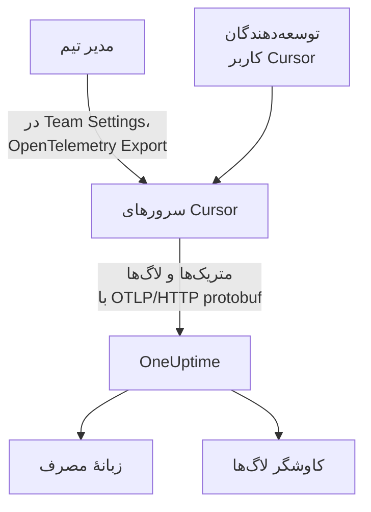

# Cursor

Cursor تله‌متری تیمش را از سرورهای خود Cursor صادر می‌کند. یک مدیر تیم یک بار، در داشبورد Cursor، OneUptime را به‌عنوان مقصد اضافه می‌کند و توکن‌ها، هزینهٔ برآوردی و فراخوانی‌های ابزار کل تیم می‌رسند: هیچ چیزی برای نصب یا تنظیم روی دستگاه‌های توسعه‌دهندگان وجود ندارد.

:::cards
- [راه‌اندازی](#راهاندازی): یک کلید در OneUptime و یک مقصد در Cursor بسازید.
- [آنچه به دست می‌آورید](#آنچه-به-دست-میآورید-و-آنچه-نه): متریک‌ها و لاگ‌ها؛ بدون ترِیس.
- [چه کسی چه خرج کرد](#انتساب-به-کارمندان): اشخاص به‌صورت شناسه‌های کاربری Cursor می‌رسند.
- [عیب‌یابی](#عیبیابی): وقتی چیزی نمی‌رسد چه چیزی را بررسی کنید.
:::

## چگونه کار می‌کند



## پیش از شروع

- **پلن Enterprise در Cursor.** صفحهٔ OpenTelemetry Export در پلن‌های دیگر نیست.
- **نقطهٔ پایانی‌ای که Cursor بتواند از اینترنت به آن برسد.** این Cursor است که از مجموعه‌ای ثابت از نشانی‌ها به شما وصل می‌شود. OneUptime Cloud به چیز دیگری نیاز ندارد؛ یک OneUptime خودمیزبان پشت فایروال باید نشانی‌های خروجی‌ای را که Cursor در صفحهٔ [OpenTelemetry Export](https://cursor.com/docs/enterprise/opentelemetry-export) خود فهرست کرده مجاز کند.

## راه‌اندازی

:::steps
### یک کلید دریافت داده بسازید

در OneUptime، **تنظیمات پروژه** > **تله‌متری و APM** > **کلیدهای دریافت داده** را باز کنید، روی **ساخت کلید دریافت داده** کلیک کنید و کلید را کپی کنید. نشانی پایهٔ OTLP شما `https://oneuptime.com/otlp` است، یا اگر OneUptime را خودتان میزبانی می‌کنید `https://YOUR-ONEUPTIME-HOST/otlp`.

### مقصد را در Cursor بسازید

در داشبورد وب Cursor، به‌عنوان مدیر تیم، **Team Settings → OpenTelemetry Export** را باز کنید و یک مقصد بسازید:

| فیلد | مقدار |
| --- | --- |
| Endpoint (base URL) | `https://oneuptime.com/otlp` |
| Header name | `x-oneuptime-token` |
| Header value | `YOUR_INGESTION_TOKEN` |

نشانی پایه را بدون `/v1` وارد کنید: Cursor خودش `/v1/metrics` و `/v1/logs` را اضافه می‌کند، و `https://oneuptime.com/otlp/v1` داده را به `/otlp/v1/v1/metrics` می‌فرستد که هیچ چیزی به آن نمی‌رسد.

### آزمایش و روشن کردن

روی **Test connection** کلیک کنید تا نشانی و سرآیند بررسی شوند، سپس روی **Enable**. صادرات در حدود یک دقیقه آغاز می‌شود؛ ویرایش‌های بعدی سرآیند حدود ۳۰ ثانیه طول می‌کشند.

### بررسی کنید که داده می‌رسد

یکی دو دقیقه با Cursor کار کنید، سپس **لاگ‌ها** را در OneUptime باز کنید و روی نام سرویس `cursor` فیلتر کنید: رکوردهای `cursor.api.request` با شمار توکن‌ها یعنی کلید و نشانی درست‌اند.
:::

Cursor پروتکل OTLP را روی HTTP فقط با protobuf دودویی به کار می‌برد (نه gRPC، نه JSON)، که OneUptime آن را همان‌طور که هست می‌پذیرد. سرآیند را رمزنگاری‌شده نگه می‌دارد و برای هر تیم فقط به یک مقصد می‌فرستد: برای فرستادن هم به OneUptime و هم به جای دیگر، یک Collector جلویش بگذارید.

## آنچه به دست می‌آورید، و آنچه نه

| سیگنال | از Cursor |
| --- | --- |
| متریک‌ها: توکن‌ها، هزینهٔ برآوردی، فراخوانی‌های ابزار | بله، به‌صورت دلتا |
| رویدادهای لاگ: درخواست‌ها، خطاها، اصلاحیه‌ها، مهارت‌ها، hookها، افزونه‌ها، عامل‌های ابری | بله |
| متن پرامپت و پاسخ | فقط اگر خانوادهٔ `conversation_content` را روشن کنید |
| ترِیس‌ها | خیر |
| هر چیزی از پیش از روشن کردن مقصد | خیر |

پس در OneUptime، Cursor در زبانهٔ **مصرف** از **محصولات** > **هوش مصنوعی / LLM**، از روی `cursor.token.usage` و `cursor.cost.usage`، نمایش داده می‌شود، ولی هرگز در **فراخوانی‌ها** یا **گفتگوها** که از ترِیس‌ها ساخته می‌شوند. جزئیات هر درخواست، رویداد `cursor.api.request` در کاوشگر **لاگ‌ها** است.

### خانواده‌ها

هر سیگنال، و هر خانوادهٔ تله‌متری، کلید روشن و خاموش خودش را در تنظیمات Cursor دارد:

| خانواده | چه چیزی را پوشش می‌دهد |
| --- | --- |
| `model_usage` | `cursor.token.usage`، `cursor.cost.usage`، و رویدادهای `cursor.api.request`، `cursor.api.error` و `cursor.api.correction` |
| `tool_calls` | `cursor.tool.calls` |
| `skills_hooks_plugins` | رویدادهای مهارت، hook و افزونه |
| `cloud_agents` | رویدادهای `cursor.cloud_agent.*` |
| `grok_bot_agent_actions` | رویدادهای `cursor.grok_bot.*`؛ به Action Recording نیاز دارد |
| `conversation_content` | متن پیام‌ها و ورودی و خروجی ابزارهای MCP؛ به‌طور پیش‌فرض خاموش |

همهٔ خانواده‌ها جز `conversation_content` روشن آغاز می‌شوند. خانواده‌هایی که Cursor بعداً اضافه کند هم روشن آغاز می‌شوند، مگر اینکه `auto_enable_new_families` را خاموش کنید.

## متریک‌ها و رویدادها

هر سه متریک مجموع‌های دلتا هستند:

| متریک | واحد | ویژگی‌ها |
| --- | --- | --- |
| `cursor.token.usage` | `{token}` | `cursor.token.type`: `input`، `output`، `cache_read`، `cache_creation`؛ `cursor.model.name`؛ `cursor.api.status`: `success`، `errored`، `aborted`؛ `cursor.api.billable` |
| `cursor.cost.usage` | `USD` | `cursor.model.name` |
| `cursor.tool.calls` | `{call}` | `cursor.tool.kind`: `builtin`، `mcp`؛ `cursor.tool.name`؛ `cursor.tool.status`: `success`، `failure`، `aborted`؛ `cursor.mcp.server.name` |

نقطه‌های داده هیچ شناسهٔ گفتگو یا درخواستی ندارند، پس هزینهٔ هر نشست در متریک‌ها نیست. `cursor.model.name` مدل درخواست‌شده است و گزینه‌های مسیریابی‌شده در آن ادغام شده‌اند: تفکیک بر پایهٔ مدل ردیفی به نام `Auto` دارد که نمی‌توان آن را میان مدل‌هایی که Cursor به آن‌ها مسیریابی کرده تقسیم کرد.

رویداد لاگی که بیش از همه به کار می‌برید `cursor.api.request` است: یکی برای هر درخواست، با شمار توکن‌های ورودی، خروجی و cache، مدل، و اینکه آیا صورت‌حساب شده است. `cursor.api.error` یک درخواست ناموفق را ثبت می‌کند (بدون پیام خطا)، و `cursor.api.correction` بعداً می‌رسد تا بگوید درخواستی در نهایت صورت‌حساب نشده است. [مرجع قالب](https://cursor.com/docs/enterprise/opentelemetry-export/wire) در Cursor همهٔ رویدادها و ویژگی‌ها را فهرست می‌کند.

هر رکورد این ویژگی‌های منبع را دارد:

| ویژگی | چیست |
| --- | --- |
| `service.name` | همیشه `cursor`: کاوشگرهای **لاگ‌ها** و **متریک‌ها** را روی آن فیلتر کنید |
| `cursor.team.id` | تیم شما، یک عدد صحیح؛ همیشه موجود |
| `cursor.user.id` | شخص، یک عدد صحیح در محدودهٔ تیم؛ اختیاری |
| `cursor.surface` | فعالیت از کجا آمده، مانند `desktop`، `cli`، `cloud_agent` یا `bugbot` |
| `cursor.entrypoint` | چگونه آغاز شده، مانند `desktop`، `cli`، `web`، `api` یا `github_pr` |

## انتساب به کارمندان

**Cursor یک شخص را با `cursor.user.id` نام می‌برد، عددی صحیح که فقط Cursor می‌تواند آن را به نام تبدیل کند، و اغلب آن را برای عامل‌های ابری حذف می‌کند.** OneUptime آن را به‌عنوان کارمند و `cursor.team.id` را به‌عنوان تیم می‌خواند، پس زبانهٔ **مصرف** بدون هیچ تنظیمی اشخاص و تیم‌ها را رتبه‌بندی می‌کند، ولی اشخاص به‌صورت عدد صحیح نمایش داده می‌شوند.

- هر دو به‌صورت ویژگی منبع (`resource.cursor.user.id`، `resource.cursor.team.id`) می‌رسند که OneUptime آن‌ها را می‌خواند.
- Cursor می‌تواند `cursor.user.email` را هم بفرستد، ولی OneUptime هنوز آن را نمی‌خواند، پس ستون ایمیل کارمند برای Cursor خالی می‌ماند.
- `gen_ai.user`، `llm.user` و شناسه‌های کاربر نهایی LiteLLM هرگز به‌عنوان کارمند خوانده نمی‌شوند: آن‌ها مشتریان شما را نام می‌برند، نه کارکنانتان را. [انتساب به کارمندان و تیم‌ها](/docs/telemetry/ai-coding-assistants#انتساب-به-کارمندان-و-تیمها) را ببینید.

### Cursor در زبانهٔ مصرف کجا نمایش داده می‌شود

Cursor متریک می‌فرستد و هیچ span GenAI نمی‌فرستد، و متریک‌ها فقط جای خالی spanها را پر می‌کنند: **اگر همان پروژه spanهای GenAI دارای هزینه دریافت کند، خرج Cursor نمایش داده نمی‌شود.** Cursor را به پروژه‌ای جداگانه بفرستید. [نخست spanها، متریک‌ها جای خالی را پر می‌کنند](/docs/telemetry/ai-llm-observability#نخست-spanها-متریکها-جای-خالی-را-پر-میکنند) را ببینید.

| تفکیک | برای Cursor |
| --- | --- |
| **کارمند** | بله، بر پایهٔ `cursor.user.id` |
| **تیم** | بله، بر پایهٔ `cursor.team.id` |
| **مدل** | بله، بر پایهٔ `cursor.model.name` |
| **ارائه‌دهنده** | خیر: Cursor هرگز نمی‌گوید کدام ارائه‌دهنده به یک فراخوانی پاسخ داده است |
| **برنامه / سرویس** | خیر: متریک‌های Cursor به هیچ سرویس OneUptime تعلق ندارند |

ردیف Cursor فقط هزینه دارد: خانه‌های فراخوانی و توکن آن `—` نشان می‌دهند، چون `cursor.cost.usage` جزئیات هر فراخوانی را ندارد. `cursor.token.usage` همچنان مجموع توکن‌های بالای جدول را پر می‌کند (نوع‌های `input` و `output` آن؛ توکن‌های cache کنار گذاشته می‌شوند)، و می‌توانید آن را روی یک داشبورد بر پایهٔ `cursor.token.type` نمودار کنید.

:::details تبدیل شناسهٔ کاربری Cursor به یک شخص
نام‌ها و مبالغ صورت‌حساب‌شده در Admin API از Cursor هستند که OneUptime آن را فراخوانی نمی‌کند: اگر لازم دارید، خودتان آن را اجرا کنید. فقط برای Enterprise است، در `https://api.cursor.com`، و یک کلید API مدیر را به‌عنوان نام کاربری با گذرواژهٔ خالی می‌پذیرد:

```bash
curl -u YOUR_API_KEY: https://api.cursor.com/teams/members
```

`GET /teams/members` ایمیل و نام هر عضو را فهرست می‌کند. `POST /teams/filtered-usage-events` مصرف صورت‌حساب‌شده را برای هر رویداد برمی‌گرداند؛ برای خرج، `chargedCents` آن را جمع بزنید. `conversationId` آن با `cursor.conversation.id` روی رویدادهای لاگ Cursor جور درمی‌آید، که وقتی هر دو سو آن را داشته باشند، یک شخص و یک مبلغ صورت‌حساب‌شده را به نشستی که از پیش می‌بینید پیوند می‌دهد. Cursor مستند نکرده است که عدد صحیح `cursor.user.id` و شناسه‌های کاربری Admin API یکی‌اند، پس پیش از اینکه کسی را بر پایهٔ آن صورت‌حساب کنید، آن را روی تیم خودتان بررسی کنید.
:::

## Cursor چگونه تحویل می‌دهد

این قواعد آنچه را در نمودارها می‌بینید تغییر می‌دهند، پس پیش از گزارش یک شکاف آن‌ها را بشناسید:

- **متریک‌ها حداکثر یک بار فرستاده می‌شوند.** یک صادرات ناموفق دوباره تلاش نمی‌شود، پس یک شکاف کوتاه پس از یک شکست عادی است: برای شکاف‌های متریک‌های Cursor کسی را احضار نکنید.
- **لاگ‌ها دست‌کم یک بار فرستاده می‌شوند**، بر پایهٔ `cursor.event.id` تکرارزدایی می‌شوند، و تا حدود ۷ روز خودکار دوباره تلاش می‌شوند.
- **هیچ ترتیبی تضمین نمی‌شود.** یک `cursor.api.correction` پس از درخواستی که اصلاح می‌کند می‌رسد: بر پایهٔ برچسب زمانی رکورد مرتب کنید، هرگز بر پایهٔ زمان رسیدن.
- **هیچ چیزی پس‌پر نمی‌شود.** هیچ چیزی از پیش از روشن کردن مقصد نمی‌رسد، و مقصدی که خراب رها شود آنچه را Cursor نتوانسته بفرستد از دست می‌دهد.
- **خاموش یا حذف کردن یک مقصد، داده‌های در راه را از بین می‌برد.** برای عوض کردن کلید دریافت داده، به‌جای حذف و ساخت دوبارهٔ مقصد، سرآیند آن را ویرایش کنید.

## هزینه برآورد است، نه صورت‌حساب

Cursor `cursor.cost.usage` را برآوردی با بهترین تلاش مستند کرده است. مصرفِ شامل‌شده در پلن را از مصرفی که بر پایهٔ تقاضا صورت‌حساب می‌شود جدا نمی‌کند؛ با کلیدهای مدل خودتان، فقط نرخ توکن Cursor را بازتاب می‌دهد، نه صورت‌حساب ارائه‌دهندهٔ شما را؛ و یک `cursor.api.correction` بعدی می‌تواند مصرفی را که پیش‌تر شمرده پس بگیرد. آن را به‌عنوان یک روند بخوانید. برای عددی که با صورت‌حساب جور دربیاید، `chargedCents` را از Admin API در Cursor جمع بزنید.

## عیب‌یابی

:::details چیزی نمی‌رسد
**Test connection** را دوباره در Cursor اجرا کنید. بررسی کنید که نشانی پایه به `/v1` ختم نشود، نام سرآیند `x-oneuptime-token` و مقدارش دقیقاً کلید باشد، و خانوادهٔ `model_usage` روشن باشد. صادرات حدود یک دقیقه پس از روشن کردن مقصد آغاز می‌شود.
:::

:::details چیزی به یک OneUptime خودمیزبان نمی‌رسد
Cursor از سرورهای خودش وصل می‌شود: نقطهٔ پایانی OTLP شما باید با یک نام DNS عمومی از اینترنت در دسترس باشد و نشانی‌های خروجی Cursor را از فایروال شما عبور دهد.
:::

:::details لاگ‌ها می‌رسند، ولی زبانهٔ مصرف هیچ خرجی از Cursor نشان نمی‌دهد
پروژه spanهای GenAI دارای هزینه هم دریافت می‌کند، پس متریک‌های Cursor خوانده نمی‌شوند. Cursor را به پروژه‌ای جداگانه با کلید دریافت دادهٔ خودش بفرستید.
:::

:::details اشخاص به‌صورت عدد نمایش داده می‌شوند
این همان `cursor.user.id` است: تنها شناسهٔ شخصی که OneUptime امروز از Cursor می‌خواند. آن را با Admin API در Cursor به نام‌ها نگاشت کنید.
:::

## گام‌های بعدی

:::cards
- [دستیارهای کدنویسی هوش مصنوعی](/docs/telemetry/ai-coding-assistants): خرج در میان همهٔ دستیارهای کدنویسی چگونه منتسب می‌شود.
- [دروازه‌های هوش مصنوعی](/docs/telemetry/ai-gateways): ترِیس‌ها و پرامپت‌های کامل برای فراخوانی‌های مدلی که برنامه‌های خودتان انجام می‌دهند.
- [مانیتور متریک‌ها](/docs/monitor/metrics-monitor): برای `cursor.cost.usage`، `cursor.token.usage` یا `cursor.tool.calls` هشدار بگذارید.
:::
