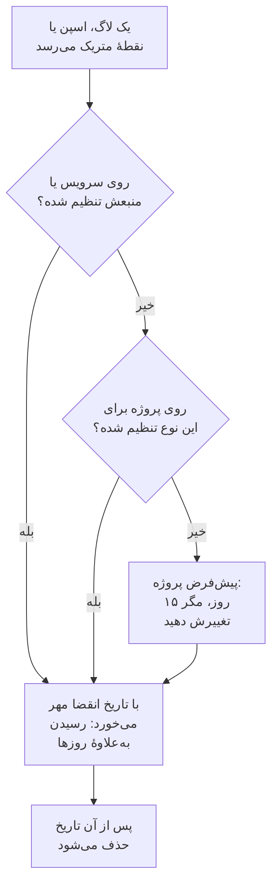

# نگهداری داده

OneUptime لاگ‌ها، ترِیس‌ها، متریک‌ها و پروفایل‌های شما را چند روز نگه می‌دارد و سپس حذفشان می‌کند: ۱۵ روز، مگر این‌که آن را تغییر دهید. این صفحه نشان می‌دهد این عدد چگونه به دست می‌آید، چگونه آن را برای کل پروژه تغییر دهید، و چگونه بخشی از تله‌متری را بیشتر یا کمتر از بقیه نگه دارید.

:::cards
- [تله‌متری چه مدت نگه داشته می‌شود](#تلهمتری-چه-مدت-نگه-داشته-میشود): ترتیبی که OneUptime تنظیمات را به آن می‌خواند.
- [تغییر نگهداری پروژه](#تغییر-نگهداری-پروژه): یک عدد برای همهٔ تله‌متری‌تان.
- [نگه داشتن بخشی از تله‌متری برای مدتی بیشتر یا کمتر](#نگه-داشتن-بخشی-از-تلهمتری-برای-مدتی-بیشتر-یا-کمتر): بر اساس نوع، شدت، وضعیت یا سرویس.
- [هزینهٔ نگهداری](#هزینهٔ-نگهداری): صورت‌حساب در OneUptime Cloud، دیسک در میزبانی شخصی.
:::

## تله‌متری چه مدت نگه داشته می‌شود

هر لاگ، اسپن، نقطهٔ متریک و نمونهٔ پروفایل هنگام رسیدن، دورهٔ نگهداری‌اش را می‌گیرد. OneUptime محاسبه می‌کند چند روز باید نگه داشته شود، تاریخ انقضایش را مهر می‌زند و پس از آن تاریخ حذفش می‌کند. دقیق‌ترین تنظیم برنده است:

به‌طور کامل، OneUptime این تنظیمات را به این ترتیب می‌خواند، و نخستین تنظیمی که مقدار داشته باشد تعیین‌کننده است:

| ترتیب | تنظیم | کجا تنظیم می‌شود |
| --- | --- | --- |
| ۱ | روزها برای یک شدت لاگ یا وضعیت اسپن، برای یک سرویس یا منبع | **نگهداری بر اساس نوع تله‌متری**، زیر **تنظیمات بیشتر** در صفحهٔ **تنظیمات** آن |
| ۲ | روزها برای یک نوع تله‌متری، برای یک سرویس یا منبع | همان کارت |
| ۳ | روزها برای هر چیزی از یک سرویس یا منبع | **نگهداری داده تله‌متری**، زیر **تنظیمات بیشتر** در همان صفحه |
| ۴ | روزها برای یک شدت لاگ یا وضعیت اسپن، برای پروژه | **نگهداری بر اساس نوع تله‌متری**، زیر **تنظیمات بیشتر** در **نگهداری داده** |
| ۵ | روزها برای یک نوع تله‌متری، برای پروژه | همان کارت |
| ۶ | روزها برای هر چیز دیگر | **نگهداری پیش‌فرض (روز)**، در **نگهداری داده** |

- **تنظیمات ۱ تا ۵ بازنویسی‌های نگهداری‌اند.** این‌ها بخشی از [نسخه سازمانی](/docs/self-hosted/enterprise) و طرح Scale در OneUptime Cloud هستند. بدون آن‌ها، هر رکورد به اندازهٔ پیش‌فرض پروژه نگه داشته می‌شود.
- **تغییر روی تله‌متری تازه اعمال می‌شود.** رکورد تاریخی را که با آن مهر خورده نگه می‌دارد: نگهداری کوتاه‌تر آن را زودتر حذف نمی‌کند، و نگهداری بلندتر آن را بیشتر نگه نمی‌دارد. رکوردهای تازه حدود پنج دقیقه بعد از تغییر پیروی می‌کنند.
- **استثناها از چیزی پیروی می‌کنند که در آن یافت شده‌اند.** یک استثنا به اندازهٔ اسپن یا لاگی که از آن آمده نگه داشته می‌شود. Session Replayها نگهداری خودشان را دارند: [داده‌های دیگر با نگهداری خودشان](#دادههای-دیگر-با-نگهداری-خودشان) را ببینید.

## پیش از شروع

- **نقشی که پروژه را تغییر دهد.** Project Owner یا Project Admin نگهداری پروژه را تغییر می‌دهند. نگهداری یک سرویس یا منبع به نقشی نیاز دارد که دیگر تنظیمات آن را تغییر می‌دهد.
- **برای بازنویسی‌ها، نسخه سازمانی یا طرح Scale.** نصب با میزبانی شخصی به مجوز Enterprise نیاز دارد، و پروژهٔ OneUptime Cloud به طرح Scale یا بالاتر. نگهداری پیش‌فرض پروژه در همهٔ نسخه‌ها و طرح‌ها وجود دارد.

## تغییر نگهداری پروژه

:::steps
### باز کردن نگهداری داده

به **تنظیمات پروژه** > **تله‌متری و APM** > **نگهداری داده** بروید. **تله‌متری و APM** در منوی کناری بسته شروع می‌شود: برای باز کردنش روی آن کلیک کنید. کارت **نگهداری داده تله‌متری**، **نگهداری پیش‌فرض (روز)** را نشان می‌دهد.

### تعیین شمار روزها

روی **Edit Retention Settings** کلیک کنید، شمار روزها را، دست‌کم ۱، وارد کنید و روی **ذخیره تغییرات** کلیک کنید.
:::

عدد تازه روی هر رکوردی اعمال می‌شود که از آن پس برسد و بازنویسی خودش را نداشته باشد.

## نگه داشتن بخشی از تله‌متری برای مدتی بیشتر یا کمتر

بازنویسی‌ها آنچه را لازم دارید بیشتر و بقیه را کمتر نگه می‌دارند: مثلاً لاگ‌های خطا را یک فصل، و لاگ‌های اشکال‌زدایی را چند روز.

### برای کل پروژه

زیر پیش‌فرض، جمع‌شده در **تنظیمات بیشتر**، کارت **نگهداری بر اساس نوع تله‌متری** برای هر نوع تله‌متری روزها را تعیین می‌کند. روی **Edit Overrides** کلیک کنید، فیلدهایی را که لازم دارید پر کنید و بقیه را خالی بگذارید:

| نوع | فیلدها |
| --- | --- |
| لاگ‌ها | **Logs default (days)**، و یک فیلد برای هر شدت لاگ |
| ترِیس‌ها | **Traces default (days)**، و یک فیلد برای هر وضعیت اسپن: خطا، موفق و تنظیم‌نشده |
| متریک‌ها | **Metrics default (days)** |
| پروفایل‌ها | **Profiles default (days)** |

فیلدی که خالی بماند به تنظیم بعدی در ترتیب بالا برمی‌گردد، پس شدتی که روزهای خودش را ندارد لاگ‌هایش را به اندازهٔ پیش‌فرض لاگ‌ها نگه می‌دارد.

### برای یک سرویس یا منبع

صفحهٔ **تنظیمات** سرویس یا منبع را باز کنید، سپس **تنظیمات بیشتر** را. کارت **نگهداری داده تله‌متری** آن **نگهداری داده تله‌متری به مدت (روز)** را دارد، یک عدد برای هر چیزی که می‌فرستد، و کارت **نگهداری بر اساس نوع تله‌متری** آن همان فیلدهای کارت پروژه را دارد. برای استفاده از تنظیمات پروژه، فیلد را خالی بگذارید.

سرویس‌ها، میزبان‌ها، خوشه‌های Kubernetes، میزبان‌های Docker و Podman، خوشه‌های Docker Swarm، Proxmox و Ceph، آرایه‌های ذخیره‌سازی، vCenterها، پایگاه‌داده‌ها، توابع بدون سرور، منابع ابری، برنامه‌های RUM و ناوگان‌های اینترنت اشیا همگی این کارت‌ها را دارند. برای صفحهٔ **تنظیمات** یک سرویس، [کاتالوگ سرویس](/docs/telemetry/services#تغییر-یک-سرویس) را ببینید.

### وقتی طرح یا مجوز دیگر بازنویسی‌ها را در بر ندارد

- **در نصب با میزبانی شخصی**، وقتی دورهٔ آزمایشی Enterprise یا مهلت اضافه بدون مجوز تمام شود، بازنویسی‌ها دیگر اعمال نمی‌شوند. تله‌متری تازه به اندازهٔ پیش‌فرض پروژه نگه داشته می‌شود، کارت‌ها فقط‌خواندنی می‌شوند، و هیچ چیزی که تنظیم کرده‌اید حذف نمی‌شود: مجوزی را فعال کنید تا دوباره اعمال شوند. [نسخه سازمانی](/docs/self-hosted/enterprise#وقتی-پروانه-منقضی-شده-یا-وجود-ندارد) را ببینید.
- **در OneUptime Cloud**، بازنویسی‌ای که یک دورهٔ آزمایشی تنظیم‌شده باقی گذاشته، در طرح‌های پایین‌تر از Scale هم اعمال می‌شود. صفحه‌اش آن را زیر کارت ارتقا نشان می‌دهد، با دکمهٔ **حذف بازنویسی** که در همهٔ طرح‌ها کار می‌کند. تنظیم دوبارهٔ یک بازنویسی به طرح Scale نیاز دارد.

## داده‌های دیگر با نگهداری خودشان

| داده | مدت نگهداری | کجا تغییرش دهید |
| --- | --- | --- |
| Session Replayها | ۷ روز، مگر تغییرش دهید | سیاست بازپخش برنامهٔ RUM: [مدیریت برنامه‌ها](/docs/rum/applications#نگهداشت-بازپخش-نشست) را ببینید. |
| لاگ‌های مانیتور، یک ردیف برای هر بررسی | ۱ روز، مگر تغییرش دهید | در نصب با میزبانی شخصی، **نگهداری لاگ مانیتور (روز)** در Admin Dashboard |
| متریک‌های مانیتور، و متریک‌هایی که SLOها ثبت می‌کنند | ۳۰ روز، مگر تغییرش دهید | در نصب با میزبانی شخصی، **نگهداری متریک مانیتور (روز)** در Admin Dashboard |

## هزینهٔ نگهداری

- **در OneUptime Cloud**، هزینهٔ تله‌متری بر اساس هر گیگابایت دریافت‌شده محاسبه می‌شود، و قیمت هر گیگابایت ۱۵ روز نگهداری را در بر دارد. نگهداری بلندتر به همان نسبت گران‌تر است: ۳۰ روز برای هر گیگابایت دو برابر ۱۵ روز هزینه دارد. نگهداری کوتاه‌تر به همان نسبت ارزان‌تر است، اما هزینهٔ نگهداری کمتر از ۷ روز به اندازهٔ ۷ روز محاسبه می‌شود. **تنظیمات پروژه** > **صورت‌حساب و فاکتورها** > **تاریخچه مصرف** روز به روز نشان می‌دهد هر سرویس چقدر فرستاده و چه مدت نگه داشته می‌شود.
- **در میزبانی شخصی**، تله‌متری در ClickHouse قرار دارد، و نگهداری دیسک آن را چند برابر می‌کند. [تعیین اندازه](/docs/installation/sizing#مدت-نگهداری-و-اثر-آن-بر-فضای-ذخیرهسازی) را ببینید.

تله‌متری‌ای که لازمش ندارید اگر هرگز ذخیره نشود هزینه‌ای ندارد: [فیلترهای حذف و قواعد پالایش](/docs/telemetry/drop-filters-and-scrub-rules) آن را هنگام رسیدن حذف می‌کنند.

## عیب‌یابی

:::details نگهداری را کم کردم، اما داده‌های قدیمی هنوز هستند
رکورد تاریخ انقضایی را که هنگام رسیدن با آن مهر خورده نگه می‌دارد. رکوردهایی که پیش از تغییر ذخیره شده‌اند در تاریخ‌های خودشان حذف می‌شوند، و فقط رکوردهای تازه از نگهداری تازه پیروی می‌کنند.
:::

:::details کارت‌های بازنویسی پیام ارتقا نشان می‌دهند
بازنویسی‌های نگهداری در نصب با میزبانی شخصی به نسخه سازمانی، و در OneUptime Cloud به طرح Scale نیاز دارند. تا آن زمان، همه‌چیز به اندازهٔ پیش‌فرض پروژه نگه داشته می‌شود.
:::

:::details فضای دیسک یک روز پس از انقضای داده‌ها برمی‌گردد
رکوردهای منقضی‌شده به محض انقضا دیگر در جستجوها، نمودارها و فهرست‌ها دیده نمی‌شوند. روی دیسک، لاگ‌ها و متریک‌ها در نخستین نیمه‌شب پس از آن حذف می‌شوند، پس فضایشان تا یک روز بعد برمی‌گردد.
:::

## گام‌های بعدی

:::cards
- [کلیدهای دریافت داده](/docs/telemetry/ingestion-keys): تله‌متری را به پروژه‌تان بفرستید.
- [فیلترهای حذف و قواعد پالایش](/docs/telemetry/drop-filters-and-scrub-rules): فقط تله‌متری‌ای را که لازم دارید نگه دارید.
- [کاتالوگ سرویس](/docs/telemetry/services): نگهداری خود یک سرویس را تعیین کنید.
- [نسخه سازمانی](/docs/self-hosted/enterprise): بازنویسی‌های نگهداری با چه چیزی می‌آیند.
:::
