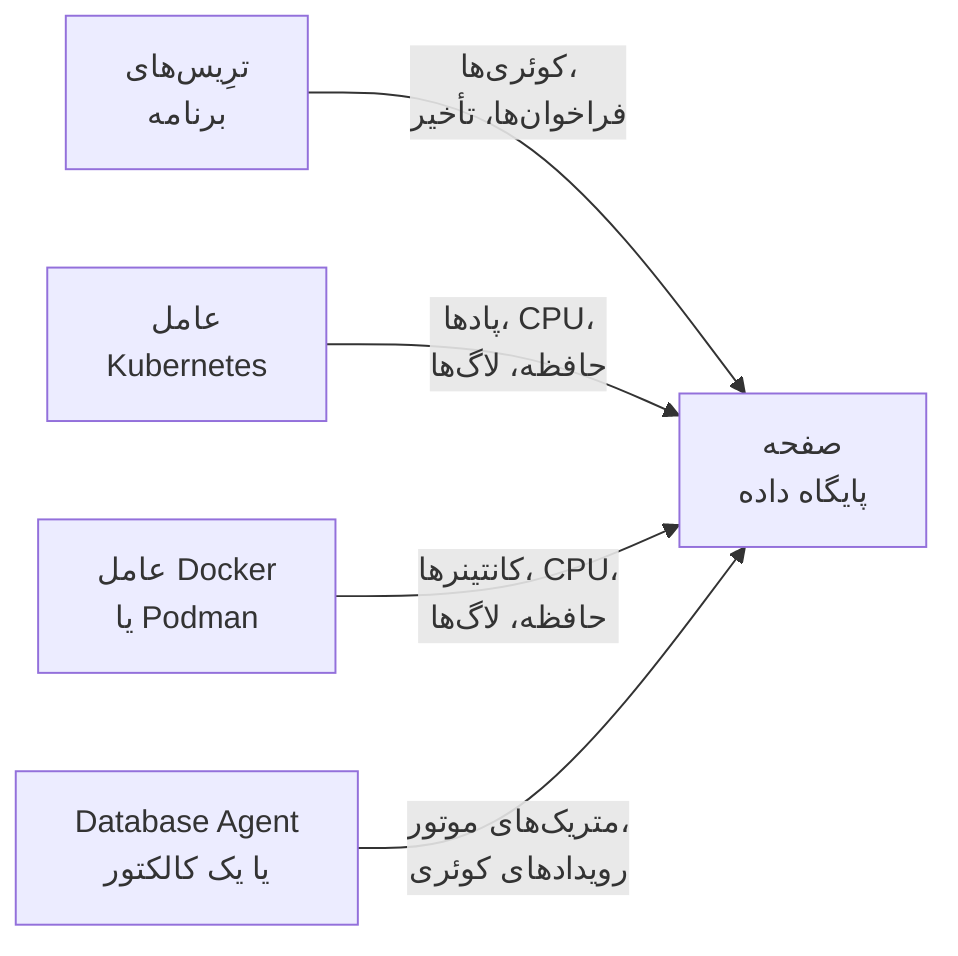

# پایگاه‌های داده

**Databases** به هر سرور پایگاه داده‌ای که پروژه شما اجرا می‌کند یا با آن کار می‌کند، صفحه‌ای از آنِ خودش می‌دهد: چه چیزی آن را فرا می‌خواند و با چه سرعتی، کجا اجرا می‌شود، متریک‌های سلامت خود موتور، لاگ‌ها و ترِیس‌هایش، حادثه‌ها، هشدارها و تعمیر و نگهداری‌های زمان‌بندی‌شده‌ای که به آن وصل‌اند، و مانیتورهای هشداری که برای موتورش پیشنهاد می‌شوند. پایگاه‌های داده هم مانند هر منبع دیگری برچسب، مالک، قاعده‌های برچسب و مالک، مدت نگهداشت جداگانه و بایگانی دارند. آن‌ها را از **محصولات** > **منابع** > **پایگاه‌های داده** باز کنید.

:::cards
- [Database Agent](#database-agent): متریک‌های موتور برای PostgreSQL، MySQL، SQL Server، Oracle، Redis، MongoDB، Elasticsearch و Memcached.
- [پایگاه‌های داده چگونه شناسایی می‌شوند](#پایگاههای-داده-چگونه-شناسایی-میشوند): از ترِیس‌ها، Kubernetes، Docker، Podman و کالکتورها.
- [هشدارها روی یک پایگاه داده](#هشدارها-روی-یک-پایگاه-داده): مانیتورهای پیشنهادی و مانیتورهایی که خودتان می‌سازید.
- [رفع اشکال](#رفع-اشکال): یک اسکریپت تشخیصی، و مشکلات معمول.
:::

## چگونه کار می‌کند

بیشتر پایگاه‌های داده خودشان ظاهر می‌شوند. OneUptime هر پایگاه داده را از حداکثر چهار منبع کنار هم می‌گذارد و هر منبع چیز متفاوتی به آن می‌افزاید:

| منبع | چه چیزی از شما لازم دارد | چه چیزی به صفحه پایگاه داده می‌افزاید |
| --- | --- | --- |
| **ترِیس‌های برنامه** | برنامه‌های ابزارگذاری‌شده (OpenTelemetry) | کوئری‌های برنامه‌ها: نرخ فراخوانی، خطاها، تأخیر و سرویس‌هایی که آن را فرا می‌خوانند |
| **Kubernetes** | [عامل Kubernetes در OneUptime](/docs/telemetry/kubernetes-agent) | محل اجرا: پادها، CPU و حافظه و لاگ‌های پادها |
| **Docker / Podman** | [عامل Docker](/docs/telemetry/docker-host) یا [عامل Podman](/docs/telemetry/podman-host) | محل اجرا: کانتینرها، CPU و حافظه آن‌ها و لاگ‌هایشان |
| **Database Agent** (یک OpenTelemetry Collector) | [Database Agent](#database-agent) یا کالکتور خودتان | **Engine metrics**: اتصال‌ها، توان عملیاتی، نسبت برخورد کش، قفل‌ها، تأخیر تکثیر، حافظه، تا جایی که موتور آن‌ها را دارد (ببینید [چه چیزهایی جمع‌آوری می‌شود](#چه-چیزهایی-جمعآوری-میشود))، به‌علاوه نمونه‌های کوئری اختیاری، کوئری‌های برتر و فایل لاگ موتور |



متریک‌های موتور فقط از کالکتوری می‌آیند که با خود پایگاه داده گفت‌وگو می‌کند (یا، برای یک پایگاه داده ابری مدیریت‌شده، با API پایش ارائه‌دهنده آن). ترِیس‌ها و فهرست کانتینرها به OneUptime می‌گویند که پایگاه داده‌ای وجود دارد و چگونه از آن استفاده می‌شود، اما نمی‌گویند درونش چه حالی دارد؛ وضعیت **Engine metrics** در هر پایگاه داده نشان می‌دهد آن بخش وصل است یا نه.

می‌توانید پایگاه داده را دستی هم اضافه کنید: **Databases** > **ساخت پایگاه داده** با موتور، نشانی و پورت آن. برای یک بررسی سلامت مبتنی بر کاوشگر که اصلاً به عامل نیازی ندارد، [مانیتور سلامت پایگاه داده](/docs/monitor/database-health-monitor) را ببینید.

## پایگاه‌های داده‌ای که پشتیبانی می‌شوند

OneUptime موتورهای زیر را با نام می‌شناسد: آنچه ابزارگذاری‌ها در `db.system.name` (یا `db.system` قدیمی‌تر) می‌گذارند را به مقدار ستون دوم یکسان‌سازی می‌کند، نام موتور را نشان می‌دهد، وقتی یک اسپن یا نشانی پورت ندارد پورت پیش‌فرض آن را به کار می‌برد، ایمیج‌های کانتینر و چارت‌های Helm آن را می‌شناسد و می‌داند متریک‌های موتورش از کجا می‌آیند. موتوری که در فهرست نیست هم هر جا که پایگاه داده با نشانی‌اش شناخته می‌شود کار می‌کند؛ فقط با همان نام خامی که اسپن‌های شما گزارش می‌کنند نشان داده می‌شود و هرگز فقط از ترِیس‌ها ساخته نمی‌شود.

**خانواده** موتوری است که از راه آن به یک فورک یا موتورِ سازگار در پروتکل دسترسی پیدا می‌شود: کتابخانه‌های کلاینت نمی‌توانند MariaDB را از MySQL یا Valkey را از Redis تشخیص دهند، پس اسپن `mysql` یا `redis` می‌گوید، در حالی که ایمیج کانتینر، چارت Helm یا Database Agent نام فورک را می‌برد. هر دو به همان پایگاه داده می‌رسند، و همین که ایمیج کانتینرِ آن، یا منبعی دست‌کم به قوت منبعی که پشت موتور کنونی آن است، موتور دقیق‌تر را نام ببرد، پایگاه داده همان را نشان می‌دهد (ببینید [پایگاه داده کدام موتور را نشان می‌دهد](#پایگاه-داده-کدام-موتور-را-نشان-میدهد)).

**ساخته‌شده از ترِیس‌ها** می‌گوید آیا اسپن‌های کلاینت به‌تنهایی پایگاه داده‌ای از آن موتور می‌سازند یا نه (ببینید [از ترِیس‌های برنامه](#از-ترِیسهای-برنامه)): سرویس مدیریت‌شده‌ای که از راه میزبان API مشترک ارائه‌دهنده‌اش در دسترس است، و موتوری که درون پردازه برنامه شما اجرا می‌شود، هرگز نمی‌سازند. **Engine metrics** می‌گوید متریک‌های سلامت خود موتور از کجا می‌آیند: پیکربندی Database Agent، یک گیرنده collector-contrib که به کالکتور خودتان اضافه می‌کنید، نقطه پایانی Prometheus خود موتور (`:port/path`، که با گیرنده `prometheus` کالکتور برداشت می‌شود)، API پایش ارائه‌دهنده ابری، یا چیزی داخلی نیست. زبانه **مستندات** هر پایگاه داده این را به یک پیکربندی کالکتورِ آماده برای همان پایگاه داده تبدیل می‌کند.

| موتور | `db.system.name` | پورت پیش‌فرض | خانواده | ساخته‌شده از ترِیس‌ها | Engine metrics |
| --- | --- | --- | --- | --- | --- |
| Actian Ingres | `actian.ingres` | — | — | بله | چیزی داخلی نیست |
| Actian Zen (Pervasive PSQL) | `pervasive` | 1583 | — | بله | چیزی داخلی نیست |
| Aerospike | `aerospike` | 3000 | — | بله | گیرنده `aerospike` |
| Amazon DocumentDB | `aws.documentdb` | 27017 | MongoDB | بله | گیرنده `awsfirehose` (پایش ابری) |
| Amazon DynamoDB | `aws.dynamodb` | 443 | — | خیر (API ابری) | گیرنده `awsfirehose` (پایش ابری) |
| Amazon Neptune | `aws.neptune` | 8182 | — | بله | گیرنده `awsfirehose` (پایش ابری) |
| Amazon Redshift | `aws.redshift` | 5439 | PostgreSQL | بله | گیرنده `awsfirehose` (پایش ابری) |
| Apache Derby | `derby` | 1527 | — | خیر (درون‌پردازه‌ای) | هیچ (درون‌پردازه‌ای) |
| Apache Doris | `doris` | 9030 | MySQL | بله | Prometheus, `:8030/metrics` |
| Apache Druid | `druid` | 8888 | — | بله | چیزی داخلی نیست |
| Apache Geode | `geode` | 10334 | — | بله | چیزی داخلی نیست |
| Apache HBase | `hbase` | — | — | بله | چیزی داخلی نیست |
| Apache Hive | `hive` | 10000 | — | بله | چیزی داخلی نیست |
| Apache Ignite | `ignite` | 10800 | — | بله | چیزی داخلی نیست |
| Apache Impala | `impala` | 21050 | — | بله | چیزی داخلی نیست |
| Apache Pinot | `pinot` | 8099 | — | بله | چیزی داخلی نیست |
| Apache Solr | `solr` | 8983 | — | بله | چیزی داخلی نیست |
| ArangoDB | `arangodb` | 8529 | — | بله | Prometheus, `:8529/_admin/metrics/v2` |
| Azure Cosmos DB | `azure.cosmosdb` | 443 | — | خیر (API ابری) | گیرنده `azure_monitor` (پایش ابری) |
| Cassandra | `cassandra` | 9042 | — | بله | چیزی داخلی نیست |
| Chroma | `chroma` | 8000 | — | بله | چیزی داخلی نیست |
| Claris FileMaker | `filemaker` | 2399 | — | بله | چیزی داخلی نیست |
| ClickHouse | `clickhouse` | 9000 | — | بله | Prometheus, `:9363/metrics` |
| Cloud Bigtable | `gcp.bigtable` | 443 | — | خیر (API ابری) | گیرنده `googlecloudmonitoring` (پایش ابری) |
| Cloud Firestore | `gcp.firestore` | 443 | — | خیر (API ابری) | گیرنده `googlecloudmonitoring` (پایش ابری) |
| Cloud Spanner | `gcp.spanner` | 443 | — | خیر (API ابری) | گیرنده `google_cloud_spanner` |
| CockroachDB | `cockroachdb` | 26257 | PostgreSQL | بله | Prometheus, `:8080/_status/vars` |
| Couchbase | `couchbase` | 11210 | — | بله | Prometheus, `:8091/metrics` |
| CouchDB | `couchdb` | 5984 | — | بله | گیرنده `couchdb` |
| Databricks | `databricks` | 443 | — | بله | چیزی داخلی نیست |
| Dragonfly | `dragonfly` | 6379 | Redis | بله | Database Agent (گیرنده `redis`) |
| DuckDB | `duckdb` | — | — | خیر (درون‌پردازه‌ای) | هیچ (درون‌پردازه‌ای) |
| Elasticsearch | `elasticsearch` | 9200 | — | بله | Database Agent (گیرنده `elasticsearch`) |
| etcd | `etcd` | 2379 | — | بله | Prometheus, `:2379/metrics` |
| FerretDB | `ferretdb` | 27017 | MongoDB | بله | Prometheus, `:8088/debug/metrics` |
| Firebird | `firebirdsql` | 3050 | — | بله | چیزی داخلی نیست |
| FoundationDB | `foundationdb` | 4500 | — | بله | چیزی داخلی نیست |
| Google BigQuery | `bigquery` | 443 | — | خیر (API ابری) | گیرنده `googlecloudmonitoring` (پایش ابری) |
| Greenplum | `greenplum` | 5432 | PostgreSQL | بله | چیزی داخلی نیست |
| H2 | `h2database` | 9092 | — | خیر (درون‌پردازه‌ای) | هیچ (درون‌پردازه‌ای) |
| Hazelcast | `hazelcast` | 5701 | — | بله | چیزی داخلی نیست |
| HyperSQL | `hsqldb` | 9001 | — | خیر (درون‌پردازه‌ای) | هیچ (درون‌پردازه‌ای) |
| IBM Db2 | `ibm.db2` | 50000 | — | بله | چیزی داخلی نیست |
| IBM Informix | `ibm.informix` | 9088 | — | بله | چیزی داخلی نیست |
| IBM Netezza | `ibm.netezza` | 5480 | — | بله | چیزی داخلی نیست |
| InfluxDB | `influxdb` | 8086 | — | بله | Prometheus, `:8086/metrics` |
| InstantDB | `instantdb` | — | — | خیر (درون‌پردازه‌ای) | هیچ (درون‌پردازه‌ای) |
| InterBase | `interbase` | 3050 | Firebird | بله | چیزی داخلی نیست |
| InterSystems IRIS / Caché | `intersystems.cache` | 1972 | — | بله | Prometheus, `:52773/api/monitor/metrics` |
| KeyDB | `keydb` | 6379 | Redis | بله | Database Agent (گیرنده `redis`) |
| MariaDB | `mariadb` | 3306 | MySQL | بله | Database Agent (گیرنده `mysql`) |
| Meilisearch | `meilisearch` | 7700 | — | بله | Prometheus, `:7700/metrics` |
| Memcached | `memcached` | 11211 | — | بله | Database Agent (گیرنده `memcached`) |
| Milvus | `milvus` | 19530 | — | بله | Prometheus, `:9091/metrics` |
| MongoDB | `mongodb` | 27017 | — | بله | Database Agent (گیرنده `mongodb`) |
| MySQL | `mysql` | 3306 | — | بله | Database Agent (گیرنده `mysql`) |
| Neo4j | `neo4j` | 7687 | — | بله | Prometheus, `:2004/metrics` |
| OceanBase | `oceanbase` | 2881 | MySQL | بله | چیزی داخلی نیست |
| OpenSearch | `opensearch` | 9200 | Elasticsearch | بله | Database Agent (گیرنده `elasticsearch`) |
| Oracle | `oracle.db` | 1521 | — | بله | Database Agent (گیرنده `oracledb`) |
| Pinecone | `pinecone` | 443 | — | خیر (API ابری) | چیزی داخلی نیست |
| PostgreSQL | `postgresql` | 5432 | — | بله | Database Agent (گیرنده `postgresql`) |
| Presto | `presto` | 8080 | — | بله | چیزی داخلی نیست |
| Progress OpenEdge | `progress` | — | — | بله | چیزی داخلی نیست |
| Qdrant | `qdrant` | 6333 | — | بله | Prometheus, `:6333/metrics` |
| QuestDB | `questdb` | 8812 | PostgreSQL | بله | Prometheus, `:9003/metrics` |
| RavenDB | `ravendb` | 8080 | — | بله | چیزی داخلی نیست |
| Redis | `redis` | 6379 | — | بله | Database Agent (گیرنده `redis`) |
| Riak KV | `riak` | 8087 | — | بله | گیرنده `riak` |
| SAP ASE (Sybase) | `sybase` | 5000 | — | بله | چیزی داخلی نیست |
| SAP HANA | `sap.hana` | 30015 | — | بله | گیرنده `saphana` |
| SAP MaxDB | `sap.maxdb` | 7210 | — | بله | چیزی داخلی نیست |
| ScyllaDB | `scylladb` | 9042 | Cassandra | بله | Prometheus, `:9180/metrics` |
| SingleStore | `singlestore` | 3306 | MySQL | بله | Prometheus, `:9104/metrics` |
| Snowflake | `snowflake` | 443 | — | بله | گیرنده `snowflake` |
| Software AG Adabas | `softwareag.adabas` | — | — | بله | چیزی داخلی نیست |
| SQL Server | `microsoft.sql_server` | 1433 | — | بله | Database Agent (گیرنده `sqlserver`) |
| SQLite | `sqlite` | — | — | خیر (درون‌پردازه‌ای) | هیچ (درون‌پردازه‌ای) |
| StarRocks | `starrocks` | 9030 | MySQL | بله | Prometheus, `:8030/metrics` |
| SurrealDB | `surrealdb` | 8000 | — | بله | چیزی داخلی نیست |
| Teradata | `teradata` | 1025 | — | بله | چیزی داخلی نیست |
| TiDB | `tidb` | 4000 | MySQL | بله | Prometheus, `:10080/metrics` |
| Trino | `trino` | 8080 | — | بله | Prometheus, `:8080/metrics` |
| Typesense | `typesense` | 8108 | — | بله | چیزی داخلی نیست |
| Valkey | `valkey` | 6379 | Redis | بله | Database Agent (گیرنده `redis`) |
| Vertica | `vertica` | 5433 | — | بله | چیزی داخلی نیست |
| Vitess | `vitess` | 3306 | MySQL | بله | Prometheus, `:15000/metrics` |
| Weaviate | `weaviate` | 8080 | — | بله | Prometheus, `:2112/metrics` |
| YugabyteDB | `yugabytedb` | 5433 | PostgreSQL | بله | Prometheus, `:9000/prometheus-metrics` |

املاهای رایج دیگر هم پذیرفته می‌شوند: `postgres` و `pg`، `mssql` و `sqlserver`، `oracle`، `mongo`، `scylla`، `dragonflydb`، `memsql`، و همه مقدارهای قدیمی `db.system` که OpenTelemetry به کار برده است (`db2`، `hanadb`، `cosmosdb`، `dynamodb`، `spanner`، `redshift`، `informix`، `maxdb`، `cache`، `h2`، `firebird`، `edb`، `cloudscape`، …). سرویس مدیریت‌شده‌ای که پروتکل یک موتور را صحبت می‌کند (Amazon RDS و Aurora، Azure Database، Cloud SQL، AlloyDB، Neon، Supabase، PlanetScale، ElastiCache، Memorystore، MongoDB Atlas) همان موتور است.

## پایگاه‌های داده چگونه شناسایی می‌شوند

هر پایگاه داده منبعی را که آن را ساخته به خاطر می‌سپارد (ستون **Discovered from**)، و نخستین مورد در **فید** آن می‌گوید چه چیزی آن را پیدا کرده است: بار کاری Kubernetes و خوشه‌اش، کانتینر Docker یا Podman (یا سرویس Compose یا Swarm) و میزبانش، نقطه پایانی‌ای که برنامه‌ها فراخوانده‌اند، یا Database Agent (با نسخه‌اش) یا کالکتوری که آن را گزارش کرده است. منبع‌های بعدی به جای ساختن پایگاه داده‌ای دیگر به همان پایگاه داده افزوده می‌شوند، تا وقتی که همان نقطه پایانی را توصیف کنند (ببینید [نقاط پایانی](#نقاط-پایانی-و-قاعده-یک-مالک)).

### از ترِیس‌های برنامه

OneUptime هر ۱۰ دقیقه اسپن‌های CLIENT را که برنامه‌های شما در ۱۵ دقیقه گذشته فرستاده‌اند و `db.system.name` (یا `db.system` قدیمی‌تر) دارند خلاصه می‌کند. سرور از `server.address` (یا `net.peer.name` قدیمی‌تر، سپس `network.peer.address` / `net.sock.peer.addr`) و پورت از `server.port` (یا `net.peer.port`، `network.peer.port`، `net.sock.peer.port`) می‌آید؛ وقتی اسپن پورت ندارد، پورت پیش‌فرض موتور فرض می‌شود. نام موتورها یکسان‌سازی می‌شوند (ببینید [پایگاه‌های داده‌ای که پشتیبانی می‌شوند](#پایگاههای-دادهای-که-پشتیبانی-میشوند))، پس `postgres`، `pg` و `postgresql` یک موتورند، همان‌طور که `mssql` و `microsoft.sql_server`؛ `mariadb` و `mysql` دو موتور از یک خانواده‌اند.

یک پایگاه داده فقط وقتی از ترِیس‌ها **ساخته می‌شود** که همه این شرط‌ها برقرار باشند؛ هر چیز دیگری همچنان برای پایگاه داده‌ای که از پیش وجود دارد حساب می‌شود، فقط هرگز پایگاه داده‌ای نمی‌سازد:

- نشانی در کل پروژه به یک سرور اشاره کند: یک نام DNS، نه یک IP لفظی و نه نامی که فقط روی یک ماشین یا درون یک شبکه resolve می‌شود، مگر آنکه خوشه Kubernetes فراخواننده آن را مشخص کند (ببینید [نقاط پایانی](#نقاط-پایانی-و-قاعده-یک-مالک))؛
- پورت از پورت‌هایی باشد که یک سرور روی آن گوش می‌دهد. سیستم‌عامل‌ها برای سمت کلاینتِ یک اتصال پورتی از ۳۲۷۶۸ به بالا برمی‌دارند (بازه پورت‌های موقت پیش‌فرض Linux از آنجا شروع می‌شود؛ Windows و macOS از ۴۹۱۵۲ تا ۶۵۵۳۵ استفاده می‌کنند)، پس پورتی از ۳۲۷۶۸ به بالا هرگز پایگاه داده‌ای نمی‌سازد، مگر آنکه پورت پیش‌فرض خود موتور باشد (۵۰۰۰۰ در IBM Db2). ابزارگذاری eBPF، از جمله ابزارگذاری عامل Kubernetes، ممکن است در میانه یک اتصال طولانی به آن بپیوندد و دو سرش را جابه‌جا کند. آن‌وقت اسپن پورت خود کلاینت را به‌عنوان سرور نام می‌برد، و بدون این قاعده هر اتصال به پایگاه داده‌ای جداگانه تبدیل می‌شد؛
- موتور از موتورهایی باشد که OneUptime می‌شناسد و نشانی خودش را داشته باشد: ستون **ساخته‌شده از ترِیس‌ها** در [پایگاه‌های داده‌ای که پشتیبانی می‌شوند](#پایگاههای-دادهای-که-پشتیبانی-میشوند). APIهای ابری که میزبانشان میان همه مشتریان مشترک است (DynamoDB، BigQuery، Spanner، Firestore، Bigtable، Cosmos DB، Pinecone)، موتورهایی که درون برنامه شما اجرا می‌شوند (SQLite، DuckDB، H2، HyperSQL، Derby) و موتورهایی که OneUptime نمی‌شناسد هرگز از ترِیس‌ها ساخته نمی‌شوند؛ آن‌ها را دستی اضافه کنید؛
- نقطه پایانی در پنجره ۱۵ دقیقه‌ای که هر اجرا به آن نگاه می‌کند دست‌کم ۱۰ کوئری دریافت کرده باشد، تا یک اسکریپت یک‌باره پایگاه داده‌ای نسازد. اسپن‌های مدیریت اتصالِ یک کتابخانه کلاینت (`pg.connect` و `pg-pool.connect` از node-postgres، `redis-connect`، `connect`، …) کوئری نیستند: نه اینجا شمرده می‌شوند و نه در **کوئری‌ها** یک پایگاه داده؛
- پروژه زیر [سقف ساخت خودکار](#سقف-ساخت-خودکار) خود باشد.

هر اسپن CLIENT پایگاه داده هنگام دریافت با نقطه پایانی‌اش هم برچسب می‌خورد، پس همین که یک پایگاه داده مالک یک نقطه پایانی شود، بخش **کوئری‌های برنامه‌ها** و زبانه **ترِیس‌ها** هر فراخوانی به آن را نشان می‌دهند، حتی فراخوانی‌هایی که پیش از ساخته‌شدن پایگاه داده انجام شده‌اند. متریک‌های `db.client.*` (برای نمونه `db.client.operation.duration`) که `server.address` دارند هم به همین شکل برچسب می‌خورند.

**خوشه‌ها و فهرست میزبان‌ها.** رشته اتصالی که چند میزبان را فهرست می‌کند (`m1:27017,m2:27017,m3:27017`) یک پایگاه داده است، به هر ترتیبی که کلاینت آن‌ها را فهرست کند. عضوهای MongoDB Atlas (`cluster0-shard-00-01.ab1cd.mongodb.net`) به یک پایگاه داده با نام خوشه‌شان (`cluster0.ab1cd.mongodb.net`) تبدیل می‌شوند و هر عضوی که دیده شود یکی از نقاط پایانی آن می‌شود. درایورهایی که هر عضو یک حلقه Cassandra، یک Redis Cluster، یک خوشه Elasticsearch یا گره‌های ElastiCache را جداگانه گزارش می‌کنند، همچنان برای هر عضو یک پایگاه داده می‌سازند: هیچ چیز در آن نام‌های میزبان نمی‌گوید به کدام خوشه تعلق دارند. یکی را نگه دارید و بقیه را در آن [ادغام کنید](#نقاط-پایانی-و-قاعده-یک-مالک).

### از Kubernetes

OneUptime هر ۵ دقیقه پادهای هر خوشه Kubernetes وصل‌شده را بررسی می‌کند و بارهای کاری پایگاه داده را می‌شناسد:

1. **نخست برچسب‌های اپراتور و چارت**: CloudNativePG، Zalando (Spilo)، Crunchy PGO، چارت‌های Bitnami، ECK، Altinity ClickHouse، cass-operator، Percona، اپراتور Oracle MySQL و اپراتور Vitess (پادهای `vtgate` آن پایگاه داده‌اند؛ `vttablet`، `vtctld`، `vtorc` و `vtbackup` بخش‌هایی از آن‌اند، نه عضو). هر خوشه اپراتور یک پایگاه داده می‌شود. Service مربوط به vtgate خودِ خوشه Vitess نامی هش‌شده دارد، پس اگر برنامه‌ها از راه آن وصل می‌شوند، آن را در زبانه **نقاط پایانی** پایگاه داده اضافه کنید.
2. **در غیر این صورت ایمیج‌های کانتینر**، بر پایه نام دقیق ایمیج: ایمیج‌های رسمی، ایمیج‌های Bitnami (از جمله مخزن‌های جابه‌جاشده `bitnamilegacy` و `bitnamisecure`) و ایمیج‌های Red Hat / OpenShift برای هر موتوری در [پایگاه‌های داده‌ای که پشتیبانی می‌شوند](#پایگاههای-دادهای-که-پشتیبانی-میشوند) که ایمیجی ارائه می‌دهد (`postgres`، `bitnami/postgresql`، `rhel9/postgresql-16`، `mysql`، `mariadb`، `mssql/server`، `gvenzl/oracle-free`، `redis`، `valkey/valkey`، `mongo`، `cockroachdb/cockroach`، `pingcap/tidb`، `clickhouse/clickhouse-server`، `qdrant/qdrant`، …). یک فورک به‌عنوان خودش شناخته می‌شود: ایمیج `mariadb` همان MariaDB است و ایمیج `valkey/valkey` همان Valkey. اکسپورترها، اپراتورها، رابط‌های مدیریتی، pooler‌های اتصال (pgbouncer، pgpool، ProxySQL، HAProxy، Cloud SQL Proxy) و ابزارهای پشتیبان‌گیری پایگاه داده نیستند. پادی که یک کانتینر برنامه هم اجرا می‌کند نیز پایگاه داده به حساب نمی‌آید (برنامه‌ای با یک sidecar پایگاه داده همچنان همان برنامه است)، هرچند StatefulSetی که کانتینر پایگاه داده‌اش پورت پیش‌فرض موتور را اعلام می‌کند می‌تواند یک کانتینر اضافه داشته باشد که OneUptime آن را نمی‌شناسد (برای نمونه یک فرستنده لاگ).

ایمیج پایگاه داده یک پاد را سرور پایگاه داده نمی‌کند، اما فقط شواهد روشن آن را چیز دیگری می‌کند. کانتینری که برنامه‌اش یک ابزار کلاینت یا dump است (`psql`، `redis-cli`، `mongosh`، `pg_dump`، `mysql`)، یک نگه‌دارنده (`sleep infinity`، `tail -f /dev/null`) یا یک shell تعاملی (یا اسکریپت `sh -c` آن جز چنین ابزارهایی، فرمان‌های داخلی shell و ابزارهای ساده‌ای مثل `echo` و `cp` چیزی اجرا نمی‌کند)، یک اجرای کلاینت یا اشکال‌زدایی است، نه پایگاه داده؛ Sentinel مربوط به Redis یا Valkey (`redis-sentinel`، `redis-server --sentinel`) هم همین‌طور. این پشت یک راه‌انداز هم برقرار است: از `env` (با تنظیم‌های `NAME=value` آن)، `nohup`، `setsid`، `tini`، `dumb-init` و `docker-entrypoint.sh` ایمیج عبور می‌شود تا به برنامه‌ای برسد که آن‌ها اجرا می‌کنند، و همین در مورد `exec`، `env` و `nohup` درون یک اسکریپت صادق است، پس `env PGPASSWORD=… psql` و `tini -- redis-cli` اجراهای کلاینت‌اند، در حالی که `tini -- docker-entrypoint.sh postgres` سرور است، و `docker-entrypoint.sh -c max_connections=200` هم، یعنی سرور خود ایمیج که با یک پرچم اجرا شده است. اسکریپتی که بعد چیز دیگری را اجرا می‌کند (`sleep 5 && exec redis-server`، `bash -ecx 'exec cockroach start …'`)، یک فایل اسکریپت (`sh /start.sh`)، یک پوشاننده که پیش از برنامه آرگومان‌های خودش را می‌گیرد (`gosu postgres …`، `timeout 30 …`) یا اسکریپتی بیش از حد طولانی برای خواندن، سرورِ احتمالی به حساب می‌آید. پادهای تمام‌شده، کارهای دسته‌ای و پادهای یک‌باره `kubectl run` که هیچ پورتی اعلام نمی‌کنند هم پایگاه داده نیستند.

پایگاه داده وقتی ظاهر می‌شود که یکی از پادهایش حدود ۱۰ دقیقه Ready بوده باشد (وقتی فقط یک sidecar نمی‌گذارد پاد Ready شود، به جای آن کانتینر آماده پایگاه داده حساب می‌شود). پادی که در حلقه crash گیر کرده با هر راه‌اندازی دوباره از نو Ready می‌شود، پس هرگز پایگاه داده نمی‌شود، و یک کار CI یا پادی که پس از یک دقیقه از کار افتاده هم نمی‌شود. پایگاه داده پس از ساخته‌شدن در هر اجرا تازه می‌شود.

پادها بر پایه StatefulSet، Deployment یا خوشه اپراتورشان گروه‌بندی می‌شوند، پس یک StatefulSet سه‌عضوی یک پایگاه داده با سه عضو است. **نمونه‌ها** در صفحه آن پادهایی را می‌شمارد که کانتینر پایگاه داده‌شان در حال اجراست: نه پادی که در `CrashLoopBackOff` یا `ImagePullBackOff` منتظر است، یا پادی که پایان یافته، هرچند Kubernetes ممکن است چنین پادی را هنوز Running گزارش کند؛ بار کاری‌ای که تا صفر کوچک شده ۰ نشان می‌دهد و صفحه‌اش را نگه می‌دارد تا [بایگانی خودکار](#چرخه-عمر-بایگانی-و-نگهداشت) آن را کنار بگذارد. مسیر برگشت هم کار می‌کند: صفحه StatefulSet یا Deployment بار کاری، و صفحه هر یک از پادهایش، پایگاه داده‌ای را که اجرا می‌کند با پیوند **Open database** نام می‌برند، حتی StatefulSet یا Deploymentی که نامش با پایگاه داده‌اش فرق دارد (`shop-redis-master` از Bitnami برای `shop-redis`، `cluster1-pxc` از Percona برای `cluster1`)، در حالی که بار کاری pooler یا پشتیبان‌گیری که یک اپراتور آن را بخشی از یک خوشه برچسب می‌زند، می‌گوید بخشی از خوشه آن پایگاه داده است.

عامل Kubernetes اشیای Service را گزارش نمی‌کند، پس نام‌های Service یک پایگاه داده از قراردادهایی می‌آیند که چارت‌ها و اپراتورها دنبال می‌کنند: نام StatefulSet یا Deployment مالک، Service بدون‌سر (headless) آن StatefulSet (و هر عضو پشت آن، `<pod>.<headless-service>`)، و Serviceهای پروکسی و pooler اپراتورها: HAProxy و ProxySQL در Percona XtraDB Cluster، router و HAProxy در Percona Server for MySQL، mongos در Percona Server for MongoDB، pgBouncer از Crunchy و poolerهای Zalando و CloudNativePG. هر کدام به یک نقطه پایانی تبدیل می‌شود که با خوشه مشخص شده است (`postgres.prod.svc.cluster.local:5432@my-cluster`)، پس یک نام یکسان در دو خوشه دو پایگاه داده می‌ماند. تا وقتی پروژه دقیقاً یک خوشه دارد، `postgres.prod.svc.cluster.local:5432` بدون مشخص‌کننده هم اضافه می‌شود و حدود ۲ ساعت پس از پیدا شدن خوشه دوم دوباره آزاد می‌شود. Serviceی با هر نام دیگری را در زبانه **نقاط پایانی** پایگاه داده اضافه کنید.

برنامه‌هایی که تله‌متری‌شان از عامل Kubernetes می‌گذرد namespace و خوشه خود را همراه دارند، پس فراخوانی‌هایشان همان‌طور خوانده می‌شود که resolver پادشان آن‌ها را می‌خواند: `postgres` (از همان namespace)، `postgres.prod` (Service `postgres` در namespace `prod`)، `postgres.prod.svc` و نام کامل همگی با پایگاه داده تطبیق داده می‌شوند، و `mongo-0.mongo-headless` هم، که عضوی از یک StatefulSet در namespace خود فراخواننده است.

OneUptime فراداده پادها، برچسب‌ها، ایمیج‌ها، پورت‌های اعلام‌شده و آنچه خط فرمان یک کانتینر اجرا می‌کند را می‌خواند (نام برنامه، پرچم‌های یک shell و اینکه اسکریپت آن کدام فرمان‌های شناخته‌شده کلاینت، نگه‌دارنده و shell را اجرا می‌کند؛ هر فرمان دیگری فقط به‌عنوان ناشناخته ثبت می‌شود)، اما هرگز متغیرهای محیطی، مقدار آرگومان‌ها، متن اسکریپت‌ها یا رازها را نمی‌خواند.

### از Docker و Podman

هر ۵ دقیقه کانتینرهای هر میزبان Docker یا Podman وصل‌شده به همان روش بر پایه ایمیج دسته‌بندی می‌شوند، سپس بر پایه نام‌هایشان و برچسب‌های Compose، Swarm و Testcontainers گروه‌بندی و پالایش می‌شوند، و هرگز بر پایه فرمانی که اجرا می‌کنند نه (پایین‌تر را ببینید). کانتینرهای یک سرویس Compose (بر پایه برچسب‌های پروژه و سرویس Compose) یا یک سرویس Swarm یک پایگاه داده با چند عضوند و بار کاری آن همان سرویس است (`Compose service/<project>-<service>`، `Swarm service/<service>`). هر کانتینر دیگری با نام دقیق خودش (`Container/<name>`) پایگاه داده جداگانه‌ای است، پس `redis-6379` و `redis-6380` دو تا می‌مانند. Testcontainers، اجراهای یک‌باره `docker compose run`، کانتینرهایی که kubelet روی یک گره Docker اجرا می‌کند (کشف Kubernetes آن‌ها را به‌صورت پاد پیدا می‌کند) و کانتینرهایی که کمتر از ۱۰ دقیقه اجرا می‌شوند هرگز پایگاه داده نمی‌شوند. سن یک کانتینر همان مدت روشن‌بودنش است، پس کانتینری که از پیش آن‌قدر اجرا شده در نخستین اجرا پس از نصب عامل پایگاه داده می‌شود. **نمونه‌ها** کانتینرهای در حال اجرا را می‌شمارد، و صفحه هر کانتینر به پایگاه داده‌اش پیوند برگشت دارد (**Open database**). میزبانی که دو بار با یک نام ثبت شده یک بار خوانده می‌شود، از راه ثبتی که آخر از همه دیده شده است.

عامل این برچسب‌ها را همراه متریک‌های هر کانتینر می‌فرستد، وقتی `otel-collector-config.yaml` عامل آن‌ها را کپی کند (`container_labels_to_metric_labels`). عامل قدیمی‌تر Docker یا Podman این کار را نمی‌کند: آن را به‌روز کنید، وگرنه هر کانتینر پایگاه داده جداگانه‌ای می‌شود، از جمله اجراهای Testcontainers و اجراهای یک‌باره.

برخلاف Kubernetes، خط فرمان یک کانتینر هرگز خوانده نمی‌شود (عامل‌ها آن را نمی‌فرستند، چون ممکن است رازهایی در خود داشته باشد)، پس یک کانتینر کلاینت یا اشکال‌زدایی طولانی‌مدت از ایمیج یک پایگاه داده (`sleep infinity`، یک حلقه `psql` یا `redis-cli`) پس از ۱۰ دقیقه اجرا پایگاه داده می‌شود. برای کنار گذاشتنش آن را بایگانی کنید: پایگاه داده‌ای که شخصی بایگانی کرده بایگانی‌شده می‌ماند. اگر رهایش کنید، ۷ روز پس از توقف کانتینر [به‌طور خودکار بایگانی می‌شود](#چرخه-عمر-بایگانی-و-نگهداشت).

نام کانتینرها فقط درون یک شبکه Docker resolve می‌شوند، پس این پایگاه‌های داده به‌طور خودکار **هیچ** نقطه پایانی‌ای نمی‌گیرند؛ صفحه آن‌ها متریک‌ها و لاگ‌های خود کانتینرها را نشان می‌دهد. برای پیوند دادن کوئری‌هایی که برنامه‌هایتان می‌فرستند، نشانی‌ای را که آن‌ها به کار می‌برند در زبانه [نقاط پایانی](#نقاط-پایانی-و-قاعده-یک-مالک) اضافه کنید.

برای متریک‌های موتور، [Database Agent](#database-agent) را از زبانه **مستندات** خود پایگاه داده نصب کنید: فرمان نصب و `.env` آن `DATABASE_SERVER_ID` را از پیش پرشده دارند، پس داده‌های عامل به همین پایگاه داده می‌پیوندند. عاملی که بدون آن نصب شود، در عوض با `DATABASE_SERVER_ADDRESS` خود تطبیق داده می‌شود که پایگاه داده کانتینری مالکش نیست: یک نام DNS سرور را به‌عنوان پایگاه داده دوم ثبت می‌کند (یک صفحه با کانتینرها، صفحه‌ای دیگر با متریک‌های موتور؛ ببینید [دو پایگاه داده برای یک سرور](#دو-پایگاه-داده-برای-یک-سرور))، و یک IP خصوصی یا نام کانتینر به هیچ چیز نمی‌پیوندد.

### از Database Agent یا کالکتور خودتان

وقتی متریک‌ها یا لاگ‌های موتور از یک گیرنده پایگاه داده در کالکتور می‌رسند، OneUptime همان لحظه دریافت آن‌ها را با یک پایگاه داده تطبیق می‌دهد: اگر داده `oneuptime.database.server.id` (یعنی `DATABASE_SERVER_ID` عامل) را داشته باشد مستقیم با id، وگرنه با نقطه پایانی‌ای که داده نام می‌برد (`server.address` / `server.port`):

- داده‌ای که با id پیوند خورده به همان پایگاه داده می‌پیوندد و در صفحه‌های آن (و فقط آنجا) نشان داده می‌شود، هر نشانی‌ای که گزارش کند: یک IP خصوصی، یک نام محلیِ خوشه، نشانی‌ای که پایگاه داده دیگری مالک آن است، یا اصلاً هیچ. نشانی گزارش‌شده‌ای که در کل پروژه به یک سرور اشاره می‌کند و هنوز به هیچ پایگاه داده‌ای تعلق ندارد، به‌عنوان نقطه پایانی به پایگاه داده افزوده می‌شود، تا ترِیس‌های برنامه به آن نشانی هم به آنجا برسند؛
- وگرنه نقطه پایانی‌ای که یک پایگاه داده از پیش مالک آن است داده را به همان پایگاه داده پیوند می‌دهد، هر چه آن را ساخته باشد؛
- وگرنه یک پایگاه داده **ساخته می‌شود**، اما فقط از نامی که در کل پروژه به معنای یک سرور است (یک نام DNS، یک IP عمومی، یا یک نام محلیِ خوشه، `.internal` یا `.local` که داده آن را با خوشه Kubernetes خود مشخص کرده است، یعنی `k8s.cluster.name`، که Database Agent هرگز آن را نمی‌گذارد)، و فقط برای موتوری که می‌تواند خودبه‌خود ساخته شود (ستون **ساخته‌شده از ترِیس‌ها** در [پایگاه‌های داده‌ای که پشتیبانی می‌شوند](#پایگاههای-دادهای-که-پشتیبانی-میشوند): هرگز یک API ابری مشترک، موتوری درون‌پردازه‌ای یا موتوری ناشناخته). IPهای خصوصی و link-local، نام‌های تک‌برچسبی (`db`) و نام‌های محلیِ خوشه بدون مشخص‌کننده (`postgres.prod.svc.cluster.local`)، `.internal` یا `.local` می‌توانند در هر شبکه سرور دیگری باشند؛ IP یک پاد با هر راه‌اندازی دوباره عوض می‌شود؛ و نام تک‌برچسبی‌ای که namespace خود کالکتور کاملش کرده ممکن است یک Service یا پاد خود کالکتور باشد. داده‌ای که یکی از این‌ها را نام می‌برد فقط به پایگاه داده‌ای می‌پیوندد که آن را از پیش به‌عنوان نقطه پایانی دارد: برای نام‌های Service، همان بار کاری‌ای که در Kubernetes شناسایی شده است. آن پایگاه داده را دستی بسازید (**Databases** > **ساخت پایگاه داده**، با همان نشانی و پورت) یا عامل را با `DATABASE_SERVER_ID` به آن پیوند دهید. در پروژه‌ای که یک خوشه Kubernetes دارد، نام محلیِ خوشه یک Service بدون خوشه‌اش پذیرفته نمی‌شود: پایگاه داده را به‌صورت `postgres.prod.svc.cluster.local:5432@my-cluster` بسازید، سپس `postgres.prod.svc.cluster.local:5432` بدون مشخص‌کننده (آنچه عامل گزارش می‌کند) را در زبانه **نقاط پایانی** آن اضافه کنید؛
- دسته‌ای از گیرنده که اصلاً هیچ سروری را نام نمی‌برد نادیده گرفته می‌شود (ببینید [استفاده از OpenTelemetry Collector خودتان](#استفاده-از-opentelemetry-collector-خودتان)).

پایگاه‌های داده‌ای که یک کالکتور می‌سازد، مانند هر پایگاه داده کشف‌شده دیگری، در [سقف ساخت خودکار](#سقف-ساخت-خودکار) شمرده می‌شوند؛ پایگاه داده‌ای که دستی ساخته‌اید و با `DATABASE_SERVER_ID` پیوند داده‌اید هرگز به ساخته‌شدن نیاز ندارد. [Database Agent](#database-agent) را ببینید.

### پایگاه داده کدام موتور را نشان می‌دهد

وقتی منبع‌ها درباره موتور یک پایگاه داده هم‌نظر نیستند، شاهد قوی‌تر برنده است: موتوری که شخصی تنظیم کرده، سپس یک کالکتور یا Database Agent (موتوری که درباره خودش گزارش می‌دهد)، سپس یک ایمیج کانتینر یا چارت Helm، سپس اسپن‌های کلاینت؛ یک درایور PostgreSQL حتی وقتی با CockroachDB کار می‌کند `postgresql` گزارش می‌دهد. یک منبع پایگاه داده را فقط وقتی به خانواده موتور دیگری می‌برد که شاهدش از آنچه موتور کنونی را نام برده قوی‌تر باشد، و موتوری که شخصی تنظیم کرده هرگز با کشف عوض نمی‌شود. درون یک خانواده، فورک موتور را دقیق‌تر می‌کند وقتی منبعی که آن را نام می‌برد دست‌کم به قوت منبعی باشد که موتور کنونی را نام برده، یا یک ایمیج کانتینر باشد: اسپن می‌گوید `redis`، ایمیج می‌گوید `valkey` و پایگاه داده Valkey را نشان می‌دهد، حتی جایی که گیرنده `redis` یک کالکتور گفته بود `redis`، چون آن گیرنده نمی‌تواند این دو را از هم تشخیص دهد. ترِیس‌های برنامه به‌تنهایی هرگز موتوری را که یک ایمیج یا کالکتور تعیین کرده دقیق‌تر نمی‌کنند: کلاینت پروتکلی را نام می‌برد که با آن صحبت می‌کند، و MariaDB Connector/J حتی در برابر یک سرور MySQL هم `mariadb` گزارش می‌دهد. کالکتور فورک را وقتی نام می‌برد که آن را در `db.system.name` بگذارد (Database Agent این کار را بر پایه `DATABASE_SYSTEM` می‌کند)، یا وقتی `db.system.version` دسته آن را نام ببرد: رشته نسخه‌ای که نام فورک را در خود دارد (`8.0.11-TiDB-v7.5.1`)، یا نسخه اصلی‌ای که فقط آن فورک منتشر کرده است؛ MySQL نسخه 10.x یا 11.x ندارد، پس `mysql` با `11.4.13`، یعنی همان عدد خالی که گیرنده `mysql` برای MariaDB 11.4 گزارش می‌کند، MariaDB است (ببینید [استفاده از OpenTelemetry Collector خودتان](#استفاده-از-opentelemetry-collector-خودتان)). یک فورک فقط با ایمیج کانتینری لغو می‌شود که موتور خانواده‌اش را نام ببرد، و فقط وقتی که جز ترِیس‌های برنامه چیزی فورک را نام نبرده باشد؛ کالکتور یا ترِیسی که خانواده را نام ببرد هرگز آن را لغو نمی‌کند. بار کاری Kubernetes که ایمیجش به فورکی از همان خانواده تغییر می‌کند (`redis` به `valkey`) همان پایگاه داده می‌ماند.

### سقف ساخت خودکار

ترِیس‌ها، Kubernetes، Docker، Podman و کالکتورها فقط تا وقتی پایگاه داده را خودبه‌خود می‌سازند که پروژه کمتر از ۵۰۰ پایگاه داده کشف‌شده فعال و بایگانی‌نشده داشته باشد (`DATABASE_SERVER_AUTO_CREATE_BUDGET`، ببینید [تنظیم برای نصب خودمیزبان](#تنظیم-برای-نصب-خودمیزبان)). پایگاه‌های داده‌ای که دستی می‌سازید هرگز شمرده نمی‌شوند و هرگز مسدود نمی‌شوند؛ پایگاه‌های داده بایگانی‌شده شمرده نمی‌شوند، پس [بایگانی خودکار](#چرخه-عمر-بایگانی-و-نگهداشت) سقف را آزاد می‌کند؛ و پایگاه‌های داده‌ای که از پیش وجود دارند همچنان تطبیق داده و به‌روز می‌شوند. وقتی به سقف برسید، داده کالکتور برای یک نقطه پایانی تازه چیزی نمی‌سازد (فقط به پایگاه‌های داده موجود می‌پیوندد) و OneUptime برای هر پروژه حداکثر هر ۱۰ دقیقه یک بار هشداری در لاگ ثبت می‌کند.

## Database Agent

OneUptime Database Agent یک OpenTelemetry Collector از پیش پیکربندی‌شده برای **PostgreSQL**، **MySQL / MariaDB**، **SQL Server**، **Oracle**، **Redis / Valkey / KeyDB / Dragonfly**، **MongoDB**، **Elasticsearch / OpenSearch** و **Memcached** است. فقط از پیکربندی تشکیل شده است: یک کانتینر استاندارد `otel/opentelemetry-collector-contrib` که گیرنده بومی کالکتور را برای موتور شما اجرا می‌کند، با پیکربندی‌ای که هویت پایگاه داده را روی هر دسته می‌زند و آن را از راه OTLP به OneUptime می‌فرستد. هیچ چیزی روی سرور پایگاه داده نصب نمی‌شود. همان `docker-compose.yml` [عامل هوش مصنوعی پایگاه داده](#عامل-هوش-مصنوعی) را هم کنار کالکتور برای OneUptime AI اجرا می‌کند. برای موتورهای دیگرِ [پایگاه‌های داده‌ای که پشتیبانی می‌شوند](#پایگاههای-دادهای-که-پشتیبانی-میشوند)، [استفاده از OpenTelemetry Collector خودتان](#استفاده-از-opentelemetry-collector-خودتان) را ببینید؛ زبانه **مستندات** هر پایگاه داده پیکربندی آن را دارد.

**هر عامل یک سرور پایگاه داده را پایش می‌کند.** هویت روی هر چیزی که عامل می‌فرستد زده می‌شود، پس برای هر سرور یک عامل (یک پوشه نصب) اجرا کنید، و اگر می‌خواهید رپلیکاها صفحه خودشان را داشته باشند، برای هر رپلیکا هم یکی.

عامل در [پوشه DatabaseAgent](https://github.com/OneUptime/oneuptime/tree/master/agents/DatabaseAgent) است: `docker-compose.yml`، یک پیکربندی کالکتور برای هر گیرنده (`configs/postgresql.yaml`، `configs/mysql.yaml`، `configs/sqlserver.yaml`، `configs/oracledb.yaml`، `configs/redis.yaml`، `configs/mongodb.yaml`، `configs/elasticsearch.yaml`، `configs/memcached.yaml`)، `install.sh`، `troubleshoot.sh` و یک یونیت systemd. یک فورک یا جایگزینِ سازگار پیکربندی خانواده‌اش را اجرا می‌کند و نام خودش را گزارش می‌دهد: `DATABASE_SYSTEM=mariadb` فایل `configs/mysql.yaml` را اجرا می‌کند و پایگاه داده به‌صورت MariaDB نشان داده می‌شود.

### پیش از شروع

- Docker Engine 20.10 یا تازه‌تر همراه افزونه Docker Compose v2، روی ماشینی که به پورت پایگاه داده دسترسی دارد (یا یک خوشه Kubernetes: ببینید [Kubernetes](#kubernetes)).
- یک حساب ورود روی پایگاه داده که بتواند کاربر پایش را بسازد و مجوزهای آماری زیر را به آن بدهد.
- یک کلید دریافت داده. آن را زیر **تنظیمات پروژه** > **تله‌متری و APM** > **کلیدهای دریافت داده** بسازید و مقدارش را کپی کنید.

:::steps
### ساختن کاربر پایش

به عامل حساب ورودِ خودش را بدهید که دسترسی خواندن به آمار موتور دارد: هرگز یک مدیر و هرگز حساب ورود یک برنامه. اگر پیش‌تر برای [مانیتور سلامت پایگاه داده](/docs/monitor/database-health-monitor#ساختن-کاربر-پایش) یک کاربر پایش ساخته‌اید، مجوزهای PostgreSQL، MySQL و SQL Server آن برای عامل هم کافی‌اند.

:::tabs
@tab PostgreSQL
```sql
CREATE USER oneuptime_monitor WITH PASSWORD 'a-strong-password';
GRANT pg_monitor TO oneuptime_monitor;
```

`pg_monitor` یک نقش داخلی است (PostgreSQL 10 و تازه‌تر) که دسترسی خواندن به نماهای آمار و پایش را می‌دهد و هیچ دسترسی‌ای به جدول‌های شما نمی‌دهد. اختیاری نیست: بدون آن `pg_stat_activity` شکست نمی‌خورد، بلکه فقط نشست خود عامل را برمی‌گرداند، پس تعداد اتصال‌ها روی سروری که در واقع پر است `1` نشان داده می‌شود. گیرنده برای خواندن آمار هر پایگاه داده به همه پایگاه‌های داده وصل می‌شود، پس کاربر روی هر کدام به `CONNECT` هم نیاز دارد (`PUBLIC` به‌طور پیش‌فرض آن را دارد). گیرنده PostgreSQL بدون گذرواژه شروع به کار نمی‌کند.

کوئری‌های برتر (`DATABASE_QUERY_EVENTS=true`) `pg_stat_statements` را هم می‌خوانند: آن را با `shared_preload_libraries = 'pg_stat_statements'` بارگذاری کنید (نیازمند راه‌اندازی دوباره) و در هر پایگاه داده پایش‌شده بسازید:

```sql
CREATE EXTENSION IF NOT EXISTS pg_stat_statements;
```

طرح‌های اجرای کوئری‌های برتر به `SELECT` روی جدول‌هایی که کوئری‌ها با آن‌ها کار دارند نیاز دارند، که `pg_monitor` آن را نمی‌دهد؛ اگر طرح می‌خواهید، آن را برای هر schema بدهید (`GRANT SELECT ON ALL TABLES IN SCHEMA app TO oneuptime_monitor`). بدون آن، کوئری‌های برتر همچنان می‌رسند اما با طرح‌های خالی، و کالکتور برای هر کدام `failed to explain` را در لاگ ثبت می‌کند؛ اسکریپت عیب‌یابی این را به‌عنوان هشدار گزارش می‌کند، نه به‌عنوان مجوز گم‌شده.

در سرویس مدیریت‌شده‌ای که `pg_monitor` در آن در دسترس نیست، `pg_read_all_stats` همان نماها را پوشش می‌دهد. عامل از پیش پایگاه‌های داده داخلی Amazon RDS، Azure، Cloud SQL و AlloyDB را که هیچ حساب ورود مشتری نمی‌تواند باز کند رد می‌کند.
@tab MySQL / MariaDB
```sql
CREATE USER 'oneuptime_monitor'@'%' IDENTIFIED BY 'a-strong-password';
GRANT PROCESS, REPLICATION CLIENT ON *.* TO 'oneuptime_monitor'@'%';
GRANT SELECT ON performance_schema.* TO 'oneuptime_monitor'@'%';
```

`PROCESS` و `REPLICATION CLIENT` شمارنده‌های وضعیت سراسری، وضعیت InnoDB و وضعیت رپلیکا را پوشش می‌دهند؛ `performance_schema` (که از MySQL 5.6 به‌طور پیش‌فرض روشن است) برای نمونه‌های کوئری و کوئری‌های برتر خوانده می‌شود. MariaDB 10.5.9 و تازه‌تر وضعیت رپلیکا را به امتیاز جداگانه‌ای منتقل کرده‌اند، پس آنجا `GRANT SLAVE MONITOR ON *.* TO 'oneuptime_monitor'@'%';` را هم اجرا کنید. برای سرور MariaDB، `DATABASE_SYSTEM=mariadb` را تنظیم کنید: همان پیکربندی آن را پایش می‌کند و پایگاه داده به‌صورت MariaDB نشان داده می‌شود. این راه مطمئن است. عاملی که به‌صورت `mysql` در برابر MariaDB 10 یا تازه‌تر نصب شده هم با شماره نسخه‌اش (`11.4.13`؛ MySQL هرگز نسخه 10.x یا 11.x منتشر نکرده است) به همان‌جا می‌رسد، اما MariaDB 5.5 همان MySQL می‌ماند.
@tab SQL Server
```sql
CREATE LOGIN oneuptime_monitor WITH PASSWORD = 'a-strong-password';
GRANT VIEW SERVER STATE TO oneuptime_monitor;
GRANT VIEW ANY DEFINITION TO oneuptime_monitor;
```

`VIEW SERVER STATE` (در SQL Server 2022 و تازه‌تر `VIEW SERVER PERFORMANCE STATE` کافی است) نماهای مدیریتی پویایی را می‌خواند که هر متریک از آن‌ها می‌آید، و هیچ دسترسی‌ای به داده‌های شما نمی‌دهد. گیرنده اطلاعات ورود را بدون نقل‌قول در یک رشته اتصال می‌گذارد، پس نام کاربری و گذرواژه نباید نقطه‌ویرگول (`;`) یا گیومه دوتایی (`"`) داشته باشند، یا با فاصله شروع یا تمام شوند؛ `install.sh` آن‌ها را رد می‌کند. درایور رمزنگاری را خودش با سرور مذاکره می‌کند، پس متغیرهای TLS اعمال نمی‌شوند.

برای یک نمونه نام‌دار (`sql1.corp\INST01`)، `DATABASE_ENDPOINT` را به پورت TCP خود آن نمونه نشانه بگیرید، هرگز به پورت ۱۴۳۳ نمونه پیش‌فرض، که به جای آن به نمونه پیش‌فرض می‌رسد. SQL Server Configuration Manager آن را نشان می‌دهد (پروتکل TCP/IP نمونه، IPAll)، یا روی آن نمونه `SELECT local_tcp_port FROM sys.dm_exec_connections WHERE session_id = @@SPID;` را اجرا کنید. `install.sh` مقدار `host\instance` را رد می‌کند و `host:port` می‌خواهد.
@tab Oracle
```sql
-- In the pluggable database the agent connects to, e.g. ALTER SESSION SET CONTAINER = FREEPDB1;
CREATE USER oneuptime_monitor IDENTIFIED BY "a-strong-password";
GRANT CREATE SESSION TO oneuptime_monitor;
GRANT SELECT_CATALOG_ROLE TO oneuptime_monitor;
```

`SELECT_CATALOG_ROLE` نماهای `V$` و `DBA_` را می‌خواند که متریک‌ها، نمونه‌های کوئری و کوئری‌های برتر از آن‌ها می‌آیند، و هیچ دسترسی‌ای به جدول‌های شما نمی‌دهد. `DATABASE_ORACLE_SERVICE` سرویسی را نام می‌برد که عامل به آن وصل می‌شود (`FREEPDB1`، `ORCLPDB1`، …).
@tab Redis / Valkey / KeyDB / Dragonfly
```text
ACL SETUSER oneuptime_monitor on >a-strong-password -@all +info +ping
```

گیرنده فقط `INFO` را اجرا می‌کند. کاربر را با `ACL SAVE` (یا یک خط `user` در `redis.conf` / فایل ACL خودتان) ماندگار کنید. روی سروری که فقط با `requirepass` محافظت می‌شود، `DATABASE_USERNAME` را خالی بگذارید و `DATABASE_PASSWORD` را تنظیم کنید؛ روی سروری بدون احراز هویت هر دو را خالی بگذارید. برای این سرورها `DATABASE_SYSTEM` را روی `valkey`، `keydb` یا `dragonfly` تنظیم کنید. گیرنده نسخه را از `redis_version` در `INFO` می‌خواند، که Valkey آن را روی `7.2.4` (نسخه‌ای از Redis که از آن فورک شده) نگه می‌دارد و Dragonfly آن را روی نسخه Redisی که شبیه‌سازی می‌کند می‌گذارد. OneUptime برای آن‌ها این مقدار را نادیده می‌گیرد، پس یک پایگاه داده Valkey یا Dragonfly وقتی Kubernetes، Docker یا Podman آن را اجرا می‌کند نسخه ایمیج کانتینرش را نشان می‌دهد، و وقتی فقط عامل هست هیچ نسخه‌ای.
@tab MongoDB
```js
db.getSiblingDB("admin").createUser({
  user: "oneuptime_monitor",
  pwd: "a-strong-password",
  roles: [{ role: "clusterMonitor", db: "admin" }],
});
```

`clusterMonitor` همه متریک‌ها را پوشش می‌دهد. طرح‌های اجرای کوئری‌های برتر افزون بر این برای هر پایگاه داده پایش‌شده به `{ role: "read", db: "<database>" }` نیاز دارند؛ بدون آن، کوئری‌های برتر همچنان می‌رسند اما با طرح‌های خالی. عامل دقیقاً به یک عضو وصل می‌شود (`direct_connection`)، پس برای هر عضو replica set یک عامل اجرا کنید.
@tab Elasticsearch / OpenSearch
```text
POST /_security/role/oneuptime_monitor
{ "cluster": ["monitor"], "indices": [{ "names": ["*"], "privileges": ["monitor"] }] }

POST /_security/user/oneuptime_monitor
{ "password": "a-strong-password", "roles": ["oneuptime_monitor"] }
```

امتیازهای `monitor` آمار گره‌ها، خوشه و ایندکس‌ها را می‌خوانند و هیچ سندی را نمی‌خوانند. در OpenSearch با افزونه امنیتی، به جای آن مجوز خوشه `cluster_monitor` و مجوز ایندکس `indices_monitor` را روی `*` بدهید؛ روی خوشه‌ای بدون امنیت، `DATABASE_USERNAME` و `DATABASE_PASSWORD` را خالی بگذارید. یک عامل کل خوشه را از راه یک نقطه پایانی پایش می‌کند، یعنی یک URL (`http://search.internal:9200`، یا `https://` برای TLS). برای یک خوشه OpenSearch، `DATABASE_SYSTEM=opensearch` را تنظیم کنید.
@tab Memcached
Memcached کاربر ندارد: گیرنده `stats` را روی پروتکل متنی اجرا می‌کند، پس `DATABASE_USERNAME` و `DATABASE_PASSWORD` را خالی بگذارید. سروری که با احراز هویت SASL (`-S`) راه‌اندازی شده باشد را نمی‌توان این‌گونه پایش کرد.
:::

### عامل را نصب و اجرا کنید

:::tabs
@tab install.sh
اسکریپت نصب را دانلود کنید و روی ماشینی که میزبان عامل خواهد بود اجرا کنید:

```bash
curl -sSL https://raw.githubusercontent.com/OneUptime/oneuptime/master/agents/DatabaseAgent/install.sh -o install.sh
bash install.sh
```

اسکریپت نشانی OneUptime و کلید دریافت داده، موتور، نقطه پایانی برای اتصال و اعتبارنامه‌های پایش را می‌پرسد (گذرواژه بدون نمایش خوانده می‌شود) و، برای موتوری که [عامل هوش مصنوعی](#عامل-هوش-مصنوعی) پشتیبانی می‌کند، اینکه آیا می‌تواند اصلاح‌ها را اعمال کند، و اگر آری، یک حساب ورود ویژه آن. فایل `docker-compose.yml` و `configs/<receiver>.yaml` متناظر (که به‌صورت `otel-collector-config.yaml` ذخیره می‌شود) را در `/opt/oneuptime-database-agent` دانلود می‌کند، یک فایل `.env` با مجوز `0600` می‌نویسد و عامل را راه می‌اندازد. وقتی نقطه پایانی فقط روی همین ماشین معنا دارد (`localhost`، `host.docker.internal`)، نام میزبانی را هم که برنامه‌هایتان به کار می‌برند می‌پرسد، چون آن نام هویت پایگاه داده است؛ وقتی آن نام فقط درون یک شبکه resolve می‌شود (یک IP خصوصی یا link-local، یک نام تک‌برچسبی، یک نام محلیِ خوشه، `.internal` یا `.local`)، id پایگاه داده در OneUptime (`DATABASE_SERVER_ID`) را می‌خواهد، چون چنین نامی هرگز خودش پایگاه داده‌ای نمی‌سازد.

به هر پرسش می‌توان با یک متغیر export‌شده هم‌نام پاسخ داد، و `INSTALL_DIR` پوشه را انتخاب می‌کند؛ برای نمونه `INSTALL_DIR=/opt/oneuptime-database-agent-orders bash install.sh` برای پایگاه داده دوم. اجرای دوباره اسکریپت همه مقدارهای `.env` موجود شما را دوباره به کار می‌برد (ببینید [ارتقا و حذف](#ارتقا-و-حذف)).

هر نویسه‌ای در گذرواژه مجاز است، جز چند نویسه‌ای که رشته اتصال SQL Server نمی‌تواند حملشان کند (زبانه SQL Server در [ساختن کاربر پایش](#ساختن-کاربر-پایش) را ببینید). کالکتور `$` را درون مقدارهایی که می‌خواند یک بار دیگر باز می‌کند (`$$` به `$` و `${NAME}` به متغیری دیگر تبدیل می‌شود)، پس اسکریپت افزون بر نقل‌قول کردن مقدارها برای Docker Compose، هر `$` در `DATABASE_USERNAME` و `DATABASE_PASSWORD` را دوتایی می‌نویسد.
@tab Docker Compose
`docker-compose.yml` و پیکربندی موتور خود را از [پوشه DatabaseAgent](https://github.com/OneUptime/oneuptime/tree/master/agents/DatabaseAgent) در یک پوشه دانلود کنید و پیکربندی را به‌صورت `otel-collector-config.yaml` ذخیره کنید:

```bash
curl -fsSL https://raw.githubusercontent.com/OneUptime/oneuptime/master/agents/DatabaseAgent/docker-compose.yml -o docker-compose.yml
curl -fsSL https://raw.githubusercontent.com/OneUptime/oneuptime/master/agents/DatabaseAgent/configs/postgresql.yaml -o otel-collector-config.yaml
```

کنار آن‌ها یک فایل `.env` بسازید (`chmod 600 .env`؛ یک گذرواژه در آن است):

```bash
# DATABASE_USERNAME and DATABASE_PASSWORD are escaped for the collector: every $ is written as $$.
ONEUPTIME_URL=YOUR_ONEUPTIME_URL
ONEUPTIME_TELEMETRY_INGESTION_KEY=YOUR_TELEMETRY_INGESTION_KEY
DATABASE_SYSTEM=postgresql
DATABASE_ENDPOINT=db.example.com:5432
DATABASE_ENDPOINT_HOST=db.example.com
DATABASE_ENDPOINT_PORT=5432
DATABASE_ORACLE_SERVICE=
DATABASE_SERVER_ADDRESS=db.example.com
DATABASE_SERVER_PORT=5432
DATABASE_USERNAME=oneuptime_monitor
DATABASE_PASSWORD='a-strong-password'
DATABASE_TLS_INSECURE=true
DATABASE_TLS_INSECURE_SKIP_VERIFY=false
DATABASE_COLLECTION_INTERVAL=30s
DATABASE_QUERY_EVENTS=false
DATABASE_SERVER_ID=
```

گذرواژه را در نقل‌قول تکی بگذارید و هر `$` درون آن را به‌صورت `$$` بنویسید. خط نخست همین را می‌گوید، با واژه‌های همان `.env` که `install.sh` می‌نویسد، و `install.sh` وقتی دوباره روی این پوشه (`INSTALL_DIR`) اجرا شود فایل را به همین شکل می‌خواند. آن را راه بیندازید:

```bash
docker compose up -d
```
:::

### پیدا کردن پایگاه داده در OneUptime

پس از نخستین جمع‌آوری، پایگاه داده زیر **Databases** ظاهر می‌شود، یا اگر OneUptime از پیش آن را از روی ترِیس‌ها یا کانتینرهایی با همان نشانی شناسایی کرده بود، وضعیت **Engine metrics** آن به متصل تغییر می‌کند. برای یک IP خصوصی یا نامی که فقط درون شبکه شما resolve می‌شود (`db.prod.internal`، یک نام محلیِ خوشه)، نخست پایگاه داده را بسازید یا `DATABASE_SERVER_ID` را تنظیم کنید (ببینید [از Database Agent یا کالکتور خودتان](#از-database-agent-یا-کالکتور-خودتان)).
:::

### متغیرهای محیطی

| متغیر | الزامی | توضیح |
| --- | --- | --- |
| `ONEUPTIME_URL` | بله | نشانی نمونه OneUptime شما (برای نمونه `https://oneuptime.com` یا میزبان خودمیزبان شما) |
| `ONEUPTIME_TELEMETRY_INGESTION_KEY` | بله | کلید دریافت داده از **تنظیمات پروژه** > **تله‌متری و APM** > **کلیدهای دریافت داده** |
| `DATABASE_SYSTEM` | بله | موتور، که به‌صورت `db.system.name` زده می‌شود: `postgresql`، `mysql`، `mariadb`، `redis`، `valkey`، `keydb`، `dragonfly`، `mongodb`، `microsoft.sql_server`، `oracle.db`، `elasticsearch`، `opensearch` یا `memcached`. `install.sh` املاهای رایج را می‌پذیرد و پیکربندی متناظر را دانلود می‌کند |
| `DATABASE_ENDPOINT` | بله | `host:port`ی که عامل به آن وصل می‌شود. وقتی عامل روی ماشین پایگاه داده اجرا می‌شود از `host.docker.internal:<port>` استفاده کنید (اگر رد شد، [عیب‌یابی](#رفع-اشکال) را ببینید). برای Elasticsearch / OpenSearch یک URL: `http://host:9200`، یا `https://` برای TLS |
| `DATABASE_ENDPOINT_HOST` | SQL Server | میزبانِ `DATABASE_ENDPOINT` به‌تنهایی؛ گیرنده SQL Server میزبان و پورت را جدا می‌گیرد. `install.sh` آن را می‌نویسد |
| `DATABASE_ENDPOINT_PORT` | SQL Server | پورتِ `DATABASE_ENDPOINT` به‌تنهایی. `install.sh` آن را می‌نویسد |
| `DATABASE_ORACLE_SERVICE` | Oracle | سرویس Oracle برای اتصال، برای نمونه `FREEPDB1` یا `ORCLPDB1` |
| `DATABASE_SERVER_ADDRESS` | بله | هویت پایگاه داده، که به‌صورت `server.address` زده می‌شود: نام میزبانی که **برنامه‌های** شما برای رسیدن به آن به کار می‌برند. هرگز `localhost` نه؛ OneUptime نشانی‌هایی را که فقط روی یک ماشین معنا دارند نادیده می‌گیرد. نامی که فقط درون یک شبکه resolve می‌شود (یک IP خصوصی، یک نام تک‌برچسبی، یک نام محلیِ خوشه، `.internal` یا `.local`) فقط به پایگاه داده‌ای می‌پیوندد که آن را از پیش به‌عنوان نقطه پایانی دارد. آن را ثابت نگه دارید؛ تغییرش پایگاه داده دومی را ثبت می‌کند |
| `DATABASE_SERVER_PORT` | بله | پورتی که برنامه‌های شما به کار می‌برند، که به‌صورت `server.port` زده می‌شود |
| `DATABASE_USERNAME` | PostgreSQL، MySQL، SQL Server، Oracle | کاربر پایش. برای سرورهای Redis، MongoDB و Elasticsearch بدون احراز هویت اختیاری است؛ برای Memcached استفاده نمی‌شود |
| `DATABASE_PASSWORD` | PostgreSQL، SQL Server، Oracle | گذرواژه آن. در `.env` آن را در نقل‌قول تکی بگذارید و هر `$` را به‌صورت `$$` بنویسید (`install.sh` هر دو را برایتان انجام می‌دهد) |
| `DATABASE_TLS_INSECURE` | خیر | `true` (پیش‌فرض) بدون TLS وصل می‌شود؛ `false` TLS را روشن می‌کند |
| `DATABASE_TLS_INSECURE_SKIP_VERIFY` | خیر | `true` گواهی‌ای را می‌پذیرد که ایمیج کالکتور به آن اعتماد ندارد (خودامضا، CA خصوصی). پیش‌فرض `false` است |
| `DATABASE_COLLECTION_INTERVAL` | خیر | هر چند وقت یک بار آمار موتور خوانده شود. پیش‌فرض `30s` است |
| `DATABASE_QUERY_EVENTS` | خیر | `true` نمونه‌های کوئری و کوئری‌های برتر را به‌صورت لاگ می‌فرستد (PostgreSQL، MySQL، MongoDB، SQL Server و Oracle). متن کوئری را در خود دارند. پیش‌فرض `false` است |
| `DATABASE_SERVER_ID` | خیر | id پایگاه داده‌ای که OneUptime از پیش نشان می‌دهد (در زبانه **مستندات** آن، از پیش پرشده هست). آن‌وقت داده مستقیم به همان پایگاه داده می‌پیوندد و در صفحه‌هایش نشان داده می‌شود، هر نشانی‌ای که گزارش کند (یا هیچ)؛ این راهِ درست در Kubernetes و برای IPهای خصوصی است. باید پایگاه داده‌ای در پروژه‌ای باشد که کلید دریافت داده به آن تعلق دارد |

### چه چیزهایی جمع‌آوری می‌شود

| موتور | گیرنده | روشن‌شده افزون بر این به دست عامل (در upstream خاموش) | رویدادهای کوئری |
| --- | --- | --- | --- |
| PostgreSQL | `postgresql`: اتصال‌ها در برابر `max_connections`، commitها و rollbackها، خواندن بلوک‌ها، اندازه پایگاه‌های داده و جدول‌ها، عملیات ردیف، تأخیر تکثیر بر حسب بایت، عمر WAL، checkpointها، vacuumها | `postgresql.blks_hit` / `postgresql.blks_read` (نسبت برخورد کش)، `postgresql.deadlocks`، `postgresql.temp_files`، `postgresql.tup_*` (توان عملیاتی ردیف)، `postgresql.database.locks`، `postgresql.wal.delay` (تأخیر زمانی تکثیر) | نمونه‌های کوئری (`pg_stat_activity`)، کوئری‌های برتر (`pg_stat_statements`) |
| MySQL / MariaDB | `mysql`: رشته‌ها و اتصال‌ها، مصرف و خواندن‌های buffer pool، قفل‌های ردیف و جدول، handlerها، عملیات ردیف (فقط MySQL)، مدت روشن‌بودن | `mysql.query.count`، `mysql.query.slow.count`، `mysql.commands`، `mysql.connection.count`، `mysql.connection.errors`، `mysql.max_used_connections`، `mysql.replica.time_behind_source`، `mysql.client.network.io` | نمونه‌های کوئری، کوئری‌های برتر (`performance_schema`) |
| SQL Server | `sqlserver`: اتصال‌های کاربر، درخواست‌های batch، کامپایل‌ها، نسبت برخورد کش بافر، page life expectancy، انتظارهای قفل | `sqlserver.deadlock.rate`، `sqlserver.processes.blocked`، `sqlserver.memory.grants.pending.count`، `sqlserver.cpu.utilization`، `sqlserver.database.io`، `sqlserver.database.latency`، `sqlserver.availability_group.database_replica.secondary_lag` | نمونه‌های کوئری، کوئری‌های برتر (نماهای مدیریتی پویا) |
| Oracle | `oracledb`: نشست‌ها، اجراها، commitها و rollbackها، parseها، خواندن‌های منطقی و فیزیکی، زمان CPU، PGA، اندازه tablespaceها (اتصال به یک pluggable database نه تعداد پردازه‌ها را گزارش می‌کند و نه سقف نشست‌ها یا پردازه‌ها را) | `oracledb.db.time`، `oracledb.tablespace.utilization`، `oracledb.sga.usage`، `oracledb.sga.limit` | نمونه‌های کوئری، کوئری‌های برتر (`V$SESSION`، `V$SQL`) |
| Redis / Valkey / KeyDB / Dragonfly | `redis`: کلاینت‌ها، فرمان در ثانیه، برخوردها و نبودهای keyspace، حافظه، بیرون‌رانی‌ها، انقضاها، offset تکثیر، مدت روشن‌بودن | `redis.maxmemory`، `redis.role`، `redis.replication.replica_offset`، `redis.cmd.latency` | — |
| MongoDB | `mongodb`: اتصال‌ها، عملیات و زمانشان، عملیات کش، حافظه، اندازه داده‌ها، ذخیره‌سازی و ایندکس‌ها، cursorها، نشست‌ها | `mongodb.uptime`، `mongodb.operation.latency.time`، `mongodb.page_faults`، `mongodb.lock.deadlock.count`، `mongodb.active.reads`، `mongodb.active.writes` | نمونه‌های کوئری (`$currentOp`)، کوئری‌های برتر (profiler یا `getLog`) |
| Elasticsearch / OpenSearch | `elasticsearch`: سلامت خوشه، shardها و کارهای در انتظار، اسناد هر گره، عملیات و زمانشان، thread poolها، کش‌ها، دیسک، heap و GC در JVM، اندازه‌ها و عملیات هر ایندکس | `jvm.memory.heap.utilization`، `elasticsearch.process.cpu.usage`، `elasticsearch.node.operations.current` | — |
| Memcached | `memcached`: اتصال‌ها، فرمان‌ها، برخوردها و نبودها، بیرون‌رانی‌ها، آیتم‌ها، بایت‌ها، شبکه، رشته‌ها، CPU (همه به‌طور پیش‌فرض روشن) | — | — |

دروازه قابلیت (feature gate) `postgresqlreceiver.preciselagmetrics` در گیرنده PostgreSQL، که به‌طور پیش‌فرض روشن است، تأخیر زمانی تکثیر را به جای `postgresql.wal.lag` به‌صورت `postgresql.wal.delay` ثبت می‌کند، و آن متریک در upstream خاموش است؛ برای همین عامل آن را روشن می‌کند. هر پیکربندی متریک‌های اختیاری بیشتری را در یک توضیح فهرست می‌کند؛ هر کدام را به همین شکل روشن کنید. بخش **Engine metrics** در نمای کلی یک پایگاه داده برای هر موتورِ این جدول مجموعه‌ای گزینش‌شده را نمودار می‌کند (برای Elasticsearch / OpenSearch سلامت خوشه، گره‌ها، shardهای تخصیص‌نیافته، کارهای در انتظار، heap در JVM، دیسک آزاد، جست‌وجوها و ایندکس‌کردن؛ برای Memcached اتصال‌ها، حافظه، آیتم‌ها، برخوردها و نبودهای get، فرمان‌ها و بیرون‌رانی‌ها)، و زبانه **متریک‌ها** همه چیز را دارد. آنجا متریکی که نمای کلی نمودارش را نشان می‌دهد، همان مقدار نمای کلی را نشان می‌دهد (سری‌هایش به همان شکل ترکیب می‌شوند، شمارنده به‌صورت نرخ در ثانیه) با زیرنویسی که می‌گوید چگونه (_total of series_، _per second, all series_)؛ هر ردیف دیگر میانگین سری‌هایش را نشان می‌دهد، و تا وقتی فهرست را بر پایه یک ویژگی پالایش می‌کنید همه ردیف‌ها همین کار را می‌کنند. MariaDB متریک `mysql.buffer_pool.limit` را به‌صورت تعداد صفحه‌های buffer pool گزارش می‌کند، نه بایت‌هایی که گیرنده اعلام می‌کند، پس در یک پایگاه داده MariaDB آن ردیف و نمودارش بر حسب صفحه خوانده می‌شوند. MariaDB شمارنده‌های وضعیت `Innodb_rows_*` را ندارد، پس گیرنده برای آن هیچ `mysql.row_operations`ی نمی‌فرستد و نمای کلی MariaDB نمودار **Row operations** ندارد؛ **Handler operations** خواندن‌ها و نوشتن‌های ردیف آن را نشان می‌دهد.

**نسخه** پایگاه داده از گیرنده می‌آید، هر جا که گیرنده آن را گزارش کند: `db.system.version` (MySQL / MariaDB، MongoDB)، `redis.version` (Redis، KeyDB)، `oracle.db.version` (Oracle) و `elasticsearch.node.version` (Elasticsearch / OpenSearch). گیرنده‌های PostgreSQL، SQL Server و Memcached هیچ نسخه‌ای گزارش نمی‌کنند، پس وقتی فقط عامل هست آن پایگاه‌های داده نسخه‌ای نشان نمی‌دهند؛ پایگاه داده‌ای که در Kubernetes، Docker یا Podman هم اجرا می‌شود نسخه ایمیج کانتینرش را نشان می‌دهد.

نمونه‌های کوئری و کوئری‌های برتر با متن کوئری به‌عنوان پیام به زبانه **لاگ‌ها** پایگاه داده می‌رسند. گیرنده‌ها آن‌ها را با بدنه خالی و کوئری در `db.query.text` می‌فرستند؛ پردازنده `transform/query_event_body` در پیکربندی آن را به بدنه کپی می‌کند و ویژگی را نگه می‌دارد، و به رویدادی که متن کوئری ندارد نام رویدادش را می‌دهد (`db.server.query_sample`، `db.server.top_query`).

هر دسته `db.system.name` (از `DATABASE_SYSTEM`)، `server.address`، `server.port`، `oneuptime.database.agent` و `oneuptime.agent.version` را دارد، و وقتی `DATABASE_SERVER_ID` تنظیم شده باشد `oneuptime.database.server.id` را هم. پیکربندی `service.name` را حذف می‌کند تا داده‌ها هرگز نتوانند یک سرویس خیالی ثبت کنند، پیکربندی‌های SQL Server و Oracle ویژگی `host.name` گیرنده‌هایشان (نام ماشین پایگاه داده) را خاموش می‌کنند، و هیچ پیکربندی‌ای پردازنده `resourcedetection` ندارد، پس هیچ ماشینی هرگز جای هویت پایگاه داده را نمی‌گیرد.

### اختیاری — فرستادن فایل لاگ پایگاه داده

پیکربندی‌های PostgreSQL، MySQL، Redis و MongoDB یک گیرنده `filelog` توضیح‌شده (comment) دارند. آن را از حالت توضیح بیرون بیاورید، به خط لوله `logs` اضافه کنید و پوشه لاگ موتور را در `docker-compose.yml` در `/var/log/database` mount کنید (برای نمونه `- /var/log/postgresql:/var/log/database:ro`). کالکتور با کاربری غیر root اجرا می‌شود، پس فایل‌ها باید برای آن خواندنی باشند. پردازنده `resource` همان هویت را می‌زند، پس خط‌ها به زبانه **لاگ‌ها** پایگاه داده می‌رسند.

### اجرا به‌صورت سرویس systemd

```bash
sudo cp /opt/oneuptime-database-agent/systemd/oneuptime-database-agent.service /etc/systemd/system/
sudo systemctl daemon-reload
sudo systemctl enable --now oneuptime-database-agent
```

یونیت `/opt/oneuptime-database-agent` را فرض می‌گیرد (پیش‌فرض اسکریپت نصب). برای پایگاه داده دوم، آن را با نامی تازه کپی کنید و `WorkingDirectory` را تغییر دهید.

### ارتقا و حذف

`install.sh` را دوباره اجرا کنید: همه مقدارهای `.env` موجود شما را دوباره به کار می‌برد، `docker-compose.yml`، `otel-collector-config.yaml` و یونیت systemd را با نسخه‌های کنونی جایگزین می‌کند و کانتینر عامل را دوباره می‌سازد تا پیکربندی تازه اعمال شود. فایلی که ویرایش کرده بودید (`network_mode: host`، یک گیرنده `filelog` و mount آن، متریک‌های اضافه) کنار فایل تازه به‌صورت `<file>.bak.<timestamp>` نگه داشته می‌شود، و اسکریپت در پایان آن را فهرست می‌کند تا بتوانید ویرایش را دوباره اعمال کنید. هر ویرایشی در `.env` یا `otel-collector-config.yaml` را با `docker compose up -d --force-recreate` اعمال کنید: کالکتور پیکربندی‌اش را فقط هنگام شروع می‌خواند، و یک `docker compose up -d` ساده وقتی فقط فایل پیکربندی تغییر کرده باشد به کانتینر در حال اجرا دست نمی‌زند. اسکریپت آنچه را نصب کرده در `.agent-files.sha256` ثبت می‌کند، پس فایلی که کسی ویرایشش نکرده بدون نسخه پشتیبان جایگزین می‌شود، هر قدر هم نسخه تازه تغییر کرده باشد؛ در پوشه‌ای بدون آن ثبت (پوشه‌ای که دستی آماده کرده‌اید) هر فایلی که با نسخه تازه فرق دارد نگه داشته می‌شود، چون ممکن است ویرایش‌هایی در آن باشد. برای حذف عامل، `cd /opt/oneuptime-database-agent && docker compose down` را اجرا کنید، سپس کاربر پایش (و حساب ورود ویژه عامل هوش مصنوعی، اگر ساخته‌اید) را حذف کنید.

عامل نسخه کالکتوری را که فایل‌هایش ثابت می‌کنند به‌عنوان **Agent version** خود گزارش می‌کند. وقتی آن از نسخه‌ای که این انتشار OneUptime ثابت می‌کند قدیمی‌تر باشد، یک نشانه هشدار کنار آن در **نمای کلی** پایگاه داده ظاهر می‌شود. آن را انتخاب کنید تا ببینید چگونه ارتقا دهید: با اسکریپت نصب، با Docker Compose، یا برای پایگاه داده‌ای در Kubernetes، با Deployment راهنمای راه‌اندازی.

## عامل هوش مصنوعی

`docker-compose.yml` مربوط به Database Agent، **عامل هوش مصنوعی پایگاه داده** را هم اجرا می‌کند، یعنی سرویس `oneuptime-database-ai-agent` (ایمیج `oneuptime/resource-ai-agent:release`). وقتی OneUptime AI حادثه یا هشداری را روی این پایگاه داده بررسی می‌کند، از عامل اطلاعات عیب‌یابی می‌خواهد (`db sessions --limit 20`، `db long-queries --min-seconds 30`، `db locks`، `db replication`، `db settings work_mem`) و فقط اگر اجازه دهید یک اصلاح اعمال می‌کند: لغو یک کوئری در حال اجرا یا پایان دادن به یک نشست. `db` زبان SQL نیست: هر فرمان یک عملیات از یک کاتالوگ ثابت است که عامل آن را از راه درایور خود موتور، در یک نشست فقط‌خواندنی با محدودیت زمانی روی هر دستور اجرا می‌کند. OneUptime AI هرگز SQL، فرمان Redis یا کد shell مربوط به MongoDB نمی‌نویسد، و متن کوئری با جایگزین شدن هر مقدار ثابت با `?` برمی‌گردد.

- **بررسی‌های هوش مصنوعی به‌طور پیش‌فرض روشن‌اند.** همین که عامل وصل شود، OneUptime AI حادثه‌ها و هشدارهای این پایگاه داده را با آن بررسی می‌کند، و **نمای کلی** پایگاه داده وضعیت عامل را نشان می‌دهد. برای توقف، `ONEUPTIME_AI_INVESTIGATION=false` را جایی که عامل اجرا می‌شود تنظیم کنید (**تغییر** زیر **کارهای مجاز هوش مصنوعی** در صفحه عامل هوش مصنوعی روشش را نشان می‌دهد)، یا عامل را کنار بگذارید.
- از PostgreSQL، MySQL (و MariaDB و Percona Server)، Redis (و Valkey، KeyDB و Dragonfly) و MongoDB پشتیبانی می‌کند. برای SQL Server، Oracle، Elasticsearch / OpenSearch و Memcached هیچ چیزی اجرا نمی‌کند و این را در صفحه **هوش مصنوعی** > **عامل هوش مصنوعی** پایگاه داده می‌گوید.
- به‌عنوان همان پایگاه داده‌ای ثبت می‌شود که کالکتور گزارش می‌کند (`DATABASE_SERVER_ID`، یا `DATABASE_SYSTEM`، `DATABASE_SERVER_ADDRESS` و `DATABASE_SERVER_PORT`) و با حساب ورود پایش کالکتور از همان `.env` به `DATABASE_ENDPOINT` وصل می‌شود. **حساب ورود مرز سخت است**: حساب ورود پایش می‌تواند بخواند و هیچ کار دیگری نه.
- **فقط‌خواندنی** است مگر آنکه `ONEUPTIME_AI_ALLOW_WRITES=true` را تنظیم کنید. اصلاح‌ها به حساب ورودی از آنِ خود عامل هوش مصنوعی نیاز دارند که بتواند به نشست‌های دیگر سیگنال بفرستد (`pg_signal_backend` در PostgreSQL، امتیاز `CONNECTION_ADMIN` در MySQL 8، `+client|kill` برای یک کاربر ACL در Redis، کنش `killop` در MongoDB)، که در همان `.env` به‌صورت `ONEUPTIME_AI_DATABASE_USERNAME` / `ONEUPTIME_AI_DATABASE_PASSWORD` تنظیم می‌شود، تا حساب کالکتور فقط‌خواندنی بماند (README عامل مجوزها را دارد، و [اعتبارنامه‌ها و کمترین امتیاز](/docs/ai/infrastructure-ai-agents#اعتبارنامهها-و-کمترین-دسترسی) مجوزهای منابع دیگر را). هرگز نشست خودش را پایان نمی‌دهد. `ONEUPTIME_AI_FIXES` در همان `.env` می‌گوید اصلاح‌ها چگونه اجرا شوند (`ask-for-approval`، که در آن شخصی هر اصلاح را تأیید می‌کند، `automatic` یا `bypass-approval`)، و صفحه عامل هوش مصنوعی آن را به‌صورت فقط‌خواندنی نشان می‌دهد ([کارهای مجاز هوش مصنوعی، تنظیم‌شده به دست عامل](/docs/ai/infrastructure-ai-agents#کارهای-مجاز-هوش-مصنوعی-تعیینشده-بهدست-عامل)).
- با UID 1000 و بدون هیچ capabilities اجرا می‌شود. اگر از OneUptime AI استفاده نمی‌کنید، سرویس `oneuptime-database-ai-agent` را از `docker-compose.yml` حذف کنید.

متغیرهای خودش، در همان `.env` (فایل compose آن‌ها را فقط به عامل هوش مصنوعی می‌دهد؛ پس از تغییر هر کدام `docker compose up -d` را اجرا کنید):

| متغیر | پیش‌فرض | توضیح |
| --- | --- | --- |
| `ONEUPTIME_AI_INVESTIGATION` | `true` | `false` نمی‌گذارد OneUptime AI هنگام بررسی حتی عیب‌یابی‌های فقط‌خواندنی را اجرا کند |
| `ONEUPTIME_AI_FIXES` | `ask-for-approval` همراه `ONEUPTIME_AI_ALLOW_WRITES=true`، وگرنه `off` | اصلاح‌ها چگونه اجرا شوند: `off`، `ask-for-approval`، `automatic` یا `bypass-approval`. هر حالتی جز `off` به `ONEUPTIME_AI_ALLOW_WRITES=true` هم نیاز دارد. صفحه عامل هوش مصنوعی پایگاه داده هر دو را به‌صورت فقط‌خواندنی نشان می‌دهد |
| `ONEUPTIME_AI_ALLOW_WRITES` | `false` | `true` اجازه می‌دهد اصلاح‌ها را اعمال کند؛ هر مقدار دیگری آن را فقط‌خواندنی نگه می‌دارد |
| `ONEUPTIME_AI_WRITE_TARGETS` | هر نشستی | globهای `session:<id>` جداشده با ویرگول که یک اصلاح می‌تواند به آن‌ها دست بزند |
| `ONEUPTIME_AI_PROTECTED_TARGETS` | — | globهای `session:<id>` جداشده با ویرگول که هیچ اصلاحی هرگز به آن‌ها دست نمی‌زند |
| `ONEUPTIME_AI_DATABASE_USERNAME` | حساب ورود پایش | حساب ورودی از آنِ خود عامل هوش مصنوعی، که هرگاه یکی از این دو تنظیم شده باشد به جای `DATABASE_USERNAME` / `DATABASE_PASSWORD` به کار می‌رود. همان‌طور که هست نوشته می‌شود: برخلاف حساب کالکتور، `$`های آن دوتایی نمی‌شوند |
| `ONEUPTIME_AI_DATABASE_PASSWORD` | — | گذرواژه آن حساب؛ آن را در نقل‌قول تکی بگذارید |
| `ONEUPTIME_AI_DATABASE_NAME` | `postgres` / `admin` | PostgreSQL: پایگاه داده‌ای که عامل به آن وصل می‌شود. MongoDB: پایگاه داده احراز هویت آن حساب |
| `ONEUPTIME_AI_DATABASE_CA_FILE` | — | یک بسته CA با قالب PEM که در کانتینر mount شده است (`volumes` توضیح‌شده `oneuptime-database-ai-agent` را ببینید)، تا وقتی `DATABASE_TLS_INSECURE=false` است گواهی سرور در برابر آن بررسی شود |
| `ONEUPTIME_AI_AGENT_RESOURCE_NAME` | هویت کالکتور | عامل هوش مصنوعی را به‌عنوان پایگاه داده‌ای جز پایگاه داده کالکتور ثبت می‌کند: id آن در OneUptime، یا `<engine>\|<address>:<port>`. آن را خالی بگذارید |
| `LOG_LEVEL` | `info` | سطح لاگ عامل هوش مصنوعی: `debug`، `info`، `warn` یا `error` |

چه چیزی می‌تواند اجرا کند، اصلاح‌ها چگونه کار می‌کنند و چگونه عیب‌یابی‌اش کنید: [عامل‌های AI زیرساخت](/docs/ai/infrastructure-ai-agents#سرورهای-پایگاه-داده).

## Kubernetes

پایگاه‌های داده‌ای که در خوشه‌ای با عامل Kubernetes در OneUptime اجرا می‌شوند، همراه پادها، مصرف منابع و لاگ‌هایشان [به‌طور خودکار شناسایی می‌شوند](#از-kubernetes). متریک‌های موتور به Database Agent کنار آن‌ها نیاز دارند: آن را به‌صورت یک Deployment کوچک در namespace پایگاه داده اجرا کنید که با id به پایگاه داده شناسایی‌شده پیوند خورده است.

زبانه **مستندات** درون برنامه برای یک پایگاه داده شناسایی‌شده، این manifest را برای همان پایگاه داده از پیش پرشده نشان می‌دهد: namespace، موتور، نشانی و id. به‌صورت دستی:

:::steps
### پیکربندی و رازها را در namespace بگذارید

پیکربندی موتور خود را در یک ConfigMap و رازها را در یک Secret بگذارید (هر `$` در گذرواژه را به‌صورت `$$` بنویسید؛ کالکتور آن را باز می‌کند):

```bash
curl -fsSL https://raw.githubusercontent.com/OneUptime/oneuptime/master/agents/DatabaseAgent/configs/postgresql.yaml -o config.yaml
kubectl -n prod create configmap oneuptime-database-agent --from-file=config.yaml=config.yaml
kubectl -n prod create secret generic oneuptime-database-agent \
  --from-literal=ONEUPTIME_TELEMETRY_INGESTION_KEY='YOUR_TELEMETRY_INGESTION_KEY' \
  --from-literal=DATABASE_PASSWORD='a-strong-password'
```

### Deployment را اعمال کنید

```yaml
apiVersion: apps/v1
kind: Deployment
metadata:
  name: oneuptime-database-agent
  namespace: prod
spec:
  replicas: 1
  selector:
    matchLabels:
      app.kubernetes.io/name: oneuptime-database-agent
  template:
    metadata:
      labels:
        app.kubernetes.io/name: oneuptime-database-agent
    spec:
      containers:
        - name: otel-collector
          image: otel/opentelemetry-collector-contrib:0.161.0
          env:
            - name: ONEUPTIME_URL
              value: "YOUR_ONEUPTIME_URL"
            - name: ONEUPTIME_TELEMETRY_INGESTION_KEY
              valueFrom:
                secretKeyRef:
                  name: oneuptime-database-agent
                  key: ONEUPTIME_TELEMETRY_INGESTION_KEY
            - name: DATABASE_SYSTEM
              value: "postgresql"
            - name: DATABASE_ENDPOINT
              value: "postgres.prod.svc.cluster.local:5432"
            - name: DATABASE_ENDPOINT_HOST
              value: "postgres.prod.svc.cluster.local"
            - name: DATABASE_ENDPOINT_PORT
              value: "5432"
            - name: DATABASE_ORACLE_SERVICE
              value: ""
            - name: DATABASE_SERVER_ADDRESS
              value: "postgres.prod.svc.cluster.local"
            - name: DATABASE_SERVER_PORT
              value: "5432"
            - name: DATABASE_USERNAME
              value: "oneuptime_monitor"
            - name: DATABASE_PASSWORD
              valueFrom:
                secretKeyRef:
                  name: oneuptime-database-agent
                  key: DATABASE_PASSWORD
            - name: DATABASE_TLS_INSECURE
              value: "true"
            - name: DATABASE_TLS_INSECURE_SKIP_VERIFY
              value: "false"
            - name: DATABASE_COLLECTION_INTERVAL
              value: "30s"
            - name: DATABASE_QUERY_EVENTS
              value: "false"
            - name: DATABASE_SERVER_ID
              value: "YOUR_DATABASE_ID"
          volumeMounts:
            - name: config
              mountPath: /etc/otelcol-contrib
              readOnly: true
          resources:
            requests:
              cpu: 50m
              memory: 64Mi
            limits:
              memory: 320Mi
      volumes:
        - name: config
          configMap:
            name: oneuptime-database-agent
```
:::

دو مقدار متریک‌ها را به پایگاه داده‌ای پیوند می‌دهند که OneUptime از پیش شناسایی کرده است:

- `DATABASE_SERVER_ID`: id پایگاه داده از زبانه **مستندات** آن. یک نام محلیِ خوشه فقط درون یک خوشه یکتاست، پس هرگز خودش پایگاه داده‌ای نمی‌سازد؛ id داده‌ها را مستقیم به پایگاه داده شناسایی‌شده پیوند می‌دهد، و حتی وقتی پروژه چند خوشه دارد در صفحه‌های همان پایگاه داده نشان داده می‌شوند. بدون آن، داده‌ها فقط به پایگاه داده‌ای می‌پیوندند که `<service>.<namespace>.svc.cluster.local:<port>` ساده را از پیش به‌عنوان نقطه پایانی دارد، که OneUptime فقط تا وقتی پروژه دقیقاً یک خوشه دارد آن را خودکار اضافه می‌کند.
- `DATABASE_SERVER_ADDRESS`: نام کامل Service، یعنی `<service>.<namespace>.svc.cluster.local`، در حالی که `DATABASE_ENDPOINT` به همان Service اشاره می‌کند. برای متریک‌های هر عضو، برای هر عضو یک عامل اجرا کنید که هر دو مقدار روی نام headless همان پاد (`<pod>.<headless-service>.<namespace>.svc.cluster.local`) و `DATABASE_SERVER_ID` یکسان باشد: آن‌وقت سری‌های عضوها با `server.address` از هم جدا می‌مانند.

عامل هرگز `k8s.cluster.name` را نمی‌زند. OneUptime آن ویژگی را به‌عنوان ضربان خود عامل Kubernetes می‌خواند، پس Database Agent خوشه را وصل نشان می‌داد، یا با یک اشتباه تایپی خوشه تازه‌ای ثبت می‌کرد.

ایمیج کالکتور ConfigMap را در مسیری mount می‌کند که فرمان پیش‌فرضش از پیش می‌خواند، پس به هیچ `args`ی نیاز نیست. خودش به‌عنوان پایگاه داده شناسایی نمی‌شود: کالکتورها به‌عنوان زیرساخت شناخته می‌شوند.

## استفاده از OpenTelemetry Collector خودتان

اگر از پیش کالکتور اجرا می‌کنید، به جای اجرای عامل، گیرنده را به یکی از آن‌ها اضافه کنید. OneUptime داده‌های گیرنده‌های collector-contrib با نام‌های `postgresql`، `mysql`، `sqlserver`، `oracledb`، `redis`، `mongodb`، `mongodbatlas`، `elasticsearch`، `memcached`، `couchdb`، `riak`، `saphana`، `snowflake`، `aerospike` و `googlecloudspanner` را می‌شناسد (کالکتورهای کنونی گیرنده‌های Atlas و Spanner را به‌صورت `mongodb_atlas` و `google_cloud_spanner` پیکربندی می‌کنند)، و همچنین داده‌های هر منبعی که هم `db.system.name` (یا `db.system` قدیمی‌تر) و هم `server.address` را داشته باشد (برای نمونه برداشت Prometheus از نقطه پایانی متریک‌های خود موتور که خودتان هویت را رویش می‌زنید). زبانه **مستندات** هر پایگاه داده پیکربندی کامل کالکتور را برای موتور آن نشان می‌دهد: گیرنده یا برداشت Prometheus، زدن هویت، صادرکننده و خط لوله. سه قاعده:

1. **هر دسته باید سرور را نام ببرد.** OneUptime به ترتیب `server.address` / `server.port`، سپس یک `host:port` در `service.instance.id`، سپس `mysql.instance.endpoint`، سپس `mongodb_atlas.host.name` / `mongodb_atlas.process.port` و سپس `saphana.host` (با پورت پیش‌فرض SAP HANA، یعنی ۳۰۰۱۵) را می‌خواند؛ مقدارهایی که هیچ چیزی را مشخص نمی‌کنند (`unknown`، یک id کانتینر، نام خود پاد) گم‌شده به حساب می‌آیند. گیرنده‌هایی که هیچ‌کدام از این‌ها را گزارش نمی‌کنند (Redis مگر آنکه `resource_attributes.server.address` و `server.port` روشن باشند، Memcached، Elasticsearch، CouchDB، Snowflake، Riak، Aerospike و Cloud Spanner) نادیده گرفته می‌شوند تا وقتی که `server.address` و `server.port` را با یک پردازنده `resource` بزنید، همان‌طور که پیکربندی‌های عامل می‌کنند (یا `oneuptime.database.server.id` را بزنید). دسته‌های گیرنده `saphana` با نام میزبان خود HANA پیوند می‌خورند؛ با این حال وقتی آن نام میزبان یک نام تک‌برچسبی است (که فقط به پایگاه داده‌ای می‌پیوندد که آن را از پیش دارد و هرگز پایگاه داده‌ای نمی‌سازد) یا نشانی‌ای نیست که برنامه‌هایتان به کار می‌برند، `server.address` و `server.port` (یا id) را بزنید. در هر خط لوله یک نمونه گیرنده بگذارید، وگرنه زدن هویت آن‌ها را با هم یکی می‌کند. گیرنده‌ای که به یک فورک اشاره می‌کند خانواده آن را گزارش می‌کند: با تنظیمات پیش‌فرض، گیرنده `mysql` برای MariaDB و TiDB می‌گوید `mysql` و گیرنده `redis` برای Valkey می‌گوید `redis`. گیرنده `mysql` وقتی `resource_attributes.db.system.name` آن روشن شود (به‌طور پیش‌فرض خاموش است) خودش MariaDB را نام می‌برد: آن‌وقت `mariadb` گزارش می‌کند. `db.system.version`ی که رشته نسخه خود سرور را دارد هم وقتی MariaDB، TiDB، Vitess یا OceanBase را نام ببرد موتور را دقیق‌تر می‌کند (`8.0.11-TiDB-v7.5.1` همان TiDB است). گیرنده `mysql` آنجا فقط عدد را گزارش می‌کند (`11.4.13`، هرگز `11.4.13-MariaDB`)؛ این همچنان MariaDB 10 و تازه‌تر را نشان می‌دهد، چون MySQL هرگز نسخه 10.x یا 11.x منتشر نکرده است، اما نه MariaDB 5.5 را، و نه TiDB، Vitess یا OceanBase را که شماره‌هایشان همان شماره‌های MySQL است. زدن نام فورک در `db.system.name` راه مطمئنِ دیدن آن به‌عنوان خودش است؛ Database Agent بر پایه `DATABASE_SYSTEM` همین کار را می‌کند.
2. **`service.name` را روی منبع نگذارید.** داده‌ای که `service.name` دارد نخست به همان سرویس فرستاده می‌شود. گیرنده Prometheus همیشه آن را تنظیم می‌کند (روی نام job)، پس آن را در پردازنده `resource` حذف کنید، و `service.instance.id`، یعنی هدف برداشت، را هم.
3. **سروری را نام ببرید که برنامه‌هایتان به کار می‌برند.** یک نقطه پایانی loopback (`localhost:5432`) هیچ سروری را نام نمی‌برد. OneUptime فقط برای کالکتوری که مستقیم روی یک VM یا میزبان فیزیکی اجرا می‌شود به `host.name` ماشین کالکتور برمی‌گردد (آشکارساز `system` در `resourcedetection` مقدار `os.type` را گزارش می‌کند، و هیچ چیزی آن را کانتینر، پاد یا کار serverless نشان نمی‌دهد)؛ هر جای دیگری دسته نادیده گرفته می‌شود. زدن نامی که برنامه‌ها به کار می‌برند در `server.address` در هر حال مطمئن‌تر است، و همین است که متریک‌های موتور را به ترِیس‌های برنامه پیوند می‌دهد. به گیرنده‌های پایگاه داده خط لوله خودشان را بدهید، همان‌طور که پیکربندی‌های عامل می‌کنند: داده‌های گیرنده در هر حال به پایگاه داده‌اش تعلق دارد (ببینید [متریک‌ها روی یک میزبان می‌نشینند](#متریکها-روی-یک-میزبان-مینشینند-یا-سرویس-تازهای-ظاهر-میشود))، اما پردازنده `resource`ی که هویت یک پایگاه داده را می‌زند، آن را روی هر منبعی در خط لوله‌اش می‌زند، از جمله متریک‌های میزبان.

برای پیوند دادن یک گیرنده به پایگاه داده‌ای که OneUptime از پیش نشان می‌دهد، هر نشانی‌ای که داشته باشد، `oneuptime.database.server.id` را هم با id آن پایگاه داده بزنید (زبانه **مستندات** آن را دارد). مقدارهایی که کالکتور از محیط می‌خواند یک بار دیگر باز می‌شوند، پس هر `$` در یک گذرواژه را به‌صورت `$$` بنویسید.

اگر رویدادهای کوئری یک گیرنده (`db.server.query_sample`، `db.server.top_query`) را روشن کنید، متن کوئری را همان‌طور که پیکربندی‌های عامل می‌کنند به بدنه لاگ کپی کنید: گیرنده‌ها بدنه را خالی می‌گذارند، و زبانه **لاگ‌ها** پیام هر رویداد را `{}` نشان می‌داد:

```yaml
processors:
  transform/query_event_body:
    error_mode: ignore
    log_statements:
      - set(log.body, log.attributes["db.query.text"]) where (log.body == nil or log.body == "") and log.attributes["db.query.text"] != nil and log.attributes["db.query.text"] != ""
      - set(log.body, log.event_name) where (log.body == nil or log.body == "") and log.event_name != ""
```

آن را پیش از `batch` به خط لوله `logs` اضافه کنید.

## نقاط پایانی و قاعده یک مالک

نقطه پایانی یک `host:port` است که پایگاه داده روی آن پاسخ می‌دهد. زبانه **نقاط پایانی** یک پایگاه داده آن‌ها را فهرست می‌کند: نقطه پایانی اصلی (نقطه پایانی‌ای که پایگاه داده از آن ساخته شده و نمی‌توان حذفش کرد) و هر نام مستعاری. هر چیزی که یک نقطه پایانی را نام ببرد (یک اسپن، یک متریک `db.client.*`، یک دسته گیرنده، یک مانیتور Database Health یا SQL Query) به پایگاه داده‌ای نسبت داده می‌شود که مالک آن است، پس نقاط پایانی همان چیزی‌اند که ترِیس‌ها، Kubernetes، متریک‌های موتور و هشدارها را در یک صفحه به هم می‌بندند.

- **یک مالک.** یک نقطه پایانی در یک پروژه حداکثر به یک پایگاه داده تعلق دارد. افزودن نام مستعاری که پایگاه داده دیگری مالک آن است رد می‌شود، و اگر بتوانید آن پایگاه داده را ببینید نامش گفته می‌شود.
- **افزودن یا حذف یک نام مستعار یک ویرایش است.** به مجوز ویرایش آن پایگاه داده نیاز دارد (مجوز ویرایشی که به برچسب یا مالک محدود شده فقط پایگاه‌های داده‌ای را پوشش می‌دهد که به آن‌ها می‌رسد)، و نقطه پایانی اصلی هرگز حذف‌شدنی نیست. هر نام مستعاری که به این شکل افزوده یا حذف شود، با نام نقطه پایانی و کسی که آن را تغییر داده، در **فید** پایگاه داده ثبت می‌شود؛ تغییرهای نقطه پایانی که خود کشف انجام می‌دهد ثبت نمی‌شوند.
- **ادغام دو پایگاه داده‌ای که یک سرورند.** نقاط پایانی پایگاه داده‌ای را که نگه نمی‌دارید یادداشت کنید، آن را حذف کنید و بی‌درنگ آن نقاط پایانی را به‌عنوان نام مستعار به دیگری اضافه کنید. حذف همه نقاط پایانی پایگاه داده حذف‌شده، از جمله نقطه اصلی آن را آزاد می‌کند؛ بایگانی این کار را نمی‌کند، و پایگاه داده بایگانی‌شده نقاط پایانی خود را نگه می‌دارد. پس از افزودن نام‌های مستعار، هر چیزی که آن‌ها را نام ببرد به پایگاه داده‌ای می‌رسد که نگه داشته‌اید، پس پایگاه داده حذف‌شده برنمی‌گردد.
- **شکل‌های استاندارد.** نقاط پایانی با حروف کوچک و همراه پورت ذخیره می‌شوند (اگر پورتی داده نشده باشد، پورت پیش‌فرض موتور)، و IPv6 درون کروشه. نام‌های Kubernetes به `<service>.<namespace>.svc.cluster.local` گسترش می‌یابند، و نام‌هایی که فقط درون یک شبکه resolve می‌شوند، هرگاه خوشه معلوم باشد، خوشه را به‌عنوان پسوند می‌گیرند (`postgres.prod.svc.cluster.local:5432@my-cluster`). رشته اتصالی که چند میزبان را فهرست می‌کند یک نقطه پایانی است، به هر ترتیبی که آن‌ها را فهرست کند.
- **نمونه‌های نام‌دار SQL Server.** دو نمونه نام‌دار روی یک میزبان دو پایگاه داده‌اند. نشانی‌ای که یک نمونه را نام می‌برد و پورتی نه (`sql1.corp\INST01`، یا `db.mssql.instance_name` یک اسپن، یا بخش نمونه از یک `db.namespace` به شکل `instance|database`) به نقطه پایانی `sql1.corp\inst01` بدون پورت تبدیل می‌شود. یک پورت معلوم خودش نمونه را مشخص می‌کند، پس `sql1.corp:14330` به نام نمونه نیازی ندارد، و `MSSQLSERVER`، یعنی نمونه پیش‌فرض، اصلاً نمونه به حساب نمی‌آید. اگر برخی برنامه‌ها یک نمونه را نام می‌برند و برخی پورتش را، دو پایگاه داده را به روش بالا ادغام کنید.
- **نام‌هایی که فقط محلی‌اند هرگز یک پایگاه داده را مشخص نمی‌کنند.** `localhost`، `127.0.0.1`، `::1`، `host.docker.internal`، `host.containers.internal`، هر نام دیگر `*.docker.internal` و نام‌های `host.<tool>.internal` در minikube، k3d، Lima، OrbStack و Rancher Desktop برای هر فراخواننده به جای متفاوتی اشاره می‌کنند، معمولاً به یک پروکسی sidecar مانند Cloud SQL Auth Proxy یا pgbouncer روی localhost. فراخوانی‌ها به آن‌ها به هیچ پایگاه داده‌ای نسبت داده نمی‌شوند و نمی‌توان آن‌ها را به‌عنوان نام مستعار اضافه کرد.
- **نام‌هایی که فقط درون یک شبکه resolve می‌شوند** (یک نام تک‌برچسبی مانند `postgres`، یک نام محلیِ خوشه، یک نام `.internal`، `.local`، `.home.arpa` یا `.localdomain`، یک IP خصوصی مانند `10/8`، `172.16/12`، `192.168/16`، `100.64/10` یا `fc00::/7`) وقتی فراخواننده در Kubernetes اجرا می‌شود با خوشه فراخواننده مشخص می‌شوند. بدون خوشه (فراخوانی از یک VM، یک لپ‌تاپ، یک تابع serverless یا Database Agent) روی اسپن‌ها و داده‌های گیرنده ثبت می‌شوند اما هرگز پایگاه داده‌ای نمی‌سازند: فقط به پایگاه داده‌ای می‌پیوندند که دقیقاً همان نقطه پایانی را از پیش دارد، یعنی پایگاه داده‌ای که با آن نشانی ساخته‌اید یا پایگاه داده‌ای که آن را به‌عنوان نام مستعار به آن افزوده‌اید، چون آن نام واقعاً در پروژه شما یکتاست. نشانی‌های link-local (`169.254/16`، `fe80::/10`) هرگز پایگاه داده‌ای نمی‌سازند، حتی از یک پاد: هر پیوند شبکه نشانی‌های خودش را دارد.
- **فراخوانی‌ها از Kubernetes خوشه خود را همراه دارند.** برنامه‌ای که تله‌متری‌اش از عامل Kubernetes می‌گذرد namespace و خوشه‌اش را گزارش می‌کند، پس فراخوانی‌هایش همان‌طور خوانده می‌شوند که resolver پادش آن‌ها را می‌خواند (`postgres` به‌عنوان Service در namespace خودش، `postgres.prod` به‌عنوان Service `postgres` در namespace `prod`)، و نام‌هایی که فقط درون خوشه resolve می‌شوند همراه با خوشه ثبت می‌شوند. یک نام دوبخشی که از یک VM فراخوانده شود یک نام DNS معمولی است.
- **نام بردن خوشه به دست خودتان.** وقتی یک نقطه پایانی را تایپ می‌کنید (نشانی پایگاه داده‌ای که می‌سازید، یا یک نام مستعار در زبانه نقاط پایانی آن)، برای نامی که فقط درون یک خوشه یا شبکه resolve می‌شود، خوشه را پس از یک `@` بنویسید: `postgres.prod.svc.cluster.local:5432@my-cluster` یا `postgres.prod:5432@my-cluster`، با همان نام خوشه‌ای که عامل Kubernetes شما با آن نصب شده است؛ وگرنه فراخوانی‌های آن خوشه با آن جور نمی‌شوند. در پایگاه داده‌ای که در Kubernetes شناسایی شده، نامی که بدون خوشه تایپ شود خوشه خود پایگاه داده را می‌گیرد. این مشخص‌کننده روی نامی که همه جا یکسان resolve می‌شود (`db.example.com@prod`) پذیرفته نمی‌شود، یک نام تک‌برچسبی نخست به namespace خود نیاز دارد (`postgres.prod@prod`، نه `postgres@prod`)، و `user@host` (`admin@10.0.0.5:5432`) رد می‌شود: کاربر پایگاه داده جایی در نقطه پایانی ندارد.
- **مستقل از موتور.** نقاط پایانی موتوری ندارند، پس موتورهای سازگار در پروتکل به هم می‌پیوندند: یک خوشه CockroachDB یا YugabyteDB که برنامه‌ها با درایور PostgreSQL به آن می‌رسند، یک سرور MariaDB که با درایور MySQL به آن می‌رسند، یا یک خوشه OpenSearch که کلاینت‌ها آن را Elasticsearch گزارش می‌کنند، همچنان به پایگاه داده خود می‌رسد، که همین که یک ایمیج، یک چارت یا عامل موتور دقیق را نام ببرد، همان را نشان می‌دهد.
- **نقاط پایانی کشف‌شده جابه‌جا می‌شوند.** ستون **Added by** می‌گوید یک نقطه پایانی را شخصی افزوده یا کشف. کشف نقاط پایانی خودش را نگه‌داری می‌کند: نام یک Service در Kubernetes حدود ۲ ساعت پس از آنکه بار کاری دیگر آن را تولید نکند آزاد می‌شود (یک Service تغییرنام‌یافته، یا شکل بدون مشخص‌کننده وقتی پروژه خوشه دومی پیدا می‌کند)، و وقتی یک بار کاری جایگزین می‌شود (یک Deployment که به StatefulSet منتقل شده، یک ایمیج که به‌عنوان موتور دیگری شناخته شده)، همین که بار کاری قدیمی یک ساعت دیده نشود، نقاط پایانی پایگاه داده قدیمی به پایگاه داده تازه منتقل می‌شوند. همچنین از روی یک پایگاه داده تکراریِ دست‌نخورده که ترِیس‌های برنامه پیش از شناسایی بار کاری ساخته‌اند برداشته می‌شوند، یعنی پایگاه داده‌ای که در ۳۰ روز گذشته هیچ‌کس نامش را تغییر نداده، توضیحی برایش ننوشته، برچسب یا مالکی به آن نداده، آن را به حادثه، هشدار یا تعمیر و نگهداری زمان‌بندی‌شده‌ای پیوند نداده، نقطه پایانی‌ای به آن نیفزوده، مدت نگهداشتش را تغییر نداده یا آن را از بایگانی بازنگردانده است. نقاط پایانی‌ای که شخصی افزوده هرگز جابه‌جا یا آزاد نمی‌شوند. **Last Matched** حداکثر ساعتی یک بار تازه می‌شود؛ برای نام یک Service در Kubernetes، زمانی است که بار کاری آخرین بار آن را تولید کرده است.

نام یک پایگاه داده به‌طور پیش‌فرض موتور و نقطه پایانی آن است (`PostgreSQL db.example.com:5432`)، یا برای پایگاه داده‌ای که از روی کانتینرهایش شناسایی شده، موتور و بار کاری آن: در Kubernetes `<namespace>/<workload>` (`PostgreSQL data/postgres`)، و در Docker یا Podman نام کانتینر، سرویس Compose آن (`<project>-<service>`) یا سرویس Swarm آن. می‌توان آزادانه نامش را تغییر داد؛ نام، هویت نیست. این پیش‌فرض قاعده‌های برچسب و مالک بر پایه نام را آسان می‌کند: الگوی نام `^PostgreSQL` با همه پایگاه‌های داده PostgreSQL جور می‌شود، و `^MariaDB` با همه پایگاه‌های داده MariaDB.

## هشدارها روی یک پایگاه داده

زبانه‌های **هشدارها** و **حوادث** یک پایگاه داده نشان می‌دهند مانیتورهایی که آن را نام می‌برند چه چیزهایی باز کرده‌اند. تا وقتی پایگاه داده در یک پنجره تعمیر و نگهداری زمان‌بندی‌شده در جریان است، آن مانیتورها هیچ حادثه یا هشدار تازه‌ای باز نمی‌کنند، مگر آنکه منبعی بیرون از آن پنجره را هم نام ببرند. وضعیتشان همچنان به‌روز می‌شود، و آنچه پیش از پنجره باز کرده‌اند همچنان برطرف می‌شود. پایگاه‌های داده را هم مانند هر منبع دیگری می‌توان دستی به حادثه‌ها، هشدارها و تعمیر و نگهداری‌های زمان‌بندی‌شده پیوند داد: ساختن یکی از زبانه **حوادث**، **هشدارها** یا **تعمیر و نگهداری زمان‌بندی‌شده** خود پایگاه داده با پایگاه داده از پیش انتخاب‌شده شروع می‌شود.

### مانیتورهای پیشنهادی

زبانه **توصیه‌ها** پایگاه داده مانیتورهای متریک آماده‌ای برای موتورش پیشنهاد می‌کند (اتصال‌های نزدیک به سقف، تأخیر تکثیر، فشار حافظه و کش، نشست‌های مسدود، tablespaceهای پر، سلامت خوشه، راه‌اندازی‌های دوباره، و یک بررسی **Engine Metrics Stopped** که وقتی رسیدن متریک‌های موتور متوقف شود فعال می‌شود)، برای این موتورها: PostgreSQL، MySQL، MariaDB، SQL Server، Oracle، Redis، Valkey، KeyDB، Dragonfly، Memcached، MongoDB، CouchDB، Elasticsearch و OpenSearch. این مانیتورها متریک‌هایی را می‌خوانند که گیرنده کالکتورِ موتور گزارش می‌کند، پس وقتی پیشنهاد می‌شوند که یکی از آن متریک‌ها در ۳۰ روز گذشته با `oneuptime.database.server.id` پایگاه داده رسیده باشد (لاگ‌های آن، گیرنده‌ای دیگر، برای نمونه گیرنده `mongodbatlas` یک خوشه MongoDB Atlas، یا یک صادرکننده حساب نمی‌شوند، و تا آن زمان زبانه می‌گوید چرا خالی است)، و هر کدام بر پایه `oneuptime.database.server.id` پایگاه داده پالایش می‌کند. نشان کنار زبانه آن‌هایی را می‌شمارد که هنوز ساخته نشده‌اند.

مستندات یک گیرنده فهرست می‌کند چه چیزهایی را می‌تواند گزارش کند، نه آنچه از هر چیدمانی می‌رسد، پس مانیتورهای SQL Server و Oracle فقط متریک‌هایی را می‌خوانند که دیده شده از پیکربندی‌های خود Database Agent می‌رسند. برای همین SQL Server هیچ مانیتوری برای transaction log یا زمان انتظار قفل ندارد (فقط شمارنده‌های کارایی Windows آن‌ها را گزارش می‌کنند، و عامل مستقیم وصل می‌شود)، و Oracle هیچ مانیتوری برای سقف نشست‌ها یا پردازه‌هایش ندارد (اتصال به یک pluggable database آن‌ها را گزارش نمی‌کند).

### مانیتورهایی که خودتان می‌سازید

مانیتوری که خودتان می‌سازید، وقتی پایگاه داده را نام ببرد، هشدارها و حادثه‌هایش را به آن پایگاه داده پیوند می‌دهد:

- **با id.** یک مانیتور **متریک‌ها** روی یک متریک موتور، یا یک مانیتور **لاگ‌ها** روی رویدادهای کوئری و فایل لاگ آن، که بر پایه `oneuptime.database.server.id` پالایش می‌کند، یعنی همان id که در زبانه **مستندات** پایگاه داده است. برای پایش چند پایگاه داده با یک مانیتور، به جای آن کوئری را بر پایه `oneuptime.database.server.id` گروه‌بندی کنید: آن‌وقت هر سری به پایگاه داده خودش پیوند می‌خورد و فقط با تعمیر و نگهداری زمان‌بندی‌شده همان پایگاه داده ساکت می‌شود.
- **با نقطه پایانی.** مانیتورهای **Database Health** و **SQL Query** به پایگاه داده‌ای پیوند می‌خورند که نقاط پایانی‌اش میزبان و پورتی را که به آن وصل می‌شوند دربر دارد (برای یک نمونه نام‌دار SQL Server، یعنی `host\instance`، میزبان و نمونه آن: درایور پورت یک نمونه نام‌دار را نادیده می‌گیرد و پورت خود نمونه را از SQL Browser می‌پرسد)، و مانیتورهای متریک و **ترِیس‌ها** که بر پایه `server.address` پالایش می‌کنند هم همین‌طور: همراه با `server.port`، وگرنه با پورت پیش‌فرض موتوری که یک پالایه `db.system.name` یا یک متریک گیرنده (`postgresql.backends`) نام می‌برد. یک مانیتور ترِیس روی فراخوانی‌های ناموفق به `orders-db.example.com` از آنِ همان پایگاه داده است. نشانی همان‌طور خوانده می‌شود که نشانی یک اسپن، پس یک پالایه `k8s.namespace.name` یا `k8s.cluster.name` کنار یک نام محلیِ خوشه آن را کامل و مشخص می‌کند؛ کاوشگر خوشه‌ای ندارد، پس با نامی که فقط درون یک خوشه resolve می‌شود فقط تا وقتی جور می‌شود که پایگاه داده آن را بدون مشخص‌کننده هم داشته باشد (پروژه‌ای با یک خوشه Kubernetes).

سریع‌ترین راه ساختن یکی، از خود نمودار است: نموداری که از زبانه **متریک‌ها** پایگاه داده باز شده دکمه **ساخت مانیتور** را دارد، که یک مانیتور متریک تازه روی همان متریک باز می‌کند (با تجمیع، پالایه‌های ویژگی و بازه زمانی نمودار)، که بر پایه `oneuptime.database.server.id` پایگاه داده پالایش شده است، پس از آغاز به پایگاه داده تعلق دارد. یک gauge گزینش‌شده که نمودار آن را روی سری‌ها جمع می‌زند (اتصال‌ها در هر پایگاه داده، یک عامل برای هر عضو replica set) به مانیتوری تبدیل می‌شود که برای هر سری هشدار می‌دهد (مانیتور نمی‌تواند سری‌ها را با هم جمع کند)، و gaugeی که نمودارش بیشترین یا کمترین مقدار سری‌هایش را نشان می‌دهد با Max یا Min خوانده می‌شود؛ خطی زیر دکمه همین را می‌گوید. دکمه برای یک شمارنده تجمعی (نمودار نرخ آن را نشان می‌دهد و مانیتور نرخ ندارد) و برای متریکی که id پایگاه داده را ندارد غیرفعال است و دلیلش را می‌گوید: متریک‌های `db.client.*` از برنامه‌هایی که آن را فرا می‌خوانند، یا CPU و حافظه پادها و کانتینرهایی که در آن‌ها اجرا می‌شود. این‌ها را به جای آن از کاوشگر متریک‌ها بسازید.

گروه‌بندی بر پایه `server.address` چیزی را پیوند نمی‌دهد: بر پایه `oneuptime.database.server.id` گروه‌بندی کنید. نمودارها حادثه‌ها و هشدارهای یک پایگاه داده را وقتی روی خود نشان می‌دهند که بر پایه `oneuptime.database.server.id` پالایش شده باشند، هرگز بر پایه `oneuptime.database.server.name`، که نامی نمایشی ساخته‌شده از داده‌هاست، نه نام خود پایگاه داده.

### روی چه چیزی هشدار بگذارید

gaugeهای آستانه‌دار (اتصال‌ها در برابر سقفشان، حافظه، تأخیر تکثیر، نسبت برخورد کش، نشست‌های مسدود) یا نسبت دو gauge از یک برداشت. یک شمارنده تجمعی (کوئری‌های کند، بن‌بست‌ها، اتصال‌های ردشده، بیرون‌رانی‌ها) فقط بالا می‌رود و مانیتورها تابع نرخ ندارند، پس آستانه‌ای روی مقدار خام آن یک بار فعال می‌شود و هرگز پاک نمی‌شود؛ زبانه **متریک‌ها** با این حال آن را به‌صورت نرخ نمودار می‌کند. برای هشدار روی یکی از آن‌ها، آن را در کالکتور با یک پردازنده `cumulativetodelta` به دلتا تبدیل کنید: آن‌وقت هر نقطه افزایش نسبت به نقطه قبلی است، و یک Sum روی پنجره مانیتور با آستانه سنجیده می‌شود. در `otel-collector-config.yaml` عامل، پردازنده را اضافه کنید و آن را پیش از `batch` در خط لوله `metrics` بگذارید:

```yaml
processors:
  cumulativetodelta/alerting:
    include:
      metrics:
        - postgresql.deadlocks
        - postgresql.rollbacks
      match_type: strict

service:
  pipelines:
    metrics:
      processors: [memory_limiter, resource, transform/optional_identity, cumulativetodelta/alerting, batch]
```

فقط شمارنده‌هایی را فهرست کنید که رویشان هشدار می‌گذارید: از آن پس نمودارهای پایگاه داده آن متریک‌ها را برای هر بازه نشان می‌دهند. ارتقا پیکربندی را جایگزین می‌کند و نسخه ویرایش‌شده شما را کنارش نگه می‌دارد (ببینید [ارتقا و حذف](#ارتقا-و-حذف))، پس پس از آن ویرایش را دوباره اعمال کنید.

متریک‌های `sqlserver.*.rate` در SQL Server (درخواست‌های batch، کامپایل‌ها، انتظارهای قفل، بن‌بست‌ها) شمارنده‌هایی در لباس مبدل‌اند: روی اتصال مستقیم عامل، به جای نرخ در ثانیه، مجموع شمارنده از زمان شروع سرور را دارند (فقط شمارنده‌های کارایی Windows نرخ را گزارش می‌کنند)، و `cumulativetodelta` به آن‌ها دست نمی‌زند چون گیرنده آن‌ها را به‌صورت gauge گزارش می‌کند. به جای آن روی مقدارهای لحظه‌ای SQL Server هشدار بگذارید: نشست‌های مسدود، تخصیص‌های حافظه در انتظار، page life expectancy، نسبت برخورد کش بافر.

برای کاوشگری که یک پایگاه داده را بدون هیچ عاملی بررسی می‌کند، [مانیتور سلامت پایگاه داده](/docs/monitor/database-health-monitor) را ببینید.

## چرخه عمر، بایگانی و نگهداشت

- **آخرین دیده‌شدن** به دست هر منبعی به‌روز می‌شود، و نشان سرصفحه پایگاه داده آن را می‌خواند: تا وقتی منبعی پایگاه داده را در ۳۰ دقیقه گذشته دیده باشد _اخیراً دیده شده_، پس از آن _اخیراً دیده نشده_، و پیش از آنکه هیچ منبعی آن را دیده باشد _هرگز دیده نشده_. این درباره متریک‌های موتور چیزی نمی‌گوید، که وضعیت جداگانه خود را دارند.
- **Engine metrics** تا وقتی داده کالکتور پیوسته می‌رسد _متصل_ را نشان می‌دهد، وقتی کالکتوری که گزارش می‌داده ۱۵ دقیقه متوقف شود _قطع‌شده_ را، و وقتی هیچ Database Agent یا کالکتوری هرگز گزارش نداده باشد _متصل نیست_ را. این ۱۵ دقیقه حداقل است: OneUptime ضربان یک کالکتور را تا وقتی داده جریان دارد فقط تقریباً هر ۵ دقیقه یک بار ثبت می‌کند، پس افزون بر آن ۷ دقیقه دیگر صبر می‌کند، از آخرین ضربان ثبت‌شده، و هر ۵ دقیقه بررسی می‌کند؛ کالکتوری که متوقف شود، بین ۱۵ تا حدود ۲۷ دقیقه پس از آخرین نقطه داده‌اش _قطع‌شده_ را نشان می‌دهد. پالایه **Engine metrics** در فهرست هر سه را پیشنهاد می‌کند.
- **برای کنار گذاشتن، بایگانی کنید.** حذف یک پایگاه داده کشف‌شده آن را فقط تا وقتی کنار می‌گذارد که منبعی دوباره آن را ببیند: اسپن یا پاد بعدی آن را به‌صورت پایگاه داده‌ای تازه برمی‌گرداند. برای کنار گذاشتن همیشگی، آن را **بایگانی** کنید: پایگاه داده بایگانی‌شده نقاط پایانی خود را نگه می‌دارد، پس هر چیزی که با آن‌ها جور شود به جای ساختن پایگاه داده تازه، به پایگاه داده بایگانی‌شده پیوسته می‌ماند.
- **پایگاه‌های داده‌ای که برای پورت یک کلاینت ساخته شده‌اند.** پایگاه داده‌ای که ترِیس‌های برنامه برای پورتی از ۳۲۷۶۸ به بالا (جز پورت پیش‌فرض موتورش) ساخته‌اند، اگر هیچ‌کس رویش سرمایه‌گذاری نکرده، نامش را تغییر نداده، توضیحی برایش ننوشته، یا آن را بایگانی یا بازیابی نکرده باشد، حذف می‌شود، نه بایگانی. کشف دیگر چنین پایگاه‌های داده‌ای نمی‌سازد (ببینید [یک پایگاه داده برای هر اتصال](#یک-پایگاه-داده-برای-هر-اتصال-هر-کدام-روی-یک-پورت-بالای-متفاوت))، و پایگاه داده حذف‌شده برنمی‌گردد.
- **بایگانی خودکار.** پایگاه داده کشف‌شده‌ای که هیچ منبعی ۷ روز آن را ندیده باشد به‌طور خودکار بایگانی می‌شود، مگر آنکه کسی رویش سرمایه‌گذاری کرده باشد: برچسب‌ها یا مالک‌هایی که شخصی افزوده، یک حادثه، هشدار یا تعمیر و نگهداری زمان‌بندی‌شده، یک نقطه پایانی که شخصی افزوده، یا یک تنظیم نگهداشت. برچسب‌ها و مالک‌هایی که قاعده‌های برچسب یا مالک، یا ویژگی‌های `oneuptime.label.*`، خودشان پیوست کرده‌اند حساب نمی‌شوند (وگرنه یک قاعده فراگیر هر پایگاه داده‌ای را برای همیشه نگه می‌داشت)، تا وقتی که شخصی آن‌ها را روی پایگاه داده ذخیره کند. پایگاه‌های داده یک خوشه Kubernetes یا یک میزبان Docker یا Podman که خودش خاموش مانده، تا وقتی آن خاموش است بایگانی نمی‌شوند: یک پایگاه داده فقط وقتی دیده‌نشده به حساب می‌آید که مدت‌ها پیش از خوشه یا میزبانش از دید رفته باشد.
- **بازیابی.** پایگاه داده‌ای که به‌طور خودکار بایگانی شده، همین که منبعی دوباره آن را ببیند به‌طور خودکار بازیابی می‌شود، جز پایگاه داده یک بار کاری Kubernetes، Docker یا Podman، که فقط بار کاری‌اش یا یک کالکتور آن را برمی‌گرداند: ترِیس‌های برنامه که هنوز Service آن را نام می‌برند نه آن را بازیابی می‌کنند و نه دیدن آن به حساب می‌آیند (**آخرین دیده‌شدن** آن تغییر نمی‌کند). پایگاه‌های داده‌ای که خودتان ساخته‌اید، و پایگاه‌های داده‌ای که شخصی بایگانی کرده، هرگز با کشف بایگانی یا بازیابی نمی‌شوند. پایگاه داده‌ای که شخصی بازیابی کند ۳۰ روز بازیابی‌شده می‌ماند (یا به اندازه پنجره بایگانی، اگر بلندتر باشد) حتی اگر هیچ چیزی آن را نبیند؛ از دیده‌شدن بعدی‌اش قاعده ۷ روزه دوباره اعمال می‌شود.
- **نگهداشت.** تنظیم نگهداشت در زبانه **تنظیمات** یک پایگاه داده بر تله‌متری‌ای اعمال می‌شود که یک کالکتور یا عامل از خود پایگاه داده جمع‌آوری می‌کند: متریک‌های موتور، رویدادهای کوئری و فایل لاگ آن، از جمله داده‌های یک گیرنده پایگاه داده که کالکتور را با متریک‌های میزبان یا Kubernetes شریک است. بدون تنظیم، پیش‌فرض پروژه اعمال می‌شود. ترِیس‌های برنامه از نگهداشت سرویسی پیروی می‌کنند که آن‌ها را فرستاده، و لاگ‌ها و متریک‌های کانتینر از نگهداشت خوشه یا میزبانشان.

## تنظیم برای نصب خودمیزبان

نصب‌های خودمیزبان می‌توانند کشف را با این متغیرهای محیطی روی برنامه OneUptime تنظیم کنند:

| متغیر | پیش‌فرض | چه چیزی را کنترل می‌کند |
| --- | --- | --- |
| `DATABASE_SERVER_MIN_CALLS` | `10` | تعداد کوئری‌هایی که یک نقطه پایانی باید در پنجره ۱۵ دقیقه‌ای‌ای که هر اجرای ۱۰ دقیقه‌ای به آن نگاه می‌کند دریافت کند، پیش از آنکه ترِیس‌ها برایش پایگاه داده‌ای بسازند (اسپن‌های اتصال مانند `pg.connect` حساب نمی‌شوند) |
| `DATABASE_SERVER_AUTO_CREATE_BUDGET` | `500` | تعداد پایگاه‌های داده کشف‌شده فعال و بایگانی‌نشده‌ای که یک پروژه می‌تواند داشته باشد، پیش از آنکه ترِیس‌ها، Kubernetes، Docker، Podman و کالکتورها ساختن پایگاه‌های داده تازه را متوقف کنند. فقط پایگاه‌های داده‌ای که دستی ساخته شده‌اند مستثنی‌اند؛ `0` ساخت خودکار را خاموش می‌کند |
| `DATABASE_SERVER_AUTO_ARCHIVE_DAYS` | `7` | روزهای دیده‌نشدن پیش از آنکه یک پایگاه داده کشف‌شده دست‌نخورده بایگانی شود (حداقل ۱) |
| `DATABASE_SERVER_COLLECTOR_STALE_MINUTES` | `15` | دقیقه‌های سکوت کالکتور پیش از آنکه Engine metrics قطع‌شده را نشان دهد (حداقل ۱۰): دست‌کم این مدت پس از آخرین داده، و تا حدود ۱۲ دقیقه بیشتر (ببینید [چرخه عمر](#چرخه-عمر-بایگانی-و-نگهداشت)) |

## رفع اشکال

### نخست اسکریپت عیب‌یابی را اجرا کنید

```bash
curl -sSL https://raw.githubusercontent.com/OneUptime/oneuptime/master/agents/DatabaseAgent/troubleshoot.sh -o troubleshoot.sh
bash troubleshoot.sh    # add -d <dir> if you installed outside /opt/oneuptime-database-agent
```

این اسکریپت کانتینر، هویت در `.env`، دسترس‌پذیری TCP پایگاه داده از شبکه خود عامل، خطاهای ورود، مجوز و TLS در لاگ کالکتور (و نام هر خطای دیگر گیرنده که آنجا پیدا کند) و کلید دریافت داده را بررسی می‌کند. بررسی کلید مهم است: نقاط پایانی OTLP در OneUptime یک کلید نادرست را با `401` رد می‌کنند (`422` برای کلید غیرفعال یا کلید مرورگر)، و کالکتور هر دسته‌ای را که نتواند برساند دور می‌اندازد و برای هر دسته یک خط `Exporting failed` در لاگ ثبت می‌کند که لابه‌لای خروجی گیرنده به‌آسانی از چشم می‌افتد. اسکریپت `GET <url>/otlp/v1/validate` را فرا می‌خواند که مستقیم `200` یا `401` پاسخ می‌دهد. بررسی‌هایش را از یک ایمیج curl با نسخه ثابت اجرا می‌کند و کلید را از راه stdin به آن می‌دهد، هرگز در خط فرمان.

### عامل اجرا می‌شود اما هیچ پایگاه داده‌ای ظاهر نمی‌شود

- `DATABASE_SERVER_ADDRESS` برابر `localhost`، `127.0.0.1` یا `host.docker.internal` است: نشانی‌هایی که فقط محلی‌اند نادیده گرفته می‌شوند. نامی را به کار ببرید که برنامه‌هایتان به کار می‌برند.
- یک IP خصوصی، یک نام تک‌برچسبی یا یک نام محلیِ خوشه (`*.svc.cluster.local`) است: چنین نام‌هایی هرگز خودشان پایگاه داده‌ای نمی‌سازند. پایگاه داده را با همان نشانی و پورت دستی بسازید، یا `DATABASE_SERVER_ID` را تنظیم کنید. در پروژه‌ای که یک خوشه Kubernetes دارد، نام محلیِ خوشه یک Service را همراه خوشه‌اش بسازید (`postgres.prod.svc.cluster.local:5432@my-cluster`)، چون آنجا نام بدون مشخص‌کننده رد می‌شود، سپس نام بدون مشخص‌کننده‌ای را که عامل گزارش می‌کند در زبانه **نقاط پایانی** پایگاه داده اضافه کنید.
- `DATABASE_SERVER_ID` id پایگاه داده‌ای در پروژه‌ای نیست که کلید دریافت داده به آن تعلق دارد.
- کلید دریافت داده نادرست است: اسکریپت عیب‌یابی را اجرا کنید.
- کالکتور خودتان دسته‌های گیرنده را بدون `server.address` می‌فرستد: **دسته‌های گیرنده‌ای که سرورشان را نام نمی‌برند نادیده گرفته می‌شوند**. `resource_attributes.server.address` / `server.port` را روشن کنید (Redis) یا هر دو را با یک پردازنده `resource` بزنید (Memcached، Elasticsearch، CouchDB، Snowflake، Riak، Aerospike، Cloud Spanner). منبعی که خودتان هویت را رویش می‌زنید به `db.system.name` (یا `db.system` قدیمی‌تر) کنار `server.address` نیاز دارد.
- دسته‌های کالکتور خودتان یک سرور را فقط با یک نام تک‌برچسبی نام می‌برند (برای نمونه نام میزبان خود SAP HANA)، که هرگز پایگاه داده‌ای نمی‌سازد. `server.address` / `server.port` را با نامی که برنامه‌ها به کار می‌برند بزنید، یا `oneuptime.database.server.id` را.

### کالکتور نمی‌تواند به پایگاه داده وصل شود

درون کانتینر عامل، `localhost` خود کانتینر است. از `host.docker.internal:<port>` استفاده کنید (فایل compose آن را روی Linux هم به ماشین نگاشت می‌کند) و پایگاه داده را طوری تنظیم کنید که روی نشانی bridge در Docker هم گوش دهد، یا `network_mode: host` را در `docker-compose.yml` از حالت توضیح بیرون بیاورید و از `localhost:<port>` استفاده کنید. برای سرورهای دور، DNS، دیواره‌های آتش و فهرست مجاز خود سرور (`pg_hba.conf`، `bind-address`، `bind`، `net.bindIp`) را بررسی کنید.

### خطاهای ورود، مجوز یا TLS در لاگ کالکتور

- `password authentication failed`، `Access denied for user`، `Login failed for user`، `ORA-01017`، `WRONGPASS`، `Authentication failed`: اعتبارنامه‌ها را بررسی کنید. کالکتور `$` را درون آن‌ها یک بار دیگر باز می‌کند، پس هر `$` باید در `.env` یا یک Secret در Kubernetes به‌صورت `$$` نوشته شود (`install.sh` این کار را می‌کند). گذرواژه‌ای را که `#`، فاصله یا نقل‌قول دارد در `.env` درون نقل‌قول بگذارید. در SQL Server حساب ورودی که `;` یا `"` دارد، یا پیرامونش فاصله است، همیشه شکست می‌خورد: رشته اتصال آن نمی‌تواند آن‌ها را حمل کند (زبانه SQL Server در [ساختن کاربر پایش](#ساختن-کاربر-پایش) را ببینید).
- تعداد اتصال‌ها همیشه `1`، `permission denied`، `Access denied; you need … privilege(s)` (خطای ۱۲۲۷ در MySQL / MariaDB: `PROCESS`، یا `SLAVE MONITOR` در MariaDB 10.5.9 و تازه‌تر)، `NOPERM`، `not authorized`، `VIEW SERVER STATE`، `ORA-00942`: کاربر پایش مجوزش را ندارد؛ ببینید [ساختن کاربر پایش](#ساختن-کاربر-پایش).
- `ORA-12514` یا `ORA-12505`: listener در Oracle پاسخ می‌دهد (پس بررسی اتصال موفق است) اما سرویسی را که `DATABASE_ORACLE_SERVICE` نام می‌برد نمی‌شناسد؛ `lsnrctl services` روی میزبان پایگاه داده سرویس‌هایی را که می‌شناسد فهرست می‌کند.
- `ORA-28000` یا `ORA-28001`: کاربر پایش Oracle قفل شده یا گذرواژه‌اش منقضی شده است.
- `failed to explain` روی کوئری‌های برتر PostgreSQL مجوز گم‌شده نیست: طرح‌های اجرا به `SELECT` روی جدول‌های شما نیاز دارند، که `pg_monitor` آگاهانه آن را نمی‌دهد. متریک‌ها و کوئری‌های برتر تحت تأثیر نیستند؛ فقط طرح‌ها خالی می‌مانند.
- `SSL is not enabled on the server`: `DATABASE_TLS_INSECURE=true` را تنظیم کنید. برای سروری که TLS می‌خواهد: `DATABASE_TLS_INSECURE=false`، به‌علاوه `DATABASE_TLS_INSECURE_SKIP_VERIFY=true` برای گواهی‌ای که ایمیج به آن اعتماد ندارد. برای Elasticsearch / OpenSearch، `http://` یا `https://` در `DATABASE_ENDPOINT` این را تعیین می‌کند.
- خطاهای `pg_stat_statements`: افزونه را بسازید، یا `DATABASE_QUERY_EVENTS=false` را تنظیم کنید.
- برای هر خطای دیگر گیرنده، اسکریپت عیب‌یابی پرتکرارترین را چاپ می‌کند، با همان عبارتی که درایور پایگاه داده نوشته است (با گذرواژه پنهان‌شده).

### متریک‌ها روی یک میزبان می‌نشینند، یا سرویس تازه‌ای ظاهر می‌شود

OneUptime یک دسته را فقط وقتی به یک پایگاه داده نسبت می‌دهد که دسته سرور پایگاه داده را نام ببرد، یا `oneuptime.database.server.id` آن را داشته باشد. دسته‌ای که چنین نکند بر پایه ویژگی‌های دیگرش نسبت داده می‌شود: به میزبان کالکتور وقتی `resourcedetection` ویژگی `host.name` را افزوده باشد، یا به یک سرویس وقتی `service.name` داشته باشد، که حتی بر هویت یک پایگاه داده هم برتری دارد. `server.address` / `server.port` را بزنید (ببینید [استفاده از OpenTelemetry Collector خودتان](#استفاده-از-opentelemetry-collector-خودتان))، و `service.name` را در پردازنده `resource` حذف کنید.

داده‌های یک گیرنده پایگاه داده حتی وقتی گیرنده کالکتور (و خط لوله‌ای) را با متریک‌های میزبان یا Kubernetes شریک است، به پایگاه داده تعلق دارد: هر گیرنده منبع خودش را بیرون می‌دهد، پس یک گیرنده PostgreSQL که به خط لوله متریک‌های میزبان یا عامل Kubernetes افزوده شده به پایگاه داده‌اش نسبت داده می‌شود، نه به میزبان یا خوشه، و نه یک میزبان Inventory ثبت می‌کند و نه با ضربان یکی را زنده نگه می‌دارد. فقط منبعی منفرد که خودش هم متریک‌های `system.*` یا `process.*` دارد میزبان می‌ماند. کالکتورهایی که پیش از وجود پایگاه داده این‌گونه تنظیم شده‌اند، اکنون آن داده‌ها را به پایگاه داده می‌فرستند (که وقتی نشانی‌اش اجازه دهد خودکار ساخته می‌شود)، پس:

- نگهداشت پایگاه داده بر آن‌ها اعمال می‌شود (آن را در زبانه **تنظیمات** پایگاه داده تنظیم کنید)، و تا وقتی تنظیمش نکرده‌اید، پیش‌فرض پروژه، نه نگهداشت میزبان یا خوشه؛
- ردیف‌هایشان به جای `oneuptime.host.id`، `oneuptime.database.server.id` را دارند: مانیتور یا داشبوردی که چنین متریک‌هایی را بر پایه `oneuptime.host.id` گروه‌بندی می‌کرد، باید به جای آن بر پایه `oneuptime.database.server.id` پالایش یا گروه‌بندی کند.

### دو پایگاه داده برای یک سرور

منبع‌ها آن را به نام‌های متفاوت خوانده‌اند: یک جا IP و جای دیگر نام DNS، دو نام DNS، یک نمونه SQL Server که یک جا با نام نمونه و جای دیگر با پورتش نام برده شده، یا عضوی از خوشه که یک درایور جداگانه گزارشش کرده است (Cassandra، Redis Cluster، Elasticsearch، ElastiCache). آن را که نگه نمی‌دارید حذف کنید و نقاط پایانی‌اش را به‌عنوان نام مستعار به دیگری اضافه کنید (ببینید [نقاط پایانی](#نقاط-پایانی-و-قاعده-یک-مالک)). نشانه گرفتن عامل به سوی پایگاه داده با `DATABASE_SERVER_ID` از این مشکل برای متریک‌های موتور جلوگیری می‌کند، به‌ویژه برای پایگاه داده‌ای که از روی کانتینرهای Docker یا Podman آن شناسایی شده و هیچ نقطه پایانی‌ای ندارد که نشانی عامل با آن جور شود: عامل را از زبانه **مستندات** همان پایگاه داده نصب کنید، که id آنجا از پیش پر شده است.

### یک پایگاه داده برای هر اتصال، هر کدام روی یک پورت بالای متفاوت

پایگاه‌های داده بسیاری با یک میزبان و پورت‌های متفاوت از ۳۲۷۶۸ به بالا، مانند `Redis my-worker.default.svc.cluster.local:46600`، `…:46482` و `…:60538`، که همه با **ترِیس‌های برنامه** پیدا شده‌اند، پایگاه داده نیستند. آن‌ها سرِ خود کلاینت در هر اتصال‌اند. ابزارگذاری eBPF که در میانه اتصال‌ها به آن‌ها پیوسته بود دو سرشان را جابه‌جا کرد، پس هر اسپن بار کاری فراخواننده و پورت موقت آن را به‌عنوان سرور نام برد. کشف دیگر برای چنین پورتی پایگاه داده‌ای نمی‌سازد (ببینید [از ترِیس‌های برنامه](#از-ترِیسهای-برنامه)). آن‌هایی که پیش‌تر ساخته شده‌اند ظرف ۵ دقیقه حذف می‌شوند، مگر آنکه کسی نام یکی‌شان را تغییر داده، توضیحی برایش نوشته، برچسب یا مالکی به آن داده، آن را بایگانی یا بازیابی کرده، به حادثه، هشدار یا تعمیر و نگهداری زمان‌بندی‌شده‌ای پیوند داده، نقطه پایانی‌ای به آن افزوده یا مدت نگهداشتش را تغییر داده باشد. آن‌ها را خودتان حذف کنید.

### پایگاه داده‌ای که برنامه‌هایم به کار می‌برند ساخته نشده است

احتمالاً بیرون از [سیاست ساخت](#از-ترِیسهای-برنامه) بوده است: یک نشانی IP، یک نام فقط محلی یا تک‌برچسبی، نامی که فقط درون یک شبکه resolve می‌شود (یک نام `.internal` یا `.local`، یک نام محلیِ خوشه) و از بیرون Kubernetes فراخوانده شده، پورتی از ۳۲۷۶۸ به بالا که پورت پیش‌فرض موتور نیست (برای نمونه پورتی از Docker که تصادفی منتشر شده)، کمتر از ۱۰ کوئری در ۱۵ دقیقه گذشته (اسپن‌های اتصال مانند `pg.connect` و `pg-pool.connect` حساب نمی‌شوند)، موتوری که هرگز از ترِیس‌ها ساخته نمی‌شود (یک API ابری مشترک، یک موتور درون‌پردازه‌ای، یا موتوری که OneUptime نمی‌شناسد)، یا [سقف ساخت خودکار](#سقف-ساخت-خودکار) پروژه. آن را با نشانی‌ای که برنامه‌هایتان به کار می‌برند دستی بسازید: بخش **کوئری‌های برنامه‌ها** آن از اسپن‌هایی که از پیش ذخیره شده‌اند پر می‌شود.

### یک پایگاه داده Kubernetes شناسایی نشده است

خوشه باید وصل باشد (عامل Kubernetes در حال اجرا)، و یکی از پادهای پایگاه داده باید حدود ۱۰ دقیقه Ready بوده باشد؛ پادی در `CrashLoopBackOff` با هر راه‌اندازی دوباره از نو Ready می‌شود. پادی که یک کانتینر برنامه هم اجرا می‌کند، یک اجرای کلاینت یا اشکال‌زدایی از ایمیج یک پایگاه داده (مستقیم، از راه `sh -c`، یا پشت `env`، `nohup`، `tini`، `dumb-init` یا `docker-entrypoint.sh`)، پادی از `kubectl run` که پورتی اعلام نمی‌کند، ایمیجی که OneUptime نمی‌شناسد، یا یک pooler اتصال، پایگاه داده نیست. آن را دستی بسازید و نام‌های Service آن را به‌عنوان نقطه پایانی همراه خوشه اضافه کنید (`postgres.prod.svc.cluster.local:5432@my-cluster`)، تا فراخوانی‌های برنامه‌های درون خوشه جور شوند.

### بخش کوئری‌های برنامه‌ها خالی است

اسپن‌ها `db.system.name` / `db.system` یا `server.address` را ندارند، یا نشانی‌ای را به کار می‌برند که یکی از نقاط پایانی پایگاه داده نیست: زبانه **نقاط پایانی** را با `server.address` روی یک اسپن در کاوشگر **ترِیس‌ها** مقایسه کنید و نام مستعارِ جاافتاده را اضافه کنید.

### وضعیت Engine metrics «قطع‌شده» یا «متصل نیست» است

_متصل نیست_: هیچ Database Agent یا کالکتوری هرگز برای این پایگاه داده گزارش نداده است؛ عامل را از زبانه **مستندات** آن نصب کنید. _قطع‌شده_: یکی گزارش داده و دست‌کم ۱۵ دقیقه چیزی نفرستاده است (ببینید [چرخه عمر](#چرخه-عمر-بایگانی-و-نگهداشت))؛ [اسکریپت عیب‌یابی](#نخست-اسکریپت-عیبیابی-را-اجرا-کنید) را همان‌جا که اجرا می‌شود اجرا کنید. مانیتورهای پیشنهادی وقتی در زبانه **توصیه‌ها** ظاهر می‌شوند که متریک‌های خود گیرنده موتور رسیده باشند.

### هشدارهای یک مانیتور روی پایگاه داده نشان داده نمی‌شوند

مانیتور پایگاه داده را نام نمی‌برد. یک مانیتور متریک یا لاگ را بر پایه `oneuptime.database.server.id` پالایش یا گروه‌بندی کنید، یا بررسی کنید میزبان و پورتی که یک مانیتور Database Health، SQL Query، متریک یا ترِیس نام می‌برد، دقیقاً همان‌طور که زبانه **نقاط پایانی** آن را فهرست می‌کند، یکی از نقاط پایانی پایگاه داده باشد (ببینید [مانیتورهایی که خودتان می‌سازید](#مانیتورهایی-که-خودتان-میسازید)).

## گام‌های بعدی

:::cards
- [مانیتور متریک‌ها](/docs/monitor/metrics-monitor): هشدار روی متریک‌های موتور یک پایگاه داده، پالایش‌شده بر پایه `oneuptime.database.server.id` آن.
- [مانیتور سلامت پایگاه داده](/docs/monitor/database-health-monitor): بررسی PostgreSQL، MySQL یا SQL Server از یک کاوشگر، بدون عامل.
- [OpenTelemetry](/docs/telemetry/open-telemetry): برنامه‌هایتان را ابزارگذاری کنید تا فراخوانی‌های پایگاه داده‌شان **کوئری‌های برنامه‌ها** را پر کنند.
- [عامل‌های AI زیرساخت](/docs/ai/infrastructure-ai-agents): عامل هوش مصنوعی پایگاه داده چه چیزی می‌تواند اجرا کند، و اصلاح‌ها چگونه کار می‌کنند.
:::
